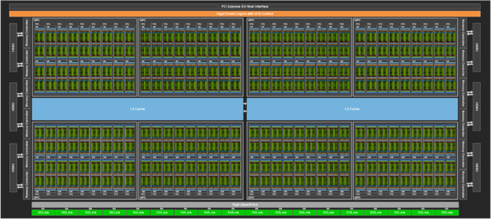
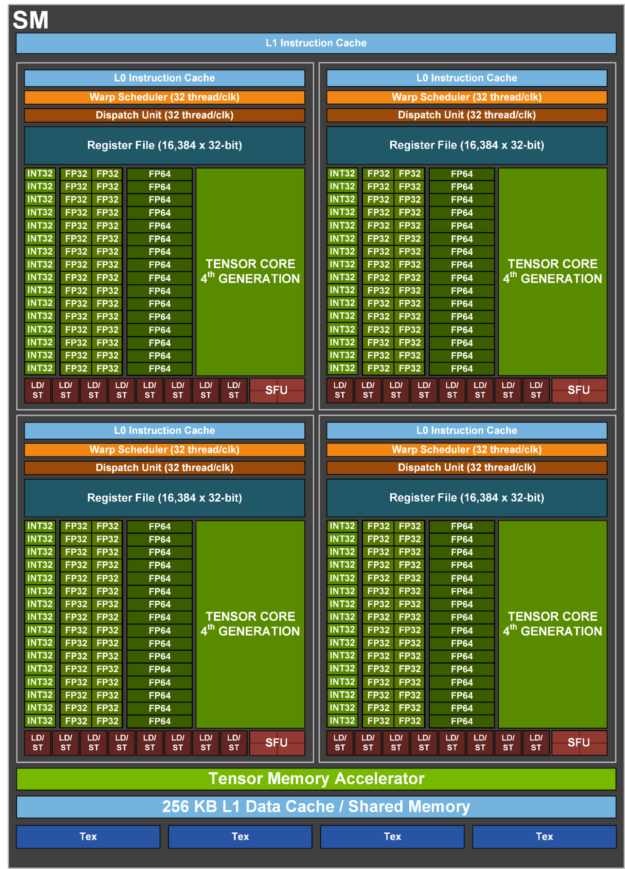
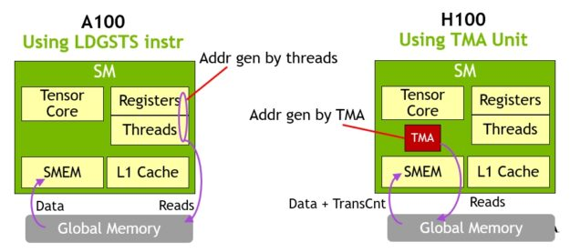
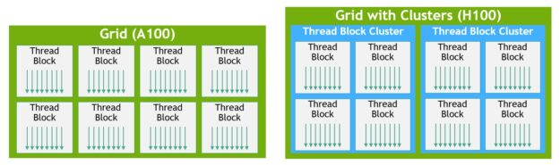
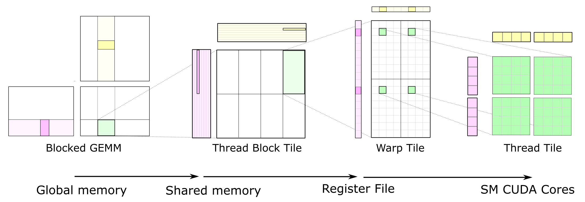
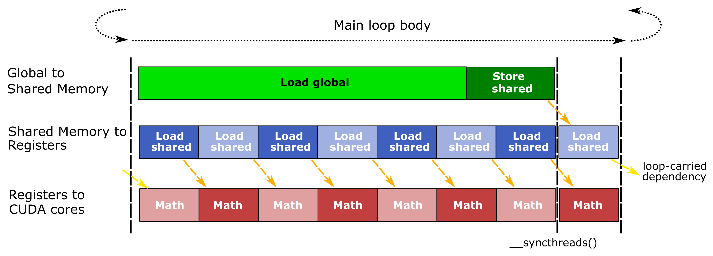
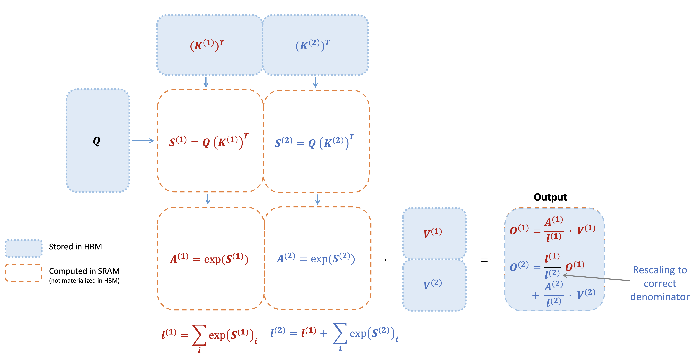
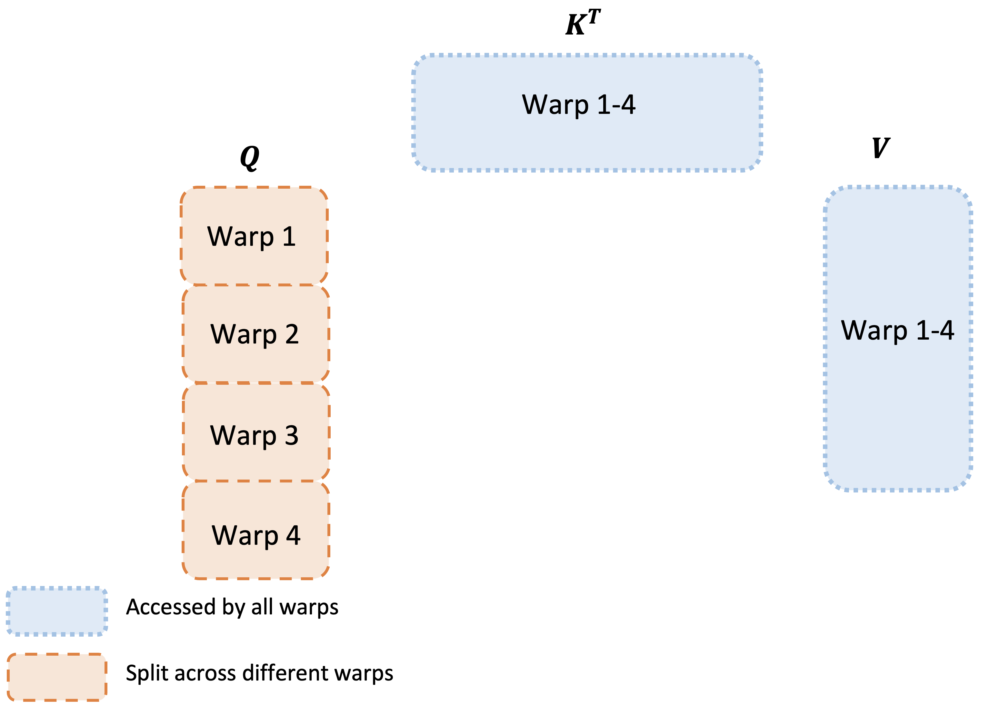
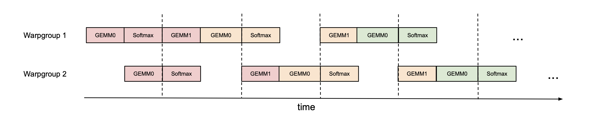

# GPU Execution Model and Kernels for ML Engineers

## Prerequisites

- [Toolkit](../../foundations/toolkit.md) - the "Reading C" part (pointers, arrays, structs, `#include`, compiling with a compiler) for the CUDA C++ snippets, and the Python-environment part for running the scripts.
- [Computer architecture](../../foundations/computer-architecture.md) - caches, memory bandwidth vs latency, [Little's law](../../foundations/computer-architecture.md#bandwidth-vs-latency), SIMD, [the GPU](../../foundations/computer-architecture.md#the-gpu) (SMs, warps, tensor cores) and [the roofline model](../../foundations/computer-architecture.md#arithmetic-intensity-and-the-roofline-model); this chapter assumes all of it.
- [Linux and the OS](../../foundations/linux-and-os.md) - processes, system calls, [environment variables](../../foundations/linux-and-os.md#environment-variables-and-path) (the `TORCH_LOGS=... python script.py` form used below) and [driver vs runtime vs toolkit (`nvcc`)](../../foundations/linux-and-os.md#cuda-driver-vs-runtime-vs-toolkit-why-cuda-version-mismatch-happens), needed for the launch-overhead, compile and profiling sections.
- [Concurrency](../../foundations/concurrency.md) - threads, synchronization, barriers, atomics and [GPU concurrency](../../foundations/concurrency.md#part-7-gpu-concurrency) (asynchronous launches, streams, synchronization points, CUDA graphs), which is how GPU kernels and CUDA streams behave.
- [Transformer architectures](../../models/architectures.md) - attention, [the KV cache and prefill vs decode](../../models/architectures.md#the-kv-cache), [GQA/MQA](../../models/architectures.md#mha-to-mqa-to-gqa-the-kv-cache-arithmetic), RMSNorm and the MLP block, the ops whose kernels this chapter dissects.

Forward links (later chapters that go deeper on terms this chapter only touches): [Writing GPU kernels](writing-kernels.md) teaches CUDA C++ and Triton from zero; [Model parallelism derivations](../../training/model-parallelism/derivations.md) covers tensor parallelism; [Serving engine internals](../../inference/serving-engine-internals.md) covers continuous batching and paged KV caches; [Profiling and optimization](../../training/profiling-and-optimization.md) covers `torch.compile` and activation checkpointing as tools.

The [Accelerators](../accelerators.md) chapter tells you what a GPU is rated at - [TFLOPS](../accelerators.md#tflops), [memory bandwidth](../accelerators.md#accelerator-memory-size-and-speed), [caches](../accelerators.md#caches), and how much of the peak is [actually achievable](../accelerators.md#maximum-achievable-and-sustainable-flops). This chapter is about *why* a given kernel (a function compiled for the GPU and launched from the CPU to run across thousands of GPU threads at once) gets the fraction it gets: how the hardware schedules threads (independent streams of instructions, each with its own registers), where the bytes live, what a tensor core instruction looks like, and how the kernels that dominate an LLM step (GEMM, attention, normalization) are structured to hit or miss the roofline (the performance ceiling set by whichever of compute or memory bandwidth runs out first, [defined below](#roofline-per-op)). It ends with the tools that tell you which case you are in.

Two terms used throughout: *HBM* (High Bandwidth Memory) is the GPU's main memory, the tens of GB of DRAM stacked next to the chip where tensors live; the *host* is the CPU and its RAM, as opposed to the *device* (the GPU).

## How to follow this chapter without a GPU

Every calculator and simulator below is plain Python (stdlib, numpy or CPU PyTorch) and was run on an Apple M4 laptop while writing this chapter; their output is pasted as-is. Code that needs an NVIDIA GPU (CUDA C++, Triton, Nsight) is marked "untested". To reproduce (virtual environments and `pip` are covered in the [toolkit](../../foundations/toolkit.md#running-the-books-code) chapter):

```bash
python3 -m venv /tmp/mle-venv
/tmp/mle-venv/bin/pip install torch numpy        # torch 2.15.0, numpy 2.5.4 when this was written
mkdir -p /tmp/mle-exec && cd /tmp/mle-exec       # save each script below under its file name
/tmp/mle-venv/bin/python occupancy.py
```

A suggested reading order for someone new to GPUs: [SMs, warps and schedulers](#sms-warps-and-schedulers) and [Memory hierarchy](#memory-hierarchy) give the machine model; [Roofline per op](#roofline-per-op) gives the one formula you will use every day; then [GEMM tiling](#gemm-tiling-hierarchy) and [FlashAttention](#flashattention) show how the two most important kernels apply both. Tensor core instruction details, CuTe and FA3 can be skimmed on a first pass.

Most of the numbers below are for NVIDIA H100 SXM (Hopper, `sm_90`) with B200 (Blackwell, `sm_100`) differences called out. Every hardware number is either taken from a named NVIDIA/AMD document or derived by arithmetic that is shown. Where a number is not published by the vendor and comes from microbenchmarking literature or from my own inference, it is marked as such.

Nothing in this chapter is a benchmark result. The one kernel in it comes with a benchmark harness but no measured numbers - run it on your hardware.


## Glossary

- CTA: Cooperative Thread Array - the hardware name for a thread block
- cuBLAS / cuBLASLt: NVIDIA's closed-source GEMM libraries; `torch.matmul` on a GPU ends up here. CUTLASS: NVIDIA's open-source C++ template library for writing your own GEMM-like kernels.
- DSMEM: Distributed Shared Memory - shared memory of other CTAs in the same cluster
- epilogue: the code at the end of a GEMM (or attention) kernel that post-processes the finished output tile (scale, bias, activation, cast) and writes it to memory
- GEMM: GEneral Matrix Multiply, $C = AB$ (optionally scaled and added to an existing `C`); the operation behind every `nn.Linear`. GEMV is the matrix-vector special case (one row of activations).
- GPC: Graphics Processing Cluster - a group of SMs; a thread block cluster is co-scheduled within one
- ILP: Instruction-Level Parallelism
- MAC / MMA: multiply-accumulate (`c += a * b`, 2 FLOPs) / matrix multiply-accumulate (`C += A @ B` on a small tile, one tensor core instruction)
- PTX: NVIDIA's virtual assembly language - what CUDA C++ and Triton compile to first; portable across GPU generations
- SASS: the real machine code for one GPU generation, produced from PTX by the `ptxas` assembler (part of `nvcc`) or by the driver at load time
- LDS: Local Data Share - AMD's counterpart of shared memory
- MUFU: Multi-Function Unit - the special function unit (`exp2`, `rsqrt`, `sin`, ...)
- SIMT: Single Instruction Multiple Threads
- SOL: Speed Of Light - Nsight Compute's "% of peak" for a hardware unit
- smem: shared memory
- TMA: Tensor Memory Accelerator (Hopper and later)
- TMEM: Tensor Memory (Blackwell `sm_100`)
- warpgroup: 4 consecutive warps (128 threads), the issuing unit of Hopper `wgmma`

For the general accelerator glossary see [the main chapter](../accelerators.md#glossary).


## SMs, warps and schedulers

### The hierarchy

A GPU is made of many Streaming Multiprocessors (SMs), each an independent processor with its own registers (the fastest storage, private to each thread), shared memory and schedulers. A kernel launch is a grid of thread blocks (CTAs, groups of up to 1024 threads that can cooperate through shared memory). Each CTA is assigned to one SM for its whole lifetime and never migrates. Inside the SM the CTA's threads are grouped into warps of 32 threads, and the warp - not the thread - is what the hardware schedules.

What a kernel launch looks like from the programmer's side: you write a function that describes the work of *one* thread, and at launch you say how many blocks of how many threads to run. Each thread finds out which piece of data is its own from built-in variables (`blockIdx`, `blockDim`, `threadIdx`). The smallest complete CUDA program (untested here - needs an NVIDIA GPU and `nvcc`):

```cpp
// vadd.cu - build: nvcc -O3 -arch=sm_90 vadd.cu -o vadd
#include <cstdio>
__global__ void vadd(const float* a, const float* b, float* c, int n) {
    int i = blockIdx.x * blockDim.x + threadIdx.x;   // this thread's global index
    if (i < n) c[i] = a[i] + b[i];                   // boundary mask for the last block
}
int main() {
    int n = 1 << 24;
    float *a, *b, *c;
    cudaMallocManaged(&a, n * 4); cudaMallocManaged(&b, n * 4); cudaMallocManaged(&c, n * 4);
    for (int i = 0; i < n; i++) { a[i] = 1.0f; b[i] = 2.0f; }
    int threads = 256, blocks = (n + threads - 1) / threads;   // grid = ceil(n / 256) CTAs
    vadd<<<blocks, threads>>>(a, b, c, n);                     // asynchronous: returns immediately
    cudaDeviceSynchronize();                                   // wait for the GPU
    printf("c[0]=%f c[n-1]=%f\n", c[0], c[n - 1]);             // expected: 3.000000 3.000000
}
```

Just enough C/CUDA to read this (C syntax itself - pointers, arrays, `#include`, `main`, compiling - is in the "Reading C" part of the [toolkit](../../foundations/toolkit.md#reading-c); CUDA C++ is taught properly in [CUDA C++ from zero](writing-kernels.md#cuda-c-from-zero)):

- `nvcc -O3 -arch=sm_90 vadd.cu -o vadd` compiles with NVIDIA's compiler: `-O3` optimize, `-arch=sm_90` generate code for H100 (compute capability 9.0), `-o vadd` name the executable. Running `./vadd` prints the line.
- `float* a` is a pointer: the address of the first of many `float`s in memory, indexed like a Python list (`a[i]`). `const float*` means the kernel only reads through it.
- `__global__` marks `vadd` as a kernel: it runs on the GPU, is called from the CPU, and every thread runs the whole function body once with its own `blockIdx`/`threadIdx`.
- `cudaMallocManaged(&a, n * 4)` allocates `n * 4` bytes (4 bytes per `float`) of *unified memory*, readable by both CPU and GPU, and writes its address into `a` (`&a` passes "where to store the pointer"). Real code usually uses `cudaMalloc` (GPU-only) plus explicit copies.
- `vadd<<<blocks, threads>>>(...)` is the CUDA launch syntax: run `blocks` CTAs of `threads` threads each. It only enqueues the work, which is why `cudaDeviceSynchronize()` is needed before reading `c` on the CPU - the same asynchrony as in [GPU concurrency](../../foundations/concurrency.md#part-7-gpu-concurrency).
- `1 << 24` is `2**24`; `(n + threads - 1) / threads` is integer ceil-division.

The index arithmetic the hardware does for you, and where any given thread ends up:

```python
# threads.py - where does global thread id t live? (block, warp, lane)
BLOCK = 256                      # threads per CTA (blockDim.x)
WARP = 32
for t in [0, 31, 32, 255, 256, 1000]:
    block, tid = divmod(t, BLOCK)       # blockIdx.x, threadIdx.x
    warp, lane = divmod(tid, WARP)      # warp inside the CTA, lane inside the warp
    print(f"global thread {t:5d} -> block {block}, threadIdx {tid:3d}, warp {warp}, lane {lane:2d}")

n = 10_000_000                   # elements of a 1-D elementwise kernel, one per thread
blocks = -(-n // BLOCK)          # ceil div: the grid size you pass at launch
print(f"\nn={n:,}: grid={blocks:,} CTAs of {BLOCK} -> {blocks*BLOCK - n} idle threads in the last CTA")
print(f"H100: {blocks / 132:.0f} CTAs per SM over the kernel's lifetime")
```

```
global thread     0 -> block 0, threadIdx   0, warp 0, lane  0
global thread    31 -> block 0, threadIdx  31, warp 0, lane 31
global thread    32 -> block 0, threadIdx  32, warp 1, lane  0
global thread   255 -> block 0, threadIdx 255, warp 7, lane 31
global thread   256 -> block 1, threadIdx   0, warp 0, lane  0
global thread  1000 -> block 3, threadIdx 232, warp 7, lane  8

n=10,000,000: grid=39,063 CTAs of 256 -> 128 idle threads in the last CTA
H100: 296 CTAs per SM over the kernel's lifetime
```

Note the last point: a big kernel has far more CTAs than SMs. The hardware's block scheduler hands a new CTA to an SM whenever one finishes, so the grid size is a statement about the *work*, not about the machine.

The full GH100 die (H100 SXM ships with 132 of these 144 SMs enabled):



([source](https://developer.nvidia.com/blog/nvidia-hopper-architecture-in-depth/))

One H100 SM - four partitions, each with its own warp scheduler, register file and tensor core:



([source](https://developer.nvidia.com/blog/nvidia-hopper-architecture-in-depth/))

On Hopper (per the [H100 architecture white paper](https://resources.nvidia.com/en-us-hopper-architecture/nvidia-h100-tensor-c) and the [Hopper Tuning Guide](https://docs.nvidia.com/cuda/hopper-tuning-guide/index.html)) each SM is split into 4 sub-partitions (SMSPs). Each sub-partition has:

- 1 warp scheduler (the hardware that picks which ready warp runs its next instruction) that can issue 1 instruction per clock from one of its resident warps
- a 16K x 32-bit register file slice (64KB), so 64K registers = 256KB per SM
- 32 FP32 lanes, 16 INT32, 16 FP64 lanes
- 1 tensor core (4 per SM, 528 on the 132-SM H100 SXM - the figure the [TFLOPS derivation](../accelerators.md#how-to-calculate-theoretical-tflops) uses)
- special function units; the FlashAttention-3 paper states H100 SXM5 has "989 TFLOPS of FP16 matmul but only 3.9 TFLOPS of special functions", which works out to $3.9\times10^{12} / (132\ \text{SMs} \times 1.83\times10^{9}\ \text{Hz}) = 16$ MUFU ops per clock per SM, i.e. 4 per sub-partition (derived; the per-SM count is consistent with the white paper but I did not find it stated as a single number)

Per-SM limits for compute capability 9.0, from the [CUDA C++ Programming Guide](https://docs.nvidia.com/cuda/cuda-c-programming-guide/index.html#features-and-technical-specifications) table:

| resource                          | H100 (`sm_90`) | B200 (`sm_100`) |
| :-------------------------------- | -------------: | --------------: |
| max resident warps per SM         |             64 |              64 |
| max resident threads per SM       |           2048 |            2048 |
| max resident CTAs per SM          |             32 |              32 |
| max threads per CTA               |           1024 |            1024 |
| 32-bit registers per SM           |            64K |             64K |
| max registers per thread          |            255 |             255 |
| max shared memory per SM          |          228KB |           228KB |
| max shared memory per CTA (opt-in)|          227KB |           227KB |
| SMs (product)                     |            132 |             148 |

The B200 column follows the [Blackwell Tuning Guide](https://docs.nvidia.com/cuda/blackwell-tuning-guide/index.html), which keeps the Hopper per-SM limits for `sm_100`. The 148 SM count is what the [divisibility section](../../training/profiling-and-optimization.md#do-more-sms-give-more-tflops) measured on a B200 SKU. If your toolkit's programming guide disagrees with this table, it wins.

On a machine with an NVIDIA GPU you can read most of these limits from PyTorch instead of trusting a table (untested here; attribute names as of PyTorch 2.x - `regs_per_multiprocessor` and `shared_memory_per_multiprocessor` are recent additions, so use `getattr` defensively):

```python
import torch
p = torch.cuda.get_device_properties(0)
print(p.name, f"sm_{p.major}{p.minor}", p.multi_processor_count, "SMs")
for k in ("max_threads_per_multi_processor", "regs_per_multiprocessor",
          "shared_memory_per_multiprocessor", "shared_memory_per_block_optin", "L2_cache_size"):
    print(f"  {k:34s} {getattr(p, k, 'n/a')}")
# expected on H100 SXM (sketch): NVIDIA H100 80GB HBM3 sm_90 132 SMs, 2048 threads, 65536 regs, ...
```

`nvidia-smi -q` and `deviceQuery` from the CUDA samples print the same information from the shell.

### Latency hiding is the whole design

A GPU does not hide memory latency with caches and out-of-order execution as a CPU does. (Latency is the time from issuing a load until its data arrives; bandwidth is how many bytes per second arrive once the pipe is full.) It hides it by having many warps resident and switching between them for free: every resident warp's registers are permanently allocated in the register file, so a "context switch" is the scheduler picking a different warp on the next clock. When warp A issues a global load and its next instruction depends on the result, A stalls (in Nsight Compute vocabulary, on the *long scoreboard*) and the scheduler issues from warp B.

How much parallelism you need is [Little's law](../../foundations/computer-architecture.md#bandwidth-vs-latency): $\text{bytes in flight} = \text{bandwidth} \times \text{latency}$. NVIDIA does not publish DRAM latency; microbenchmark studies of Hopper (e.g. Luo et al., "Benchmarking and Dissecting the Nvidia Hopper GPU Architecture", arXiv:2402.13499 (id unverified)) report several hundred ns. Taking 500ns as an assumption:

$$
3.35\times10^{12}\ \text{B/s} \times 500\times10^{-9}\ \text{s} = 1.675\ \text{MB in flight across the GPU}
$$

$$
1.675\ \text{MB} / 132\ \text{SMs} \approx 12.4\ \text{KB in flight per SM}
$$

At one 16-byte vectorized load outstanding per thread, that is ~790 threads (~25 warps) per SM doing nothing but waiting on memory, just to saturate HBM. You get there with some combination of:

- **TLP** - more resident warps (occupancy)
- **ILP** - each thread issues several independent loads before consuming any
- **asynchronous copies** - `cp.async` (Ampere) or TMA (Hopper) move data into shared memory without holding a register or a thread, which is how modern GEMM and attention kernels run at low occupancy and still saturate the memory system

The same arithmetic as a calculator, with a range of assumed latencies (the true value depends on access pattern, TLB hits and load):

```python
# littles_law.py - how many loads must be in flight to saturate HBM?
def in_flight(bw_Bps, latency_s, sms, bytes_per_thread=16):
    total = bw_Bps * latency_s                # bytes in flight across the chip
    per_sm = total / sms
    threads = per_sm / bytes_per_thread       # one outstanding 16B load per thread
    return total, per_sm, threads, threads / 32

for name, bw, sms in [("H100 SXM", 3.35e12, 132), ("B200", 8.0e12, 148)]:
    for lat_ns in (400, 500, 700):            # assumed DRAM latency (not published)
        total, per_sm, thr, warps = in_flight(bw, lat_ns * 1e-9, sms)
        print(f"{name:8s} lat={lat_ns}ns  {total/1e6:5.2f} MB in flight, {per_sm/1e3:5.1f} KB/SM"
              f" = {thr:5.0f} threads = {warps:4.1f} warps/SM (of 64) at 1x16B load each")
```

```
H100 SXM lat=400ns   1.34 MB in flight,  10.2 KB/SM =   634 threads = 19.8 warps/SM (of 64) at 1x16B load each
H100 SXM lat=500ns   1.68 MB in flight,  12.7 KB/SM =   793 threads = 24.8 warps/SM (of 64) at 1x16B load each
H100 SXM lat=700ns   2.35 MB in flight,  17.8 KB/SM =  1110 threads = 34.7 warps/SM (of 64) at 1x16B load each
B200     lat=400ns   3.20 MB in flight,  21.6 KB/SM =  1351 threads = 42.2 warps/SM (of 64) at 1x16B load each
B200     lat=500ns   4.00 MB in flight,  27.0 KB/SM =  1689 threads = 52.8 warps/SM (of 64) at 1x16B load each
B200     lat=700ns   5.60 MB in flight,  37.8 KB/SM =  2365 threads = 73.9 warps/SM (of 64) at 1x16B load each
```

(`12.7 KB` here is decimal; the `~12.4 KB` above is the same number in KiB.) Two things to take away: the required parallelism grows linearly with bandwidth, so every new generation needs *more* bytes in flight, and B200 at the assumed latencies cannot be saturated by one 16-byte load per thread at all - kernels there must use ILP or TMA. That is the hardware argument for the asynchronous copy engines below.

### Occupancy, worked

Occupancy is $\text{resident warps} / 64$. It is limited by whichever resource runs out first: registers, shared memory (a small on-chip scratchpad per SM that the threads of one CTA explicitly read and write to share data), the thread limit, or the CTA limit.

Allocation granularities matter. Registers are allocated per warp in units of 256 (so per-thread counts round up to a multiple of 8), and since compute capability 8.0 each CTA also reserves 1KB of shared memory for the system ([CUDA Programming Guide, shared memory section](https://docs.nvidia.com/cuda/cuda-c-programming-guide/index.html#shared-memory-8-x)). The [CUDA Occupancy Calculator](https://docs.nvidia.com/nsight-compute/NsightComputeCli/index.html) (now in Nsight Compute) applies the exact rules; this is the arithmetic it does.

A kernel with 128 threads per CTA, 96 registers per thread, 48KB of shared memory per CTA, on H100:

$$
\begin{aligned}
\text{warps per CTA} &= 128 / 32 = 4 \\
\text{registers per warp} &= 96 \times 32 = 3072 \quad \text{(already a multiple of 256)} \\
\text{CTAs by registers} &= \lfloor \lfloor 65536 / 3072 \rfloor / 4 \rfloor = \lfloor 21 / 4 \rfloor = 5 \\
\text{CTAs by smem} &= \lfloor 228\ \text{KB} / (48\ \text{KB} + 1\ \text{KB}) \rfloor = 4 \\
\text{CTAs by threads} &= 2048 / 128 = 16 \\
\text{CTAs by CTA limit} &= 32 \\
\text{resident CTAs} &= \min(5, 4, 16, 32) = 4 \\
\text{occupancy} &= 4 \cdot 4 / 64 = 25\%
\end{aligned}
$$

Shared memory is the binding limit. Some variants:

| regs/thread | smem/CTA | CTAs/SM | occupancy | binding limit  |
| ----------: | -------: | ------: | --------: | :------------- |
|          96 |     48KB |       4 |       25% | smem           |
|          96 |     32KB |       5 |     31.2% | registers      |
|          64 |     32KB |       6 |     37.5% | smem           |
|         128 |     48KB |       4 |       25% | registers/smem |
|         168 |        0 |       3 |     18.8% | registers      |

The table above was produced with this calculator, which implements the rules above (sm_90 limits; it ignores the per-warp-allocation rounding subtleties of older architectures and the max-registers cap, which the Nsight Compute occupancy section handles exactly):

```python
# occupancy.py - the arithmetic the CUDA Occupancy Calculator does (sm_90 limits)
import math

SM90 = dict(regs_per_sm=65536, reg_unit=256, max_warps=64, max_threads=2048,
            max_ctas=32, smem_per_sm_kb=228, smem_reserved_kb=1)

def occupancy(threads_per_cta, regs_per_thread, smem_per_cta_kb, hw=SM90):
    warps = math.ceil(threads_per_cta / 32)
    regs_per_warp = math.ceil(regs_per_thread * 32 / hw["reg_unit"]) * hw["reg_unit"]
    limits = {
        "registers": (hw["regs_per_sm"] // regs_per_warp) // warps,   # warps fit, then CTAs
        "smem": (hw["smem_per_sm_kb"] // (smem_per_cta_kb + hw["smem_reserved_kb"]))
                if smem_per_cta_kb else hw["max_ctas"],
        "threads": hw["max_threads"] // threads_per_cta,
        "cta limit": hw["max_ctas"],
    }
    ctas = min(limits.values())
    binding = [k for k, v in limits.items() if v == ctas]
    return ctas, ctas * warps / hw["max_warps"], binding, limits

if __name__ == "__main__":
    print(f"{'thr':>4} {'regs':>4} {'smemKB':>6} | {'CTAs':>4} {'occ':>6}  binding   (per-limit CTAs)")
    for thr, regs, smem in [(128, 96, 48), (128, 96, 32), (128, 64, 32), (128, 128, 48),
                            (128, 168, 0), (256, 32, 0), (384, 168, 192), (1024, 64, 0)]:
        ctas, occ, binding, lim = occupancy(thr, regs, smem)
        print(f"{thr:4d} {regs:4d} {smem:6d} | {ctas:4d} {occ:6.1%}  {'/'.join(binding):9s} {lim}")
    # the 100%-occupancy register ceiling
    print("max regs/thread at 64 warps:", 65536 // 2048)
```

```
 thr regs smemKB | CTAs    occ  binding   (per-limit CTAs)
 128   96     48 |    4  25.0%  smem      {'registers': 5, 'smem': 4, 'threads': 16, 'cta limit': 32}
 128   96     32 |    5  31.2%  registers {'registers': 5, 'smem': 6, 'threads': 16, 'cta limit': 32}
 128   64     32 |    6  37.5%  smem      {'registers': 8, 'smem': 6, 'threads': 16, 'cta limit': 32}
 128  128     48 |    4  25.0%  registers/smem {'registers': 4, 'smem': 4, 'threads': 16, 'cta limit': 32}
 128  168      0 |    3  18.8%  registers {'registers': 3, 'smem': 32, 'threads': 16, 'cta limit': 32}
 256   32      0 |    8 100.0%  registers/threads {'registers': 8, 'smem': 32, 'threads': 8, 'cta limit': 32}
 384  168    192 |    1  18.8%  registers/smem {'registers': 1, 'smem': 1, 'threads': 5, 'cta limit': 32}
1024   64      0 |    1  50.0%  registers {'registers': 1, 'smem': 32, 'threads': 2, 'cta limit': 32}
max regs/thread at 64 warps: 32
```

The `384 / 168 / 192KB` row is the shape of a Hopper warp-specialized GEMM: one CTA per SM, 18.8% occupancy, by design.

The ceiling for 100% occupancy is $65536 / 2048 = 32$ registers per thread, which almost no compute-heavy kernel meets. That is fine. High occupancy is a means (latency hiding) and not a goal: a Hopper GEMM typically runs 1 CTA of 384 threads per SM, 12 of 64 warps, about 19% occupancy, and sits near the tensor core roofline because TMA does the loads and each consumer thread holds a large accumulator tile in registers. Conversely, a memory-bound elementwise kernel at 25% occupancy with one scalar load per thread will not saturate HBM. Read occupancy together with the stall reasons ([Profiling](#profiling-nsys-and-ncu)), not on its own.

[Triton](https://triton-lang.org), which appears from here on, is a Python-embedded language for writing GPU kernels: you decorate a Python function with `@triton.jit`, write it in terms of whole blocks of data (`tl.load`, `tl.sum`, ...), and launch it as `kernel[grid](args...)`; the compiler handles the per-thread details. Read the Triton snippets here as sketches; the [Triton learning path](#a-triton-learning-path) at the end of this chapter and [Triton from zero](writing-kernels.md#triton-from-zero) in the next chapter teach it.

In code you control the register count with `__launch_bounds__(maxThreads, minBlocks)` (an annotation on the CUDA kernel) or the `nvcc` flag `-maxrregcount`, in Triton with `num_warps` (and the compiler's register allocation follows from the block size), and the shared memory with the tile sizes and `num_stages`. Forcing registers down below what the kernel needs causes *spills* to local memory, which lives in L1/L2/HBM - check `ptxas -v` output (`ptxas` is the PTX-to-SASS assembler step inside `nvcc`, see the [glossary](#glossary); `-Xptxas -v` passes `-v` to it) or the Nsight Compute "Launch Statistics" section.

What that looks like in source (untested; CUDA C++ and Triton):

```cpp
// at most 128 threads per CTA, and ask the compiler to fit at least 4 CTAs per SM:
// it caps registers at 65536 / (4 * 128) = 128 per thread, spilling if it must
__global__ void __launch_bounds__(128, 4) my_kernel(const float* x, float* y) { /* ... */ }
```

```bash
# print registers, spills and smem per kernel at compile time
nvcc -O3 -arch=sm_90 -Xptxas -v my_kernel.cu -c
# ptxas info    : Used 96 registers, 49152 bytes smem, 0 bytes spill stores, 0 bytes spill loads   (sketch)
```

```python
# Triton: occupancy knobs are launch-time meta-parameters
kernel[grid](x, y, N, BLOCK=1024, num_warps=8, num_stages=3)
```

### Divergence

The 32 threads of a warp share an instruction stream (one sequence of instructions). When a branch condition differs across the warp, both sides execute with inactive lanes masked off, so the cost is the sum of both paths. Since Volta each thread has its own program counter ("independent thread scheduling"), which makes divergent code *correct* in more cases (e.g. intra-warp locks), but it does not make it faster - divergent paths are still serialized.

For ML kernels divergence is rarely the bottleneck, because the data-dependent control flow is usually a boundary mask (`if (col < N)`) that diverges in at most one warp per row, or a causal mask in attention. The standard remedy for the latter is structural: FlashAttention skips fully-masked K/V blocks entirely and applies the elementwise mask only on the diagonal block, so only one block per row of blocks pays for the mask. Prefer predication (every lane executes the instruction, and a per-lane true/false flag decides whether its result is kept or its load/store happens - no jump, so nothing to diverge; `tl.where`, masked loads) over branches for anything per-element.

A toy cost model makes the rule concrete: a warp executes every path that *any* lane takes, so the cost is the sum over distinct paths, not the per-lane average.

```python
# divergence.py - a warp pays for every path any of its lanes takes
import random
random.seed(0)
COST = {"then": 10, "else": 30}                       # instructions on each side of the branch

def warp_cost(conds):                                 # conds: 32 booleans, one per lane
    paths = set(conds)
    return sum(COST["then" if c else "else"] for c in paths)

uniform   = [True] * 32                               # all lanes agree
boundary  = [i < 20 for i in range(32)]               # `if (col < N)` in the last warp of a row
by_parity = [i % 2 == 0 for i in range(32)]           # `if (threadIdx.x % 2)` - worst case
by_warp   = [True] * 32                               # `if (warp_id % 2)` - uniform within a warp
rand      = [random.random() < 0.5 for _ in range(32)]
for name, c in [("uniform", uniform), ("boundary mask", boundary),
                ("lane parity", by_parity), ("warp-uniform", by_warp), ("random", rand)]:
    print(f"{name:14s} cost {warp_cost(c):3d} cycles  (ideal per-lane avg "
          f"{sum(COST['then' if x else 'else'] for x in c)/32:4.1f})")
```

```
uniform        cost  10 cycles  (ideal per-lane avg 10.0)
boundary mask  cost  40 cycles  (ideal per-lane avg 17.5)
lane parity    cost  40 cycles  (ideal per-lane avg 20.0)
warp-uniform   cost  10 cycles  (ideal per-lane avg 10.0)
random         cost  40 cycles  (ideal per-lane avg 22.5)
```

The "warp-uniform" row is the trick to remember: if the branch condition is the same for all 32 lanes (branch on `warp_id`, or on a block index), there is no divergence at all. That is how warp-specialized kernels give producer and consumer warps completely different code without paying for it. In Triton you never write per-lane branches; you write a mask:

```python
# Triton (untested here): masked loads and tl.where compile to predicated instructions, no branch
x = tl.load(X + offs, mask=offs < N, other=0.0)
y = tl.where(x > 0, x, 0.01 * x)          # leaky ReLU, both sides computed, one selected
```


## Memory hierarchy

### Capacities and bandwidths

| level              | H100 SXM                                     | B200                                    | scope                   | source / note                                                                 |
| :----------------- | :------------------------------------------- | :-------------------------------------- | :---------------------- | :---------------------------------------------------------------------------- |
| registers          | 256KB per SM, 33MiB total                    | 256KB per SM                            | per thread (private)    | 64K x 4B; $132 \times 256\ \text{KB} = 33\ \text{MiB}$                                              |
| tensor memory      | -                                            | 256KB per SM                            | per CTA (allocated)     | `sm_100` only; 128 lanes x 512 columns x 4B, see [tcgen05](#blackwell-tcgen05-and-tmem) |
| L1 / shared memory | 256KB per SM combined, up to 228KB as smem   | 256KB per SM combined, up to 228KB smem | per CTA (smem) / per SM | Hopper / Blackwell tuning guides                                              |
| L2                 | 50MB                                         | 126MB (GB200 figure)                    | whole GPU (2 partitions)| [caches table](../accelerators.md#caches)                                              |
| HBM                | 80GB HBM3, 3.35TBps                          | 180GB HBM3e, 8.0TBps                    | whole GPU               | [memory table](../accelerators.md#accelerator-memory-size-and-speed)                   |

Bandwidths NVIDIA does not publish as a single figure:

- **Shared memory**: 32 banks x 4 bytes per clock per SM = 128 B/clk/SM. At 1.83GHz this is $128 \times 1.83\times10^{9} \times 132 = 30.9\ \text{TBps}$ aggregate on H100 (derived; `34.7TBps` with 148 SMs on B200 at the same clock, also derived - the B200 clock may differ). That is ~9x HBM.
- **L2**: not published. Microbenchmarks report a few times HBM bandwidth; treat any specific number as unverified. The L2 on H100 and A100 is split into two partitions connected by a crossbar (an on-chip switch connecting every SM to every L2 slice), and data homed in the far partition costs more ([Hopper Tuning Guide](https://docs.nvidia.com/cuda/hopper-tuning-guide/index.html)).
- **Registers**: effectively whatever the ALUs can consume - not a bottleneck you design around, but a *capacity* you design around (see the accumulator arithmetic in [GEMM tiling](#gemm-tiling-hierarchy)).

B200 is two reticle-sized dies joined by NVIDIA's 10TBps NV-HBI link and presented to software as one GPU ([Blackwell architecture page](https://www.nvidia.com/en-us/data-center/technologies/blackwell-architecture/)). L2 and HBM are physically split between the dies, so locality effects similar to Hopper's two L2 partitions exist at a larger scale; NVIDIA does not publish the cross-die latency penalty.

The ratio that matters for kernel design: H100 does ~4094 dense BF16 FLOP per clock per SM ($989\times10^{12} / (132 \times 1.83\times10^{9})$), but HBM delivers $3.35\times10^{12} / (132 \times 1.83\times10^{9}) = 13.9$ bytes per clock per SM. Every byte fetched from HBM has to be reused ~295 times in FLOPs for the tensor cores not to starve. Registers and shared memory exist to provide that reuse.

The budget arithmetic in one place:

```python
# hierarchy_bw.py - per-clock budgets that decide kernel design on H100 SXM
SMS, CLK = 132, 1.83e9                         # boost clock used in NVIDIA's TFLOPS math
BF16, HBM = 989e12, 3.35e12
smem_B_per_clk = 32 * 4                         # 32 banks x 4 B per SM per clock
print(f"registers total        {SMS*256/1024:6.1f} MiB  (256 KB/SM)")
print(f"smem aggregate BW      {smem_B_per_clk*CLK*SMS/1e12:6.1f} TB/s  (~{smem_B_per_clk*CLK*SMS/HBM:.0f}x HBM)")
print(f"tensor FLOP/clk/SM     {BF16/(SMS*CLK):6.0f}")
print(f"HBM bytes/clk/SM       {HBM/(SMS*CLK):6.1f}")
print(f"FLOPs per HBM byte     {BF16/HBM:6.0f}  <- reuse every loaded byte this many times")
print(f"FLOPs per smem byte    {BF16/(smem_B_per_clk*CLK*SMS):6.0f}  <- why operands must also be reused from registers")
```

```
registers total          33.0 MiB  (256 KB/SM)
smem aggregate BW        30.9 TB/s  (~9x HBM)
tensor FLOP/clk/SM       4094
HBM bytes/clk/SM         13.9
FLOPs per HBM byte        295  <- reuse every loaded byte this many times
FLOPs per smem byte        32  <- why operands must also be reused from registers
```

The last line is the less-quoted half of the story: even shared memory is ~32x too slow to feed the tensor cores if every operand came from it once. Operands are reused from *registers* (each fragment feeds several MMA instructions) and, on Hopper/Blackwell, fed to the tensor core straight from shared memory by descriptors so the same smem tile serves a whole warpgroup.

### Coalescing

Global memory (the kernel's view of HBM, readable by every thread) is accessed in 32-byte sectors, grouped into 128-byte cache lines (the unit a cache stores and evicts). When a warp issues a load, the hardware computes the set of sectors touched by the 32 addresses and issues one transaction per sector. If thread `i` reads `float` element `i`, the warp touches $32 \times 4 = 128$ contiguous bytes = 4 sectors: perfect. If thread `i` reads element `i * stride`:

| stride (float) | sectors touched | bytes moved | bytes used | efficiency |
| -------------: | --------------: | ----------: | ---------: | ---------: |
|              1 |               4 |         128 |        128 |       100% |
|              2 |               8 |         256 |        128 |        50% |
|              4 |              16 |         512 |        128 |        25% |
|              8 |              32 |        1024 |        128 |      12.5% |
|            >=8 |              32 |        1024 |        128 |      12.5% |

In ML code this shows up as reading a tensor along the wrong dimension: a kernel that reduces over the last dim of a `(B, T, C)` tensor where the tensor is actually a transposed view. The fix is almost always to assign the contiguous dimension to consecutive threads (in Triton: the innermost `tl.arange` along the stride-1 dim), and to load 16 bytes per thread (8 bf16) so each warp moves 512B per instruction. This needs the base pointer and row stride to be 16-byte aligned - one concrete reason dims should be multiples of 8 for bf16 (see [why multiples](#why-dims-want-multiples-of-8-16-64-128)).

The sector counting, as code (this is what Nsight Compute reports as "sectors per request"):

```python
# coalesce.py - count the 32-byte sectors one warp-wide load touches
def sectors(addrs, sector=32):
    return len({a // sector for a in addrs})

ELEM = 4                                            # float32
print("stride  sectors  bytes_moved  efficiency")
for stride in [1, 2, 4, 8, 16, 32]:
    addrs = [lane * stride * ELEM for lane in range(32)]   # thread i reads x[i*stride]
    s = sectors(addrs)
    print(f"{stride:6d}  {s:7d}  {s*32:11d}  {32*ELEM/(s*32):9.1%}")

# 16-byte vector loads of bf16: each lane reads 8 contiguous elements
addrs = [lane * 16 + b for lane in range(32) for b in range(16)]
print("\nbf16 x8 per lane:", sectors(addrs), "sectors =", sectors(addrs) * 32, "bytes, 100% used")

# a misaligned row: base offset 2 bytes (odd number of bf16 before it)
addrs = [2 + lane * 4 + b for lane in range(32) for b in range(4)]
print("128B read starting 2 bytes off a sector:", sectors(addrs), "sectors instead of 4")
```

```
stride  sectors  bytes_moved  efficiency
     1        4          128     100.0%
     2        8          256      50.0%
     4       16          512      25.0%
     8       32         1024      12.5%
    16       32         1024      12.5%
    32       32         1024      12.5%

bf16 x8 per lane: 16 sectors = 512 bytes, 100% used
128B read starting 2 bytes off a sector: 5 sectors instead of 4
```

The last line is the alignment point in miniature: a misaligned row touches one extra sector per warp-load, and - more important in practice - disqualifies the 16-byte vector instruction entirely.

You can watch the same effect on a CPU, where the unit is a 64-128 byte cache line instead of a 32-byte sector. Real output on an Apple M4, single thread, PyTorch 2.15:

```python
# stride_cpu.py - the CPU analogue of uncoalesced access: same bytes used, more lines moved
import time, torch
torch.set_num_threads(1)
x = torch.randn(8192, 8192)                         # (R, C) row-major fp32, 256 MiB

def t(fn, n=5):
    fn(); t0 = time.perf_counter()
    for _ in range(n): fn()
    return (time.perf_counter() - t0) / n

row = t(lambda: x.sum(dim=1))                       # reduce along the contiguous dim
col = t(lambda: x.t().contiguous())                 # transpose: reads rows, writes columns
print(f"sum over contiguous dim: {x.numel()*4/row/1e9:5.1f} GB/s")
print(f"transpose copy         : {2*x.numel()*4/col/1e9:5.1f} GB/s (strided writes)")
for s in (1, 2, 4, 8, 16, 32):
    v = x.view(-1)[::s][: 2**22]                    # 4M elements, stride s
    dt = t(lambda: v.sum())
    print(f"stride {s:2d}: {v.numel()*4/dt/1e9:6.1f} GB/s of useful data")
```

```
sum over contiguous dim:  34.3 GB/s
transpose copy         :   3.6 GB/s (strided writes)
stride  1:   36.4 GB/s of useful data
stride  2:   17.7 GB/s of useful data
stride  4:    9.4 GB/s of useful data
stride  8:    4.5 GB/s of useful data
stride 16:    2.4 GB/s of useful data
stride 32:    1.1 GB/s of useful data
```

Useful bandwidth halves with each doubling of stride: the memory system moves whole lines, and you are throwing away a growing fraction of each one. A GPU behaves the same way per warp.

### Bank conflicts

Shared memory has 32 banks (independent memory sub-arrays that can each serve one 4-byte word per clock), each 4 bytes wide; word address $a$ lives in bank $\lfloor a / 4 \rfloor \bmod 32$. A warp's shared memory access completes in one cycle if all 32 threads hit distinct banks (or the same word - broadcast). If $k$ threads hit different words in the same bank, it takes $k$ cycles: a $k$-way conflict.

The canonical case is a transpose through a `float tile[32][32]`: writing rows is conflict-free, reading a column has every thread hitting bank $(32 \cdot \text{row} + c) \bmod 32 = c$, a 32-way conflict. Two fixes:

- **padding**: `float tile[32][33]` shifts each row by one bank. Simple, wastes 3% of the buffer, and breaks the alignment that vectorized and TMA accesses need.
- **swizzling**: permute the column index by XOR-ing it with bits of the row index, so a logical column maps to 32 different banks. This keeps rows aligned and is what CUTLASS, Triton and TMA use. TMA supports 32B, 64B and 128B swizzle modes in hardware, and Hopper `wgmma` / Blackwell `tcgen05` shared memory descriptors expect operands in exactly those swizzled layouts.

`ldmatrix` (Ampere+) loads 8x8 matrix fragments from shared memory into the register layout `mma.sync` expects; feeding it from an un-swizzled row-major tile with a 128B row pitch is a classic 8-way conflict.

A bank-conflict checker for the transpose example, with both fixes:

```python
# banks.py - shared-memory bank conflicts for a 32x32 fp32 tile, and two fixes
def bank(word_addr):                 # word_addr counts 4-byte words
    return word_addr % 32

def conflict_degree(word_addrs):     # cycles = max distinct words in any one bank
    per_bank = {}
    for w in set(word_addrs):        # same word -> broadcast, free
        per_bank.setdefault(bank(w), set()).add(w)
    return max(len(v) for v in per_bank.values())

ROWS = 32
def plain(r, c):    return r * 32 + c
def padded(r, c):   return r * 33 + c            # float tile[32][33]
def swizzled(r, c): return r * 32 + (c ^ r)      # XOR column with row bits

for name, layout in [("plain", plain), ("padded", padded), ("xor-swizzle", swizzled)]:
    row_read = [layout(5, lane) for lane in range(32)]      # warp reads row 5
    col_read = [layout(lane, 5) for lane in range(32)]      # warp reads column 5
    print(f"{name:12s} row read: {conflict_degree(row_read):2d}-way   column read: {conflict_degree(col_read):2d}-way")
```

```
plain        row read:  1-way   column read: 32-way
padded       row read:  1-way   column read:  1-way
xor-swizzle  row read:  1-way   column read:  1-way
```

Why the XOR works: for column $c$, row $r$ lands in bank $c \oplus r$ (XOR), and as $r$ runs over $0..31$ with $c$ fixed, $c \oplus r$ also runs over all 32 values exactly once - a permutation, so no two lanes share a bank. Rows stay 128-byte aligned because the permutation only shuffles words within a row. The hardware swizzle modes do the same thing on 16-byte chunks instead of 4-byte words.

### TMA

The Tensor Memory Accelerator (Hopper and later) is a DMA engine (a hardware unit that copies memory on its own while the processor does other work) per SM that copies 1D-5D tiles between global and shared memory. You describe the global tensor once on the host with a *tensor map* (`cuTensorMapEncodeTiled`: base address, dims, strides, box size, swizzle mode, OOB fill), and then a single thread issues `cp.async.bulk.tensor` with tile coordinates. Properties that change how kernels are written:

- **One thread issues a whole tile.** No address arithmetic per thread, no registers held for the data, so the loading warps can be few and lightweight ([warp specialization](#flashattention-3-on-hopper)).
- **Completion via mbarrier with transaction counts.** The consumer waits on an `mbarrier` (a barrier object in shared memory: threads block on it until a set number of arrivals or bytes have been recorded) that tracks the expected byte count, rather than a `__syncthreads()` (the CUDA barrier that makes every thread of the CTA wait until all of them reach it).
- **Bounds handling in hardware**: out-of-bounds elements are filled (zero or NaN), so tails need no masking code.
- **Constraints**: global strides must be multiples of 16 bytes and the global base address 16-byte aligned ([CUDA Driver API, `cuTensorMapEncodeTiled`](https://docs.nvidia.com/cuda/cuda-driver-api/group__CUDA__TENSOR__MEMORY.html)). A bf16 tensor whose row has an odd number of elements cannot use TMA directly and falls back to slower paths.
- **Multicast**: within a cluster (a group of co-scheduled CTAs, [next section](#thread-block-clusters-and-distributed-shared-memory)), one TMA load can be written into the shared memory of several CTAs at once.

The alignment constraint is the one that bites ML code, because it depends on tensor shapes you chose for other reasons. A checker you can run on the host before blaming a kernel:

```python
# tma_check.py - can this row-major 2-D tensor be described by a TMA tensor map?
# Rule (CUDA driver API, cuTensorMapEncodeTiled): global address 16B aligned,
# every non-innermost global stride a multiple of 16 bytes.
import torch

def tma_ok(t: torch.Tensor):
    strides_bytes = [s * t.element_size() for s in t.stride()[:-1]]
    return t.data_ptr() % 16 == 0 and all(s % 16 == 0 for s in strides_bytes), strides_bytes

for shape, dtype in [((4096, 4096), torch.bfloat16), ((4096, 50257), torch.bfloat16),
                     ((4096, 50304), torch.bfloat16), ((128, 100), torch.float8_e4m3fn),
                     ((128, 100), torch.float32)]:
    t = torch.empty(shape, dtype=dtype)
    ok, sb = tma_ok(t)
    print(f"{str(shape):14s} {str(dtype):20s} row stride {sb[0]:6d} B -> {'OK' if ok else 'NOT TMA-able'}")
```

```
(4096, 4096)   torch.bfloat16       row stride   8192 B -> OK
(4096, 50257)  torch.bfloat16       row stride 100514 B -> NOT TMA-able
(4096, 50304)  torch.bfloat16       row stride 100608 B -> OK
(128, 100)     torch.float8_e4m3fn  row stride    100 B -> NOT TMA-able
(128, 100)     torch.float32        row stride    400 B -> OK
```

(An odd vocabulary or a 100-wide FP8 row silently routes you to a non-TMA kernel; there is no error, only a slower kernel name in the trace.)

What the host and device sides look like, heavily abridged (untested; CUDA 12.x driver API and PTX names as in the linked docs). Reading the C: `CUtensorMap map;` declares a struct variable, `cuuint64_t dims[2] = {...}` is a 2-element array of 64-bit unsigned integers, and `&map` passes the struct's address so the function can fill it in; the device part is a PTX instruction shown as a comment:

```cpp
// host: describe a (rows, cols) bf16 row-major tensor and a 128x64 box with 128B swizzle
CUtensorMap map;
cuuint64_t dims[2]    = {cols, rows};                  // innermost first
cuuint64_t strides[1] = {cols * sizeof(__nv_bfloat16)}; // bytes, must be a multiple of 16
cuuint32_t box[2]     = {64, 128};
cuuint32_t estride[2] = {1, 1};
cuTensorMapEncodeTiled(&map, CU_TENSOR_MAP_DATA_TYPE_BFLOAT16, 2, ptr, dims, strides, box,
                       estride, CU_TENSOR_MAP_INTERLEAVE_NONE, CU_TENSOR_MAP_SWIZZLE_128B,
                       CU_TENSOR_MAP_L2_PROMOTION_NONE, CU_TENSOR_MAP_FLOAT_OOB_FILL_NONE);
// device: one elected thread issues
//   cp.async.bulk.tensor.2d.shared::cluster.global.mbarrier::complete_tx::bytes [smem], [map, {x, y}], [mbar];
// and consumers wait on the mbarrier for 128*64*2 bytes to land.
```

In practice you get TMA through CUTLASS/CuTe (CuTe is CUTLASS's layout library, [below](#cutlass-and-cute-in-one-screen)), Triton's tensor-descriptor API on Hopper, or ThunderKittens (a small open-source C++ library of tile-level GPU primitives from Stanford), rather than by writing this.

TMA vs Ampere's per-thread async copies:



([source](https://developer.nvidia.com/blog/nvidia-hopper-architecture-in-depth/))

### Thread block clusters and distributed shared memory

Hopper adds a level between CTA and grid: a *cluster* of CTAs guaranteed to be co-scheduled on SMs of the same GPC. Portable cluster size is up to 8 CTAs; H100 allows 16 with the `cudaFuncAttributeNonPortableClusterSizeAllowed` opt-in ([CUDA Programming Guide, thread block clusters](https://docs.nvidia.com/cuda/cuda-c-programming-guide/index.html#thread-block-clusters)). CTAs in a cluster can:

- read, write and perform atomics (read-modify-write operations such as add that no other thread can interleave with) on each other's shared memory (DSMEM) through the SM-to-SM network, faster than going through L2
- synchronize with cluster-wide barriers
- receive TMA multicast loads

Grids of clusters of thread blocks:



([source](https://developer.nvidia.com/blog/nvidia-hopper-architecture-in-depth/))

The GEMM use: CTAs computing output tiles in the same row of `C` all need the same `A` tile. With a 2x1 cluster, one TMA multicast fetches `A` once for both CTAs, halving that operand's L2 traffic. CUTLASS exposes this as the `ClusterShape` template parameter. On Blackwell, the 2-SM `tcgen05` MMA builds directly on clusters (below).

What the programming model looks like (untested; CUDA 12 cooperative groups API). New syntax: `namespace cg = cooperative_groups;` is a C++ alias so `cg::` can stand for the long library prefix, `__cluster_dims__(2, 1, 1)` fixes the cluster shape at compile time, and `__shared__ float buf[256];` declares an array in the CTA's shared memory (one copy per CTA, visible to all its threads):

```cpp
#include <cooperative_groups.h>
namespace cg = cooperative_groups;

__global__ void __cluster_dims__(2, 1, 1) pair_kernel(float* out) {
    __shared__ float buf[256];
    cg::cluster_group cluster = cg::this_cluster();
    unsigned me = cluster.block_rank();                  // 0 or 1 within the cluster
    buf[threadIdx.x] = me * 1000 + threadIdx.x;
    cluster.sync();                                      // both CTAs' smem is now written
    float* peer = cluster.map_shared_rank(buf, me ^ 1);  // DSMEM pointer into the other CTA
    out[blockIdx.x * 256 + threadIdx.x] = peer[threadIdx.x];
    cluster.sync();                                      // don't exit while the peer still reads us
}
// launch: pair_kernel<<<grid, 256>>>(out);  grid must be a multiple of the cluster size
```


## Tensor cores

### Instruction generations

| generation      | instruction                    | issued by                        | operands                                   | accumulator         | bf16 shape (M x N x K)        |
| :-------------- | :----------------------------- | :------------------------------- | :----------------------------------------- | :------------------ | :---------------------------- |
| Ampere `sm_80`  | `mma.sync`                     | 1 warp, synchronous              | A, B in registers                          | registers           | `m16n8k16`                    |
| Hopper `sm_90a` | `wgmma.mma_async`              | 1 warpgroup (4 warps), async     | A in registers or smem, B in smem          | registers           | `m64nNk16`, N = 8..256 step 8 |
| Blackwell `sm_100a` | `tcgen05.mma`              | 1 thread, async                  | A in smem or TMEM, B in smem               | TMEM                | M = 64/128 (1 SM), 128/256 (2 SM); N up to 256 |

Sources: [PTX ISA](https://docs.nvidia.com/cuda/parallel-thread-execution/index.html) sections on `mma`, `wgmma` and `tcgen05`. The K extent is 32 bytes of the input type throughout: `k16` for 16-bit types, `k32` for FP8, `k8` for TF32 (TensorFloat-32: NVIDIA's tensor-core format with fp32's 8-bit exponent and a 10-bit mantissa, stored in 32 bits). The Blackwell M/N ranges above are from my reading of the PTX ISA and should be checked against your CUDA version's documentation (uncertain on the exact allowed N steps per M).

Note the `a` suffix: `sm_90a` and `sm_100a` are *architecture-specific* targets. `wgmma` and `tcgen05` code compiled for them does not run on any other architecture, including later ones, which is why libraries ship separate kernels per generation and why a Hopper-tuned FlashAttention-3 binary does not run on Blackwell.

Two consequences you can check on a CPU. First, why every generation keeps bf16/FP8 *inputs* but an FP32 *accumulator*: a K=4096 dot product accumulated in bf16 is wrong in the first digit.

```python
# accum_precision.py - why tensor cores take bf16 inputs but accumulate in fp32
import torch
torch.manual_seed(0)
K = 4096
a = torch.randn(K, dtype=torch.bfloat16)           # (K,) one row of A
b = torch.randn(K, dtype=torch.bfloat16)           # (K,) one column of B
exact = (a.double() * b.double()).sum()

acc_bf16 = torch.zeros((), dtype=torch.bfloat16)
for p in (a * b):                                   # running sum kept in bf16
    acc_bf16 = (acc_bf16 + p).to(torch.bfloat16)
acc_fp32 = (a.float() * b.float()).sum()           # products exact in fp32, fp32 accumulator

print(f"exact {exact.item():+.4f}  fp32-acc {acc_fp32.item():+.4f}  bf16-acc {acc_bf16.item():+.4f}")
print(f"rel err fp32-acc {abs(acc_fp32.item()-exact.item())/abs(exact.item()):.1e}"
      f"  bf16-acc {abs(acc_bf16.item()-exact.item())/abs(exact.item()):.1e}")
```

```
exact -7.9136  fp32-acc -7.9136  bf16-acc -9.3125
rel err fp32-acc 2.3e-07  bf16-acc 1.8e-01
```

Second, the target you compile for decides which instruction you can use. Checking what a PyTorch build and GPU support (untested here):

```python
import torch
print(torch.cuda.get_device_capability())     # (9, 0) on H100, (10, 0) on B200
print(torch.cuda.get_arch_list())             # e.g. ['sm_80', 'sm_86', 'sm_90', ...] compiled into this wheel
```

### Ampere: `mma.sync`

A warp collectively holds fragments of A (16x16), B (16x8) and C (16x8) in registers, in a fixed thread-to-element mapping, and issues a synchronous MMA. Operands come from shared memory via `ldmatrix`. The whole pipeline - global to shared (`cp.async`), shared to registers (`ldmatrix`), MMA - is driven by the same warps, so register pressure and instruction issue bandwidth both limit how large a tile each warp can own.

"Fixed thread-to-element mapping" is concrete: each lane owns specific accumulator elements, and the epilogue (the end-of-kernel code that writes the result tile out, see [Epilogue fusion](#epilogue-fusion)) must know which. The mapping for the FP32 accumulator of `m16n8k16`, from the PTX ISA fragment tables:

```python
# mma_layout.py - who owns which accumulator element of mma.sync m16n8k16 (f32 C/D)?
# Mapping from the PTX ISA "Matrix Fragments for mma.m16n8k16" section:
#   groupID = lane >> 2, tig = lane % 4
#   c0,c1 -> row groupID,     col tig*2 + (i & 1)
#   c2,c3 -> row groupID + 8, col tig*2 + (i & 1)
owner = [[None] * 8 for _ in range(16)]                 # (16, 8) tile of C
for lane in range(32):
    g, tig = lane >> 2, lane % 4
    for i in range(4):
        row = g + (8 if i >= 2 else 0)
        col = tig * 2 + (i & 1)
        assert owner[row][col] is None
        owner[row][col] = f"T{lane}.c{i}"
for r in (0, 1, 8, 15):
    print(f"row {r:2d}: " + " ".join(f"{o:>7s}" for o in owner[r]))
print("each of 32 lanes holds 4 fp32 values -> 16*8 =", 32 * 4, "elements, no duplicates")
```

```
row  0:   T0.c0   T0.c1   T1.c0   T1.c1   T2.c0   T2.c1   T3.c0   T3.c1
row  1:   T4.c0   T4.c1   T5.c0   T5.c1   T6.c0   T6.c1   T7.c0   T7.c1
row  8:   T0.c2   T0.c3   T1.c2   T1.c3   T2.c2   T2.c3   T3.c2   T3.c3
row 15:  T28.c2  T28.c3  T29.c2  T29.c3  T30.c2  T30.c3  T31.c2  T31.c3
each of 32 lanes holds 4 fp32 values -> 16*8 = 128 elements, no duplicates
```

The instruction itself, as inline PTX (untested; operand counts follow from the layout: A is 8 bf16 = 4 32-bit registers per lane, B is 4 bf16 = 2 registers, C/D are 4 fp32). `asm volatile("...")` pastes a PTX instruction into C++ code; the string's `%0..%9` are placeholders bound, in order, to the C variables listed after the colons (`"+f"` = an fp32 register that is read and written, `"r"` = a 32-bit register that is only read):

```cpp
asm volatile(
  "mma.sync.aligned.m16n8k16.row.col.f32.bf16.bf16.f32 "
  "{%0,%1,%2,%3}, {%4,%5,%6,%7}, {%8,%9}, {%0,%1,%2,%3};\n"
  : "+f"(c[0]), "+f"(c[1]), "+f"(c[2]), "+f"(c[3])
  : "r"(a[0]), "r"(a[1]), "r"(a[2]), "r"(a[3]), "r"(b[0]), "r"(b[1]));
```

### Hopper: `wgmma`

`wgmma.mma_async` is issued by a warpgroup and computes a `64 x N x 16` product per instruction, with B (and optionally A) read *directly from shared memory* through a 64-bit matrix descriptor that encodes the address, leading-dimension byte offset, stride byte offset and swizzle mode. Consequences:

- no `ldmatrix` round trip through registers for B, freeing registers and issue slots
- asynchronous: the warpgroup issues a batch of `wgmma`s, then `wgmma.commit_group`, and later `wgmma.wait_group N` - so it can do other work (softmax, in FA3) while the tensor core runs
- the accumulator (the tile that `C += A @ B` sums into) is still in registers, distributed across the 128 threads. A `64 x 256` FP32 accumulator is $64 \times 256 / 128 = 128$ registers per thread. This is the register-capacity limit that shapes Hopper kernels.
- for FP8 inputs, `wgmma` requires both operands "K-major" (K contiguous) in shared memory; 16-bit types allow either major-ness for smem operands. This is why FA3's FP8 path transposes V in-kernel.

The register arithmetic for Hopper, and the TMEM arithmetic for Blackwell below, in one script:

```python
# tc_arith.py - register/TMEM/smem budgets for tensor core tiles
# Hopper wgmma: FP32 accumulator of (64*wgs) x N spread over 128*wgs threads
print("wgmma accumulator registers/thread (fp32), one warpgroup owns 64 rows:")
for N in (64, 128, 192, 256):
    print(f"  64 x {N:3d}: {64 * N // 128:3d} regs/thread")
print("  -> 255 regs max per thread, and you need addresses, softmax state, ... too")

# Hopper GEMM tile: BM x BN x BK, bf16, S stages, 2 consumer + 1 producer warpgroup
BM, BN, BK, S, b = 128, 256, 64, 4, 2
stage = (BM * BK + BN * BK) * b
print(f"\nsmem per stage {stage/1024:.0f}KB, {S} stages {S*stage/1024:.0f}KB of 227KB")
acc = BM * BN // 256
print(f"accumulator {acc} regs/thread over 256 consumer threads; average budget {65536//384}/thread")
prod, cons = 40, 232
print(f"setmaxnreg split: 128*{prod} + 256*{cons} = {128*prod + 256*cons} <= 65536")

# Blackwell TMEM: 128 lanes x 512 columns x 4B per SM
lanes, cols = 128, 512
print(f"\nTMEM = {lanes*cols*4//1024}KB/SM; a 128x256 fp32 accumulator uses {256}/{cols} columns"
      f" -> {cols//256} accumulators can be double-buffered")
```

```
wgmma accumulator registers/thread (fp32), one warpgroup owns 64 rows:
  64 x  64:  32 regs/thread
  64 x 128:  64 regs/thread
  64 x 192:  96 regs/thread
  64 x 256: 128 regs/thread
  -> 255 regs max per thread, and you need addresses, softmax state, ... too

smem per stage 48KB, 4 stages 192KB of 227KB
accumulator 128 regs/thread over 256 consumer threads; average budget 170/thread
setmaxnreg split: 128*40 + 256*232 = 64512 <= 65536

TMEM = 256KB/SM; a 128x256 fp32 accumulator uses 256/512 columns -> 2 accumulators can be double-buffered
```

(The smem, `setmaxnreg` and TMEM lines are explained in [Resource arithmetic for a Hopper tile](#resource-arithmetic-for-a-hopper-tile) and the next subsection.)

### Blackwell: `tcgen05` and TMEM

Blackwell datacenter parts (`sm_100`) add **Tensor Memory**: a 256KB per-SM on-chip memory organised as 128 lanes x 512 columns of 32-bit cells, allocated explicitly by a CTA (`tcgen05.alloc` / `tcgen05.dealloc`, in units of columns). The MMA:

- is issued by **a single thread**, not a warp or warpgroup
- writes its accumulator to TMEM rather than registers; the epilogue moves it out with `tcgen05.ld` (TMEM to registers)
- can pair the two SMs of a cluster (`cta_group::2`) to compute a 256-row tile, each SM holding half of the operands and half of the accumulator
- supports block-scaled low-precision formats (MXFP8/MXFP6/MXFP4 and NVFP4: 8-, 6- and 4-bit floats where each small block of consecutive values shares one scale factor; covered in [NVFP4 and MXFP4](../../inference/arithmetic.md#nvfp4-and-mxfp4)) with scale factors also held in TMEM

The practical effect: the accumulator no longer competes with softmax / epilogue state for the register file. A `128 x 256` FP32 accumulator is exactly 128 lanes x 256 columns, half of TMEM, which leaves room for double-buffering accumulators so the epilogue of tile `i` overlaps the MMAs of tile `i+1` without register pressure.

To my knowledge consumer Blackwell (`sm_120`, RTX 50-series) does not have TMEM or `tcgen05` and uses an extended `mma.sync` path instead - check before assuming a datacenter-Blackwell kernel ports.

A quick way to see which instruction family a library actually uses is to look at the kernel names in a profile (`nsys` is Nsight Systems, NVIDIA's command-line timeline profiler, covered in [Profiling](#profiling-nsys-and-ncu) below): cuBLAS/CUTLASS Hopper kernels carry `sm90` and `gmma`/`wgmma`-style tags, Ampere ones `sm80` and `mma`/`s16816`-style tags (naming conventions are internal and change between releases; untested):

```bash
nsys profile -o gemm python -c "import torch; a=torch.randn(8192,8192,device='cuda',dtype=torch.bfloat16); [a@a for _ in range(10)]"
nsys stats --report cuda_gpu_kern_sum gemm.nsys-rep | head
```

### Why dims want multiples of 8, 16, 64, 128

There are three distinct mechanisms hiding behind "make it divisible", with different multiples:

1. **Alignment (8 elements for bf16, 16 for FP8)** - 16 bytes. Vectorized 128-bit loads, `cp.async` 16B copies and TMA strides all need 16-byte-aligned rows. Miss it and cuBLAS/cuBLASLt pick a kernel that can handle arbitrary alignment, which is usually much slower. This is the old "multiples of 8 for FP16 tensor cores" rule; tensor cores now technically run any shape, but the fast kernels assume alignment.
2. **Instruction shape (16 / 64)** - the MMA instruction's M/N/K. A K that is not a multiple of 16 (bf16) means padding the last K-slab with zeros inside the kernel; an N not a multiple of 8 wastes part of every `wgmma`.
3. **Tile quantization (64 / 128 / 256)** - the CTA tile. The output is covered by `BM x BN` tiles, and partial tiles cost as much as full ones.

On top of tile quantization sits **wave quantization**: tiles are executed in waves of $\#\text{SMs}$ (or $\#\text{SMs} \times \text{CTAs-per-SM}$). Both are covered with plots in the [Tile and wave quantization](../../training/profiling-and-optimization.md#tile-and-wave-quantization) section and the SKU-dependence in [Do more SMs give more TFLOPS?](../../training/profiling-and-optimization.md#do-more-sms-give-more-tflops); here is the combined arithmetic for H100 (132 SMs, 1 CTA per SM, `128 x 256` tile - a common Hopper CUTLASS/cuBLAS tile; the real kernel's tile is picked by heuristics and may differ):

$$
\text{efficiency} = \frac{MN}{\text{tiles} \cdot \text{BM} \cdot \text{BN}} \ \text{(tile quantization)} \times \frac{\text{tiles}}{\text{waves} \cdot \text{SMs}} \ \text{(wave quantization)}
$$

$$
\text{tiles} = \lceil M/\text{BM} \rceil \cdot \lceil N/\text{BN} \rceil, \quad \text{waves} = \lceil \text{tiles} / \text{SMs} \rceil
$$

| M x N           | tile      | tiles | waves (exact) | tile eff | wave eff | total |
| :-------------- | :-------- | ----: | ------------: | -------: | -------: | ----: |
| 4096 x 4096     | 128 x 256 |   512 |  4 (3.88)     |   100%   |   97.0%  | 97.0% |
| 4096 x 4160     | 128 x 256 |   544 |  5 (4.12)     |   95.6%  |   82.4%  | 78.8% |
| 4096 x 11008    | 128 x 256 |  1376 | 11 (10.42)    |   100%   |   94.8%  | 94.8% |
| 2048 x 2048     | 128 x 128 |   256 |  2 (1.94)     |   100%   |   97.0%  | 97.0% |
| 1536 x 1536     | 128 x 128 |   144 |  2 (1.09)     |   100%   |   54.5%  | 54.5% |
| 4096 x 4096 (B200, 148 SMs) | 128 x 256 | 512 | 4 (3.46) | 100% | 86.5% | 86.5% |

The `4160` row is the instructive one: adding 1.6% to N (64 columns) adds a 17th tile column, pushes the tile count over 4 waves, and costs 25% more time ($5/4$ waves) for 1.6% more work. The last row is the same shape on a part with *more* SMs getting *worse* wave efficiency - the staircase from the performance chapter.

The table and the staircase come from this calculator:

```python
# waves.py - tile and wave quantization for a GEMM output of M x N
import math

def gemm_efficiency(M, N, BM, BN, sms, ctas_per_sm=1):
    tiles = math.ceil(M / BM) * math.ceil(N / BN)
    slots = sms * ctas_per_sm
    waves = math.ceil(tiles / slots)
    tile_eff = M * N / (tiles * BM * BN)          # useful fraction of computed tiles
    wave_eff = tiles / (waves * slots)            # busy fraction of SM-slots
    return tiles, waves, tiles / slots, tile_eff, wave_eff, tile_eff * wave_eff

print(f"{'shape':22s} {'tile':9s} {'tiles':>6s} {'waves':>11s} {'tile':>6s} {'wave':>6s} {'total':>6s}")
for M, N, BM, BN, sms in [(4096, 4096, 128, 256, 132), (4096, 4160, 128, 256, 132),
                          (4096, 11008, 128, 256, 132), (2048, 2048, 128, 128, 132),
                          (1536, 1536, 128, 128, 132), (4096, 4096, 128, 256, 148),
                          (4096, 50257, 128, 256, 132), (4096, 50304, 128, 256, 132)]:
    t, w, wx, te, we, tot = gemm_efficiency(M, N, BM, BN, sms)
    print(f"{M}x{N} ({sms} SMs){'':3s}"[:22].ljust(22) +
          f" {BM}x{BN:<5d} {t:6d} {w:3d} ({wx:5.2f}) {te:6.1%} {we:6.1%} {tot:6.1%}")

# sweep N to see the staircase: time is proportional to waves, work to N
print("\nN      waves  time/work (relative to N=4096)")
base = gemm_efficiency(4096, 4096, 128, 256, 132)[1] / 4096
for N in range(3840, 4609, 128):
    w = gemm_efficiency(4096, N, 128, 256, 132)[1]
    print(f"{N:5d}  {w:5d}  {w / N / base:6.3f}")
```

```
shape                  tile       tiles       waves   tile   wave  total
4096x4096 (132 SMs)    128x256      512   4 ( 3.88) 100.0%  97.0%  97.0%
4096x4160 (132 SMs)    128x256      544   5 ( 4.12)  95.6%  82.4%  78.8%
4096x11008 (132 SMs)   128x256     1376  11 (10.42) 100.0%  94.8%  94.8%
2048x2048 (132 SMs)    128x128      256   2 ( 1.94) 100.0%  97.0%  97.0%
1536x1536 (132 SMs)    128x128      144   2 ( 1.09) 100.0%  54.5%  54.5%
4096x4096 (148 SMs)    128x256      512   4 ( 3.46) 100.0%  86.5%  86.5%
4096x50257 (132 SMs)   128x256     6304  48 (47.76)  99.7%  99.5%  99.1%
4096x50304 (132 SMs)   128x256     6304  48 (47.76)  99.7%  99.5%  99.2%

N      waves  time/work (relative to N=4096)
 3840      4   1.067
 3968      4   1.032
 4096      4   1.000
 4224      5   1.212
 4352      5   1.176
 4480      5   1.143
 4608      5   1.111
```

The second half is the staircase: time per unit of work jumps by 21% at $N = 4224$ and then decays until the next wave boundary.

And a counterexample to a popular explanation: padding GPT-2's vocab from 50257 to 50304 (a multiple of 64) is often described as a tile-quantization win, but with $M = 4096$ tokens and a `128 x 256` tile both shapes need exactly 6304 tiles and 48 waves. The arithmetic says the gain is from mechanism 1: 50257 is odd, so the bf16 rows of the LM head weight are not 16-byte aligned. (This is my derivation, not a profiled finding - verify with the kernel names in a trace, which usually reveal the alignment variant chosen.)

These effects are why `Linear` dimensions in well-sized models are multiples of 128 or 256 and why persistent / stream-K kernels exist ([below](#split-k-stream-k-and-persistent-kernels)).


## Roofline per op

### The model

For a kernel doing $F$ FLOPs and moving $B$ bytes to/from HBM:

$$
\text{time} \ge \max\left(\frac{F}{\text{peak\_flops}}, \frac{B}{\text{peak\_bw}}\right)
$$

$$
\text{arithmetic intensity:}\quad \text{AI} = F / B \quad [\text{FLOP/byte}]
$$

$$
\text{ridge point:}\quad \text{AI}^* = \text{peak\_flops} / \text{peak\_bw}
$$

If $\text{AI} < \text{AI}^*$ the kernel is memory-bound and its best possible time is $B / \text{peak\_bw}$, no matter how clever the arithmetic. Ridge points from the vendor peaks in the [TFLOPS table](../accelerators.md#tflops-comparison-table) and [memory table](../accelerators.md#accelerator-memory-size-and-speed):

| accelerator | bf16 dense TFLOPS | HBM TBps | bf16 ridge (FLOP/B) | fp8 ridge |
| :---------- | ----------------: | -------: | ------------------: | --------: |
| H100 SXM    |               989 |     3.35 |                 295 |       590 |
| B200        |              2250 |     8.00 |                 281 |       563 |
| MI300X      |              1307 |     5.30 |                 247 |         - |

Use [achievable](../accelerators.md#mamf-and-msmf-comparison-table) rather than theoretical peaks for planning; the ridge moves left by a similar factor for both, so the classification below does not change.

The calculator used for every roofline number in this section (vendor peaks; swap in measured ones):

```python
# roofline.py - classify an op given its FLOPs and HBM bytes
HW = {  # vendor peaks: dense bf16 FLOP/s, HBM B/s
    "H100 SXM": (989e12, 3.35e12),
    "B200":     (2250e12, 8.0e12),
    "MI300X":   (1307e12, 5.3e12),
}

def roofline(F, B, hw="H100 SXM"):
    peak_f, peak_bw = HW[hw]
    t_compute, t_mem = F / peak_f, B / peak_bw
    ai, ridge = F / B, peak_f / peak_bw
    bound = "compute" if ai > ridge else "memory"
    return dict(AI=ai, ridge=ridge, t_us=max(t_compute, t_mem) * 1e6, bound=bound,
                attainable_tflops=min(peak_f, ai * peak_bw) / 1e12)

def gemm(M, N, K, b=2):
    return 2 * M * N * K, b * (M * K + K * N + M * N)

if __name__ == "__main__":
    for hw, (f, bw) in HW.items():
        print(f"{hw:8s} ridge bf16 = {f/bw:5.0f} FLOP/B, fp8 = {2*f/bw:5.0f} FLOP/B")
    print()
    ops = {
        "GEMM 4096^3":             gemm(4096, 4096, 4096),
        "proj M=1 (decode)":       gemm(1, 4096, 4096),
        "proj M=128":              gemm(128, 4096, 4096),
        "proj M=512":              gemm(512, 4096, 4096),
        "proj M=8192":             gemm(8192, 4096, 4096),
        "RMSNorm 8192x4096":       (4 * 8192 * 4096, 4 * 8192 * 4096),
        "attn naive N=8192 d=128": (4 * 8192**2 * 128, 2 * (4 * 8192**2 + 4 * 8192 * 128)),
        "attn fused N=8192 d=128": (4 * 8192**2 * 128, 2 * 4 * 8192 * 128),
    }
    for name, (F, B) in ops.items():
        r = roofline(F, B)
        print(f"{name:25s} AI={r['AI']:8.1f}  {r['bound']:7s}  floor {r['t_us']:8.1f} us"
              f"  attainable {r['attainable_tflops']:6.1f} TFLOPS")
    # crossover token count for a square N=K=4096 weight: solve AI(M) = ridge
    ridge = HW["H100 SXM"][0] / HW["H100 SXM"][1]
    M = next(m for m in range(1, 5000) if roofline(*gemm(m, 4096, 4096))["AI"] >= ridge)
    print(f"\nN=K=4096 bf16 projection becomes compute-bound at M = {M} tokens on H100")
```

```
H100 SXM ridge bf16 =   295 FLOP/B, fp8 =   590 FLOP/B
B200     ridge bf16 =   281 FLOP/B, fp8 =   562 FLOP/B
MI300X   ridge bf16 =   247 FLOP/B, fp8 =   493 FLOP/B

GEMM 4096^3               AI=  1365.3  compute  floor    139.0 us  attainable  989.0 TFLOPS
proj M=1 (decode)         AI=     1.0  memory   floor     10.0 us  attainable    3.3 TFLOPS
proj M=128                AI=   120.5  memory   floor     10.6 us  attainable  403.6 TFLOPS
proj M=512                AI=   409.6  compute  floor     17.4 us  attainable  989.0 TFLOPS
proj M=8192               AI=  1638.4  compute  floor    277.9 us  attainable  989.0 TFLOPS
RMSNorm 8192x4096         AI=     1.0  memory   floor     40.1 us  attainable    3.4 TFLOPS
attn naive N=8192 d=128   AI=    63.0  memory   floor    162.8 us  attainable  211.1 TFLOPS
attn fused N=8192 d=128   AI=  4096.0  compute  floor     34.7 us  attainable  989.0 TFLOPS

N=K=4096 bf16 projection becomes compute-bound at M = 345 tokens on H100
```

A measured roofline is two numbers: the best bandwidth you can get from a large copy, and the best FLOP rate you can get from a large matmul. This script finds both on whatever device you have. Real output on an Apple M4 (10-core GPU, `mps` backend, PyTorch 2.15) - Apple does not publish a TFLOPS figure for it, so treat these as measurements of this laptop only:

```python
# measure_roofline.py - a measured two-point roofline on whatever device you have
import time, torch

dev = "cuda" if torch.cuda.is_available() else "mps" if torch.backends.mps.is_available() else "cpu"
sync = {"cuda": torch.cuda.synchronize, "mps": torch.mps.synchronize, "cpu": lambda: None}[dev]

def bench(fn, iters=20):
    for _ in range(3): fn()                       # warmup
    sync(); t0 = time.perf_counter()
    for _ in range(iters): fn()
    sync(); return (time.perf_counter() - t0) / iters

dt = torch.float16 if dev != "cpu" else torch.float32
print(f"device={dev} dtype={dt}")
# bandwidth: a large copy reads N bytes and writes N bytes
x = torch.empty(256 * 2**20 // 2, device=dev, dtype=torch.float16)   # 256 MiB
y = torch.empty_like(x)
t = bench(lambda: y.copy_(x))
bw = 2 * x.numel() * x.element_size() / t
print(f"copy 256MiB: {bw/1e9:7.1f} GB/s")

# compute: square matmuls of growing size (AI = n/3 for 2-byte types)
for n in [256, 512, 1024, 2048, 4096]:
    a = torch.randn(n, n, device=dev, dtype=dt); b = torch.randn(n, n, device=dev, dtype=dt)
    t = bench(lambda: a @ b)
    ai = 2 * n**3 / (a.element_size() * 3 * n * n)
    print(f"matmul n={n:5d}  AI={ai:7.1f}  {2*n**3/t/1e12:6.2f} TFLOPS  {t*1e6:9.1f} us")

# memory-bound elementwise: y = x * 2 + 1 in eager is 2 kernels, each reading and writing
t = bench(lambda: x * 2 + 1)
print(f"eager x*2+1: {t*1e6:.0f} us, effective {2*x.numel()*2/t/1e9:.1f} GB/s of useful traffic")
```

```
device=mps dtype=torch.float16
copy 256MiB:    72.9 GB/s
matmul n=  256  AI=   85.3    0.37 TFLOPS       90.6 us
matmul n=  512  AI=  170.7    0.56 TFLOPS      480.8 us
matmul n= 1024  AI=  341.3    1.34 TFLOPS     1600.5 us
matmul n= 2048  AI=  682.7    3.55 TFLOPS     4845.6 us
matmul n= 4096  AI= 1365.3    3.47 TFLOPS    39609.0 us
eager x*2+1: 16535 us, effective 32.5 GB/s of useful traffic
```

Reading it: the ridge of this machine is about $3.5\times10^{12} / 73\times10^{9} = 48$ FLOP/B. Small matmuls are far below their roofline (they are latency- and launch-bound, not bandwidth-bound); from $n = 2048$ the matmul is on the flat compute roof. The last line shows fusion's value directly: eager `x * 2 + 1` is two kernels, each reading and writing the full tensor, so the useful bandwidth is half the copy bandwidth. On an H100 run the same script with `dtype=torch.bfloat16` and compare against 989 TFLOPS / 3.35 TB/s.

### GEMM

$C_{(M, N)} = A_{(M, K)} B_{(K, N)}$, each element $b$ bytes, $C$ written once, $A$ and $B$ read once (the ideal; achieved only if tiling gives enough reuse):

$$
\begin{aligned}
F &= 2MNK \quad \text{(one multiply + one add per MAC)} \\
B &= b\,(MK + KN + MN) \\
\text{AI} &= \frac{2MNK}{b\,(MK + KN + MN)}
\end{aligned}
$$

Cases, bf16 ($b = 2$):

- **Square** $M = N = K = n$: $\text{AI} = 2n^3 / (2 \cdot 3n^2) = n/3$. At $n = 4096$, $\text{AI} = 1365$ - well above the ridge.
- **Skinny** $M \ll N, K$ (decode, or the per-token weight GEMMs at small batch): the $KN$ weight term dominates, and $\text{AI} \to 2MNK / (2KN) = M$. Intensity equals the number of tokens in the batch.

| $M$ (tokens) | AI for $N = K = 4096$, bf16 |
| ---------: | ------------------------: |
|          1 |                      1.00 |
|         16 |                      15.9 |
|        128 |                       120 |
|        256 |                       228 |
|        512 |                       410 |
|       1024 |                       683 |

Solving $\text{AI}(M) = 295$ gives $M = 345$: a `4096 x 4096` bf16 projection on H100 is memory-bound below ~345 tokens. With FP8 weights *and* activations ($b = 1$) both AI and ridge double, so the crossover stays at ~345 tokens; with FP8 weights and bf16 activations the weight bytes halve and the crossover moves down. This is the arithmetic behind continuous batching in inference (a serving engine adds new requests to the running batch at every decode step so `M` stays large; see [Continuous batching and the scheduler](../../inference/serving-engine-internals.md#continuous-batching-and-the-scheduler)): a decode step at batch 1 is a GEMV with $\text{AI} \approx 1$, bound by reading the weights. For an 8B model in bf16 (16.06GB of weights), that floor is $16.06\times10^{9} / 3.35\times10^{12} = 4.8\ \text{ms}$ per token on H100 regardless of kernel quality.

On a CPU you can see the same skinny-GEMM collapse, just with a lower ridge. Real output on an Apple M4 CPU (fp32, PyTorch 2.15, other jobs were running so treat as approximate):

```python
import time, torch
W = torch.randn(4096, 4096)                       # (K, N) weight
for M in (1, 16, 128, 1024):
    x = torch.randn(M, 4096)                      # (M, K) activations
    x @ W; t0 = time.perf_counter(); [x @ W for _ in range(10)]; dt = (time.perf_counter() - t0) / 10
    print(f"M={M:5d}  {2*M*4096*4096/dt/1e9:7.1f} GFLOP/s  {W.numel()*4/dt/1e9:6.1f} GB/s of weight reads")
```

```
M=    1     20.1 GFLOP/s    40.3 GB/s of weight reads
M=   16    132.8 GFLOP/s    16.6 GB/s of weight reads
M=  128    569.5 GFLOP/s     8.9 GB/s of weight reads
M= 1024    824.6 GFLOP/s     1.6 GB/s of weight reads
```

At $M = 1$ the GFLOP/s are tiny and the "weight GB/s" column is at the level of the copy bandwidth this machine reaches (the 34-36 GB/s single-thread reads above); at large $M$ the opposite.

### Normalization, softmax and elementwise

Per element, bf16 in and out, each element read once and written once (4 bytes total):

| op                          | FLOPs / element (approx.) | AI (FLOP/B) | bound  |
| :-------------------------- | ------------------------: | ----------: | :----- |
| add / mul / cast            |                         1 |        0.25 | memory |
| GELU / SiLU                 |                     ~5-10 |        ~1-3 | memory |
| RMSNorm (`x * rstd * w`)    |                        ~4 |          ~1 | memory |
| LayerNorm                   |                       ~8  |          ~2 | memory |
| softmax (max, sub, exp, sum, div) |                  ~5 |        ~1.3 | memory |

All are two orders of magnitude below the ridge. Their cost is bytes, so the only levers are (a) moving fewer bytes - fusion - and (b) moving them at a higher fraction of peak bandwidth. On H100, a LayerNorm on an `(8192, 4096)` bf16 activation moves $2 \times 8192 \times 4096 \times 2 = 134\ \text{MB}$, a floor of 40us, while the following `4096 x 4096` projection does $2 \times 8192 \times 4096 \times 4096 = 275\ \text{GFLOP}$, a floor of 278us. At the roofline the norm is ~14% of the GEMM; in eager PyTorch with an fp32 upcast it is several separate kernels each paying the round trip, which is how normalization and elementwise ops end up a large fraction of a step for smaller models (see [Anatomy of Model's Operations](../../training/profiling-and-optimization.md#anatomy-of-models-operations)).

A PyTorch-level check of the claim that these ops are bytes, not FLOPs - count both with the FLOP counter and the tensor sizes (runs on CPU; `device="meta"` tensors carry shapes but no data, so nothing is actually computed):

```python
import torch
from torch.utils.flop_counter import FlopCounterMode
x = torch.randn(8192, 4096, dtype=torch.bfloat16, device="meta")  # (M, N)
W = torch.randn(4096, 4096, dtype=torch.bfloat16, device="meta")  # (N, N) projection
with FlopCounterMode(display=False) as fc:
    y = torch.nn.functional.layer_norm(x, (4096,)) @ W
print(fc.get_total_flops() / 1e9, "GFLOP counted")        # counts matmul FLOPs only
print(2 * x.numel() * 2 / 1e6, "MB moved by the norm (read + write)")
```

```
274.877906944 GFLOP counted
134.217728 MB moved by the norm (read + write)
```

The FLOP counter attributes zero FLOPs to `layer_norm`: PyTorch's counter only counts matmul-like ops, which is itself a hint about where the community thinks FLOPs matter. The norm's cost is its 134MB.

Note softmax has an `exp` per element, which runs on the MUFU at 1/256 the rate of the tensor cores ($3.9 / 989$). That is irrelevant for a standalone softmax (memory-bound) but matters inside fused attention ([FA3](#flashattention-3-on-hopper)).

### Attention

Per head, sequence length $N$, head dim $d$, non-causal forward:

$$
F = 2N^2 d\ (QK^\top) + 2N^2 d\ (PV) = 4N^2 d \quad \text{(causal: about half)}
$$

**Naive** (materialize `S` and `P` in HBM, bf16): read Q, K; write S; read S, write P; read P and V; write O:

$$
B_\text{naive} \approx 2\,(4N^2 + 4Nd)\ \text{bytes}
$$

$$
\begin{aligned}
N = 8192,\ d = 128:\quad B &= 545\ \text{MB} \to 163\ \mu\text{s at } 3.35\ \text{TBps} \\
F &= 34.4\ \text{GFLOP} \to 35\ \mu\text{s at } 989\ \text{TFLOPS} \\
\text{AI} &= 63 \to \text{memory-bound by} \approx 4.7\times
\end{aligned}
$$

**Fused** (FlashAttention): only Q, K, V, O touch HBM in the ideal, $B = 2 \cdot 4Nd = 8.4\ \text{MB}$, $\text{AI} = N/2 = 4096$ - compute-bound. Training-time attention at realistic $N$ is compute-bound *if fused*, memory-bound if not.

The naive vs fused byte counts as numbers (from the `roofline.py` run above):

```
attn naive N=8192 d=128   AI=    63.0  memory   floor    162.8 us  attainable  211.1 TFLOPS
attn fused N=8192 d=128   AI=  4096.0  compute  floor     34.7 us  attainable  989.0 TFLOPS
```

**Decode attention** (one query row against a [KV cache](../../models/architectures.md#the-kv-cache) of length $L$): $F = 4Ld$, $B \approx 2 \cdot Ld \cdot 2$ (read K and V) so $\text{AI} \approx 1$ per query head. With GQA, $g$ query heads share each KV head, so $\text{AI} \approx g$. Still far below the ridge: decode attention is bound by reading the KV cache, which is why paged KV layout (storing the cache in fixed-size blocks, like OS memory pages, so a sequence need not be contiguous), KV quantization and [MQA/GQA](../../models/architectures.md#mha-to-mqa-to-gqa-the-kv-cache-arithmetic)/[MLA](../../models/architectures.md#mla-multi-head-latent-attention-deepseek-v2v3) matter for serving and FLOP-saving attention tricks do not.

### Summary for an LLM step

| op                                  | prefill / training | decode (small batch) |
| :---------------------------------- | :----------------- | :------------------- |
| QKV / O / MLP projections           | compute-bound      | memory-bound (weights) |
| attention core (fused)              | compute-bound      | memory-bound (KV cache) |
| RMSNorm / LayerNorm, residual add   | memory-bound       | memory-bound (and launch-bound) |
| activation (SiLU/GELU), gating mul  | memory-bound       | memory-bound |
| RoPE                                | memory-bound       | memory-bound |
| softmax over vocab / cross-entropy  | memory-bound       | memory-bound |
| optimizer step (AdamW)              | memory-bound       | -                    |

AdamW is worth a line of arithmetic: per parameter it reads param, grad, `m`, `v` and writes param, `m`, `v`; with fp32 master weights (in bf16 mixed-precision training the optimizer updates an fp32 copy of the weights, and forward/backward use a bf16 copy) and states that is $4 \cdot 4 + 3 \cdot 4 = 28$ bytes (plus bf16 grad/param copies depending on the setup) for ~10-15 FLOPs. Multi-tensor-apply / fused optimizers (one kernel launch that updates many parameter tensors at once - PyTorch's `foreach=True` / `fused=True` options on `torch.optim.AdamW`) win by reducing launch count, not FLOPs.

The whole table, with numbers, for one Llama-3-8B-shaped layer (hidden 4096, MLP 14336, 32 query / 8 KV heads, bf16, non-causal attention FLOPs; halve attention for causal):

```python
# layer_roofline.py - every op of one Llama-3-8B-shaped layer on the H100 roofline
PEAK, BW = 989e12, 3.35e12
C, F_, H, KV, D = 4096, 14336, 32, 8, 128        # hidden, MLP, q heads, kv heads, head dim
b = 2                                              # bf16

def ops(T, ctx):
    """T new tokens, attending to ctx tokens of (K, V) context."""
    g = lambda m, n, k: (2*m*n*k, b*(m*k + k*n + m*n))                 # GEMM F, B
    ew = lambda n, flops, rw=2: (flops*n, b*rw*n)                      # elementwise: read+write
    kvd = KV * D
    return {
        "rmsnorm":        ew(T*C, 4),
        "qkv proj":       g(T, C + 2*kvd, C),
        "rope":           ew(T*(C + kvd), 6),
        "attention":      (4*T*ctx*D*H, b*(2*T*C + 2*ctx*kvd)),         # fused: Q,O + K,V read once
        "o proj":         g(T, C, C),
        "residual add":   ew(T*C, 1, 3),
        "gate+up proj":   g(T, 2*F_, C),
        "silu*mul":       ew(T*F_, 6, 3),
        "down proj":      g(T, C, F_),
    }

for label, T, ctx in [("prefill T=4096", 4096, 4096), ("decode B=1, ctx=4096", 1, 4096),
                      ("decode B=64, ctx=4096 (per seq KV)", 64, 4096)]:
    print(label)
    tot = 0
    for name, (F, B) in ops(T, ctx).items():
        if label.startswith("decode B=64") and name == "attention":
            F, B = 64 * 4*ctx*D*H, b*(2*64*C + 64*2*ctx*KV*D)          # each sequence has its own KV
        t = max(F / PEAK, B / BW); tot += t
        print(f"  {name:13s} AI={F/B:8.1f}  {'compute' if F/B > PEAK/BW else 'memory ':7s}  {t*1e6:8.1f} us")
    print(f"  {'layer floor':13s} {tot*1e6:24.1f} us\n")
```

```
prefill T=4096
  rmsnorm       AI=     1.0  memory       20.0 us
  qkv proj      AI=  1536.0  compute     208.5 us
  rope          AI=     1.5  memory       25.0 us
  attention     AI=  3276.8  compute     277.9 us
  o proj        AI=  1365.3  compute     139.0 us
  residual add  AI=     0.2  memory       30.0 us
  gate+up proj  AI=  1911.5  compute     972.8 us
  silu*mul      AI=     1.0  memory      105.2 us
  down proj     AI=  1792.0  compute     486.4 us
  layer floor                     2264.8 us

decode B=1, ctx=4096
  rmsnorm       AI=     1.0  memory        0.0 us
  qkv proj      AI=     1.0  memory       15.0 us
  rope          AI=     1.5  memory        0.0 us
  attention     AI=     4.0  memory        5.0 us
  o proj        AI=     1.0  memory       10.0 us
  residual add  AI=     0.2  memory        0.0 us
  gate+up proj  AI=     1.0  memory       70.1 us
  silu*mul      AI=     1.0  memory        0.0 us
  down proj     AI=     1.0  memory       35.1 us
  layer floor                      135.3 us

decode B=64, ctx=4096 (per seq KV)
  rmsnorm       AI=     1.0  memory        0.3 us
  qkv proj      AI=    62.4  memory       15.4 us
  rope          AI=     1.5  memory        0.4 us
  attention     AI=     4.0  memory      320.8 us
  o proj        AI=    62.1  memory       10.3 us
  residual add  AI=     0.2  memory        0.5 us
  gate+up proj  AI=    62.9  memory       71.4 us
  silu*mul      AI=     1.0  memory        1.6 us
  down proj     AI=    62.7  memory       35.8 us
  layer floor                      456.5 us
```

Three readings. In prefill, the memory-bound ops (norm, RoPE, residual, SiLU) add up to `~180us` of a `~2.3ms` floor - small at the roofline, large if each is several unfused eager kernels. In decode at batch 1, every op is memory-bound and the layer floor is the weight read (`~135us`, about 4.3ms for 32 layers). At batch 64 the projections are still memory-bound (AI ~ 63, below 295) but now attention dominates, because each sequence reads its own KV cache - which is the arithmetic behind KV-cache compression and paged attention in [serving](../../inference/arithmetic.md).


## GEMM tiling hierarchy

### Block, warp, instruction

A high-performance GEMM is the same loop nest at three levels, each level staging data in a faster memory to get reuse:

```
for each CTA tile (BM, BN) of C:                 # grid level: one CTA per tile (or persistent, below)
    acc = zeros(BM, BN)                          # (BM, BN) fp32, in registers (Hopper) or TMEM (Blackwell)
    for k0 in range(0, K, BK):                   # mainloop over K
        sA = load A[m0:m0+BM, k0:k0+BK]          # (BM, BK) global -> smem
        sB = load B[k0:k0+BK, n0:n0+BN]          # (BK, BN) global -> smem
        for each warp(group) sub-tile (WM, WN):  # warp level
            for kk in range(0, BK, MMA_K):       # instruction level
                acc[warp tile] += mma(sA[..., kk], sB[kk, ...])
    epilogue(acc) -> C[m0:m0+BM, n0:n0+BN]       # scale, bias, activation, cast, store
```

The CUTLASS GEMM hierarchy - global memory to shared-memory block tiles to register warp tiles to per-thread fragments:



([source](https://developer.nvidia.com/blog/cutlass-linear-algebra-cuda/))

The same loop nest, runnable in numpy, with a counter for the bytes that would cross from HBM into shared memory. It checks itself against a plain matmul:

```python
# tiled_gemm.py - the GPU GEMM loop nest in numpy, with traffic counters
import numpy as np

def tiled_gemm(A, B, BM=64, BN=128, BK=32, WM=32, WN=64, MMA_K=16):
    M, K = A.shape; K2, N = B.shape; assert K == K2
    C = np.zeros((M, N), dtype=np.float32)
    global_bytes = 0                                     # bytes "loaded from HBM into smem"
    for m0 in range(0, M, BM):                           # grid: one CTA per (m0, n0) tile
        for n0 in range(0, N, BN):
            acc = np.zeros((min(BM, M - m0), min(BN, N - n0)), np.float32)   # (BM, BN) "registers"
            for k0 in range(0, K, BK):                   # mainloop over K
                sA = A[m0:m0+BM, k0:k0+BK]               # (BM, BK) global -> smem
                sB = B[k0:k0+BK, n0:n0+BN]               # (BK, BN) global -> smem
                global_bytes += sA.nbytes + sB.nbytes
                for wm in range(0, sA.shape[0], WM):     # warp tiles
                    for wn in range(0, sB.shape[1], WN):
                        for kk in range(0, sA.shape[1], MMA_K):   # one "mma" per step
                            a = sA[wm:wm+WM, kk:kk+MMA_K].astype(np.float32)   # (WM, MMA_K) fragment
                            b = sB[kk:kk+MMA_K, wn:wn+WN].astype(np.float32)   # (MMA_K, WN)
                            acc[wm:wm+WM, wn:wn+WN] += a @ b                   # fp32 accumulate
            C[m0:m0+BM, n0:n0+BN] = acc                  # epilogue: store (cast, bias, act would go here)
            global_bytes += acc.size * 2                 # write C in bf16-sized elements
    return C, global_bytes

rng = np.random.default_rng(0)
M, N, K = 256, 512, 384
A = rng.standard_normal((M, K)).astype(np.float16)       # (M, K) fp16 stands in for bf16
B = rng.standard_normal((K, N)).astype(np.float16)       # (K, N)
C, gbytes = tiled_gemm(A, B)
ref = A.astype(np.float32) @ B.astype(np.float32)
print("max abs err vs fp32 matmul:", float(np.abs(C - ref).max()))
assert np.allclose(C, ref, atol=1e-3, rtol=1e-4)

flops = 2 * M * N * K
ideal = 2 * (M * K + K * N + M * N)
BM, BN = 64, 128
print(f"FLOPs {flops/1e6:.1f}M | ideal bytes {ideal/1e3:.0f}KB (AI {flops/ideal:.0f})"
      f" | tiled bytes {gbytes/1e3:.0f}KB (AI {flops/gbytes:.0f})")
print(f"formula 2*BM*BN/(b*(BM+BN)) = {2*BM*BN/(2*(BM+BN)):.1f} FLOP/B per CTA mainloop")
for bm, bn in [(64, 64), (128, 128), (128, 256), (256, 256)]:
    print(f"  tile {bm}x{bn}: AI_tile = {2*bm*bn/(2*(bm+bn)):6.1f}")
```

```
max abs err vs fp32 matmul: 6.866455078125e-05
FLOPs 100.7M | ideal bytes 852KB (AI 118) | tiled bytes 2621KB (AI 38)
formula 2*BM*BN/(b*(BM+BN)) = 42.7 FLOP/B per CTA mainloop
  tile 64x64: AI_tile =   32.0
  tile 128x128: AI_tile =   64.0
  tile 128x256: AI_tile =   85.3
  tile 256x256: AI_tile =  128.0
```

The measured intensity of the tiled loop (38 FLOP/B, including the `C` write) is below the ideal 118 because every CTA re-reads its `A` rows and `B` columns; the formula below predicts 42.7 for the mainloop alone. Bigger tiles mean fewer re-reads - which is exactly why kernel writers fight for registers and shared memory to make tiles bigger.

Reuse per level: each element of `sA` is used `BN` times, each of `sB` `BM` times. The CTA's global-memory intensity is

$$
\text{AI}_\text{tile} = \frac{2 \cdot \text{BM} \cdot \text{BN} \cdot \text{BK}}{b\,(\text{BM} \cdot \text{BK} + \text{BK} \cdot \text{BN})} = \frac{2 \cdot \text{BM} \cdot \text{BN}}{b\,(\text{BM} + \text{BN})}
$$

$$
128 \times 256,\ \text{bf16}:\quad \frac{2 \cdot 128 \cdot 256}{2 \cdot 384} = 85\ \text{FLOP/B}
$$

85 is below H100's 295 ridge with respect to HBM - which is fine, because most of those reads hit L2 (neighbouring CTAs read the same `A` rows and `B` columns). This is why tile *rasterization* (the order CTAs are launched in, e.g. CUTLASS's swizzled tile schedulers or Triton's `GROUP_SIZE_M` trick of launching CTAs in groups of `GROUP_SIZE_M` tile-rows so consecutive CTAs share `B` tiles) affects GEMM throughput: it controls L2 hit rate. Clusters with TMA multicast push the effective tile larger still.

### Resource arithmetic for a Hopper tile

$\text{BM} \times \text{BN} \times \text{BK} = 128 \times 256 \times 64$, bf16, 2 consumer warpgroups + 1 producer warpgroup (384 threads):

$$
\begin{aligned}
\text{smem per stage} &= (\text{BM} \cdot \text{BK} + \text{BN} \cdot \text{BK}) \cdot 2\ \text{B} = (8192 + 16384) \cdot 2 = 48\ \text{KB} \\
\text{4 stages} &= 192\ \text{KB} \quad \text{(fits in 227KB, leaving room for the epilogue buffer)} \\
\text{accumulator} &= 128 \cdot 256\ \text{fp32} / 256\ \text{consumer threads} = 128\ \text{registers/thread} \\
\text{register budget} &= 65536 / 384 = 170\ \text{per thread on average}
\end{aligned}
$$

128 accumulator registers plus addresses and fragments do not fit comfortably at 170 per thread for everyone - but the producer warpgroup only issues TMA and needs few registers. `setmaxnreg` (Hopper) lets warpgroups re-balance: e.g. producer at 40 and consumers at 232 gives $128 \cdot 40 + 256 \cdot 232 = 64512 \le 65536$. (The exact numbers CUTLASS and FA3 choose vary by kernel; these are illustrative.)

These numbers are the `tc_arith.py` output in [Hopper: `wgmma`](#hopper-wgmma) above:

```
smem per stage 48KB, 4 stages 192KB of 227KB
accumulator 128 regs/thread over 256 consumer threads; average budget 170/thread
setmaxnreg split: 128*40 + 256*232 = 64512 <= 65536
```

In CUDA the rebalancing is two inline-PTX instructions at the top of the producer and consumer branches (untested; PTX `setmaxnreg`, `sm_90a`):

```cpp
if (warpgroup_id == 0) { asm volatile("setmaxnreg.dec.sync.aligned.u32 40;\n");  producer_loop(); }
else                   { asm volatile("setmaxnreg.inc.sync.aligned.u32 232;\n"); consumer_loop(); }
```

### Software pipelining

The mainloop above is serial as written: load, wait, compute. Pipelining keeps $S$ stages of `sA`/`sB` in a ring buffer in shared memory so that while the tensor cores work on stage $s$, loads for stages $s+1, \dots, s+S-1$ are in flight:

- **Ampere**: `cp.async` copies with `cp.async.commit_group` / `wait_group`, issued by the same warps that compute. Triton's `num_stages` controls this.
- **Hopper/Blackwell**: TMA loads completing on per-stage `mbarrier`s; consumers arrive on an "empty" barrier when done with a stage so the producer can refill it. CUTLASS calls this `PipelineTmaAsync`.

Overlapping loads for tile $k+1$ with math on tile $k$:



([source](https://developer.nvidia.com/blog/cutlass-linear-algebra-cuda/))

Choose `S` so that `S - 1` stages of loads cover the memory latency at the rate the tensor cores consume stages, subject to the shared memory budget above. Too few stages leaves the tensor cores waiting on loads (Nsight Compute shows "long scoreboard" or barrier stalls); too many reduces CTAs per SM or blocks a larger tile.

A tiny discrete-event simulation of that rule - a load latency of 4 MMA-steps, varying the number of ring-buffer stages:

```python
# pipeline_sim.py - how many smem stages hide the load latency?
# Each K-step needs one tile load (latency L, many can be in flight at once) and one
# MMA (time C, tensor core does one at a time). A ring buffer of S smem slots means
# the load for step k cannot be issued until the MMA of step k-S has freed its slot.
def simulate(steps, L, C, S):
    issue, mma_done = [0.0] * steps, [0.0] * steps
    for k in range(steps):
        slot_free = mma_done[k - S] if k >= S else 0.0
        issue[k] = max(slot_free, issue[k - 1] if k else 0.0)   # loads issued in order
        start = max(issue[k] + L, mma_done[k - 1] if k else 0.0)  # wait for data and the tensor core
        mma_done[k] = start + C
    return mma_done[-1], steps * C / mma_done[-1]

L, C, steps = 8.0, 2.0, 64                     # load latency = 4x one MMA step
for S in range(1, 8):
    total, util = simulate(steps, L, C, S)
    print(f"stages={S}  time={total:6.1f}  tensor core busy {util:5.1%}")
print(f"rule of thumb: S-1 >= L/C = {L/C:.0f}  ->  S >= {int(L/C)+1}; the rest is the prologue fill (L={L:.0f})")
```

```
stages=1  time= 640.0  tensor core busy 20.0%
stages=2  time= 322.0  tensor core busy 39.8%
stages=3  time= 220.0  tensor core busy 58.2%
stages=4  time= 166.0  tensor core busy 77.1%
stages=5  time= 136.0  tensor core busy 94.1%
stages=6  time= 136.0  tensor core busy 94.1%
stages=7  time= 136.0  tensor core busy 94.1%
rule of thumb: S-1 >= L/C = 4  ->  S >= 5; the rest is the prologue fill (L=8)
```

Utilization rises linearly with stages until `S - 1` loads cover the latency, then is flat; the remaining 6% is the pipeline fill at the start (64 MMA steps is a short K loop - with more steps the fill amortizes away). In Triton this is a single argument (untested here):

```python
triton.Config({"BLOCK_M": 128, "BLOCK_N": 256, "BLOCK_K": 64}, num_stages=4, num_warps=8)
```

### Split-K, stream-K and persistent kernels

Wave quantization is worst when there are few output tiles: a GEMM with $M = 64, N = 4096, K = 16384$ has only $1 \times 16$ tiles of `64 x 256` - 16 CTAs on 132 SMs.

- **Split-K**: partition K into $s$ chunks, give each to a different CTA, then reduce the $s$ partial `C` tiles (through a global workspace and a second reduction kernel, or atomics, or a serialized "fixup" in the last CTA). Raises CTA count by $s$ at the cost of $s$ extra FP32 tile writes/reads. cuBLAS and Triton (`SPLIT_K`) pick it heuristically for small-$MN$ / large-$K$ shapes - common after tensor-parallel sharding (splitting each weight matrix across GPUs, which shrinks N or K per GPU; derived in [Tensor parallelism](../../training/model-parallelism/derivations.md#tensor-parallelism-megatron)).
- **Stream-K** (Osama et al., "Stream-K: Work-centric Parallel Decomposition for Dense Matrix-Matrix Multiplication on the GPU", arXiv:2301.03598): launch exactly as many CTAs as SMs and divide the *total* MAC-loop iterations $\text{tiles} \cdot \lceil K/\text{BK} \rceil$ evenly among them, so a CTA may finish one tile's K range and start partway through another. Tiles split across CTAs are fixed up with partial-sum exchange. This removes the tail wave in general rather than per shape. CUTLASS ships stream-K tile schedulers.
- **Persistent kernels**: launch `#SMs` (times CTAs-per-SM) CTAs that loop over tiles from a tile scheduler instead of one CTA per tile. This amortizes prologue (barrier init, TMA descriptor prefetch) over many tiles and, more importantly, lets the epilogue of tile `i` overlap the mainloop of tile `i+1`. On Hopper CUTLASS offers two schedules:
  - *cooperative*: both consumer warpgroups work on the same tile (split along M), epilogue not overlapped
  - *ping-pong*: the two consumer warpgroups work on different tiles and alternate, so one runs its epilogue while the other runs MMAs

  On Blackwell the TMEM double-buffered accumulator plays the role ping-pong plays on Hopper.

Split-K and stream-K, run on a deliberately tiny "GPU" with 6 SMs so the schedule fits on screen; both are verified against `A @ B`:

```python
# splitk.py - split-K and stream-K work division, verified numerically
import math, numpy as np

rng = np.random.default_rng(0)
M, N, K = 64, 512, 2048
A = rng.standard_normal((M, K)).astype(np.float32)   # (M, K)
B = rng.standard_normal((K, N)).astype(np.float32)   # (K, N)

# split-K: s CTAs each do a K-slice of the same output tile, then a reduction
s = 4
partials = [A[:, i*K//s:(i+1)*K//s] @ B[i*K//s:(i+1)*K//s, :] for i in range(s)]  # s x (M, N) fp32 workspace
C = sum(partials)                                                                    # second "reduction kernel"
assert np.allclose(C, A @ B, atol=1e-3)
print(f"split-K s={s}: {s} partial tiles, extra workspace traffic = {s} x {M*N*4/1e3:.0f}KB written + read")

# stream-K: divide total MAC iterations evenly across a fixed number of CTAs
BM, BN, BK, SMS = 64, 128, 64, 6                # tiny "GPU" with 6 SMs so the print fits
tiles = math.ceil(M / BM) * math.ceil(N / BN)   # 4 output tiles
iters_per_tile = math.ceil(K / BK)              # 32 K-iterations each
total = tiles * iters_per_tile
per_cta = math.ceil(total / SMS)
print(f"\nstream-K: {tiles} tiles x {iters_per_tile} k-iters = {total} iters over {SMS} CTAs = {per_cta} each")
C2 = np.zeros((M, N), np.float32)
for cta in range(SMS):
    lo, hi = cta * per_cta, min((cta + 1) * per_cta, total)
    segs = []
    for it in range(lo, hi):
        t, k = divmod(it, iters_per_tile)
        n0 = t * BN
        C2[:, n0:n0+BN] += A[:, k*BK:(k+1)*BK] @ B[k*BK:(k+1)*BK, n0:n0+BN]   # "fixup" = accumulate
        if not segs or segs[-1][0] != t: segs.append([t, k, k])
        else: segs[-1][2] = k
    print(f"  CTA {cta}: " + ", ".join(f"tile {t} k[{a}..{b}]" for t, a, b in segs))
assert np.allclose(C2, A @ B, atol=1e-3)
print("data-parallel (1 CTA per tile) would use", tiles, "of", SMS, "SMs; stream-K uses all", SMS)
```

```
split-K s=4: 4 partial tiles, extra workspace traffic = 4 x 131KB written + read

stream-K: 4 tiles x 32 k-iters = 128 iters over 6 CTAs = 22 each
  CTA 0: tile 0 k[0..21]
  CTA 1: tile 0 k[22..31], tile 1 k[0..11]
  CTA 2: tile 1 k[12..31], tile 2 k[0..1]
  CTA 3: tile 2 k[2..23]
  CTA 4: tile 2 k[24..31], tile 3 k[0..13]
  CTA 5: tile 3 k[14..31]
data-parallel (1 CTA per tile) would use 4 of 6 SMs; stream-K uses all 6
```

CTAs 1, 2 and 4 each straddle a tile boundary; the partial sums for the tiles they share are what stream-K's fixup step combines. Here they are added into the same output array, which in a real kernel is an FP32 workspace plus a flag so the CTA finishing a tile knows when its peers' partials have landed.

### Epilogue fusion

The epilogue is the only point where the output tile is in registers before it hits HBM, so anything elementwise on `C` should happen there: scaling (`alpha`, FP8 dequant scales), bias, activation, residual add, dtype cast, computing `amax` for the next FP8 scale, even writing an auxiliary output (the pre-activation, for backward). Each op fused saves a full $MN$ round trip. Mechanisms:

- cuBLASLt epilogues (`CUBLASLT_EPILOGUE_BIAS`, `_GELU_BIAS`, `_GELU_AUX`, ...) - a fixed menu
- CUTLASS 3.x Epilogue Visitor Trees (EVT) - arbitrary DAGs (directed acyclic graphs) of elementwise/broadcast/reduction nodes compiled into the epilogue
- Triton - write the epilogue yourself after the K loop; Inductor's (the code generator inside `torch.compile`, see [torch.compile internals](#torchcompile-internals)) `max-autotune` does this with its Triton GEMM templates

What fusing buys, for an MLP up-projection with bias and GELU:

```python
# epilogue_bytes.py - HBM traffic of GEMM + bias + GELU + bf16 cast, fused vs not
M, N, K, b = 8192, 14336, 4096, 2
gemm_io = b * (M*K + K*N)                       # A and B reads, same either way
C = M * N * b                                   # one bf16 pass over the output
unfused = gemm_io + C + (C + C) + (C + C)       # write C; bias: read+write; GELU: read+write
fused = gemm_io + C                             # bias and GELU applied in registers
print(f"unfused {unfused/1e9:.2f} GB, fused {fused/1e9:.2f} GB, saved {(unfused-fused)/1e9:.2f} GB"
      f" = {(unfused-fused)/3.35e12*1e6:.0f} us at 3.35 TB/s; GEMM itself {2*M*N*K/989e12*1e6:.0f} us")
```

```
unfused 1.36 GB, fused 0.42 GB, saved 0.94 GB = 280 us at 3.35 TB/s; GEMM itself 973 us
```

Unfused, the two elementwise passes add 29% to a GEMM that is itself near the compute roof. The Triton version of a fused epilogue is a few lines after the K loop (untested; follows the structure of the official matmul tutorial):

```python
    # ... after: for k in range(0, K, BLOCK_K): acc += tl.dot(a, b)
    acc += tl.load(bias_ptr + offs_n, mask=offs_n < N)[None, :]      # (BM, BN) + (1, BN)
    acc = 0.5 * acc * (1 + tl.erf(acc * 0.7071067811865476))        # exact GELU, fp32
    tl.store(c_ptrs, acc.to(tl.bfloat16), mask=c_mask)
```

What does *not* fuse into a GEMM epilogue: anything needing a full row of `C` when the tile only has `BN` columns of it - e.g. LayerNorm or softmax over N. Those need a separate pass, a row-tile of the full width, or a cross-CTA reduction.

### CUTLASS and CuTe in one screen

CUTLASS 3.x is built on **CuTe**, whose core abstraction is a `Layout = (Shape, Stride)`: a function from logical coordinates to offsets, composable and hierarchical. `((8, 16), 4) : ((1, 32), 8)` is a valid layout; swizzles are layouts; a thread-value partition is a layout.

A layout is just a function, and it fits in a dozen lines of Python. CuTe's convention is colexicographic (the leftmost mode varies fastest):

```python
# cute_layout.py - a CuTe Layout is (Shape, Stride): a function coord -> offset
def flatten(t):
    return [x for e in t for x in flatten(e)] if isinstance(t, tuple) else [t]

def size(shape):
    n = 1
    for s in flatten(shape): n *= s
    return n

def layout(shape, stride):
    """Map a 1-D index (colexicographic, CuTe's convention) to an offset."""
    shp, std = flatten(shape), flatten(stride)
    def f(i):
        off = 0
        for s, d in zip(shp, std):
            i, c = divmod(i, s)          # leftmost mode varies fastest
            off += c * d
        return off
    return f

row_major = layout((4, 8), (8, 1))       # 4x8, row-major
col_major = layout((4, 8), (1, 4))       # 4x8, column-major
print("index -> offset (first 8):")
print("  row-major (4,8):(8,1)", [row_major(i) for i in range(8)])
print("  col-major (4,8):(1,4)", [col_major(i) for i in range(8)])

L = layout(((8, 16), 4), ((1, 32), 8))   # the hierarchical example from the text
offs = [L(i) for i in range(size(((8, 16), 4)))]
print(f"((8,16),4):((1,32),8): size {len(offs)}, first 10 {offs[:10]}, max offset {max(offs)},"
      f" distinct {len(set(offs))}")
```

```
index -> offset (first 8):
  row-major (4,8):(8,1) [0, 8, 16, 24, 1, 9, 17, 25]
  col-major (4,8):(1,4) [0, 1, 2, 3, 4, 5, 6, 7]
((8,16),4):((1,32),8): size 512, first 10 [0, 1, 2, 3, 4, 5, 6, 7, 32, 33], max offset 511, distinct 512
```

The hierarchical example is a bijection onto `0..511`: the inner `(8, 16)` mode walks 8 contiguous elements, then jumps by 32, while the outer `4` mode fills the gaps at stride 8. This is the kind of interleaved layout an MMA fragment or a swizzled smem tile has, and CuTe lets you compose and slice such layouts algebraically instead of writing index arithmetic by hand.

On top of layouts, CuTe provides:

- **Atoms**: `MMA_Atom` (one tensor core instruction with its thread/value layout, e.g. `SM90_64x256x16_F32BF16BF16_SS`) and `Copy_Atom` (one copy instruction: `SM90_TMA_LOAD`, `SM75_U32x4_LDSM_N`, ...)
- **TiledMMA / TiledCopy**: atoms tiled over threads and values to cover a CTA tile
- `local_tile` / `local_partition` / `partition_fragment_C`: slicing global/shared/register tensors for this CTA/thread

The GEMM itself is assembled from a `CollectiveMainloop` (pipeline + MMA), `CollectiveEpilogue` and a `TileScheduler` (persistent, stream-K) inside `GemmUniversal`. CUTLASS 4 adds the CuTe DSL, a Python front end over the same abstractions. You rarely need to write CUTLASS for standard GEMMs - cuBLASLt covers them - but it is the tool for fused GEMMs (grouped/MoE GEMM, GEMM + custom epilogue, block-scaled FP8/FP4) and it is what FA3 is written in.


## FlashAttention

### Online softmax

First the one-dimensional version - computing the softmax normalizer of a stream in one pass, without knowing the maximum in advance (Milakov and Gimelshein's trick):

```python
# online_softmax.py - softmax normalizer in one pass over a stream of chunks
import math, random
random.seed(0)
x = [700 + random.gauss(0, 5) for _ in range(1000)]     # logits near 700: exp() overflows float64

m, l = float("-inf"), 0.0                                # running max, running sum of exp(x - m)
for start in range(0, len(x), 128):                      # chunks arrive one at a time
    chunk = x[start:start + 128]
    m_new = max(m, max(chunk))
    l = l * math.exp(m - m_new) + sum(math.exp(v - m_new) for v in chunk)
    m = m_new
two_pass = sum(math.exp(v - max(x)) for v in x)
print(f"online: m={m:.3f} l={l:.6f}   two-pass: m={max(x):.3f} l={two_pass:.6f}")
assert math.isclose(l, two_pass, rel_tol=1e-12)
try:
    sum(math.exp(v) for v in x)
except OverflowError as e:
    print("unshifted exp:", e)
```

```
online: m=717.858 l=1.126983   two-pass: m=717.858 l=1.126983
unshifted exp: math range error
```

FlashAttention applies exactly this per query row, with `O` carried along and rescaled by the same factor.

For one query block `Q_i` (`Br` rows) iterate over key/value blocks `K_j, V_j` (`Bc` rows each), keeping per-row running max `m`, running denominator `l` and unnormalized output `O`. Scale $1/\sqrt{d}$ folded into $S$:

```
init:   m = -inf (Br,),  l = 0 (Br,),  O = 0 (Br, d)

for j in blocks:
    S     = Q_i @ K_j^T * scale              # (Br, Bc)
    m_new = max(m, rowmax(S))                # (Br,)
    P     = exp(S - m_new[:, None])          # (Br, Bc)   unnormalized probabilities
    alpha = exp(m - m_new)                   # (Br,)      rescale factor for old state
    l     = alpha * l + rowsum(P)            # (Br,)
    O     = alpha[:, None] * O + P @ V_j     # (Br, d)
    m     = m_new

finalize:
    O   = O / l[:, None]                     # (Br, d)
    LSE = m + log(l)                         # (Br,)  saved for backward
```

The online-softmax forward pass with K/V split into two blocks:



([source](https://arxiv.org/abs/2307.08691))

Correctness: after processing blocks $1..j$, $l = \sum_k \exp(s_k - m)$ and $O = \sum_k \exp(s_k - m)\, v_k$ over all keys seen so far, with $m$ their max. Replacing $m$ by $m_\text{new}$ multiplies every existing term by $\exp(m - m_\text{new})$, which is exactly $\alpha$ (`alpha`). The final division gives $\sum_k \operatorname{softmax}(s)_k\, v_k$ exactly - this is not an approximation. (In practice kernels use `exp2` with $\text{scale} \cdot \log_2 e$ folded in, since `ex2` is the native MUFU op.)

The equations above are the FA2 form. FA1 kept $O$ normalized at each step ($O = (l_\text{old}\, \alpha\, O + PV) / l_\text{new}$), costing a division per element per block; FA2 defers it to the end.

The full algorithm in pure PyTorch - forward with causal block skipping, and the recomputation backward from [Backward and recomputation](#backward-and-recomputation) - checked against naive attention, `F.scaled_dot_product_attention` and autograd in float64. `N = 300` is deliberately not a multiple of the 64-row block so the tails are exercised:

```python
# flash_attn.py - FlashAttention-2 forward and backward in pure PyTorch, checked against naive
import math, torch

def naive_attention(q, k, v, causal=False):
    # q, k, v: (B, H, N, d)
    s = q @ k.transpose(-1, -2) / math.sqrt(q.shape[-1])        # (B, H, N, N)  materialized
    if causal:
        N = q.shape[-2]
        s = s.masked_fill(torch.ones(N, N, dtype=torch.bool).triu(1), float("-inf"))
    return torch.softmax(s, dim=-1) @ v                          # (B, H, N, d)

def flash_fwd(q, k, v, Br=64, Bc=64, causal=False):
    B, H, N, d = q.shape
    scale = 1 / math.sqrt(d)
    o = torch.empty_like(q)                                      # (B, H, N, d)
    lse = torch.empty(B, H, N, dtype=q.dtype)                    # (B, H, N) saved for backward
    for i0 in range(0, N, Br):                                   # one "CTA" per query block (FA2 order)
        qi = q[:, :, i0:i0+Br]                                   # (B, H, Br, d)
        m = torch.full(qi.shape[:-1], float("-inf"))             # (B, H, Br) running max
        l = torch.zeros(qi.shape[:-1])                           # (B, H, Br) running denominator
        acc = torch.zeros_like(qi)                               # (B, H, Br, d) unnormalized O
        j_end = min(N, i0 + Br) if causal else N                 # skip fully-masked K/V blocks
        for j0 in range(0, j_end, Bc):
            kj, vj = k[:, :, j0:j0+Bc], v[:, :, j0:j0+Bc]        # (B, H, Bc, d)
            s = qi @ kj.transpose(-1, -2) * scale                # (B, H, Br, Bc)  lives in SRAM only
            if causal and j0 + Bc > i0:                          # diagonal block: elementwise mask
                rows = torch.arange(i0, i0 + qi.shape[2])[:, None]
                cols = torch.arange(j0, j0 + kj.shape[2])[None, :]
                s = s.masked_fill(cols > rows, float("-inf"))
            m_new = torch.maximum(m, s.amax(-1))                 # (B, H, Br)
            p = torch.exp(s - m_new[..., None])                  # (B, H, Br, Bc)
            alpha = torch.exp(m - m_new)                         # (B, H, Br) rescale old state
            l = alpha * l + p.sum(-1)
            acc = alpha[..., None] * acc + p @ vj                # (B, H, Br, d)
            m = m_new
        o[:, :, i0:i0+Br] = acc / l[..., None]                   # deferred normalization (FA2)
        lse[:, :, i0:i0+Br] = m + torch.log(l)
    return o, lse

def flash_bwd(q, k, v, o, lse, do, Br=64, Bc=64, causal=False):
    B, H, N, d = q.shape
    scale = 1 / math.sqrt(d)
    dq, dk, dv = torch.zeros_like(q), torch.zeros_like(k), torch.zeros_like(v)
    D = (do * o).sum(-1)                                         # (B, H, N) = rowsum(P * dP)
    for j0 in range(0, N, Bc):                                   # FA2 backward: K/V block outer
        kj, vj = k[:, :, j0:j0+Bc], v[:, :, j0:j0+Bc]            # (B, H, Bc, d)
        for i0 in range(j0 // Br * Br if causal else 0, N, Br):
            qi, doi = q[:, :, i0:i0+Br], do[:, :, i0:i0+Br]      # (B, H, Br, d)
            s = qi @ kj.transpose(-1, -2) * scale                # (B, H, Br, Bc) recomputed
            if causal:
                rows = torch.arange(i0, i0 + qi.shape[2])[:, None]
                cols = torch.arange(j0, j0 + kj.shape[2])[None, :]
                s = s.masked_fill(cols > rows, float("-inf"))
            p = torch.exp(s - lse[:, :, i0:i0+Br, None])         # (B, H, Br, Bc) exact P
            dv[:, :, j0:j0+Bc] += p.transpose(-1, -2) @ doi      # (B, H, Bc, d)
            dp = doi @ vj.transpose(-1, -2)                      # (B, H, Br, Bc)
            ds = p * (dp - D[:, :, i0:i0+Br, None])              # (B, H, Br, Bc)
            dq[:, :, i0:i0+Br] += ds @ kj * scale                # atomics in the real kernel
            dk[:, :, j0:j0+Bc] += ds.transpose(-1, -2) @ qi * scale
    return dq, dk, dv

if __name__ == "__main__":
    torch.manual_seed(0)
    B, H, N, d = 2, 3, 300, 64                                   # N not a multiple of the block
    q, k, v = (torch.randn(B, H, N, d, dtype=torch.float64, requires_grad=True) for _ in range(3))
    for causal in (False, True):
        ref = naive_attention(q, k, v, causal)                   # (B, H, N, d)
        o, lse = flash_fwd(q.detach(), k.detach(), v.detach(), causal=causal)
        print(f"causal={causal!s:5s} fwd max|diff| vs naive {(o - ref).abs().max():.2e}", end="  ")
        sdpa = torch.nn.functional.scaled_dot_product_attention(q, k, v, is_causal=causal)
        print(f"vs SDPA {(o - sdpa).abs().max():.2e}", end="  ")
        do = torch.randn_like(ref)
        gq, gk, gv = torch.autograd.grad(ref, (q, k, v), do)
        dq, dk, dv = flash_bwd(q.detach(), k.detach(), v.detach(), o, lse, do, causal=causal)
        print("bwd max|diff| dq {:.1e} dk {:.1e} dv {:.1e}".format(
            *((a - b).abs().max().item() for a, b in [(dq, gq), (dk, gk), (dv, gv)])))
        assert torch.allclose(o, ref, atol=1e-10) and torch.allclose(dq, gq, atol=1e-10)
        assert torch.allclose(dk, gk, atol=1e-10) and torch.allclose(dv, gv, atol=1e-10)
    # what each version keeps alive per head at N=8192, bf16
    N, d = 8192, 128
    print(f"\nper head at N={N}: naive S+P = {2*N*N*2/1e6:.0f}MB,"
          f" flash keeps one (Br,Bc) tile + LSE = {64*64*4/1e3:.0f}KB + {N*4/1e3:.0f}KB")
```

```
causal=False fwd max|diff| vs naive 7.22e-16  vs SDPA 8.88e-16  bwd max|diff| dq 8.9e-16 dk 7.8e-16 dv 9.1e-16
causal=True  fwd max|diff| vs naive 8.88e-16  vs SDPA 9.99e-16  bwd max|diff| dq 8.9e-16 dk 4.4e-15 dv 8.0e-15

per head at N=8192: naive S+P = 268MB, flash keeps one (Br,Bc) tile + LSE = 16KB + 33KB
```

Differences at 1e-15 in float64 confirm the claim that FlashAttention is exact, not an approximation. This is a teaching implementation: the Python loops are the grid (outer) and the K/V loop (inner) of the real kernel, each `(Br, Bc)` tile `s` is what lives in registers/smem, and it is orders of magnitude slower than SDPA. Its value is that you can put a breakpoint inside the inner loop.

### IO complexity

The FlashAttention paper (Dao et al., arXiv:2205.14135) counts HBM accesses with an SRAM of size $M$ elements, $d \le M \le Nd$:

- standard attention: $\Theta(Nd + N^2)$
- FlashAttention: $\Theta(N^2 d^2 / M)$

The argument (FA1 loop order: K/V blocks outer, Q blocks inner): choose $B_c = \lceil M / 4d \rceil$ so a K/V block plus a Q/O block plus $S$ fit in SRAM. There are $T_c = N / B_c$ outer iterations, and each makes one pass over all of $Q$ and $O$ ($\Theta(Nd)$ each). Total:

$$
T_c \cdot Nd = \frac{N}{B_c} \cdot Nd = N^2 d \cdot \frac{4d}{M} = \Theta\left(\frac{N^2 d^2}{M}\right)
$$

Since $d^2 < M$ in practice, this beats $N^2$. With $d = 128$ and $M = 228\ \text{KB} / 2\ \text{B} = 116{,}736$ bf16 elements, $d^2 / M = 0.14$. The paper also shows (Proposition 3) that no exact attention algorithm can achieve $o(N^2 d^2 / M)$ for all $M$ in $[d, Nd]$.

The numbers in this section, computed:

```python
# fa_arith.py - IO model and the FA3 exp-vs-matmul budget
N, d, Br, b = 8192, 128, 128, 2
M_elems = 228 * 1024 // 2                                # smem in bf16 elements (text uses 116,736)
print(f"d^2/M = {d*d/M_elems:.2f}  (flash beats N^2 traffic by this factor in the model)")
kv_reread = 2 * N * d * (N // Br) * b                    # FA2 order: each Q block reads all of K,V
print(f"FA2 K/V re-reads per head: {kv_reread/1e6:.0f}MB; one head's K+V = {2*N*d*b/1e6:.1f}MB (fits in L2)")

# FA3 motivation: per score element, matmul FLOPs vs exponentials
matmul_flops_per_score = 4 * d                           # 2d for QK^T, 2d for PV
print(f"matmul FLOPs per exp = {matmul_flops_per_score}")
tc, mufu = 989e12, 3.9e12                                # H100 SXM, from the FA3 paper
print(f"throughput ratio tensor/MUFU = {tc/mufu:.0f}x")
print(f"exp time / matmul time = {(1/mufu) / (matmul_flops_per_score/tc):.0%}")
```

```
d^2/M = 0.14  (flash beats N^2 traffic by this factor in the model)
FA2 K/V re-reads per head: 268MB; one head's K+V = 4.2MB (fits in L2)
matmul FLOPs per exp = 512
throughput ratio tensor/MUFU = 254x
exp time / matmul time = 50%
```

The last two lines are the FA3 motivation in the next section: 512 matmul FLOPs per exponential, 254x lower exponential throughput, so the `exp` costs half as long as the matmuls unless overlapped.

Two caveats the asymptotics hide, worth knowing when you reason about real kernels:

- The constants are not small. In the FA2 loop order (Q outer), each Q block loads all of K and V once: $2Nd \cdot (N / B_r)$ elements. At $N = 8192, d = 128, B_r = 128$ that is 268MB per head - comparable to the naive 545MB. The kernel is still fast because those re-reads mostly hit **L2**, not HBM: one head's K and V are $2 \times 8192 \times 128 \times 2\ \text{B} = 4.2\ \text{MB}$, and the CTAs concurrently working on a head share them. The model counts HBM-SRAM traffic without an L2.
- What the model *does* capture is the thing that matters most: the $N^2$ matrices $S$ and $P$ never exist in HBM, so the memory footprint is $O(N)$ and the kernel's AI becomes $\approx N/2$ instead of $\approx 63$.

### FA2 partitioning changes

FlashAttention-2 (Dao, arXiv:2307.08691) changes three things relative to FA1:

1. **Fewer non-matmul FLOPs**: deferred normalization (above), and only `LSE` is saved instead of both `m` and `l`. On A100 the paper notes non-matmul FLOPs are up to 16x more expensive than matmul FLOPs (312 TFLOPS tensor vs 19.5 TFLOPS FP32), so these matter.
2. **Parallelize over the sequence dimension**: the grid is `(N / Br, batch * heads)` rather than `batch * heads`, so long sequences with small batch still fill the SMs. This required swapping the loop order to Q-blocks outer.
3. **Work partitioning between warps**: FA1 split K/V across the 4 warps of a CTA ("split-K"), so each warp held partial `S @ V` products that had to be combined through shared memory. FA2 splits Q across warps, each warp seeing all of K/V for its query rows, so the per-warp results are independent and no inter-warp reduction is needed in the forward.

The grid shape, as the FA2-style kernel launches it (illustrative; real kernels add split-KV for decode):

```python
import math
B, H, N, Br = 2, 32, 8192, 128
fa1_grid = (B * H,)                       # one CTA per (batch, head): 64 CTAs on 132 SMs
fa2_grid = (math.ceil(N / Br), B * H)     # also over query blocks: 64 * 64 = 4096 CTAs
print(fa1_grid, fa2_grid, math.prod(fa2_grid) / 132, "CTAs per SM")
```

```
(64,) (64, 64) 31.03030303030303 CTAs per SM
```

FA2 splits Q across warps instead of K/V ("split-Q"), removing the shared-memory reduction between warps:



([source](https://arxiv.org/abs/2307.08691))

The paper reports up to 73% of theoretical max FLOPs on A100 for the forward pass; I am quoting, not measuring.

### FlashAttention-3 on Hopper

FA2 on H100 reaches only ~35% utilization according to the FA3 paper (Shah et al., arXiv:2407.08608), because it uses `mma.sync` and synchronous loads and so cannot use `wgmma` and TMA. FA3's changes:

- **Warp specialization**: within a CTA, a *producer* warpgroup issues TMA loads of K/V into a shared-memory ring buffer; *consumer* warpgroups issue `wgmma` and do softmax. `setmaxnreg` moves registers from the producer to the consumers. The producer/consumer handshake is `mbarrier`-based, as in a CUTLASS Hopper GEMM.
- **Ping-pong scheduling between warpgroups**: with 2 consumer warpgroups, named barriers (hardware barriers that only a chosen subset of warps waits on, unlike `__syncthreads()`) force warpgroup 1's GEMMs to run while warpgroup 2 does its softmax, and vice versa. The motivation is the MUFU arithmetic above: per the paper, for `d = 128` there are 512x more matmul FLOPs than exponentials but exponentials have 256x lower throughput, so the `exp` can take ~50% of the cycles of the matmuls. Overlapping hides it.
- **Intra-warpgroup pipelining**: within one warpgroup, issue $S_{j+1} = Q K_{j+1}^\top$ asynchronously (`wgmma` is async), then compute softmax of $S_j$ while it runs, then $P_j V_j$. Costs extra registers for the second `S` tile.
- **FP8**: `wgmma` FP8 requires K-major operands, so V (which is MN-major - N contiguous - for `P @ V`) is transposed in shared memory inside the kernel; the register layout of the FP32 accumulator of the first GEMM does not match the operand layout FP8 `wgmma` needs for `P`, so a register permutation is done. To limit quantization error: **block quantization** (one scale per block rather than per tensor) and **incoherent processing** (multiply Q and K by a random orthogonal matrix - a Hadamard matrix, whose entries are all +-1 scaled by $1/\sqrt{d}$ and which can be applied in $O(d \log d)$, with random signs - which leaves $QK^\top$ unchanged but spreads outliers).

FA3's ping-pong schedule - one warpgroup's softmax overlaps the other's GEMMs:



([source](https://arxiv.org/abs/2407.08608))

Paper-reported results: 1.5-2.0x over FA2 in FP16, up to 740 TFLOPS (75% of 989), and close to 1.2 PFLOPS in FP8, with 2.6x lower numerical error than baseline per-tensor FP8 attention. On Blackwell the equivalent role is played by `tcgen05`-based kernels (cuDNN's, and FlashAttention's own Blackwell path); the FA3 binary does not run there (`sm_90a`).

Why the incoherent-processing trick is free: an orthogonal $H$ satisfies $HH^\top = I$, so $(QH)(KH)^\top = QK^\top$, while the rotation spreads one large outlier channel across all channels. Checked on CPU with a random orthogonal matrix standing in for the randomized Hadamard transform:

```python
import torch
torch.manual_seed(0)
N, d = 256, 128
q, k = torch.randn(N, d), torch.randn(N, d)                 # (N, d)
q[:, 7] *= 50                                               # one outlier channel
H, _ = torch.linalg.qr(torch.randn(d, d))                   # (d, d) random orthogonal
print("max |QK^T - (QH)(KH)^T| =", (q @ k.T - (q @ H) @ (k @ H).T).abs().max().item())
print(f"max/mean |q| before {q.abs().max() / q.abs().mean():.1f}, after {(q @ H).abs().max() / (q @ H).abs().mean():.1f}")
```

```
max |QK^T - (QH)(KH)^T| = 0.000274658203125
max/mean |q| before 122.2, after 10.7
```

The product is unchanged up to fp32 rounding (scores here are in the hundreds), while the peak-to-mean ratio that an FP8 scale has to cover drops 11x.

### Backward and recomputation

The backward needs `P` but it was never stored. It is recomputed from `Q`, `K` and the saved `LSE`, block by block:

```
D   = rowsum(dO * O)                         # (N,)  precomputed once, cheap
for each (i, j) block pair:
    S   = Q_i @ K_j^T * scale                # (Br, Bc)
    P   = exp(S - LSE_i[:, None])            # (Br, Bc)  exact, already normalized
    dV_j += P^T @ dO_i                       # (Bc, d)
    dP  = dO_i @ V_j^T                       # (Br, Bc)
    dS  = P * (dP - D_i[:, None])            # (Br, Bc)  softmax Jacobian-vector product
    dQ_i += dS @ K_j * scale                 # (Br, d)
    dK_j += dS^T @ Q_i * scale               # (Bc, d)
```

$D_i = \operatorname{rowsum}(dO_i \circ O_i)$ equals $\operatorname{rowsum}(P \circ dP)$ and is what makes the softmax backward local to a block. The backward does 5 matmuls per block (`S`, `dV`, `dP`, `dQ`, `dK`) versus 2 in the forward, so it is ~2.5x the forward FLOPs, and recomputing `S` is one of those five - recomputation is ~20% of the backward FLOPs (25% more than a backward that read a stored `P`) but saves $O(N^2)$ memory and the HBM traffic of reading `P`, which is a net speed win. FA2's backward parallelizes over K/V blocks (each CTA owns `dK_j, dV_j` and loops over Q blocks), so `dQ` contributions from different CTAs are accumulated with atomic adds in FP32.

The `flash_bwd` function in [the PyTorch implementation above](#online-softmax) is this pseudocode line for line, loop order included, and its gradients match autograd to 1e-15. Using a production kernel from PyTorch, which dispatches to FlashAttention or cuDNN attention on NVIDIA GPUs (untested here; backend enum names as of PyTorch 2.x):

```python
import torch, torch.nn.functional as F
from torch.nn.attention import sdpa_kernel, SDPBackend
q, k, v = (torch.randn(2, 32, 8192, 128, device="cuda", dtype=torch.bfloat16, requires_grad=True)
           for _ in range(3))                                   # (B, H, N, d)
with sdpa_kernel(SDPBackend.FLASH_ATTENTION):                   # error if flash can't handle the inputs
    o = F.scaled_dot_product_attention(q, k, v, is_causal=True) # (B, H, N, d)
o.sum().backward()
print(torch.cuda.max_memory_allocated() / 2**30, "GiB")         # no (N, N) tensor anywhere
```


## torch.compile internals

The [torch.compile section](../../training/profiling-and-optimization.md#torchcompile) of the performance chapter covers when it pays off, with measurements. This is what happens under the hood, so you can reason about the failure modes.

What it is, in one paragraph: `torch.compile(fn)` (or `@torch.compile` on a function or `nn.Module`) returns a wrapped version of `fn`. On the first call it captures the PyTorch operations `fn` performs into a graph, generates fused kernels for that graph, and caches them; later calls with compatible inputs run the cached kernels. Three stages do the work: **Dynamo** captures the graph from Python, **AOTAutograd** adds the backward pass, **Inductor** generates the kernels (Triton on GPU, C++ on CPU). The tool-level view - when to use it and what it buys - is in [Profiling and optimization](../../training/profiling-and-optimization.md#torchcompile).

### Dynamo: capture

TorchDynamo hooks CPython's frame evaluation (PEP 523, the interpreter API that lets a library intercept each Python function call before it runs). When a compiled function is called, Dynamo symbolically executes its *bytecode* (the low-level instruction list CPython compiles each function into), recording tensor operations into an FX graph (`torch.fx.GraphModule`: PyTorch's Python data structure for a computation graph - a list of nodes, each one op with references to its inputs - that can be printed, edited and run) and keeping everything else (Python ints, lists, attribute lookups, module structure) as compile-time constants or guarded values.

- **Graph breaks**: when Dynamo hits something it cannot trace - a call into an unsupported C extension, `print`, `.item()` / `.tolist()` used for control flow, data-dependent Python branching on tensor values, some generators - it compiles the graph so far, emits bytecode that runs the offending code in plain Python, and resumes tracing after it. Each break is a fusion boundary and a graph launch boundary. `fullgraph=True` makes breaks errors; `torch._dynamo.explain(fn)(*args)` summarizes them; `TORCH_LOGS="graph_breaks"` prints each one with its source line.
- **Guards**: every assumption baked into the graph becomes a guard checked on each call - tensor dtype, device, rank, sizes and strides (or symbolic constraints on them), `requires_grad`, identity/value of globals and module attributes used, Python scalars that were specialized. Guard evaluation itself costs CPU time per call (a small, but non-zero, term in launch-bound regimes).
- **Recompiles**: a guard failure triggers a new trace for the new specialization, cached alongside the old one, up to `torch._dynamo.config.recompile_limit` entries. `TORCH_LOGS="recompiles"` tells you which guard failed. The usual offenders: a changing sequence length, a Python float hyperparameter that changes (e.g. a scheduled scale passed as `float` rather than a tensor), toggling `model.train()`/`eval()`.
- **Dynamic shapes**: the first compile specializes on exact sizes. When a size changes and causes a recompile, Dynamo by default ("automatic dynamic") recompiles with that dimension symbolic, so the next graph is generic in it. Sizes 0 and 1 are always specialized. `torch._dynamo.mark_dynamic(x, dim)` opts in up front. Symbolic shapes cost some kernel quality (no constant folding of sizes, more masking) - for a handful of fixed buckets, static specialization per bucket is often faster.

All four behaviours - a graph break, guards, a recompile on a Python float, and automatic dynamic shapes - can be watched on a CPU. A custom backend is just a function that receives the captured FX graph; this one prints it and runs it unchanged:

```python
# dynamo_demo.py - graph breaks, guards and recompiles, on CPU
import torch, torch._dynamo as dynamo
torch.manual_seed(0)

def f(x):
    y = torch.sin(x) * 2
    if y.sum() > 0:            # data-dependent branch on a tensor value -> graph break
        y = y + 1
    print("side effect")       # print -> graph break
    return y.cos()

ex = dynamo.explain(f)(torch.randn(8))
print("graphs:", ex.graph_count, "breaks:", ex.graph_break_count)
for b in ex.break_reasons:
    print(" -", b.reason.splitlines()[0][:110])

# a custom backend that just prints what Dynamo captured
def show(gm, example_inputs):
    ops = [getattr(n.target, "__name__", n.target) for n in gm.graph.nodes
           if n.op in ("call_function", "call_method")]
    shapes = [tuple(t.shape) for t in example_inputs if isinstance(t, torch.Tensor)]
    print("captured graph:", ops, "example input shapes", shapes)
    return gm.forward

@torch.compile(backend=show)
def g(x, scale):
    return torch.relu(x * scale).sum(-1)       # (B, T, C) -> (B, T)

g(torch.randn(2, 4, 8), 0.5)
print("-- second call, same shapes")
g(torch.randn(2, 4, 8), 0.5)                    # same guards -> no recompile
g(torch.randn(2, 4, 8), 0.25)                   # python float changed -> recompile
g(torch.randn(2, 6, 8), 0.25)                   # T changed -> recompile, now dynamic in T
g(torch.randn(2, 9, 8), 0.25)                   # covered by the dynamic graph
```

Real output, `TORCH_LOGS="recompiles" python dynamo_demo.py` on PyTorch 2.15 (log prefixes trimmed):

```
side effect
graphs: 2 breaks: 1
 - generic_jump TensorVariable()
captured graph: ['mul', 'relu', 'sum'] example input shapes [(2, 4, 8)]
-- second call, same shapes
captured graph: ['item', 'mul', 'relu', 'sum'] example input shapes [(2, 4, 8), ()]
captured graph: ['item', 'mul', 'relu', 'sum'] example input shapes [(2, 6, 8), ()]
Recompiling function g in /private/tmp/mle-exec/dynamo_demo.py:24
    triggered by the following guard failure(s):
    - 0/0: scale == 0.5
Recompiling function g in /private/tmp/mle-exec/dynamo_demo.py:24
    triggered by the following guard failure(s):
    - 0/1: tensor 'x' size mismatch at index 1. expected 4, actual 6
    - 0/0: scale == 0.5
```

Line by line: `if y.sum() > 0` is a jump on a tensor value, so Dynamo breaks the graph there (`generic_jump`); the exact count from `explain` depends on which side of the branch the input takes and on the PyTorch version. The second call with the same shapes and the same float prints nothing - the guards passed, the cached graph ran. Changing `scale` from 0.5 to 0.25 failed the `scale == 0.5` guard; on recompile Dynamo made the float dynamic, so it now arrives as a 0-d tensor input (the extra `()` shape and the `item` op). Changing `T` from 4 to 6 failed the size guard and the recompiled graph is dynamic in `T`, so the final call with `T = 9` reuses it with no log line.

### AOTAutograd: joint graph

For training, AOTAutograd traces the forward graph through the autograd engine via `__torch_dispatch__` (the hook PyTorch provides for intercepting every low-level op call) to produce a single *joint* forward+backward graph of ATen ops (ATen is PyTorch's C++ tensor library; every `torch.*` call ends up as one or more `aten::` ops, the names you see in profiler tables), then:

- **functionalizes** it (in-place ops and views rewritten as pure functions plus copy-backs), so the compiler can reorder and fuse freely
- **decomposes** composite ops into a smaller core ATen / prims (primitive ops) op set
- **partitions** the joint graph into forward and backward with a min-cut *rematerialization* partitioner: it decides which intermediates to save for backward and which to recompute, and prefers recomputing cheap pointwise ops (whose recompute is fused into backward kernels for free) over saving their outputs. This is automatic, local activation checkpointing (activation checkpointing = not storing some forward activations and recomputing them during backward, trading FLOPs for memory; the manual version is in [Profiling and optimization](../../training/profiling-and-optimization.md#activation-checkpointing)); it is one reason compiled models often use less activation memory.

You can see the partitioner's decision by giving AOTAutograd compilers that print the graphs. Real output (CPU, PyTorch 2.15), for RMSNorm followed by SiLU:

```python
# aot_demo.py - the forward/backward graphs AOTAutograd produces, and what it saves
import torch
from torch._functorch.aot_autograd import aot_function
from functorch.compile import (default_partition, make_boxed_func,
                               min_cut_rematerialization_partition)

def rmsnorm_silu(x, w):                       # (B, T, C), (C,)
    y = x * torch.rsqrt(x.pow(2).mean(-1, keepdim=True) + 1e-6) * w
    return torch.nn.functional.silu(y)

def printer(name):
    def compiler(gm, example_inputs):
        ops = [str(n.target).replace("aten.", "").split(".")[0]
               for n in gm.graph.nodes if n.op == "call_function"]
        if name == "fwd":
            outs = [n for n in gm.graph.nodes if n.op == "output"][0].args[0]
            saved = [str(o) for o in outs[1:]]       # outputs past the first are saved for backward
            print(f"  fwd {len(ops):2d} ops: {' '.join(ops)}\n  saved for bwd: {saved}")
        else:
            print(f"  bwd {len(ops):2d} ops")
        return make_boxed_func(gm)
    return compiler

for part in (default_partition, min_cut_rematerialization_partition):
    print(part.__name__)
    f = aot_function(rmsnorm_silu, fw_compiler=printer("fwd"), bw_compiler=printer("bwd"),
                     partition_fn=part)
    x = torch.randn(2, 4, 8, requires_grad=True)
    w = torch.randn(8, requires_grad=True)
    f(x, w).sum().backward()
```

```
default_partition
  fwd  8 ops: pow mean add rsqrt detach mul mul silu
  saved for bwd: ['primals_1', 'primals_2', 'rsqrt', 'detach', 'mul', 'mul_1']
  bwd 18 ops
min_cut_rematerialization_partition
  fwd  7 ops: pow mean add rsqrt mul mul silu
  saved for bwd: ['primals_1', 'primals_2', 'rsqrt']
  bwd 21 ops
```

The default partition saves two full `(B, T, C)` intermediates (`mul`, `mul_1`); the min-cut partitioner saves only the inputs and `rsqrt`, a `(B, T, 1)` tensor, and pays three extra cheap ops in the backward to recompute the rest. That is the "automatic activation checkpointing" in practice: `C` times less saved memory for this block. (`primals_*` are the inputs `x` and `w`; `aot_function` and the partitioner import paths are internal and have moved between releases.)

### Inductor: codegen

Inductor lowers the ATen graph to its own loop-level IR, then a scheduler groups nodes into kernels:

- **pointwise and reduction fusion**: chains of elementwise ops, and elementwise ops feeding/following a reduction, become one Triton kernel. RMSNorm becomes one kernel, the RoPE + reshape becomes one, a residual add + norm becomes one. This is the memory-bound win from the [roofline section](#normalization-softmax-and-elementwise).
- **matmuls and convolutions** go by default to `extern` calls (cuBLAS / cuDNN), and the surrounding pointwise ops become separate Triton kernels before/after.
- **`mode="max-autotune"`**: benchmarks Triton GEMM templates (and optionally the CUTLASS backend) against cuBLAS at compile time, per shape, and can fuse pointwise epilogues into the chosen template. It also enables CUDA graphs. Compile time is much longer (see the cold-start numbers in the [performance chapter's torch.compile section](../../training/profiling-and-optimization.md#torchcompile)). `max-autotune-no-cudagraphs` exists for when graphs are the problem.
- Triton kernels are themselves autotuned over a small set of block sizes / `num_warps` per kernel; `torch._inductor.config.coordinate_descent_tuning = True` searches further.

To see what you got: `TORCH_LOGS="output_code"` prints the generated Python/Triton; `TORCH_COMPILE_DEBUG=1` dumps the IR and code per graph; `TORCH_TRACE=/tmp/trace` plus `tlparse` (a separate `pip install tlparse` tool that turns the trace directory into HTML) gives a browsable report of every graph, guard set, break and recompile. Reading the generated code is the fastest way to answer "did it fuse X into Y?".

On a CPU, Inductor emits C++/OpenMP instead of Triton, but the fusion decisions are the same. Residual add + RMSNorm:

```python
# inductor_demo.py - how many kernels does Inductor generate for RMSNorm + residual?
import torch

def block(x, r, w):                            # (B, T, C), (B, T, C), (C,)
    h = x + r                                  # residual add
    hf = h.float()
    y = hf * torch.rsqrt(hf.pow(2).mean(-1, keepdim=True) + 1e-6) * w
    return y.to(x.dtype), h

c = torch.compile(block)
x, r = torch.randn(4, 128, 1024), torch.randn(4, 128, 1024)
w = torch.randn(1024)
y, h = c(x, r, w)
torch.testing.assert_close(y, block(x, r, w)[0])
print("ok")
```

`TORCH_LOGS="output_code" python inductor_demo.py`, real output trimmed to the kernel signature and the host-side `call`. You do not need to read the C++: note that there is one `kernel` function taking three input pointers (`const float*`) and three output pointers (`float*`), that `extern "C"` just keeps its name simple so Python can find it, and that `#pragma omp parallel num_threads(4)` asks OpenMP (a standard C/C++ extension for multithreaded loops) to split the loop over 4 CPU threads:

```
cpp_fused_add_mean_mul_pow_rsqrt_0 = async_compile.cpp_pybinding(['const float*', 'const float*', 'const float*', 'float*', 'float*', 'float*'], r'''
#include <torch/csrc/inductor/cpp_prefix.h>
extern "C"  void  kernel(const float* in_ptr0,
                       const float* in_ptr1,
                       const float* in_ptr2,
                       float* out_ptr0,
                       float* out_ptr1,
                       float* out_ptr2)
{
    ...
    #pragma omp parallel num_threads(4)
    ...
                        auto tmp0 = at::vec::Vectorized<float>::loadu(in_ptr0 + static_cast<int64_t>(x0), static_cast<int64_t>(4));
                        auto tmp1 = at::vec::Vectorized<float>::loadu(in_ptr1 + static_cast<int64_t>(x0), static_cast<int64_t>(4));
                        auto tmp2 = tmp0 + tmp1;
    ...
    def call(self, args):
        arg0_1, arg1_1, arg2_1 = args
        ...
        buf0 = empty_strided_cpu((4, 128, 1024), (131072, 1024, 1), torch.float32)
        buf1 = empty_strided_cpu((4, 128, 1), (128, 1, 512), torch.float32)
        buf2 = empty_strided_cpu((4, 128, 1024), (131072, 1024, 1), torch.float32)
        cpp_fused_add_mean_mul_pow_rsqrt_0(arg0_1, arg1_1, arg2_1, buf0, buf1, buf2)
        ...
        return (buf2, buf0, )
```

One kernel, named after the ops it fused (`add_mean_mul_pow_rsqrt`), writing the residual sum `h` (`buf0`), the per-row mean of squares (`buf1`) and the output (`buf2`). Eager PyTorch runs six or more kernels for the same code. On a GPU the same file contains `triton_per_fused_...` / `triton_red_fused_...` kernels instead.

### reduce-overhead and CUDA graphs

`mode="reduce-overhead"` wraps each compiled graph in CUDA graphs ("CUDA graph trees" in Inductor): after a warmup call the kernel sequence is captured once and replayed with a single launch per graph. Constraints and gotchas that follow from how CUDA graphs work ([below](#cuda-graphs)):

- inputs are copied into static buffers unless they are already static (parameters, buffers)
- outputs live in a graph-owned memory pool and are **overwritten by the next replay**. Holding a reference across iterations and reading it later gives an error ("accessing tensor output of CUDAGraphs that has been overwritten by a subsequent run"); clone it, or call `torch.compiler.cudagraph_mark_step_begin()` at the start of each iteration in non-standard loops
- dynamic shapes mean one graph per distinct shape, each with its own memory; graphs are skipped for graphs with CPU tensors, some mutations, or ops that synchronize

Usage, and the one-line fix for the overwritten-output error (untested here - needs CUDA):

```python
model = torch.compile(model, mode="reduce-overhead")
for step, batch in enumerate(loader):
    torch.compiler.cudagraph_mark_step_begin()     # tell the graph tree a new iteration starts
    logits = model(batch)                          # (B, T, V) lives in the graph pool
    history.append(logits[:, -1].clone())          # clone anything you keep past the next replay
```


## Writing a Triton kernel: fused RMSNorm

RMSNorm is memory-bound with $\text{AI} \approx 1$, so the whole job is to read `x` once and write `y` once at as close to peak bandwidth as possible. Eager PyTorch with the standard fp32 upcast launches a chain of kernels (cast, `pow`, `mean`, `add`+`rsqrt`, `mul`, `mul`, cast), each of which round-trips an `(M, N)` tensor. Rough per-element byte count for that chain (bf16 in, fp32 intermediates):

```
x.float()             read 2, write 4
.pow(2)               read 4, write 4
.mean(-1)             read 4
xf * rstd             read 4, write 4
* w                   read 4, write 4
.to(bf16)             read 4, write 2
total                 ~40 bytes/element   vs   4 bytes/element fused
```

So the fused kernel's floor is ~10x below eager's for large tensors (an arithmetic expectation, not a measurement; the real ratio depends on the shapes and on any fusion eager does internally, and `torch.nn.functional.rms_norm` may already dispatch to a fused kernel in your PyTorch version).

Triton does not run on macOS (there are no wheels for it), so nothing in this section was run while writing; everything in it is untested. Triton has an interpreter mode (`TRITON_INTERPRET=1`) that runs kernels on the CPU with numpy for debugging on a Linux machine without a GPU - useful for checking indexing and masks, useless for timing.

### The kernel

One program per row: a row of up to ~16K bf16 elements fits in registers across the CTA's threads. (If Triton syntax is new, read the vector-add in [A Triton learning path](#a-triton-learning-path) first: `@triton.jit` marks a GPU kernel, `tl.program_id(0)` is the block index, pointer arguments like `X` are tensors' base addresses, and `tl.constexpr` arguments are compile-time constants.)

```python
# rmsnorm_triton.py
import torch
import triton
import triton.language as tl


@triton.jit
def rmsnorm_fwd_kernel(
    X, W, Y, RSTD,                 # pointers
    stride_x, stride_y,            # row strides (elements)
    N,                             # row length
    eps,
    BLOCK_N: tl.constexpr,         # power of 2 >= N
):
    row = tl.program_id(0)                          # one program per row
    cols = tl.arange(0, BLOCK_N)                    # (BLOCK_N,)
    mask = cols < N                                 # (BLOCK_N,)  tail of the row

    x = tl.load(X + row * stride_x + cols, mask=mask, other=0.0).to(tl.float32)  # (BLOCK_N,)
    w = tl.load(W + cols, mask=mask, other=0.0).to(tl.float32)                   # (BLOCK_N,)

    ms = tl.sum(x * x, axis=0) / N                  # ()  mean of squares, fp32; masked lanes are 0
    rstd = 1.0 / tl.sqrt(ms + eps)                  # ()
    y = x * rstd * w                                # (BLOCK_N,)

    tl.store(Y + row * stride_y + cols, y.to(Y.dtype.element_ty), mask=mask)
    tl.store(RSTD + row, rstd)                      # (1,) per row, for a backward pass


def rmsnorm(x: torch.Tensor, w: torch.Tensor, eps: float = 1e-6) -> torch.Tensor:
    shape = x.shape                                 # (..., N)
    x2 = x.reshape(-1, shape[-1])                   # (M, N)
    if x2.stride(-1) != 1:
        x2 = x2.contiguous()
    M, N = x2.shape
    y = torch.empty_like(x2)                        # (M, N)
    rstd = torch.empty(M, device=x.device, dtype=torch.float32)  # (M,)

    BLOCK_N = triton.next_power_of_2(N)
    if BLOCK_N * x.element_size() > 64 * 1024:
        raise ValueError(f"row of {N} elements too wide for the one-row-per-program kernel")
    # Note: fixed num_warps heuristic; use @triton.autotune over num_warps if a shape matters
    num_warps = 4 if BLOCK_N <= 2048 else 8 if BLOCK_N <= 8192 else 16

    rmsnorm_fwd_kernel[(M,)](
        x2, w, y, rstd,
        x2.stride(0), y.stride(0),
        N, eps,
        BLOCK_N=BLOCK_N, num_warps=num_warps,
    )
    return y.view(shape)


def rmsnorm_eager(x, w, eps=1e-6):
    xf = x.float()                                                  # (M, N) fp32
    return (xf * torch.rsqrt(xf.pow(2).mean(-1, keepdim=True) + eps) * w.float()).to(x.dtype)


if __name__ == "__main__":
    torch.manual_seed(0)
    M, N = 8192, 4096
    x = torch.randn(M, N, device="cuda", dtype=torch.bfloat16)     # (M, N)
    w = torch.randn(N, device="cuda", dtype=torch.bfloat16)        # (N,)

    # correctness first: bf16 output, compare with an fp32-internal reference
    torch.testing.assert_close(rmsnorm(x, w), rmsnorm_eager(x, w), atol=2e-2, rtol=2e-2)
    # non-power-of-2 width exercises the mask
    x_odd = torch.randn(64, 4000, device="cuda", dtype=torch.bfloat16)
    w_odd = torch.randn(4000, device="cuda", dtype=torch.bfloat16)
    torch.testing.assert_close(rmsnorm(x_odd, w_odd), rmsnorm_eager(x_odd, w_odd), atol=2e-2, rtol=2e-2)

    compiled = torch.compile(rmsnorm_eager)
    candidates = {
        "eager": rmsnorm_eager,
        "F.rms_norm": lambda x, w: torch.nn.functional.rms_norm(x, (x.shape[-1],), w, 1e-6),
        "torch.compile": compiled,
        "triton": rmsnorm,
    }

    peak = torch.cuda.get_device_properties(0)
    peak_gbps = peak.memory_clock_rate * 1e3 * (peak.memory_bus_width / 8) * 2 / 1e9

    print(f"{peak.name}  theoretical {peak_gbps:.0f} GB/s")
    for N in [1024, 2048, 4096, 8192, 16384]:
        x = torch.randn(M, N, device="cuda", dtype=torch.bfloat16)
        w = torch.randn(N, device="cuda", dtype=torch.bfloat16)
        bytes_moved = 2 * x.numel() * x.element_size() + w.numel() * w.element_size()  # read x, write y, read w
        row = []
        for name, fn in candidates.items():
            ms = triton.testing.do_bench(lambda: fn(x, w), quantiles=[0.5])          # median, ms
            row.append(f"{name}={ms*1e3:7.1f}us ({bytes_moved / (ms * 1e-3) / 1e9:6.0f} GB/s)")
        print(f"N={N:5d}  " + "  ".join(row))
```

This code was written for this chapter and not run while writing it (no GPU was available); treat it as untested until the two `assert_close` calls pass on your machine.

### Choices, and why

- **Block size = whole row** (`next_power_of_2(N)`): the reduction needs the whole row, and keeping it in registers means one read of `x`. For $N = 4096$ with 8 warps that is $4096 / 256 = 16$ fp32 values of `x` plus 16 of `w` per thread - comfortable. At $N = 16384$ with 16 warps it is 32 + 32, still fine; much beyond that, register pressure forces spills and you switch to a two-pass loop over column chunks (reduce pass, then normalize pass), paying a second read of `x` that will usually hit L2.
- **`num_warps`**: enough threads that each one issues a few 16-byte vector loads (8 bf16). With 8 warps and $N = 4096$, each thread loads $4096 / 256 = 16$ elements = two 16B loads. Too few warps per program and each program has too little memory parallelism; too many and the reduction (`tl.sum` across warps goes through shared memory) dominates for short rows. Autotune it if the shape matters.
- **Grid = M programs**: $M = 8192$ rows on 132 SMs, many programs resident per SM, so per-row latency is hidden across rows. For tiny $M$ (decode, $M = \text{batch}$) one row per program leaves most SMs idle - but then the op is launch-bound anyway ([next section](#launch-overhead-and-cpu-boundness)).
- **fp32 accumulation** for the mean of squares - bf16 has 8 bits of mantissa and summing thousands of squares in it loses precision.
- **Saving `rstd`** costs `4M` bytes (negligible) and makes the backward a single fused pass.

The per-thread register arithmetic behind the first bullet, for the `num_warps` heuristic in the wrapper:

```python
for N in (1024, 2048, 4096, 8192, 16384):
    num_warps = 4 if N <= 2048 else 8 if N <= 8192 else 16
    threads = 32 * num_warps
    per_thread = N // threads                       # fp32 values of x held by each thread
    print(f"N={N:5d} num_warps={num_warps:2d} -> {per_thread:3d} x-values + {per_thread:3d} w-values"
          f" = {2*per_thread:3d} fp32 registers of data per thread")
```

```
N= 1024 num_warps= 4 ->   8 x-values +   8 w-values =  16 fp32 registers of data per thread
N= 2048 num_warps= 4 ->  16 x-values +  16 w-values =  32 fp32 registers of data per thread
N= 4096 num_warps= 8 ->  16 x-values +  16 w-values =  32 fp32 registers of data per thread
N= 8192 num_warps= 8 ->  32 x-values +  32 w-values =  64 fp32 registers of data per thread
N=16384 num_warps=16 ->  32 x-values +  32 w-values =  64 fp32 registers of data per thread
```

### Benchmarking notes

- `triton.testing.do_bench` runs warmup, flushes L2 between repetitions by writing a large buffer, synchronizes with CUDA events, and returns the requested quantiles of the timings. Flushing matters: at `M = 8192, N = 1024` the input is 16MB and fits in H100's 50MB L2, so without a flush you would measure L2 bandwidth.
- Report GB/s against the theoretical peak from the device properties (computed as in [How to calculate theoretical memory bandwidth](../accelerators.md#how-to-calculate-theoretical-memory-bandwidth)). A good memory-bound kernel on H100 lands at a large fraction of it; NVIDIA does not publish an achievable figure, so measure a plain `y.copy_(x)` with the same harness as the practical ceiling.
- Expect `torch.compile` to be close to the hand-written kernel here: this is exactly the pattern Inductor fuses well. The reason to write Triton yourself is when the fusion crosses something Inductor will not fuse - a GEMM mainloop, a custom backward that recomputes rather than saves, a non-standard reduction layout, or a cross-entropy over a 128K vocab that should never materialize the logits (Liger-Kernel's fused linear cross-entropy is a good public example).

The practical ceiling measurement suggested above, in the same harness (untested here):

```python
import torch, triton
x = torch.randn(8192, 4096, device="cuda", dtype=torch.bfloat16)    # (M, N)
y = torch.empty_like(x)
ms = triton.testing.do_bench(lambda: y.copy_(x), quantiles=[0.5])
print(f"copy ceiling: {2 * x.numel() * x.element_size() / (ms * 1e-3) / 1e9:.0f} GB/s")
# a kernel reaching ~90% of this number has little left to gain
```

### A Triton learning path

[Triton](https://triton-lang.org) is a Python-embedded language where you program one *block* of work (a program instance, roughly a CTA) with whole-tile operations - `tl.load` a tile, `tl.dot` two tiles, `tl.sum` along an axis - and the compiler decides the per-thread mapping, shared memory staging, vectorization and tensor core instructions. That is why the RMSNorm kernel above has no `threadIdx` in it.

The official tutorials are the best path, in this order, each one adding one idea from this chapter:

| tutorial | new idea | chapter section |
| :------- | :------- | :-------------- |
| 01 vector add | programs, `program_id`, masks, launch grid | [SMs, warps and schedulers](#sms-warps-and-schedulers) |
| 02 fused softmax | one row per program, reductions, why fusion wins | [Normalization, softmax and elementwise](#normalization-softmax-and-elementwise) |
| 03 matrix multiplication | `tl.dot`, K loop, `GROUP_SIZE_M` rasterization, autotune | [GEMM tiling hierarchy](#gemm-tiling-hierarchy) |
| 05 layer norm | forward and backward, parallel reduction of `dW` | [the RMSNorm kernel](#the-kernel) |
| 06 fused attention | online softmax, causal block skipping | [FlashAttention](#flashattention) |

Step one, the whole kernel (untested here; mirrors tutorial 01):

```python
# vadd_triton.py
import torch, triton, triton.language as tl

@triton.jit
def add_kernel(X, Y, OUT, n, BLOCK: tl.constexpr):
    pid = tl.program_id(0)                       # which block of BLOCK elements is mine
    offs = pid * BLOCK + tl.arange(0, BLOCK)     # (BLOCK,) element indices
    mask = offs < n                              # last block may be partial
    x = tl.load(X + offs, mask=mask)
    y = tl.load(Y + offs, mask=mask)
    tl.store(OUT + offs, x + y, mask=mask)

x = torch.randn(98_432, device="cuda"); y = torch.randn_like(x)
out = torch.empty_like(x)
grid = lambda meta: (triton.cdiv(x.numel(), meta["BLOCK"]),)   # number of programs
add_kernel[grid](x, y, out, x.numel(), BLOCK=1024)
torch.testing.assert_close(out, x + y)
```

Workflow that pays off at every step:

```bash
# 1. correctness without a GPU (Linux): interpreter mode, set before importing triton
TRITON_INTERPRET=1 python vadd_triton.py
# 2. inspect what was generated: Triton IR (TTIR) -> Triton GPU IR (TTGIR) -> LLVM IR (LLIR) -> PTX -> cubin (the SASS binary) are cached here
ls ~/.triton/cache/*/
# 3. see Inductor's Triton for the eager reference you are trying to beat
TORCH_LOGS="output_code" python -c "import torch; f=torch.compile(lambda x: torch.softmax(x, -1)); f(torch.randn(4096, 4096, device='cuda'))"
# 4. benchmark with triton.testing.do_bench against torch and the copy ceiling (see Benchmarking notes)
```

After tutorial 06, read Liger-Kernel's RMSNorm and fused linear cross-entropy kernels for production patterns, and the FlashAttention-2 Triton implementation in the Triton repository for a full forward + backward.


## Launch overhead and CPU-boundness

### What it costs

Every eager PyTorch op runs Python, the dispatcher (PyTorch's C++ layer that picks the implementation for a given dtype/device), the ATen kernel's host-side setup, and a `cudaLaunchKernel` call before the GPU sees anything. These costs are host-CPU dependent and not published as specs; as orders of magnitude (my estimates, measure yours):

- `cudaLaunchKernel` host call: a few us
- full eager op from Python, including dispatch: roughly 5-20us
- a kernel launch replayed from a CUDA graph: on the order of 1us or less per kernel of GPU-side overhead

The GPU runs asynchronously, so overhead only matters when the GPU executes kernels faster than the CPU can enqueue them. Illustrative arithmetic: a decode step of a 1B-parameter bf16 model reads 2GB of weights, a floor of $2\times10^{9} / 3.35\times10^{12} = 0.6\ \text{ms}$ on H100. If that model has 16 layers with ~15 kernels each (norm, QKV, RoPE, attention, O-proj, residual, norm, gate/up, act, mul, down, residual, ...) that is ~240 launches; at an assumed 10us each the CPU needs 2.4ms. The step is CPU-bound by ~4x and a faster kernel would change nothing.

Measure your own launch rate with a trivially small kernel:

```python
import time, torch
x = torch.zeros(1, device="cuda")
for _ in range(100): x.add_(1)                  # warmup
torch.cuda.synchronize()
n = 10000
t0 = time.perf_counter()
for _ in range(n): x.add_(1)                    # each is one tiny kernel
torch.cuda.synchronize()
print(f"{(time.perf_counter() - t0) / n * 1e6:.1f} us per eager op")
```

Real numbers from a slightly extended version that also runs on CPU and Apple's `mps` backend (PyTorch 2.15, M4). There is no CUDA here, so the CUDA line is missing; on a GPU box expect several microseconds:

```python
# launch_overhead.py - per-op host overhead of eager PyTorch, and what fusion buys
import time, torch

def per_op_us(dev, n=10000):
    sync = {"cuda": torch.cuda.synchronize, "mps": torch.mps.synchronize, "cpu": lambda: None}[dev]
    x = torch.zeros(1, device=dev)
    for _ in range(100): x.add_(1)                    # warmup
    sync(); t0 = time.perf_counter()
    for _ in range(n): x.add_(1)                      # each is one tiny kernel/op
    sync()
    return (time.perf_counter() - t0) / n * 1e6

devs = ["cpu"] + (["mps"] if torch.backends.mps.is_available() else []) + \
       (["cuda"] if torch.cuda.is_available() else [])
for d in devs:
    print(f"{d:4s}: {per_op_us(d):5.1f} us per eager x.add_(1)")

# illustrative decode-step arithmetic from the text: is the step launch-bound?
weights_bytes, hbm = 2e9, 3.35e12                      # 1B params bf16 on H100
launches, per_launch = 16 * 15, 10e-6
print(f"GPU floor {weights_bytes/hbm*1e3:.2f} ms vs CPU launch time {launches*per_launch*1e3:.2f} ms"
      f" -> CPU-bound by {launches*per_launch/(weights_bytes/hbm):.1f}x")
```

```
cpu :   1.5 us per eager x.add_(1)
mps :   3.6 us per eager x.add_(1)
GPU floor 0.60 ms vs CPU launch time 2.40 ms -> CPU-bound by 4.0x
```

The CPU number is pure dispatcher + kernel overhead with no device in the way: even without a GPU, eager PyTorch costs ~1.5us per op on a fast core.

### Spotting it in a trace

In an Nsight Systems or `torch.profiler` timeline:

- **GPU idle gaps between kernels**, with the CUDA HW row showing short kernels separated by whitespace. If kernels are 5-20us and the gaps are similar, you are launch-bound.
- **The CPU thread is always busy** in the CUDA API row (`cudaLaunchKernel` back to back) while the GPU is not; the launch of kernel `k+1` ends just before kernel `k+1` starts on the GPU (the queue is empty - the GPU is waiting on the CPU). In a healthy GPU-bound trace the CPU runs far ahead and then blocks in a synchronize.
- **Synchronization points** (a CUDA stream is a queue of GPU work executed in order; synchronizing makes the CPU wait until a stream's queue is empty): `cudaStreamSynchronize` / `cudaMemcpy DtoH` from `.item()`, `.cpu()`, `print(tensor)`, `if tensor:`, `torch.nonzero`, boolean-mask indexing. Each one drains the queue and exposes the full launch latency of whatever follows.

Remedies in order of effort: remove syncs; fuse (fewer kernels - `torch.compile`, fused optimizers via `foreach`/`fused=True`); larger batches (more work per launch); CUDA graphs.

The `torch.profiler` version of "many tiny ops" can be seen without a GPU. A decode-like batch of 1 through 8 small LayerNorm-Linear-GELU blocks, real output on CPU:

```python
# profile_demo.py - torch.profiler on a small, launch-bound model (CPU)
import torch
from torch.profiler import profile, ProfilerActivity

torch.manual_seed(0)
C = 256
layers = torch.nn.Sequential(*[torch.nn.Sequential(torch.nn.LayerNorm(C), torch.nn.Linear(C, C),
                                                   torch.nn.GELU()) for _ in range(8)])
x = torch.randn(1, C)                                    # (B=1, C): decode-like, tiny work per op
with torch.no_grad():
    for _ in range(10): layers(x)                        # warmup
    with profile(activities=[ProfilerActivity.CPU]) as prof:
        for _ in range(100): layers(x)
print(prof.key_averages().table(sort_by="self_cpu_time_total", row_limit=8,
                                max_name_column_width=24))
```

```
------------------------  ------------  ------------  ------------  ------------  ------------  ------------
                    Name    Self CPU %      Self CPU   CPU total %     CPU total  CPU time avg    # of Calls
------------------------  ------------  ------------  ------------  ------------  ------------  ------------
             aten::addmm        39.79%       3.858ms        47.37%       4.593ms       5.741us           800
aten::native_layer_no...        13.64%       1.322ms        23.10%       2.239ms       2.799us           800
              aten::gelu         8.79%     852.390us         8.79%     852.390us       1.065us           800
            aten::linear         7.35%     712.513us        64.14%       6.218ms       7.773us           800
             aten::empty         7.00%     678.408us         7.00%     678.408us       0.283us          2400
                 aten::t         4.31%     418.273us         9.42%     913.169us       1.141us           800
             aten::copy_         4.29%     415.939us         4.29%     415.939us       0.520us           800
        aten::layer_norm         3.98%     385.555us        27.07%       2.625ms       3.281us           800
------------------------  ------------  ------------  ------------  ------------  ------------  ------------
Self CPU time total: 9.696ms
```

Each `addmm` is a 256x256 GEMV - 131K FLOPs - taking 5.7us, i.e. ~23 GFLOP/s on a core that does several hundred on a large matmul. `aten::empty`, `aten::t` and `aten::copy_` are pure overhead (allocations, a transpose view, a copy) and together are 15% of the time. On a GPU you would add `ProfilerActivity.CUDA` and export a timeline with `prof.export_chrome_trace("trace.json")` (open it at https://ui.perfetto.dev or `chrome://tracing`), then look for the gaps described above.

A synchronization point you can find in your own code by asking PyTorch to warn about it (CUDA only; untested here):

```python
torch.cuda.set_sync_debug_mode("warn")    # warns on every implicit host-device sync
loss_value = loss.item()                  # -> UserWarning: called a synchronizing CUDA operation
```

### CUDA graphs

A CUDA graph records a sequence of kernel launches (with their arguments, i.e. fixed pointers and fixed shapes) once, then replays the whole sequence with one host call. The constraints follow from "fixed pointers and shapes":

- static shapes - one graph per shape bucket (this is what vLLM and SGLang do for decode batch sizes)
- inputs must be copied into the captured input buffers; outputs are in graph-owned memory
- no CPU synchronization or host-side, data-dependent control flow inside the captured region
- memory allocated during capture comes from a private pool held for the graph's lifetime

Manual use, when you are not going through `torch.compile(mode="reduce-overhead")`:

```python
static_x = torch.randn(B, T, C, device="cuda")              # (B, T, C) capture-time input buffer
s = torch.cuda.Stream()
s.wait_stream(torch.cuda.current_stream())
with torch.cuda.stream(s):                                  # warmup on a side stream (lazy init, autotune)
    for _ in range(3):
        static_y = model(static_x)
torch.cuda.current_stream().wait_stream(s)

g = torch.cuda.CUDAGraph()
with torch.cuda.graph(g):
    static_y = model(static_x)                              # (B, T, V) output lives in the graph pool

for batch in loader:
    static_x.copy_(batch)                                   # write into the captured buffer
    g.replay()
    use(static_y.clone())                                   # clone if it must survive the next replay
```

See the [PyTorch CUDA graphs docs](https://docs.pytorch.org/docs/stable/notes/cuda.html#cuda-graphs) for capturing training steps including backward and optimizer.

How to tell whether graphs are worth it before writing any of that: time a step eagerly, then time only the GPU work (from a profile). If $\text{eager\_step} / \text{gpu\_busy}$ is well above 1, graphs (or fusion) will recover most of the difference. A sketch of the measurement (untested):

```python
start, end = torch.cuda.Event(enable_timing=True), torch.cuda.Event(enable_timing=True)
start.record(); g.replay(); end.record(); torch.cuda.synchronize()
print(f"graph replay {start.elapsed_time(end):.3f} ms")          # vs. the eager step from time.perf_counter
```


## Profiling: nsys and ncu

Two different tools, for two different questions. Start with the timeline; only go to the kernel profiler once you know which kernel matters. For `torch.profiler` usage see [Profilers](../../development/debugging-distributed.md#profilers).

### Nsight Systems: where does the time go

```bash
nsys profile -t cuda,nvtx,osrt,cublas,cudnn --cuda-graph-trace=node \
    -o step_profile --force-overwrite true python train.py
nsys stats --report cuda_gpu_kern_sum step_profile.nsys-rep     # kernel time summary
```

Flags: `-t` picks what to trace (CUDA API calls and kernels, NVTX ranges, `osrt` = OS runtime calls such as `read` and `pthread` waits, cuBLAS and cuDNN calls), `--cuda-graph-trace=node` shows each kernel inside a replayed CUDA graph instead of one opaque block, `-o` names the `.nsys-rep` report file, and `--force-overwrite true` replaces an existing one. Open the report in the Nsight Systems GUI to see the timeline, or summarize it with `nsys stats`.

Wrap regions with NVTX (NVIDIA's API for named ranges that show up on the timeline; `torch.cuda.nvtx.range_push("fwd")` / `range_pop()`, or `torch.autograd.profiler.emit_nvtx()`) so the timeline is readable, and limit the capture to a few steady-state steps (`--capture-range=cudaProfilerApi` with `torch.cuda.profiler.start()/stop()`), since the first steps include compilation and allocator warmup.

What to read off it:

| what you see                                                     | what it implies                                                   |
| :--------------------------------------------------------------- | :---------------------------------------------------------------- |
| GPU row dense, CPU blocked in sync                               | GPU-bound: go to kernel-level analysis                            |
| short kernels with gaps, CPU saturated with launches             | launch / CPU-bound: fuse, batch, CUDA graphs                      |
| gaps aligned with `cudaMemcpy`/`cudaStreamSynchronize`           | host syncs; find the `.item()`                                    |
| gaps aligned with CPU work in `osrt` / Python                    | dataloader or Python overhead                                     |
| NCCL (collective communication, e.g. all-reduce = sum a tensor across GPUs) kernels serialized with compute          | communication not overlapped                                      |
| one kernel dominating `cuda_gpu_kern_sum`                        | the candidate for `ncu`                                           |

What `nsys stats --report cuda_gpu_kern_sum` looks like (shape of the output only; the kernel names are typical patterns, not copied from a run - the numbers are elided, not measured; the column set varies by nsys version):

```
 Time (%)  Total Time (ns)  Instances  Avg (ns)  ...  Name
 --------  ---------------  ---------  --------  ...  ------------------------------------------
      ...              ...        ...       ...  ...  sm90_xmma_gemm_bf16bf16_bf16f32_f32_tn_n_...
      ...              ...        ...       ...  ...  flash_fwd_kernel<...>
      ...              ...        ...       ...  ...  triton_per_fused_add_mean_mul_pow_rsqrt_0
```

Read it as: total time per kernel name, sorted. The top entry is what `ncu` should look at next; a long tail of small kernels with high `Instances` is the launch-bound signature.

### Nsight Compute: why is this kernel slow

```bash
ncu --set full -k regex:rmsnorm --launch-skip 10 --launch-count 1 \
    -o rmsnorm_report python rmsnorm_triton.py
```

`ncu` replays each profiled kernel many times to collect all counters, so profile one or a few launches (`-k regex:rmsnorm` keeps only kernels whose name matches, `--launch-skip 10` skips the first 10 matching launches as warmup, `--launch-count 1` profiles one; `--nvtx --nvtx-include` filters by NVTX range instead). `--set full` collects every report section listed below, and `-o` writes a `.ncu-rep` file you open in the Nsight Compute GUI. By default it locks clocks to base (`--clock-control base`), so its durations are not directly comparable to an unprofiled run; use `--clock-control none` when you care about absolute time.

Pulling specific metrics on the command line instead of opening the GUI (untested; metric names as in the Nsight Compute profiling guide, check `ncu --query-metrics` on your device):

```bash
ncu -k regex:rmsnorm --launch-skip 10 --launch-count 1 \
    --metrics gpu__time_duration.sum,dram__throughput.avg.pct_of_peak_sustained_elapsed,sm__throughput.avg.pct_of_peak_sustained_elapsed,sm__warps_active.avg.pct_of_peak_sustained_active \
    python rmsnorm_triton.py
# sketch of the output shape:
#   rmsnorm_fwd_kernel (8192, 1, 1)x(256, 1, 1), Context 1, Stream 7, Device 0, CC 9.0
#     Section: Command line profiler metrics
#     dram__throughput.avg.pct_of_peak_sustained_elapsed    %     <high for a good memory-bound kernel>
#     gpu__time_duration.sum                                 us    ...
```

The sections and how to read them:

- **GPU Speed Of Light Throughput**: `Compute (SM) Throughput %` and `Memory Throughput %`, each the *maximum* over the sub-units in that category (e.g. memory = max of DRAM, L2, L1, shared memory). The first decision:
  - memory SOL high (say >60-80%), compute low: memory-bound. Check which unit is the high one in Memory Workload Analysis - DRAM means fuse or reduce bytes; L1/shared means bank conflicts or poor access patterns.
  - compute SOL high: compute-bound. Check which pipe (tensor, FMA, ALU, XU/MUFU) in Compute Workload Analysis; if it is not the tensor pipe for a GEMM-like kernel, something is wrong.
  - **both low**: latency-bound - neither unit is busy because warps are stalled. This is the most common state of a bad kernel, and the next sections tell you why.
- **Memory Workload Analysis**: DRAM throughput (`dram__throughput.avg.pct_of_peak_sustained_elapsed`), L1/L2 hit rates, sectors per request (should be 4 for 32-bit coalesced warp loads; higher means uncoalesced), shared memory bank conflicts.
- **Occupancy**: theoretical vs **achieved** occupancy (`sm__warps_active.avg.pct_of_peak_sustained_active`) and which limit binds - the [worked calculation](#occupancy-worked) done for you. Achieved much lower than theoretical means tail effects or load imbalance (wave quantization shows up here).
- **Launch Statistics**: grid/block size, registers per thread, shared memory per block, and "waves per SM" - fractional waves are wave quantization.
- **Warp State Statistics**: average cycles between issued instructions per warp, broken down by stall reason. The main ones:

| stall reason          | meaning                                                         | typical fix                                                       |
| :-------------------- | :-------------------------------------------------------------- | :---------------------------------------------------------------- |
| Long Scoreboard       | waiting on an L1TEX (the L1/texture unit that serves global and local loads) memory result                | more memory parallelism (occupancy, ILP, async copies); fewer bytes; check for register spills (local memory) |
| Short Scoreboard      | waiting on shared memory or MUFU result                         | bank conflicts; fewer transcendental ops                          |
| MIO Throttle          | shared memory / special-op instruction queue full               | fewer, wider shared memory accesses; reduce bank conflicts        |
| LG Throttle           | local/global memory instruction queue full                      | vectorize (16B per thread), fewer memory instructions             |
| Barrier               | waiting at `__syncthreads`                                      | imbalance between warps; smaller CTAs; async barriers             |
| Math Pipe Throttle    | the execution pipe is busy                                      | good if it is the tensor pipe - you are compute-bound             |
| Wait                  | fixed-latency dependency                                        | more ILP                                                          |
| Not Selected / Selected | warp was ready but another was issued / was issued            | not stalls - plenty of eligible warps                             |
| Membar / Drain        | memory fence / draining stores at exit                          | fewer fences; usually minor                                       |

- **Source Counters**: stalls attributed to SASS (and source) lines, so you can see which load or `exp` is responsible. Compile with `nvcc -lineinfo` (Triton kernels carry line info by default) to get source correlation.

For tensor core kernels look at the tensor pipe utilization in Compute Workload Analysis (metric names differ by architecture, e.g. `sm__pipe_tensor_op_hmma_cycles_active` on Ampere; Hopper `wgmma` uses a separate `gmma` pipe counter - check `ncu --query-metrics` on your device rather than trusting a name from this page).


## AMD differences

The same concepts apply to AMD Instinct (CDNA) GPUs with different names and numbers. ROCm is AMD's counterpart of the CUDA software stack, HIP its counterpart of CUDA C++, an XCD (accelerator complex die) is one of the compute chiplets an MI300X is built from, and VGPRs are vector registers (one value per lane). For tuning specifics see [AMD GPUs Performance](../accelerators.md).

| concept               | NVIDIA (H100)                         | AMD (MI300X, CDNA3)                                       |
| :-------------------- | :------------------------------------ | :-------------------------------------------------------- |
| compute unit          | SM, 132                               | CU, 304 (8 XCDs x 38)                                     |
| SIMT group            | warp, 32 threads                      | wavefront, 64 threads                                     |
| matrix unit           | tensor core, 4/SM                     | Matrix Core, 4/CU (1216 total, per the [TFLOPS table](../accelerators.md#how-to-calculate-theoretical-tflops)) |
| matrix instruction    | `mma.sync` / `wgmma`                  | MFMA (`v_mfma_*`), issued by a wavefront                  |
| shared memory         | smem, up to 228KB/SM                  | LDS, 64KB/CU                                              |
| last-level cache      | 50MB L2                               | 4MB L2 per XCD + 256MB Infinity Cache                     |
| HBM                   | 3.35TBps                              | 5.3TBps                                                   |
| bulk async copy       | TMA                                   | no direct TMA equivalent on CDNA3 (to my knowledge)       |

Sources: [AMD CDNA3 ISA and MI300 documentation](https://rocm.docs.amd.com/en/latest/conceptual/gpu-arch/mi300.html) and the [MI300X specifications](https://www.amd.com/en/products/accelerators/instinct/mi300/mi300x.html); cache numbers as in the [caches table](../accelerators.md#caches).

What changes in practice:

- **Wavefront 64.** In Triton on ROCm `num_warps` counts 64-wide wavefronts, so the same `num_warps` means twice the threads; block sizes tuned for NVIDIA are often wrong. Cross-lane reductions span 64 lanes.
- **Small LDS.** 64KB per CU on MI300X versus 228KB per SM on H100 means smaller GEMM / attention tiles or fewer pipeline stages. CDNA4 (MI350/MI355X) increases LDS to 160KB per CU per AMD's CDNA4 materials (stated with moderate confidence; check the MI355X documentation).
- **Large register file, organized differently.** Each SIMD has its own VGPR file and CDNA3 lets a wavefront use up to 512 VGPRs, unified with the accumulation registers (AGPRs) that MFMA writes (from my reading of the CDNA3 ISA guide; verify). Occupancy is counted in waves per SIMD; the ROCm Triton knob `waves_per_eu` trades it against registers.
- **Chiplets.** MI300X is built from chiplets (several smaller dies in one package); its 8 XCDs each have a private 4MB L2; workgroups are dispatched round-robin across XCDs, so consecutive workgroup IDs land on different L2s. GEMM and attention kernels on MI300X remap workgroup IDs so that tiles sharing operands land on the same XCD - the analogue of tile rasterization, with a much larger penalty for getting it wrong.
- **Ridge point** is $1307 / 5.3 = 247$ FLOP/B for bf16 - the same classification of ops as on H100.
- **Tools**: `rocprofv3` (timeline, the nsys analogue) and `rocprof-compute` (formerly Omniperf; the ncu analogue with roofline and per-unit utilization). Libraries: hipBLASLt (cuBLASLt analogue), Composable Kernel (CUTLASS analogue), and AITER / CK-based FlashAttention.

The most common porting bug is the wavefront width. The same Triton launch on the two vendors:

```python
for vendor, lanes in [("NVIDIA", 32), ("AMD CDNA", 64)]:
    num_warps = 8
    threads = num_warps * lanes
    print(f"{vendor:9s} num_warps={num_warps} -> {threads:4d} threads; a 4096-wide row gives "
          f"{4096 // threads} elements per thread")
```

```
NVIDIA    num_warps=8 ->  256 threads; a 4096-wide row gives 16 elements per thread
AMD CDNA  num_warps=8 ->  512 threads; a 4096-wide row gives 8 elements per thread
```


## You can now read

- [Training arithmetic](../../training/arithmetic.md) and [Inference arithmetic](../../inference/arithmetic.md) - the roofline applied to whole training steps and decode loops.
- [GPU software stack](../gpu-software-stack.md) - driver, CUDA runtime, cuBLAS/cuDNN/NCCL and how PyTorch reaches them.
- [Profiling and optimization](../../training/profiling-and-optimization.md) - the end-to-end workflow that ends at the tools in [Profiling](#profiling-nsys-and-ncu).
- [Serving engine internals](../../inference/serving-engine-internals.md) - paged KV caches, CUDA graphs per batch bucket, and decode kernels.
- [Collectives internals](../../network/collectives-internals.md) - what the NCCL kernels in your trace are doing.

## Further reading

NVIDIA documentation:
- [CUDA C++ Programming Guide](https://docs.nvidia.com/cuda/cuda-c-programming-guide/index.html) - execution model, occupancy, clusters, per-architecture limits
- [CUDA C++ Best Practices Guide](https://docs.nvidia.com/cuda/cuda-c-best-practices-guide/index.html) - coalescing, shared memory, occupancy
- [PTX ISA](https://docs.nvidia.com/cuda/parallel-thread-execution/index.html) - `mma`, `wgmma`, `tcgen05`, `cp.async.bulk.tensor`, `mbarrier`
- [Hopper Tuning Guide](https://docs.nvidia.com/cuda/hopper-tuning-guide/index.html) and [Blackwell Tuning Guide](https://docs.nvidia.com/cuda/blackwell-tuning-guide/index.html)
- [NVIDIA H100 Tensor Core GPU Architecture white paper](https://resources.nvidia.com/en-us-hopper-architecture/nvidia-h100-tensor-c)
- [Matrix Multiplication Background User's Guide](https://docs.nvidia.com/deeplearning/performance/dl-performance-matrix-multiplication/index.html) - tile and wave quantization, alignment
- [Nsight Compute Kernel Profiling Guide](https://docs.nvidia.com/nsight-compute/ProfilingGuide/index.html) - SOL, stall reasons, metric definitions
- [Nsight Systems User Guide](https://docs.nvidia.com/nsight-systems/UserGuide/index.html)
- [CUTLASS](https://github.com/NVIDIA/cutlass) and its CuTe documentation (`media/docs/cute/`)

Papers:
- Dao et al., "FlashAttention: Fast and Memory-Efficient Exact Attention with IO-Awareness", [arXiv:2205.14135](https://arxiv.org/abs/2205.14135)
- Dao, "FlashAttention-2: Faster Attention with Better Parallelism and Work Partitioning", [arXiv:2307.08691](https://arxiv.org/abs/2307.08691)
- Shah et al., "FlashAttention-3: Fast and Accurate Attention with Asynchrony and Low-precision", [arXiv:2407.08608](https://arxiv.org/abs/2407.08608)
- Milakov and Gimelshein, "Online normalizer calculation for softmax", [arXiv:1805.02867](https://arxiv.org/abs/1805.02867) (id unverified)
- Osama et al., "Stream-K: Work-centric Parallel Decomposition for Dense Matrix-Matrix Multiplication on the GPU", [arXiv:2301.03598](https://arxiv.org/abs/2301.03598) (id unverified)
- Williams, Waterman, Patterson, "Roofline: An Insightful Visual Performance Model for Multicore Architectures", CACM 2009
- Luo et al., "Benchmarking and Dissecting the Nvidia Hopper GPU Architecture", [arXiv:2402.13499](https://arxiv.org/abs/2402.13499) (id unverified)
- Anthony et al., "The Case for Co-Designing Model Architectures with Hardware", [arXiv:2401.14489](https://arxiv.org/abs/2401.14489)
- Ansel et al., "PyTorch 2: Faster Machine Learning Through Dynamic Python Bytecode Transformation and Graph Compilation", ASPLOS 2024

PyTorch and Triton:
- [torch.compile documentation](https://docs.pytorch.org/docs/stable/torch.compiler.html) and the [troubleshooting guide](https://docs.pytorch.org/docs/stable/user_guide/torch_compiler/torch.compiler_troubleshooting.html)
- [Triton tutorials](https://triton-lang.org/main/getting-started/tutorials/index.html) - especially fused softmax, matmul, and layer norm
- [Liger-Kernel](https://github.com/linkedin/Liger-Kernel) - production Triton kernels for RMSNorm, RoPE, SwiGLU, fused linear cross-entropy

AMD:
- [AMD Instinct MI300 architecture (ROCm docs)](https://rocm.docs.amd.com/en/latest/conceptual/gpu-arch/mi300.html)
- [ROCm Triton kernel optimization guide](https://rocm.docs.amd.com/en/latest/how-to/rocm-for-ai/inference-optimization/optimizing-triton-kernel.html)

Other:
- [Modal GPU Glossary](https://modal.com/gpu-glossary) - concise definitions of most terms in this chapter
