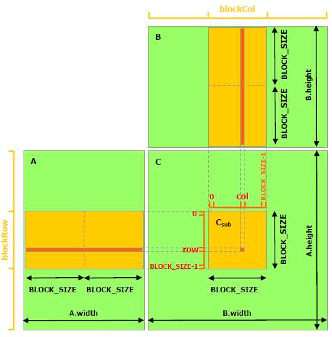

# Writing GPU Kernels: Further Topics

Reference material split out of [Writing GPU Kernels, Hands-On](writing-kernels.md) so the main chapter reads faster. The sections stand alone: read them when you need them. Earlier chapters link straight to the section they use.

## GEMM step by step

The best-known hands-on GEMM worklog is Simon Boehm, ["How to Optimize a CUDA Matmul Kernel for cuBLAS-like Performance: a Worklog"](https://siboehm.com/articles/22/CUDA-MMM) (2022). It writes fp32 SGEMM kernels in order, each fixing the bottleneck of the previous one. **These numbers are his**, measured mostly on an NVIDIA A6000 with fp32 (no tensor cores) at about 4096x4096 (see his post for exact conditions):

| kernel (Boehm's numbering) | GFLOP/s | % of cuBLAS |
| :------------------------- | ------: | ----------: |
| 1: naive | 309.0 | 1.3% |
| 2: global memory coalescing | 1986.5 | 8.5% |
| 3: shared memory caching | 2980.3 | 12.8% |
| 4: 1D blocktiling | 8474.7 | 36.5% |
| 5: 2D blocktiling | 15971.7 | 68.7% |
| 6: vectorized memory access | 18237.3 | 78.4% |
| 9: autotuning | 19721.0 | 84.8% |
| 10: warptiling | 21779.3 | 93.7% |
| 0: cuBLAS | 23249.6 | 100.0% |

The kernels below follow his steps 1 to 6 with the same tile parameters (written for this chapter, not copied; row-major `C = A @ B`, no `alpha`/`beta`). For the theory of each level, see the [tiling hierarchy](execution-model.md#gemm-tiling-hierarchy) and [coalescing](execution-model.md#coalescing).

Kernel 3's shared-memory tiling in the CUDA guide's picture: each block computes one `BLOCK_SIZE` x `BLOCK_SIZE` tile $C_{sub}$ of C (here `TILE`), stepping a row strip of A and a column strip of B through shared memory one tile at a time.



([source](https://docs.nvidia.com/cuda/archive/12.8.0/cuda-c-programming-guide/index.html))

```cuda
// sgemm.cu - C = A @ B, fp32, row-major A (M, K), B (K, N), C (M, N); the steps of the
// SGEMM worklog. Kernels 1-3 handle any shape; 4-6 require M % BM == N % BN == K % BK == 0.

// ---- 1: naive. threadIdx.x -> row, so the 32 lanes of a warp read 32 different rows of A
//      (stride K: 32 sectors per load) and write 32 different rows of C.
__global__ void sgemm_naive(int M, int N, int K, const float* A, const float* B, float* C) {
  const int row = blockIdx.x * blockDim.x + threadIdx.x;
  const int col = blockIdx.y * blockDim.y + threadIdx.y;
  if (row < M && col < N) {
    float acc = 0.f;
    for (int k = 0; k < K; ++k) acc += A[row * K + k] * B[k * N + col];
    C[row * N + col] = acc;
  }
}
// launch: dim3 block(32, 32); dim3 grid(cdiv(M, 32), cdiv(N, 32));

// ---- 2: coalesced. threadIdx.x -> column: a warp reads one A element (broadcast) and 32
//      consecutive floats of B (4 sectors), and writes 32 consecutive floats of C.
__global__ void sgemm_coalesced(int M, int N, int K, const float* A, const float* B, float* C) {
  const int row = blockIdx.y * blockDim.y + threadIdx.y;
  const int col = blockIdx.x * blockDim.x + threadIdx.x;
  if (row < M && col < N) {
    float acc = 0.f;
    for (int k = 0; k < K; ++k) acc += A[row * K + k] * B[k * N + col];
    C[row * N + col] = acc;
  }
}
// launch: dim3 block(32, 32); dim3 grid(cdiv(N, 32), cdiv(M, 32));

// ---- 3: shared-memory tiling. Each A and B element is loaded from global once per block
//      instead of once per thread: global traffic drops by TILE (32x).
template <int TILE>
__global__ void sgemm_smem(int M, int N, int K, const float* A, const float* B, float* C) {
  __shared__ float As[TILE][TILE];
  __shared__ float Bs[TILE][TILE];
  const int tx = threadIdx.x, ty = threadIdx.y;
  const int row = blockIdx.y * TILE + ty, col = blockIdx.x * TILE + tx;
  float acc = 0.f;
  for (int k0 = 0; k0 < K; k0 += TILE) {
    As[ty][tx] = (row < M && k0 + tx < K) ? A[row * K + k0 + tx] : 0.f;   // coalesced along tx
    Bs[ty][tx] = (k0 + ty < K && col < N) ? B[(k0 + ty) * N + col] : 0.f;
    __syncthreads();                         // tile fully loaded before anyone reads it
#pragma unroll
    for (int k = 0; k < TILE; ++k) acc += As[ty][k] * Bs[k][tx];          // As: broadcast, Bs: 32 banks
    __syncthreads();                         // everyone done reading before the next overwrite
  }
  if (row < M && col < N) C[row * N + col] = acc;
}
// launch: dim3 block(32, 32); dim3 grid(cdiv(N, 32), cdiv(M, 32));

// ---- 4: 1D blocktiling. Each thread computes TM outputs in a column; the B value is loaded
//      from smem once and reused TM times from a register. 9 smem loads per 8 FMAs instead of 16.
template <int BM, int BN, int BK, int TM>
__global__ void __launch_bounds__((BM * BN) / TM)
sgemm_1d(int M, int N, int K, const float* A, const float* B, float* C) {
  static_assert(BM * BK == (BM * BN) / TM && BN * BK == (BM * BN) / TM, "one A and one B element per thread");
  __shared__ float As[BM * BK];
  __shared__ float Bs[BK * BN];
  const int tCol = threadIdx.x % BN, tRow = threadIdx.x / BN;
  A += blockIdx.y * BM * K;                  // move to this block's tile
  B += blockIdx.x * BN;
  C += blockIdx.y * BM * N + blockIdx.x * BN;
  const int aRow = threadIdx.x / BK, aCol = threadIdx.x % BK;
  const int bRow = threadIdx.x / BN, bCol = threadIdx.x % BN;
  float acc[TM] = {0.f};
  for (int k0 = 0; k0 < K; k0 += BK) {
    As[aRow * BK + aCol] = A[aRow * K + aCol];
    Bs[bRow * BN + bCol] = B[bRow * N + bCol];
    __syncthreads();
    A += BK;
    B += BK * N;
#pragma unroll
    for (int k = 0; k < BK; ++k) {
      const float b = Bs[k * BN + tCol];
#pragma unroll
      for (int i = 0; i < TM; ++i) acc[i] += As[(tRow * TM + i) * BK + k] * b;
    }
    __syncthreads();
  }
#pragma unroll
  for (int i = 0; i < TM; ++i) C[(tRow * TM + i) * N + tCol] = acc[i];
}
// launch BM=BN=64, BK=8, TM=8: dim3 block(512); dim3 grid(N / 64, M / 64);

// ---- 5: 2D blocktiling. Each thread owns a TM x TN register tile and does an outer product
//      per k: TM + TN smem loads feed TM * TN FMAs (16 loads : 64 FMAs).
template <int BM, int BN, int BK, int TM, int TN>
__global__ void __launch_bounds__((BM * BN) / (TM * TN))
sgemm_2d(int M, int N, int K, const float* A, const float* B, float* C) {
  constexpr int NT = (BM * BN) / (TM * TN);  // 256 threads for 128x128 / (8x8)
  __shared__ float As[BM * BK];
  __shared__ float Bs[BK * BN];
  const int tRow = threadIdx.x / (BN / TN), tCol = threadIdx.x % (BN / TN);
  A += blockIdx.y * BM * K;
  B += blockIdx.x * BN;
  C += blockIdx.y * BM * N + blockIdx.x * BN;
  const int aRow = threadIdx.x / BK, aCol = threadIdx.x % BK;
  const int bRow = threadIdx.x / BN, bCol = threadIdx.x % BN;
  constexpr int aStride = NT / BK, bStride = NT / BN;   // rows covered per loader pass
  float acc[TM * TN] = {0.f};
  float regM[TM], regN[TN];
  for (int k0 = 0; k0 < K; k0 += BK) {
#pragma unroll
    for (int o = 0; o < BM; o += aStride) As[(aRow + o) * BK + aCol] = A[(aRow + o) * K + aCol];
#pragma unroll
    for (int o = 0; o < BK; o += bStride) Bs[(bRow + o) * BN + bCol] = B[(bRow + o) * N + bCol];
    __syncthreads();
    A += BK;
    B += BK * N;
#pragma unroll
    for (int k = 0; k < BK; ++k) {
#pragma unroll
      for (int i = 0; i < TM; ++i) regM[i] = As[(tRow * TM + i) * BK + k];
#pragma unroll
      for (int j = 0; j < TN; ++j) regN[j] = Bs[k * BN + tCol * TN + j];
#pragma unroll
      for (int i = 0; i < TM; ++i)
#pragma unroll
        for (int j = 0; j < TN; ++j) acc[i * TN + j] += regM[i] * regN[j];
    }
    __syncthreads();
  }
#pragma unroll
  for (int i = 0; i < TM; ++i)
#pragma unroll
    for (int j = 0; j < TN; ++j) C[(tRow * TM + i) * N + tCol * TN + j] = acc[i * TN + j];
}
// launch BM=BN=128, BK=8, TM=TN=8: dim3 block(256); dim3 grid(N / 128, M / 128);

// ---- 6: vectorized. 16-byte global loads (LDG.128) and A stored transposed in smem so the
//      regM reads are contiguous too. Also needs 16-byte aligned A, B, C.
template <int BM, int BN, int BK, int TM, int TN>
__global__ void __launch_bounds__((BM * BN) / (TM * TN))
sgemm_vec(int M, int N, int K, const float* A, const float* B, float* C) {
  constexpr int NT = (BM * BN) / (TM * TN);
  static_assert(BM * BK / 4 == NT && BN * BK / 4 == NT, "one float4 of A and of B per thread");
  __shared__ float As[BK * BM];              // transposed: As[k * BM + m]
  __shared__ float Bs[BK * BN];
  const int tRow = threadIdx.x / (BN / TN), tCol = threadIdx.x % (BN / TN);
  A += blockIdx.y * BM * K;
  B += blockIdx.x * BN;
  C += blockIdx.y * BM * N + blockIdx.x * BN;
  const int aRow = threadIdx.x / (BK / 4), aCol = threadIdx.x % (BK / 4);
  const int bRow = threadIdx.x / (BN / 4), bCol = threadIdx.x % (BN / 4);
  float acc[TM * TN] = {0.f};
  float regM[TM], regN[TN];
  for (int k0 = 0; k0 < K; k0 += BK) {
    const float4 a = reinterpret_cast<const float4*>(&A[aRow * K + aCol * 4])[0];
    As[(aCol * 4 + 0) * BM + aRow] = a.x;
    As[(aCol * 4 + 1) * BM + aRow] = a.y;
    As[(aCol * 4 + 2) * BM + aRow] = a.z;
    As[(aCol * 4 + 3) * BM + aRow] = a.w;
    reinterpret_cast<float4*>(&Bs[bRow * BN + bCol * 4])[0] =
        reinterpret_cast<const float4*>(&B[bRow * N + bCol * 4])[0];
    __syncthreads();
    A += BK;
    B += BK * N;
#pragma unroll
    for (int k = 0; k < BK; ++k) {
#pragma unroll
      for (int i = 0; i < TM; ++i) regM[i] = As[k * BM + tRow * TM + i];
#pragma unroll
      for (int j = 0; j < TN; ++j) regN[j] = Bs[k * BN + tCol * TN + j];
#pragma unroll
      for (int i = 0; i < TM; ++i)
#pragma unroll
        for (int j = 0; j < TN; ++j) acc[i * TN + j] += regM[i] * regN[j];
    }
    __syncthreads();
  }
#pragma unroll
  for (int i = 0; i < TM; ++i)
#pragma unroll
    for (int j = 0; j < TN; j += 4)
      reinterpret_cast<float4*>(&C[(tRow * TM + i) * N + tCol * TN + j])[0] =
          make_float4(acc[i * TN + j], acc[i * TN + j + 1], acc[i * TN + j + 2], acc[i * TN + j + 3]);
}
// launch BM=BN=128, BK=8, TM=TN=8: dim3 block(256); dim3 grid(N / 128, M / 128);
```

### Why each step is faster

The whole ladder is about one ratio: **FLOPs per byte moved at each level of the memory hierarchy**. Global memory feeds smem, smem feeds registers, registers feed the FMA units. Each step raises the ratio at one level:

```python
# gemm_ai.py - why each SGEMM step is faster: bytes moved per FMA at each level of the hierarchy
def step(name, BM, BN, BK, TM, TN, smem_loads_per_k):
    threads = BM * BN // (TM * TN)
    glob_bytes = (BM + BN) * BK * 4                  # one A tile + one B tile per K-step, fp32
    fmas = BM * BN * BK
    print(f"{name:20s} tile {BM:3d}x{BN:3d}x{BK:2d} thr={threads:4d}  "
          f"global FLOP/B = {2*fmas/glob_bytes:5.1f}   smem loads per FMA = {smem_loads_per_k/(TM*TN):.3f}")

# naive/coalesced: no smem; every FMA loads 2 floats from global (L1/L2 may catch some)
print(f"{'naive / coalesced':20s} global FLOP/B = {2/8:5.2f} (before caches)  -- 2 loads per FMA")
step("k3 smem 32x32", 32, 32, 32, 1, 1, 2)            # As[ty][k], Bs[k][tx]: 2 smem loads per FMA
step("k4 1D TM=8", 64, 64, 8, 8, 1, 8 + 1)            # per k: 8 A values + 1 B value for 8 FMAs
step("k5 2D 8x8", 128, 128, 8, 8, 8, 8 + 8)           # per k: 8 + 8 values for 64 FMAs
print("registers for k5 accumulators+fragments:", 8 * 8 + 8 + 8, "floats/thread")

# H100 SXM: 989 TFLOPS bf16 dense, 3.35 TB/s HBM -> ridge point
print(f"H100 bf16 ridge point: {989e12 / 3.35e12:.0f} FLOP/B")
for n in (1024, 4096, 8192):                          # square bf16 GEMM, ideal traffic
    flops = 2 * n**3; bytes_ = 3 * n * n * 2
    print(f"  GEMM n={n:5d}: AI={flops/bytes_:6.0f} FLOP/B  -> compute-bound floor {flops/989e12*1e6:8.1f} us,"
          f" memory floor {bytes_/3.35e12*1e6:6.1f} us")

# reporting a measurement against the roofline (the 'measured' times are placeholders)
def report(name, flops, bytes_, t_s, peak_flops=989e12, peak_bw=3.35e12):
    bound = max(flops / peak_flops, bytes_ / peak_bw)
    print(f"{name:26s} {flops/t_s/1e12:7.1f} TFLOP/s {bytes_/t_s/1e9:7.0f} GB/s  {100*bound/t_s:5.1f}% of roofline")
report("gemm 4096^3 bf16 @ 180us", 2 * 4096**3, 3 * 4096**2 * 2, 180e-6)
report("softmax 8192x32768 bf16 @ 400us", 5 * 8192 * 32768, 2 * 8192 * 32768 * 2, 400e-6)
```

```
naive / coalesced    global FLOP/B =  0.25 (before caches)  -- 2 loads per FMA
k3 smem 32x32        tile  32x 32x32 thr=1024  global FLOP/B =   8.0   smem loads per FMA = 2.000
k4 1D TM=8           tile  64x 64x 8 thr= 512  global FLOP/B =  16.0   smem loads per FMA = 1.125
k5 2D 8x8            tile 128x128x 8 thr= 256  global FLOP/B =  32.0   smem loads per FMA = 0.250
registers for k5 accumulators+fragments: 80 floats/thread
H100 bf16 ridge point: 295 FLOP/B
  GEMM n= 1024: AI=   341 FLOP/B  -> compute-bound floor      2.2 us, memory floor    1.9 us
  GEMM n= 4096: AI=  1365 FLOP/B  -> compute-bound floor    139.0 us, memory floor   30.0 us
  GEMM n= 8192: AI=  2731 FLOP/B  -> compute-bound floor   1111.7 us, memory floor  120.2 us
gemm 4096^3 bf16 @ 180us     763.5 TFLOP/s     559 GB/s   77.2% of roofline
softmax 8192x32768 bf16 @ 400us     3.4 TFLOP/s    2684 GB/s   80.1% of roofline
```

- **1 to 2 (coalescing, 6.4x in Boehm's table).** Same FLOPs, same algorithm. Only the mapping of `threadIdx.x` changes. In kernel 1 a warp's 32 lanes read 32 different rows of A (one 32-byte sector each, so 32 sectors for 128 useful bytes) and write C with stride `N`. In kernel 2 they read 32 consecutive floats of B (4 sectors) and one broadcast element of A. Check it with the [sector counter](execution-model.md#coalescing).
- **2 to 3 (shared memory, 1.5x).** Each element of A and B is loaded from global memory once per 32x32 block instead of once per thread: global FLOP/byte rises from 0.25 to 8. The gain is small because the bottleneck moves to the smem-to-register level. Every FMA still needs two smem loads, and the smem pipe sustains far fewer loads per clock than the FMA units do FMAs.
- **3 to 4 (1D blocktiling, 2.8x).** Each thread computes 8 outputs and reuses one `Bs` value from a register 8 times: 9 smem loads per 8 FMAs instead of 16. The tile is also taller (64x64x8), so global intensity doubles.
- **4 to 5 (2D blocktiling, 1.9x).** An 8x8 register tile per thread is an outer product: 8 + 8 smem loads feed 64 FMAs (0.25 loads per FMA, an 8x reduction from kernel 3). The cost is 64 accumulators + 16 fragment registers per thread. That is fine at 256 threads per block, but it limits occupancy ([occupancy arithmetic](execution-model.md#occupancy-worked)). From here on the kernel is limited by instruction issue and latency, not bandwidth.
- **5 to 6 (vectorized, 1.14x).** 128-bit loads (`LDG.128`, `LDS.128`) cut load instruction count by 4x. Storing A transposed in smem makes each thread's 8 `regM` values contiguous, so they can be read as two vector loads too.
- **Beyond (Boehm's 7-10).** Autotuning tile sizes per GPU. *Warptiling* adds an explicit warp-level tile between block and thread, which improves register-level locality and makes the code map naturally onto tensor core instructions. *Double buffering* (Boehm's kernel 11, and the [software pipelining](execution-model.md#software-pipelining) section) overlaps the next tile's loads with the current tile's math.

Kernels 4 to 6 assume `M`, `N`, `K` are multiples of the tile sizes. Production GEMMs handle the edges with predicated (masked) loads for the last tiles, or with a separate edge kernel. The wrapper below enforces the assumption with `TORCH_CHECK` rather than silently computing garbage.

### Checking the index arithmetic without a GPU

Register-tiled kernels are dense index arithmetic, and an off-by-one in `tRow * TM + i` produces wrong numbers, not a crash. This mirror runs each kernel's exact index expressions thread by thread on bounds-checked flat buffers. The two barriers become phase boundaries: all threads finish loading before any thread computes. C is pre-filled with NaN, so an element no thread wrote shows up as a failure:

```python
# gemm_mirror.py - execute the CUDA SGEMM kernels' index arithmetic thread by thread in Python,
# on flat buffers, and check C against numpy. Barriers become phase boundaries: every thread
# finishes the load phase before any thread starts the compute phase.
import numpy as np


class Buf:                                   # a bounds-checked float* (base offset + flat array)
    def __init__(self, a, off=0): self.a, self.off = a, off
    def __getitem__(self, i):
        j = self.off + i; assert 0 <= j < self.a.size, f"OOB read {j}"; return self.a[j]
    def __setitem__(self, i, v):
        j = self.off + i; assert 0 <= j < self.a.size, f"OOB write {j}"; self.a[j] = v
    def __add__(self, d): return Buf(self.a, self.off + d)


def k3_smem(M, N, K, A, B, C, TILE=32):
    for by in range(-(-M // TILE)):
        for bx in range(-(-N // TILE)):
            As = np.zeros((TILE, TILE), np.float32); Bs = np.zeros((TILE, TILE), np.float32)
            acc = np.zeros((TILE, TILE), np.float32)
            for k0 in range(0, K, TILE):
                for ty in range(TILE):
                    for tx in range(TILE):                              # load phase
                        row, col = by * TILE + ty, bx * TILE + tx
                        As[ty][tx] = A[row * K + k0 + tx] if (row < M and k0 + tx < K) else 0.0
                        Bs[ty][tx] = B[(k0 + ty) * N + col] if (k0 + ty < K and col < N) else 0.0
                for ty in range(TILE):                                  # compute phase
                    for tx in range(TILE):
                        for k in range(TILE): acc[ty][tx] += As[ty][k] * Bs[k][tx]
            for ty in range(TILE):
                for tx in range(TILE):
                    row, col = by * TILE + ty, bx * TILE + tx
                    if row < M and col < N: C[row * N + col] = acc[ty][tx]


def k4_1d(M, N, K, A0, B0, C0, BM=64, BN=64, BK=8, TM=8):
    NT = BM * BN // TM
    assert BM * BK == NT and BN * BK == NT
    for cRow in range(M // BM):
        for cCol in range(N // BN):
            As = np.zeros(BM * BK, np.float32); Bs = np.zeros(BK * BN, np.float32)
            acc = np.zeros((NT, TM), np.float32)
            A, B, C = A0 + cRow * BM * K, B0 + cCol * BN, C0 + cRow * BM * N + cCol * BN
            for k0 in range(0, K, BK):
                for t in range(NT):
                    aRow, aCol, bRow, bCol = t // BK, t % BK, t // BN, t % BN
                    As[aRow * BK + aCol] = A[aRow * K + aCol]
                    Bs[bRow * BN + bCol] = B[bRow * N + bCol]
                A, B = A + BK, B + BK * N
                for t in range(NT):
                    tCol, tRow = t % BN, t // BN
                    for k in range(BK):
                        b = Bs[k * BN + tCol]
                        for i in range(TM): acc[t][i] += As[(tRow * TM + i) * BK + k] * b
            for t in range(NT):
                for i in range(TM): C[(t // BN * TM + i) * N + t % BN] = acc[t][i]


def k5_2d(M, N, K, A0, B0, C0, BM=128, BN=128, BK=8, TM=8, TN=8, vec=False):
    NT = BM * BN // (TM * TN)
    for cRow in range(M // BM):
        for cCol in range(N // BN):
            As = np.zeros(BM * BK, np.float32); Bs = np.zeros(BK * BN, np.float32)
            acc = np.zeros((NT, TM * TN), np.float32)
            A, B, C = A0 + cRow * BM * K, B0 + cCol * BN, C0 + cRow * BM * N + cCol * BN
            for k0 in range(0, K, BK):
                for t in range(NT):
                    if not vec:                                          # kernel 5 loaders
                        aRow, aCol, bRow, bCol = t // BK, t % BK, t // BN, t % BN
                        for o in range(0, BM, NT // BK): As[(aRow + o) * BK + aCol] = A[(aRow + o) * K + aCol]
                        for o in range(0, BK, NT // BN): Bs[(bRow + o) * BN + bCol] = B[(bRow + o) * N + bCol]
                    else:                                                # kernel 6: float4, A transposed
                        aRow, aCol, bRow, bCol = t // (BK // 4), t % (BK // 4), t // (BN // 4), t % (BN // 4)
                        a4 = [A[aRow * K + aCol * 4 + q] for q in range(4)]
                        for q in range(4): As[(aCol * 4 + q) * BM + aRow] = a4[q]
                        for q in range(4): Bs[bRow * BN + bCol * 4 + q] = B[bRow * N + bCol * 4 + q]
                A, B = A + BK, B + BK * N
                for t in range(NT):
                    tRow, tCol = t // (BN // TN), t % (BN // TN)
                    for k in range(BK):
                        if not vec: regM = [As[(tRow * TM + i) * BK + k] for i in range(TM)]
                        else:       regM = [As[k * BM + tRow * TM + i] for i in range(TM)]
                        regN = [Bs[k * BN + tCol * TN + j] for j in range(TN)]
                        for i in range(TM):
                            for j in range(TN): acc[t][i * TN + j] += regM[i] * regN[j]
            for t in range(NT):
                tRow, tCol = t // (BN // TN), t % (BN // TN)
                for i in range(TM):
                    for j in range(TN): C[(tRow * TM + i) * N + tCol * TN + j] = acc[t][i * TN + j]


rng = np.random.default_rng(0)
def check(name, fn, M, N, K, **kw):
    A = rng.standard_normal((M, K), dtype=np.float32); B = rng.standard_normal((K, N), dtype=np.float32)
    C = np.full(M * N, np.nan, np.float32)                   # nan: any element never written shows up
    fn(M, N, K, Buf(A.ravel()), Buf(B.ravel()), Buf(C), **kw)
    err = np.abs(C.reshape(M, N) - A @ B).max()
    print(f"{name:28s} M={M:3d} N={N:3d} K={K:3d}  max|C - A@B| = {err:.2e}")
    assert err < 1e-3

check("k3 smem tiling (bounds-checked)", k3_smem, 33, 65, 40)
check("k4 1D blocktiling", k4_1d, 128, 128, 32)
check("k5 2D blocktiling", k5_2d, 128, 256, 16)
check("k6 vectorized + transposed As", k5_2d, 256, 128, 16, vec=True)
```

```
k3 smem tiling (bounds-checked) M= 33 N= 65 K= 40  max|C - A@B| = 3.81e-06
k4 1D blocktiling            M=128 N=128 K= 32  max|C - A@B| = 3.81e-06
k5 2D blocktiling            M=128 N=256 K= 16  max|C - A@B| = 2.86e-06
k6 vectorized + transposed As M=256 N=128 K= 16  max|C - A@B| = 3.81e-06
```

This verifies the indexing and tiling logic of kernels 3 to 6. It does not verify the CUDA compilation (syntax-checked only) or the performance. Kernels 1 and 2 differ only in which index is `threadIdx.x`.

### Testing and benchmarking the ladder against cuBLAS

The harness compares each kernel to `torch.matmul` with TF32 disabled, so cuBLAS runs a true fp32 SGEMM. With TF32 enabled, cuBLAS would use tensor cores at lower precision and the comparison would be meaningless. Untested; the output format is what it would print:

```python
# sgemm_ext.py - build sgemm.cu into PyTorch, test every kernel, benchmark against cuBLAS (untested: needs a GPU)
import pathlib, torch, triton
from torch.utils.cpp_extension import load_inline

launcher = r"""
#include <torch/extension.h>
#include <ATen/cuda/CUDAContext.h>
#include <c10/cuda/CUDAGuard.h>

static inline int cdiv(int a, int b) { return (a + b - 1) / b; }

torch::Tensor sgemm(torch::Tensor A, torch::Tensor B, int64_t version) {
  TORCH_CHECK(A.is_cuda() && B.is_cuda() && A.scalar_type() == torch::kFloat32 && B.scalar_type() == torch::kFloat32);
  TORCH_CHECK(A.dim() == 2 && B.dim() == 2 && A.size(1) == B.size(0), "shape mismatch");
  const at::cuda::OptionalCUDAGuard guard(A.device());
  A = A.contiguous(); B = B.contiguous();
  const int M = A.size(0), K = A.size(1), N = B.size(1);
  auto C = torch::empty({M, N}, A.options());
  const float *a = A.data_ptr<float>(), *b = B.data_ptr<float>(); float* c = C.data_ptr<float>();
  auto s = at::cuda::getCurrentCUDAStream();
  if (version >= 4) TORCH_CHECK(M % 128 == 0 && N % 128 == 0 && K % 8 == 0, "kernels 4-6 need tile multiples");
  switch (version) {
    case 1: sgemm_naive<<<dim3(cdiv(M, 32), cdiv(N, 32)), dim3(32, 32), 0, s>>>(M, N, K, a, b, c); break;
    case 2: sgemm_coalesced<<<dim3(cdiv(N, 32), cdiv(M, 32)), dim3(32, 32), 0, s>>>(M, N, K, a, b, c); break;
    case 3: sgemm_smem<32><<<dim3(cdiv(N, 32), cdiv(M, 32)), dim3(32, 32), 0, s>>>(M, N, K, a, b, c); break;
    case 4: sgemm_1d<64, 64, 8, 8><<<dim3(N / 64, M / 64), 512, 0, s>>>(M, N, K, a, b, c); break;
    case 5: sgemm_2d<128, 128, 8, 8, 8><<<dim3(N / 128, M / 128), 256, 0, s>>>(M, N, K, a, b, c); break;
    case 6: sgemm_vec<128, 128, 8, 8, 8><<<dim3(N / 128, M / 128), 256, 0, s>>>(M, N, K, a, b, c); break;
    default: TORCH_CHECK(false, "unknown version");
  }
  C10_CUDA_KERNEL_LAUNCH_CHECK();
  return C;
}
"""
src = (pathlib.Path(__file__).parent / "sgemm.cu").read_text() + launcher
ext = load_inline("sgemm_ext", cpp_sources="torch::Tensor sgemm(torch::Tensor A, torch::Tensor B, int64_t version);",
                  cuda_sources=src, functions=["sgemm"], extra_cuda_cflags=["-O3", "-lineinfo", "--ptxas-options=-v"])

torch.backends.cuda.matmul.allow_tf32 = False              # compare against true fp32 SGEMM
torch.manual_seed(0)
for v in range(1, 7):                                       # correctness first
    shapes = [(1, 1, 1), (33, 65, 17), (100, 37, 300)] if v <= 3 else [(128, 128, 8), (256, 384, 136)]
    for M, N, K in shapes:
        A, B = torch.randn(M, K, device="cuda"), torch.randn(K, N, device="cuda")
        torch.testing.assert_close(ext.sgemm(A, B, v), A @ B, rtol=1e-4, atol=1e-4)
print("all kernels correct")

n = 4096
A, B = torch.randn(n, n, device="cuda"), torch.randn(n, n, device="cuda")
ms_cublas = triton.testing.do_bench(lambda: A @ B)
for v in range(1, 7):
    ms = triton.testing.do_bench(lambda: ext.sgemm(A, B, v))
    print(f"kernel {v}: {2 * n**3 / ms / 1e9:8.0f} GFLOP/s  {100 * ms_cublas / ms:5.1f}% of cuBLAS")
print(f"cuBLAS  : {2 * n**3 / ms_cublas / 1e9:8.0f} GFLOP/s")
```

```
all kernels correct
kernel 1:  <your GPU>  GFLOP/s   x.x% of cuBLAS        <- not measured; see Boehm's table for an A6000
...
```

The `--ptxas-options=-v` flag prints registers per kernel at build time. Kernel 5 should report on the order of 100+ registers. If it reports `spill stores`, the accumulator array did not stay in registers (usually a loop index the compiler could not resolve at compile time, which is why every loop is `#pragma unroll` with constant bounds).

### Tensor cores: WMMA, `mma.sync`, and why you stop there

fp32 SGEMM on CUDA cores tops out at the FP32 peak, about 67 TFLOPS on H100 SXM. bf16 on tensor cores is rated at 989 TFLOPS dense. For ML dtypes, every serious GEMM therefore runs on tensor cores ([instruction generations](execution-model.md#tensor-cores)). There are three levels of API:

1. **WMMA** (`nvcuda::wmma`, `<mma.h>`, sm_70+): a portable C++ API. A *fragment* is a warp-wide tile whose element-to-lane mapping is opaque. You `load_matrix_sync`, `mma_sync`, `store_matrix_sync`. It is easy and portable, but you cannot control register layouts, so you cannot do the smem swizzles and `ldmatrix` loads fast kernels need.

```cuda
// wmma.cu - tensor cores through the WMMA API: one warp computes one 16x16 tile of C.
// fp16 inputs, fp32 accumulate; requires M, N, K multiples of 16. sm_70+.
#include <cuda_fp16.h>
#include <mma.h>
using namespace nvcuda;

__global__ void hgemm_wmma(int M, int N, int K, const half* A, const half* B, float* C) {
  const int tileM = blockIdx.y * blockDim.y + threadIdx.y;          // warp-uniform
  const int tileN = (blockIdx.x * blockDim.x + threadIdx.x) / 32;   // warp-uniform
  if (tileM * 16 >= M || tileN * 16 >= N) return;                    // whole warp exits together
  wmma::fragment<wmma::matrix_a, 16, 16, 16, half, wmma::row_major> a;
  wmma::fragment<wmma::matrix_b, 16, 16, 16, half, wmma::row_major> b;
  wmma::fragment<wmma::accumulator, 16, 16, 16, float> c;
  wmma::fill_fragment(c, 0.0f);
  for (int k = 0; k < K; k += 16) {
    wmma::load_matrix_sync(a, A + tileM * 16 * K + k, K);   // last arg: leading dimension
    wmma::load_matrix_sync(b, B + k * N + tileN * 16, N);
    wmma::mma_sync(c, a, b, c);                             // c += a @ b on the tensor cores
  }
  wmma::store_matrix_sync(C + tileM * 16 * N + tileN * 16, c, N, wmma::mem_row_major);
}
// launch: dim3 block(128, 4) = 4x4 warps -> a 64x64 C tile per block;
//         dim3 grid(N / 64, M / 64)
```

This version loads fragments straight from global memory, so it repeats kernel 2's mistake at the tensor core level: there is no smem reuse across warps. The next steps mirror the SGEMM ladder. Stage block tiles of A and B through shared memory, use `cp.async` to overlap the copies ([pipelining](execution-model.md#software-pipelining)), give each warp a larger warp tile (e.g. 64x64, i.e. 4x4 fragments), and pad or swizzle smem rows to avoid bank conflicts on fragment loads.

2. **`mma.sync` PTX + `ldmatrix`** (sm_80+): inline PTX that exposes the documented register layout of each fragment ([the layout](execution-model.md#ampere-mmasync)). `ldmatrix` loads 8x8 tiles from smem directly into that layout. This is what fast Ampere kernels (and CUTLASS's SM80 path, and FlashAttention-2) use:

```cuda
// one m16n8k16 bf16 MMA with fp32 accumulators: d = a @ b + c, per warp.
// a: 4 x 32-bit regs (8 bf16), b: 2 regs (4 bf16), c/d: 4 fp32 per lane. Untested; see PTX ISA "mma".
asm volatile(
    "mma.sync.aligned.m16n8k16.row.col.f32.bf16.bf16.f32 "
    "{%0,%1,%2,%3}, {%4,%5,%6,%7}, {%8,%9}, {%10,%11,%12,%13};\n"
    : "=f"(d[0]), "=f"(d[1]), "=f"(d[2]), "=f"(d[3])
    : "r"(a[0]), "r"(a[1]), "r"(a[2]), "r"(a[3]), "r"(b[0]), "r"(b[1]),
      "f"(c[0]), "f"(c[1]), "f"(c[2]), "f"(c[3]));
// fragments come from shared memory via ldmatrix, e.g.
// asm volatile("ldmatrix.sync.aligned.m8n8.x4.shared.b16 {%0,%1,%2,%3}, [%4];\n"
//              : "=r"(a[0]), "=r"(a[1]), "=r"(a[2]), "=r"(a[3]) : "r"(smem_addr));
```

3. **Hopper `wgmma` + TMA + warp specialization** (sm_90a), and **Blackwell `tcgen05` + TMEM** (sm_100a). These are asynchronous warpgroup-wide MMAs that read operands from smem descriptors, fed by the TMA copy engine through `mbarrier`s, with producer and consumer warpgroups ([Hopper](execution-model.md#hopper-wgmma), [Blackwell](execution-model.md#blackwell-tcgen05-and-tmem)). Hand-writing this is possible but long. In practice people write it in CUTLASS/CuTe, ThunderKittens or Triton, which emit these instructions for you.

Published tensor-core worklogs, with **their** numbers:

| worklog | GPU, dtype, size | result (author's measurement) |
| :------ | :--------------- | :---------------------------- |
| Alex Armbruster, ["How To Write A Fast Matrix Multiplication From Scratch With Tensor Cores"](https://alexarmbr.github.io/2024/08/10/How-To-Write-A-Fast-Matrix-Multiplication-From-Scratch-With-Tensor-Cores.html) (2024) | Tesla T4, fp16, 8192^3 | 6 kernels from ~8% to ~96% of cuBLAS (`mma.sync`, `ldmatrix`, swizzling, pipelining) |
| Pranjal Shankhdhar, ["Outperforming cuBLAS on H100: a Worklog"](https://cudaforfun.substack.com/p/outperforming-cublas-on-h100-a-worklog) (2024) | H100 SXM, bf16, 4096^3 | Boehm-style fp32 kernel ported to bf16: 32 TFLOPS; first `wgmma` kernel 317; warp specialization 498; two consumer warpgroups 610; L2-aware scheduling 660; clusters 734; final (Hilbert-curve tile order) 764 vs cuBLAS 716 |

The H100 row is the best one-paragraph argument for tensor cores. A well-tuned CUDA-core kernel reaches 32 TFLOPS, and the *first, unoptimized* `wgmma` kernel reaches 10x that.


## Grouped GEMM for MoE

A mixture-of-experts layer routes each token to `topk` of `E` experts. Each expert does its own GEMM on the tokens it received, and the counts per expert are uneven and change every step. Running `E` separate `torch.matmul`s means `E` launches, most of them on tiny or empty batches. A **grouped GEMM** does all experts in one launch:

1. Sort the `T * topk` routed rows by expert, so each expert's rows are contiguous. Record `offs[e]`, where expert `e`'s rows start.
2. Build a **tile schedule**: one work item per `(expert, BLOCK_M rows of that expert)`. A hot expert gets many tiles and an empty one gets none, so the grid size matches the real work.
3. Each program looks up its expert and row range, **gathers** its token rows through an index array (no permuted copy of `X`), and multiplies by `W[e]`. Rows past the expert's end are masked.

```python
# grouped_gemm.py - MoE expert GEMMs as ONE launch: Y[i] = X[tok[i]] @ W[expert(i)] for every routed row
import torch
from backend import triton, tl, DEV


@triton.jit
def grouped_gemm_kernel(X, W, Y, TOK, TILE_E, TILE_START, OFFS, N, K,
                        stride_xt, stride_we, stride_wk, stride_yr,
                        BLOCK_M: tl.constexpr, BLOCK_N: tl.constexpr, BLOCK_K: tl.constexpr):
    tile = tl.program_id(0)                                   # one (expert, row-block) work item
    pid_n = tl.program_id(1)
    e = tl.load(TILE_E + tile)                                # which expert's weights
    r0 = tl.load(TILE_START + tile)                           # first sorted row of this tile
    r_end = tl.load(OFFS + e + 1)                             # end of this expert's rows
    rows = r0 + tl.arange(0, BLOCK_M)                         # (BM,) rows in expert-sorted order
    row_ok = rows < r_end                                     # tile may run past the expert's last row
    tok = tl.load(TOK + rows, mask=row_ok, other=0)           # (BM,) gather: which token each row is
    rn = pid_n * BLOCK_N + tl.arange(0, BLOCK_N)
    rk = tl.arange(0, BLOCK_K)
    acc = tl.zeros((BLOCK_M, BLOCK_N), tl.float32)
    for k0 in range(0, K, BLOCK_K):
        kk = k0 + rk
        a = tl.load(X + tok[:, None] * stride_xt + kk[None, :],
                    mask=row_ok[:, None] & (kk[None, :] < K), other=0.0)                 # (BM, BK)
        b = tl.load(W + e * stride_we + kk[:, None] * stride_wk + rn[None, :],
                    mask=(kk[:, None] < K) & (rn[None, :] < N), other=0.0)               # (BK, BN)
        acc = tl.dot(a, b, acc)
    tl.store(Y + rows[:, None] * stride_yr + rn[None, :], acc.to(Y.dtype.element_ty),
             mask=row_ok[:, None] & (rn[None, :] < N))


def moe_grouped_gemm(x, w, expert_idx, BLOCK_M=64, BLOCK_N=64, BLOCK_K=32):
    """x (T, K), w (E, K, N), expert_idx (T, topk) -> y (T*topk, N) in expert-sorted order, plus the order."""
    E, K, N = w.shape
    flat = expert_idx.reshape(-1)                             # (T*topk,)
    order = torch.argsort(flat, stable=True)                  # routed rows sorted by expert
    tok = (order // expert_idx.shape[1]).to(torch.int64)      # token id of each sorted row
    counts = torch.bincount(flat, minlength=E)                # (E,)
    offs = torch.zeros(E + 1, dtype=torch.int64, device=x.device)
    offs[1:] = torch.cumsum(counts, 0)
    # tile schedule on the host: experts with 0 rows get 0 tiles, hot experts get many
    tiles_per_e = (counts + BLOCK_M - 1) // BLOCK_M
    tile_e = torch.repeat_interleave(torch.arange(E, device=x.device), tiles_per_e)
    first_tile = torch.cumsum(tiles_per_e, 0) - tiles_per_e
    tile_start = offs[tile_e] + (torch.arange(len(tile_e), device=x.device) - first_tile[tile_e]) * BLOCK_M
    y = torch.empty(flat.numel(), N, device=x.device, dtype=x.dtype)
    grid = (len(tile_e), triton.cdiv(N, BLOCK_N))
    grouped_gemm_kernel[grid](x, w, y, tok, tile_e, tile_start, offs, N, K,
                              x.stride(0), w.stride(0), w.stride(1), y.stride(0),
                              BLOCK_M=BLOCK_M, BLOCK_N=BLOCK_N, BLOCK_K=BLOCK_K)
    return y, order


if __name__ == "__main__":
    torch.manual_seed(0)
    T, K, N, E, topk = 300, 96, 80, 8, 2
    x = torch.randn(T, K, device=DEV, dtype=torch.bfloat16)
    w = torch.randn(E, K, N, device=DEV, dtype=torch.bfloat16) / K ** 0.5
    logits = torch.randn(T, E, device=DEV)
    logits[:, 0] += 3                                         # skewed router: expert 0 is hot
    logits[:, 7] -= 100                                       # expert 7 gets no tokens
    expert_idx = logits.topk(topk, dim=-1).indices            # (T, topk)
    y, order = moe_grouped_gemm(x, w, expert_idx)
    print("rows per expert:", torch.bincount(expert_idx.reshape(-1), minlength=E).tolist())
    ref = torch.empty_like(y)
    for i, r in enumerate(order.tolist()):                    # slow reference: one row at a time
        t, j = divmod(r, topk)
        ref[i] = (x[t].float() @ w[expert_idx[t, j]].float()).to(y.dtype)
    torch.testing.assert_close(y, ref)
    print("grouped GEMM matches per-row reference")
```

```
rows per expert: [295, 52, 38, 57, 43, 54, 61, 0]
grouped GEMM matches per-row reference
```

Expert 0 received 295 of 600 routed rows and expert 7 received none. The schedule gives expert 0 five 64-row tiles and expert 7 zero, all in one launch. Production versions differ in where the schedule is built. vLLM's `fused_moe` computes the sorted, block-padded token ids on the GPU (`moe_align_block_size`), so the whole thing is CUDA-graph capturable with no host sync. MegaBlocks (Gale et al., arXiv 2211.15841) frames the same computation as block-sparse matmul. DeepGEMM (DeepSeek, 2025) provides FP8 grouped GEMMs in two layouts: "contiguous" (sorted rows, as here, for training and prefill) and "masked" (a fixed-capacity slot per expert, for CUDA-graph decode). Prefill and decode are the two phases of generation ([the KV cache](../../models/architectures.md#the-kv-cache)); [CUDA graphs](execution-model.md#cuda-graphs) need fixed shapes, hence the fixed-capacity slots. The scatter back to token order, weighted by router probabilities, is usually fused into the next kernel or done with an `index_add_`. *Expert parallelism* places different experts on different GPUs, so each token's row has to be sent to the GPU holding its expert and the result sent back: an [all-to-all](../../foundations/distributed-systems.md#collectives-the-workhorse-of-distributed-training) collective. Kernels for that exchange are covered later ([DeepEP](../../inference/serving-engine-internals.md#all-to-all-kernels-deepep); the collective itself in [collectives internals](../../network/collectives-internals.md)).


## Testing kernels

A kernel that is fast and wrong is worse than useless, because it corrupts training silently. Reviewers of kernel PRs check these things, roughly in this order:

1. **A reference implementation in plain PyTorch**, as simple as possible, computed in **fp64 (or fp32) on the same rounded inputs**. The "same rounded inputs" part is easy to get wrong. The harness below first compared a bf16 kernel to an fp64 softmax of the *unrounded* data, and failed with a relative error of 0.021 against bf16's tolerance of 0.016. The failure was the rounding of the input, not the kernel. Comparing against `softmax(x_bf16.double())` fixed it.
2. **Tolerances per dtype.** `torch.testing.assert_close` defaults, printed from this PyTorch version: fp32 `rtol=1.3e-6, atol=1e-5`; fp16 `rtol=1e-3, atol=1e-5`; bf16 `rtol=1.6e-2, atol=1e-5`. For long reductions (GEMMs with big K, attention), a fixed tolerance is too tight or too loose. The more robust bar, used by FlashAttention's tests, is: **your error against the fp64 reference is at most ~2x the error of PyTorch's own implementation at the same dtype.**
3. **Shapes that break kernels**: 1; sizes just below, at and above every block size (`BLOCK-1, BLOCK, BLOCK+1`); primes; large values that overflow int32 offsets ($M \cdot \text{stride} > 2^{31}$); empty tensors; and random shapes from a *seeded* generator, so that a failure reproduces.
4. **Layouts**: non-contiguous views (transposes, slices with `stride(-1) != 1`), storage offsets, different alignments.
5. **Special values**: `-inf` rows (fully masked attention), very large magnitudes (overflow in `exp` without max subtraction), NaN propagation where PyTorch propagates it.
6. **Determinism**: same input, same bits, run twice. If a kernel is non-deterministic by design (atomics, split-K), document it and offer a deterministic path.
7. **Gradients**: compare `torch.autograd.grad` against the reference, or use `torch.autograd.gradcheck` in fp64 on tiny shapes.

```python
# test_kernels.py - the testing pattern: fp64 reference, per-dtype tolerances, random + edge shapes,
# "no worse than PyTorch's own low-precision op", determinism, strided inputs.
import random, torch
from backend import DEV
from softmax import softmax
from matmul import matmul

TOL = {torch.float32: dict(rtol=1.3e-6, atol=1e-5),     # torch.testing defaults, printed from
       torch.float16: dict(rtol=1e-3, atol=1e-5),       # torch.testing._comparison._DTYPE_PRECISIONS
       torch.bfloat16: dict(rtol=1.6e-2, atol=1e-5)}

def edge_sizes(block):                                   # the sizes that break kernels
    return [1, 2, 3, block - 1, block, block + 1, 2 * block + 1]

def rand_sizes(k, lo, hi, rng):
    return [rng.randint(lo, hi) for _ in range(k)]

def test_softmax(rng):
    n = 0
    for N in edge_sizes(64) + rand_sizes(4, 1, 3000, rng):
        for dt in TOL:
            xl = (torch.randn(rng.randint(1, 9), N, device=DEV) * 4).to(dt)
            ref = torch.softmax(xl.double(), -1)         # fp64 reference ON THE ROUNDED INPUT
            for online in (False, True):
                y = softmax(xl, online=online, BLOCK_N=64)
                torch.testing.assert_close(y, ref.to(dt), **TOL[dt])
                n += 1
    return n

def test_matmul_vs_torch_error(rng):
    # low-precision outputs differ from fp64 by rounding no matter what; the useful bar is
    # "our error is within 2x of PyTorch's own error at the same dtype"
    worst = 0.0
    for _ in range(6):
        M, N, K = rand_sizes(3, 1, 300, rng)
        for dt in (torch.float16, torch.bfloat16):
            a = torch.randn(M, K, device=DEV, dtype=dt); b = torch.randn(K, N, device=DEV, dtype=dt)
            ref = a.double() @ b.double()
            err_ours = (matmul(a, b).double() - ref).abs().max().item()
            err_torch = ((a @ b).double() - ref).abs().max().item()
            assert err_ours <= 2 * err_torch + 1e-6, (M, N, K, dt, err_ours, err_torch)
            worst = max(worst, err_ours / max(err_torch, 1e-12))
    return worst

def test_determinism_and_strides():
    x = torch.randn(64, 1000, device=DEV, dtype=torch.bfloat16)
    assert torch.equal(softmax(x), softmax(x)), "same input, different bits"
    big = torch.randn(64, 2000, device=DEV)
    xs = big[:, ::2]                                     # non-contiguous view, stride(1) = 2
    torch.testing.assert_close(softmax(xs), torch.softmax(xs, -1))
    a = torch.randn(70, 50, device=DEV, dtype=torch.float16)
    torch.testing.assert_close(matmul(a.t(), a), (a.float().t() @ a.float()).half(), **TOL[torch.float16])

if __name__ == "__main__":
    rng = random.Random(0)                               # record the seed: failures must reproduce
    print("softmax cases passed:", test_softmax(rng))
    print(f"matmul worst error ratio vs torch: {test_matmul_vs_torch_error(rng):.2f}x")
    test_determinism_and_strides()
    print("determinism + strided inputs OK")
```

```
softmax cases passed: 66
matmul worst error ratio vs torch: 1.00x
determinism + strided inputs OK
```

This harness found a real bug while the chapter was being written. The first version of the `softmax` launcher passed `x.stride(0)` but silently assumed `stride(1) == 1`. On a `[:, ::2]` view it returned values off by up to 453x relative (`Mismatched elements: 63213 / 64000`). The fix (now in `softmax.py`) is `x = x.contiguous()` when `stride(-1) != 1`. The alternative is to pass the column stride into the kernel. Either way, only a strided-input test catches this.

The matmul ratio of 1.00x means the kernel's error equals CPU PyTorch's: both accumulate in fp32 and round once. On a GPU, compare against cuBLAS the same way.

**Memory and race checkers on a GPU** (untested here). `compute-sanitizer` ships with the CUDA toolkit and works on Triton kernels too, because it instruments the binary:

```bash
compute-sanitizer --tool memcheck  python test_kernels.py   # out-of-bounds / misaligned accesses
compute-sanitizer --tool racecheck python test_kernels.py   # shared-memory races (missing __syncthreads)
compute-sanitizer --tool synccheck python test_kernels.py   # barriers inside divergent code
compute-sanitizer --tool initcheck python test_kernels.py   # reads of uninitialized device memory
# ========= Invalid __global__ read of size 4 bytes ... by thread (24,0,0) in block (3,0,0)   <- sketch
```

Run the shape sweep under memcheck once per kernel change. Many out-of-bounds reads land inside a valid allocation, never crash, and produce plausible numbers, so the sanitizer is the only thing that sees them. For kernel PRs, pytest's `@pytest.mark.parametrize` over `(shape, dtype, layout)` is the standard way to express the sweep (pytest is the usual Python test runner: it finds functions named `test_*` and runs them, and `parametrize` runs one test function once per listed argument combination). Keep the sweep small enough to run in CI on one GPU in minutes.


## Benchmarking kernels

Timing a GPU kernel badly is easy. The three mistakes, demonstrated on the CPU (the physics is the same):

```python
# bench_pitfalls.py - the three benchmarking mistakes, demonstrated on a CPU (same physics as a GPU)
import time, statistics, torch
torch.set_num_threads(1)

def bench(fn, reps=50, warmup=5):
    for _ in range(warmup): fn()
    ts = []
    for _ in range(reps):
        t0 = time.perf_counter(); fn(); ts.append(time.perf_counter() - t0)
    return statistics.median(ts), min(ts), max(ts)

n = 1 << 20                                         # 1M fp32 = 4 MB per tensor: fits in cache
x, y, out = torch.randn(n), torch.randn(n), torch.empty(n)
t0 = time.perf_counter(); torch.add(x, y, out=out); first = time.perf_counter() - t0
med, lo, hi = bench(lambda: torch.add(x, y, out=out))
print(f"1. first call {first*1e6:8.1f} us vs warm median {med*1e6:6.1f} us  (min {lo*1e6:.1f}, max {hi*1e6:.1f})")

hot = 3 * 4 * n / med / 1e9                         # read x, read y, write out
bufs = [(torch.randn(n), torch.randn(n), torch.empty(n)) for _ in range(64)]   # 768 MB: no cache holds it
it = iter(range(10**9))
def cold():
    a, b, c = bufs[next(it) % 64]; torch.add(a, b, out=c)
med_c, _, _ = bench(cold, reps=64)
print(f"2. same buffers every rep: {hot:5.1f} GB/s   rotating 64 buffer sets: {3*4*n/med_c/1e9:5.1f} GB/s  (cache vs DRAM)")

ms = [bench(lambda: torch.add(x, y, out=out), reps=20)[0] * 1e6 for _ in range(5)]
print("3. five repeated medians (us):", [round(m, 1) for m in ms])
```

```
1. first call    378.7 us vs warm median  104.1 us  (min 100.0, max 111.5)
2. same buffers every rep: 120.8 GB/s   rotating 64 buffer sets:  31.0 GB/s  (cache vs DRAM)
3. five repeated medians (us): [105.3, 105.2, 105.3, 105.3, 105.3]
```

1. **No warmup.** The first call cost more than 3x the warm median, all of it one-time work. On a GPU, first calls include CUDA context creation, module loading, Triton JIT compilation (seconds) and autotuning.
2. **Warm caches.** Re-running on the same 12 MB of buffers measured cache bandwidth: almost 4x the bandwidth seen when the buffers rotate through more memory than any cache holds. On a GPU the trap is the L2 (50 MB on H100): a 16 MB input re-timed in a loop is served from L2. Flush it between repetitions by writing a buffer larger than the L2.
3. **One sample.** Report the median (or several quantiles) of many repetitions, and repeat the whole measurement to see its spread.

A correct GPU timing harness, using CUDA events (timestamps recorded *on the GPU stream*, so no host sync sits inside the timed region). Untested here:

```python
# bench_cuda.py - CUDA-event timing with warmup, L2 flush and quantiles (untested: needs a GPU)
import torch

def bench(fn, warmup=25, rep=100):
    flush = torch.empty(256 * 1024 * 1024, dtype=torch.int8, device="cuda")   # > L2 of current GPUs
    for _ in range(warmup):
        fn()
    starts = [torch.cuda.Event(enable_timing=True) for _ in range(rep)]
    ends = [torch.cuda.Event(enable_timing=True) for _ in range(rep)]
    for i in range(rep):
        flush.zero_()                      # evict L2; its own kernel, outside the timed region
        starts[i].record()
        fn()
        ends[i].record()
    torch.cuda.synchronize()               # wait once, at the end
    ts = sorted(s.elapsed_time(e) for s, e in zip(starts, ends))   # ms
    return {"p20": ts[rep // 5], "median": ts[rep // 2], "p80": ts[4 * rep // 5]}
```

`triton.testing.do_bench(fn, warmup=25, rep=100, quantiles=None, return_mode="mean")` does the same (warmup and rep are in *milliseconds* of running time, not iteration counts; it flushes L2 with a 256 MB buffer and returns the mean unless you ask for quantiles). `triton.testing.do_bench_cudagraph` captures `fn` in a CUDA graph first, which removes launch overhead. Use it for microsecond kernels, where the [launch cost](execution-model.md#launch-overhead-and-cpu-boundness) of a few microseconds is the same order as the kernel. `triton.testing.perf_report` + `triton.testing.Benchmark` sweep a shape axis and plot several implementations; the Triton tutorials use them.

Other rules for numbers you put in a PR:

- **Report against the roofline, not just "x% faster".** Compute the minimum bytes and FLOPs, and report achieved TFLOP/s and GB/s and the fraction of whichever bound applies (`gemm_ai.py` above has a `report` function; the inputs to it there are placeholders, not measurements). A 2x speedup over a bad baseline that still sits at 20% of bandwidth is not done.
- **Always include the vendor library and `torch.compile` as baselines** (cuBLAS via `torch.matmul`, FlashAttention via `F.scaled_dot_product_attention`, Inductor's generated Triton kernel). The [RMSNorm benchmark](execution-model.md#benchmarking-notes) in the execution model chapter shows the pattern, plus the `copy_` ceiling for memory-bound kernels.
- **Sweep shapes from the real workload**: decode shapes (`M = batch`, tiny) behave nothing like training shapes. Report the whole sweep.
- **Control clocks.** GPUs boost and throttle with temperature and power. `nvidia-smi -q -d CLOCK` shows current clocks. Nsight Compute locks to base clock by default (`--clock-control base`). For comparisons that matter, keep the machine otherwise idle and report the GPU model, driver, CUDA version and clock policy.


## Reading ncu to choose the next optimization

[The execution model chapter](execution-model.md#profiling-nsys-and-ncu) covers the Nsight tools, the Speed Of Light sections and the stall-reason table. This section is the loop you run with them while optimizing one kernel. Profile one launch, read four numbers, make one change, re-measure.

```bash
# full report for one launch of one kernel, with source correlation (needs -lineinfo for CUDA)
ncu --set full --import-source yes -k regex:sgemm_2d --launch-skip 3 --launch-count 1 \
    -o sgemm_2d python sgemm_ext.py
ncu -i sgemm_2d.ncu-rep --page details            # text version of the GUI's Details page
ncu -i sgemm_2d.ncu-rep --page raw --csv > raw.csv # every metric, for diffing two versions
# the GUI can set any report as a baseline and show per-metric deltas against it
```

The four questions, and what the SGEMM ladder looks like through them. The "what ncu shows" column is the expected signature from the analysis above, not a measured report:

| kernel | 1. which SOL is high? | 2. what is the top stall? | 3. memory detail | next step |
| :----- | :-------------------- | :------------------------ | :--------------- | :-------- |
| 1 naive | both low (latency-bound) | Long Scoreboard (waiting on global loads) | global load sectors/request ~32 (ideal 4) | coalesce (kernel 2) |
| 2 coalesced | memory (L1/L2) high-ish, compute low | Long Scoreboard | sectors/request ~4; DRAM traffic far above the ideal $(MK + KN + MN) \cdot 4$ bytes | reuse via smem (kernel 3) |
| 3 smem | L1/shared high, FMA pipe low | MIO Throttle / Short Scoreboard (smem queue) | smem loads per FMA = 2 | more work per smem load (kernels 4, 5) |
| 5 2D tile | compute (FMA) rising | fewer smem stalls; LG Throttle, issue-bound | many scalar LDG/LDS instructions | 128-bit loads (kernel 6) |
| 6 vectorized | FMA pipe high | Not Selected / Math Pipe Throttle | spills? check `--ptxas-options=-v` | warptiling, double buffering, autotune |
| any tensor-core GEMM | tensor pipe % | Barrier / Long Scoreboard at the `mbarrier` waits | smem bank conflicts on fragment loads | more stages, swizzle, warp specialization |
| memory-bound (norms, softmax) | DRAM % of peak | Long Scoreboard | DRAM throughput near the `copy_` ceiling | if > ~85% of copy: stop, or fuse with a neighbour |

The specific metrics behind those questions (names as in the Nsight Compute profiling guide; verify with `ncu --query-metrics` on your GPU, since names change across versions and architectures):

```bash
ncu -k regex:sgemm --metrics \
gpu__time_duration.sum,\
sm__throughput.avg.pct_of_peak_sustained_elapsed,\
gpu__compute_memory_throughput.avg.pct_of_peak_sustained_elapsed,\
dram__bytes_read.sum,dram__bytes_write.sum,\
l1tex__t_sectors_pipe_lsu_mem_global_op_ld.sum,l1tex__t_requests_pipe_lsu_mem_global_op_ld.sum,\
l1tex__data_bank_conflicts_pipe_lsu_mem_shared_op_ld.sum,\
sm__warps_active.avg.pct_of_peak_sustained_active,\
launch__registers_per_thread,launch__occupancy_limit_registers \
python sgemm_ext.py
# sectors / requests for global loads = sectors per warp-wide load: 4 is perfect for fp32,
# 32 means every lane touched its own sector (kernel 1).
# dram__bytes_read vs the ideal bytes: the reuse factor your tiling achieves.
```

Habits that save days. Look at the **Source** page with SASS next to source: the hot instruction tells you more than any summary (an unexpected `LDL`/`STL` is a register spill; a hot `BAR.SYNC` is load imbalance; `F2F` conversions in the inner loop are a dtype mistake). When the profile says "latency-bound, low occupancy, high registers", decide deliberately between more occupancy (smaller tiles, `__launch_bounds__`, fewer registers) and more ILP per thread (bigger tiles). The GEMM ladder above took the ILP route on purpose.


## CUTLASS, CuTe, ThunderKittens and other kernel DSLs

You will meet these in other people's repositories. Status as of late 2025 to 2026. This area moves fast: check each project's README before relying on any detail here.

| tool | what it is | when people use it |
| :--- | :--------- | :----------------- |
| [CUTLASS](https://github.com/NVIDIA/cutlass) 3.x (C++) | NVIDIA's header-only template library: GEMM/conv collectives, epilogues, TMA/`wgmma`/`tcgen05` paths, built on CuTe | peak GEMMs on Hopper/Blackwell with custom epilogues; what vLLM, FlashAttention-3 and many FP8 kernels build on |
| CuTe (C++, part of CUTLASS) | layouts as `(shape, stride)` algebra, tensors, copy and MMA "atoms" ([one screen](execution-model.md#cutlass-and-cute-in-one-screen)) | writing your own kernel with CUTLASS's building blocks instead of its full GEMM templates |
| CuTe DSL (Python, CUTLASS 4.x, 2025) | the CuTe concepts as a Python DSL, JIT-compiled, no C++ templates ([docs](https://docs.nvidia.com/cutlass/media/docs/pythonDSL/overview.html)); in public beta per its PyPI page | new Hopper/Blackwell kernels with full hardware control and fast compile times (e.g. Tri Dao's QuACK kernels, FlashAttention-4 work) |
| [Triton](https://github.com/triton-lang/triton) | tile-level Python DSL, this chapter | most new ML kernels: Liger-Kernel, Inductor output, vLLM's `fused_moe`, Unsloth |
| Gluon (in the Triton repo, 2025) | a lower-level Triton dialect that exposes layouts, shared memory and warp specialization explicitly | when Triton's compiler will not produce the Hopper/Blackwell schedule you need |
| [ThunderKittens](https://github.com/HazyResearch/ThunderKittens) (Spector et al., arXiv 2410.20399) | small C++ embedded library built around 16x16 register and shared tiles, warp/warpgroup operations and a producer/consumer template | attention variants, linear attention, state-space kernels; the paper reports matching cuBLAS and FA3 on GEMM and attention inference |
| TileLang (tile-ai; arXiv 2504.17577, id unverified) | Python tile DSL on TVM (Apache TVM, an open-source ML compiler), separating dataflow from scheduling annotations | DeepSeek-style MLA and FP8 kernels; AMD and NVIDIA backends |
| Helion (PyTorch, 2025) | higher-level Python DSL that compiles to Triton with heavy autotuning | PyTorch-native authoring where Triton tiling decisions are searched automatically |
| NVIDIA cuTile / CUDA Tile IR (CUDA 13.x, late 2025) | NVIDIA's tile-based programming model and IR, with a Python front end | early; worth watching as NVIDIA's own answer to Triton |
| [Pallas](https://docs.jax.dev/en/latest/pallas/index.html) (JAX) | JAX's kernel language for TPU and GPU (Triton or Mosaic GPU backends) | kernels in JAX codebases |
| Mojo (Modular) | systems language with GPU kernels; Modular's MAX kernels | Modular's stack |
| Composable Kernel, AITER (AMD) | AMD's CUTLASS-analogue and its LLM-kernel library | ROCm; see [AMD differences](execution-model.md#amd-differences) |

How to choose, as a working rule:

- **Default to Triton** for anything memory-bound or fusion-shaped (norms, activations, losses, RoPE, quantize/dequantize, MoE routing), and for GEMM-like kernels where 80-95% of peak is enough.
- **Use CUTLASS/CuTe (C++ or DSL)** when you need the last 10-20% on Hopper/Blackwell GEMMs and attention, custom FP8/FP4 block-scaled formats, or features Triton does not expose (clusters, TMA multicast, exact warp specialization). Expect a steep learning curve and slow C++ compiles.
- **Use ThunderKittens** for attention-like kernels where its tile abstractions fit and you want readable C++.
- **Read the generated code.** Whatever you write in, the PTX/SASS (`cuobjdump -sass`, the Triton cache) is the ground truth for what runs.


## A checklist before you open a kernel PR

What reviewers in kernel repositories (FlashAttention, vLLM, Liger, SGLang, TransformerEngine) look for, condensed:

```text
[ ] reference implementation in plain PyTorch, in the test file
[ ] tests: dtypes x shapes (edge sizes, primes, random seeded) x layouts (strided, offset) x special values
[ ] tolerance justified: vs fp64 reference, and no worse than ~2x PyTorch's own error at that dtype
[ ] gradients tested (if there is a backward), determinism stated
[ ] compute-sanitizer memcheck clean on the test sweep
[ ] benchmark script: real-workload shapes, vs vendor library + torch.compile + previous kernel,
    median of many reps with L2 flush, reported as TFLOP/s or GB/s and % of roofline
[ ] GPU model, driver, CUDA, PyTorch and Triton versions in the PR description
[ ] preconditions enforced with TORCH_CHECK / asserts (alignment, contiguity, shape multiples)
[ ] registered as a torch.library op with a fake impl; torch.compile(fullgraph=True) test
[ ] CUDA-graph capturable (no host syncs, no per-call allocation outside PyTorch's allocator)
[ ] no regression on other architectures you claim to support (sm_80 / sm_90 / sm_100, ROCm)
```

The fastest way to become useful in a kernel repo is not writing a new kernel. It is taking an existing one, adding the missing shape or dtype test that fails, and fixing it. Every repository listed above has open issues of exactly that kind.
