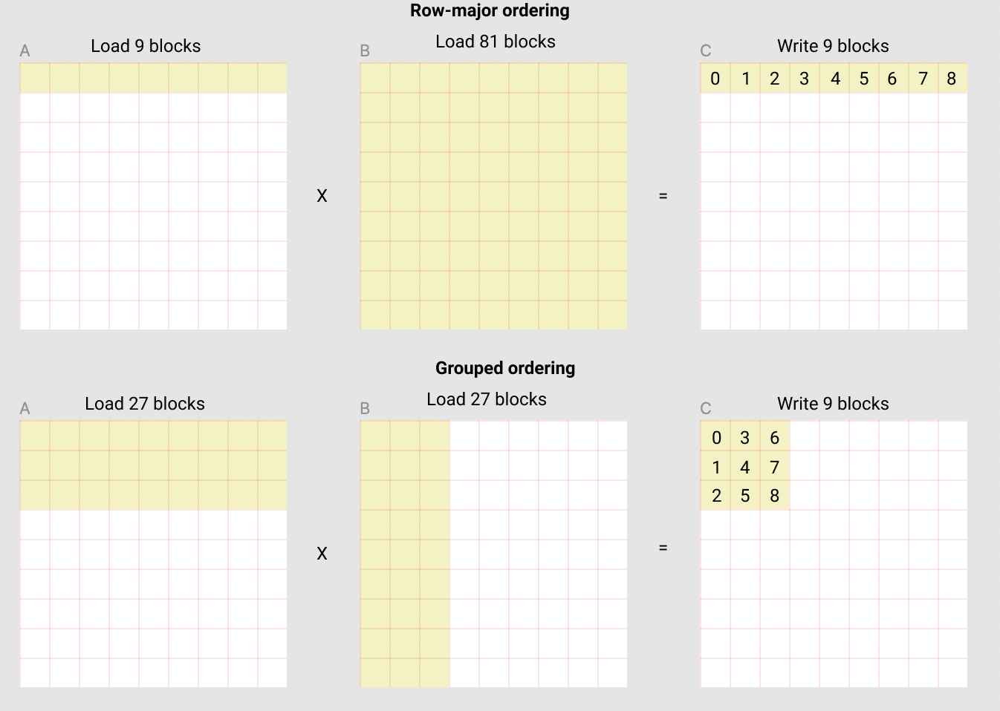

# Writing GPU Kernels, Hands-On

## Prerequisites

- [GPU execution model](execution-model.md) - SMs, warps, occupancy, coalescing, bank conflicts, tensor cores, GEMM tiling, the FlashAttention derivation, roofline. This chapter does not explain that theory again. It links to the relevant section whenever a step depends on it.
- [Toolkit](../../foundations/toolkit.md) - the "Reading C" section (pointers, arrays, structs, `#include`, compiling with a C compiler) and the Python-environment section (`venv`, `pip`). Every CUDA file here is C plus a few C++ features, which [Just enough C++ to read CUDA](#just-enough-c-to-read-cuda) below adds.
- [Linux and the OS](../../foundations/linux-and-os.md) - the shell, [environment variables](../../foundations/linux-and-os.md#environment-variables-and-path) (`CUDA_LAUNCH_BLOCKING=1`, `TORCH_CUDA_ARCH_LIST`), [shared libraries](../../foundations/linux-and-os.md#shared-libraries-and-ld_library_path) (the `.so` a build produces), and [driver vs runtime vs toolkit](../../foundations/linux-and-os.md#cuda-driver-vs-runtime-vs-toolkit-why-cuda-version-mismatch-happens).
- [Concurrency](../../foundations/concurrency.md) - races, barriers, atomics, and [streams and events](../../foundations/concurrency.md#part-7-gpu-concurrency). A kernel is a few thousand threads racing on shared memory.
- [Computer architecture](../../foundations/computer-architecture.md) - caches, SIMD, floating point, why bytes cost more than FLOPs.
- [Transformer architectures](../../models/architectures.md) - what softmax, RMSNorm, attention, cross-entropy, GQA and [MoE](../../models/architectures.md#mixture-of-experts) layers compute.

Forward links: [GPU software stack](../gpu-software-stack.md) (the next chapter) goes deeper into driver, CUDA toolkit, `nvcc`, PTX vs SASS, and how PyTorch finds CUDA; this chapter defines what it needs of those in place. [Serving engine internals](../../inference/serving-engine-internals.md) is where the inference-side kernels linked from here (paged and split-KV attention, ragged batching, DeepEP) are taught.

[The execution model chapter](execution-model.md) explains why a kernel is fast or slow. This chapter is the workshop. You write kernels from an empty file, test them until they are correct, measure them, and use a profiler to pick the next optimization. It covers the two languages you will meet in any lab's kernel repository: CUDA C++ (full control, more code) and Triton (a Python DSL, or domain-specific language, where you program whole tiles and the compiler maps them to threads). By the end you should be able to read and modify a production kernel repository (FlashAttention, Liger-Kernel, vLLM's `csrc/` and `fused_moe`, ThunderKittens, DeepGEMM), add a kernel with tests and benchmarks, and expose it to `torch.compile`.

Names you will see throughout: *vLLM* and *SGLang* are open-source LLM inference servers (taught in [serving engine internals](../../inference/serving-engine-internals.md)); *Liger-Kernel* is a library of Triton kernels for LLM training; *cuBLAS* is NVIDIA's closed-source matrix-multiply library, which is what `torch.matmul` calls on a GPU and the baseline every GEMM kernel is measured against. A *PR* (pull request) is a proposed change to a shared git repository that maintainers review before merging it, and *CI* (continuous integration) is the machine that automatically runs the repository's tests on every PR ([git basics are in the toolkit chapter](../../foundations/toolkit.md#git-from-zero)).

The plan:

| part | what you build | why it matters |
| :--- | :------------- | :------------- |
| [CUDA C++ from zero](#cuda-c-from-zero) | vector add, a PyTorch extension, a fused bf16 elementwise kernel | launch syntax, indexing, memory, errors, build |
| [Reductions](#reductions) | sum: atomics, smem tree, shuffles, multi-block | every norm, softmax, loss and optimizer has one |
| [Softmax and norms in CUDA](#softmax-rmsnorm-and-layernorm-in-cuda) | online softmax, RMSNorm, Welford LayerNorm | one-pass statistics, mergeable states |
| [GEMM step by step](#gemm-step-by-step) | 6 SGEMM kernels, then tensor cores | the most important kernel, and the clearest optimization ladder |
| [Triton from zero](#triton-from-zero) | softmax, autotuned matmul, fused cross-entropy, FlashAttention forward | what most new ML kernels are written in |
| [Grouped GEMM for MoE](#grouped-gemm-for-moe) | one launch for all experts | the core of MoE training and serving |
| [Testing](#testing-kernels), [benchmarking](#benchmarking-kernels), [ncu](#reading-ncu-to-choose-the-next-optimization) | a test harness, a timing harness, a profiler workflow | what reviewers check in a kernel PR |
| [Custom ops](#integrating-kernels-as-pytorch-custom-ops) | `torch.library` ops that work with autograd and `torch.compile` | how a kernel becomes usable |
| [The kernel DSL landscape](#cutlass-cute-thunderkittens-and-other-kernel-dsls) | CUTLASS/CuTe, ThunderKittens, TileLang, Gluon, ... | what you will see in other repositories |


## How to run this chapter without a GPU

This chapter was written on an Apple Silicon Mac, which has no NVIDIA GPU. Here is how each kind of code was checked. Every code block says which kind it is.

- **Triton kernels: run in a simulator.** Triton has no macOS wheels (`pip download triton` on this machine: `ERROR: No matching distribution found for triton`), so even `TRITON_INTERPRET=1` (Triton's built-in CPU interpreter, Linux only) was unavailable. Instead, [`tsim.py`](#tsimpy-a-cpu-simulator-of-the-triton-model) below is a ~130-line CPU simulator of the subset of `triton.language` this chapter uses, built on CPU PyTorch. The kernel bodies are ordinary Triton source. Only the import line changes, through a 10-line `backend.py`. With an NVIDIA GPU and real Triton, the same files run on the GPU unchanged. **The pasted outputs come from the simulator. They show the algorithm and indexing are correct. They say nothing about speed, and the kernels have not been compiled by the real Triton compiler.** Real Triton enforces constraints the simulator does not (for example power-of-2 block shapes, `tl.dot` needing tiles of at least 16, and types of loop-carried values), so treat the Triton code as "algorithm verified, compile untested".
- **CUDA C++: syntax-checked, never run.** No `nvcc` here. Every `.cu` file was type-checked with `clang++ -x cuda -fsyntax-only --cuda-gpu-arch=sm_90` against hand-written stub headers. That catches typos, type errors and bad template instantiations, but it is not the real CUDA headers and not a compile. The index arithmetic of the SGEMM kernels and the reduction trees was checked by [mirroring them thread by thread in Python](#checking-the-index-arithmetic-without-a-gpu). Running them on a GPU is untested.
- **PyTorch integration: run on CPU.** `torch.utils.cpp_extension.load_inline` (with a C++ CPU function), `torch.library.custom_op`, `opcheck` and `torch.compile(fullgraph=True)` all work on a Mac and were run.

Setup, all inside `/tmp` (virtual environments and `pip` are covered in the [toolkit chapter](../../foundations/toolkit.md#running-the-books-code); `ninja` is a small, fast build tool, a cousin of Make, that PyTorch uses to drive the C++ compiler):

```bash
python3 -m venv /tmp/mle-venv
/tmp/mle-venv/bin/pip install torch numpy ninja      # torch 2.15.0, numpy 2.5.4; ninja for cpp_extension
mkdir -p /tmp/mle-kernels && cd /tmp/mle-kernels      # save each file below under its name
/tmp/mle-venv/bin/python softmax.py
```

### `backend.py`: one import line for GPU and simulator

```python
# backend.py - real Triton on an NVIDIA GPU, the tsim simulator otherwise. Same kernel source.
import torch
if torch.cuda.is_available():
    import triton
    import triton.language as tl
    DEV = "cuda"
else:
    import tsim as triton
    tl = triton.language
    DEV = "cpu"
```

### `tsim.py`: a CPU simulator of the Triton model

Read this after [the Triton programming model](#the-programming-model) if you want to know exactly what the simulator does. It does what Triton's interpreter does: it runs each program instance one at a time on the CPU, treats every `tl.*` op as a whole-tile tensor op, and represents a pointer as "base buffer + tensor of offsets". Two choices make it more useful for debugging than a naive loop. Programs run in a **shuffled order**, because real programs run in no defined order and a kernel that depends on order is wrong. Every load and store is **bounds-checked against the tensor's storage**, so a missing mask raises an error instead of quietly reading a neighbour's memory, which is what usually happens on a GPU.

```python
# tsim.py - a tiny CPU simulator of the Triton programming model, built on CPU PyTorch.
# Kernel bodies written against it are plain Triton; only the import line changes:
#     import tsim as triton; tl = triton.language      # instead of: import triton, triton.language as tl
# It runs one program instance at a time, sequentially, like TRITON_INTERPRET=1 does.
# Note: covers the subset of tl.* used in this chapter; add ops as kernels need them.
import itertools, random, types
import torch


class _Dtype:                                   # what `ptr.dtype.element_ty` returns
    def __init__(self, t): self.element_ty = t


class Ptr:
    """A pointer tensor: one flat storage buffer + a tensor of element offsets into it."""
    def __init__(self, buf, offs):
        self.buf, self.offs = buf, offs
    def __add__(self, o): return Ptr(self.buf, self.offs + o)
    __radd__ = __add__
    def __sub__(self, o): return Ptr(self.buf, self.offs - o)
    @property
    def dtype(self): return _Dtype(self.buf.dtype)


def _as_ptr(t):
    # view the whole underlying storage as 1-D so strided / offset tensors behave like raw pointers
    n = t.untyped_storage().nbytes() // t.element_size()
    flat = torch.as_strided(t, (n,), (1,), 0)
    return Ptr(flat, torch.tensor(t.storage_offset()))


def _check(p, mask):
    offs = p.offs if mask is None else p.offs[torch.broadcast_to(torch.as_tensor(mask), p.offs.shape)]
    if offs.numel() and (offs.min() < 0 or offs.max() >= p.buf.numel()):
        raise IndexError(f"out-of-bounds access (offset {int(offs.max())} >= {p.buf.numel()}); missing mask?")


def load(p, mask=None, other=0.0):
    _check(p, mask)
    idx = p.offs.clamp(0, p.buf.numel() - 1)
    x = p.buf[idx]
    if mask is None:
        return x
    return torch.where(torch.as_tensor(mask), x, torch.as_tensor(other, dtype=x.dtype))


def store(p, val, mask=None):
    _check(p, mask)
    val = torch.broadcast_to(torch.as_tensor(val).to(p.buf.dtype), p.offs.shape)
    m = torch.ones_like(p.offs, dtype=torch.bool) if mask is None else torch.broadcast_to(torch.as_tensor(mask), p.offs.shape)
    p.buf[p.offs[m]] = val[m]


def atomic_add(p, val, mask=None):
    _check(p, mask)
    val = torch.broadcast_to(torch.as_tensor(val).to(p.buf.dtype), p.offs.shape)
    m = torch.ones_like(p.offs, dtype=torch.bool) if mask is None else torch.broadcast_to(torch.as_tensor(mask), p.offs.shape)
    p.buf.index_add_(0, p.offs[m].reshape(-1), val[m].reshape(-1))


_rng = random.Random(0)
_pid = [0, 0, 0]
_grid = [1, 1, 1]
T = torch.as_tensor
language = types.SimpleNamespace(
    constexpr=int, float32=torch.float32, float16=torch.float16, bfloat16=torch.bfloat16,
    int32=torch.int32, int64=torch.int64,
    program_id=lambda axis: _pid[axis],
    num_programs=lambda axis: _grid[axis],
    arange=lambda a, b: torch.arange(a, b),
    zeros=lambda shape, dtype: torch.zeros(shape, dtype=dtype),
    full=lambda shape, v, dtype: torch.full(shape, v, dtype=dtype),
    load=load, store=store, atomic_add=atomic_add,
    sum=lambda x, axis=None: x.sum() if axis is None else x.sum(axis),
    max=lambda x, axis=None: x.max() if axis is None else x.amax(axis),
    min=lambda x, axis=None: x.min() if axis is None else x.amin(axis),
    argmax=lambda x, axis: x.argmax(axis),
    exp=lambda x: torch.exp(T(x)), exp2=lambda x: torch.exp2(T(x)), log=lambda x: torch.log(T(x)),
    sqrt=lambda x: torch.sqrt(T(x)), rsqrt=lambda x: torch.rsqrt(T(x)),
    maximum=lambda a, b: torch.maximum(T(a), T(b)), minimum=lambda a, b: torch.minimum(T(a), T(b)),
    where=lambda c, a, b: torch.where(T(c), T(a), T(b)),
    # tl.dot: tensor-core MMA, fp32 accumulate; inputs are fed at their own precision
    dot=lambda a, b, acc=None: (a.float() @ b.float()) + (0 if acc is None else acc),
    trans=lambda x: x.T,
    cdiv=lambda a, b: (a + b - 1) // b,
    multiple_of=lambda x, _: x, max_contiguous=lambda x, _: x,   # compiler hints: no-ops here
    static_range=range, range=range,
)


def cdiv(a, b): return (a + b - 1) // b
def next_power_of_2(n): return 1 << (n - 1).bit_length()


class Config:
    def __init__(self, kwargs, num_warps=4, num_stages=2):
        self.kwargs, self.num_warps, self.num_stages = kwargs, num_warps, num_stages


class _Kernel:
    def __init__(self, fn, configs=None): self.fn, self.configs, self.calls = fn, configs, 0
    def __getitem__(self, grid):
        def launch(*args, **kw):
            kw.pop("num_warps", None); kw.pop("num_stages", None)   # meaningless on a CPU
            if self.configs:   # "autotune": each call uses the next config, so a test loop covers all
                kw = {**self.configs[self.calls % len(self.configs)].kwargs, **kw}   # (timing here means nothing)
                self.calls += 1
            g = grid(kw) if callable(grid) else grid
            g = tuple(g) + (1,) * (3 - len(g))
            _grid[:] = g
            args = [_as_ptr(a) if isinstance(a, torch.Tensor) else a for a in args]
            pids = list(itertools.product(*(range(n) for n in g)))
            _rng.shuffle(pids)            # real programs run in no particular order; so do these
            for pid in pids:
                _pid[:] = pid
                self.fn(*args, **kw)
        return launch


def jit(fn): return _Kernel(fn)


def autotune(configs, key, **_):
    return lambda k: _Kernel(k.fn, configs)
```


## CUDA C++ from zero

### Just enough C++ to read CUDA

CUDA C++ is C (as read in the [toolkit chapter](../../foundations/toolkit.md#reading-c)'s "Reading C" section) plus some C++ features and a handful of GPU keywords. You do not need to write general C++ to follow this chapter. You need to recognize these features when they appear:

- **`a::b`** is a name `b` inside a *namespace* `a`, which is how C++ groups names, much like a Python module (`torch::Tensor`, `at::cuda::getCurrentCUDAStream`, `wmma::fragment`). `using namespace nvcuda;` makes the names in `nvcuda` usable without the prefix, like `from nvcuda import *`.
- **Templates.** `template <typename T, int N>` before a function or struct makes it generic over a type `T` and a compile-time integer `N`. You pick the values in angle brackets at the call site, e.g. `sgemm_smem<32><<<grid, block>>>(...)` means "the version of `sgemm_smem` with `TILE = 32`". The compiler generates separate machine code for each choice, so `N` is a constant inside the function, and loops over it can be fully unrolled. That is why tile sizes are template parameters.
- **`auto x = ...;`** lets the compiler infer the type. **`constexpr`** marks a value computed at compile time. **`static_assert(cond, "msg")`** is a check the compiler runs while compiling; it costs nothing at run time.
- **Structs with functions.** A C++ `struct` can contain functions. `operator()` makes a struct callable like a function, so `struct Sum { float operator()(float a, float b) const { return a + b; } };` can be passed as an argument and then called as `merge(a, b)`. `Sum{}` creates one; `MD{x, 1.f}` builds a struct from its fields in order (*brace initialization*).
- **`reinterpret_cast<T*>(p)`** reinterprets the bytes at pointer `p` as type `T`, with no conversion. It is how the code treats 8 adjacent bf16 values as one 16-byte `uint4` to load them in one instruction. `(float)i` is the ordinary C cast, which does convert.
- **Preprocessor lines** start with `#` and are processed before compilation. `#include "file.cuh"` pastes a file in (`.cuh` is the CUDA header-file convention). `#pragma once` at the top of a header says "include this at most once". `#pragma unroll` asks the compiler to unroll the next loop. `#define NAME(args) ...` defines a *macro*, a text substitution; a trailing `\` continues it on the next line, and the `do { ... } while (0)` wrapper in `CUDA_CHECK` is the standard trick that makes a multi-statement macro behave like one statement. `__FILE__` and `__LINE__` expand to the current file name and line number.
- **Small C syntax that Python lacks:** `cond ? a : b` is Python's `a if cond else b`; `1.f` and `0.5f` are `float` literals (`1.0` would be a `double`); `++i` adds one; `x >>= 1` halves an integer; `0xffffffffu` is an unsigned hexadecimal constant (all 32 bits set). Bitwise `&`, `|`, `^`, `<<`, `>>` mean the same as in Python.
- **`asm volatile("...")`** embeds raw assembly (here PTX, the GPU's assembly language) inside C++; the `"=f"(d[0])` and `"r"(a[0])` lists say which C++ variables feed each `%0, %1, ...` placeholder. You will only read this, in the tensor core section.
- **CUDA's built-in vector types**: `float4` is a struct of four floats with fields `.x .y .z .w` (16 bytes), `uint4` is four 32-bit unsigned integers (also 16 bytes, used as a raw 16-byte chunk), `dim3` and `uint3` are three integers `.x .y .z` (a `dim3` you do not fill in defaults to 1 in the missing axes), and `make_float4(a, b, c, d)` builds a `float4`. `half` and `__nv_bfloat16` are the fp16 and bf16 types; `__bfloat162float` and `__float2bfloat16` convert to and from `float`.

The same features in a plain C++ program you can compile on any machine with a C++ compiler (run on this Mac with Apple clang 17; the GPU keywords are left out):

```cpp
// cpp_tour.cpp - the C++ features this chapter's CUDA code uses, in plain C++ (no GPU)
// build: clang++ -std=c++17 -o cpp_tour cpp_tour.cpp && ./cpp_tour     (g++ works too)
#include <cstdio>
#include <cstdint>

#define CHECK(cond)                                         \
  do {                                                      \
    if (!(cond)) { printf("failed at line %d\n", __LINE__); return 1; } \
  } while (0)

namespace demo {                                  // demo::sum is the full name
template <typename T, int N>                      // a type and an int fixed at compile time
T sum(const T* x) {
  static_assert(N > 0, "N must be positive");      // checked by the compiler, costs nothing at run time
  T acc = 0;
#pragma unroll                                     // a hint; plain C++ compilers may ignore it
  for (int i = 0; i < N; ++i) acc += x[i];
  return acc;
}
}  // namespace demo

struct Max {                                      // a "function object": a struct you can call
  float operator()(float a, float b) const { return a > b ? a : b; }
};

struct Pair { float m, d; };

int main() {
  float x[4] = {1.f, 2.f, 3.f, 4.f};              // 1.f is a float literal (1.0 would be a double)
  constexpr int n = 4;                             // compile-time constant
  auto s = demo::sum<float, n>(x);                 // auto: the compiler infers the type (float)
  float m = Max{}(3.f, 7.f);                       // build a Max with {}, then call it
  Pair p{m, s};                                    // brace initialization of a struct
  uint32_t bits = *reinterpret_cast<uint32_t*>(&p.d);   // view the same 4 bytes as another type
  printf("sum=%.1f max=%.1f bits=0x%08x\n", p.d, p.m, bits);
  CHECK(s == 10.f && m == 7.f);
  return 0;
}
```

```
sum=10.0 max=7.0 bits=0x41200000
```

`0x41200000` is the IEEE 754 bit pattern of `10.0f` ([floating point](../../foundations/computer-architecture.md#floating-point-ieee-754)): `reinterpret_cast` changed how the bytes are read, not the bytes.

### The anatomy of a kernel

A *kernel* is a C++ function marked `__global__`. The host (CPU) launches it and the device (GPU) runs it once per thread. The launch syntax `kernel<<<grid, block, smem_bytes, stream>>>(args...)` starts `grid.x * grid.y * grid.z` *blocks* (CTAs) of `block.x * block.y * block.z` threads each. Every thread runs the same function and finds out who it is from four built-in variables:

| variable | type | meaning |
| :------- | :--- | :------ |
| `threadIdx` | `uint3` | this thread's coordinates within its block |
| `blockIdx` | `uint3` | this block's coordinates within the grid |
| `blockDim` | `dim3` | the block shape (threads per block, per axis) |
| `gridDim` | `dim3` | the grid shape (blocks per axis) |

The other qualifiers you will see: `__device__` is a function callable only from GPU code (inlined helpers). `__host__ __device__` compiles for both sides. `__shared__` declares a variable in the block's shared memory (smem), visible to all threads of the block. `__restrict__` promises the compiler that pointers do not alias, which lets it use the read-only cache and reorder loads. `__syncthreads()` is a barrier for all threads of one block (there is no barrier across blocks inside a kernel, apart from *cooperative launches*, a special launch mode, `cudaLaunchCooperativeKernel`, that guarantees all blocks are resident at once so a grid-wide barrier cannot deadlock). `__forceinline__` forces a `__device__` helper to be inlined, and `__launch_bounds__(N)` on a kernel promises it is never launched with more than `N` threads per block, so the compiler can budget registers for that size ([occupancy](execution-model.md#occupancy-worked)).

Limits worth memorizing (from the [CUDA programming guide](https://docs.nvidia.com/cuda/cuda-c-programming-guide/index.html), compute capability 7.0 to 10.x): at most 1024 threads per block; `gridDim.x` up to $2^{31} - 1$; `gridDim.y` and `gridDim.z` up to 65535; static `__shared__` up to 48 KB per block (more needs dynamic shared memory plus `cudaFuncSetAttribute`). Blocks should be a multiple of 32 threads, because the hardware runs 32-thread warps ([why](execution-model.md#sms-warps-and-schedulers)).

The one line every elementwise kernel starts with is the global index, plus the check for the partial last block:

```python
# indexing.py - what `int i = blockIdx.x * blockDim.x + threadIdx.x` computes, for n = 1000, 256 threads/block
n, threads = 1000, 256
blocks = (n + threads - 1) // threads              # ceil-divide: 4 blocks = 1024 threads >= n
for b in range(blocks):
    ids = [b * threads + t for t in range(threads)]
    live = sum(i < n for i in ids)
    print(f"block {b}: i = {ids[0]:4d}..{ids[-1]:4d}  threads doing work: {live}")
```

```
block 0: i =    0.. 255  threads doing work: 256
block 1: i =  256.. 511  threads doing work: 256
block 2: i =  512.. 767  threads doing work: 256
block 3: i =  768..1023  threads doing work: 232
```

Without the `if (i < n)`, the last 24 threads write past the end of the array. The GPU usually does not crash on that: it scribbles over whatever the caching allocator placed next. This is the most common kernel bug, and it is why [testing](#testing-kernels) uses sizes that are not multiples of the block size.

### A complete program: memory, launch, errors, timing

Device memory is a separate address space. `cudaMalloc` returns a pointer the CPU must not dereference, and `cudaMemcpy` moves bytes between the two. Every CUDA runtime call returns a `cudaError_t`. Kernel launches return nothing, so you check them in two places: `cudaGetLastError()` right after the launch catches *launch* errors (too many threads per block, too much shared memory), and the next synchronizing call (`cudaDeviceSynchronize`, `cudaEventSynchronize`, a blocking `cudaMemcpy`) reports *execution* errors (illegal address, misaligned access). Because execution is asynchronous, an error reported at line 80 may come from a kernel launched at line 40. Set `CUDA_LAUNCH_BLOCKING=1` to make every launch synchronous while you debug.

```cuda
// vadd.cu - a complete CUDA program: allocate, copy, launch, check errors, time, verify
#include <cstdio>
#include <cstdlib>
#include <cuda_runtime.h>

#define CUDA_CHECK(call)                                                              \
  do {                                                                                \
    cudaError_t err_ = (call);                                                        \
    if (err_ != cudaSuccess) {                                                        \
      fprintf(stderr, "CUDA error %s at %s:%d: %s\n", cudaGetErrorName(err_),         \
              __FILE__, __LINE__, cudaGetErrorString(err_));                          \
      exit(1);                                                                        \
    }                                                                                 \
  } while (0)

// __global__: runs on the GPU, launched from the host. One thread per element.
__global__ void vadd(const float* __restrict__ a, const float* __restrict__ b,
                     float* __restrict__ c, int n) {
  int i = blockIdx.x * blockDim.x + threadIdx.x;   // global thread index
  if (i < n) c[i] = a[i] + b[i];                   // the last block is partial
}

int main() {
  const int n = 1 << 24;                           // 16M floats = 64 MB per array
  const size_t bytes = (size_t)n * sizeof(float);
  float* ha = (float*)malloc(bytes);
  float* hb = (float*)malloc(bytes);
  float* hc = (float*)malloc(bytes);
  for (int i = 0; i < n; ++i) { ha[i] = (float)i; hb[i] = 2.0f * i; }

  float *da, *db, *dc;                             // device pointers: not dereferenceable on host
  CUDA_CHECK(cudaMalloc(&da, bytes));
  CUDA_CHECK(cudaMalloc(&db, bytes));
  CUDA_CHECK(cudaMalloc(&dc, bytes));
  CUDA_CHECK(cudaMemcpy(da, ha, bytes, cudaMemcpyHostToDevice));
  CUDA_CHECK(cudaMemcpy(db, hb, bytes, cudaMemcpyHostToDevice));

  const int threads = 256;                         // per block: a multiple of 32 (warp size)
  const int blocks = (n + threads - 1) / threads;  // ceil-divide so every element is covered
  cudaEvent_t start, stop;
  CUDA_CHECK(cudaEventCreate(&start));
  CUDA_CHECK(cudaEventCreate(&stop));

  vadd<<<blocks, threads>>>(da, db, dc, n);        // warmup (first launch loads the module)
  CUDA_CHECK(cudaGetLastError());                  // catches bad launch configs immediately
  CUDA_CHECK(cudaEventRecord(start));
  vadd<<<blocks, threads>>>(da, db, dc, n);
  CUDA_CHECK(cudaGetLastError());
  CUDA_CHECK(cudaEventRecord(stop));
  CUDA_CHECK(cudaEventSynchronize(stop));          // faults inside the kernel surface here
  float ms = 0.f;
  CUDA_CHECK(cudaEventElapsedTime(&ms, start, stop));

  CUDA_CHECK(cudaMemcpy(hc, dc, bytes, cudaMemcpyDeviceToHost));
  int bad = 0;
  for (int i = 0; i < n; ++i) bad += (hc[i] != 3.0f * i);
  printf("n=%d  %.3f ms  %.0f GB/s  mismatches=%d\n", n, ms, 3.0 * bytes / (ms * 1e6), bad);

  CUDA_CHECK(cudaFree(da)); CUDA_CHECK(cudaFree(db)); CUDA_CHECK(cudaFree(dc));
  free(ha); free(hb); free(hc);
  return bad != 0;
}
```

Build and run (untested here; expected output sketched, numbers depend on the GPU). `nvcc` is NVIDIA's compiler driver, used like the C compiler in the toolkit chapter: `-O3` optimizes, `-o vadd` names the output program, `-arch=sm_90` picks the GPU generation to generate machine code for, and `-lineinfo` keeps a map from machine code back to source lines for the profiler (more on all of these in the next section):

```bash
nvcc -O3 -arch=sm_90 -lineinfo -o vadd vadd.cu     # sm_90 = H100; sm_80 = A100; sm_100 = B200
./vadd
# n=16777216  0.07 ms  2900 GB/s  mismatches=0        <- sketch: 3 x 64 MB moved, near HBM peak on H100
```

The arithmetic behind that sketched line, so you can tell whether your own number makes sense:

```python
# vadd_floor.py - the floor for vadd.cu: 3 arrays of 2^24 fp32 at peak HBM bandwidth
n = 1 << 24
bytes_moved = 3 * n * 4                       # read a, read b, write c (fp32)
for gpu, bw in [("A100 80GB SXM", 2.039e12), ("H100 SXM", 3.35e12)]:
    print(f"{gpu:14s} ideal time {bytes_moved / bw * 1e3:.3f} ms at peak {bw/1e12:.2f} TB/s")
```

```
A100 80GB SXM  ideal time 0.099 ms at peak 2.04 TB/s
H100 SXM       ideal time 0.060 ms at peak 3.35 TB/s
```

Unified memory (`cudaMallocManaged`) gives one pointer valid on both sides, with pages migrating on demand. It is convenient for prototypes. In ML code you rarely touch either API, because PyTorch's caching allocator owns device memory and you receive pointers from tensors, as shown next.

### Compiling: nvcc, PTX, SASS

`nvcc` splits a `.cu` file into host code (passed to the system C++ compiler) and device code. Device code is compiled to *PTX* (a virtual, forward-compatible ISA) and then by `ptxas` to *SASS* (the real machine code of one architecture). The executable embeds a *fatbinary* with SASS for each `-arch`/`-gencode` target and optionally PTX, which the driver can JIT-compile for newer GPUs. Details are in [the software stack chapter](../gpu-software-stack.md), which comes next; this section is enough to build the examples here.

```bash
# SASS for H100 + PTX so future GPUs can JIT it
nvcc -O3 -lineinfo -gencode arch=compute_90,code=sm_90 -gencode arch=compute_90,code=compute_90 -o vadd vadd.cu
# wgmma / setmaxnreg and other Hopper-only features need the "a" (architecture-specific) target:
nvcc -O3 -arch=sm_90a ...
# per-kernel registers, smem and spills (read this for every kernel you write)
nvcc -O3 -arch=sm_90 --ptxas-options=-v -c vadd.cu
#   ptxas info    : Used 10 registers, 380 bytes cmem[0]          <- sketch
# look at the machine code
cuobjdump -sass vadd | grep -E "LDG|STG|FADD" | head
#   LDG.E.CONSTANT R2, desc[UR4][R2.64] ; FADD R9, R4, R7 ; STG.E desc[UR4][R6.64], R9   <- sketch
```

`-lineinfo` keeps the source-line mapping (no slowdown) so that Nsight Compute can attribute stalls to source lines. `-G` builds debug device code, which is very slow; use it only with `cuda-gdb` (NVIDIA's GPU-aware version of [gdb](../../foundations/linux-and-os.md#gdb-basics)). `--use_fast_math` replaces `expf`/division with approximate versions and flushes denormals ([subnormals](../../foundations/computer-architecture.md#floating-point-ieee-754)) to zero. Inside a kernel you can make that choice per call with intrinsics such as `__expf`.

### Loading a kernel into PyTorch: `load_inline`

`torch.utils.cpp_extension.load_inline` writes your source strings to a build directory, generates a `build.ninja`, compiles with `nvcc`/`c++`, links against libtorch, and imports the result as a Python module. If you pass `functions=[...]`, it also generates the pybind11 bindings (pybind11 is the C++ library that wraps a C++ function so Python can call it). libtorch is PyTorch's C++ library; `torch::Tensor` is the C++ type behind a Python `torch.Tensor`, and `#include <torch/extension.h>` brings in all of it. It caches by a hash of the sources, so the second run is instant. The mechanics are the same for CPU-only C++, so this part runs on a Mac:

```python
# inline_cpu.py - the load_inline mechanics with a C++ CPU function (runs on a Mac; no CUDA needed)
import time, torch
from torch.utils.cpp_extension import load_inline

cpp = r"""
#include <torch/extension.h>
torch::Tensor scale_add(torch::Tensor x, torch::Tensor y, double alpha) {
  TORCH_CHECK(x.sizes() == y.sizes(), "shape mismatch");
  TORCH_CHECK(x.scalar_type() == torch::kFloat && y.scalar_type() == torch::kFloat, "float32 only");
  auto xc = x.contiguous(), yc = y.contiguous();
  auto out = torch::empty_like(xc);
  const float* xp = xc.data_ptr<float>(); const float* yp = yc.data_ptr<float>();
  float* op = out.data_ptr<float>();
  for (int64_t i = 0; i < xc.numel(); ++i) op[i] = alpha * xp[i] + yp[i];
  return out;
}
"""
t0 = time.time()
ext = load_inline(name="scale_add_ext", cpp_sources=cpp, functions=["scale_add"],
                  extra_cflags=["-O3"], verbose=False)
print(f"built + loaded in {time.time() - t0:.1f}s ->", ext.scale_add.__doc__.splitlines()[0])
x, y = torch.randn(1000), torch.randn(1000)
torch.testing.assert_close(ext.scale_add(x, y, 2.0), 2.0 * x + y)
print("scale_add OK")
try:
    ext.scale_add(x, y[:10], 2.0)
except RuntimeError as e:
    print("TORCH_CHECK ->", str(e).splitlines()[0])
```

```
built + loaded in 4.6s -> scale_add(arg0: torch.Tensor, arg1: torch.Tensor, arg2: typing.SupportsFloat | typing.SupportsIndex) -> torch.Tensor
scale_add OK
TORCH_CHECK -> shape mismatch
```

The first run compiles (the time above, with an empty cache). A second run prints `built + loaded in 0.0s`, because the build directory (`~/.cache/torch_extensions/<py>_<cuda>/<name>` on Linux, `~/Library/Caches/torch_extensions/...` here; override with `TORCH_EXTENSIONS_DIR`) holds the `.so` (the compiled [shared library](../../foundations/linux-and-os.md#shared-libraries-and-ld_library_path) that Python imports). `TORCH_CHECK` raises a Python `RuntimeError` with your message. Use it for every precondition your kernel assumes.

The CUDA version (untested). Three details separate a toy from a correct extension: launch on PyTorch's *current stream*, not the default stream, otherwise your kernel is unordered with respect to the surrounding PyTorch ops; set the *device guard* so a tensor on `cuda:1` launches on GPU 1; and check the launch:

```python
# vadd_ext.py - CUDA kernel as a PyTorch function (untested: needs an NVIDIA GPU + CUDA toolkit)
import torch
from torch.utils.cpp_extension import load_inline

cuda_src = r"""
#include <torch/extension.h>
#include <ATen/cuda/CUDAContext.h>
#include <c10/cuda/CUDAGuard.h>

__global__ void vadd_kernel(const float* __restrict__ a, const float* __restrict__ b,
                            float* __restrict__ c, int64_t n) {
  int64_t i = blockIdx.x * (int64_t)blockDim.x + threadIdx.x;   // int64: tensors can exceed 2^31 elements
  if (i < n) c[i] = a[i] + b[i];
}

torch::Tensor vadd(torch::Tensor a, torch::Tensor b) {
  TORCH_CHECK(a.is_cuda() && b.is_cuda(), "CUDA tensors expected");
  TORCH_CHECK(a.scalar_type() == torch::kFloat32 && b.scalar_type() == torch::kFloat32, "float32 expected");
  TORCH_CHECK(a.sizes() == b.sizes(), "shape mismatch");
  const at::cuda::OptionalCUDAGuard guard(a.device());
  auto ac = a.contiguous(), bc = b.contiguous();      // kernel assumes dense, unit-stride memory
  auto c = torch::empty_like(ac);
  const int64_t n = ac.numel();
  if (n == 0) return c;                               // a 0-block launch is an error
  const int threads = 256;
  const unsigned blocks = (unsigned)((n + threads - 1) / threads);
  vadd_kernel<<<blocks, threads, 0, at::cuda::getCurrentCUDAStream()>>>(
      ac.data_ptr<float>(), bc.data_ptr<float>(), c.data_ptr<float>(), n);
  C10_CUDA_KERNEL_LAUNCH_CHECK();                     // cudaGetLastError -> C++ exception -> Python
  return c;
}
"""
ext = load_inline(name="vadd_ext",
                  cpp_sources="torch::Tensor vadd(torch::Tensor a, torch::Tensor b);",   # declaration for bindings
                  cuda_sources=cuda_src, functions=["vadd"],
                  extra_cuda_cflags=["-O3", "-lineinfo"], verbose=True)
x, y = torch.randn(10_000_001, device="cuda"), torch.randn(10_000_001, device="cuda")
torch.testing.assert_close(ext.vadd(x, y), x + y)
```

`TORCH_CUDA_ARCH_LIST="9.0"` (environment variable) selects the architectures to build for; by default it builds for the GPUs it sees. For a real repository you would switch to `torch.utils.cpp_extension.CUDAExtension` in `setup.py` (the classic file that tells `pip install` how to build a package with compiled parts), or to a CMake build (CMake is a widely used generator of C/C++ build scripts), and register the function as a proper operator ([below](#integrating-kernels-as-pytorch-custom-ops)) instead of a pybind function.

### Elementwise fusion and vectorized loads

Elementwise ops have arithmetic intensity well below 1 FLOP/byte, so they are memory-bound and their cost is bytes moved ([roofline](execution-model.md#roofline-per-op)). *Fusion* means doing several ops per load: read `x` once, apply bias, GELU, residual, cast, write once. Eager PyTorch runs one kernel per op and round-trips HBM between them. The fused kernel below also uses *vectorized* 16-byte accesses (8 bf16 values per `uint4`). That issues one wide load instruction instead of eight narrow ones, which cuts instruction count and pressure on the load/store queue; it is the "LG Throttle" fix in the [stall table](execution-model.md#nsight-compute-why-is-this-kernel-slow). Vector accesses need the address aligned to 16 bytes and the row length divisible by 8. Real kernels check both and fall back to a scalar path.

```cuda
// bias_gelu.cu - fused bias + tanh-GELU, bf16, 16-byte (8 x bf16) vector loads and stores
#include <cstdint>
#include <cuda_bf16.h>
#include <math.h>

// requires N % 8 == 0 and 16-byte aligned x, bias, y (true for fresh torch allocations)
__global__ void bias_gelu_bf16(const __nv_bfloat16* __restrict__ x, const __nv_bfloat16* __restrict__ bias,
                               __nv_bfloat16* __restrict__ y, int64_t rows, int N) {
  const int64_t nvec = rows * N / 8;
  const int64_t stride = (int64_t)gridDim.x * blockDim.x;
  for (int64_t v = blockIdx.x * (int64_t)blockDim.x + threadIdx.x; v < nvec; v += stride) {
    uint4 xr = reinterpret_cast<const uint4*>(x)[v];                       // 16 B = 8 bf16
    uint4 br = *reinterpret_cast<const uint4*>(bias + (v * 8) % N);
    const __nv_bfloat16* xe = reinterpret_cast<const __nv_bfloat16*>(&xr);
    const __nv_bfloat16* be = reinterpret_cast<const __nv_bfloat16*>(&br);
    uint4 out;
    __nv_bfloat16* oe = reinterpret_cast<__nv_bfloat16*>(&out);
#pragma unroll
    for (int j = 0; j < 8; ++j) {
      float t = __bfloat162float(xe[j]) + __bfloat162float(be[j]);
      oe[j] = __float2bfloat16(0.5f * t * (1.f + tanhf(0.7978845608f * (t + 0.044715f * t * t * t))));
    }
    reinterpret_cast<uint4*>(y)[v] = out;
  }
}
```

It uses a *grid-stride loop*: launch a fixed grid of a few blocks per SM and let each thread walk the array in steps of the whole grid. One launch configuration then works for any size, and per-thread setup is amortized.

The bytes the fusion saves, per element of a `(rows, N)` bf16 activation:

```python
# fusion_bytes.py - HBM bytes per element: bias + GELU + residual add in eager vs fused, bf16
eager = {"x + bias": 2 + 2, "gelu": 2 + 2, "+ residual": 2 + 2 + 2}   # read(s) + write per kernel
fused = 2 + 2 + 2                                                         # read x, read residual, write y
print("eager kernels:", eager, "->", sum(eager.values()), "B/elem")
print("fused:", fused, "B/elem ->", f"{sum(eager.values()) / fused:.2f}x fewer bytes, 3 launches -> 1")
```

```
eager kernels: {'x + bias': 4, 'gelu': 4, '+ residual': 6} -> 14 B/elem
fused: 6 B/elem -> 2.33x fewer bytes, 3 launches -> 1
```

(The kernel above fuses the first two; adding the residual is one more 16-byte load per thread. The bias vector is tiny and cached, so it is ignored. `torch.compile` does exactly this kind of fusion for you, see [Inductor](execution-model.md#inductor-codegen). You write elementwise kernels by hand when the fusion crosses something the compiler will not fuse, such as the epilogue of a custom GEMM.)


## Reductions

A *reduction* combines many values into one (sum, max, mean, logsumexp). Elementwise kernels are embarrassingly parallel (each output depends only on its own inputs, so threads never need to talk); reductions are not, because every input contributes to one output. They appear in every norm, softmax, loss, optimizer step and gradient-norm clip. The goal is the same as for elementwise kernels: a reduction is memory-bound, so a good one reads its input once at close to HBM bandwidth.

The canonical worklog is Mark Harris, "Optimizing Parallel Reduction in CUDA" (NVIDIA, 2007; [slides](https://developer.download.nvidia.com/assets/cuda/files/reduction.pdf)). It runs on a G80 (peak 86.4 GB/s) with 2^22 integers. Its numbers, as published:

| Harris kernel | idea | GB/s | cumulative speedup |
| :------------ | :--- | ---: | -----------------: |
| 1 | interleaved addressing, divergent branch (`tid % (2*s) == 0`) | 2.083 | 1x |
| 2 | interleaved addressing, strided index (bank conflicts) | 4.854 | 2.33x |
| 3 | sequential addressing | 9.741 | 4.68x |
| 4 | first add during global load | 17.377 | 8.34x |
| 5 | unroll the last warp | 31.289 | 15.01x |
| 6 | complete unroll (templates) | 43.996 | 21.16x |
| 7 | multiple elements per thread | 62.671 | 30.04x (72% of peak) |

The ideas still hold. Two things changed: kernel 5's "warp-synchronous" trick, which relied on implicit lockstep within a warp, became incorrect with Volta's independent thread scheduling, and warp shuffles replaced it.

### v0 to v3

All four versions are in one file. The shared `block_allreduce` helper is written once and reused by every later kernel in this chapter. "All-reduce" has the same meaning as the [collective](../../foundations/distributed-systems.md#collectives-the-workhorse-of-distributed-training) of that name, scaled down: every thread of the block (instead of every GPU) ends up holding the combined result:

```cuda
// block_reduce.cuh - warp and block all-reduce for any struct of floats and any associative merge
#pragma once

template <typename T>
__device__ __forceinline__ T shfl_xor(T v, int lane_mask) {
  static_assert(sizeof(T) % sizeof(float) == 0, "T must be a struct of 4-byte fields");
  float* f = reinterpret_cast<float*>(&v);
#pragma unroll
  for (int i = 0; i < (int)(sizeof(T) / sizeof(float)); ++i)
    f[i] = __shfl_xor_sync(0xffffffffu, f[i], lane_mask);
  return v;
}

// butterfly: after 5 steps every lane of the warp holds the reduction of all 32 lanes
template <typename T, typename Merge>
__device__ __forceinline__ T warp_allreduce(T v, Merge merge) {
#pragma unroll
  for (int m = 16; m > 0; m >>= 1) v = merge(v, shfl_xor(v, m));
  return v;
}

// requires blockDim.x to be a multiple of 32 and <= 1024; every thread gets the result
template <typename T, typename Merge>
__device__ __forceinline__ T block_allreduce(T v, Merge merge, T identity) {
  __shared__ T part[32];                       // one slot per warp
  const int lane = threadIdx.x & 31, warp = threadIdx.x >> 5, nwarps = blockDim.x >> 5;
  v = warp_allreduce(v, merge);
  __syncthreads();                             // a previous call may still be reading part[]
  if (lane == 0) part[warp] = v;
  __syncthreads();
  v = lane < nwarps ? part[lane] : identity;   // each warp redundantly reduces the partials,
  return warp_allreduce(v, merge);             // which saves a third barrier and a broadcast
}

struct Sum { __device__ float operator()(float a, float b) const { return a + b; } };
```

```cuda
// reduce.cu - summing n floats, four ways
#include <cstdint>
#include "block_reduce.cuh"

// v0: one atomic per element. Correct, but 2^24 atomics serialize on one address,
// and the summation order (hence the fp32 result) changes run to run.
__global__ void sum_atomic(const float* __restrict__ x, float* out, int n) {
  int i = blockIdx.x * blockDim.x + threadIdx.x;
  if (i < n) atomicAdd(out, x[i]);
}

// v1: shared-memory tree with sequential addressing: active threads are contiguous
// (whole warps retire together, no divergence) and s[tid], s[tid + stride] hit distinct banks.
template <int BLOCK>
__global__ void sum_smem_tree(const float* __restrict__ x, float* __restrict__ partial, int n) {
  __shared__ float s[BLOCK];
  const int tid = threadIdx.x;
  const int i = blockIdx.x * BLOCK + tid;
  s[tid] = i < n ? x[i] : 0.f;
  __syncthreads();
  for (int stride = BLOCK / 2; stride > 0; stride >>= 1) {
    if (tid < stride) s[tid] += s[tid + stride];
    __syncthreads();                           // log2(BLOCK) barriers
  }
  if (tid == 0) partial[blockIdx.x] = s[0];
}

// v2: warp shuffles: registers only inside a warp, one smem round trip per block
__global__ void sum_shuffle(const float* __restrict__ x, float* __restrict__ partial, int n) {
  int i = blockIdx.x * blockDim.x + threadIdx.x;
  float v = block_allreduce(i < n ? x[i] : 0.f, Sum{}, 0.f);
  if (threadIdx.x == 0) partial[blockIdx.x] = v;
}

// v3: a fixed grid (a few blocks per SM) where each thread first sums many elements with
// 16-byte loads, so the tree runs once per block instead of once per 256 elements.
// Call twice: n elements -> gridDim.x partials -> 1. Deterministic: no atomics.
__global__ void sum_grid_stride(const float* __restrict__ x, float* __restrict__ partial, int64_t n) {
  float acc = 0.f;
  const int64_t tid = blockIdx.x * (int64_t)blockDim.x + threadIdx.x;
  const int64_t nthreads = (int64_t)gridDim.x * blockDim.x;
  const int64_t n4 = n / 4;                    // x must be 16-byte aligned (torch allocations are)
  const float4* x4 = reinterpret_cast<const float4*>(x);
  for (int64_t i = tid; i < n4; i += nthreads) {
    float4 v = x4[i];
    acc += (v.x + v.y) + (v.z + v.w);
  }
  for (int64_t i = 4 * n4 + tid; i < n; i += nthreads) acc += x[i];   // 0-3 tail elements
  acc = block_allreduce(acc, Sum{}, 0.f);
  if (threadIdx.x == 0) partial[blockIdx.x] = acc;
}
```

Why each one is faster than the last:

- **v0, atomics**: `atomicAdd` on one address serializes in the L2's atomic unit. It is fine for a few thousand atomics, hopeless for millions. It is also non-deterministic: the order of the floating-point additions depends on timing.
- **v1, shared-memory tree**: $\log_2 256 = 8$ steps, each halving the active threads. *Sequential addressing* (`s[tid] += s[tid + stride]`, active threads `0..stride-1`) keeps active threads contiguous, so whole warps go idle together (no [divergence](execution-model.md#divergence)) and the 32 lanes touch 32 consecutive words (no [bank conflicts](execution-model.md#bank-conflicts)). Cost: 8 barriers and a smem round trip per step.
- **v2, warp shuffles**: `__shfl_xor_sync(mask, v, m)` reads register `v` from lane `lane ^ m` directly, with no shared memory and no barrier inside a warp. Five steps reduce 32 lanes. Only the 8 warp partials go through smem, once. The XOR "butterfly" leaves the total in *every* lane, so every warp can finish the block reduction redundantly and the result needs no broadcast.
- **v3, multi-block with many elements per thread**: launch a fixed grid of `4 x num_SMs` blocks. Each thread sums $n / (\text{blocks} \cdot 256)$ elements in registers with 16-byte loads (Harris's kernel 7 idea), and the tree runs once per block instead of once per 256 elements. A second launch reduces the partials. Two passes, no atomics, so the result is **bitwise deterministic** for a given grid size.

The PyTorch wrapper and test for v3 (untested):

```python
# reduce_ext.py - build reduce.cu's v3 into PyTorch and check it (needs an NVIDIA GPU; untested)
import pathlib, torch
from torch.utils.cpp_extension import load_inline

here = pathlib.Path(__file__).parent
cuda_src = (here / "block_reduce.cuh").read_text() + (here / "reduce.cu").read_text().replace(
    '#include "block_reduce.cuh"', "") + r"""
#include <torch/extension.h>
#include <ATen/cuda/CUDAContext.h>
#include <c10/cuda/CUDAGuard.h>

torch::Tensor sum_two_pass(torch::Tensor x) {
  TORCH_CHECK(x.is_cuda() && x.is_contiguous() && x.scalar_type() == torch::kFloat32, "contiguous fp32 CUDA");
  const at::cuda::OptionalCUDAGuard guard(x.device());
  const int blocks = 4 * at::cuda::getCurrentDeviceProperties()->multiProcessorCount;
  auto partial = torch::empty({blocks}, x.options());
  auto out = torch::empty({1}, x.options());
  auto stream = at::cuda::getCurrentCUDAStream();
  sum_grid_stride<<<blocks, 256, 0, stream>>>(x.data_ptr<float>(), partial.data_ptr<float>(), x.numel());
  C10_CUDA_KERNEL_LAUNCH_CHECK();
  sum_grid_stride<<<1, 1024, 0, stream>>>(partial.data_ptr<float>(), out.data_ptr<float>(), blocks);
  C10_CUDA_KERNEL_LAUNCH_CHECK();
  return out;
}
"""
ext = load_inline("reduce_ext", cpp_sources="torch::Tensor sum_two_pass(torch::Tensor x);",
                  cuda_sources=cuda_src, functions=["sum_two_pass"], extra_cuda_cflags=["-O3", "-lineinfo"])

for n in [1, 3, 4, 1000, 1 << 20, (1 << 24) + 7]:
    x = torch.randn(n, device="cuda")
    got, ref = ext.sum_two_pass(x), x.double().sum()
    assert abs(got.item() - ref.item()) <= 1e-5 * n ** 0.5 + 1e-5, (n, got.item(), ref.item())
    assert torch.equal(ext.sum_two_pass(x), got)          # bitwise reproducible
print("sum_two_pass OK")
```

### Checking the reduction without a GPU

Before running on a GPU, you can execute the algorithm lane by lane in Python to check it gives the right answer. The mirror below reproduces `__shfl_down_sync` (the "down" variant, where only lane 0 ends with the total), the block structure and the grid-stride split. It also shows the floating-point facts that drive kernel design:

```python
# reduce_mirror.py - the warp-shuffle and block reductions, lane by lane, plus why order matters
import numpy as np

def shfl_down(vals, delta):                  # __shfl_down_sync(0xffffffff, v, delta) for a 32-lane warp
    return [vals[l + delta] if l + delta < 32 else vals[l] for l in range(32)]

def warp_reduce_sum(vals):
    vals = list(vals)
    for off in (16, 8, 4, 2, 1):            # 5 steps for 32 lanes
        other = shfl_down(vals, off)
        vals = [v + o for v, o in zip(vals, other)]
    return vals[0]                          # only lane 0 holds the full sum

def block_reduce_sum(x, threads=256):       # one value per thread -> warp sums -> smem -> warp 0
    warp_sums = [warp_reduce_sum(x[w * 32:(w + 1) * 32]) for w in range(threads // 32)]
    smem = warp_sums + [0.0] * (32 - len(warp_sums))   # warp 0 reads 32 slots, pads with 0
    return warp_reduce_sum(smem)

rng = np.random.default_rng(0)
x = rng.standard_normal(256).astype(np.float32)
print("block_reduce_sum:", np.float32(block_reduce_sum(list(x))), " np.sum:", x.sum(dtype=np.float64))

# grid-stride: each of G*256 threads accumulates a strided subset, then one block reduce per block
n, G = 1_000_003, 8
y = rng.standard_normal(n).astype(np.float32)
partials = []
for b in range(G):
    per_thread = [np.float32(0)] * 256
    for t in range(256):
        per_thread[t] = y[b * 256 + t::G * 256].sum(dtype=np.float32)
    partials.append(np.float32(block_reduce_sum(per_thread)))
print("two-pass multi-block:", np.float32(sum(partials)), " fp64 reference:", y.sum(dtype=np.float64))

# fp32 addition is not associative: the same numbers in a different order give a different sum
orders = {np.float32(np.sum(rng.permutation(y), dtype=np.float32)) for _ in range(5)}
print("5 random orders ->", len(orders), "distinct fp32 sums:", sorted(float(o) for o in orders))

# Welford / Chan merge for LayerNorm: (n, mean, M2) of two halves combine exactly
def merge(a, b):
    n = a[0] + b[0]; d = b[1] - a[1]
    return n, a[1] + d * b[0] / n, a[2] + b[2] + d * d * a[0] * b[0] / n
z = rng.standard_normal(4096) * 3 + 100
st = lambda v: (len(v), v.mean(), ((v - v.mean()) ** 2).sum())
n_, mean, M2 = merge(merge(st(z[:1000]), st(z[1000:3000])), st(z[3000:]))
print(f"welford merge: mean {mean:.10f} var {M2 / n_:.10f} | numpy: {z.mean():.10f} {z.var():.10f}")

# online-softmax pair merge (m, d): max and rescaled sum, associative so any tree order works
def sm_merge(a, b):
    m = max(a[0], b[0]); return m, a[1] * np.exp(a[0] - m) + b[1] * np.exp(b[0] - m)
s = rng.standard_normal(1000) * 10
parts = [(c.max(), np.exp(c - c.max()).sum()) for c in np.split(s, 8)]
m, d = parts[0]
for p in parts[1:]: m, d = sm_merge((m, d), p)
print(f"online softmax merge: logsumexp {m + np.log(d):.12f} | direct {np.log(np.exp(s).sum()):.12f}")
```

```
block_reduce_sum: 0.48477745  np.sum: 0.4847759190015495
two-pass multi-block: 989.6423  fp64 reference: 989.6422559503635
5 random orders -> 2 distinct fp32 sums: [989.642333984375, 989.6424560546875]
welford merge: mean 100.0402787114 var 8.6659856771 | numpy: 100.0402787114 8.6659856771
online softmax merge: logsumexp 32.735291829949 | direct 32.735291829949
```

Three lessons from the output. The block and multi-block trees agree with an fp64 reference to fp32 rounding. Summing the same 1M floats in different orders gives **different fp32 results**, because floating-point addition is not associative. That is why atomics (order depends on timing) and split-K style kernels whose split depends on the shape are non-deterministic, while a fixed two-pass tree is reproducible ([batch invariance](../../inference/serving-engine-internals.md#determinism-and-batch-invariance) in a serving engine, a later chapter, is the same issue: the same request should give the same bits whatever else is in its batch). The Welford and online-softmax *merge* functions are associative, which is exactly what makes them usable inside a tree reduction: any split of the input, merged in any tree order, gives the same answer up to rounding.


## Softmax, RMSNorm and LayerNorm in CUDA

All three are "one row per block, reduce, then normalize" kernels. The only differences are what gets reduced and how two partial states merge:

| op | per-thread state | merge(a, b) | passes over x |
| :- | :--------------- | :---------- | ------------: |
| softmax (naive) | max, then sum | max; sum | 3 (max, sum, write) |
| softmax (online) | $(m, d)$ running max and rescaled sum | $m = \max(m_a, m_b);\ d = d_a e^{m_a - m} + d_b e^{m_b - m}$ | 2 (stats, write) |
| RMSNorm | sum of squares | `+` | 2 (stats, write) |
| LayerNorm (Welford) | `(n, mean, M2)` | Chan et al. parallel merge | 2 (stats, write) |

The online softmax derivation is in [the execution model chapter](execution-model.md#online-softmax). Here it is used as a merge operator, so the `block_allreduce` above works unchanged:

```cuda
// norms.cu - one block per row: online softmax, RMSNorm (bf16), LayerNorm (Welford)
#include <cstdint>
#include <cuda_bf16.h>
#include <math.h>
#include "block_reduce.cuh"

// ---- softmax: (max, sum) in one pass, then one normalizing pass: 2 reads of x instead of 3 ----
struct MD { float m, d; };                     // running max, running sum of exp(x - m)
struct MergeMD {
  __device__ MD operator()(MD a, MD b) const {
    float m = fmaxf(a.m, b.m);
    if (m == -INFINITY) return {m, 0.f};       // both sides saw only -inf: avoid (-inf) - (-inf)
    return {m, a.d * __expf(a.m - m) + b.d * __expf(b.m - m)};
  }
};

__global__ void softmax_online(const float* __restrict__ x, float* __restrict__ y, int N) {
  const float* xr = x + (int64_t)blockIdx.x * N;
  float* yr = y + (int64_t)blockIdx.x * N;
  MD t{-INFINITY, 0.f};
  for (int i = threadIdx.x; i < N; i += blockDim.x) t = MergeMD{}(t, MD{xr[i], 1.f});
  const MD row = block_allreduce(t, MergeMD{}, MD{-INFINITY, 0.f});
  const float inv_d = 1.f / row.d;
  for (int i = threadIdx.x; i < N; i += blockDim.x) yr[i] = __expf(xr[i] - row.m) * inv_d;
}

// ---- RMSNorm, bf16 in/out, fp32 math. The second read of the row hits L1/L2 ----
__global__ void rmsnorm_bf16(const __nv_bfloat16* __restrict__ x, const __nv_bfloat16* __restrict__ w,
                             __nv_bfloat16* __restrict__ y, int N, float eps) {
  const __nv_bfloat16* xr = x + (int64_t)blockIdx.x * N;
  __nv_bfloat16* yr = y + (int64_t)blockIdx.x * N;
  float ss = 0.f;
  for (int i = threadIdx.x; i < N; i += blockDim.x) {
    float v = __bfloat162float(xr[i]);
    ss += v * v;
  }
  ss = block_allreduce(ss, Sum{}, 0.f);
  const float rstd = rsqrtf(ss / N + eps);
  for (int i = threadIdx.x; i < N; i += blockDim.x)
    yr[i] = __float2bfloat16(__bfloat162float(xr[i]) * rstd * __bfloat162float(w[i]));
}

// ---- LayerNorm: Welford (count, mean, M2) per thread, merged with Chan's formula ----
// One-pass sum / sum-of-squares is E[x^2] - E[x]^2, which cancels catastrophically when
// |mean| >> std; Welford does not.
struct Welford { float n, mean, m2; };
struct MergeW {
  __device__ Welford operator()(Welford a, Welford b) const {
    float n = a.n + b.n;
    if (n == 0.f) return {0.f, 0.f, 0.f};
    float d = b.mean - a.mean, rb = b.n / n;
    return {n, a.mean + d * rb, a.m2 + b.m2 + d * d * a.n * rb};
  }
};

__global__ void layernorm_f32(const float* __restrict__ x, const float* __restrict__ gamma,
                              const float* __restrict__ beta, float* __restrict__ y, int N, float eps) {
  const float* xr = x + (int64_t)blockIdx.x * N;
  float* yr = y + (int64_t)blockIdx.x * N;
  Welford t{0.f, 0.f, 0.f};
  for (int i = threadIdx.x; i < N; i += blockDim.x) {   // Welford update = merge with a 1-sample state
    float v = xr[i];
    t.n += 1.f;
    float d = v - t.mean;
    t.mean += d / t.n;
    t.m2 += d * (v - t.mean);
  }
  const Welford s = block_allreduce(t, MergeW{}, Welford{0.f, 0.f, 0.f});
  const float mean = s.mean, rstd = rsqrtf(s.m2 / N + eps);
  for (int i = threadIdx.x; i < N; i += blockDim.x)
    yr[i] = (xr[i] - mean) * rstd * gamma[i] + beta[i];
}
```

Design notes:

- **Why Welford for LayerNorm.** The tempting one-pass $\operatorname{var} = E[x^2] - E[x]^2$ subtracts two large, nearly equal numbers when $\lvert\text{mean}\rvert \gg \text{std}$, and in fp32 it can lose every significant digit (it can even go negative). Welford's running `(n, mean, M2)` and Chan's merge are stable. The mirror output above confirms the merge on data with mean 100 and std 3. RMSNorm has no mean subtraction, so a plain sum of squares in fp32 is fine.
- **The `-inf` guard** in `MergeMD` handles fully masked rows (attention with padding): `(-inf) - (-inf)` is NaN in IEEE arithmetic, and one NaN poisons the whole row. The Triton softmax below has the same guard, and the [tests](#testing-kernels) cover it.
- **The second pass** re-reads `x`. For rows up to a few thousand elements that re-read hits L1/L2. The faster production layout caches the row in registers on the first pass. With $N \le 8192$ bf16 and 256 threads that is at most 32 values per thread (the [register arithmetic](execution-model.md#choices-and-why) in the execution model chapter), and it removes the second HBM read entirely for rows evicted from L2.
- **One block per row** is wrong for small `N`: a 1024-wide row on 256 threads gives each thread 4 elements, and block-level barriers dominate. Production kernels (Apex, FlashAttention's layer norm, vLLM's `csrc/layernorm_kernels.cu`) map *one warp per row* when `N` is small, so the reduction is shuffles only, and one block per row when it is large.

A test for the CUDA norms looks exactly like the Triton tests in [Testing kernels](#testing-kernels); `reduce_ext.py` above shows the build pattern.


## GEMM step by step

The best-known hands-on GEMM worklog is Simon Boehm, ["How to Optimize a CUDA Matmul Kernel for cuBLAS-like Performance: a Worklog"](https://siboehm.com/articles/22/CUDA-MMM) (2022). It writes fp32 SGEMM kernels in order, each fixing the bottleneck of the previous one. **These numbers are his**, measured mostly on an NVIDIA A6000 with fp32 (no tensor cores) at about 4096x4096 (see his post for exact conditions):

| kernel (Boehm's numbering) | GFLOP/s | % of cuBLAS |
| :------------------------- | ------: | ----------: |
| 1: naive | 309.0 | 1.3% |
| 2: global memory coalescing | 1986.5 | 8.5% |
| 3: shared memory caching | 2980.3 | 12.8% |
| 4: 1D blocktiling | 8474.7 | 36.5% |
| 5: 2D blocktiling | 15971.7 | 68.7% |
| 6: vectorized memory access | 18237.3 | 78.4% |
| 9: autotuning | 19721.0 | 84.8% |
| 10: warptiling | 21779.3 | 93.7% |
| 0: cuBLAS | 23249.6 | 100.0% |

The kernels below follow his steps 1 to 6 with the same tile parameters (written for this chapter, not copied; row-major `C = A @ B`, no `alpha`/`beta`). For the theory of each level, see the [tiling hierarchy](execution-model.md#gemm-tiling-hierarchy) and [coalescing](execution-model.md#coalescing).

```cuda
// sgemm.cu - C = A @ B, fp32, row-major A (M, K), B (K, N), C (M, N); the steps of the
// SGEMM worklog. Kernels 1-3 handle any shape; 4-6 require M % BM == N % BN == K % BK == 0.

// ---- 1: naive. threadIdx.x -> row, so the 32 lanes of a warp read 32 different rows of A
//      (stride K: 32 sectors per load) and write 32 different rows of C.
__global__ void sgemm_naive(int M, int N, int K, const float* A, const float* B, float* C) {
  const int row = blockIdx.x * blockDim.x + threadIdx.x;
  const int col = blockIdx.y * blockDim.y + threadIdx.y;
  if (row < M && col < N) {
    float acc = 0.f;
    for (int k = 0; k < K; ++k) acc += A[row * K + k] * B[k * N + col];
    C[row * N + col] = acc;
  }
}
// launch: dim3 block(32, 32); dim3 grid(cdiv(M, 32), cdiv(N, 32));

// ---- 2: coalesced. threadIdx.x -> column: a warp reads one A element (broadcast) and 32
//      consecutive floats of B (4 sectors), and writes 32 consecutive floats of C.
__global__ void sgemm_coalesced(int M, int N, int K, const float* A, const float* B, float* C) {
  const int row = blockIdx.y * blockDim.y + threadIdx.y;
  const int col = blockIdx.x * blockDim.x + threadIdx.x;
  if (row < M && col < N) {
    float acc = 0.f;
    for (int k = 0; k < K; ++k) acc += A[row * K + k] * B[k * N + col];
    C[row * N + col] = acc;
  }
}
// launch: dim3 block(32, 32); dim3 grid(cdiv(N, 32), cdiv(M, 32));

// ---- 3: shared-memory tiling. Each A and B element is loaded from global once per block
//      instead of once per thread: global traffic drops by TILE (32x).
template <int TILE>
__global__ void sgemm_smem(int M, int N, int K, const float* A, const float* B, float* C) {
  __shared__ float As[TILE][TILE];
  __shared__ float Bs[TILE][TILE];
  const int tx = threadIdx.x, ty = threadIdx.y;
  const int row = blockIdx.y * TILE + ty, col = blockIdx.x * TILE + tx;
  float acc = 0.f;
  for (int k0 = 0; k0 < K; k0 += TILE) {
    As[ty][tx] = (row < M && k0 + tx < K) ? A[row * K + k0 + tx] : 0.f;   // coalesced along tx
    Bs[ty][tx] = (k0 + ty < K && col < N) ? B[(k0 + ty) * N + col] : 0.f;
    __syncthreads();                         // tile fully loaded before anyone reads it
#pragma unroll
    for (int k = 0; k < TILE; ++k) acc += As[ty][k] * Bs[k][tx];          // As: broadcast, Bs: 32 banks
    __syncthreads();                         // everyone done reading before the next overwrite
  }
  if (row < M && col < N) C[row * N + col] = acc;
}
// launch: dim3 block(32, 32); dim3 grid(cdiv(N, 32), cdiv(M, 32));

// ---- 4: 1D blocktiling. Each thread computes TM outputs in a column; the B value is loaded
//      from smem once and reused TM times from a register. 9 smem loads per 8 FMAs instead of 16.
template <int BM, int BN, int BK, int TM>
__global__ void __launch_bounds__((BM * BN) / TM)
sgemm_1d(int M, int N, int K, const float* A, const float* B, float* C) {
  static_assert(BM * BK == (BM * BN) / TM && BN * BK == (BM * BN) / TM, "one A and one B element per thread");
  __shared__ float As[BM * BK];
  __shared__ float Bs[BK * BN];
  const int tCol = threadIdx.x % BN, tRow = threadIdx.x / BN;
  A += blockIdx.y * BM * K;                  // move to this block's tile
  B += blockIdx.x * BN;
  C += blockIdx.y * BM * N + blockIdx.x * BN;
  const int aRow = threadIdx.x / BK, aCol = threadIdx.x % BK;
  const int bRow = threadIdx.x / BN, bCol = threadIdx.x % BN;
  float acc[TM] = {0.f};
  for (int k0 = 0; k0 < K; k0 += BK) {
    As[aRow * BK + aCol] = A[aRow * K + aCol];
    Bs[bRow * BN + bCol] = B[bRow * N + bCol];
    __syncthreads();
    A += BK;
    B += BK * N;
#pragma unroll
    for (int k = 0; k < BK; ++k) {
      const float b = Bs[k * BN + tCol];
#pragma unroll
      for (int i = 0; i < TM; ++i) acc[i] += As[(tRow * TM + i) * BK + k] * b;
    }
    __syncthreads();
  }
#pragma unroll
  for (int i = 0; i < TM; ++i) C[(tRow * TM + i) * N + tCol] = acc[i];
}
// launch BM=BN=64, BK=8, TM=8: dim3 block(512); dim3 grid(N / 64, M / 64);

// ---- 5: 2D blocktiling. Each thread owns a TM x TN register tile and does an outer product
//      per k: TM + TN smem loads feed TM * TN FMAs (16 loads : 64 FMAs).
template <int BM, int BN, int BK, int TM, int TN>
__global__ void __launch_bounds__((BM * BN) / (TM * TN))
sgemm_2d(int M, int N, int K, const float* A, const float* B, float* C) {
  constexpr int NT = (BM * BN) / (TM * TN);  // 256 threads for 128x128 / (8x8)
  __shared__ float As[BM * BK];
  __shared__ float Bs[BK * BN];
  const int tRow = threadIdx.x / (BN / TN), tCol = threadIdx.x % (BN / TN);
  A += blockIdx.y * BM * K;
  B += blockIdx.x * BN;
  C += blockIdx.y * BM * N + blockIdx.x * BN;
  const int aRow = threadIdx.x / BK, aCol = threadIdx.x % BK;
  const int bRow = threadIdx.x / BN, bCol = threadIdx.x % BN;
  constexpr int aStride = NT / BK, bStride = NT / BN;   // rows covered per loader pass
  float acc[TM * TN] = {0.f};
  float regM[TM], regN[TN];
  for (int k0 = 0; k0 < K; k0 += BK) {
#pragma unroll
    for (int o = 0; o < BM; o += aStride) As[(aRow + o) * BK + aCol] = A[(aRow + o) * K + aCol];
#pragma unroll
    for (int o = 0; o < BK; o += bStride) Bs[(bRow + o) * BN + bCol] = B[(bRow + o) * N + bCol];
    __syncthreads();
    A += BK;
    B += BK * N;
#pragma unroll
    for (int k = 0; k < BK; ++k) {
#pragma unroll
      for (int i = 0; i < TM; ++i) regM[i] = As[(tRow * TM + i) * BK + k];
#pragma unroll
      for (int j = 0; j < TN; ++j) regN[j] = Bs[k * BN + tCol * TN + j];
#pragma unroll
      for (int i = 0; i < TM; ++i)
#pragma unroll
        for (int j = 0; j < TN; ++j) acc[i * TN + j] += regM[i] * regN[j];
    }
    __syncthreads();
  }
#pragma unroll
  for (int i = 0; i < TM; ++i)
#pragma unroll
    for (int j = 0; j < TN; ++j) C[(tRow * TM + i) * N + tCol * TN + j] = acc[i * TN + j];
}
// launch BM=BN=128, BK=8, TM=TN=8: dim3 block(256); dim3 grid(N / 128, M / 128);

// ---- 6: vectorized. 16-byte global loads (LDG.128) and A stored transposed in smem so the
//      regM reads are contiguous too. Also needs 16-byte aligned A, B, C.
template <int BM, int BN, int BK, int TM, int TN>
__global__ void __launch_bounds__((BM * BN) / (TM * TN))
sgemm_vec(int M, int N, int K, const float* A, const float* B, float* C) {
  constexpr int NT = (BM * BN) / (TM * TN);
  static_assert(BM * BK / 4 == NT && BN * BK / 4 == NT, "one float4 of A and of B per thread");
  __shared__ float As[BK * BM];              // transposed: As[k * BM + m]
  __shared__ float Bs[BK * BN];
  const int tRow = threadIdx.x / (BN / TN), tCol = threadIdx.x % (BN / TN);
  A += blockIdx.y * BM * K;
  B += blockIdx.x * BN;
  C += blockIdx.y * BM * N + blockIdx.x * BN;
  const int aRow = threadIdx.x / (BK / 4), aCol = threadIdx.x % (BK / 4);
  const int bRow = threadIdx.x / (BN / 4), bCol = threadIdx.x % (BN / 4);
  float acc[TM * TN] = {0.f};
  float regM[TM], regN[TN];
  for (int k0 = 0; k0 < K; k0 += BK) {
    const float4 a = reinterpret_cast<const float4*>(&A[aRow * K + aCol * 4])[0];
    As[(aCol * 4 + 0) * BM + aRow] = a.x;
    As[(aCol * 4 + 1) * BM + aRow] = a.y;
    As[(aCol * 4 + 2) * BM + aRow] = a.z;
    As[(aCol * 4 + 3) * BM + aRow] = a.w;
    reinterpret_cast<float4*>(&Bs[bRow * BN + bCol * 4])[0] =
        reinterpret_cast<const float4*>(&B[bRow * N + bCol * 4])[0];
    __syncthreads();
    A += BK;
    B += BK * N;
#pragma unroll
    for (int k = 0; k < BK; ++k) {
#pragma unroll
      for (int i = 0; i < TM; ++i) regM[i] = As[k * BM + tRow * TM + i];
#pragma unroll
      for (int j = 0; j < TN; ++j) regN[j] = Bs[k * BN + tCol * TN + j];
#pragma unroll
      for (int i = 0; i < TM; ++i)
#pragma unroll
        for (int j = 0; j < TN; ++j) acc[i * TN + j] += regM[i] * regN[j];
    }
    __syncthreads();
  }
#pragma unroll
  for (int i = 0; i < TM; ++i)
#pragma unroll
    for (int j = 0; j < TN; j += 4)
      reinterpret_cast<float4*>(&C[(tRow * TM + i) * N + tCol * TN + j])[0] =
          make_float4(acc[i * TN + j], acc[i * TN + j + 1], acc[i * TN + j + 2], acc[i * TN + j + 3]);
}
// launch BM=BN=128, BK=8, TM=TN=8: dim3 block(256); dim3 grid(N / 128, M / 128);
```

### Why each step is faster

The whole ladder is about one ratio: **FLOPs per byte moved at each level of the memory hierarchy**. Global memory feeds smem, smem feeds registers, registers feed the FMA units. Each step raises the ratio at one level:

```python
# gemm_ai.py - why each SGEMM step is faster: bytes moved per FMA at each level of the hierarchy
def step(name, BM, BN, BK, TM, TN, smem_loads_per_k):
    threads = BM * BN // (TM * TN)
    glob_bytes = (BM + BN) * BK * 4                  # one A tile + one B tile per K-step, fp32
    fmas = BM * BN * BK
    print(f"{name:20s} tile {BM:3d}x{BN:3d}x{BK:2d} thr={threads:4d}  "
          f"global FLOP/B = {2*fmas/glob_bytes:5.1f}   smem loads per FMA = {smem_loads_per_k/(TM*TN):.3f}")

# naive/coalesced: no smem; every FMA loads 2 floats from global (L1/L2 may catch some)
print(f"{'naive / coalesced':20s} global FLOP/B = {2/8:5.2f} (before caches)  -- 2 loads per FMA")
step("k3 smem 32x32", 32, 32, 32, 1, 1, 2)            # As[ty][k], Bs[k][tx]: 2 smem loads per FMA
step("k4 1D TM=8", 64, 64, 8, 8, 1, 8 + 1)            # per k: 8 A values + 1 B value for 8 FMAs
step("k5 2D 8x8", 128, 128, 8, 8, 8, 8 + 8)           # per k: 8 + 8 values for 64 FMAs
print("registers for k5 accumulators+fragments:", 8 * 8 + 8 + 8, "floats/thread")

# H100 SXM: 989 TFLOPS bf16 dense, 3.35 TB/s HBM -> ridge point
print(f"H100 bf16 ridge point: {989e12 / 3.35e12:.0f} FLOP/B")
for n in (1024, 4096, 8192):                          # square bf16 GEMM, ideal traffic
    flops = 2 * n**3; bytes_ = 3 * n * n * 2
    print(f"  GEMM n={n:5d}: AI={flops/bytes_:6.0f} FLOP/B  -> compute-bound floor {flops/989e12*1e6:8.1f} us,"
          f" memory floor {bytes_/3.35e12*1e6:6.1f} us")

# reporting a measurement against the roofline (the 'measured' times are placeholders)
def report(name, flops, bytes_, t_s, peak_flops=989e12, peak_bw=3.35e12):
    bound = max(flops / peak_flops, bytes_ / peak_bw)
    print(f"{name:26s} {flops/t_s/1e12:7.1f} TFLOP/s {bytes_/t_s/1e9:7.0f} GB/s  {100*bound/t_s:5.1f}% of roofline")
report("gemm 4096^3 bf16 @ 180us", 2 * 4096**3, 3 * 4096**2 * 2, 180e-6)
report("softmax 8192x32768 bf16 @ 400us", 5 * 8192 * 32768, 2 * 8192 * 32768 * 2, 400e-6)
```

```
naive / coalesced    global FLOP/B =  0.25 (before caches)  -- 2 loads per FMA
k3 smem 32x32        tile  32x 32x32 thr=1024  global FLOP/B =   8.0   smem loads per FMA = 2.000
k4 1D TM=8           tile  64x 64x 8 thr= 512  global FLOP/B =  16.0   smem loads per FMA = 1.125
k5 2D 8x8            tile 128x128x 8 thr= 256  global FLOP/B =  32.0   smem loads per FMA = 0.250
registers for k5 accumulators+fragments: 80 floats/thread
H100 bf16 ridge point: 295 FLOP/B
  GEMM n= 1024: AI=   341 FLOP/B  -> compute-bound floor      2.2 us, memory floor    1.9 us
  GEMM n= 4096: AI=  1365 FLOP/B  -> compute-bound floor    139.0 us, memory floor   30.0 us
  GEMM n= 8192: AI=  2731 FLOP/B  -> compute-bound floor   1111.7 us, memory floor  120.2 us
gemm 4096^3 bf16 @ 180us     763.5 TFLOP/s     559 GB/s   77.2% of roofline
softmax 8192x32768 bf16 @ 400us     3.4 TFLOP/s    2684 GB/s   80.1% of roofline
```

- **1 to 2 (coalescing, 6.4x in Boehm's table).** Same FLOPs, same algorithm. Only the mapping of `threadIdx.x` changes. In kernel 1 a warp's 32 lanes read 32 different rows of A (one 32-byte sector each, so 32 sectors for 128 useful bytes) and write C with stride `N`. In kernel 2 they read 32 consecutive floats of B (4 sectors) and one broadcast element of A. Check it with the [sector counter](execution-model.md#coalescing).
- **2 to 3 (shared memory, 1.5x).** Each element of A and B is loaded from global memory once per 32x32 block instead of once per thread: global FLOP/byte rises from 0.25 to 8. The gain is small because the bottleneck moves to the smem-to-register level. Every FMA still needs two smem loads, and the smem pipe sustains far fewer loads per clock than the FMA units do FMAs.
- **3 to 4 (1D blocktiling, 2.8x).** Each thread computes 8 outputs and reuses one `Bs` value from a register 8 times: 9 smem loads per 8 FMAs instead of 16. The tile is also taller (64x64x8), so global intensity doubles.
- **4 to 5 (2D blocktiling, 1.9x).** An 8x8 register tile per thread is an outer product: 8 + 8 smem loads feed 64 FMAs (0.25 loads per FMA, an 8x reduction from kernel 3). The cost is 64 accumulators + 16 fragment registers per thread. That is fine at 256 threads per block, but it limits occupancy ([occupancy arithmetic](execution-model.md#occupancy-worked)). From here on the kernel is limited by instruction issue and latency, not bandwidth.
- **5 to 6 (vectorized, 1.14x).** 128-bit loads (`LDG.128`, `LDS.128`) cut load instruction count by 4x. Storing A transposed in smem makes each thread's 8 `regM` values contiguous, so they can be read as two vector loads too.
- **Beyond (Boehm's 7-10).** Autotuning tile sizes per GPU. *Warptiling* adds an explicit warp-level tile between block and thread, which improves register-level locality and makes the code map naturally onto tensor core instructions. *Double buffering* (Boehm's kernel 11, and the [software pipelining](execution-model.md#software-pipelining) section) overlaps the next tile's loads with the current tile's math.

Kernels 4 to 6 assume `M`, `N`, `K` are multiples of the tile sizes. Production GEMMs handle the edges with predicated (masked) loads for the last tiles, or with a separate edge kernel. The wrapper below enforces the assumption with `TORCH_CHECK` rather than silently computing garbage.

### Checking the index arithmetic without a GPU

Register-tiled kernels are dense index arithmetic, and an off-by-one in `tRow * TM + i` produces wrong numbers, not a crash. This mirror runs each kernel's exact index expressions thread by thread on bounds-checked flat buffers. The two barriers become phase boundaries: all threads finish loading before any thread computes. C is pre-filled with NaN, so an element no thread wrote shows up as a failure:

```python
# gemm_mirror.py - execute the CUDA SGEMM kernels' index arithmetic thread by thread in Python,
# on flat buffers, and check C against numpy. Barriers become phase boundaries: every thread
# finishes the load phase before any thread starts the compute phase.
import numpy as np


class Buf:                                   # a bounds-checked float* (base offset + flat array)
    def __init__(self, a, off=0): self.a, self.off = a, off
    def __getitem__(self, i):
        j = self.off + i; assert 0 <= j < self.a.size, f"OOB read {j}"; return self.a[j]
    def __setitem__(self, i, v):
        j = self.off + i; assert 0 <= j < self.a.size, f"OOB write {j}"; self.a[j] = v
    def __add__(self, d): return Buf(self.a, self.off + d)


def k3_smem(M, N, K, A, B, C, TILE=32):
    for by in range(-(-M // TILE)):
        for bx in range(-(-N // TILE)):
            As = np.zeros((TILE, TILE), np.float32); Bs = np.zeros((TILE, TILE), np.float32)
            acc = np.zeros((TILE, TILE), np.float32)
            for k0 in range(0, K, TILE):
                for ty in range(TILE):
                    for tx in range(TILE):                              # load phase
                        row, col = by * TILE + ty, bx * TILE + tx
                        As[ty][tx] = A[row * K + k0 + tx] if (row < M and k0 + tx < K) else 0.0
                        Bs[ty][tx] = B[(k0 + ty) * N + col] if (k0 + ty < K and col < N) else 0.0
                for ty in range(TILE):                                  # compute phase
                    for tx in range(TILE):
                        for k in range(TILE): acc[ty][tx] += As[ty][k] * Bs[k][tx]
            for ty in range(TILE):
                for tx in range(TILE):
                    row, col = by * TILE + ty, bx * TILE + tx
                    if row < M and col < N: C[row * N + col] = acc[ty][tx]


def k4_1d(M, N, K, A0, B0, C0, BM=64, BN=64, BK=8, TM=8):
    NT = BM * BN // TM
    assert BM * BK == NT and BN * BK == NT
    for cRow in range(M // BM):
        for cCol in range(N // BN):
            As = np.zeros(BM * BK, np.float32); Bs = np.zeros(BK * BN, np.float32)
            acc = np.zeros((NT, TM), np.float32)
            A, B, C = A0 + cRow * BM * K, B0 + cCol * BN, C0 + cRow * BM * N + cCol * BN
            for k0 in range(0, K, BK):
                for t in range(NT):
                    aRow, aCol, bRow, bCol = t // BK, t % BK, t // BN, t % BN
                    As[aRow * BK + aCol] = A[aRow * K + aCol]
                    Bs[bRow * BN + bCol] = B[bRow * N + bCol]
                A, B = A + BK, B + BK * N
                for t in range(NT):
                    tCol, tRow = t % BN, t // BN
                    for k in range(BK):
                        b = Bs[k * BN + tCol]
                        for i in range(TM): acc[t][i] += As[(tRow * TM + i) * BK + k] * b
            for t in range(NT):
                for i in range(TM): C[(t // BN * TM + i) * N + t % BN] = acc[t][i]


def k5_2d(M, N, K, A0, B0, C0, BM=128, BN=128, BK=8, TM=8, TN=8, vec=False):
    NT = BM * BN // (TM * TN)
    for cRow in range(M // BM):
        for cCol in range(N // BN):
            As = np.zeros(BM * BK, np.float32); Bs = np.zeros(BK * BN, np.float32)
            acc = np.zeros((NT, TM * TN), np.float32)
            A, B, C = A0 + cRow * BM * K, B0 + cCol * BN, C0 + cRow * BM * N + cCol * BN
            for k0 in range(0, K, BK):
                for t in range(NT):
                    if not vec:                                          # kernel 5 loaders
                        aRow, aCol, bRow, bCol = t // BK, t % BK, t // BN, t % BN
                        for o in range(0, BM, NT // BK): As[(aRow + o) * BK + aCol] = A[(aRow + o) * K + aCol]
                        for o in range(0, BK, NT // BN): Bs[(bRow + o) * BN + bCol] = B[(bRow + o) * N + bCol]
                    else:                                                # kernel 6: float4, A transposed
                        aRow, aCol, bRow, bCol = t // (BK // 4), t % (BK // 4), t // (BN // 4), t % (BN // 4)
                        a4 = [A[aRow * K + aCol * 4 + q] for q in range(4)]
                        for q in range(4): As[(aCol * 4 + q) * BM + aRow] = a4[q]
                        for q in range(4): Bs[bRow * BN + bCol * 4 + q] = B[bRow * N + bCol * 4 + q]
                A, B = A + BK, B + BK * N
                for t in range(NT):
                    tRow, tCol = t // (BN // TN), t % (BN // TN)
                    for k in range(BK):
                        if not vec: regM = [As[(tRow * TM + i) * BK + k] for i in range(TM)]
                        else:       regM = [As[k * BM + tRow * TM + i] for i in range(TM)]
                        regN = [Bs[k * BN + tCol * TN + j] for j in range(TN)]
                        for i in range(TM):
                            for j in range(TN): acc[t][i * TN + j] += regM[i] * regN[j]
            for t in range(NT):
                tRow, tCol = t // (BN // TN), t % (BN // TN)
                for i in range(TM):
                    for j in range(TN): C[(tRow * TM + i) * N + tCol * TN + j] = acc[t][i * TN + j]


rng = np.random.default_rng(0)
def check(name, fn, M, N, K, **kw):
    A = rng.standard_normal((M, K), dtype=np.float32); B = rng.standard_normal((K, N), dtype=np.float32)
    C = np.full(M * N, np.nan, np.float32)                   # nan: any element never written shows up
    fn(M, N, K, Buf(A.ravel()), Buf(B.ravel()), Buf(C), **kw)
    err = np.abs(C.reshape(M, N) - A @ B).max()
    print(f"{name:28s} M={M:3d} N={N:3d} K={K:3d}  max|C - A@B| = {err:.2e}")
    assert err < 1e-3

check("k3 smem tiling (bounds-checked)", k3_smem, 33, 65, 40)
check("k4 1D blocktiling", k4_1d, 128, 128, 32)
check("k5 2D blocktiling", k5_2d, 128, 256, 16)
check("k6 vectorized + transposed As", k5_2d, 256, 128, 16, vec=True)
```

```
k3 smem tiling (bounds-checked) M= 33 N= 65 K= 40  max|C - A@B| = 3.81e-06
k4 1D blocktiling            M=128 N=128 K= 32  max|C - A@B| = 3.81e-06
k5 2D blocktiling            M=128 N=256 K= 16  max|C - A@B| = 2.86e-06
k6 vectorized + transposed As M=256 N=128 K= 16  max|C - A@B| = 3.81e-06
```

This verifies the indexing and tiling logic of kernels 3 to 6. It does not verify the CUDA compilation (syntax-checked only) or the performance. Kernels 1 and 2 differ only in which index is `threadIdx.x`.

### Testing and benchmarking the ladder against cuBLAS

The harness compares each kernel to `torch.matmul` with TF32 disabled, so cuBLAS runs a true fp32 SGEMM. With TF32 enabled, cuBLAS would use tensor cores at lower precision and the comparison would be meaningless. Untested; the output format is what it would print:

```python
# sgemm_ext.py - build sgemm.cu into PyTorch, test every kernel, benchmark against cuBLAS (untested: needs a GPU)
import pathlib, torch, triton
from torch.utils.cpp_extension import load_inline

launcher = r"""
#include <torch/extension.h>
#include <ATen/cuda/CUDAContext.h>
#include <c10/cuda/CUDAGuard.h>

static inline int cdiv(int a, int b) { return (a + b - 1) / b; }

torch::Tensor sgemm(torch::Tensor A, torch::Tensor B, int64_t version) {
  TORCH_CHECK(A.is_cuda() && B.is_cuda() && A.scalar_type() == torch::kFloat32 && B.scalar_type() == torch::kFloat32);
  TORCH_CHECK(A.dim() == 2 && B.dim() == 2 && A.size(1) == B.size(0), "shape mismatch");
  const at::cuda::OptionalCUDAGuard guard(A.device());
  A = A.contiguous(); B = B.contiguous();
  const int M = A.size(0), K = A.size(1), N = B.size(1);
  auto C = torch::empty({M, N}, A.options());
  const float *a = A.data_ptr<float>(), *b = B.data_ptr<float>(); float* c = C.data_ptr<float>();
  auto s = at::cuda::getCurrentCUDAStream();
  if (version >= 4) TORCH_CHECK(M % 128 == 0 && N % 128 == 0 && K % 8 == 0, "kernels 4-6 need tile multiples");
  switch (version) {
    case 1: sgemm_naive<<<dim3(cdiv(M, 32), cdiv(N, 32)), dim3(32, 32), 0, s>>>(M, N, K, a, b, c); break;
    case 2: sgemm_coalesced<<<dim3(cdiv(N, 32), cdiv(M, 32)), dim3(32, 32), 0, s>>>(M, N, K, a, b, c); break;
    case 3: sgemm_smem<32><<<dim3(cdiv(N, 32), cdiv(M, 32)), dim3(32, 32), 0, s>>>(M, N, K, a, b, c); break;
    case 4: sgemm_1d<64, 64, 8, 8><<<dim3(N / 64, M / 64), 512, 0, s>>>(M, N, K, a, b, c); break;
    case 5: sgemm_2d<128, 128, 8, 8, 8><<<dim3(N / 128, M / 128), 256, 0, s>>>(M, N, K, a, b, c); break;
    case 6: sgemm_vec<128, 128, 8, 8, 8><<<dim3(N / 128, M / 128), 256, 0, s>>>(M, N, K, a, b, c); break;
    default: TORCH_CHECK(false, "unknown version");
  }
  C10_CUDA_KERNEL_LAUNCH_CHECK();
  return C;
}
"""
src = (pathlib.Path(__file__).parent / "sgemm.cu").read_text() + launcher
ext = load_inline("sgemm_ext", cpp_sources="torch::Tensor sgemm(torch::Tensor A, torch::Tensor B, int64_t version);",
                  cuda_sources=src, functions=["sgemm"], extra_cuda_cflags=["-O3", "-lineinfo", "--ptxas-options=-v"])

torch.backends.cuda.matmul.allow_tf32 = False              # compare against true fp32 SGEMM
torch.manual_seed(0)
for v in range(1, 7):                                       # correctness first
    shapes = [(1, 1, 1), (33, 65, 17), (100, 37, 300)] if v <= 3 else [(128, 128, 8), (256, 384, 136)]
    for M, N, K in shapes:
        A, B = torch.randn(M, K, device="cuda"), torch.randn(K, N, device="cuda")
        torch.testing.assert_close(ext.sgemm(A, B, v), A @ B, rtol=1e-4, atol=1e-4)
print("all kernels correct")

n = 4096
A, B = torch.randn(n, n, device="cuda"), torch.randn(n, n, device="cuda")
ms_cublas = triton.testing.do_bench(lambda: A @ B)
for v in range(1, 7):
    ms = triton.testing.do_bench(lambda: ext.sgemm(A, B, v))
    print(f"kernel {v}: {2 * n**3 / ms / 1e9:8.0f} GFLOP/s  {100 * ms_cublas / ms:5.1f}% of cuBLAS")
print(f"cuBLAS  : {2 * n**3 / ms_cublas / 1e9:8.0f} GFLOP/s")
```

```
all kernels correct
kernel 1:  <your GPU>  GFLOP/s   x.x% of cuBLAS        <- not measured; see Boehm's table for an A6000
...
```

The `--ptxas-options=-v` flag prints registers per kernel at build time. Kernel 5 should report on the order of 100+ registers. If it reports `spill stores`, the accumulator array did not stay in registers (usually a loop index the compiler could not resolve at compile time, which is why every loop is `#pragma unroll` with constant bounds).

### Tensor cores: WMMA, `mma.sync`, and why you stop there

fp32 SGEMM on CUDA cores tops out at the FP32 peak, about 67 TFLOPS on H100 SXM. bf16 on tensor cores is rated at 989 TFLOPS dense. For ML dtypes, every serious GEMM therefore runs on tensor cores ([instruction generations](execution-model.md#tensor-cores)). There are three levels of API:

1. **WMMA** (`nvcuda::wmma`, `<mma.h>`, sm_70+): a portable C++ API. A *fragment* is a warp-wide tile whose element-to-lane mapping is opaque. You `load_matrix_sync`, `mma_sync`, `store_matrix_sync`. It is easy and portable, but you cannot control register layouts, so you cannot do the smem swizzles and `ldmatrix` loads fast kernels need.

```cuda
// wmma.cu - tensor cores through the WMMA API: one warp computes one 16x16 tile of C.
// fp16 inputs, fp32 accumulate; requires M, N, K multiples of 16. sm_70+.
#include <cuda_fp16.h>
#include <mma.h>
using namespace nvcuda;

__global__ void hgemm_wmma(int M, int N, int K, const half* A, const half* B, float* C) {
  const int tileM = blockIdx.y * blockDim.y + threadIdx.y;          // warp-uniform
  const int tileN = (blockIdx.x * blockDim.x + threadIdx.x) / 32;   // warp-uniform
  if (tileM * 16 >= M || tileN * 16 >= N) return;                    // whole warp exits together
  wmma::fragment<wmma::matrix_a, 16, 16, 16, half, wmma::row_major> a;
  wmma::fragment<wmma::matrix_b, 16, 16, 16, half, wmma::row_major> b;
  wmma::fragment<wmma::accumulator, 16, 16, 16, float> c;
  wmma::fill_fragment(c, 0.0f);
  for (int k = 0; k < K; k += 16) {
    wmma::load_matrix_sync(a, A + tileM * 16 * K + k, K);   // last arg: leading dimension
    wmma::load_matrix_sync(b, B + k * N + tileN * 16, N);
    wmma::mma_sync(c, a, b, c);                             // c += a @ b on the tensor cores
  }
  wmma::store_matrix_sync(C + tileM * 16 * N + tileN * 16, c, N, wmma::mem_row_major);
}
// launch: dim3 block(128, 4) = 4x4 warps -> a 64x64 C tile per block;
//         dim3 grid(N / 64, M / 64)
```

This version loads fragments straight from global memory, so it repeats kernel 2's mistake at the tensor core level: there is no smem reuse across warps. The next steps mirror the SGEMM ladder. Stage block tiles of A and B through shared memory, use `cp.async` to overlap the copies ([pipelining](execution-model.md#software-pipelining)), give each warp a larger warp tile (e.g. 64x64, i.e. 4x4 fragments), and pad or swizzle smem rows to avoid bank conflicts on fragment loads.

2. **`mma.sync` PTX + `ldmatrix`** (sm_80+): inline PTX that exposes the documented register layout of each fragment ([the layout](execution-model.md#ampere-mmasync)). `ldmatrix` loads 8x8 tiles from smem directly into that layout. This is what fast Ampere kernels (and CUTLASS's SM80 path, and FlashAttention-2) use:

```cuda
// one m16n8k16 bf16 MMA with fp32 accumulators: d = a @ b + c, per warp.
// a: 4 x 32-bit regs (8 bf16), b: 2 regs (4 bf16), c/d: 4 fp32 per lane. Untested; see PTX ISA "mma".
asm volatile(
    "mma.sync.aligned.m16n8k16.row.col.f32.bf16.bf16.f32 "
    "{%0,%1,%2,%3}, {%4,%5,%6,%7}, {%8,%9}, {%10,%11,%12,%13};\n"
    : "=f"(d[0]), "=f"(d[1]), "=f"(d[2]), "=f"(d[3])
    : "r"(a[0]), "r"(a[1]), "r"(a[2]), "r"(a[3]), "r"(b[0]), "r"(b[1]),
      "f"(c[0]), "f"(c[1]), "f"(c[2]), "f"(c[3]));
// fragments come from shared memory via ldmatrix, e.g.
// asm volatile("ldmatrix.sync.aligned.m8n8.x4.shared.b16 {%0,%1,%2,%3}, [%4];\n"
//              : "=r"(a[0]), "=r"(a[1]), "=r"(a[2]), "=r"(a[3]) : "r"(smem_addr));
```

3. **Hopper `wgmma` + TMA + warp specialization** (sm_90a), and **Blackwell `tcgen05` + TMEM** (sm_100a). These are asynchronous warpgroup-wide MMAs that read operands from smem descriptors, fed by the TMA copy engine through `mbarrier`s, with producer and consumer warpgroups ([Hopper](execution-model.md#hopper-wgmma), [Blackwell](execution-model.md#blackwell-tcgen05-and-tmem)). Hand-writing this is possible but long. In practice people write it in CUTLASS/CuTe, ThunderKittens or Triton, which emit these instructions for you.

Published tensor-core worklogs, with **their** numbers:

| worklog | GPU, dtype, size | result (author's measurement) |
| :------ | :--------------- | :---------------------------- |
| Alex Armbruster, ["How To Write A Fast Matrix Multiplication From Scratch With Tensor Cores"](https://alexarmbr.github.io/2024/08/10/How-To-Write-A-Fast-Matrix-Multiplication-From-Scratch-With-Tensor-Cores.html) (2024) | Tesla T4, fp16, 8192^3 | 6 kernels from ~8% to ~96% of cuBLAS (`mma.sync`, `ldmatrix`, swizzling, pipelining) |
| Pranjal Shankhdhar, ["Outperforming cuBLAS on H100: a Worklog"](https://cudaforfun.substack.com/p/outperforming-cublas-on-h100-a-worklog) (2024) | H100 SXM, bf16, 4096^3 | Boehm-style fp32 kernel ported to bf16: 32 TFLOPS; first `wgmma` kernel 317; warp specialization 498; two consumer warpgroups 610; L2-aware scheduling 660; clusters 734; final (Hilbert-curve tile order) 764 vs cuBLAS 716 |

The H100 row is the best one-paragraph argument for tensor cores. A well-tuned CUDA-core kernel reaches 32 TFLOPS, and the *first, unoptimized* `wgmma` kernel reaches 10x that.


## Triton from zero

### The programming model

In CUDA you write the program for **one thread** and reason about warps by hand. In Triton you write the program for **one block of work** (a *program instance*, one per grid point). Every value is a whole tile (a small tensor of shape known at compile time), and the compiler decides how the tile is spread across threads, registers and shared memory, and which instructions (vector loads, `mma`, `wgmma`) to use. The core vocabulary:

| Triton | meaning | CUDA analogue |
| :----- | :------ | :------------ |
| `@triton.jit` | compile this Python function as a kernel (JIT, specialized per dtype / constexpr / alignment) | `__global__` |
| `kernel[grid](args)` | launch `grid` programs; `grid` is a tuple or `lambda meta: (...)` | `<<<grid, block>>>` |
| `tl.program_id(axis)` | which program am I | `blockIdx` |
| `tl.arange(0, BLOCK)` | the tile of indices `0..BLOCK-1` (BLOCK a power of 2) | `threadIdx` loop, implicit |
| `tl.constexpr` | compile-time constant: tile sizes, flags | template parameter |
| `X + offs` | a tile of pointers (tensor arguments arrive as pointers to element 0) | pointer arithmetic |
| `tl.load(p, mask, other)` | gather a tile; masked lanes get `other` instead of touching memory | guarded loads |
| `tl.store(p, v, mask)` | scatter a tile; masked lanes do nothing | guarded stores |
| `tl.sum / max(x, axis)` | reduction along an axis of the tile | everything in [Reductions](#reductions) |
| `tl.dot(a, b, acc)` | tile matmul on tensor cores, fp32 accumulate | WMMA / `mma` / `wgmma` |
| `num_warps`, `num_stages` | threads per program (`32 * num_warps`), software-pipeline depth | `blockDim`, multi-buffering |

A 2-D tile is built by broadcasting a column of row indices against a row of column indices. This is the pattern in every matmul and attention kernel below. The simulator shows the offsets and the mask for the last row-block of a 5x6 matrix with 4x8 tiles:

```python
# ptr_tile.py - what a 2-D pointer tile and its mask look like (runs in the simulator)
import torch
from backend import tl

x = torch.arange(5 * 6, dtype=torch.float32).reshape(5, 6)     # (M=5, N=6), row stride 6
rows = 4 + tl.arange(0, 4)                                      # program 1 of BLOCK_M=4: rows 4..7
cols = tl.arange(0, 8)                                          # BLOCK_N=8 > N=6
offs = rows[:, None] * x.stride(0) + cols[None, :]              # (4, 8) element offsets: broadcast
mask = (rows[:, None] < 5) & (cols[None, :] < 6)                # (4, 8)
print("offsets:\n", offs)
print("mask:\n", mask.int())
from tsim import _as_ptr
print("loaded tile (other=-1):\n", tl.load(_as_ptr(x) + offs, mask=mask, other=-1.0))
```

```
offsets:
 tensor([[24, 25, 26, 27, 28, 29, 30, 31],
        [30, 31, 32, 33, 34, 35, 36, 37],
        [36, 37, 38, 39, 40, 41, 42, 43],
        [42, 43, 44, 45, 46, 47, 48, 49]])
mask:
 tensor([[1, 1, 1, 1, 1, 1, 0, 0],
        [0, 0, 0, 0, 0, 0, 0, 0],
        [0, 0, 0, 0, 0, 0, 0, 0],
        [0, 0, 0, 0, 0, 0, 0, 0]], dtype=torch.int32)
loaded tile (other=-1):
 tensor([[24., 25., 26., 27., 28., 29., -1., -1.],
        [-1., -1., -1., -1., -1., -1., -1., -1.],
        [-1., -1., -1., -1., -1., -1., -1., -1.],
        [-1., -1., -1., -1., -1., -1., -1., -1.]])
```

Look at the masked offsets 30 and 31 in the first row. Here they fall just past the end of the 30-element tensor. In any row except the last, the same column overflow lands on the start of the *next* row, which is a valid address. Without the column mask the kernel would read the wrong data silently instead of crashing.

Masks replace the `if (i < n)` of CUDA. Every load and store whose indices can run past the end needs one. The rule for `other` is "a value that does not change the result": `0` for sums and dot products, `-inf` for max and softmax.

### Vector add, and what a missing mask does

```python
# vadd.py
import torch
from backend import triton, tl, DEV


@triton.jit
def add_kernel(X, Y, OUT, n, BLOCK: tl.constexpr):
    pid = tl.program_id(0)                        # which BLOCK-sized chunk is mine
    offs = pid * BLOCK + tl.arange(0, BLOCK)      # (BLOCK,) element indices
    mask = offs < n                               # the last chunk is partial
    x = tl.load(X + offs, mask=mask)
    y = tl.load(Y + offs, mask=mask)
    tl.store(OUT + offs, x + y, mask=mask)


def add(x, y, BLOCK=1024):
    out = torch.empty_like(x)
    n = x.numel()
    grid = lambda meta: (triton.cdiv(n, meta["BLOCK"]),)    # number of programs
    add_kernel[grid](x, y, out, n, BLOCK=BLOCK)
    return out


@triton.jit
def add_kernel_nomask(X, Y, OUT, n, BLOCK: tl.constexpr):
    offs = tl.program_id(0) * BLOCK + tl.arange(0, BLOCK)
    tl.store(OUT + offs, tl.load(X + offs) + tl.load(Y + offs))   # BUG: no mask


if __name__ == "__main__":
    torch.manual_seed(0)
    for n in [1, 1000, 1024, 1025, 98_432]:
        x, y = torch.randn(n, device=DEV), torch.randn(n, device=DEV)
        torch.testing.assert_close(add(x, y), x + y)
    print("add: 5 sizes OK")
    x = torch.randn(1000, device=DEV); out = torch.empty_like(x)
    try:
        add_kernel_nomask[(1,)](x, x, out, 1000, BLOCK=1024)
    except IndexError as e:
        print("nomask:", e)
```

```
add: 5 sizes OK
nomask: out-of-bounds access (offset 1023 >= 1000); missing mask?
```

On a GPU, the unmasked kernel would not raise. It would read past the end of `x` and write past the end of `out`, usually into memory the caching allocator gave to another tensor. Real Triton's interpreter (`TRITON_INTERPRET=1`) runs on numpy, and it is your first tool for catching this on a Linux box without a GPU. `compute-sanitizer` ([below](#testing-kernels)) catches it on a GPU.

### Fused softmax: one row per program, and online for long rows

This mirrors Triton's tutorial 02 in idea. One program handles one row. If the whole row fits in one tile, the kernel reads `x` once and writes `y` once, which is the memory floor. Eager PyTorch's unfused equivalent (`max`, `sub`, `exp`, `sum`, `div`) reads and writes the row several times. For rows too long for one tile (a 128K-vocab logits row), the online variant loops over chunks with the `(m, d)` state from the CUDA version, then makes a second pass to write.

```python
# softmax.py - row softmax two ways: whole row in registers, and online (chunked) for long rows
import torch
from backend import triton, tl, DEV


@triton.jit
def softmax_row_kernel(X, Y, stride_x, stride_y, N, BLOCK_N: tl.constexpr):
    row = tl.program_id(0)                                  # one program per row
    cols = tl.arange(0, BLOCK_N)                            # (BLOCK_N,)
    mask = cols < N
    x = tl.load(X + row * stride_x + cols, mask=mask, other=float("-inf")).to(tl.float32)
    x = x - tl.max(x, axis=0)                               # -inf padding -> exp() = 0
    num = tl.exp(x)
    y = num / tl.sum(num, axis=0)
    tl.store(Y + row * stride_y + cols, y.to(Y.dtype.element_ty), mask=mask)


@triton.jit
def softmax_online_kernel(X, Y, stride_x, stride_y, N, BLOCK_N: tl.constexpr):
    # pass 1: running max m and running normalizer d over chunks (Milakov & Gimelshein)
    row = tl.program_id(0)
    m = tl.full((BLOCK_N,), float("-inf"), tl.float32)      # per-lane running max
    d = tl.zeros((BLOCK_N,), tl.float32)                    # per-lane running sum of exp(x - m)
    for start in range(0, N, BLOCK_N):
        cols = start + tl.arange(0, BLOCK_N)
        x = tl.load(X + row * stride_x + cols, mask=cols < N, other=float("-inf")).to(tl.float32)
        m_new = tl.maximum(m, x)
        # lanes that have only seen -inf keep d = 0 (avoid exp(-inf - -inf) = nan)
        d = tl.where(m_new == float("-inf"), 0.0, d * tl.exp(m - m_new) + tl.exp(x - m_new))
        m = m_new
    m_row = tl.max(m, axis=0)                               # combine the BLOCK_N lanes
    d_row = tl.sum(tl.where(m == float("-inf"), 0.0, d * tl.exp(m - m_row)), axis=0)
    # pass 2: normalize and write
    for start in range(0, N, BLOCK_N):
        cols = start + tl.arange(0, BLOCK_N)
        x = tl.load(X + row * stride_x + cols, mask=cols < N, other=float("-inf")).to(tl.float32)
        tl.store(Y + row * stride_y + cols, (tl.exp(x - m_row) / d_row).to(Y.dtype.element_ty), mask=cols < N)


def softmax(x, online=False, BLOCK_N=None):
    if x.stride(-1) != 1:          # the kernel indexes columns as base + cols: needs unit stride
        x = x.contiguous()
    M, N = x.shape
    y = torch.empty_like(x)
    if online:
        softmax_online_kernel[(M,)](x, y, x.stride(0), y.stride(0), N, BLOCK_N=BLOCK_N or 1024)
    else:
        softmax_row_kernel[(M,)](x, y, x.stride(0), y.stride(0), N, BLOCK_N=triton.next_power_of_2(N))
    return y


if __name__ == "__main__":
    torch.manual_seed(0)
    for M, N in [(1, 1), (3, 7), (64, 1000), (16, 4096), (5, 5003)]:
        for dt in (torch.float32, torch.bfloat16):
            x = (3 * torch.randn(M, N, device=DEV)).to(dt)
            ref = torch.softmax(x.float(), -1).to(dt)
            torch.testing.assert_close(softmax(x), ref)
            torch.testing.assert_close(softmax(x, online=True, BLOCK_N=256), ref)
    x = torch.randn(4, 300, device=DEV); x[1, :] = float("-inf"); x[2, 100:] = float("-inf")
    print("fully masked row -> nan, like torch:", softmax(x)[1, :3].tolist(), torch.softmax(x, -1)[1, :3].tolist())
    torch.testing.assert_close(softmax(x, online=True, BLOCK_N=64)[2:], torch.softmax(x, -1)[2:])
    print("softmax: row and online variants OK for 5 shapes x 2 dtypes")
```

```
fully masked row -> nan, like torch: [nan, nan, nan] [nan, nan, nan]
softmax: row and online variants OK for 5 shapes x 2 dtypes
```

The online kernel keeps a per-lane `(m, d)` vector across the loop and merges lanes once at the end, so the loop body has no cross-lane reduction at all. That is the same trick as v3 of the CUDA reduction: accumulate privately, reduce once.

### Matmul with autotuning

This follows the structure of Triton's tutorial 03, written out with masks so that it handles any `M`, `N`, `K`:

```python
# matmul.py - tiled GEMM C = A @ B with grouped rasterization and autotuning
import torch
from backend import triton, tl, DEV


def configs():
    return [triton.Config({"BLOCK_M": bm, "BLOCK_N": bn, "BLOCK_K": bk, "GROUP_M": 8}, num_warps=w, num_stages=s)
            for bm, bn, bk, w, s in [(128, 128, 64, 8, 3), (128, 64, 32, 4, 4), (64, 128, 32, 4, 4),
                                     (64, 64, 32, 4, 4), (32, 32, 32, 2, 5)]]


@triton.autotune(configs=configs(), key=["M", "N", "K"])     # re-tune when the shape changes
@triton.jit
def matmul_kernel(A, B, C, M, N, K,
                  stride_am, stride_ak, stride_bk, stride_bn, stride_cm, stride_cn,
                  BLOCK_M: tl.constexpr, BLOCK_N: tl.constexpr, BLOCK_K: tl.constexpr, GROUP_M: tl.constexpr):
    # --- which output tile is mine: grouped ordering so GROUP_M row-tiles share B tiles in L2 ---
    pid = tl.program_id(0)
    num_pid_m = tl.cdiv(M, BLOCK_M)
    num_pid_n = tl.cdiv(N, BLOCK_N)
    num_pid_in_group = GROUP_M * num_pid_n
    group_id = pid // num_pid_in_group
    first_pid_m = group_id * GROUP_M
    group_size_m = min(num_pid_m - first_pid_m, GROUP_M)       # last group may be short
    pid_m = first_pid_m + ((pid % num_pid_in_group) % group_size_m)
    pid_n = (pid % num_pid_in_group) // group_size_m

    rm = pid_m * BLOCK_M + tl.arange(0, BLOCK_M)               # (BM,) rows of C
    rn = pid_n * BLOCK_N + tl.arange(0, BLOCK_N)               # (BN,) cols of C
    rk = tl.arange(0, BLOCK_K)                                 # (BK,)
    a_ptrs = A + rm[:, None] * stride_am + rk[None, :] * stride_ak   # (BM, BK)
    b_ptrs = B + rk[:, None] * stride_bk + rn[None, :] * stride_bn   # (BK, BN)

    acc = tl.zeros((BLOCK_M, BLOCK_N), dtype=tl.float32)      # fp32 accumulator in registers
    for k in range(0, tl.cdiv(K, BLOCK_K)):
        k_left = K - k * BLOCK_K
        a = tl.load(a_ptrs, mask=(rm[:, None] < M) & (rk[None, :] < k_left), other=0.0)
        b = tl.load(b_ptrs, mask=(rk[:, None] < k_left) & (rn[None, :] < N), other=0.0)
        acc = tl.dot(a, b, acc)                                # (BM, BN) += (BM, BK) @ (BK, BN)
        a_ptrs += BLOCK_K * stride_ak
        b_ptrs += BLOCK_K * stride_bk

    c_ptrs = C + rm[:, None] * stride_cm + rn[None, :] * stride_cn
    tl.store(c_ptrs, acc.to(C.dtype.element_ty), mask=(rm[:, None] < M) & (rn[None, :] < N))


def matmul(a, b):
    M, K = a.shape
    K2, N = b.shape
    assert K == K2
    c = torch.empty((M, N), device=a.device, dtype=a.dtype)
    grid = lambda meta: (triton.cdiv(M, meta["BLOCK_M"]) * triton.cdiv(N, meta["BLOCK_N"]),)
    matmul_kernel[grid](a, b, c, M, N, K,
                        a.stride(0), a.stride(1), b.stride(0), b.stride(1), c.stride(0), c.stride(1))
    return c


if __name__ == "__main__":
    torch.manual_seed(0)
    for M, N, K in [(1, 1, 1), (128, 128, 64), (257, 129, 100), (1000, 300, 77), (64, 64, 64)]:
        for dt in (torch.float16, torch.bfloat16):
            a = torch.randn(M, K, device=DEV, dtype=dt)
            b = torch.randn(K, N, device=DEV, dtype=dt)
            ref = (a.float() @ b.float()).to(dt)
            torch.testing.assert_close(matmul(a, b), ref)
    a = torch.randn(300, 200, device=DEV, dtype=torch.float16)
    bt = torch.randn(150, 200, device=DEV, dtype=torch.float16)
    torch.testing.assert_close(matmul(a, bt.t()), (a.float() @ bt.float().t()).half())   # strided B
    print("matmul: 5 shapes x 2 dtypes (10 calls = every config twice) + transposed B OK")
```

```
matmul: 5 shapes x 2 dtypes (10 calls = every config twice) + transposed B OK
```

What each part does:

- **`tl.dot`** compiles to `mma.sync` on Ampere, `wgmma` on Hopper and `tcgen05` on Blackwell. You never see the fragment layouts. `num_stages` controls how many K-tiles are in flight (`cp.async` or TMA pipelining), and `num_warps` how many warps share the tile.
- **`@triton.autotune(configs, key)`**: on the first call for each distinct value of the `key` arguments, Triton benchmarks every config and caches the fastest. Pick configs that span the tradeoffs: large tiles (more reuse, more registers and smem, fewer programs) vs small tiles (more parallelism for small shapes). Autotuning costs time at first call, and it is a source of non-determinism across machines, since a different config means a different summation order. Production code often pins configs per GPU from an offline sweep. (The simulator's "autotune" uses the next config on each call, so the test loop above exercised all five configs.)
- **Grouped ordering (`GROUP_M`)**: programs with consecutive `pid` values run at roughly the same time. With row-major order, the first 9 programs need 1 row-tile of A and 9 column-tiles of B. With groups of 3 rows they need 3 and 3, so tiles are re-read from L2 instead of HBM:



([source](https://triton-lang.org/main/getting-started/tutorials/03-matrix-multiplication.html))

The figure's counts, reproduced from the kernel's own mapping code:

```python
# swizzle.py - the matmul kernel's pid -> (pid_m, pid_n) mapping, printed as a grid of launch order
num_pid_m = num_pid_n = 9; GROUP_M = 3
order = [[None] * num_pid_n for _ in range(num_pid_m)]
for pid in range(num_pid_m * num_pid_n):
    num_pid_in_group = GROUP_M * num_pid_n
    first_pid_m = (pid // num_pid_in_group) * GROUP_M
    group_size_m = min(num_pid_m - first_pid_m, GROUP_M)
    pid_m = first_pid_m + (pid % num_pid_in_group) % group_size_m
    pid_n = (pid % num_pid_in_group) // group_size_m
    order[pid_m][pid_n] = pid
for row in order[:4]: print(" ".join(f"{p:2d}" for p in row))
# tiles loaded by the first 9 programs (one wave of 9 SMs): A row-tiles + B col-tiles
for name, first9 in [("row-major", [(p // 9, p % 9) for p in range(9)]),
                     ("grouped", [(r, c) for r in range(9) for c in range(9) if order[r][c] < 9])]:
    rows = {r for r, _ in first9}; cols = {c for _, c in first9}
    print(f"{name:9s}: {len(rows)} distinct A row-blocks, {len(cols)} distinct B col-blocks "
          f"-> {9*len(rows) + 9*len(cols)} tile loads of A+B")
```

```
 0  3  6  9 12 15 18 21 24
 1  4  7 10 13 16 19 22 25
 2  5  8 11 14 17 20 23 26
27 30 33 36 39 42 45 48 51
row-major: 1 distinct A row-blocks, 9 distinct B col-blocks -> 90 tile loads of A+B
grouped  : 3 distinct A row-blocks, 3 distinct B col-blocks -> 54 tile loads of A+B
```

### Fused cross-entropy

For a 128K vocabulary, eager `F.cross_entropy` on `(B*T, V)` bf16 logits materializes fp32 softmax and gradient tensors several times the size of the logits. At $B \cdot T = 16384$ and $V = 128256$, one fp32 copy is 8.4 GB. The fused kernel computes the loss with an online logsumexp in one read, then **overwrites the logits buffer with the gradient** $(\operatorname{softmax} - \text{onehot}) / n$ in a second pass. The backward pass then just returns that buffer. This is the trick behind Liger-Kernel's cross-entropy. Its "fused linear cross-entropy" goes further and never materializes the logits at all, chunking the final matmul.

```python
# cross_entropy.py - fused cross-entropy: loss and dlogits in one kernel, no (B, V) softmax tensor
import torch
from backend import triton, tl, DEV


@triton.jit
def ce_fwd_bwd_kernel(LOGITS, TARGET, LOSS, stride, V, n_valid, ignore_index,
                      BLOCK_V: tl.constexpr):
    row = tl.program_id(0)
    t = tl.load(TARGET + row)
    base = LOGITS + row * stride
    if t == ignore_index:                                  # padding token: zero loss, zero grad
        for s in range(0, V, BLOCK_V):
            cols = s + tl.arange(0, BLOCK_V)
            tl.store(base + cols, tl.zeros((BLOCK_V,), tl.float32), mask=cols < V)
        tl.store(LOSS + row, 0.0)
        return
    # pass 1: online logsumexp over the vocab, chunk by chunk (scalar running max m, sum d)
    m = float("-inf")
    d = 0.0
    for s in range(0, V, BLOCK_V):
        cols = s + tl.arange(0, BLOCK_V)
        x = tl.load(base + cols, mask=cols < V, other=float("-inf")).to(tl.float32)
        m_new = tl.maximum(m, tl.max(x, axis=0))
        d = d * tl.exp(m - m_new) + tl.sum(tl.exp(x - m_new), axis=0)
        m = m_new
    lse = m + tl.log(d)
    x_t = tl.load(base + t).to(tl.float32)
    tl.store(LOSS + row, (lse - x_t) / n_valid)            # mean reduction over non-ignored rows
    # pass 2: overwrite the logits with dloss/dlogits = (softmax - onehot) / n_valid
    for s in range(0, V, BLOCK_V):
        cols = s + tl.arange(0, BLOCK_V)
        x = tl.load(base + cols, mask=cols < V, other=0.0).to(tl.float32)
        g = (tl.exp(x - lse) - tl.where(cols == t, 1.0, 0.0)) / n_valid
        tl.store(base + cols, g.to(LOGITS.dtype.element_ty), mask=cols < V)


class FusedCE(torch.autograd.Function):
    @staticmethod
    def forward(ctx, logits, target, ignore_index=-100):    # logits (B, V), target (B,)
        logits = logits.contiguous().clone()   # clone so the demo can compare; production reuses the buffer
        B, V = logits.shape
        loss = torch.empty(B, device=logits.device, dtype=torch.float32)
        n_valid = max(int((target != ignore_index).sum()), 1)   # host sync; fine for a demo
        ce_fwd_bwd_kernel[(B,)](logits, target, loss, logits.stride(0), V, n_valid, ignore_index,
                                BLOCK_V=1024)
        ctx.save_for_backward(logits)                       # now holds the gradient
        return loss.sum()

    @staticmethod
    def backward(ctx, gout):
        (grad,) = ctx.saved_tensors
        return grad * gout, None, None


if __name__ == "__main__":
    torch.manual_seed(0)
    for B, V in [(1, 10), (8, 1000), (33, 5000), (4, 32_000)]:
        for dt in (torch.float32, torch.bfloat16):
            x = (4 * torch.randn(B, V, device=DEV)).to(dt).requires_grad_()
            t = torch.randint(0, V, (B,), device=DEV)
            if B > 1: t[0] = -100                           # one ignored row (B=1 would be 0/0 = nan in torch)
            loss = FusedCE.apply(x, t); loss.backward(); g = x.grad.clone(); x.grad = None
            ref = torch.nn.functional.cross_entropy(x.float(), t, ignore_index=-100); ref.backward()
            torch.testing.assert_close(loss, ref, rtol=1e-5, atol=1e-5) if dt == torch.float32 else \
                torch.testing.assert_close(loss, ref, rtol=1e-2, atol=1e-2)
            torch.testing.assert_close(g, x.grad.to(dt))
    print("fused CE: loss and grad match F.cross_entropy for 4 shapes x 2 dtypes")
```

```
fused CE: loss and grad match F.cross_entropy for 4 shapes x 2 dtypes
```

The memory it saves:

```python
# ce_mem.py - memory for cross-entropy over a Llama-3-sized vocabulary
BT, V = 16384, 128256
gb = lambda n_bytes: f"{n_bytes / 1e9:5.1f} GB"
print("bf16 logits             ", gb(BT * V * 2))
print("fp32 upcast + softmax   ", gb(BT * V * 4 * 2), "(eager, typical)")
print("fused: grad in place    ", gb(0), "extra; loss is", BT * 4, "bytes")
```

```
bf16 logits                4.2 GB
fp32 upcast + softmax     16.8 GB (eager, typical)
fused: grad in place       0.0 GB extra; loss is 65536 bytes
```

Two caveats. The demo clones the logits so it can compare against PyTorch. Production code writes into the caller's buffer and has to document that the input is destroyed (`mutates_args` in [the custom op](#integrating-kernels-as-pytorch-custom-ops)). The host-side `n_valid` count forces a GPU-to-CPU sync; production kernels pass it as a device tensor.

### FlashAttention forward, compact

This is the [FlashAttention-2 algorithm](execution-model.md#flashattention) in about 50 lines: one program per `(query block, batch*head)`, a loop over key/value blocks, online softmax in base 2 (`exp2` is the native instruction; `log2(e)` is folded into the scale), causal block skipping, and the log-sum-exp saved for a backward pass.

```python
# flash_fwd.py - compact FlashAttention-2 style forward: O = softmax(Q K^T * scale) V, plus LSE
import math
import torch
from backend import triton, tl, DEV


@triton.jit
def flash_fwd_kernel(Q, K, V, O, LSE, sm_scale, T,
                     stride_b, stride_h, stride_t,            # q, k, v, o share one contiguous layout
                     H, CAUSAL: tl.constexpr, D: tl.constexpr,
                     BLOCK_M: tl.constexpr, BLOCK_N: tl.constexpr):
    start_m = tl.program_id(0)                                # which query block
    bh = tl.program_id(1)                                     # which (batch, head)
    off = (bh // H) * stride_b + (bh % H) * stride_h
    rm = start_m * BLOCK_M + tl.arange(0, BLOCK_M)            # (BM,) query positions
    rd = tl.arange(0, D)                                      # (D,)
    q = tl.load(Q + off + rm[:, None] * stride_t + rd[None, :], mask=rm[:, None] < T, other=0.0)  # (BM, D)

    m_i = tl.full((BLOCK_M,), float("-inf"), tl.float32)     # running row max (base-2 units)
    l_i = tl.zeros((BLOCK_M,), tl.float32)                    # running row sum
    acc = tl.zeros((BLOCK_M, D), tl.float32)                  # unnormalized output
    qk_scale = sm_scale * 1.4426950408889634                  # fold log2(e) in: exp(x) = exp2(x*log2e)

    hi = tl.minimum((start_m + 1) * BLOCK_M, T) if CAUSAL else T   # causal: skip blocks above diagonal
    for start_n in range(0, hi, BLOCK_N):
        rn = start_n + tl.arange(0, BLOCK_N)                  # (BN,) key positions
        kv_mask = rn[:, None] < T
        k = tl.load(K + off + rn[:, None] * stride_t + rd[None, :], mask=kv_mask, other=0.0)   # (BN, D)
        v = tl.load(V + off + rn[:, None] * stride_t + rd[None, :], mask=kv_mask, other=0.0)   # (BN, D)
        s = tl.dot(q, tl.trans(k)) * qk_scale                 # (BM, BN) fp32
        valid = rn[None, :] < T
        if CAUSAL:
            valid = valid & (rm[:, None] >= rn[None, :])
        s = tl.where(valid, s, float("-inf"))
        m_new = tl.maximum(m_i, tl.max(s, axis=1))            # (BM,)  finite: key 0 is always valid
        p = tl.exp2(s - m_new[:, None])                       # (BM, BN)
        alpha = tl.exp2(m_i - m_new)                          # (BM,) rescale for the old state
        l_i = l_i * alpha + tl.sum(p, axis=1)
        acc = acc * alpha[:, None] + tl.dot(p.to(v.dtype), v) # P cast to bf16/fp16 for the tensor core
        m_i = m_new

    acc = acc / l_i[:, None]
    tl.store(O + off + rm[:, None] * stride_t + rd[None, :], acc.to(O.dtype.element_ty), mask=rm[:, None] < T)
    lse = m_i / 1.4426950408889634 + tl.log(l_i)              # back to natural log: ln(sum e^s)
    tl.store(LSE + bh * T + rm, lse, mask=rm < T)            # natural-log LSE, for a backward pass


def flash_fwd(q, k, v, causal=False, BLOCK_M=64, BLOCK_N=64):
    B, H, T, D = q.shape                                      # (B, H, T, D), contiguous
    assert q.is_contiguous() and k.is_contiguous() and v.is_contiguous() and D in (16, 32, 64, 128)
    o = torch.empty_like(q)
    lse = torch.empty(B * H, T, device=q.device, dtype=torch.float32)
    grid = (triton.cdiv(T, BLOCK_M), B * H)
    flash_fwd_kernel[grid](q, k, v, o, lse, 1.0 / math.sqrt(D), T,
                           q.stride(0), q.stride(1), q.stride(2), H,
                           CAUSAL=causal, D=D, BLOCK_M=BLOCK_M, BLOCK_N=BLOCK_N)
    return o, lse.view(B, H, T)


if __name__ == "__main__":
    torch.manual_seed(0)
    F = torch.nn.functional
    for B, H, T, D in [(1, 1, 1, 16), (2, 3, 100, 64), (1, 2, 257, 128)]:
        for causal in (False, True):
            for dt in (torch.float16, torch.bfloat16):
                q, k, v = (torch.randn(B, H, T, D, device=DEV, dtype=dt) for _ in range(3))
                o, lse = flash_fwd(q, k, v, causal)
                ref = F.scaled_dot_product_attention(q.float(), k.float(), v.float(), is_causal=causal)
                s = (q.float() @ k.float().transpose(-1, -2)) / math.sqrt(D)
                if causal:
                    s = s.masked_fill(torch.ones(T, T, dtype=torch.bool).triu(1), float("-inf"))
                torch.testing.assert_close(o, ref.to(dt), atol=2e-2, rtol=2e-2)
                torch.testing.assert_close(lse, torch.logsumexp(s, -1), atol=1e-3, rtol=1e-3)
    print("flash_fwd: 3 shapes x causal/non-causal x fp16/bf16 OK (output and LSE)")
```

```
flash_fwd: 3 shapes x causal/non-causal x fp16/bf16 OK (output and LSE)
```

What this compact version leaves out, in the order you would add it: `num_stages` pipelining and autotuned `BLOCK_M/BLOCK_N` per head dim; splitting the causal loop into the full off-diagonal blocks (no mask needed) and the diagonal block (masked), which removes the `tl.where` from most iterations; GQA (index K/V by `head // group`); variable-length sequences packed into one tensor without padding (`cu_seqlens`, the cumulative sequence lengths that mark where each sequence starts; see [ragged batching](../../inference/serving-engine-internals.md#ragged-batching), a later chapter); and the backward pass (recompute `P` from `Q, K` and the saved LSE). The Triton repository's tutorial 06 (fused attention) has forward + backward. The serving-side variants (split-KV, paged KV) are in [inference attention kernels](../../inference/serving-engine-internals.md#inference-attention-kernels), a later chapter.

### Debugging and inspecting Triton

These commands need Linux and real Triton (untested here; flags and environment variables as of Triton 3.x, check your version). `VAR=1 python ...` sets an [environment variable](../../foundations/linux-and-os.md#environment-variables-and-path) for that one command. MLIR is the compiler framework Triton is built on; TTIR and TTGIR are Triton's own intermediate representations, the stages between your Python and PTX:

```bash
TRITON_INTERPRET=1 python flash_fwd.py      # CPU interpreter: pdb (Python's debugger) works inside kernels, prints show tiles
TRITON_DEBUG=1 python flash_fwd.py          # enables tl.device_assert checks
MLIR_ENABLE_DUMP=1 python flash_fwd.py      # dump the MLIR passes (TTIR -> TTGIR -> LLVM)
ls ~/.triton/cache/*/                        # per-kernel .ttir .ttgir .llir .ptx .cubin, and a .json with
                                             # num_warps, shared memory bytes, etc.
```

Inside a kernel, `tl.device_print("m", m_i)` prints from the device, and `tl.static_print` prints at compile time (shapes and constexprs). To check what the compiler did with your `tl.dot`, look in the `.ptx` for `mma.sync` / `wgmma.mma_async` and in the `.ttgir` for the layouts it chose. If a dot falls back to FMA instructions, the tile shapes or dtypes were unsupported.


## Grouped GEMM for MoE

A mixture-of-experts layer routes each token to `topk` of `E` experts. Each expert does its own GEMM on the tokens it received, and the counts per expert are uneven and change every step. Running `E` separate `torch.matmul`s means `E` launches, most of them on tiny or empty batches. A **grouped GEMM** does all experts in one launch:

1. Sort the `T * topk` routed rows by expert, so each expert's rows are contiguous. Record `offs[e]`, where expert `e`'s rows start.
2. Build a **tile schedule**: one work item per `(expert, BLOCK_M rows of that expert)`. A hot expert gets many tiles and an empty one gets none, so the grid size matches the real work.
3. Each program looks up its expert and row range, **gathers** its token rows through an index array (no permuted copy of `X`), and multiplies by `W[e]`. Rows past the expert's end are masked.

```python
# grouped_gemm.py - MoE expert GEMMs as ONE launch: Y[i] = X[tok[i]] @ W[expert(i)] for every routed row
import torch
from backend import triton, tl, DEV


@triton.jit
def grouped_gemm_kernel(X, W, Y, TOK, TILE_E, TILE_START, OFFS, N, K,
                        stride_xt, stride_we, stride_wk, stride_yr,
                        BLOCK_M: tl.constexpr, BLOCK_N: tl.constexpr, BLOCK_K: tl.constexpr):
    tile = tl.program_id(0)                                   # one (expert, row-block) work item
    pid_n = tl.program_id(1)
    e = tl.load(TILE_E + tile)                                # which expert's weights
    r0 = tl.load(TILE_START + tile)                           # first sorted row of this tile
    r_end = tl.load(OFFS + e + 1)                             # end of this expert's rows
    rows = r0 + tl.arange(0, BLOCK_M)                         # (BM,) rows in expert-sorted order
    row_ok = rows < r_end                                     # tile may run past the expert's last row
    tok = tl.load(TOK + rows, mask=row_ok, other=0)           # (BM,) gather: which token each row is
    rn = pid_n * BLOCK_N + tl.arange(0, BLOCK_N)
    rk = tl.arange(0, BLOCK_K)
    acc = tl.zeros((BLOCK_M, BLOCK_N), tl.float32)
    for k0 in range(0, K, BLOCK_K):
        kk = k0 + rk
        a = tl.load(X + tok[:, None] * stride_xt + kk[None, :],
                    mask=row_ok[:, None] & (kk[None, :] < K), other=0.0)                 # (BM, BK)
        b = tl.load(W + e * stride_we + kk[:, None] * stride_wk + rn[None, :],
                    mask=(kk[:, None] < K) & (rn[None, :] < N), other=0.0)               # (BK, BN)
        acc = tl.dot(a, b, acc)
    tl.store(Y + rows[:, None] * stride_yr + rn[None, :], acc.to(Y.dtype.element_ty),
             mask=row_ok[:, None] & (rn[None, :] < N))


def moe_grouped_gemm(x, w, expert_idx, BLOCK_M=64, BLOCK_N=64, BLOCK_K=32):
    """x (T, K), w (E, K, N), expert_idx (T, topk) -> y (T*topk, N) in expert-sorted order, plus the order."""
    E, K, N = w.shape
    flat = expert_idx.reshape(-1)                             # (T*topk,)
    order = torch.argsort(flat, stable=True)                  # routed rows sorted by expert
    tok = (order // expert_idx.shape[1]).to(torch.int64)      # token id of each sorted row
    counts = torch.bincount(flat, minlength=E)                # (E,)
    offs = torch.zeros(E + 1, dtype=torch.int64, device=x.device)
    offs[1:] = torch.cumsum(counts, 0)
    # tile schedule on the host: experts with 0 rows get 0 tiles, hot experts get many
    tiles_per_e = (counts + BLOCK_M - 1) // BLOCK_M
    tile_e = torch.repeat_interleave(torch.arange(E, device=x.device), tiles_per_e)
    first_tile = torch.cumsum(tiles_per_e, 0) - tiles_per_e
    tile_start = offs[tile_e] + (torch.arange(len(tile_e), device=x.device) - first_tile[tile_e]) * BLOCK_M
    y = torch.empty(flat.numel(), N, device=x.device, dtype=x.dtype)
    grid = (len(tile_e), triton.cdiv(N, BLOCK_N))
    grouped_gemm_kernel[grid](x, w, y, tok, tile_e, tile_start, offs, N, K,
                              x.stride(0), w.stride(0), w.stride(1), y.stride(0),
                              BLOCK_M=BLOCK_M, BLOCK_N=BLOCK_N, BLOCK_K=BLOCK_K)
    return y, order


if __name__ == "__main__":
    torch.manual_seed(0)
    T, K, N, E, topk = 300, 96, 80, 8, 2
    x = torch.randn(T, K, device=DEV, dtype=torch.bfloat16)
    w = torch.randn(E, K, N, device=DEV, dtype=torch.bfloat16) / K ** 0.5
    logits = torch.randn(T, E, device=DEV)
    logits[:, 0] += 3                                         # skewed router: expert 0 is hot
    logits[:, 7] -= 100                                       # expert 7 gets no tokens
    expert_idx = logits.topk(topk, dim=-1).indices            # (T, topk)
    y, order = moe_grouped_gemm(x, w, expert_idx)
    print("rows per expert:", torch.bincount(expert_idx.reshape(-1), minlength=E).tolist())
    ref = torch.empty_like(y)
    for i, r in enumerate(order.tolist()):                    # slow reference: one row at a time
        t, j = divmod(r, topk)
        ref[i] = (x[t].float() @ w[expert_idx[t, j]].float()).to(y.dtype)
    torch.testing.assert_close(y, ref)
    print("grouped GEMM matches per-row reference")
```

```
rows per expert: [295, 52, 38, 57, 43, 54, 61, 0]
grouped GEMM matches per-row reference
```

Expert 0 received 295 of 600 routed rows and expert 7 received none. The schedule gives expert 0 five 64-row tiles and expert 7 zero, all in one launch. Production versions differ in where the schedule is built. vLLM's `fused_moe` computes the sorted, block-padded token ids on the GPU (`moe_align_block_size`), so the whole thing is CUDA-graph capturable with no host sync. MegaBlocks (Gale et al., arXiv 2211.15841) frames the same computation as block-sparse matmul. DeepGEMM (DeepSeek, 2025) provides FP8 grouped GEMMs in two layouts: "contiguous" (sorted rows, as here, for training and prefill) and "masked" (a fixed-capacity slot per expert, for CUDA-graph decode). Prefill and decode are the two phases of generation ([the KV cache](../../models/architectures.md#the-kv-cache)); [CUDA graphs](execution-model.md#cuda-graphs) need fixed shapes, hence the fixed-capacity slots. The scatter back to token order, weighted by router probabilities, is usually fused into the next kernel or done with an `index_add_`. *Expert parallelism* places different experts on different GPUs, so each token's row has to be sent to the GPU holding its expert and the result sent back: an [all-to-all](../../foundations/distributed-systems.md#collectives-the-workhorse-of-distributed-training) collective. Kernels for that exchange are covered later ([DeepEP](../../inference/serving-engine-internals.md#all-to-all-kernels-deepep); the collective itself in [collectives internals](../../network/collectives-internals.md)).


## Testing kernels

A kernel that is fast and wrong is worse than useless, because it corrupts training silently. Reviewers of kernel PRs check these things, roughly in this order:

1. **A reference implementation in plain PyTorch**, as simple as possible, computed in **fp64 (or fp32) on the same rounded inputs**. The "same rounded inputs" part is easy to get wrong. The harness below first compared a bf16 kernel to an fp64 softmax of the *unrounded* data, and failed with a relative error of 0.021 against bf16's tolerance of 0.016. The failure was the rounding of the input, not the kernel. Comparing against `softmax(x_bf16.double())` fixed it.
2. **Tolerances per dtype.** `torch.testing.assert_close` defaults, printed from this PyTorch version: fp32 `rtol=1.3e-6, atol=1e-5`; fp16 `rtol=1e-3, atol=1e-5`; bf16 `rtol=1.6e-2, atol=1e-5`. For long reductions (GEMMs with big K, attention), a fixed tolerance is too tight or too loose. The more robust bar, used by FlashAttention's tests, is: **your error against the fp64 reference is at most ~2x the error of PyTorch's own implementation at the same dtype.**
3. **Shapes that break kernels**: 1; sizes just below, at and above every block size (`BLOCK-1, BLOCK, BLOCK+1`); primes; large values that overflow int32 offsets ($M \cdot \text{stride} > 2^{31}$); empty tensors; and random shapes from a *seeded* generator, so that a failure reproduces.
4. **Layouts**: non-contiguous views (transposes, slices with `stride(-1) != 1`), storage offsets, different alignments.
5. **Special values**: `-inf` rows (fully masked attention), very large magnitudes (overflow in `exp` without max subtraction), NaN propagation where PyTorch propagates it.
6. **Determinism**: same input, same bits, run twice. If a kernel is non-deterministic by design (atomics, split-K), document it and offer a deterministic path.
7. **Gradients**: compare `torch.autograd.grad` against the reference, or use `torch.autograd.gradcheck` in fp64 on tiny shapes.

```python
# test_kernels.py - the testing pattern: fp64 reference, per-dtype tolerances, random + edge shapes,
# "no worse than PyTorch's own low-precision op", determinism, strided inputs.
import random, torch
from backend import DEV
from softmax import softmax
from matmul import matmul

TOL = {torch.float32: dict(rtol=1.3e-6, atol=1e-5),     # torch.testing defaults, printed from
       torch.float16: dict(rtol=1e-3, atol=1e-5),       # torch.testing._comparison._DTYPE_PRECISIONS
       torch.bfloat16: dict(rtol=1.6e-2, atol=1e-5)}

def edge_sizes(block):                                   # the sizes that break kernels
    return [1, 2, 3, block - 1, block, block + 1, 2 * block + 1]

def rand_sizes(k, lo, hi, rng):
    return [rng.randint(lo, hi) for _ in range(k)]

def test_softmax(rng):
    n = 0
    for N in edge_sizes(64) + rand_sizes(4, 1, 3000, rng):
        for dt in TOL:
            xl = (torch.randn(rng.randint(1, 9), N, device=DEV) * 4).to(dt)
            ref = torch.softmax(xl.double(), -1)         # fp64 reference ON THE ROUNDED INPUT
            for online in (False, True):
                y = softmax(xl, online=online, BLOCK_N=64)
                torch.testing.assert_close(y, ref.to(dt), **TOL[dt])
                n += 1
    return n

def test_matmul_vs_torch_error(rng):
    # low-precision outputs differ from fp64 by rounding no matter what; the useful bar is
    # "our error is within 2x of PyTorch's own error at the same dtype"
    worst = 0.0
    for _ in range(6):
        M, N, K = rand_sizes(3, 1, 300, rng)
        for dt in (torch.float16, torch.bfloat16):
            a = torch.randn(M, K, device=DEV, dtype=dt); b = torch.randn(K, N, device=DEV, dtype=dt)
            ref = a.double() @ b.double()
            err_ours = (matmul(a, b).double() - ref).abs().max().item()
            err_torch = ((a @ b).double() - ref).abs().max().item()
            assert err_ours <= 2 * err_torch + 1e-6, (M, N, K, dt, err_ours, err_torch)
            worst = max(worst, err_ours / max(err_torch, 1e-12))
    return worst

def test_determinism_and_strides():
    x = torch.randn(64, 1000, device=DEV, dtype=torch.bfloat16)
    assert torch.equal(softmax(x), softmax(x)), "same input, different bits"
    big = torch.randn(64, 2000, device=DEV)
    xs = big[:, ::2]                                     # non-contiguous view, stride(1) = 2
    torch.testing.assert_close(softmax(xs), torch.softmax(xs, -1))
    a = torch.randn(70, 50, device=DEV, dtype=torch.float16)
    torch.testing.assert_close(matmul(a.t(), a), (a.float().t() @ a.float()).half(), **TOL[torch.float16])

if __name__ == "__main__":
    rng = random.Random(0)                               # record the seed: failures must reproduce
    print("softmax cases passed:", test_softmax(rng))
    print(f"matmul worst error ratio vs torch: {test_matmul_vs_torch_error(rng):.2f}x")
    test_determinism_and_strides()
    print("determinism + strided inputs OK")
```

```
softmax cases passed: 66
matmul worst error ratio vs torch: 1.00x
determinism + strided inputs OK
```

This harness found a real bug while the chapter was being written. The first version of the `softmax` launcher passed `x.stride(0)` but silently assumed `stride(1) == 1`. On a `[:, ::2]` view it returned values off by up to 453x relative (`Mismatched elements: 63213 / 64000`). The fix (now in `softmax.py`) is `x = x.contiguous()` when `stride(-1) != 1`. The alternative is to pass the column stride into the kernel. Either way, only a strided-input test catches this.

The matmul ratio of 1.00x means the kernel's error equals CPU PyTorch's: both accumulate in fp32 and round once. On a GPU, compare against cuBLAS the same way.

**Memory and race checkers on a GPU** (untested here). `compute-sanitizer` ships with the CUDA toolkit and works on Triton kernels too, because it instruments the binary:

```bash
compute-sanitizer --tool memcheck  python test_kernels.py   # out-of-bounds / misaligned accesses
compute-sanitizer --tool racecheck python test_kernels.py   # shared-memory races (missing __syncthreads)
compute-sanitizer --tool synccheck python test_kernels.py   # barriers inside divergent code
compute-sanitizer --tool initcheck python test_kernels.py   # reads of uninitialized device memory
# ========= Invalid __global__ read of size 4 bytes ... by thread (24,0,0) in block (3,0,0)   <- sketch
```

Run the shape sweep under memcheck once per kernel change. Many out-of-bounds reads land inside a valid allocation, never crash, and produce plausible numbers, so the sanitizer is the only thing that sees them. For kernel PRs, pytest's `@pytest.mark.parametrize` over `(shape, dtype, layout)` is the standard way to express the sweep (pytest is the usual Python test runner: it finds functions named `test_*` and runs them, and `parametrize` runs one test function once per listed argument combination). Keep the sweep small enough to run in CI on one GPU in minutes.


## Benchmarking kernels

Timing a GPU kernel badly is easy. The three mistakes, demonstrated on the CPU (the physics is the same):

```python
# bench_pitfalls.py - the three benchmarking mistakes, demonstrated on a CPU (same physics as a GPU)
import time, statistics, torch
torch.set_num_threads(1)

def bench(fn, reps=50, warmup=5):
    for _ in range(warmup): fn()
    ts = []
    for _ in range(reps):
        t0 = time.perf_counter(); fn(); ts.append(time.perf_counter() - t0)
    return statistics.median(ts), min(ts), max(ts)

n = 1 << 20                                         # 1M fp32 = 4 MB per tensor: fits in cache
x, y, out = torch.randn(n), torch.randn(n), torch.empty(n)
t0 = time.perf_counter(); torch.add(x, y, out=out); first = time.perf_counter() - t0
med, lo, hi = bench(lambda: torch.add(x, y, out=out))
print(f"1. first call {first*1e6:8.1f} us vs warm median {med*1e6:6.1f} us  (min {lo*1e6:.1f}, max {hi*1e6:.1f})")

hot = 3 * 4 * n / med / 1e9                         # read x, read y, write out
bufs = [(torch.randn(n), torch.randn(n), torch.empty(n)) for _ in range(64)]   # 768 MB: no cache holds it
it = iter(range(10**9))
def cold():
    a, b, c = bufs[next(it) % 64]; torch.add(a, b, out=c)
med_c, _, _ = bench(cold, reps=64)
print(f"2. same buffers every rep: {hot:5.1f} GB/s   rotating 64 buffer sets: {3*4*n/med_c/1e9:5.1f} GB/s  (cache vs DRAM)")

ms = [bench(lambda: torch.add(x, y, out=out), reps=20)[0] * 1e6 for _ in range(5)]
print("3. five repeated medians (us):", [round(m, 1) for m in ms])
```

```
1. first call    378.7 us vs warm median  104.1 us  (min 100.0, max 111.5)
2. same buffers every rep: 120.8 GB/s   rotating 64 buffer sets:  31.0 GB/s  (cache vs DRAM)
3. five repeated medians (us): [105.3, 105.2, 105.3, 105.3, 105.3]
```

1. **No warmup.** The first call cost more than 3x the warm median, all of it one-time work. On a GPU, first calls include CUDA context creation, module loading, Triton JIT compilation (seconds) and autotuning.
2. **Warm caches.** Re-running on the same 12 MB of buffers measured cache bandwidth: almost 4x the bandwidth seen when the buffers rotate through more memory than any cache holds. On a GPU the trap is the L2 (50 MB on H100): a 16 MB input re-timed in a loop is served from L2. Flush it between repetitions by writing a buffer larger than the L2.
3. **One sample.** Report the median (or several quantiles) of many repetitions, and repeat the whole measurement to see its spread.

A correct GPU timing harness, using CUDA events (timestamps recorded *on the GPU stream*, so no host sync sits inside the timed region). Untested here:

```python
# bench_cuda.py - CUDA-event timing with warmup, L2 flush and quantiles (untested: needs a GPU)
import torch

def bench(fn, warmup=25, rep=100):
    flush = torch.empty(256 * 1024 * 1024, dtype=torch.int8, device="cuda")   # > L2 of current GPUs
    for _ in range(warmup):
        fn()
    starts = [torch.cuda.Event(enable_timing=True) for _ in range(rep)]
    ends = [torch.cuda.Event(enable_timing=True) for _ in range(rep)]
    for i in range(rep):
        flush.zero_()                      # evict L2; its own kernel, outside the timed region
        starts[i].record()
        fn()
        ends[i].record()
    torch.cuda.synchronize()               # wait once, at the end
    ts = sorted(s.elapsed_time(e) for s, e in zip(starts, ends))   # ms
    return {"p20": ts[rep // 5], "median": ts[rep // 2], "p80": ts[4 * rep // 5]}
```

`triton.testing.do_bench(fn, warmup=25, rep=100, quantiles=None, return_mode="mean")` does the same (warmup and rep are in *milliseconds* of running time, not iteration counts; it flushes L2 with a 256 MB buffer and returns the mean unless you ask for quantiles). `triton.testing.do_bench_cudagraph` captures `fn` in a CUDA graph first, which removes launch overhead. Use it for microsecond kernels, where the [launch cost](execution-model.md#launch-overhead-and-cpu-boundness) of a few microseconds is the same order as the kernel. `triton.testing.perf_report` + `triton.testing.Benchmark` sweep a shape axis and plot several implementations; the Triton tutorials use them.

Other rules for numbers you put in a PR:

- **Report against the roofline, not just "x% faster".** Compute the minimum bytes and FLOPs, and report achieved TFLOP/s and GB/s and the fraction of whichever bound applies (`gemm_ai.py` above has a `report` function; the inputs to it there are placeholders, not measurements). A 2x speedup over a bad baseline that still sits at 20% of bandwidth is not done.
- **Always include the vendor library and `torch.compile` as baselines** (cuBLAS via `torch.matmul`, FlashAttention via `F.scaled_dot_product_attention`, Inductor's generated Triton kernel). The [RMSNorm benchmark](execution-model.md#benchmarking-notes) in the execution model chapter shows the pattern, plus the `copy_` ceiling for memory-bound kernels.
- **Sweep shapes from the real workload**: decode shapes (`M = batch`, tiny) behave nothing like training shapes. Report the whole sweep.
- **Control clocks.** GPUs boost and throttle with temperature and power. `nvidia-smi -q -d CLOCK` shows current clocks. Nsight Compute locks to base clock by default (`--clock-control base`). For comparisons that matter, keep the machine otherwise idle and report the GPU model, driver, CUDA version and clock policy.


## Reading ncu to choose the next optimization

[The execution model chapter](execution-model.md#profiling-nsys-and-ncu) covers the Nsight tools, the Speed Of Light sections and the stall-reason table. This section is the loop you run with them while optimizing one kernel. Profile one launch, read four numbers, make one change, re-measure.

```bash
# full report for one launch of one kernel, with source correlation (needs -lineinfo for CUDA)
ncu --set full --import-source yes -k regex:sgemm_2d --launch-skip 3 --launch-count 1 \
    -o sgemm_2d python sgemm_ext.py
ncu -i sgemm_2d.ncu-rep --page details            # text version of the GUI's Details page
ncu -i sgemm_2d.ncu-rep --page raw --csv > raw.csv # every metric, for diffing two versions
# the GUI can set any report as a baseline and show per-metric deltas against it
```

The four questions, and what the SGEMM ladder looks like through them. The "what ncu shows" column is the expected signature from the analysis above, not a measured report:

| kernel | 1. which SOL is high? | 2. what is the top stall? | 3. memory detail | next step |
| :----- | :-------------------- | :------------------------ | :--------------- | :-------- |
| 1 naive | both low (latency-bound) | Long Scoreboard (waiting on global loads) | global load sectors/request ~32 (ideal 4) | coalesce (kernel 2) |
| 2 coalesced | memory (L1/L2) high-ish, compute low | Long Scoreboard | sectors/request ~4; DRAM traffic far above the ideal $(MK + KN + MN) \cdot 4$ bytes | reuse via smem (kernel 3) |
| 3 smem | L1/shared high, FMA pipe low | MIO Throttle / Short Scoreboard (smem queue) | smem loads per FMA = 2 | more work per smem load (kernels 4, 5) |
| 5 2D tile | compute (FMA) rising | fewer smem stalls; LG Throttle, issue-bound | many scalar LDG/LDS instructions | 128-bit loads (kernel 6) |
| 6 vectorized | FMA pipe high | Not Selected / Math Pipe Throttle | spills? check `--ptxas-options=-v` | warptiling, double buffering, autotune |
| any tensor-core GEMM | tensor pipe % | Barrier / Long Scoreboard at the `mbarrier` waits | smem bank conflicts on fragment loads | more stages, swizzle, warp specialization |
| memory-bound (norms, softmax) | DRAM % of peak | Long Scoreboard | DRAM throughput near the `copy_` ceiling | if > ~85% of copy: stop, or fuse with a neighbour |

The specific metrics behind those questions (names as in the Nsight Compute profiling guide; verify with `ncu --query-metrics` on your GPU, since names change across versions and architectures):

```bash
ncu -k regex:sgemm --metrics \
gpu__time_duration.sum,\
sm__throughput.avg.pct_of_peak_sustained_elapsed,\
gpu__compute_memory_throughput.avg.pct_of_peak_sustained_elapsed,\
dram__bytes_read.sum,dram__bytes_write.sum,\
l1tex__t_sectors_pipe_lsu_mem_global_op_ld.sum,l1tex__t_requests_pipe_lsu_mem_global_op_ld.sum,\
l1tex__data_bank_conflicts_pipe_lsu_mem_shared_op_ld.sum,\
sm__warps_active.avg.pct_of_peak_sustained_active,\
launch__registers_per_thread,launch__occupancy_limit_registers \
python sgemm_ext.py
# sectors / requests for global loads = sectors per warp-wide load: 4 is perfect for fp32,
# 32 means every lane touched its own sector (kernel 1).
# dram__bytes_read vs the ideal bytes: the reuse factor your tiling achieves.
```

Habits that save days. Look at the **Source** page with SASS next to source: the hot instruction tells you more than any summary (an unexpected `LDL`/`STL` is a register spill; a hot `BAR.SYNC` is load imbalance; `F2F` conversions in the inner loop are a dtype mistake). When the profile says "latency-bound, low occupancy, high registers", decide deliberately between more occupancy (smaller tiles, `__launch_bounds__`, fewer registers) and more ILP per thread (bigger tiles). The GEMM ladder above took the ILP route on purpose.


## Integrating kernels as PyTorch custom ops

A raw Python function that launches a kernel works in eager mode. But `torch.compile` cannot trace through a pybind call or a Triton launch it does not understand, `torch.export` (which saves a traced model graph for deployment without Python) cannot serialize it, and autograd knows nothing about it. `torch.library` (PyTorch 2.4+; APIs as of 2.15) turns it into a real operator with a schema:

- `@torch.library.custom_op("ns::name", mutates_args=())` defines the op from type annotations. The op is **opaque** to `torch.compile`: it appears as one node, and Dynamo does not graph-break on it.
- `register_fake` is the shape/dtype function used during tracing (on "fake" tensors that carry no data). If it is missing, `torch.compile` fails.
- `register_autograd(backward, setup_context=...)` supplies the gradient.
- `torch.library.opcheck` tests that all of these are consistent: schema, fake vs real outputs, autograd registration, and AOT dispatch with dynamic shapes.

This runs on CPU here, with the softmax kernel (through the simulator) inside:

```python
# custom_op.py - expose a kernel to PyTorch (autograd, torch.compile, opcheck) via torch.library
import torch
from softmax import softmax as softmax_kernel   # the launcher from softmax.py (Triton or tsim)


@torch.library.custom_op("mlek::softmax", mutates_args=())
def softmax_op(x: torch.Tensor) -> torch.Tensor:
    return softmax_kernel(x.contiguous())


@softmax_op.register_fake                       # shape/dtype propagation without running the kernel
def _(x):
    return torch.empty_like(x)


def _setup(ctx, inputs, output):
    ctx.save_for_backward(output)


def _backward(ctx, gy):                         # dsoftmax: y * (gy - sum(gy * y))
    (y,) = ctx.saved_tensors
    return y * (gy - (gy * y).sum(-1, keepdim=True))


softmax_op.register_autograd(_backward, setup_context=_setup)


if __name__ == "__main__":
    torch.manual_seed(0)
    x = torch.randn(8, 300, requires_grad=True)
    torch.library.opcheck(softmax_op, (x,))      # schema, fake tensor, autograd registration checks
    print("opcheck passed")

    def block(x):
        return (softmax_op(x * 2.0) * torch.linspace(-1, 1, 300)).sum(-1).mean() + x.square().mean()

    compiled = torch.compile(block, fullgraph=True)        # fullgraph: error on any graph break
    out = compiled(x); out.backward()
    g = x.grad.clone(); x.grad = None
    block_ref = lambda x: (torch.softmax(x * 2.0, -1) * torch.linspace(-1, 1, 300)).sum(-1).mean() + x.square().mean()
    out_ref = block_ref(x); out_ref.backward()
    torch.testing.assert_close(out, out_ref); torch.testing.assert_close(g, x.grad)
    print("torch.compile(fullgraph=True) + backward match eager:", round(out.item(), 6))
    print(torch.ops.mlek.softmax.default._schema)
```

```
opcheck passed
torch.compile(fullgraph=True) + backward match eager: 0.925124
mlek::softmax(Tensor x) -> Tensor
```

`mutates_args` must list every input the kernel writes to. The fused cross-entropy, which overwrites its logits, needs `mutates_args=("logits",)`. Getting it wrong breaks `torch.compile`'s functionalization (the pass that rewrites in-place ops into pure ones so the graph can be reordered; see [AOTAutograd](execution-model.md#aotautograd-joint-graph)) silently.

For Triton kernels there is a better option: **`torch.library.triton_op` + `wrap_triton`**. Unlike `custom_op`, the op's body is visible to `torch.compile`, which can trace into the Triton launch, fuse around it and CUDA-graph it. You do not need a separate fake implementation if the body only allocates outputs with PyTorch ops. Untested (needs real Triton):

```python
import torch
from torch.library import triton_op, wrap_triton
from softmax import softmax_row_kernel
import triton

@triton_op("mlek::softmax_t", mutates_args={})
def softmax_t(x: torch.Tensor) -> torch.Tensor:
    x = x.contiguous()
    M, N = x.shape
    y = torch.empty_like(x)
    wrap_triton(softmax_row_kernel)[(M,)](x, y, x.stride(0), y.stride(0), N,
                                          BLOCK_N=triton.next_power_of_2(N))
    return y
# autograd: softmax_t.register_autograd(backward, setup_context=...) exactly as for custom_op
```

For CUDA C++ in a package, register the operator in C++ so it exists without Python bindings, and add the fake in Python (untested). `TORCH_LIBRARY` and `TORCH_LIBRARY_IMPL` are macros from libtorch: the first declares operator `mlek::vadd` and its schema, the second says "on CUDA tensors, run the C++ function `vadd`" (`&vadd` is a pointer to that function):

```cpp
// in the extension's .cu file
TORCH_LIBRARY(mlek, m) { m.def("vadd(Tensor a, Tensor b) -> Tensor"); }
TORCH_LIBRARY_IMPL(mlek, CUDA, m) { m.impl("vadd", &vadd); }
```

```python
torch.ops.load_library("build/mlek_ext.so")       # or load_inline(..., is_python_module=False)
@torch.library.register_fake("mlek::vadd")
def _(a, b):
    return torch.empty_like(a)
y = torch.ops.mlek.vadd(x, x)                       # now traceable by torch.compile
```

Two more things for production. If the kernel uses no Python-specific features, build against the stable ABI subset so one wheel works across PyTorch versions (the ABI, application binary interface, is the binary-level contract between compiled code and the library it calls; a wheel is the prebuilt package file `pip` installs); check the current state in the PyTorch docs, since this is moving (as of 2025-2026). And CUDA-graph-capture your op once in a test: anything that syncs or allocates per call (`.item()`, host-side counts like `n_valid` above) breaks capture.


## CUTLASS, CuTe, ThunderKittens and other kernel DSLs

You will meet these in other people's repositories. Status as of late 2025 to 2026. This area moves fast: check each project's README before relying on any detail here.

| tool | what it is | when people use it |
| :--- | :--------- | :----------------- |
| [CUTLASS](https://github.com/NVIDIA/cutlass) 3.x (C++) | NVIDIA's header-only template library: GEMM/conv collectives, epilogues, TMA/`wgmma`/`tcgen05` paths, built on CuTe | peak GEMMs on Hopper/Blackwell with custom epilogues; what vLLM, FlashAttention-3 and many FP8 kernels build on |
| CuTe (C++, part of CUTLASS) | layouts as `(shape, stride)` algebra, tensors, copy and MMA "atoms" ([one screen](execution-model.md#cutlass-and-cute-in-one-screen)) | writing your own kernel with CUTLASS's building blocks instead of its full GEMM templates |
| CuTe DSL (Python, CUTLASS 4.x, 2025) | the CuTe concepts as a Python DSL, JIT-compiled, no C++ templates ([docs](https://docs.nvidia.com/cutlass/media/docs/pythonDSL/overview.html)); in public beta per its PyPI page | new Hopper/Blackwell kernels with full hardware control and fast compile times (e.g. Tri Dao's QuACK kernels, FlashAttention-4 work) |
| [Triton](https://github.com/triton-lang/triton) | tile-level Python DSL, this chapter | most new ML kernels: Liger-Kernel, Inductor output, vLLM's `fused_moe`, Unsloth |
| Gluon (in the Triton repo, 2025) | a lower-level Triton dialect that exposes layouts, shared memory and warp specialization explicitly | when Triton's compiler will not produce the Hopper/Blackwell schedule you need |
| [ThunderKittens](https://github.com/HazyResearch/ThunderKittens) (Spector et al., arXiv 2410.20399) | small C++ embedded library built around 16x16 register and shared tiles, warp/warpgroup operations and a producer/consumer template | attention variants, linear attention, state-space kernels; the paper reports matching cuBLAS and FA3 on GEMM and attention inference |
| TileLang (tile-ai; arXiv 2504.17577, id unverified) | Python tile DSL on TVM (Apache TVM, an open-source ML compiler), separating dataflow from scheduling annotations | DeepSeek-style MLA and FP8 kernels; AMD and NVIDIA backends |
| Helion (PyTorch, 2025) | higher-level Python DSL that compiles to Triton with heavy autotuning | PyTorch-native authoring where Triton tiling decisions are searched automatically |
| NVIDIA cuTile / CUDA Tile IR (CUDA 13.x, late 2025) | NVIDIA's tile-based programming model and IR, with a Python front end | early; worth watching as NVIDIA's own answer to Triton |
| [Pallas](https://docs.jax.dev/en/latest/pallas/index.html) (JAX) | JAX's kernel language for TPU and GPU (Triton or Mosaic GPU backends) | kernels in JAX codebases |
| Mojo (Modular) | systems language with GPU kernels; Modular's MAX kernels | Modular's stack |
| Composable Kernel, AITER (AMD) | AMD's CUTLASS-analogue and its LLM-kernel library | ROCm; see [AMD differences](execution-model.md#amd-differences) |

How to choose, as a working rule:

- **Default to Triton** for anything memory-bound or fusion-shaped (norms, activations, losses, RoPE, quantize/dequantize, MoE routing), and for GEMM-like kernels where 80-95% of peak is enough.
- **Use CUTLASS/CuTe (C++ or DSL)** when you need the last 10-20% on Hopper/Blackwell GEMMs and attention, custom FP8/FP4 block-scaled formats, or features Triton does not expose (clusters, TMA multicast, exact warp specialization). Expect a steep learning curve and slow C++ compiles.
- **Use ThunderKittens** for attention-like kernels where its tile abstractions fit and you want readable C++.
- **Read the generated code.** Whatever you write in, the PTX/SASS (`cuobjdump -sass`, the Triton cache) is the ground truth for what runs.


## A checklist before you open a kernel PR

What reviewers in kernel repositories (FlashAttention, vLLM, Liger, SGLang, TransformerEngine) look for, condensed:

```text
[ ] reference implementation in plain PyTorch, in the test file
[ ] tests: dtypes x shapes (edge sizes, primes, random seeded) x layouts (strided, offset) x special values
[ ] tolerance justified: vs fp64 reference, and no worse than ~2x PyTorch's own error at that dtype
[ ] gradients tested (if there is a backward), determinism stated
[ ] compute-sanitizer memcheck clean on the test sweep
[ ] benchmark script: real-workload shapes, vs vendor library + torch.compile + previous kernel,
    median of many reps with L2 flush, reported as TFLOP/s or GB/s and % of roofline
[ ] GPU model, driver, CUDA, PyTorch and Triton versions in the PR description
[ ] preconditions enforced with TORCH_CHECK / asserts (alignment, contiguity, shape multiples)
[ ] registered as a torch.library op with a fake impl; torch.compile(fullgraph=True) test
[ ] CUDA-graph capturable (no host syncs, no per-call allocation outside PyTorch's allocator)
[ ] no regression on other architectures you claim to support (sm_80 / sm_90 / sm_100, ROCm)
```

The fastest way to become useful in a kernel repo is not writing a new kernel. It is taking an existing one, adding the missing shape or dtype test that fails, and fixing it. Every repository listed above has open issues of exactly that kind.


## You can now read

- [Profiling and optimization](../../training/profiling-and-optimization.md) - finding which kernel matters in a whole training step before you write one.
- [Serving engine internals](../../inference/serving-engine-internals.md#inference-attention-kernels) - paged and split-KV attention kernels, CUDA graphs, MoE serving.
- [Inference arithmetic](../../inference/arithmetic.md) and [training arithmetic](../../training/arithmetic.md) - where the kernels in this chapter sit in the step-time budget.
- [GPU execution model](execution-model.md) - the reference for every "why" in this chapter, in more depth: TMA, clusters, `wgmma` resource arithmetic, FA3.
- Source you can now follow: Triton's tutorials 01-06, [Liger-Kernel](https://github.com/linkedin/Liger-Kernel)'s `ops/`, vLLM's `csrc/` and `vllm/model_executor/layers/fused_moe/`, [FlashAttention](https://github.com/Dao-AILab/flash-attention)'s Triton and CuTe code, CUTLASS's `examples/`.

## Further reading

Worklogs (numbers in this chapter labelled as theirs come from these):
- Simon Boehm, [How to Optimize a CUDA Matmul Kernel for cuBLAS-like Performance: a Worklog](https://siboehm.com/articles/22/CUDA-MMM), 2022
- Mark Harris, [Optimizing Parallel Reduction in CUDA](https://developer.download.nvidia.com/assets/cuda/files/reduction.pdf), NVIDIA, 2007
- Alex Armbruster, [How To Write A Fast Matrix Multiplication From Scratch With Tensor Cores](https://alexarmbr.github.io/2024/08/10/How-To-Write-A-Fast-Matrix-Multiplication-From-Scratch-With-Tensor-Cores.html), 2024
- Pranjal Shankhdhar, [Outperforming cuBLAS on H100: a Worklog](https://cudaforfun.substack.com/p/outperforming-cublas-on-h100-a-worklog), 2024

Documentation:
- [CUDA C++ Programming Guide](https://docs.nvidia.com/cuda/cuda-c-programming-guide/index.html) - launch syntax, memory, warp intrinsics (`__shfl_*_sync`), WMMA
- [PTX ISA](https://docs.nvidia.com/cuda/parallel-thread-execution/index.html) - `mma`, `ldmatrix`, `wgmma`, `cp.async`
- [Compute Sanitizer](https://docs.nvidia.com/compute-sanitizer/ComputeSanitizer/index.html) and [Nsight Compute Profiling Guide](https://docs.nvidia.com/nsight-compute/ProfilingGuide/index.html)
- [PyTorch custom C++ and CUDA operators](https://docs.pytorch.org/tutorials/advanced/cpp_custom_ops.html), [Python custom operators](https://docs.pytorch.org/tutorials/advanced/python_custom_ops.html), and [`torch.library`](https://docs.pytorch.org/docs/stable/library.html) (`custom_op`, `triton_op`, `opcheck`)
- [Triton tutorials](https://triton-lang.org/main/getting-started/tutorials/index.html) and [`triton.testing`](https://triton-lang.org/main/python-api/triton.testing.html)
- [CUTLASS](https://github.com/NVIDIA/cutlass) (CuTe docs under `media/docs/cute/`, Python DSL under `media/docs/pythonDSL/`)

Papers:
- Tillet, Kung, Cox, "Triton: An Intermediate Language and Compiler for Tiled Neural Network Computations", MAPL 2019
- Dao, "FlashAttention-2: Faster Attention with Better Parallelism and Work Partitioning", [arXiv:2307.08691](https://arxiv.org/abs/2307.08691)
- Milakov and Gimelshein, "Online normalizer calculation for softmax", [arXiv:1805.02867](https://arxiv.org/abs/1805.02867)
- Spector et al., "ThunderKittens: Simple, Fast, and Adorable AI Kernels", [arXiv:2410.20399](https://arxiv.org/abs/2410.20399)
- Gale et al., "MegaBlocks: Efficient Sparse Training with Mixture-of-Experts", [arXiv:2211.15841](https://arxiv.org/abs/2211.15841)
- Hsu et al., "Liger Kernel: Efficient Triton Kernels for LLM Training", [arXiv:2410.10989](https://arxiv.org/abs/2410.10989) (id from memory)
- Welford, "Note on a method for calculating corrected sums of squares and products", Technometrics 1962; Chan, Golub, LeVeque, "Algorithms for computing the sample variance", 1983

Courses and communities:
- [GPU MODE](https://github.com/gpu-mode) lectures and the kernel leaderboards - the most active public community for exactly this skill
- Kirk, Hwu, El Hajj, *Programming Massively Parallel Processors*, 4th edition, 2022
