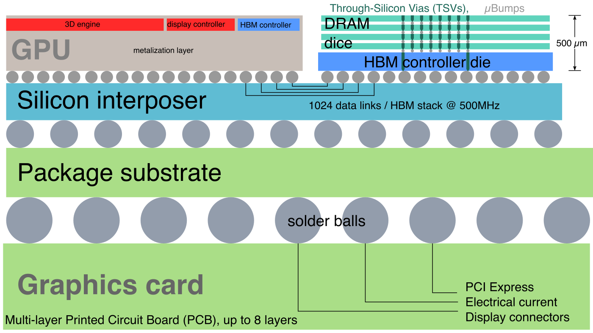

# Accelerators: Specs, Vendors and Achievable Performance

An accelerator is the chip that does the arithmetic of training and inference: a GPU (graphics processing unit) from NVIDIA or AMD, a TPU (tensor processing unit) from Google, Trainium from AWS, Gaudi from Intel, or one of a handful of more exotic designs. It's the most expensive thing you will rent or buy, and every one of them is sold with a spec sheet full of numbers that are true, carefully chosen, and not what you will get.

This chapter teaches you to read those spec sheets, compute the headline numbers yourself from first principles, compare vendors fairly, and - most importantly - measure what an accelerator *actually* delivers. The spec sheet says an H100 does 989 TFLOPS of bf16; a well-tuned matmul on a real H100 holds about 786. Knowing that second number, and why it's the one to plan with, is the difference between an optimization effort that knows when to stop and one that chases a target nobody can hit.

The chapter has five parts:

1. **What we care about and why** - the workload, the landscape, the glossary, and why the accelerator alone doesn't decide your return on investment.
2. **The spec sheet, number by number** - TFLOPS, memory size and bandwidth, caches, clock speed, power and cooling, each with how to compute or check it, and a comparison table across every current high-end accelerator.
3. **Achievable vs theoretical** - Maximum Achievable and Maximum Sustainable Matmul FLOPS (MAMF and MSMF), measured tables, the silicon lottery, and why a node runs at the speed of its slowest GPU.
4. **How to benchmark** - timing correctly, why the *values* in your tensors change the timing, and the [`mamf-finder.py`](accelerator/benchmarks/mamf-finder.py) tool in detail.
5. **Vendors** - NVIDIA, AMD, Intel Gaudi and GPU D-series, AWS Trainium, Google TPU, Huawei Ascend, Cerebras, SambaNova and the startups; their software stacks; AMD-specific tuning and profiling; and how to compare and buy.

Conventions:

- Every code block is runnable unless marked otherwise. The pure-arithmetic scripts need only `python3`. Scripts marked **[torch]** need `pip install torch numpy packaging`; they were run on an Apple M4 laptop GPU (PyTorch's `mps` device, torch 2.15.0, Python 3.14) while writing this chapter, and their output is pasted as-is. Commands marked **[GPU, untested]** need a datacenter GPU and were **not executed** for this chapter; they follow the vendors' documented tools.
- Numbers in tables come from vendor documents, linked per row, or from measurements that the notes describe. Measurements from the M4 are one run on one laptop - an anecdote, not a benchmark.
- Specs move fast. Every "as of" date is the date a number was checked; re-check before you spend money on it.

## Prerequisites

- [Computer architecture](../foundations/computer-architecture.md): [floating point formats](../foundations/computer-architecture.md#floating-point-ieee-754) (what fp32, bf16 and fp8 are), [units and the classic mistakes](../foundations/computer-architecture.md#units-and-the-classic-mistakes) (GB vs GiB, FLOPs vs FLOPS, dense vs sparse), [the memory hierarchy](../foundations/computer-architecture.md#the-memory-hierarchy) (caches and why bandwidth matters), [the GPU](../foundations/computer-architecture.md#the-gpu) and especially [the pieces](../foundations/computer-architecture.md#the-pieces) (SMs, tensor cores, HBM), and [arithmetic intensity and the roofline model](../foundations/computer-architecture.md#arithmetic-intensity-and-the-roofline-model).
- [Linux and the OS](../foundations/linux-and-os.md): [environment variables](../foundations/linux-and-os.md#environment-variables-and-path) (for `CUDA_VISIBLE_DEVICES`), [NUMA and numactl](../foundations/linux-and-os.md#numa-and-numactl), and [`nvidia-smi`](../foundations/linux-and-os.md#nvidia-smi).
- [Concurrency](../foundations/concurrency.md): [why naive GPU timing is wrong](../foundations/concurrency.md#why-naive-gpu-timing-is-wrong) and [CUDA events](../foundations/concurrency.md#events) - the benchmarking sections rely on both.
- [Networking](../foundations/networking.md) for bits vs bytes and the [scale-up fabric inside a node](../foundations/networking.md#inside-the-node-a-network-inside-the-box), and [Transformer architectures](../models/architectures.md) for what a forward/backward pass of an LLM consists of.

Forward links: [GPU Execution Model and Kernels](accelerator/execution-model.md), the next chapter, explains *why* a kernel gets the fraction of peak it gets; this chapter tells you what the peak is and how much of it is reachable. Interconnects (NVLink, UALink, UB Link, InfiniBand) are covered in [Interconnects](../network/interconnects.md); MFU is derived in [Training arithmetic](../training/arithmetic.md#mfu-and-hfu-properly).


## What an accelerator is for

Almost all of the arithmetic in a neural network is matrix multiplication, a `matmul`, also called GEMM (general matrix multiply). An accelerator is a chip designed to do as many of those per second as possible, and to feed them with data fast enough.

There are two main ML workloads, training and inference, and they stress the hardware differently.

**Inference** of a language model generates text one token at a time. Each new token is another `forward` call, so a long answer is thousands of `forward` calls, each doing comparatively small `matmul`s (the batch is the number of sequences being served at once, and each contributes one new token per step). That can run on an accelerator, or - for small models and low traffic - on some recent CPUs that handle inference quite efficiently.

**Training** processes the whole sequence in one go. For a sequence of 4096 tokens the same weight matrix multiplies 4096 token vectors at once, so the `matmul` is 4096 times larger than a single-token inference step and needs a compute unit that can do that much work fast. Accelerators excel at exactly this: the larger the matrices, the more efficiently they run (we'll see why in [TFLOPS](#tflops)).

Training also does more `matmul`s in total. The `forward` pass is the same as inference, but the `backward` pass does about twice as much again: one `matmul` to compute the gradient with respect to the layer's input and one for the gradient with respect to its weights. And if you use activation recomputation (also called gradient checkpointing: discard the activations saved during `forward` to save memory, and recompute them during `backward`; see [activation checkpointing](../training/profiling-and-optimization.md#activation-checkpointing)), there is an extra `forward`. So training costs 3-4x the `matmul` work of inference over the same tokens:

```python
# train_vs_infer.py - matmul work per token, in units of one forward pass
forward, backward = 1, 2          # backward: grad wrt inputs + grad wrt weights
print("inference:                 ", forward)
print("training:                  ", forward + backward)
print("training + recomputation:  ", forward + backward + forward)
```

```
inference:                  1
training:                   3
training + recomputation:   4
```

This is the same "6N FLOPs per token" you will derive in [Training arithmetic](../training/arithmetic.md#where-6n-comes-from): 2N for the forward, 4N for the backward.

**Finetuning** is usually the same workload as training. The exception is a light-weight method like [LoRA](https://arxiv.org/abs/2106.09685), which freezes the base weights and trains only small low-rank matrices added alongside them; it needs much less memory and time than normal finetuning.


## The landscape

Compute accelerators were once just GPUs. Now there are also TPUs, HPUs (Intel Gaudi's "AI processor units"), RDUs (SambaNova's dataflow units), wafer-scale engines, FPGAs (field-programmable gate arrays, chips whose logic you can rewire) and even QPUs (quantum processing units) on research roadmaps. Unlike the consumer GPU market, though, the high-end market has only a few products, and if you rent on the cloud most providers offer more or less the same handful.

Clouds come in tiers. **Tier 1** are the hyperscalers - AWS, OCI (Oracle), Azure and GCP. **Tier 2** are the smaller, GPU-focused clouds. The distinction matters for availability (new AMD parts usually appear on Tier 2 first) and for price (see [How to get the best price](accelerators-reference.md#how-to-get-the-best-price)).

As of 2026-08:

GPUs:
- NVIDIA: ML clouds and HPC (high-performance computing) centers already have B200s and B300s, and GB200/GB300 NVL72 racks (72 GPUs in one NVLink domain) are shipping. Rubin is expected in H2-2026.
- AMD: MI325X is widely available on Tier 2 clouds. MI355X is starting to appear, MI455X is hoped for in 2026, and - new - large CSPs (cloud service providers) have started to offer AMD GPUs.
- Intel: the GPU D-series (D270, code-named Crescent Island) is an inference-oriented data-center GPU, launched at OCP 2026 with customer sampling in H2-2026. Intel has published only its FP8 peak (1.3 PFLOPS). See [Intel GPU D-series](accelerators-reference.md#intel-gpu-d-series-crescent-island).

HPUs:
- Intel's Gaudi2 and Gaudi3 are available on Intel's cloud.
- Falcon Shores was supposed to replace Gaudi in 2025; the project has been canceled.

TPU-like:
- Google's TPUs are available, but only for rent, and the software isn't easily portable between GPUs and TPUs. So many (most?) developers stay with GPUs rather than lock themselves into hardware that only one company sells.
- Amazon's Trainium2 has an architecture similar to the TPU's and is available on AWS.

Pods and racks:
- Cerebras' Wafer Scale Engine (WSE).
- SambaNova's SambaRack (SN40L today, SN50 from H2-2026).
- Dozens of pod and rack configurations that compose the GPUs above with very fast interconnects.

That is about it as of 2026-07-31. [Vendors and products](accelerators-reference.md#vendors-and-products) goes through each in detail.

Most of us rent compute and never see it. This is what an 8x H100 node physically looks like - the GPU tray of a Dell PowerEdge XE9680 rack server. The eight large heatsinks are the eight GPUs:


## Glossary

Terms you will meet in spec sheets and in this chapter. Several are explained in more depth where they're first used.

- **BLAS**: Basic Linear Algebra Subprograms - the standard library interface for matmul and friends (cuBLAS on NVIDIA, hipBLASLt/rocBLAS on AMD).
- **CDNA**: AMD's data-center GPU architecture family (CDNA2 = MI250X, CDNA3 = MI300X/MI325X, CDNA4 = MI350X/MI355X).
- **CPU**: Central Processing Unit.
- **CTS**: Custom Thermal Solution - a vendor-supported cooling option that allows a higher power limit than the default.
- **CU**: Compute Unit - AMD's counterpart to NVIDIA's SM.
- **CUDA**: Compute Unified Device Architecture - NVIDIA's (proprietary) GPU programming platform.
- **DCORE**: the die core Intel reports Gaudi3 cache against; a Gaudi3 has 4 of them.
- **DGX**: NVIDIA's turn-key accelerator server line.
- **ECC**: Error Correcting Code - extra bits stored with memory that detect and correct bit flips.
- **FMA**: Fused Multiply-Add, $a \cdot b + c$ in one instruction; counts as 2 FLOPs.
- **FPGA**: Field Programmable Gate Array.
- **GA**: Generally Available - the product can actually be bought or rented, as opposed to announced, sampling, or spec'd only.
- **GCD**: Graphics Compute Die - one of the dies in a multi-die AMD package (an MI250X has two).
- **GDDR**: Graphics DDR - the cheaper, lower-bandwidth memory used on consumer and some inference cards instead of HBM.
- **GEMM**: General Matrix Multiply.
- **GPU**: Graphics Processing Unit.
- **HBM**: High Bandwidth Memory - stacked DRAM in the accelerator's package; see [HBM](#hbm).
- **HFU**: Hardware FLOPS Utilization - achieved FLOPS over peak, counting every FLOP the hardware executes, including recomputation.
- **HGX**: NVIDIA's accelerator baseboard that OEMs (server makers) build their own servers around.
- **HPC**: High-performance Computing.
- **HPU**: Habana (Intel) Gaudi AI Processor Unit.
- **LLC**: Last Level Cache - the biggest, slowest cache before main memory.
- **LPDDR**: Low-Power DDR - the memory type used in laptops and phones; cheaper and denser per dollar than HBM but much slower.
- **MAMF**: Maximum Achievable Matmul FLOPS - see [MAMF and MSMF](#maximum-achievable-and-sustainable-flops).
- **MFU**: Model FLOPS Utilization - achieved model FLOPS over peak, counting only the model's own FLOPs.
- **MIG**: Multi-Instance GPU - NVIDIA's partitioning of one GPU into isolated instances.
- **MME**: Matrix Multiplication Engine - Gaudi's matmul unit.
- **Matrix Core**: AMD's counterpart to NVIDIA's Tensor Core.
- **MSMF**: Maximum Sustainable Matmul FLOPS.
- **NVL72**: an NVLink domain of 72 accelerators; likewise NVL8 and NVL36.
- **OAM**: OCP Accelerator Module - the Open Compute Project's accelerator form factor.
- **PSU**: Power Supply Unit.
- **PTX**: Parallel Thread Execution - NVIDIA's intermediate GPU instruction set.
- **QPU**: Quantum Processing Unit.
- **RDU**: Reconfigurable Dataflow Unit (SambaNova).
- **ROCm**: AMD's GPU software platform - its counterpart to the CUDA stack (driver, compiler, BLAS and collective-communication libraries).
- **SM**: Streaming Multiprocessor - NVIDIA's counterpart to AMD's CU.
- **SRAM**: Static Random Access Memory - the fast on-chip memory caches and registers are made of.
- **TBP**: Typical Board Power or Total Board Power, depending on vendor.
- **TDP**: Thermal Design Power or Thermal Design Parameter.
- **TGP**: Total Graphics Power.
- **TPC**: Tensor Processing Core - Gaudi's programmable vector unit.
- **TPU**: Tensor Processing Unit.
- **WSE**: Wafer Scale Engine - Cerebras' whole-wafer accelerator.
- **XCD**: Accelerator Complex Die - AMD's per-die cache reporting scope.
- **XLA**: Accelerated Linear Algebra - the compiler behind PyTorch/JAX on TPUs and Trainium.

Modal maintains a good [additional GPU glossary](https://modal.com/gpu-glossary).


## The most important thing to understand

It's not enough to buy or rent the most expensive accelerators and expect a high return on investment (ROI). This point comes up again and again in this book.

The two metrics that decide ROI for ML training are:

1. **How fast the training finishes.** If it takes 2-3x longer than planned, your model may be irrelevant before it's released - in a competitive market time is everything.
2. **The total \$\$ spent.** If it takes 2-3x longer than planned, it costs 2-3x as much.

If the rest of the hardware isn't chosen to match the workload, the accelerators will spend much of their time idle, and both time and money are lost. The most critical other component is the [network](../network/interconnects.md), then [storage](../foundations/storage-and-data.md); the least critical are the [CPU and CPU memory](../foundations/computer-architecture.md) - at least for typical training, where CPU limitations are compensated for with multiple `DataLoader` workers.

If you rent, you usually don't get to choose: the hardware is fixed, or a few components can be swapped from a short list. If a provider doesn't offer a well-matched configuration, look for a different provider. If you buy, do very thorough due diligence first.

Hardware also needs software that uses it efficiently. Both sides are covered across the book; [Profiling and optimization](../training/profiling-and-optimization.md) and [Model parallelism](../training/model-parallelism/derivations.md) are the main places.


## Reading a spec sheet

What characteristics of an accelerator do we care about? We'll use NVIDIA's A100 spec sheet as the reference point for the next several sections. The SMs, tensor cores and HBM it refers to were introduced in [The pieces](../foundations/computer-architecture.md#the-pieces); the GPU's internals are taken apart properly in the next chapter, [GPU Execution Model and Kernels](accelerator/execution-model.md).


([source](https://www.nvidia.com/en-us/data-center/a100/))

The rows that matter for ML are, in order: the TFLOPS per data type, the memory size and bandwidth, the interconnect bandwidth (covered in [Interconnects](../network/interconnects.md)), and the power. The next sections take them one at a time.


## TFLOPS

### What the number means

Matrix multiplication is made of many multiplications followed by sums. Each of those floating point operations can be counted, and the chip's speed is how many of them it can perform per second.

**TFLOPS** is trillions ($10^{12}$) of FLoating point OPerations per Second. It's the single number accelerators are most often judged by, and there is a separate figure for each data type. Here are a few of the theoretical peak TFLOPS from the [A100 spec](https://www.nvidia.com/en-us/data-center/a100/):

| Data type \ TFLOPS     | w/o Sparsity | w/ Sparsity |
| :--------------------  | -----------: | ----------: |
| FP32                   |         19.5 |         n/a |
| Tensor Float 32 (TF32) |          156 |         312 |
| BFLOAT16 Tensor Core   |          312 |         624 |
| FP16 Tensor Core       |          312 |         624 |
| FP8 Tensor Core        |          624 |        1248 |
| INT8 Tensor Core       |          624 |        1248 |

How to read it:

- INT8 is measured in TOPS (tera-operations per second), since integer math isn't floating point; the arithmetic is the same.
- Each halving of the data type's width doubles the rate: int8/fp8 is 2x bf16, which is 2x tf32 (tf32 is NVIDIA's 19-bit format that tensor cores use when you ask for "fp32" matmuls with TF32 enabled). Plain FP32 without tensor cores is much lower - 19.5 vs 156 - because it runs on the general-purpose lanes, not the tensor cores.
- The "w/ Sparsity" column is exactly 2x and only applies to 2:4 structured-sparse matrices (2 of every 4 consecutive values are zero), which ordinary training doesn't produce. Use the left column. See [dense vs sparse FLOPS](../foundations/computer-architecture.md#units-and-the-classic-mistakes).

Watch the word itself. **FLOPS** can mean a count of floating point operations (how many FLOPS one Transformer iteration takes) or a rate (how many per second). In accelerator specs it's almost always the rate; when model architectures are discussed it's usually the count. This book writes FLOPs for the count and FLOPS for the rate, but you will see both spellings used both ways.

The achieved TFLOPS also depend on the matrix sizes:


([source](https://developer.nvidia.com/blog/cuda-11-features-revealed/))

How to read it: the x-axis is the size of a square matmul ($m = n = k$), the y-axis the achieved TFLOPS with cuBLAS. The FP16 and BF16 lines climb to about 290 of the 312 peak only at 8192; the TF32 line levels off around 130 of 156; the unlabelled blue line at the bottom, flat at about 19, is the FP32 path (its height matches the 19.5 FP32 spec). Small matmuls are nowhere near peak, and the curves aren't smooth - they have steps and dips. Both come from **tile and wave quantization**: a matmul is cut into fixed-size tiles that run in waves across the SMs, so a dimension that leaves the last tile, or the last wave, partly empty pays for work it doesn't do. The next chapter works through it in [Why dims want multiples of 8, 16, 64, 128](accelerator/execution-model.md#why-dims-want-multiples-of-8-16-64-128).

### How to calculate theoretical TFLOPS

The theoretical peak published on a spec sheet isn't measured. It's computed:

$$
\text{Theoretical FLOPS} = \text{compute\_unit\_clock\_speed} \cdot \text{FLOPs\_per\_clock\_cycle\_per\_compute\_unit} \cdot \text{num\_compute\_units}
$$

where:

- `compute_unit_clock_speed` is how many times the compute unit's clock ticks per second, in Hz;
- `flops_per_clock_cycle_per_compute_unit` is the number of floating point operations one compute unit (a tensor core, a Matrix Core, an MME) can execute per clock;
- `num_compute_units` is how many of those units the device has.

FLOPs per clock are rarely published, but FMAs per clock often are. One FMA is a multiply and an add, 2 FLOPs, so:

$$
\text{Theoretical FLOPS} = \text{compute\_unit\_clock\_speed} \cdot \text{FMAs\_per\_clock\_cycle\_per\_compute\_unit} \cdot 2 \cdot \text{num\_compute\_units}
$$

Let's check that this reproduces the published BF16 (half precision) specs. The H100 numbers come from [Wikipedia](https://en.wikipedia.org/wiki/Hopper_(microarchitecture)#H100_accelerator_and_DGX_H100). The hard part is the FMAs per tensor core per clock for BF16; [this NVIDIA forum thread](https://forums.developer.nvidia.com/t/how-to-calculate-the-tensor-core-fp16-performance-of-h100/244727/2) collects them. Most originate in the [A100 whitepaper](https://images.nvidia.com/aem-dam/en-zz/Solutions/data-center/nvidia-ampere-architecture-whitepaper.pdf) (search the PDF for "FMA" and pick the rows for your precision); the [H100 whitepaper](https://resources.nvidia.com/en-us-hopper-architecture/nvidia-h100-tensor-c) omits most per-unit FMA numbers but gives multipliers relative to the A100 ones. The clocks used, and what each vendor's "clock" actually means, are collected in [Clock speed](accelerators-reference.md#clock-speed).

**NVIDIA @ BF16** - BF16 runs on the tensor cores:

| Accelerator | Clock   | FMAs per Tensor Core per clock | Tensor Cores | Spec TFLOPS | Notes |
| :---------  | ------: | -----------------------------: | -----------: | ----------: | ----: |
| H100 SXM    | 1830MHz |                            512 |          528 |         989 |     1 |
| A100 SXM    | 1410MHz |                            256 |          432 |         312 |     1 |

1. `Tensor Cores` is derived: 4 tensor cores per SM, times 132 SMs for H100 SXM and 108 SMs for A100 SXM.

**AMD @ BF16** - BF16 runs on the Matrix Cores:

| Accelerator | Peak Engine Clock | FMAs per Matrix Core per clock | Matrix Cores | Spec TFLOPS | Notes |
| :---------- | ----------------: | -----------------------------: | -----------: | ----------: | ----: |
| MI355X      |           2400MHz |                            512 |         1024 |        2500 |     1 |
| MI350X      |           2200MHz |                            512 |         1024 |        2300 |     1 |
| MI300X      |           2100MHz |                            256 |         1216 |        1307 |       |
| MI250X      |           1700MHz |                            128 |          880 |         383 |     2 |

1. AMD publishes `2.5 PFLOPS` for MI355X and `2.3 PFLOPS` for MI350X BF16 matrix, rounded to two significant digits.
2. AMD publishes the Matrix Core count for MI355X and MI350X (1024) and MI300X (1216), but not for MI250X, so its 880 is derived: 4 Matrix Cores per CU, times 220 CUs.

**Intel Gaudi @ BF16** - Gaudi does `matmul` on its MMEs, each a $256 \times 256$ array of multiply-accumulators:

| Accelerator | MME Clock | FMAs per MME per clock | MMEs | Spec TFLOPS |
| :---------- | --------: | ---------------------: | ---: | ----------: |
| Gaudi 2     |   1650MHz |                256*256 |    2 |         432 |
| Gaudi 3     |   1600MHz |                256*256 |    8 |        1677 |

Now the arithmetic, for all of them at once, plus the inverse: given a published TFLOPS, which clock does it imply?

```python
# tflops.py - theoretical peak = clock * FMAs/clock/unit * 2 FLOPs/FMA * units
rows = [  # name, clock MHz, FMAs per unit per clock, units, published dense bf16 TFLOPS
    ("NVIDIA H100 SXM", 1830, 512, 4 * 132, 989),
    ("NVIDIA A100 SXM", 1410, 256, 4 * 108, 312),
    ("AMD MI355X",      2400, 512, 1024, 2500),
    ("AMD MI350X",      2200, 512, 1024, 2300),
    ("AMD MI300X",      2100, 256, 1216, 1307),
    ("AMD MI250X",      1700, 128, 4 * 220, 383),
    ("Intel Gaudi2",    1650, 256 * 256, 2, 432),
    ("Intel Gaudi3",    1600, 256 * 256, 8, 1835),  # whitepaper figure
]
def peak(mhz, fma, units):
    return mhz * 1e6 * fma * 2 * units / 1e12
for name, mhz, fma, units, spec in rows:
    t = peak(mhz, fma, units)
    print(f"{name:16s} {t:8.1f} TFLOPS  spec {spec:5d}  ratio {t/spec:.3f}")

# inverse: which clock does a published TFLOPS imply?
def implied_mhz(tflops, fma, units):
    return tflops * 1e12 / (fma * 2 * units) / 1e6
print(f"H100 SXM clock implied by 989 TFLOPS:  {implied_mhz(989, 512, 528):.1f} MHz")
print(f"H100 SXM peak if the clock were 1980:  {peak(1980, 512, 528):.1f} TFLOPS")
print(f"Gaudi3 clock implied by 1835 TFLOPS:   {implied_mhz(1835, 256*256, 8):.1f} MHz")
print(f"H200 NVL clock implied by 835 TFLOPS:  {implied_mhz(835, 512, 528):.1f} MHz (if it has 132 SMs)")
```

```
NVIDIA H100 SXM     989.4 TFLOPS  spec   989  ratio 1.000
NVIDIA A100 SXM     311.9 TFLOPS  spec   312  ratio 1.000
AMD MI355X         2516.6 TFLOPS  spec  2500  ratio 1.007
AMD MI350X         2306.9 TFLOPS  spec  2300  ratio 1.003
AMD MI300X         1307.4 TFLOPS  spec  1307  ratio 1.000
AMD MI250X          383.0 TFLOPS  spec   383  ratio 1.000
Intel Gaudi2        432.5 TFLOPS  spec   432  ratio 1.001
Intel Gaudi3       1677.7 TFLOPS  spec  1835  ratio 0.914
H100 SXM clock implied by 989 TFLOPS:  1829.2 MHz
H100 SXM peak if the clock were 1980:  1070.5 TFLOPS
Gaudi3 clock implied by 1835 TFLOPS:   1750.0 MHz
H200 NVL clock implied by 835 TFLOPS:  1544.4 MHz (if it has 132 SMs)
```

How to read the output:

- **NVIDIA**: both match - 989 for H100 SXM and 312 for A100 SXM.
- **AMD**: MI300X matches its spec, which you will usually see rounded down to `1300`. MI250X matches exactly. MI355X (2516.6) and MI350X (2306.9) match AMD's published `2.5` and `2.3` PFLOPS within AMD's own rounding; MI350X is the same silicon as MI355X at a lower clock.
- **Gaudi2** matches. **Gaudi3** comes out at 1677, not the 1835 in its whitepaper: to get 1835 the MME clock would have to be 1750MHz, and the shipping Gaudi3 runs at 1600MHz. That's why this chapter's tables carry 1677 for it.
- **The H100 clock.** 1830MHz is now NVIDIA's official figure. The widely published number used to be 1980MHz, and it doesn't work: it gives 1070 TFLOPS, some 80 above the spec. Before 1830MHz was official you could already recover it by inverting the formula against the spec TFLOPS, as the script does: 1829.2MHz. (1980MHz is the boost clock that reproduces the FP32 peak, as [The pieces](../foundations/computer-architecture.md#the-pieces) shows; the tensor-core figure is quoted at the lower clock.) That inversion is a useful trick in general: if a vendor publishes the TFLOPS but not the clock, or a clock that doesn't reproduce their own TFLOPS, the formula tells you which number they actually used.

Two more things to take from this:

- **The FMAs per AMD Matrix Core doubled every CDNA generation** - 128 on MI250X (CDNA2), 256 on MI300X (CDNA3), 512 on MI355X (CDNA4). The Matrix Core count barely moved (880 to 1216 to 1024), so that per-core doubling is where almost all of the generational BF16 gain came from, not from more cores.
- **This peak is an aggregate over the whole accelerator.** `528` tensor cores is $4 \times 132$ SMs, so a single matmul gets it only if it's large enough to keep every SM busy. A part with more SMs therefore doesn't automatically deliver more TFLOPS on your matmuls - see the tile and wave discussion in [the next chapter](accelerator/execution-model.md#why-dims-want-multiples-of-8-16-64-128) and [Profiling and optimization](../training/profiling-and-optimization.md).

And the consequence that matters in practice: **the clock is a factor in the formula.** If your accelerator runs below its spec clock - because it's overheating and throttling, or because it has hit its power limit - its TFLOPS are proportionally lower than advertised. To check the actual clock under load see [Clock speed](accelerators-reference.md#clock-speed).

### TFLOPS comparison table

Here are the theoretical dense (no sparsity) peak TFLOPS of the high-end accelerators for each supported data type. The data types themselves were introduced in [Floating point: IEEE 754](../foundations/computer-architecture.md#floating-point-ieee-754), and how they're used in training is in [Mixed precision internals](../training/arithmetic.md#mixed-precision-internals) and [FP8 training](../training/arithmetic.md#fp8-training).

The two FP4 columns are the two block-scaled FP4 formats. In a block-scaled format, every small block of 4-bit values shares one scale factor stored alongside it. `mxfp4` is the Open Compute Project's microscaling format: one power-of-two (E8M0) scale per 32 elements. `nvfp4` is NVIDIA's: one E4M3 (fp8) scale per 16 elements, plus a per-tensor FP32 scale. Which to use is discussed in [Training arithmetic](../training/arithmetic.md).

How to read the cells: a number is the vendor's dense peak; `X` means the format isn't supported or, for a few rows called out in the notes, that no rate is published; `V` means the format is supported but no rate is published; `?` means the vendor hasn't stated the number. Both tables are sorted by the bf16 column, and the `Notes` column points to the numbered notes after them.

**Generally available:**

| Accelerator \ TFLOPS  | fp32  | tf32   | fp16 | bf16 | fp8  | int8 | fp6   | mxfp4 | nvfp4 | Notes |
| :-------------------- | ----: | -----: | ---: | ---: | ---: | ---: | ----: | ----: | ----: | ----: |
| NVIDIA GB300 SXM      |  80.0 | 1250.0 | 2500 | 2500 | 5000 | 5000 |  5000 | 15000 | 15000 |    24 |
| NVIDIA GB200 SXM      |  80.0 | 1250.0 | 2500 | 2500 | 5000 | 5000 |  5000 | 10000 | 10000 |    23 |
| AMD MI355X            | 157.3 |      ? | 2500 | 2500 | 5000 | 5000 | 10100 | 10100 |     X |    22 |
| Google TPU v7x        |     ? |      ? | 2307 | 2307 | 4614 |    ? |     ? |     ? |     ? |    25 |
| AMD MI350X            | 144.2 |      ? | 2300 | 2300 | 4600 | 4600 |  9200 |  9200 |     X |    22 |
| NVIDIA B300 SXM       |  80.0 | 1125.0 | 2250 | 2250 | 4500 | 4500 |  4500 | 13500 | 13500 |    21 |
| NVIDIA B200 SXM       |  80.0 | 1125.0 | 2250 | 2250 | 4500 | 4500 |  4500 |  9000 |  9000 |    20 |
| Intel Gaudi3          | 229.0 |  459.0 |  459 | 1677 | 1677 |    V |     X |     X |     X |  8,19 |
| AMD MI325X            | 163.4 |  653.7 | 1300 | 1300 | 2610 | 2600 |     X |     X |     X |    18 |
| AMD MI300X            | 163.4 |  653.7 | 1300 | 1300 | 2610 | 2600 |     X |     X |     X |    17 |
| NVIDIA H200 SXM       |  67.0 |  494.5 |  989 |  989 | 1979 | 1979 |     X |     X |     X |    16 |
| NVIDIA H100 SXM       |  67.0 |  494.5 |  989 |  989 | 1979 | 1979 |     X |     X |     X | 12,15 |
| NVIDIA GH200 SXM      |  67.0 |  494.5 |  989 |  989 | 1979 | 1979 |     X |     X |     X |    14 |
| Google TPU v6e        |     ? |      ? |  918 |  918 |  918 | 1836 |     X |     X |     X |    13 |
| NVIDIA H200 NVL       |  60.0 |  417.5 |  835 |  835 | 1670 | 1670 |     X |     X |     X |    29 |
| NVIDIA H100 PCIe      |  51.0 |  378.0 |  756 |  756 | 1513 | 1513 |     X |     X |     X |    12 |
| AWS Trainium2 / Ultra | 181.0 |  667.0 |  667 |  667 | 1299 |    X |     X |     X |     X |    11 |
| Google TPU v5p        |     X |      X |    X |  459 |    X |  918 |     X |     X |     X |    10 |
| Intel Gaudi2          |     V |      V |    V |  432 |  865 |    V |     X |     X |     X |   8,9 |
| AMD MI250X            |  47.9 |      X |  383 |  383 |    X |  383 |     X |     X |     X |     7 |
| NVIDIA L40S           |  91.6 |  183.0 |  362 |  362 |  733 |  733 |     X |     X |     X |     6 |
| AMD MI250             |  45.3 |      X |  362 |  362 |    X |  362 |     X |     X |     X |     5 |
| NVIDIA A100 SXM       |  19.5 |  156.0 |  312 |  312 |    X |  624 |     X |     X |     X |     4 |
| NVIDIA A100 PCIe      |  19.5 |  156.0 |  312 |  312 |    X |  624 |     X |     X |     X |   3,4 |
| Google TPU v4         |     X |      X |    X |  275 |    X |  275 |     X |     X |     X |     2 |
| Google TPU v5e        |     X |      X |    X |  197 |    X |  394 |     X |     X |     X |     1 |

**Announced, availability not confirmed:**

| Accelerator \ TFLOPS | fp32  | tf32   | fp16 | bf16 | fp8   | int8 | fp6   | mxfp4 | nvfp4 | Notes |
| :------------------- | ----: | -----: | ---: | ---: | ----: | ---: | ----: | ----: | ----: | ----: |
| AMD MI455X           | 315.0 |      ? | 5000 | 5000 | 10000 | 5000 | 10000 | 20000 |     X |    27 |
| NVIDIA Rubin SXM     | 130.0 | 2000.0 | 4000 | 4000 | 17500 | 2500 | 17500 | 35000 | 35000 |    26 |
| Huawei Ascend 950DT  |     X |      X |  486 |  486 |   919 |    X |     X |  1783 |     X |    28 |
| Intel GPU D270       |  20.5 |      ? |    ? |    ? |  1300 |    ? |     X |  2622 |     X |    30 |

Notes and sources. They run from the oldest hardware upward, so a new row gets the next number and lands at the end of the list:

1. [Google Cloud TPU v5e documentation](https://docs.cloud.google.com/tpu/docs/v5e).
2. [Google Cloud TPU v4 documentation](https://docs.cloud.google.com/tpu/docs/v4).
3. Oddly, the NVIDIA A100 PCIe and SXM [specs](https://www.nvidia.com/en-us/data-center/a100/) report the same TFLOPS, even though the SXM version uses 30% more power and a 5% faster HBM.
4. [NVIDIA A100 specifications](https://www.nvidia.com/en-us/data-center/a100/) - covers both the SXM and PCIe rows.
5. [AMD Instinct MI250 specifications](https://www.amd.com/en/products/accelerators/instinct/mi200/mi250.html).
6. [NVIDIA L40S specifications](https://www.nvidia.com/en-us/data-center/l40s/).
7. [AMD Instinct MI250X specifications](https://www.amd.com/en/products/accelerators/instinct/mi200/mi250x.html).
8. Intel publishes only partial TFLOPS [specs](https://www.intel.com/content/www/us/en/content-details/817486/intel-gaudi-3-ai-accelerator-white-paper.html) for Gaudi2 and 3, though both support FP32, TF32, BF16, FP16, FP8, INT8 and INT16. These numbers are for MME (matrix) compute.
9. [Intel Gaudi 2 AI accelerator white paper](https://www.intel.com/content/www/us/en/content-details/839363/intel-gaudi-2-ai-accelerators-white-paper.html).
10. [Google Cloud TPU v5p documentation](https://docs.cloud.google.com/tpu/docs/v5p).
11. Trainium2 also supports FP8/FP16/BF16/TF32 at 2563 TFLOPS with 4:1 sparsity. See [AWS Trainium2 architecture documentation](https://awsdocs-neuron.readthedocs-hosted.com/en/latest/about-neuron/arch/neuron-hardware/trainium2.html).
12. [NVIDIA H100 specifications](https://www.nvidia.com/en-us/data-center/h100/) - covers both the SXM and PCIe rows.
13. [Google Cloud TPU v6e documentation](https://docs.cloud.google.com/tpu/docs/v6e).
14. GH200 is two chips (an H100-class GPU and a Grace CPU) in one package, so the table gives the GPU's per-chip specs without sparsity. See [NVIDIA GH200 Grace Hopper Superchip specifications](https://www.nvidia.com/en-us/data-center/grace-hopper-superchip/).
15. `NVIDIA H100 dual NVL` isn't included because it's 2 GPUs, which wouldn't be a fair comparison: the same FLOPS as H100 but 2x everything, plus a bit more memory (94GiB per chip vs 80GiB on H100) that is a bit faster.
16. H200 is the same as H100 but with 141GiB instead of 80GiB of HBM, and faster memory - HBM3e at 4.8TBps vs HBM3 at 3.35TBps. So H200 addresses the memory-bandwidth and memory-capacity bottlenecks of H100. See [NVIDIA H200 specifications](https://www.nvidia.com/en-us/data-center/h200/).
17. [AMD Instinct MI300X specifications](https://www.amd.com/en/products/accelerators/instinct/mi300/mi300x.html).
18. MI325X is the same compute as MI300X, with more memory and more power. See [AMD Instinct MI325X specifications](https://www.amd.com/en/products/accelerators/instinct/mi300/mi325x.html) and the power-efficiency arithmetic in [Power consumption](#power-consumption).
19. Gaudi3 as of 2026-08 runs at 1600MHz (MME), not the planned 1750MHz, so its BF16 TFLOPS are 1677, not the 1835 of the whitepaper (see [the calculation](#how-to-calculate-theoretical-tflops)). The same goes for fp8, which runs at the same TFLOPS as BF16.
20. [NVIDIA DGX B200 datasheet](https://resources.nvidia.com/en-us-dgx-systems/dgx-b200-datasheet) - `FP4 Tensor Core: 144|72` petaFLOPS sparse|dense for 8 GPUs, so 9000 dense per GPU; the [HGX page](https://www.nvidia.com/en-us/data-center/hgx/) agrees (read 2026-10-02). NVIDIA publishes a single FP4 rate for Blackwell, which its GB200 NVL72 page labels `NVFP4`, and the tensor cores run both FP4 formats through the same `tcgen05.mma.kind::mxf4nvf4` instruction at the same rate (see the [CUTLASS Blackwell docs](https://docs.nvidia.com/cutlass/latest/media/docs/cpp/blackwell_functionality.html)), so the `mxfp4` and `nvfp4` columns of every NVIDIA Blackwell row carry the same number.
21. [NVIDIA DGX B300 datasheet](https://resources.nvidia.com/en-us-dgx-systems/dgx-b300-datasheet) - `FP4 Tensor Core 144|108` PFLOPS sparse|dense for 8 GPUs, so 13500 dense per GPU, the "1.5x dense FP4" over B200 the datasheet advertises; the [HGX page](https://www.nvidia.com/en-us/data-center/hgx/) agrees (read 2026-10-02). The 15000 often quoted for B300 is GB300's per-GPU figure.
22. [AMD Instinct MI355X specifications](https://www.amd.com/en/products/accelerators/instinct/mi350/mi355x.html) - these are AMD's dense figures. AMD also publishes `with Structured Sparsity` variants at exactly 2x - 10.1 PFLOPS for OCP-FP8 and 5 PFLOPS for FP16 matrix - so a 10.1 PFLOPS fp8 number quoted elsewhere is the sparse one, not this table's. The `fp6` and `fp4` entries carry no sparsity qualifier on AMD's page and are dense. [MI350X](https://www.amd.com/en/products/accelerators/instinct/mi350/mi350x.html) is the same silicon at 2200MHz and 1000W, with everything scaled by the clock ratio (144.2 vs 157.3 fp32): AMD publishes 2.3 PFLOPS FP16 and BF16, 4.6 PFLOPS OCP-FP8 and INT8, and 9.2 PFLOPS MXFP6 and MXFP4, all dense, with the same 2x `with Structured Sparsity` variants.
23. GB200 is 2 B200-class GPUs plus a Grace CPU, so the table gives TFLOPS per GPU for a fair comparison - double it for a whole GB200. It also seems to run its GPUs a bit faster than a standalone B200, hence higher specs. It also means that instead of the usual 8-GPU node, a GB200 system gives you a 4-GPU node (2 GB200s), but that is roughly the equivalent of 8x B200 with ~10% faster compute. See [NVIDIA GB200 NVL72 specifications](https://www.nvidia.com/en-us/data-center/gb200-nvl72/).
24. GB200 NVL72 and GB300 NVL72 look the same, except the latter has faster fp4 and more memory. See [NVIDIA GB300 NVL72 specifications](https://www.nvidia.com/en-us/data-center/gb300-nvl72/).
25. [Google Cloud TPU v7x documentation](https://docs.cloud.google.com/tpu/docs/tpu7x) - Google calls it "the latest TPU available on Google Cloud" and documents using it through GKE or Compute Engine, so it's treated as available like every other TPU here, all of which are rent-only and capacity-gated. Only fp16, bf16 and fp8 are published; the rest of the row is `?` because Google hasn't stated those numbers.
26. [NVIDIA Vera Rubin NVL72 specifications](https://www.nvidia.com/en-us/data-center/vera-rubin-nvl72/) - pre-release, so these are announced figures, not a shipped part's spec sheet.
27. AMD's MI455X figures come from its [product page](https://www.amd.com/en/products/accelerators/instinct/mi400/mi455x.html), read on 2026-08-06. `fp32` 315, `fp16` 5000, `bf16` 5000 and `int8` 5000 are AMD's own dense numbers. `fp8`, `fp6` and `fp4` are halved from the 20100, 20100 and 40300 that AMD publishes, because those three are almost certainly with-sparsity figures that AMD didn't declare as such: it labels the sparsity variants of FP16, BF16 and INT8 explicitly on the same page, all at 10100, and taking the three unlabelled numbers at face value would make fp8 4x bf16 where every other accelerator here is 2x - MI355X runs 2500, 5000, 10100. Halving restores that doubling exactly. AMD publishes no TF32 figure for this part, hence `?`. All of it remains AMD Performance Labs projections carrying "Results subject to change when products are released in market".
28. Ascend 950DT figures are from the Atlas 950 SuperPoD product-spec table on [Ascend Community](https://www.hiascend.com/en/hardware/cluster?tag=950) (read 2026-08-10): `114.1 / 58.8 / 31.1` PFLOPS at `mxFP4` / `mxFP8/HiF8` / `FP16/BF16` for **64x** Ascend 950DT, divided by 64 = **1783 / 919 / 486** (the arithmetic is in [Huawei Ascend](accelerators-reference.md#huawei-ascend)). Don't mix these with the 1024-card SuperPoD totals on the Chinese page (those give ~1953 / 977 mxFP4/mxFP8 and no bf16). The `fp8` column is Huawei's single published `mxFP8/HiF8` rate; [HiF8](https://arxiv.org/abs/2409.16626) is a tapered-precision format (its precision varies with the magnitude of the number), not OCP E4M3/E5M2, so the usual `eXmY` exponent/mantissa reading of fp8 names doesn't apply to it. Unpublished columns are `X`.
29. H200 NVL is the PCIe card version of the H200: the same chip and the same 141GB of HBM3e at 4.8TBps as the H200 SXM, but with a 600W power limit instead of 700W, and NVIDIA rates its compute about 16% lower. The `tf32`, `fp16`, `bf16`, `fp8` and `int8` columns are half of the 835 / 1671 / 1671 / 3341 / 3341 that NVIDIA publishes with sparsity, rounded down like the H200 SXM row. Its NVLink connects only 2 or 4 cards through a bridge, at 900GBps per GPU, and GPUs in different bridge groups talk over PCIe Gen5 at 128GBps - unlike the H200 SXM, where NVSwitch connects all 8 GPUs of the node. See [NVIDIA H200 specifications](https://www.nvidia.com/en-us/data-center/h200/).
30. Intel GPU D270 (code-named Crescent Island) is the first product in Intel's Xe3P-based GPU D-series - an inference-only data-center accelerator (32 Xe3P cores, 256 XMX matrix engines, 32MB L2), announced at OCP 2026 (2026-10-12) with customer sampling in H2-2026. The Xe3P XMX natively supports the full precision ladder - FP64, FP32, TF32, FP16, BF16, dual-format FP8 (E4M3/E5M2), FP4, the OCP MX formats (MXFP4/MXFP8) and int8/int4 - so the `?` cells here mean "supported, rate unpublished", not "unsupported". Intel's publicly published compute figure is `1.3 PFLOPS` of **dense** FP8 (no structured sparsity), hence `fp8` 1300. Intel's product spec also gives **dense** `mxfp4` = 2622 TFLOPS (2x FP8) and vector `fp32` = 20.5 TFLOPS (vector FP64 is 10.2, which has no column here); these two are official Intel figures but are not yet on any public page, so they carry no source link - they are vendor specs, not estimates. Every other supported format (`tf32`, `fp16`, `bf16`, `int8`) stays `?` until Intel publishes official rates (no estimates are carried in the table). `fp6` is `X` (absent from Intel's format list) and `nvfp4` is `X` because the part implements the OCP microscaling fp4 (`mxfp4`), not NVIDIA's nvfp4. See [Intel GPU D-series](accelerators-reference.md#intel-gpu-d-series-crescent-island), [Intel newsroom](https://www.intel.com/content/www/us/en/newsroom/news/artificial-intelligence/intel-accelerates-open-infrastructure-agentic-ai-era.html), [Tom's Hardware](https://www.tomshardware.com/tech-industry/artificial-intelligence/intels-crescent-island-ai-accelerator-officially-powers-new-gpu-d-series-products-chip-delivers-1-3-peak-pflops-of-fp8-compute-and-1-5-tb-s-of-memory-bandwidth) (all read 2026-10-15).

General notes on reading these tables:

- int8 is in TOPS (tera-operations), since it isn't floating point.
- If you find numbers double the ones above, they're almost certainly with 2:4 structured sparsity, which at the moment almost nobody can benefit from because our matrices are dense.
- Read spec sheets very carefully. Many vendors publish TFLOPS with sparsity because they're ~2x bigger, and if they mark it at all it's often in small print. Stas Bekman had to ask NVIDIA to add a note to their H100 spec that its numbers were with sparsity, because originally it didn't say so. As of 2026-08, 99% of the time you won't be using sparsity, so the dense numbers above are the ones you care about.
- A higher TFLOPS on paper doesn't mean a faster accelerator. These are theoretical numbers that can never be reached in practice, and the fraction actually achieved - the hardware FLOPS utilization (HFU) - varies a lot from vendor to vendor and even between one vendor's architectures. The next section measures it.


## Maximum achievable and sustainable FLOPS

<a id="maximum-achievable-flops"></a>

### Why the peak can't be reached

Theoretical peak FLOPS are **very** theoretical: no workload reaches them, even under perfect conditions. Each accelerator has a realistic ceiling that isn't advertised. There are anecdotal community reports, but no official ones; if you know of a solid, checkable report (a paper, a vendor measurement) of the TFLOPS achievable on any of these accelerators, the book would welcome the reference.

For a sense of scale, take the A100, with a 312 TFLOPS bf16 peak. Until FlashAttention (the fused attention kernel that never writes the full attention matrix to HBM, taken apart in [FlashAttention](accelerator/execution-model.md#flashattention)) about 150 TFLOPS was known to be close to the best you could get in fp16/bf16 mixed-precision training (matmuls in 16-bit while a master copy of the weights and the optimizer state stay in fp32). With FlashAttention it's around 180+ TFLOPS. Those are end-to-end LLM training numbers, where the network and I/O add overheads; for the matmuls alone, the achievable peak probably lies somewhere between 200 and 300 TFLOPS.

You can measure the achievable peak directly: run a perfectly aligned, maximum-size `matmul` on a single accelerator and time it. That's what the [MAMF finder](accelerators-reference.md#the-mamf-finder-mamf-finderpy) does. Of course, it only tells you how well the accelerator *and its software stack* do `matmul` - depending on your workload that might be all you need to know, or not.

### MAMF and MSMF

Two numbers capture the achievable ceiling. Both were coined by Stas Bekman for this purpose:

- **MAMF, Maximum Achievable Matmul FLOPS**: the best rate a short burst of matmuls reaches, at the boost clock, on a chip that was just idle.
- **MSMF, Maximum Sustainable Matmul FLOPS**: the best rate a matmul *holds* once the chip is saturated at its power limit and its clock has settled.

Use MSMF for training throughput, because training is sustained load. MAMF is the short-burst ceiling. Both are practical tools for anyone doing performance work, because they replace the unreachable spec denominator with a reachable one. The precise definitions are in [How MAMF and MSMF are defined](accelerators-reference.md#how-mamf-and-msmf-are-defined).

The [MFU](../training/arithmetic.md#mfu-and-hfu-properly) you compute against the spec peak tops out well below 100% even for a perfect implementation; around 50% MFU is usually considered a win, but that tells you nothing about how far you are from what's achievable. Measured against MAMF or MSMF instead - call these MAMFU and MSMFU, model achievable/sustainable matmul FLOPS utilization - you can actually optimize toward 100%, in particular against MSMF, since "achievable" is still not "sustainable". That's how you know when to stop optimizing. [Profiling and optimization](../training/profiling-and-optimization.md#the-denominator-spec-peak-vs-measured-ceiling) uses exactly this denominator.

<a id="maximum-achievable-matmul-flops-comparison-table"></a>

### MAMF and MSMF comparison table

The following are measured TFLOPS for `matmul` with BF16, FP8 and FP4 inputs (no sparsity), sorted by MAMF %. How to read the columns:

- `MAMF` and `MSMF` are the measured values; `—` means MSMF isn't measured yet.
- `Theory` is the dense peak from the [TFLOPS comparison table](#tflops-comparison-table); `MAMF %` and `MSMF %` are $\text{MAMF}/\text{Theory} \cdot 100$ and $\text{MSMF}/\text{Theory} \cdot 100$.
- `Siblings` says whether the other GPUs of the node were busy (`yes`) or idle (`no`) during the measurement - see the caveat after the tables.
- `Shape MxNxK` is the matmul that gave the best MAMF: an `(M, K)` by `(K, N)` multiplication. The MSMF shape, power, clock and temperature are in the numbered notes. Many shapes usually perform almost identically; these are listed for reproducibility.
- The `torch version` suffix says which build was used: `+cu130` = built against CUDA 13.0, `+rocm…` = an AMD ROCm build, `+hpu…` = Intel Gaudi.

Reproduce any row with [`mamf-finder.py`](accelerators-reference.md#the-mamf-finder-mamf-finderpy).

**BF16**:

| Accelerator      | MAMF | MSMF | Theory | MAMF<br>% | MSMF<br>% | Sib<br>lings | Shape MxNxK<br>(MAMF) | torch<br>version     | Notes |
| :--------------- | ---: | ---: | -----: | --------: | --------: | :----------- | :-------------------- | :------------------- | ----: |
| Intel Gaudi 2    |  419 |    — |    432 |     97.0% |         — | no           | 14336x15360x2048      | 2.6.0+hpu_1.21.2-76  |     1 |
| NVIDIA A100 PCIe |  285 |  258 |    312 |     91.3% |     82.7% | no           | 18432x1536x30720      | 2.14.1+cu130         |     2 |
| NVIDIA H200 NVL  |  761 |  665 |    835 |     91.1% |     79.6% | yes          | 2816x1536x30720       | 2.14.1+cu132         |       |
| NVIDIA A100 SXM  |  271 |    — |    312 |     86.9% |         — | no           | 1024x10240x5120       | 2.6.0+cu126          |       |
| NVIDIA H100 SXM  |  853 |  786 |    989 |     86.2% |     79.5% | yes          | 2816x1536x40960       | 2.12.0a0 (NGC 26.04) |    17 |
| NVIDIA H200 SXM  |  850 |  755 |    989 |     85.9% |     76.3% | yes          | 1536x2816x40960       | 2.14.0+cu130         |     3 |
| NVIDIA B300 SXM  | 1892 | 1519 |   2250 |     84.1% |     67.5% | no           | 10752x14336x3072      | 2.14.0+cu130         |     4 |
| NVIDIA GH200 SXM |  829 |    — |    989 |     83.8% |         — | no           | 1024x15360x4096       | 2.6.0+cu126          |     5 |
| NVIDIA B200 SXM  | 1737 | 1439 |   2250 |     77.2% |     64.0% | yes          | 4096x8192x3072        | 2.14.0+cu130         |     6 |
| Intel Gaudi 3    | 1243 |    — |   1677 |     74.1% |         — | no           | 16384x4096x768        | 2.6.0+hpu_1.21.4-3   |     1 |
| NVIDIA GB200 SXM | 1822 |    — |   2500 |     72.9% |         — | no           | 4096x9728x2048        | 2.10.0+cu130         |       |
| AMD MI355X       | 1565 |    — |   2500 |     62.6% |         — | no           | 12288x8192x8192       | 2.8.0+rocm7.0.2      |     7 |
| AMD MI350X       | 1411 | 1195 |   2300 |     61.3% |     52.0% | yes          | 4608x4096x7168        | 2.13.0+rocm10.0.0    |     8 |
| AMD MI325X       |  785 |  787 |   1300 |     60.4% |     60.5% | no           | 9216x9728x8192        | 2.9.1+rocm7.2.1      |     9 |
| AMD MI300X       |  634 |  616 |   1300 |     48.8% |     47.4% | yes          | 6144x4864x8192        | 2.13.0+rocm10.0.0    |    10 |

**FP8 (`float8_e4m3fn`)**:

| Accelerator      | MAMF | MSMF | Theory | MAMF<br>% | MSMF<br>% | Sib<br>lings | Shape MxNxK<br>(MAMF) | torch<br>version     | Notes |
| :--------------- | ---: | ---: | -----: | --------: | --------: | :----------- | :-------------------- | :------------------- | ----: |
| Intel Gaudi 2    |  827 |    — |    865 |     95.6% |         — | no           | 6144x11264x5120       | 2.6.0+hpu_1.21.2-76  |     1 |
| NVIDIA H200 NVL  | 1366 | 1160 |   1670 |     81.8% |     69.5% | yes          | 1536x2816x40960       | 2.14.1+cu132         |       |
| NVIDIA B300 SXM  | 3608 | 2969 |   4500 |     80.2% |     66.0% | no           | 6144x18432x3072       | 2.14.0+cu130         |    11 |
| NVIDIA H100 SXM  | 1535 | 1364 |   1979 |     77.6% |     68.9% | yes          | 1280x16896x16384      | 2.12.0a0 (NGC 26.04) |    17 |
| NVIDIA GH200 SXM | 1535 |    — |   1979 |     77.6% |         — | no           | 1024x14336x14336      | 2.6.0+cu126          |     5 |
| NVIDIA H200 SXM  | 1525 | 1354 |   1979 |     77.1% |     68.4% | yes          | 1280x16896x16384      | 2.14.0+cu130         |    12 |
| Intel Gaudi 3    | 1290 |    — |   1677 |     76.9% |         — | no           | 16640x1536x3072       | 2.6.0+hpu_1.21.4-3   |     1 |
| NVIDIA B200 SXM  | 3350 | 2788 |   4500 |     74.4% |     62.0% | yes          | 6912x19968x1024       | 2.14.0+cu130         |    13 |
| NVIDIA GB200 SXM | 3616 |    — |   5000 |     72.3% |         — | no           | 19456x5120x1536       | 2.10.0+cu130         |       |
| AMD MI325X       | 1464 | 1431 |   2600 |     56.3% |     55.0% | no           | 9216x4864x8192        | 2.9.1+rocm7.2.1      |    18 |
| AMD MI300X       | 1230 | 1182 |   2600 |     47.3% |     45.5% | yes          | 6144x4864x12288       | 2.13.0+rocm10.0.0    |    14 |

**FP4 (`nvfp4`, `mxfp4`)**:

| Accelerator     | Format | MAMF | MSMF | Theory | MAMF<br>% | MSMF<br>% | Sib<br>lings | Shape MxNxK<br>(MAMF) | torch<br>version | Notes |
| :-------------- | :----- | ---: | ---: | -----: | --------: | --------: | :----------- | :-------------------- | :--------------- | ----: |
| NVIDIA B200 SXM | nvfp4  | 6746 | 5627 |   9000 |     75.0% |     62.5% | yes          | 2816x18944x14336      | 2.14.0+cu130     |    15 |
| NVIDIA B200 SXM | mxfp4  | 6183 | 5222 |   9000 |     68.7% |     58.0% | yes          | 2048x18944x16384      | 2.14.0+cu130     |    16 |
| NVIDIA B300 SXM | nvfp4  | 8909 | 7434 |  13500 |     66.0% |     55.1% | yes          | 18944x4096x12288      | 2.14.1+cu132     |    19 |
| NVIDIA B300 SXM | mxfp4  | 6607 | 5847 |  13500 |     48.9% |     43.3% | yes          | 2048x18944x19456      | 2.14.0+cu130     |    20 |

**Caveat emptor.** These numbers come from `mamf-finder.py --search auto` (or a grid confirm of the same or equivalent shapes), using the software stack available at measurement time. The rows with `Siblings` = `yes` were measured with [`mamf-finder-all-gpus.py`](accelerator/benchmarks/mamf-finder-all-gpus.py), which runs `mamf-finder.py` on each GPU of the node in turn while all the others run a continuous matmul - the way they all compute at once in training - and reports the median GPU. The rows with `Siblings` = `no` are one GPU measured alone with its siblings idle; on a board whose GPUs share power and cooling, that can read higher than the same GPU sustains in a busy node. Re-run on your setup for numbers that are true to your box - these are a rough estimate, not absolute. As software improves the numbers climb toward the theoretical spec, so ideally re-measure every 6 months or so.

**How precise these numbers are.** Measurements vary, so don't read any row as an exact value - and most of the variation is between chips, not between runs. Two examples, not an account of every row:

- On an 8x H200 node every GPU ran the same MSMF shape at the same 685-688W, yet they sustained 745-765 TFLOPS, and the faster GPUs ran at higher clocks - 1860MHz on the slowest against 1913MHz on the fastest.
- On an 8x B200 node the same test gave 1421-1460 TFLOPS at 978-987W, with clocks of 1399 against 1438MHz.

At the same power a better chip holds a higher clock - the [silicon lottery](#silicon-lottery). On these nodes cooling added little: every GPU was held back by its power cap, not its temperature, and the 8-11°C between the hottest and coolest GPUs accounted for under a tenth of their clock gap (see [Cooling](accelerators-reference.md#cooling)). Rerunning the same GPU typically moved its numbers by under 1%, and by 2.2% at most. So a `Siblings` = `yes` row describes the median GPU of one node and a `Siblings` = `no` row describes one GPU, measured with the software of its day; another node, driver or `torch` version will move it, and other GPUs may vary by different amounts. Treat a gap of a few percent between two rows, or between a row and your own measurement, as noise rather than a real difference.

**Notes** - the `Notes` column of all three tables points here. Some vocabulary first:

- `PYTORCH_TUNABLEOP_ENABLED=1` makes PyTorch time several GEMM implementations for each new shape and keep the fastest; `numa_balancing=0` turns off the Linux kernel's automatic migration of memory pages between NUMA nodes; `PT_HPU_LAZY_MODE=1` runs Gaudi in lazy mode, where ops are collected into a graph and compiled before running. All three are explained in [Architecture-specific setup](accelerators-reference.md#architecture-specific-setup).
- In the dtype names, `fn` means finite-only (no infinities), `uz` means no negative zero - the `float8_e4m3fnuz` variant is the one MI300-series hardware implements - and `float8_e8m0fnu` is the exponent-only type used for mxfp4 block scales.
- `sm100` and `sm103` name the compute capability a kernel was compiled for (B200 is 10.0, B300 is 10.3; `sm_103a` is the B300-specific instruction set), and `_scaled_mm` is PyTorch's matmul op for low-precision inputs that carry scale factors.

1. Intel Gaudi 2 and Intel Gaudi 3 (both tables): `PT_HPU_LAZY_MODE=1`.
2. NVIDIA A100 PCIe, BF16: 80GB, 300W; the median of 3 runs; MAMF at 1395MHz; MSMF 258 at 2304x1536x6144, ~299W at 1326MHz.
3. NVIDIA H200 SXM, BF16: MAMF ~148-167W at 1980MHz; MSMF 755 at 1536x2816x6144, ~685-688W at 1860-1918MHz, 63-71°C.
4. NVIDIA B300 SXM, BF16: B300 SXM6 AC 1100W; MAMF ~286W at 2032MHz; MSMF 1519 at 8192x18432x1024, ~1066W at 1455MHz.
5. NVIDIA GH200 SXM (both tables): the 900W 141GiB HBM3e version.
6. NVIDIA B200 SXM, BF16: MAMF ~274-300W at 1965MHz; MSMF 1439 at 3072x18944x4608, ~978-987W at 1399-1443MHz, 61-74°C.
7. AMD MI355X, BF16: `PYTORCH_TUNABLEOP_ENABLED=0`.
8. AMD MI350X, BF16: `PYTORCH_TUNABLEOP_ENABLED=1`, 1000W; the `amdsmi` sample of ~340W at 2181MHz lags the MAMF burst, as on MI300X (note 10); MSMF 1195 at 4096x4096x8192, 1000W, 74-100°C. This node's cooling limited its MSMF: the 4 GPUs at 74-77°C held 1212-1274 at the 1000W cap, the 4 at 95-100°C 898-1177, one of them throttling below the cap at 100°C, so a well-cooled node may read higher. Measured by [Amy Sartran](https://github.com/stas00/ml-engineering/pull/143#issuecomment-6049652037).
9. AMD MI325X, BF16: `PYTORCH_TUNABLEOP_ENABLED=1`, `numa_balancing=0`, 1000W. MSMF 787 at 9216x9728x8192, 1000W at 1577MHz, 73°C.
10. AMD MI300X, BF16: `PYTORCH_TUNABLEOP_ENABLED=1`, 750W. MAMF is not a boost burst here - the card reaches its 750W cap within the first ~4ms kernel, and the `amdsmi` sample of ~198W at 2088MHz lags it and reads close to idle (~180W at 2095MHz); MSMF 616 at 9216x9728x8192, 750W at 1203-1261MHz, 77-89°C. Measured by [Amy Sartran](https://github.com/stas00/ml-engineering/pull/143#issuecomment-6049652037).
11. NVIDIA B300 SXM, FP8: MAMF ~262W at 2032MHz; MSMF 2969 at 6144x18432x3072, ~1057W at 1425MHz.
12. NVIDIA H200 SXM, FP8: MAMF ~154-163W at 1980MHz; MSMF 1354 at 1536x2816x10240, ~683-689W at 1767-1848MHz, 63-72°C.
13. NVIDIA B200 SXM, FP8: MAMF ~270-312W at 1965MHz; MSMF 2788 at 3072x18944x6144, ~975-982W at 1399-1447MHz, 61-73°C.
14. AMD MI300X, FP8: `float8_e4m3fnuz`, `PYTORCH_TUNABLEOP_ENABLED=1`, 750W; MAMF is not a boost burst, as in note 10; MSMF 1182 at 8192x4864x4096, 750W at 1322-1378MHz, 73-86°C. Measured by [Amy Sartran](https://github.com/stas00/ml-engineering/pull/143#issuecomment-6049652037).
15. NVIDIA B200 SXM, nvfp4: one `float8_e4m3fn` scale per 16 elements; MAMF ~281-323W at 1965MHz; MSMF 5627 at 18944x3328x12288, ~983-991W at 1489-1521MHz, 60-73°C. Theory is NVIDIA's single dense FP4 figure (see note 20 of the [TFLOPS comparison table](#tflops-comparison-table)). At 75.0% / 62.5% of it, nvfp4 tracks this GPU's FP8 row (74.4% / 62.0%), i.e. it delivers the full 2x over FP8 that the spec promises.
16. NVIDIA B200 SXM, mxfp4: one `float8_e8m0fnu` scale per 32 elements; MAMF ~279-320W at 1965MHz; MSMF 5222 at 2048x18944x20480, ~975-988W at 1452-1505MHz, 60-73°C. It trails nvfp4 by 7-8% on both MAMF and MSMF, although NVIDIA quotes one FP4 rate for both and mxfp4 carries half as many scales. That points at the software path rather than the hardware: torch 2.14's `_scaled_mm` doesn't accept mxfp4, so `mamf-finder.py` runs it through `torch._scaled_mm_v2`, the op behind `torch.nn.functional.scaled_mm`.
17. NVIDIA H100 SXM (both tables): median across eight 80GB GPUs with sibling load, 700W per GPU, NGC 26.04 (NVIDIA's container release), CUDA 13.2. BF16 MSMF 786 at 2816x1536x8192, 650-685W at 1958-1980MHz, 53-65°C. FP8 MSMF 1364 at 1536x2816x12288, 667-681W at 1902-1974MHz, 52-63°C.
18. AMD MI325X, FP8: `float8_e4m3fnuz`, `PYTORCH_TUNABLEOP_ENABLED=1`, `numa_balancing=0`, 1000W. MSMF 1431 at 9216x4864x8192, 1000W at 1528MHz, 74°C.
19. NVIDIA B300 SXM, nvfp4: one `float8_e4m3fn` scale per 16 elements; B300 SXM6 AC 1100W; MAMF ~271-300W at 2032MHz; MSMF 7434 at 18944x4096x12288, ~1063-1075W at 1402-1435MHz, 64-69°C. torch 2.14.1+cu132 ships cuBLAS 13.4, which runs it on an `sm103` kernel using B300's faster `sm_103a` FP4 path; the cuBLAS 13.1 in torch 2.14.0+cu130 picks an `sm100` one and reaches only 7526 / 6410.
20. NVIDIA B300 SXM, mxfp4: one `float8_e8m0fnu` scale per 32 elements; MAMF ~267-307W at 2032MHz; MSMF 5847 at 2048x18944x19456, ~1065-1076W at 1534-1621MHz, 64-74°C. It runs on torch's own `sm100` kernel rather than cuBLAS's, so B300's faster `sm_103a` FP4 path isn't used with either torch 2.14.0+cu130 or 2.14.1+cu132.

General notes:

- The script reports `max`, `median` and `mean` for every shape, should you want a number other than the headline. `mean` is probably what most users want.
- If you measure much lower than this table, check that the hardware is adequately cooled: an overheated accelerator throttles. The other assumption is that the power supply matches the spec - rarely a problem in data centers, but bad cooling isn't unheard of.
- **Software makes a huge difference.** On MI300X, Stas Bekman measured 450 TFLOPS with ROCm 6.1, and ROCm 6.2 jumped a whopping additional 300 TFLOPS. The BLAS library type and version can matter as much.
- So do system settings: on MI300X, disabling `numa_balancing` in the kernel settings is a must.
- **Rows aren't always exactly comparable.** Each is the best shape found for *that* accelerator, often on a different `torch`/CUDA or ROCm version, so a gap between two rows mixes hardware, shape and software. It's still a good enough indication to compare against the theoretical spec. As software evolves, remeasuring is needed and will likely give better results; contributions of measurements are welcome - see [Measuring a node and reporting results](accelerators-reference.md#measuring-a-node-and-reporting-results).
- Of the rows with an MSMF, H200, B200 and A100 PCIe were measured with benchmark version 4 of `mamf-finder.py` (the report header prints it), and B300 and MI300X with an earlier version that defined both headlines differently, so compare those two with the rest only roughly.
- MI325X was measured on 2026-10-05 with the unchanged version 4 finder at [`30ddd970`](https://github.com/stas00/ml-engineering/commit/30ddd97054eb01035c0a5079a58f011df603b525), with siblings idle. These are best-MAMF single-run pairs, not repeat medians or full-node results. FP8 input and output use the listed vendor format. See the [measurement details](https://github.com/stas00/ml-engineering/pull/140) for repeat ranges and higher MSMF results from separate runs.
- AMD MI250X has 2 GCDs, and its 383 TFLOPS is for both. A single matmul uses only one GCD, so halve the theoretical TFLOPS when you compare.

### Why MSMF is well below the spec, and MAMF above MSMF

**MSMF is well below Theory, and that isn't a broken GPU.** The advertised peak assumes the chip's *boost* clock (B200: ~1965MHz gives 2250 bf16 TFLOPS). A dense matmul that actually fills the SMs draws the full rated power - B200 1000W, B300 1100W, H200 700W; those are the spec limits, not some sub-spec cap - and to stay within it the SM clock settles well below boost. Since TFLOPS scale linearly with the clock, a rough ceiling is the theory scaled by the clock ratio:

$$
\text{ceiling} \approx \text{Theory} \cdot \frac{\text{sustained clock}}{\text{boost clock}}
$$

```python
# sustained.py - why MSMF sits below the spec, and what a straggler costs
theory, boost, sustained = 2250, 1965, 1410          # B200 bf16 TFLOPS, MHz, MHz
print(f"B200 clock-scaled ceiling: {theory * sustained / boost:.0f} TFLOPS (measured MSMF 1439)")

msmf = {"MAMF": (1693, 1766), "MSMF": (1421, 1460)}  # one 8x B200 node, min..max over GPUs
for k, (lo, hi) in msmf.items():
    print(f"{k} spread across 8 GPUs: {(hi - lo) / lo:.1%}")
median, slowest = 1439, 1421
print(f"node trains at the slowest GPU: {slowest} vs median {median} -> {1 - slowest/median:.1%} lost")
n, slow = 1024, 0.05
print(f"one GPU {slow:.0%} slow in a {n}-GPU sync job ~ {n * slow:.0f} GPUs idle")
```

```
B200 clock-scaled ceiling: 1615 TFLOPS (measured MSMF 1439)
MAMF spread across 8 GPUs: 4.3%
MSMF spread across 8 GPUs: 2.7%
node trains at the slowest GPU: 1421 vs median 1439 -> 1.3% lost
one GPU 5% slow in a 1024-GPU sync job ~ 51 GPUs idle
```

The first line: at the ~1410MHz a saturated B200 holds, the theory scales to 1615 TFLOPS, in the ballpark of the measured 1439; the rest is real-kernel overhead. (The remaining lines are used in [A measured example](#a-measured-example) below.) Some shapes - often skinnier ones that draw less power per FLOP - hold a *higher* saturated clock while still pinned at the power limit - H200's MSMF shape runs at ~1900MHz, B300's at 1455MHz - and that number is still sustainable.

**MAMF sits above MSMF** because MAMF is a short, unsaturated burst. The two headlines often land on *different* shapes: a fat GEMM can be the better boost burst and a skinnier one the better sustained rate, or the reverse. Concretely, on B300 `10752x14336x3072` bursts at **2032MHz / 286W to 1892 TFLOPS** (MAMF) but holds only 1487 TFLOPS once saturated; `8192x18432x1024` bursts lower, at 1809, yet holds **1455MHz / 1066W, 1519 TFLOPS** (MSMF). `mamf-finder.py` times queued bursts after an idle and reports the median of the 5 fastest iterations whose sampled clock reached boost, so a throttled or base-clock reading can't masquerade as MAMF; after both headlines it prints each winning shape in both regimes. AMD MI300X has no such burst: it reaches its 750W cap within the first ~4ms kernel, so its MAMF is only 1-3% above its MSMF and is a noisy reading of the same throttled state. Use MSMF there.

### Using these numbers

Knowing the MAMF at some particular shape like `4352x3840x13568` doesn't mean your application will get that performance - chances are you will never hit that exact shape. To know your system, run the [MAMF finder](accelerators-reference.md#the-mamf-finder-mamf-finderpy) with the shapes your model actually uses during training. That's the main intention of the tool. Comparing the TFLOPS your training reports against the MSMF measured on your own cluster tells you when you can stop optimizing.

And the point of the tables is **not to point fingers at which accelerator is less efficient, but to give a sense of what's what: how to navigate theoretical specs, and when to keep optimizing and when to stop.** Start from these numbers, then measure your own use case and work from that measurement.

The metric is catching on. AMD published this graph and an [explanation of why accelerators' efficiency goes down as they get faster](https://rocm.blogs.amd.com/software-tools-optimization/Understanding_Peak_and_Max-Achievable_FLOPS/README.html):


([source](https://rocm.blogs.amd.com/software-tools-optimization/Understanding_Peak_and_Max-Achievable_FLOPS/README.html))

How to read it: the x-axis runs through GPU generations from P100 to MI325X, the blue line is the peak FP16 (dense) TFLOPS and the orange line AMD's estimated max-achievable. The two lines coincide up to V100, the A100 achieves over 92% of peak, and from H100 on the gap opens to the 44-70% range AMD marks (these are AMD's preliminary estimates, made with older software than the table above). The same downward trend in efficiency shows in the MAMF % column above: A100 at 87-91%, H100/H200 at ~86%, B200 at 77%.

### Not all accelerators are created equal

A measurement on one accelerator gives you the ballpark, but its siblings will perform somewhat differently. Stas Bekman has seen differences of 5% and more within one 8-GPU node.

Part of it is manufacturing, part how well each accelerator is installed, and much of it how equally each one is cooled. With air cooling, accelerators closer to the source of cool air are likely to perform better than those farther away, especially since the hot air from one row is blown into the next. Liquid cooling should be more even.

### Silicon lottery

Even two chips from the same wafer aren't identical. Tiny manufacturing variations give each die slightly different transistor characteristics: some leak more current, some need a higher voltage to switch reliably at a given frequency, some run cooler or hotter on the same workload. This is the **silicon lottery**: two GPUs with the same model number and SKU can have measurably different performance and power behavior.

The characterization is each chip's **V-F-T curve** (voltage-frequency-temperature): a surface giving the minimum voltage the die needs to run stably at a given frequency and temperature. A "good" die reaches higher frequencies at lower voltage, so it produces less heat, draws less power and has more headroom before throttling. A "weaker" die needs more voltage for the same clock, which produces more heat, which forces the clock down sooner under load. So the curves aren't parallel: two dies that are equal at idle can diverge considerably once they're hot and under sustained compute.

Chips are tested at the factory and sorted, or **binned**, into product grades by how well they perform. In data-center accelerators the boost clock and power spec are set conservatively so that every binned chip can meet them, but the *actual sustained performance* still falls anywhere on a distribution. Together with uneven cooling, that's why on the same 8-GPU node you can see a 5%+ MAMF spread between GPUs that all passed the same binning.

So measure all accelerators of a node, and measure them **at the same time**, because they share power and cooling. On NVIDIA, if a benchmark measures one accelerator, you can run it on all eight at once; [`CUDA_VISIBLE_DEVICES`](../foundations/linux-and-os.md#environment-variables-and-path) restricts each background process (`&`) to one GPU, and `wait` blocks until all of them finish **[GPU, untested]**:

```bash
CUDA_VISIBLE_DEVICES=0 ./some-benchmark &
CUDA_VISIBLE_DEVICES=1 ./some-benchmark &
...
CUDA_VISIBLE_DEVICES=7 ./some-benchmark &
wait
```

(For matmul FLOPS specifically, [`mamf-finder-all-gpus.py`](accelerators-reference.md#measuring-a-node-and-reporting-results) does this for you.)

The number you want from such a run is the **slowest**. In synchronous training every GPU waits for the others at every step, so the slowest accelerator - the **straggler** - sets the speed for all of them. In multi-node training, measure every node.

So if you calculate an *achievable* [MFU](../training/arithmetic.md#mfu-and-hfu-properly) rather than a theoretical one, measure the achievable FLOPS across all participating accelerators and use the value of the slowest. If it really is an outlier, consider replacing it.

### A measured example

On one 8x B200 node, measured with [`mamf-finder-all-gpus.py`](accelerator/benchmarks/mamf-finder-all-gpus.py) while all 8 GPUs computed at once, the GPUs' MAMF ranged from 1693 to 1766 TFLOPS, 4.3% apart, and their MSMF from 1421 to 1460, 2.7% apart (the `sustained.py` output above). This isn't measurement noise: over 5 rounds of the same measurement each GPU stayed in its own part of the range (GPU0 averaged an MSMF of 1417 TFLOPS, GPU5 1472), while any one GPU moved by at most 1.7% from round to round. An 8x H200 node showed the same picture, with MSMF 2.7% apart.

In synchronous training every step waits for the slowest GPU, so this node trains at 1421 TFLOPS, not at the 1439 of its median GPU - 1.3% lost. A multi-node job runs at the slowest GPU among all its nodes. One GPU that is 5% slower than the rest makes the compute of a 1,024-GPU job about 5% slower - as if about 50 of its GPUs sat idle.

So know your slowest GPU, and replace one that stays well below its node's median. A few percent is the normal silicon lottery, and every node has a slowest GPU: here GPU0 is 1.3% below the median, which is no reason to replace it. A reasonable rule, the one Stas Bekman's [evaluate-cluster skill](https://github.com/stas00/ml-engineering/blob/master/skills/evaluate-cluster/SKILL.md) uses, is to flag a GPU that is more than 5% below its node's median in three passes in a row. Check such a GPU for a cooling problem first, and if the gap remains, ask your provider to replace it.


## Accelerator memory: size and speed

### HBM

Accelerators use [High Bandwidth Memory](https://en.wikipedia.org/wiki/High_Bandwidth_Memory) (HBM), a 3D version of SDRAM. "3D" means several DRAM dies are stacked on top of each other and placed in the same package as the accelerator chip, which gives a very wide, short connection. For example, the 80GiB A100-SXM has HBM2e at 2.0TBps, and the 80GiB H100-SXM has HBM3 at 3.35TBps.

A cross-section of the package: the DRAM dies stack on a base die, joined by through-silicon vias (TSVs), and a silicon interposer carries the 1024-bit-wide link to the GPU die beside it. The 500MHz clock and the display controller date the drawing to HBM1 on a graphics card; the stacking is the same on current accelerators.



([source](https://commons.wikimedia.org/wiki/File:High_Bandwidth_Memory_schematic.svg))

The HBM generations:

| Type  | Max data<br> rate speed per<br> pin (Gbps) | Stack<br> Height | Bits per<br> Channel | Number<br> of dies<br> per stack | Die capacity<br> per stack<br> (GiBs) | Max capacity<br> per stack<br> (GiBs) | Max data<br> rate per<br> stack (GBps) |
| :---- | -----------------------------------------: | ---------------: | -------------------: | -------------------------------: | ------------------------------------: | ------------------------------------: | -------------------------------------: |
| HBM1  |                                        1.0 |                8 |                  128 |                                4 |                                     1 |                                     4 |                                    128 |
| HBM2  |                                        2.4 |                8 |                  128 |                                8 |                                     1 |                                     8 |                                    307 |
| HBM2e |                                        3.6 |                8 |                  128 |                               12 |                                     2 |                                    24 |                                    461 |
| HBM3  |                                        6.4 |               16 |                   64 |                               12 |                                     2 |                                    24 |                                    819 |
| HBM3e |                                        9.6 |               16 |                   64 |                               16 |                                     3 |                                    48 |                                   1229 |
| HBM4  |                                        8.0 |               32 |                   64 |                               16 |                                     4 |                                    64 |                                   2048 |

Notes:

- The table comes from [Wikipedia](https://en.wikipedia.org/wiki/High_Bandwidth_Memory). Published numbers vary a lot, probably because there were different implementations, or the specs changed several times and different publications caught different versions.
- HBM is a stack of DRAM dies; the *Stack Height* column is how many.
- An accelerator carries several stacks, so its total bandwidth is roughly the last column times the number of stacks. For example, H100's 3.35TBps comes from 5 active HBM3 stacks, each running below the HBM3 maximum (`hbm.py` below works it out).

### GB, GiB, and the capacity you actually get

Memory specs are often unclear about what GB means. Sometimes it's GiB ($2^{30}$ bytes) written as GB; sometimes it really is GB ($10^9$ bytes). Bandwidth (`GBps`, `TBps`) almost always means decimal units ($1\ \text{GBps} = 10^9$ bytes per second). To convert GiB to GB: $x \cdot 2^{30} / 10^9$. To convert GB to GiB: $x \cdot 10^9 / 2^{30}$. Most often memory *size* is in GiB with the `i` omitted, while bandwidth is decimal. [Units and the classic mistakes](../foundations/computer-architecture.md#units-and-the-classic-mistakes) has the general rules.

To make it more confusing, the advertised capacity isn't always what you get to use. NVIDIA's B200 appears as both 192GB and 180GB. One possible explanation: it physically has 192GiB of HBM3e in 8 stacks of 24GiB each. These are GiB, not decimal GB, because DRAM die density is inherently binary: a stack of 8x 24Gbit dies is $8 \cdot 24 \cdot 2^{30}/8 = 24\ \text{GiB}$, and 8 stacks give 192GiB, which vendors just print as "192GB". Under this interpretation only about 180GiB is usable in HGX/DGX systems and the rest is reserved, e.g. for ECC; $192 \cdot 15/16 = 180$ exactly, suggesting that 1/16 is held back. So the 192-vs-180 difference would be physical vs usable capacity, not GB vs GiB, which is why the table below lists NVIDIA's 180GB hardware/platform figure. **But** the 192GiB physical capacity, the eight-stack layout, the binary-unit reading and the 1/16 reservation are all derived from arithmetic. NVIDIA hasn't documented this relationship, and the actual layout or memory accounting could differ.

### Why size and bandwidth matter

Typically, the more on-device memory an accelerator has, the better. At any given moment most of a model's weights aren't being used - they wait their turn to be processed - and more memory means more of the model (plus activations and optimizer state) can sit on the accelerator, immediately available. When there isn't enough, the model has to be split across multiple accelerators ([model parallelism](../training/model-parallelism/derivations.md)) or offloaded to CPU memory or disk. [Training arithmetic](../training/arithmetic.md#total-memory-and-the-caching-allocator) computes how much you need.

Memory speed (bandwidth) is just as important: if it isn't fast enough, the compute idles waiting for data to move to and from memory. Which of the two limits a given op is the [roofline](../foundations/computer-architecture.md#arithmetic-intensity-and-the-roofline-model) question; LLM decode, for example, is almost purely bandwidth-bound.

### Memory comparison table

Memory specs for the recent high-end accelerators, sorted by memory size, then bandwidth:

**Generally available:**

| Accelerator           | Memory<br>(GB) | Type  | Peak<br>Bandwidth<br>(TBps) |
| :-------------------- | -------------: | :---- | --------------------------: |
| NVIDIA B300 SXM       |            288 | HBM3e |                        8.00 |
| AMD MI355X            |            288 | HBM3e |                        8.00 |
| AMD MI350X            |            288 | HBM3e |                        8.00 |
| AMD MI325X            |            256 | HBM3e |                        6.00 |
| AMD MI300X            |            192 | HBM3  |                        5.30 |
| NVIDIA GB200 SXM      |            186 | HBM3e |                        8.00 |
| NVIDIA B200 SXM       |            180 | HBM3e |                        8.00 |
| NVIDIA GH200 SXM (2)  |            141 | HBM3e |                        4.80 |
| NVIDIA H200 SXM       |            141 | HBM3e |                        4.80 |
| NVIDIA H200 NVL       |            141 | HBM3e |                        4.80 |
| Intel Gaudi3          |            128 | HBM2e |                        3.70 |
| AMD MI250             |            128 | HBM2e |                        3.28 |
| AMD MI250X            |            128 | HBM2e |                        3.28 |
| NVIDIA GH200 SXM (1)  |             96 | HBM3  |                        4.00 |
| Intel Gaudi2          |             96 | HBM2e |                        2.46 |
| AWS Trainium2 / Ultra |             96 | HBM3  |                        2.90 |
| Google TPU v5p        |             95 | HBM2e |                        2.76 |
| NVIDIA H100 SXM       |             80 | HBM3  |                        3.35 |
| NVIDIA A100 SXM       |             80 | HBM2e |                        2.00 |
| NVIDIA H100 PCIe      |             80 | HBM3  |                        2.00 |
| NVIDIA A100 PCIe      |             80 | HBM2e |                        1.94 |
| NVIDIA L40S           |             48 | GDDR6 |                        0.86 |
| Google TPU v4         |             32 | HBM2  |                        1.20 |
| Google TPU v5e        |             16 | HBM2  |                        0.82 |

**Announced, availability not confirmed:**

| Accelerator           | Memory<br>(GB) | Type    | Peak<br>Bandwidth<br>(TBps) |
| :-------------------- | -------------: | :------ | --------------------------: |
| Intel GPU D270        |            480 | LPDDR5X |                        1.50 |
| AMD MI455X            |            432 | HBM4    |                       23.30 |
| NVIDIA Rubin SXM      |            288 | HBM4    |                       19.20 |
| Huawei Ascend 950DT   |             96 | ?       |                        4.00 |

Notes:

- GH200 comes in two versions: (1) with 96GB HBM3 and (2) with 141GB HBM3e.
- Intel GPU D270 (Crescent Island) is the memory-capacity outlier: it uses LPDDR5X rather than HBM, trading bandwidth for capacity and cost. `480` is the maximum ODM (original design manufacturer, i.e. partner-built) configuration; Intel's own reference PCIe card ships with `160GB`. The `1.5TBps` comes from a 1280-bit bus running LPDDR5X at 9.6Gbps - high for LPDDR, but well below the HBM parts above. Sources are in note 30 of the [TFLOPS table](#tflops-comparison-table).
- The listed sizes keep the vendors' `GB` labels. As of 2026-07-29, NVIDIA's [HGX AI Factory components](https://docs.nvidia.com/enterprise-reference-architectures/hgx-ai-factory/latest/components.html) page lists B200 at 180GB, and its [MIG table](https://www.nvidia.com/en-gb/technologies/multi-instance-gpu/) lists B200 at 180GB and GB200 at 186GB. NVIDIA's [OpenFold2 support matrix](https://docs.nvidia.com/nim/bionemo/openfold2/2.0.0/support-matrix.html) instead lists B200 at 192GB without explaining whether the difference is physical, usable, reserved or differently reported capacity. This table follows the hardware and platform values; the physical-capacity/ECC explanation [above](#gb-gib-and-the-capacity-you-actually-get) is an arithmetic derivation, not a documented NVIDIA specification.
- The `NVIDIA Rubin SXM` row is the standard Rubin GPU (the `288`GB HBM4 part, sometimes called `R200`). `19.20 TBps` is NVIDIA's current per-GPU figure on the [Vera Rubin NVL72](https://www.nvidia.com/en-us/data-center/vera-rubin-nvl72/) spec page - `288 GB HBM4 | 19.2 TB/s` in the single-GPU column - cut from an earlier `22` target. Rubin CPX (a separate monolithic prefill GPU; NVIDIA officially lists only `128GB GDDR7` and `30` PFLOPS NVFP4, no per-GPU bandwidth) and the later Rubin Ultra (HBM4e) are distinct parts with their own memory, not covered by this row.
- `NVIDIA H100 dual NVL` isn't included: it's 2x H100 GPUs with 14GiB more memory per chip and slightly faster memory (3.9TBps vs 3.35TBps), which would give it an unfair advantage in a per-chip table. (MI250 is also 2 GCDs, but it isn't very competitive anyway and will soon be displaced from the table by newer parts.)

### How to calculate theoretical memory bandwidth

The `Peak Bandwidth` figures above aren't measured. Like the [theoretical TFLOPS](#how-to-calculate-theoretical-tflops), they fall out of three numbers:

$$
\text{bandwidth (bytes/sec)} = \text{memory clock (Hz)} \times \text{bus width (bytes)} \times 2
$$

The $\times 2$ is because HBM, like all Double Data Rate (DDR) memory, transfers on both the rising and the falling edge of the clock - one transfer per half-cycle. The bus width is the *whole* memory interface summed across every stack, not one stack's width; that's the easiest of the three to get wrong.

On a B200, `nvidia-smi -q -d CLOCK` reports a 3996MHz memory clock, and the bus is 8192 bits, i.e. 1024 bytes:

```python
# hbm.py - memory bandwidth = memory clock * bus width (bytes) * 2 (double data rate)
def bw_tbps(mem_mhz, bus_bits):
    return mem_mhz * 1e6 * (bus_bits / 8) * 2 / 1e12
print(f"B200: 3996 MHz x 8192-bit -> {bw_tbps(3996, 8192):.3f} TBps (published 8.00)")

# per-stack view: total ~= per-stack rate * number of stacks
hbm3_stack_max = 819   # GBps, HBM3 maximum per stack
print(f"H100: 5 HBM3 stacks at the HBM3 max would be {5*hbm3_stack_max/1e3:.2f} TBps; "
      f"published 3.35 -> {3350/5:.0f} GBps per stack ({3350/5/hbm3_stack_max:.0%} of max)")

# GB vs GiB
GiB, GB = 2**30, 10**9
print(f"80 GiB = {80*GiB/GB:.1f} GB;  80 GB = {80*GB/GiB:.1f} GiB")
stack_gib = 8 * 24 * GiB / 8 / GiB   # 8 dies x 24 Gbit each, /8 bits per byte
print(f"one stack of 8 x 24Gbit dies = {stack_gib:.0f} GiB; 8 stacks = {8*stack_gib:.0f} GiB; "
      f"x15/16 = {8*stack_gib*15/16:.0f} GiB")
```

```
B200: 3996 MHz x 8192-bit -> 8.184 TBps (published 8.00)
H100: 5 HBM3 stacks at the HBM3 max would be 4.09 TBps; published 3.35 -> 670 GBps per stack (82% of max)
80 GiB = 85.9 GB;  80 GB = 74.5 GiB
one stack of 8 x 24Gbit dies = 24 GiB; 8 stacks = 192 GiB; x15/16 = 180 GiB
```

How to read it: the B200 arithmetic gives 8.184TBps against the 8.00TBps NVIDIA publishes. The 2.3% gap is the published figure being rounded down, not an error - the normal outcome, and the reason this is worth doing as a *cross-check* rather than as a way to obtain the number. If your result is far off rather than a couple of percent off, one of the three inputs is wrong. The H100 line shows the per-stack view: its stacks run at 82% of the HBM3 maximum. The last two lines are the GiB/GB conversion and the B200 capacity arithmetic from [above](#gb-gib-and-the-capacity-you-actually-get).

All three inputs can be read from the accelerator itself, so nothing has to be copied from a spec sheet **[GPU, untested]**:

```python
import torch
p = torch.cuda.get_device_properties(0)
# memory_clock_rate is the *peak* clock in kHz; memory_bus_width is in bits
bw = p.memory_clock_rate * 1e3 * (p.memory_bus_width / 8) * 2 / 1e12
print(f"{p.name}: {p.memory_clock_rate/1e6:.3f}GHz x {p.memory_bus_width}-bit bus -> {bw:.2f}TBps")
```

Two things to watch:

- Use the **peak** memory clock, not the current one. An idle accelerator clocks its memory down, so `nvidia-smi`'s `Clocks` section reads low while `Max Clocks` shows the figure this arithmetic needs. PyTorch's `memory_clock_rate` is already the peak.
- This is the *theoretical* ceiling. A real workload achieves less - the same relationship MAMF has to TFLOPS. The next chapter's [roofline section](accelerator/execution-model.md#roofline-per-op) includes a script that measures achieved bandwidth with a large copy.


> **Moved to the reference part:** [Caches](accelerators-reference.md#caches), [Clock speed](accelerators-reference.md#clock-speed). Read it when you need it.

## Power consumption

### TDP, TGP, TBP: what the power numbers mean

Vendors publish power under several names: **TDP** (Thermal Design Power, or Thermal Design Parameter), **TGP** (Total Graphics Power) and **TBP** (Typical Board Power, or Total Board Power).

They're related, because each describes a power or thermal envelope used to provision electricity and cooling. The physical scopes they describe can be nested - chip or package, accelerator board or module, complete system - and a broader scope includes more components. But the acronym alone doesn't reliably tell you the scope, so TDP, TGP and TBP can't be universally ordered or converted into one another.

Where a vendor documents the scope, the relationship is useful:

- [NVIDIA defines TGP](https://docs.nvidia.com/mission-control/docs/systems-administration-guide/2.3.0/wpps/concepts.html#tgp-total-graphics-power) as the total electrical power for the GPU core, onboard memory and supporting board circuitry. Its [DGX B200 power controls](https://docs.nvidia.com/dgx/dgxb200-user-guide/power-capping.html) separately expose a 1000W maximum TGP, a 700W default set point, the configured set point, and the current measured power.
- [AMD lists the MI250X](https://www.amd.com/en/products/accelerators/instinct/mi200/mi250x.html) at 500W TDP and 560W peak TBP, so for this OAM module the published peak TBP is 60W above its TDP.
- NVIDIA's [GB300 rack-planning example](https://docs.nvidia.com/mission-control/docs/systems-administration-guide/2.3.0/prs/faq.html) adds four 1.4kW GPUs and a 1kW CPU into a 6.6kW managed node budget, adds 0.9kW of static node power, and multiplies the resulting 7.5kW node budget by 18 nodes to get a 135kW rack budget (reproduced in `power.py` below).

These are product-specific relationships, not conversion rules. Before comparing two values, check whether each describes electrical input or thermal design, which components it includes, and whether it's typical, default, maximum, peak or configurable. Actual draw varies with the workload and the configured power limit.

### Who needs these numbers

If you rent cloud compute you normally don't care: power is included in the price. If you host your own hardware, these values tell you how much power and cooling to provision so the accelerators don't throttle on power or temperature.

They also help explain sustained performance. With adequate cooling, more power headroom can reduce power-limit throttling and let an accelerator sustain a higher clock - that's exactly the MSMF mechanism [above](#why-msmf-is-well-below-the-spec-and-mamf-above-msmf). But a higher power spec alone doesn't prove faster compute or better efficiency; efficiency needs comparable work-per-energy measurements, such as FLOP/J or tokens/J. For example:

```python
# power.py - spec-sheet power arithmetic
mi300x = dict(tflops=1300, watts=750, mem_gb=192, bw=5.3)
mi325x = dict(tflops=1300, watts=1000, mem_gb=256, bw=6.0)
print(f"MI325X vs MI300X: memory +{mi325x['mem_gb']/mi300x['mem_gb']-1:.0%}, "
      f"bandwidth +{mi325x['bw']/mi300x['bw']-1:.0%}, "
      f"peak TFLOPS per W {(mi325x['tflops']/mi325x['watts'])/(mi300x['tflops']/mi300x['watts'])-1:+.0%}")
gpus, gpu_kw, cpu_kw, static_kw, nodes = 4, 1.4, 1.0, 0.9, 18   # GB300 rack-planning example
managed = gpus * gpu_kw + cpu_kw
node = managed + static_kw
print(f"GB300 node: managed {managed:.1f} kW + static {static_kw} = {node:.1f} kW; rack = {node*nodes:.0f} kW")
```

```
MI325X vs MI300X: memory +33%, bandwidth +13%, peak TFLOPS per W -25%
GB300 node: managed 6.6 kW + static 0.9 = 7.5 kW; rack = 135 kW
```

How to read it: AMD publishes the same peak arithmetic for MI325X and MI300X, but MI325X pairs it with a 1000W instead of 750W peak TBP, 33% more HBM and 13% more bandwidth. Its nominal peak arithmetic per watt is therefore 25% *lower*, while its measured efficiency may well be better on memory-bound workloads. And in the measured tables, the MI325X's extra power does show up: its BF16 MSMF is 787 against MI300X's 616.

### Power comparison table

Sorted by power spec, highest first, followed by `N/A` entries. Values are per accelerator, not per node or rack. `N/A` means the cited specification didn't publish a product power value when checked on 2026-07-29.

**Generally available:**

| Accelerator           | Power<br>spec (W) | Vendor term                 | Notes                    |
| :-------------------- | ----------------: | :-------------------------- | :----------------------- |
| NVIDIA GB300 SXM      |              1400 | per-GPU maximum power       | 1                        |
| AMD MI355X            |              1400 | Typical Board Power         | 2                        |
| NVIDIA GB200 SXM      |              1200 | per-GPU maximum power       | 1                        |
| AMD MI325X            |              1000 | Typical Board Power         | 3; peak                  |
| AMD MI350X            |              1000 | Typical Board Power         | 4                        |
| NVIDIA B200 SXM       |              1000 | maximum TGP                 | 5                        |
| NVIDIA B300 SXM       |              1000 | maximum TGP                 | 6                        |
| Intel Gaudi3          |               900 | TDP                         | 7                        |
| AMD MI300X            |               750 | Typical Board Power         | 8; peak                  |
| NVIDIA H100 SXM       |               700 | maximum TDP                 | 9                        |
| NVIDIA H200 SXM       |               700 | maximum TDP                 | 10                       |
| AMD MI350P            |               600 | maximum Typical Board Power | 11; configurable to 450W |
| Intel Gaudi2          |               600 | TDP                         | 12                       |
| NVIDIA H200 NVL       |               600 | maximum TDP                 | 10                       |
| NVIDIA RTX PRO 6000   |               600 | maximum power consumption   | 13; configurable         |
| AMD MI250X            |               560 | Typical Board Power         | 14; peak; 500W TDP       |
| NVIDIA H100 NVL       |               400 | maximum TDP                 | 9; configurable 350-400W |
| NVIDIA A100 SXM       |               400 | maximum TDP                 | 15; CTS up to 500W       |
| NVIDIA L40S           |               350 | maximum power consumption   | 16                       |
| NVIDIA A100 PCIe      |               300 | maximum TDP                 | 15                       |
| AWS Trainium2 / Ultra |               N/A |                             | 18                       |
| Google TPUs           |               N/A |                             | 20                       |

**Announced, availability not confirmed:**

| Accelerator           | Power<br>spec (W) | Vendor term                 | Notes                    |
| :-------------------- | ----------------: | :-------------------------- | :----------------------- |
| Intel GPU D270        |               350 | power envelope              | 21                       |
| AMD MI455X            |               N/A |                             | 17                       |
| NVIDIA Rubin GPU      |               N/A |                             | 19                       |

Notes:

1. [NVIDIA Mission Control power-management FAQs](https://docs.nvidia.com/mission-control/docs/systems-administration-guide/2.3.0/prs/faq.html)
2. [AMD Instinct MI355X specifications](https://www.amd.com/en/products/accelerators/instinct/mi350/mi355x.html)
3. [AMD Instinct MI325X specifications](https://www.amd.com/en/products/accelerators/instinct/mi300/mi325x.html)
4. [AMD Instinct MI350X specifications](https://www.amd.com/en/products/accelerators/instinct/mi350/mi350x.html)
5. [NVIDIA DGX B200 power capping](https://docs.nvidia.com/dgx/dgxb200-user-guide/power-capping.html)
6. [NVIDIA DGX B300 power capping](https://docs.nvidia.com/dgx/dgxb300-user-guide/power-capping.html). (The MAMF table's B300 was a B300 SXM6 AC part with an 1100W limit.)
7. [Intel Gaudi 3 AI accelerator white paper](https://www.intel.com/content/www/us/en/content-details/817486/intel-gaudi-3-ai-accelerator-white-paper.html)
8. [AMD Instinct MI300X specifications](https://www.amd.com/en/products/accelerators/instinct/mi300/mi300x.html)
9. [NVIDIA H100 specifications](https://www.nvidia.com/en-us/data-center/h100/)
10. [NVIDIA H200 specifications](https://www.nvidia.com/en-us/data-center/h200/)
11. [AMD Instinct MI350P specifications](https://www.amd.com/en/products/accelerators/instinct/mi350/mi350p.html)
12. [Intel Gaudi 2 AI accelerator white paper](https://www.intel.com/content/www/us/en/content-details/839363/intel-gaudi-2-ai-accelerators-white-paper.html)
13. [NVIDIA RTX PRO 6000 Blackwell Server Edition specifications](https://www.nvidia.com/en-us/data-center/rtx-pro-6000-blackwell-server-edition/)
14. [AMD Instinct MI250X specifications](https://www.amd.com/en/products/accelerators/instinct/mi200/mi250x.html)
15. [NVIDIA A100 specifications](https://www.nvidia.com/en-us/data-center/a100/) (CTS = Custom Thermal Solution, see the [Glossary](#glossary))
16. [NVIDIA L40S specifications](https://www.nvidia.com/en-us/data-center/l40s/)
17. [AMD Instinct MI455X specifications](https://www.amd.com/en/products/accelerators/instinct/mi400/mi455x.html)
18. [AWS Trainium2 architecture documentation](https://awsdocs-neuron.readthedocs-hosted.com/en/latest/about-neuron/arch/neuron-hardware/trainium2.html)
19. [NVIDIA Vera Rubin NVL72 specifications](https://www.nvidia.com/en-us/data-center/vera-rubin-nvl72/)
20. Google doesn't publish power specs for recent TPUs; the older ones are listed on [Wikipedia](https://en.wikipedia.org/wiki/Tensor_Processing_Unit#Products).
21. Intel GPU D270 (Crescent Island): Intel specifies a 350W air-cooled PCIe 5.0 x16 design. Sources are in note 30 of the [TFLOPS table](#tflops-comparison-table).

### Supplying power to your own cards

If you build a workstation with high-end consumer GPUs, power delivery is your problem, and getting it wrong costs performance silently.

- Some high-end cards have 2 and sometimes 3 PCIe 8-pin power sockets. Plug in as many **independent** 12V PCIe 8-pin cables as there are sockets. Don't use the two split ends of one cable (a "pigtail" cable): with 2 sockets on the GPU, you want 2 PCIe 8-pin cables running from the PSU to the card, not one cable with 2 connectors at its end. Otherwise you won't get the card's full performance.
- Each PCIe 8-pin cable must be plugged into a 12V rail on the PSU side and can supply up to 150W.
- Some cards use PCIe 12-pin connectors instead, which can deliver up to 500-600W.
- Low-end cards may use 6-pin connectors, which supply up to 75W.
- Use a high-end PSU with stable voltage. Some lower-quality units can't give the card the stable voltage it needs to run at its peak.
- And of course the PSU needs enough unused watts to power the card.

The cable arithmetic for a hypothetical 450W card with three 8-pin sockets: $3 \times 150 = 450$ W through the cables, plus up to 75W through the PCIe slot itself. Feed two of those sockets from one pigtail cable and that cable has to carry 300W against its 150W rating.


> **Moved to the reference part:** [Cooling](accelerators-reference.md#cooling). Read it when you need it.

## How to benchmark an accelerator

### Timing GPU work correctly

GPU operations are asynchronous: a Python call *launches* a kernel and returns immediately, so timing it with `time.time()` around the call measures the launch, not the work. The fix is to synchronize, or better, to record CUDA events on the GPU's own timeline. Both are covered from scratch in [Why naive GPU timing is wrong](../foundations/concurrency.md#why-naive-gpu-timing-is-wrong) and [Events](../foundations/concurrency.md#events), and in [Timing GPU code correctly](../training/profiling-and-optimization.md#timing-gpu-code-correctly).

Two excellent detailed write-ups on CUDA benchmarking:

1. [How to Accurately Time CUDA Kernels in PyTorch](https://www.speechmatics.com/company/articles-and-news/timing-operations-in-pytorch).
2. [How to Benchmark Code on CUDA Devices?](https://salykova.github.io/sgemm-gpu#2-how-to-benchmark-code-on-cuda-devices). Unlike (1), which locks only the GPU clock, it suggests locking both the GPU and the memory clocks.

**Locking a clock** means pinning it to one fixed frequency so that boosting and throttling (see [Clock speed](accelerators-reference.md#clock-speed)) can't make two runs differ. On NVIDIA **[GPU, untested]**:

```bash
sudo nvidia-smi --lock-gpu-clocks=<MHz>        # SM clock
sudo nvidia-smi --lock-memory-clocks=<MHz>     # memory clock
sudo nvidia-smi --reset-gpu-clocks             # undo
sudo nvidia-smi --reset-memory-clocks
```

Locking is right when you compare two *kernels* and want the clock out of the comparison. It's wrong when you want to know what the hardware *delivers*, because the delivered rate includes the clock behavior - which is why [`mamf-finder.py`](accelerators-reference.md#the-mamf-finder-mamf-finderpy) applies the rest of these instructions but doesn't lock clocks, and instead samples the clock and reports it.

### Input data affects measured performance

Kernel time isn't a function of tensor shapes alone. The *values* flowing through a GEMM change how hard the chip works, and that feeds back into the clock.

Dynamic power is roughly proportional to clock frequency times the number of transistors that switch. High-entropy, "unpredictable" bit patterns flip more transistors per cycle than sparse, sorted or all-zero patterns, so the same-shape matmul draws more power. Once the draw approaches the configured power (or thermal, or current) limit, NVIDIA's GPU Boost and AMD's equivalent step the SM clock down to stay inside the envelope - the mechanism described in [Power consumption](#power-consumption), [Cooling](accelerators-reference.md#cooling) and the chip's [V-F-T curve](#silicon-lottery). So less predictable inputs can make an identical kernel run slower, with no change in code or shapes.

Horace He's [Strangely, Matrix Multiplications on GPUs Run Faster When Given "Predictable" Data](https://www.thonking.ai/p/strangely-matrix-multiplications) demonstrates the effect by comparing all-zeros against random inputs; [Input-Dependent Power Usage in GPUs](https://ar5iv.labs.arxiv.org/html/2409.18324) measures GEMM power swinging by up to ~38-40% across input patterns (entropy, sparsity, bit similarity, Hamming weight - the number of 1 bits). A secondary, smaller path is **denormals** (subnormals: the tiny values below a format's smallest normal number, see [Floating point: IEEE 754](../foundations/computer-architecture.md#floating-point-ieee-754)). Some ops take a slower route for them, and the reduced normal range of bf16/fp16 makes them more likely; see NVIDIA's [Flush Denormals with Confidence](https://developer.nvidia.com/blog/cuda-pro-tip-flush-denormals-confidence/).

Here's the experiment on the M4 laptop GPU **[torch]**:

```python
# input_data.py - same shape, same kernel, different values: does the timing move?
import time, torch
dev = "mps" if torch.backends.mps.is_available() else "cpu"
sync = torch.mps.synchronize if dev == "mps" else (lambda: None)
n, iters = 4096, 50
torch.manual_seed(0)                      # seed BEFORE building inputs
inputs = {
    "zeros":  torch.zeros(n, n, device=dev, dtype=torch.bfloat16),
    "ones":   torch.ones(n, n, device=dev, dtype=torch.bfloat16),
    "randn":  torch.randn(n, n, device=dev, dtype=torch.bfloat16),
}
def tflops(a):
    for _ in range(10): a @ a             # warmup
    sync(); t0 = time.perf_counter()
    for _ in range(iters): a @ a
    sync(); dt = (time.perf_counter() - t0) / iters
    return 2 * n**3 / dt / 1e12
for rep in range(3):                       # interleave so drift hits all three equally
    print(f"round {rep}: " + "  ".join(f"{k} {tflops(v):.2f}" for k, v in inputs.items()))
```

```
round 0: zeros 3.71  ones 3.70  randn 3.74
round 1: zeros 3.73  ones 3.76  randn 3.78
round 2: zeros 3.77  ones 3.74  randn 3.79
```

How to read it: on this machine there is **no** input-data effect - all three are within about 1% and random is, if anything, slightly faster. That's the expected result here, not a refutation: a laptop GPU doing 3.8 TFLOPS isn't power-capped by one matmul, so there's no power budget for the extra switching to push against. The effect appears on a datacenter GPU drawing its full rated power (the setup Horace's post and the paper measure), which is exactly the MSMF regime. The general lesson stands: don't assume an effect transfers between hardware - measure it on yours.

Practical consequences for a benchmark:

1. **Seed the RNG that builds the inputs** (`torch.manual_seed(...)` before the tensors are created). Without a fixed seed, run-to-run input variation adds a small, uncontrolled jitter on top of measurement noise, even when the *distribution* is unchanged.
2. **Use a realistic distribution**, not all zeros or another pathological pattern. All-zeros under-reports power and over-reports throughput - exactly the trap Horace's post is about. Normal random values (or whatever your real workload feeds) keep the measured power and clock regime close to production.
3. **Expect a small effect even with the distribution held fixed**, not zero. Seeding removes one noise source; it doesn't make two differently-valued tensors of the same shape run at identical clocks.

This is distinct from [numerical reproducibility](../training/fault-tolerance-and-reproducibility.md), which forces the *same results* via deterministic algorithms. Here the goal is the *same timing conditions*: same data, same power draw, same clock.

### The core of a matmul benchmark

Put the pieces together and you have the inner loop of a matmul benchmark: seeded realistic inputs, a cache flush before each iteration so the inputs come from HBM as they would in a real training step, device events around the matmul alone, warmup iterations discarded, and a robust statistic over the rest. This is a stripped-down version of what [`mamf-finder.py`](accelerators-reference.md#the-mamf-finder-mamf-finderpy) does per iteration **[torch]** (on an NVIDIA GPU it picks `cuda` automatically; there it is untested):

```python
# mini_mamf.py - the core of one MAMF measurement: flush cache, time only the matmul with device events
import sys, torch
dev = sys.argv[1] if len(sys.argv) > 1 else ("cuda" if torch.cuda.is_available() else "mps")
mod = torch.cuda if dev == "cuda" else torch.mps
torch.manual_seed(42)
flush = torch.empty(256 * 2**20, dtype=torch.int8, device=dev)    # 256MB > any L2 / LLC listed in this chapter
def measure(m, n, k, iters=20, dtype=torch.bfloat16):
    a = torch.randn(m, k, device=dev, dtype=dtype)             # (M, K)
    b = torch.randn(k, n, device=dev, dtype=dtype)             # (K, N)
    c = torch.empty(m, n, device=dev, dtype=dtype)             # (M, N)
    times = []
    for i in range(iters + 5):
        flush.zero_()                                          # evict a, b from cache: read them from HBM
        start, end = mod.Event(enable_timing=True), mod.Event(enable_timing=True)
        start.record(); torch.matmul(a, b, out=c); end.record()
        mod.synchronize()
        if i >= 5: times.append(start.elapsed_time(end) / 1e3)   # ms -> s, skip 5 warmup
    times.sort()
    best5 = times[:5]
    return 2 * m * n * k / best5[len(best5) // 2] / 1e12      # median of the 5 fastest
for shape in [(1024, 1024, 1024), (2048, 4096, 4096), (4096, 4096, 4096), (4096, 4096, 4097)]:
    print(f"{dev} {'x'.join(map(str, shape)):18s} {measure(*shape):6.2f} TFLOPS")
```

```
mps 1024x1024x1024       3.52 TFLOPS
mps 2048x4096x4096       3.85 TFLOPS
mps 4096x4096x4096       3.80 TFLOPS
mps 4096x4096x4097       3.85 TFLOPS
```

How to read it: the FLOP count of an `(M, K) @ (K, N)` matmul is $2MNK$ (one multiply and one add per term), divided by the median of the 5 fastest timed iterations. The small 1024³ matmul is ~9% below the larger ones, the familiar "small matmuls don't fill the chip" effect. The last row is a deliberately misaligned K (4097): on this GPU it costs nothing, but on a tensor-core GPU it typically does, because an odd K breaks the alignment requirements explained in [Why dims want multiples of 8, 16, 64, 128](accelerator/execution-model.md#why-dims-want-multiples-of-8-16-64-128). These ~3.8 TFLOPS agree with the 3.76 measured on the same laptop in [Profiling and optimization](../training/profiling-and-optimization.md#the-denominator-spec-peak-vs-measured-ceiling).

What this toy doesn't do, and the real tool does: search over shapes, verify the clock was at boost, distinguish burst from sustained, and handle every vendor and dtype. That's the next section.


> **Moved to the reference part:** [The MAMF finder: `mamf-finder.py`](accelerators-reference.md#the-mamf-finder-mamf-finderpy), [Vendors and products](accelerators-reference.md#vendors-and-products), [Software stacks](accelerators-reference.md#software-stacks), [AMD performance tuning and profiling](accelerators-reference.md#amd-performance-tuning-and-profiling), [Apples-to-apples comparison](accelerators-reference.md#apples-to-apples-comparison), [How to get the best price](accelerators-reference.md#how-to-get-the-best-price). Read it when you need it.

## You can now read

- [GPU Execution Model and Kernels](accelerator/execution-model.md) - why a kernel gets the fraction of the peak it gets: SMs, warps, memory hierarchy, tensor core instructions, tile and wave quantization, and the roofline per op.
- [Writing GPU kernels](accelerator/writing-kernels.md) - CUDA C++ and Triton from zero, benchmarked against the MAMF-style ceilings from this chapter.
- [The GPU node software stack](gpu-software-stack.md) - drivers, CUDA, ROCm, NCCL and health checks, including the `nvidia-smi` and `amd-smi` tools used above.
- [Interconnects](../network/interconnects.md) - NVLink, UALink, UB Link, ICI, NeuronLink and the inter-node fabrics that keep these accelerators fed.
- [Training arithmetic](../training/arithmetic.md) and [Profiling and optimization](../training/profiling-and-optimization.md) - MFU against the spec peak and against a measured ceiling, and how to close the gap.
- [Getting compute](../platform/getting-compute.md) - choosing a provider, negotiating, and when to upgrade GPUs.

Parts of this chapter are adapted from Stas Bekman's [Machine Learning Engineering Open Book](https://github.com/stas00/ml-engineering) (CC BY-SA 4.0).


## Further reading

Measuring and timing:

- Quentin Anthony et al. (EleutherAI), [The Case for Co-Designing Model Architectures with Hardware](https://arxiv.org/abs/2401.14489) (2024) - the paper `mamf-finder.py` derives from; the shape recipe in [What makes a fast shape](accelerators-reference.md#what-makes-a-fast-shape) comes from it.
- [How to Accurately Time CUDA Kernels in PyTorch](https://www.speechmatics.com/company/articles-and-news/timing-operations-in-pytorch) and [How to Benchmark Code on CUDA Devices?](https://salykova.github.io/sgemm-gpu#2-how-to-benchmark-code-on-cuda-devices).
- Horace He, [Strangely, Matrix Multiplications on GPUs Run Faster When Given "Predictable" Data](https://www.thonking.ai/p/strangely-matrix-multiplications), and [Input-Dependent Power Usage in GPUs](https://ar5iv.labs.arxiv.org/html/2409.18324).
- AMD, [Understanding Peak and Max-Achievable FLOPS](https://rocm.blogs.amd.com/software-tools-optimization/Understanding_Peak_and_Max-Achievable_FLOPS/README.html).
- [Accelerating models on ROCm using PyTorch TunableOp](https://rocm.blogs.amd.com/artificial-intelligence/pytorch-tunableop/README.html).

Architecture whitepapers and references:

- [NVIDIA A100 (Ampere) architecture whitepaper](https://images.nvidia.com/aem-dam/en-zz/Solutions/data-center/nvidia-ampere-architecture-whitepaper.pdf) and [H100 (Hopper) whitepaper](https://resources.nvidia.com/en-us-hopper-architecture/nvidia-h100-tensor-c); the [Ampere](https://docs.nvidia.com/cuda/ampere-tuning-guide/index.html), [Hopper](https://docs.nvidia.com/cuda/hopper-tuning-guide/index.html) and [Blackwell](https://docs.nvidia.com/cuda/blackwell-tuning-guide/index.html) tuning guides.
- [AMD GPU specs table](https://rocm.docs.amd.com/en/latest/reference/gpu-specs.html) and [MI300 / MI350 workload optimization](https://rocm.docs.amd.com/projects/ai-ecosystem/en/latest/optimization/workload-optimization.html).
- [Intel Gaudi architecture](https://docs.habana.ai/en/latest/Gaudi_Overview/Gaudi_Architecture.html) and the [Gaudi 3 white paper](https://www.intel.com/content/www/us/en/content-details/817486/intel-gaudi-3-ai-accelerator-white-paper.html).
- [Google TPU system architecture](https://docs.cloud.google.com/tpu/docs/system-architecture-tpu-vm) and [AWS Trainium2 architecture](https://awsdocs-neuron.readthedocs-hosted.com/en/latest/about-neuron/arch/neuron-hardware/trainium2.html).
- [Modal GPU glossary](https://modal.com/gpu-glossary) and [Wikipedia: High Bandwidth Memory](https://en.wikipedia.org/wiki/High_Bandwidth_Memory).

Comparisons and prices:

- [MLPerf training](https://mlcommons.org/benchmarks/training/) and [inference: datacenter](https://mlcommons.org/benchmarks/inference-datacenter/) results.
- [gpulist.ai](https://gpulist.ai), [vast.ai](https://cloud.vast.ai/create/) and [Lantern Works GPU price comparison](https://thelanternworks.com/gpu/price-comparison/).
