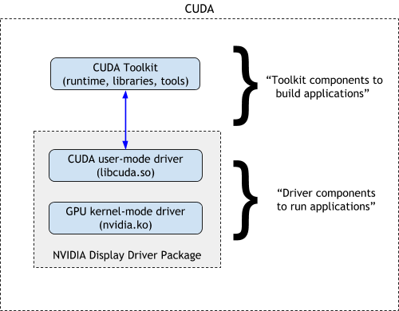
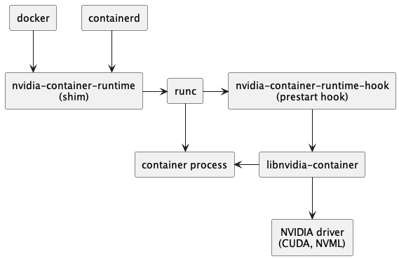

# The GPU Node Software Stack From Zero: Drivers, CUDA, NCCL and Fabric Bring-up

A GPU server fresh from the vendor is a box of very expensive silicon that does nothing. Before `torch.cuda.is_available()` returns `True` and an 8-node all-reduce runs at line rate, about a dozen pieces of software have to be installed at matching versions, in the right order, on the host or in the container. Each one can be missing, the wrong version or half-loaded. When that happens the failure usually shows up somewhere else: NCCL complains, PyTorch hangs, or a job runs at a tenth of the speed it should.

This chapter goes through that stack one layer at a time, from firmware up to framework wheels. For each layer it covers what the layer is, why it exists, which versions must match, how to install and pin it on Ubuntu, and how to check it is healthy. The chapter then builds a node acceptance script that checks the whole stack and prints PASS or FAIL. An operator runs something like it on every node before a scheduler is allowed to give that node to users. It ends with troubleshooting: reading Xid and ECC errors, running diagnostics, deciding reset vs RMA, and the AMD equivalents.

Conventions:

- Python marked **[ran]** was executed on an Apple Silicon Mac (CPython 3.14.5, macOS 15) while writing this chapter. The output pasted under it is the real output.
- Package names and versions marked **[apt, verified]** were read from the Ubuntu 24.04 and NVIDIA CUDA apt repositories on 2026-11-05, using `apt-cache policy <package>` (which prints the versions apt could install and from which repository) inside an `ubuntu:24.04` amd64 container. They will drift, so treat them as "as of Nov 2026".
- Shell sessions on GPU nodes (`nvidia-smi`, `ibstat`, `dcgmi`, ...) are **untested** here, because there was no GPU or InfiniBand hardware. Their output is sketched from the tools' documented formats with the details trimmed. The commands and flags are real. The specific numbers in the sketched output are only examples.

## Prerequisites

- [Linux and the OS](../foundations/linux-and-os.md), especially [shared libraries and `LD_LIBRARY_PATH`](../foundations/linux-and-os.md#shared-libraries-and-ld_library_path), [CUDA driver vs runtime vs toolkit](../foundations/linux-and-os.md#cuda-driver-vs-runtime-vs-toolkit-why-cuda-version-mismatch-happens), [systemd](../foundations/linux-and-os.md#systemd-and-services) and [package management](../foundations/linux-and-os.md#package-management-apt-vs-conda-vs-pip-vs-uv).
- [Computer architecture](../foundations/computer-architecture.md): [PCIe](../foundations/computer-architecture.md#pcie), [DMA](../foundations/computer-architecture.md#dma), [GPUDirect](../foundations/computer-architecture.md#gpudirect-cutting-the-cpu-and-its-memory-out-of-the-path), [NVLink and NVSwitch](../foundations/computer-architecture.md#nvlink-and-nvswitch) and [the map of a GPU server](../foundations/computer-architecture.md#a-map-of-a-gpu-server).
- [Networking](../foundations/networking.md), especially [HPC networking: RDMA, InfiniBand, RoCE, EFA](../foundations/networking.md#hpc-networking-rdma-infiniband-roce-efa).
- [Toolkit](../foundations/toolkit.md): the terminal basics, Make and the "compiling C" sections (section 6 builds perftest with `./configure` and `make`, section 7 builds nccl-tests with `make`), and regular expressions (the acceptance script's parsers).
- [Linux and the OS](../foundations/linux-and-os.md) also for the shell itself: [pipes and redirection](../foundations/linux-and-os.md#pipes-and-redirection), [scripting essentials](../foundations/linux-and-os.md#scripting-essentials) (`for` loops, `$(...)`), [/proc and /sys](../foundations/linux-and-os.md#proc-and-sys-the-kernel-as-files), [logs: journalctl and dmesg](../foundations/linux-and-os.md#logs-journalctl-and-dmesg) (Xid errors) and [how torchrun spawns workers](../foundations/linux-and-os.md#how-torchrun-spawns-workers).
- [Containers and virtualization](../foundations/containers-and-virtualization.md), for the container half of the host-vs-container split, especially [GPUs in containers](../foundations/containers-and-virtualization.md#6-gpus-in-containers) and [IOMMU, VFIO and PCIe passthrough](../foundations/containers-and-virtualization.md#iommu-vfio-and-pcie-passthrough) (IOMMU, ACS, SR-IOV).
- [Distributed systems](../foundations/distributed-systems.md): ranks, launchers and [collectives](../foundations/distributed-systems.md#collectives-the-workhorse-of-distributed-training); and [Networking](../foundations/networking.md#how-pytorch-distributed-bootstraps) for how NCCL bootstraps and picks interfaces.
- Helpful: [the GPU execution model](accelerator/execution-model.md) and [writing kernels](accelerator/writing-kernels.md) (where `nvcc`, PTX and SASS come from).
- Forward links (later chapters, not needed first): [collectives internals](../network/collectives-internals.md) (algbw/busbw, NCCL algorithms), [Slurm from zero](../orchestration/slurm/from-zero.md) (`srun`, `scontrol`, draining, health checks), [Kubernetes from zero](../orchestration/kubernetes-from-zero.md) and [orchestration internals](../orchestration/internals.md) (DaemonSets, taints, device plugins, the GPU Operator). Where this chapter uses their commands it explains just enough to follow.


## 1. The map: what runs where

### The layers, bottom to top

Each layer of the stack depends only on the layers below it. Here it is from the bottom up:

```
                                                         lives in        changes how often
 +--------------------------------------------------+
 | your code: train.py, vLLM, ...                    |   container/venv  every commit
 | framework: torch, jax (+ triton)                  |   container/venv  weeks
 | CUDA libraries: cuBLAS, cuDNN, NCCL, cuFFT, ...   |   container/venv  weeks (pip wheels)
 | CUDA runtime: libcudart.so                        |   container/venv  with the framework
 +--------------------------------------------------+  <- the container boundary
 | user-space driver: libcuda.so, libnvidia-ml.so    |   HOST (injected) must equal kernel module
 | container runtime hook: nvidia-container-toolkit  |   HOST            months
 | driver daemons: nvidia-persistenced, fabricmanager|   HOST            with the driver
 |   nvidia-dcgm, nv-hostengine                      |
 | RDMA user space: libibverbs, librdmacm, providers |   both (see 6)    months
 | kernel modules: nvidia, nvidia_uvm, nvidia_peermem|   HOST            months (driver upgrade)
 |   mlx5_core, mlx5_ib, ib_uverbs                   |
 | Linux kernel                                      |   HOST            months
 | BIOS/UEFI settings, BMC                           |   HOST (board)    rarely
 | firmware: GPU VBIOS, NVSwitch, NIC (ConnectX), PSU|   on the devices  rarely, by vendor bundle
 +--------------------------------------------------+
```

Some terms, one sentence each:

- **Firmware** is software stored on a device's own flash memory that runs on the device itself, for example the GPU's VBIOS or the NIC's firmware. The operating system never runs it. It can only flash a new version.
- The **BMC** (baseboard management controller) is a small computer on the motherboard with its own network port. It lets you power-cycle the server, open its console and flash firmware even when the OS is dead.
- A **kernel module** (`.ko` file) is code loaded into the running Linux kernel. GPU and NIC drivers are kernel modules because only the kernel may program device registers, handle interrupts and map device memory.
- The **user-space driver** (`libcuda.so`) is the library your process calls to talk to that kernel module. It is part of the "driver", not part of "CUDA", and it must have exactly the same version as the kernel module.
- The **CUDA runtime** (`libcudart.so`) is the friendlier API (`cudaMalloc`, `cudaMemcpy`, kernel launches) built on top of `libcuda`. It ships with the toolkit and with framework wheels.
- The **CUDA toolkit** is the developer kit: the `nvcc` compiler, headers, the runtime and the math libraries. You need it to *compile* CUDA code, but not to run PyTorch from a wheel.

NVIDIA's own diagram of the boundary between "driver" and "toolkit":



([source](https://docs.nvidia.com/deploy/cuda-compatibility/))

### Why the split is where it is

The dividing line is "kernel vs process". The kernel module and `libcuda.so` speak a private protocol to each other through `ioctl` calls on `/dev/nvidia*` (an `ioctl` is the generic "send this device a driver-specific command" [system call](../foundations/linux-and-os.md#system-calls-the-only-door); `/dev/nvidia*` are the [device files](../foundations/linux-and-os.md#everything-is-a-file) the driver creates). Because that protocol changes between driver versions, the two must match exactly. Everything above `libcuda` uses a stable, versioned API, so it can be newer or older within the rules of [section 2](#2-versions-and-the-compatibility-rules).

That one fact explains the host-vs-container split:

- **Host only:** the kernel is shared by every container on the machine. So `nvidia.ko`, and therefore `libcuda.so` (which must match it), have to come from the host. The NVIDIA Container Toolkit mounts the host's `libcuda.so` into each GPU container when it starts ([section 5](#5-containers-and-the-gpu)).
- **In the container or venv:** the CUDA runtime, cuBLAS, cuDNN, NCCL and the framework. These are ordinary user-space libraries, so each image can bring its own, and two jobs on the same node can use different CUDA runtimes.

So "CUDA 12.8 on the node" is usually a meaningless phrase. The node has a *driver*. Each image or venv has a *runtime*. The admin owns the first and the user owns the second.

### Taking inventory of a node, layer by layer

These are the commands that answer "what is installed at each layer?" **[untested: needs a Linux GPU node]**

```bash
# firmware / hardware
sudo dmidecode -s system-product-name              # e.g. "PowerEdge XE9680"
nvidia-smi --query-gpu=index,name,vbios_version --format=csv,noheader
lspci -nn | grep -Ei 'nvidia|mellanox'             # GPUs, NVSwitches, ConnectX NICs
cat /sys/class/infiniband/mlx5_0/fw_ver            # NIC firmware, e.g. 28.43.1014

# kernel + modules
uname -r                                           # e.g. 6.8.0-87-generic
cat /proc/driver/nvidia/version                    # the LOADED nvidia.ko, and whether it is the open flavor
lsmod | grep -E '^(nvidia|mlx5|ib_)'               # which modules are loaded
dkms status                                        # which modules are built for which kernels

# user-space driver + daemons
nvidia-smi | head -4                               # driver version, max CUDA the driver supports
systemctl is-active nvidia-persistenced nvidia-fabricmanager nvidia-dcgm

# runtime + libraries (per environment, not per node!)
python -c 'import torch; print(torch.__version__, torch.version.cuda, torch.cuda.nccl.version())'
nvcc --version 2>/dev/null | tail -1               # only if a toolkit is installed
```

Sketch of the interesting lines on an 8x H100 node:

```
$ cat /proc/driver/nvidia/version
NVRM version: NVIDIA UNIX Open Kernel Module for x86_64  580.95.05  Release Build  (dvs-builder@U16-I1-N08-12-1)  ...
GCC version:  gcc version 13.3.0 (Ubuntu 13.3.0-6ubuntu2~24.04)

$ lsmod | grep -E '^(nvidia|mlx5|ib_)'
nvidia_peermem         16384  0
nvidia_uvm           2088960  4
nvidia_drm            135168  0
nvidia_modeset       1638400  1 nvidia_drm
nvidia              104701952  110 nvidia_uvm,nvidia_peermem,nvidia_modeset
mlx5_ib               520192  0
mlx5_core            2723840  1 mlx5_ib
ib_uverbs             200704  3 nvidia_peermem,rdma_ucm,mlx5_ib
```

Tools in that block, one line each: `dmidecode` reads the motherboard's description of itself (model, BIOS version); `lspci` lists every device on the PCIe bus ([PCIe](../foundations/computer-architecture.md#pcie)); `lsmod` lists the kernel modules currently loaded (`modprobe <name>` loads one, `modprobe -r <name>` unloads it); `dkms` is explained [below](#dkms-why-the-driver-gets-rebuilt-when-the-kernel-changes); `systemctl is-active` asks systemd whether a [service](../foundations/linux-and-os.md#systemd-and-services) is running.

The modules: `nvidia` is the core driver. `nvidia_uvm` handles unified memory and is needed by CUDA. `nvidia_modeset` and `nvidia_drm` handle display and are harmless on servers. `nvidia_peermem` lets the NIC DMA directly into GPU memory ([GPUDirect RDMA](#gpudirect-rdma-the-nic-reads-gpu-memory)). `mlx5_core` and `mlx5_ib` are the ConnectX NIC driver and its InfiniBand/RDMA part. `ib_uverbs` exposes RDMA to user space.

On this Mac, the framework layer exists but there is nothing underneath it. That makes the point that `torch.version.cuda` describes the wheel, not the machine: **[ran]**

```python
import torch
print(torch.__version__, torch.version.cuda, torch.cuda.is_available(), torch.backends.mps.is_available())
```

```
2.15.0 None False True
```

The macOS wheel is built without CUDA (`None`). On Linux, `pip install torch` 2.15.0 pulls in a whole CUDA user space as wheels. This is the wheel's real dependency list from PyPI on 2026-11-05: **[ran]**

```bash
curl -s https://pypi.org/pypi/torch/json | python3 -c "
import json,sys; d=json.load(sys.stdin); print(d['info']['version'])
[print(r) for r in d['info']['requires_dist'] if 'nvidia' in r or 'cuda' in r]"
```

```
2.15.0
cuda-toolkit[cublas,cudart,cufft,cufile,cupti,cusolver,cusparse,nvjitlink,nvrtc,nvtx]==13.2.2; platform_system == "Linux"
cuda-bindings<14,>=13.0.3; platform_system == "Linux" and python_version < "3.15"
nvidia-cudnn-cu13==9.26.0.51; platform_system == "Linux"
nvidia-cusparselt-cu13==0.8.1; platform_system == "Linux"
nvidia-nccl-cu13==2.30.7; platform_system == "Linux"
nvidia-nvshmem-cu13==3.7.2; platform_system == "Linux"
```

So the default PyPI `torch` 2.15.0 brings CUDA runtime 13.2.2 and NCCL 2.30.7, and it needs a driver that speaks CUDA 13 (`>= 580`, see below). No `nvcc` and no `libcuda` are in that list. `libcuda` always comes from the host.


## 2. Versions and the compatibility rules

### Reading the three version numbers

The [Linux chapter's table](../foundations/linux-and-os.md#cuda-driver-vs-runtime-vs-toolkit-why-cuda-version-mismatch-happens) introduced the four "CUDA versions". Here is what each one tells an operator:

```
$ nvidia-smi | head -4
+-----------------------------------------------------------------------------------------+
| NVIDIA-SMI 580.95.05              Driver Version: 580.95.05      CUDA Version: 13.0     |
+-----------------------------------------+------------------------+----------------------+
$ python -c 'import torch; print(torch.version.cuda)'
13.2
$ nvcc --version | tail -1
Cuda compilation tools, release 12.8, V12.8.93
```

- `Driver Version: 580.95.05` is the version of the user-space driver that `nvidia-smi` loaded. It is read as `<branch>.<minor>.<patch>`. The **branch** (580) is what matters for compatibility. Patches inside a branch are bug and security fixes.
- `CUDA Version: 13.0` is the newest CUDA API that this driver *natively* implements. It is not an installed toolkit.
- `torch.version.cuda` is the runtime the framework was built against and ships with.
- `nvcc` is the toolkit on `PATH`, if any. It matters only when you compile extensions. Its *major* version must match `torch.version.cuda`'s major version.

Here the runtime is 13.2 and the driver's native version is 13.0, and that works. The next section explains why.

### The four rules

As of CUDA 13.5 (November 2026), from [NVIDIA's compatibility guide](https://docs.nvidia.com/deploy/cuda-compatibility/):

1. **Backward compatibility.** A newer driver runs anything built for an older CUDA. A 620 driver runs a CUDA 11.8 binary.
2. **Minor-version compatibility (CUDA 11+).** Within one CUDA major version, a runtime from a newer minor version runs on any driver at or above that major version's floor, with a limited feature set (features that need a newer driver, such as some PTX JIT paths, will fail). The floors are 11.x: `>= 450.80.02`, 12.x: `>= 525.60.13`, 13.x: `>= 580` (NVIDIA's own example uses 580.65.06, the driver released with 13.0). This is why runtime 13.2 runs on driver 580.
3. **Forward compatibility across major versions** needs the `cuda-compat-<major>-<minor>` package, and **only on datacenter GPUs** (plus some RTX "NGC-ready" SKUs and Jetson, NVIDIA's embedded boards). That package is a newer `libcuda.so` placed in `/usr/local/cuda-X.Y/compat/` and loaded through `LD_LIBRARY_PATH`. It runs on top of an older kernel module, and only on specific supported driver branches.
4. **Architecture support is separate.** The runtime and the binary must also know your GPU. Each GPU has a **compute capability** (`sm_80` for A100, `sm_90` for H100/H200, `sm_100` for B200). A binary contains machine code (SASS) for some capabilities and maybe PTX, an intermediate code the driver can JIT-compile for newer ones. CUDA added `sm_90` support in 11.8 and Blackwell `sm_100` in 12.8. A CUDA 12.4 wheel on a B200 therefore fails with `no kernel image is available for execution on the device` even with a perfect driver.

Rules 1 to 3 as code, so you can paste in the two numbers from a node and get an answer: **[ran]**

```python
# cuda_compat.py - can this CUDA runtime run on this driver? (rules as of CUDA 13.5 / Nov 2026)
MIN_DRIVER = {11: (450, 80, 2), 12: (525, 60, 13), 13: (580, 65, 6)}  # minor-version-compat floor per major

def v(s):
    return tuple(int(x) for x in s.split("."))

def verdict(driver, runtime, datacenter_gpu=True):
    d, (major, minor) = v(driver), v(runtime)[:2]
    native_major = max(m for m, floor in MIN_DRIVER.items() if d >= floor) if d >= MIN_DRIVER[11] else None
    if native_major is None:
        return "FAIL: driver older than any CUDA 11+ floor"
    if major <= native_major:
        return f"OK: driver speaks CUDA {native_major}.x; runtime {runtime} runs (backward/minor-version compat)"
    if datacenter_gpu:
        return f"NEEDS cuda-compat-{major}-{minor}: newer major than driver, forward-compat package (datacenter GPUs only)"
    return "FAIL: runtime major newer than driver and forward compat is datacenter-only"

if __name__ == "__main__":
    for drv, rt, dc in [("550.54.15", "12.1", True), ("550.54.15", "12.8", True), ("575.57.08", "13.2", True),
                        ("575.57.08", "13.2", False), ("580.95.05", "13.2", True), ("620.70.06", "11.8", True),
                        ("418.87.01", "12.1", True)]:
        print(f"driver {drv:<10} runtime {rt:<5} dc={dc!s:<5} -> {verdict(drv, rt, dc)}")
    assert verdict("580.95.05", "13.2").startswith("OK")
    assert verdict("575.57.08", "13.2").startswith("NEEDS")
    assert verdict("575.57.08", "13.2", False).startswith("FAIL")
```

```
driver 550.54.15  runtime 12.1  dc=True  -> OK: driver speaks CUDA 12.x; runtime 12.1 runs (backward/minor-version compat)
driver 550.54.15  runtime 12.8  dc=True  -> OK: driver speaks CUDA 12.x; runtime 12.8 runs (backward/minor-version compat)
driver 575.57.08  runtime 13.2  dc=True  -> NEEDS cuda-compat-13-2: newer major than driver, forward-compat package (datacenter GPUs only)
driver 575.57.08  runtime 13.2  dc=False -> FAIL: runtime major newer than driver and forward compat is datacenter-only
driver 580.95.05  runtime 13.2  dc=True  -> OK: driver speaks CUDA 13.x; runtime 13.2 runs (backward/minor-version compat)
driver 620.70.06  runtime 11.8  dc=True  -> OK: driver speaks CUDA 13.x; runtime 11.8 runs (backward/minor-version compat)
driver 418.87.01  runtime 12.1  dc=True  -> FAIL: driver older than any CUDA 11+ floor
```

The script does not check rule 4 (architecture). To check that on a GPU, run `python -c 'import torch; print(torch.cuda.get_arch_list(), torch.cuda.get_device_capability())'` and make sure your device's `sm_XY` (or an older PTX) is in the list. **[untested]**

### Which driver branch ships with which toolkit

Each CUDA minor release is built and tested with one driver branch, and its `cuda-compat` package contains that branch's `libcuda`. Reading the `cuda-compat-*` versions from NVIDIA's apt repo gives the pairing **[apt, verified]**:

| CUDA toolkit | cuda-compat package version (= driver branch) |
|---|---|
| 12.4 | 550.163.01 |
| 12.6 | 560.35.05 |
| 12.8 | 570.211.01 |
| 12.9 | 575.57.08 |
| 13.0 | 580.196.07 |
| 13.1 | 590.48.01 |
| 13.2 | 595.112.07 |
| 13.3 | 610.57.04 |
| 13.4 | 615.71.10 |
| 13.5 | 620.70.06 |

The package versions are the *latest patch* of each branch, not the version that originally shipped with the toolkit. Use this table to see which branch belongs with which toolkit, not to find exact minimums.

The CUDA container images encode the same rules in an environment variable that the container toolkit checks at launch. From `nvidia/cuda:13.0.2-base-ubuntu24.04` (trimmed, **[ran]** on 2026-11-05 by inspecting the image):

```
CUDA_VERSION=13.0.2
NVIDIA_REQUIRE_CUDA=cuda>=13.0 brand=tesla,driver>=535,driver<536 brand=tesla,driver>=550,driver<551
                    brand=tesla,driver>=565,driver<566 brand=tesla,driver>=570,driver<571 brand=tesla,driver>=575,driver<576 ...
```

Read it as: "this image needs a driver that natively speaks CUDA >= 13.0, **or** one of the datacenter ("tesla") branches 535/550/565/570/575, which can run it through the bundled forward-compat `libcuda`". Those are the branches NVIDIA supports for forward compatibility. A driver from any other pre-580 branch is refused.

### How a version mismatch shows up

| Symptom | Layer | Cause | Fix |
|---|---|---|---|
| `Failed to initialize NVML: Driver/library version mismatch` | kernel module vs `libnvidia-ml` | apt upgraded the user-space libraries, but the old `nvidia.ko` is still loaded | reboot (or unload and reload the modules, [section 3](#upgrading-without-breaking-the-node)) |
| `CUDA driver version is insufficient for CUDA runtime version` / `torch.cuda.is_available()` is `False` with a warning | runtime vs driver | runtime major is newer than the driver | upgrade the driver, use a `cu12x` wheel, or `cuda-compat` |
| `no kernel image is available for execution on the device` | binary vs GPU | wheel or extension built without your `sm_XY` | newer wheel, or rebuild with `TORCH_CUDA_ARCH_LIST` |
| `The detected CUDA version (12.8) mismatches the version that was used to compile PyTorch (13.2)` | `nvcc` vs torch | compiling an extension with the wrong toolkit | point `CUDA_HOME` at a toolkit with the matching major version |
| `cudaErrorSystemNotReady` / "system not yet initialized" (error 802) | Fabric Manager | NVSwitch system and FM not running or not finished | [section 4](#fabric-manager-required-on-nvswitch-systems) |
| `nvidia-smi` hangs for seconds, first CUDA call slow | persistence | no persistence daemon, so the driver tears down state between processes | [persistence mode](#persistence-mode) |
| `libcuda.so.1: cannot open shared object file` in a container | container runtime | started without `--gpus` or without the NVIDIA runtime | [section 5](#5-containers-and-the-gpu) |

To see which libraries a process actually loaded, use the [`LD_DEBUG` and `/proc/<pid>/maps` recipes in the Linux chapter](../foundations/linux-and-os.md#shared-libraries-and-ld_library_path). The one-line version for CUDA: **[untested]**

```bash
python -c 'import torch; torch.zeros(1).cuda(); import os; os.system(f"grep -oE \"/[^ ]*(libcuda|libcudart|libnccl)[^ ]*\" /proc/{os.getpid()}/maps | sort -u")'
# /usr/lib/x86_64-linux-gnu/libcuda.so.580.95.05                              <- host driver
# /venv/lib/python3.12/site-packages/nvidia/cu13/lib/libcudart.so.13           <- wheel runtime
# /venv/lib/python3.12/site-packages/nvidia/nccl/lib/libnccl.so.2              <- wheel NCCL
```


## 3. Installing and upgrading the NVIDIA driver on Ubuntu

### Where the driver can come from

On Ubuntu 22.04/24.04/26.04 there are three sources. Pick one per fleet and never mix them on the same node.

| Source | Package names (as of Nov 2026) | Pros | Cons |
|---|---|---|---|
| Ubuntu archive ("restricted") | `nvidia-driver-570-server-open`, `nvidia-fabricmanager-570`, `nvidia-utils-570-server` | Canonical signs the modules for Secure Boot. `ubuntu-drivers` picks one for you. | lags NVIDIA by weeks |
| NVIDIA CUDA network repo | `nvidia-open` (latest), `nvidia-open-580` (one branch, up to 580), `nvidia-driver-pinning-<branch>`, `cuda-drivers` | newest drivers, NVIDIA's documented path, matching FM/DCGM/NCCL in the same repo | you sign the modules for Secure Boot (or Secure Boot is off) |
| `.run` installer | `NVIDIA-Linux-x86_64-<ver>.run` | no repo needed | invisible to apt; the next `apt upgrade` can half-overwrite it. Avoid on fleets. |

All the names above were checked against the repos **[apt, verified]**. For example, the Ubuntu archive had `nvidia-driver-570-server-open 570.211.01-0ubuntu1.24.04.1` and the CUDA repo had `nvidia-open 620.70.06-1ubuntu1`.

The `-server` packages in Ubuntu's archive are the datacenter-branch builds with a longer support lifecycle. Prefer them over the desktop `nvidia-driver-NNN` on servers.

NVIDIA ships several driver *branches* at once: production branches with long support and short-lived "new feature" branches. Pick a long-lived production branch for a fleet and move between branches deliberately. Check [NVIDIA's driver lifecycle documentation](https://docs.nvidia.com/datacenter/tesla/drivers/index.html) for which branches are long-term support right now. I have not verified the current LTS list.

### Open vs proprietary kernel modules

Since 2022 NVIDIA has published the source of its GPU kernel modules ([open-gpu-kernel-modules](https://github.com/NVIDIA/open-gpu-kernel-modules), dual MIT/GPLv2). The open modules are possible because Turing and later GPUs run most of the driver logic on an on-GPU microcontroller, the **GSP** (GPU System Processor). The kernel module is then mostly a thin shim, and NVIDIA could open-source it without exposing much.

The practical rules (as of driver 620):

- Turing (T4), Ampere (A100), Hopper (H100/H200) and Blackwell (B200/B300) can all use the open modules. Grace Hopper and Blackwell *require* them.
- Pre-Turing GPUs such as Volta (V100) need the proprietary modules, which are only available on older branches.
- NVIDIA's own install guide now documents only the open flavor. Since R560 it has been the default.

Check which one is loaded: **[untested]**

```bash
$ grep -o 'Open Kernel Module' /proc/driver/nvidia/version && echo open || echo proprietary
Open Kernel Module
open
$ modinfo nvidia | grep -E '^(version|license)'
version:        580.95.05
license:        Dual MIT/GPL          # proprietary builds say "NVIDIA"
```

### DKMS: why the driver gets rebuilt when the kernel changes

A kernel module is compiled against one specific kernel version's internal interfaces, which are not stable. When Ubuntu installs a new kernel, every out-of-tree module (a module not shipped inside the Linux source tree: NVIDIA's, and sometimes DOCA-OFED, the RDMA NIC stack from [section 6](#the-software-inbox-rdma-core-vs-doca-ofed)) has to be rebuilt for it. **DKMS** (Dynamic Kernel Module Support) automates that. The driver package installs the module *source* under `/usr/src/nvidia-<ver>/`, and an apt hook recompiles it for every kernel that gets installed. The `nvidia-dkms-*-open` package is the DKMS piece. The precompiled alternative (`linux-modules-nvidia-*` in Ubuntu) ships modules already built for Canonical's kernels.

This only works if the kernel headers for the target kernel are installed, so put `linux-headers-$(uname -r)` (or the `linux-headers-generic` metapackage) in your base image. A missing header package is the most common reason a node comes back from a kernel update with no GPU. **[untested]**

```bash
$ dkms status
nvidia/580.95.05, 6.8.0-85-generic, x86_64: installed
nvidia/580.95.05, 6.8.0-87-generic, x86_64: installed      # one line per kernel it is built for

# after installing a kernel without headers, the module silently isn't there for it:
$ ls /lib/modules/6.8.0-88-generic/updates/dkms/ 2>&1
ls: cannot access '/lib/modules/6.8.0-88-generic/updates/dkms/': No such file or directory
$ sudo apt install linux-headers-6.8.0-88-generic && sudo dkms autoinstall -k 6.8.0-88-generic
```

**Secure Boot** is a feature of UEFI (the firmware interface that replaced the classic BIOS; people still say "BIOS" for both) that refuses to load unsigned kernel code. Canonical's precompiled modules are signed. DKMS-built modules are signed with a local key (a **MOK**, machine owner key), which someone must enroll at the console on the next boot (`sudo mokutil --import /var/lib/shim-signed/mok/MOK.der`). Fleets usually either use signed modules or turn Secure Boot off in the BIOS. If `modprobe nvidia` fails with `Key was rejected by service`, this is the cause.

### A clean install from the NVIDIA repo

Compute-only (headless), open modules, pinned to the 580 branch. These follow [NVIDIA's Ubuntu install guide](https://docs.nvidia.com/datacenter/tesla/driver-installation-guide/ubuntu.html). **[untested]**

Reading the block: `echo -e "..." | sudo tee FILE` writes a file that only root may write (`sudo echo > FILE` would not work, because the redirection is done by your unprivileged shell). Files in `/etc/modprobe.d/` are options for `modprobe`; `blacklist nouveau` stops the kernel loading **nouveau**, the community-written open-source NVIDIA driver, which would otherwise grab the GPU first. `update-initramfs -u` rebuilds the **initramfs**, the small boot-time filesystem that loads early drivers, so the blacklist also applies at boot. `dpkg -i` installs a downloaded `.deb` package file directly (`apt` is the higher-level tool that downloads and resolves dependencies, see [package management](../foundations/linux-and-os.md#package-management-apt-vs-conda-vs-pip-vs-uv)); `-y` answers yes to prompts and `-V` shows the versions it picks.

```bash
# 0. nothing else may own the GPU: blacklist nouveau (the reverse-engineered open driver)
echo -e "blacklist nouveau\noptions nouveau modeset=0" | sudo tee /etc/modprobe.d/blacklist-nouveau.conf
sudo update-initramfs -u

# 1. headers for DKMS, and the NVIDIA repo
sudo apt install -y linux-headers-$(uname -r)
wget https://developer.download.nvidia.com/compute/cuda/repos/ubuntu2404/x86_64/cuda-keyring_1.1-1_all.deb
sudo dpkg -i cuda-keyring_1.1-1_all.deb && sudo apt update

# 2. pin the branch BEFORE installing (NVIDIA's recommendation), then the compute-only driver
sudo apt install -y nvidia-driver-pinning-580
sudo apt install -y -V libnvidia-compute nvidia-dkms-open      # compute-only; 'nvidia-open' = full driver
sudo apt install -y nvidia-persistenced                        # if not pulled in already

# 3. reboot and verify
sudo reboot
nvidia-smi -L
```

Starting with branch 590, NVIDIA's Ubuntu packages dropped the branch number from their names (`nvidia-open` rather than `nvidia-open-590`). Choosing a branch or an exact version is now done only with the `nvidia-driver-pinning-*` packages. The repo has both `nvidia-driver-pinning-580` (branch) and `nvidia-driver-pinning-580.126.20` (exact version) **[apt, verified]**.

### Pinning: making `apt upgrade` safe

An unattended `apt upgrade` that moves a node from 580 to 620 while jobs are running is a classic outage. The new user-space libraries no longer match the loaded kernel module, and every new process fails with the NVML mismatch error until someone reboots. The pinning package is simply an apt preferences file (files in `/etc/apt/preferences.d/` tell apt which version of a package to prefer when several are available). This is the real content of `nvidia-driver-pinning-580`, extracted from the .deb **[apt, verified]**:

```
# /etc/apt/preferences.d/nvidia-driver-pin  (from nvidia-driver-pinning-580)
Package: src:nvidia-graphics-drivers-580:any src:nvidia-kmod-open:any
Pin: version 580*
Pin-Priority: 1000

Package: src:nvidia-modprobe src:nvidia-persistenced src:nvidia-settings src:nvidia-xconfig
Pin: version 580*
Pin-Priority: 1000

Package: src:cuda-drivers:any src:nvidia-open:any
Pin: version 580*
Pin-Priority: 1000

Package: src:libnvidia-nscq src:libnvsdm src:nvidia-fabricmanager src:nvidia-imex src:nvlink5 src:fabricmanager src:imex
Pin: version 580*
Pin-Priority: 1000
```

`Pin-Priority: 1000` means "prefer this version even if it means a downgrade". The pin covers every source package of the driver, including Fabric Manager and IMEX (a daemon for sharing GPU memory across nodes on rack-scale systems, [below](#fabric-manager-required-on-nvswitch-systems)), so they all stay on the same branch. That matters because before driver 620, Fabric Manager must match the driver exactly (see below).

Belt and braces for a fleet: also keep the driver out of unattended upgrades, and pin the kernel too, since a kernel change triggers a DKMS rebuild. **[untested]**

In the block below, `dpkg-query -W -f='${Package}\n'` prints the name of every installed package, one per line, and `apt-mark hold` freezes each one at its current version. `cat <<'EOF' ... EOF` is a **heredoc**: the lines between the two `EOF` markers become the command's standard input (the quotes around `'EOF'` stop the shell from expanding `$` inside), and `| sudo tee FILE` writes them to a root-owned file.

```bash
# hold exact versions (stricter than the branch pin)
sudo apt-mark hold $(dpkg-query -W -f='${Package}\n' | grep -E '^(nvidia|libnvidia|linux-(image|headers|modules))')
# keep unattended-upgrades away from them
cat <<'EOF' | sudo tee /etc/apt/apt.conf.d/51nvidia-no-unattended
Unattended-Upgrade::Package-Blacklist { "nvidia-"; "libnvidia-"; "linux-"; };
EOF
apt-mark showhold | head
```

### Upgrading without breaking the node

A driver upgrade means "nothing may hold `/dev/nvidia*` open, swap the modules, verify". The order matters. **[untested]**

Step 1 is a preview of the cluster schedulers taught later. A **scheduler** (Slurm or Kubernetes) is the service that decides which jobs run on which nodes. **Draining** a node tells it "let running jobs finish, but place nothing new here"; **resuming** puts the node back in service. `scontrol update nodename=... state=drain reason=...` is Slurm's admin command for that ([Slurm: draining and resuming](../orchestration/slurm/from-zero.md#day-to-day-draining-resuming-adding-nodes)), and `kubectl drain` is the Kubernetes equivalent ([Kubernetes from zero](../orchestration/kubernetes-from-zero.md)). `hostname -s` prints this machine's short name. `lsof /dev/nvidia*` lists processes that have the GPU device files open ([lsof](../foundations/linux-and-os.md#lsof-and-ss-open-files-and-network-ports)).

```bash
# 1. drain: tell the scheduler to stop placing jobs, wait for running ones
sudo scontrol update nodename=$(hostname -s) state=drain reason="driver 580->620"   # Slurm
# kubectl drain $(hostname) --ignore-daemonsets                                     # Kubernetes

# 2. stop everything that holds the GPU open
sudo systemctl stop nvidia-dcgm nvidia-fabricmanager nvidia-persistenced
sudo lsof /dev/nvidia* 2>/dev/null          # must print nothing; kill or stop what it shows

# 3. move the pin, upgrade, reboot (a reboot is the reliable way to get matching modules loaded)
sudo apt install -y nvidia-driver-pinning-620 && sudo apt purge -y nvidia-driver-pinning-580
sudo apt update && sudo apt install -y libnvidia-compute nvidia-dkms-open nvidia-fabricmanager
sudo reboot

# 3b. (no-reboot variant, when nothing else depends on the modules)
#     sudo modprobe -r nvidia_peermem nvidia_uvm nvidia_drm nvidia_modeset nvidia && sudo modprobe nvidia

# 4. verify, then run the acceptance script (section 10) before resuming
cat /proc/driver/nvidia/version && nvidia-smi -L
sudo python3 node_accept.py --gpus 8 --driver 620.70.06 && sudo scontrol update nodename=$(hostname -s) state=resume
```

Roll the upgrade one node at a time and keep a canary node on the new driver for a few days of real jobs before rolling out to the rest. Driver regressions do happen, and a fleet-wide rollback is far more expensive than a slow rollout.


## 4. Driver-level services and GPU health

### Persistence mode

Normally the kernel driver tears down a GPU's state when the last process using it exits, and rebuilds it when the next process opens it. On datacenter GPUs that rebuild takes from hundreds of milliseconds to a few seconds per GPU. It makes every `nvidia-smi` call slow, and it resets settings such as application clocks between jobs. **Persistence mode** keeps the driver state alive with no clients. The supported way to get it is the `nvidia-persistenced` daemon, which holds the device files open. The older `nvidia-smi -pm 1` sets a legacy flag inside the driver. **[untested]**

```bash
$ sudo systemctl enable --now nvidia-persistenced
$ nvidia-smi --query-gpu=index,persistence_mode --format=csv,noheader
0, Enabled
...
7, Enabled
$ time nvidia-smi -L >/dev/null     # with persistence: well under a second on an idle node
```

### Fabric Manager: required on NVSwitch systems

On an HGX/DGX board, the 8 GPUs are not wired directly to each other. Each GPU connects to several **NVSwitch** chips, and the switches route NVLink traffic between them. Someone has to program the switches' routing tables and assign GPUs to partitions at boot. That is **Fabric Manager** (FM), a host daemon (`nvidia-fabricmanager.service`). Until FM has finished, CUDA on these systems refuses to start, and new CUDA processes get `cudaErrorSystemNotReady`. PCIe GPUs (L4, L40S, H100 PCIe) and machines without NVSwitch don't need FM.

Rules (as of driver 620, from the [Fabric Manager user guide](https://docs.nvidia.com/datacenter/tesla/fabric-manager-user-guide/index.html)):

- **For drivers before 620, the FM package version must match the driver version exactly.** A 580.95.05 driver with FM 580.82.07 refuses to start. This is why the pinning file above includes `src:nvidia-fabricmanager`. Starting with 620, FM is versioned separately (the repo has `nvidia-fabricmanager` as a transitional package to `nvidia-fabricmanager-direct 2.0.0` **[apt, verified]**). I haven't seen this on hardware, so check the guide for which FM version goes with which driver.
- On **HGX B200/B300**, the 4th-generation NVSwitches share their design with InfiniBand switches, and FM also needs the **NVLink Subnet Manager** (`nvlsm` package) plus an OFED/rdma-core stack. The shipped `nv-fabricmanager-start.sh` starts FM and NVLSM as the platform requires.
- Rack-scale NVL72 systems manage NVLink from the switch trays (NVIDIA calls this NMX) and use `nvidia-imex` for cross-node GPU memory sharing. That is beyond a single-node bring-up.

Install, start, verify. **[untested]**

```bash
$ sudo apt install -y nvidia-fabricmanager            # pinned to the driver branch by the pinning package
$ sudo systemctl enable --now nvidia-fabricmanager
$ systemctl is-active nvidia-fabricmanager
active
$ nvidia-smi -q -i 0 | grep -i -A 2 Fabric
    Fabric
        State                             : Completed
        Status                            : Success
```

`State: In Progress` is normal for a few seconds after boot. Anything other than `Completed / Success` once FM is up means the GPU isn't part of the NVLink fabric. Look at `journalctl -u nvidia-fabricmanager` and `/var/log/fabricmanager.log`.

### NVLink and topology checks

Once FM is happy, check that the links actually trained and at what speed, and look at how GPUs and NICs connect. [NVLink error counters](#nvlink-error-counters) in section 11 covers the error counters, and [P2P checks](../network/measuring-and-debugging.md#how-to-check-if-p2p-is-supported) whether GPUs can reach each other directly. The bring-up version: **[untested]**

```bash
$ nvidia-smi nvlink -s | head -4                 # every link should show a speed, none "<inactive>"
GPU 0: NVIDIA H100 80GB HBM3 (UUID: GPU-...)
         Link 0: 26.562 GB/s
         Link 1: 26.562 GB/s
         ...
$ nvidia-smi nvlink -s | grep -c 'GB/s'          # 8 GPUs x 18 links on H100 = 144
144
$ nvidia-smi topo -m                             # trimmed
        GPU0  GPU1  ...  NIC0  NIC1  ...  CPU Affinity  NUMA Affinity
GPU0     X    NV18  ...  PIX   NODE  ...  0-55          0
GPU1    NV18   X    ...  NODE  PIX   ...  0-55          0
NIC0    PIX   NODE  ...   X    NODE
Legend: NV# = NVLink (# links), PIX = same PCIe switch, NODE = same NUMA node, SYS = across sockets
```

The two things to check in `topo -m`: every GPU pair is `NV18` (all 18 links, on H100), and every GPU has a NIC at `PIX` distance. A GPU whose nearest NIC is `SYS` sends its network traffic across the CPU socket link, which roughly halves its inter-node bandwidth. If that happens, something is wrong with the cabling, the BIOS or the slot assignment.

18 links times 25 GBps per link per direction gives the H100's advertised 450 GBps per direction. The 26.562 shown per link is the raw signalling rate before encoding overhead. [NVLink](../network/interconnects.md#nvlink) has the arithmetic.

### ECC, row remapping, clocks and GPU reset

**ECC** (error-correcting code) memory stores a few extra check bits per word, so the hardware can fix single-bit flips and at least detect multi-bit ones. A *corrected* error is silent and harmless; an *uncorrected* one means data was lost and the process using it is killed. **Row remapping** is how HBM retires a bad memory row: the GPU records the row and swaps in a spare one at the next reset. These health fields are queryable in one CSV line per GPU. The acceptance script below uses exactly this query. Section 11 explains how to read [row remapping](#checking-row-remapping-health-before-a-job-dies) and [Xid errors](#xid-errors-reading-finding-and-looking-them-up). **[untested]**

```bash
$ nvidia-smi --query-gpu=index,ecc.mode.current,ecc.errors.uncorrected.volatile.total,remapped_rows.pending,remapped_rows.failure,pcie.link.width.current,pcie.link.width.max,clocks_event_reasons.hw_slowdown --format=csv,noheader
0, Enabled, 0, No, No, 16, 16, Not Active
...
$ sudo nvidia-smi -i 3 -r          # reset one GPU (needs no processes on it, and on NVSwitch systems often all GPUs)
```

Two traps. First, the PCIe *generation* drops on an idle GPU to save power, so check link *width* at idle and check generation only under load. Second, ECC mode changes take effect only after a reset. ECC should always be enabled on training nodes.

### DCGM: the health daemon and diagnostics

**DCGM** (Data Center GPU Manager) is NVIDIA's fleet-management layer. It runs a host engine daemon (`nv-hostengine`, packaged as the `nvidia-dcgm` service) that watches health continuously, collects metrics (exported via `dcgm-exporter` to Prometheus, a widely used time-series database that polls services for numbers and feeds dashboards and alerts) and runs diagnostic suites (`dcgmi diag`). As of DCGM 4.7.1 the Ubuntu packages are split by CUDA major version: `datacenter-gpu-manager-4-cuda13`, `-cuda12`, `-cuda11`, `-cuda-all` **[apt, verified]**. The CUDA-specific part is the stress kernels the diagnostics run. **[untested]**

```bash
$ sudo apt install -y datacenter-gpu-manager-4-cuda13
$ sudo systemctl enable --now nvidia-dcgm
$ dcgmi discovery -l | head -6            # does DCGM see all 8 GPUs and the NVSwitches?
8 GPUs found.
+--------+----------------------------------------------------------------------+
| GPU ID | Device Information                                                   |
+--------+----------------------------------------------------------------------+
| 0      | Name: NVIDIA H100 80GB HBM3                                          |
$ dcgmi health -s a                       # enable background watches for all subsystems
$ dcgmi health -c                         # ...and later ask whether anything tripped
$ dcgmi diag -r 1                         # seconds: deployment/software checks
$ dcgmi diag -r 2                         # ~minutes: + short stress, PCIe, memory
```

Level 1 belongs in every job prolog (a **prolog** is a script the scheduler runs on each node just before a job starts; an **epilog** runs just after it ends. Slurm's are introduced in [Slurm from zero](../orchestration/slurm/from-zero.md#what-happens-from-sbatch-to-processes-on-nodes)). Level 2 belongs in acceptance and after any hardware intervention. Levels 3 and 4 (tens of minutes) are for burn-in and RMA evidence. [Running diagnostics with `dcgmi diag`](#running-diagnostics-with-dcgmi-diag) in section 11 has example failure output and a Slurm script.

### Sharing one GPU: MIG and MPS

Training nodes use whole GPUs. Inference and RL rollout fleets often have many small workloads, such as a 1B reward model or a tokenizer service, and one H100 per small workload is wasteful. There are three ways to share a GPU:

| | Isolation | How it works | Use when |
|---|---|---|---|
| **Time-slicing** (default) | none: shared memory space, context switches | the driver round-robins contexts | dev boxes |
| **MPS** (Multi-Process Service) | memory not isolated, compute can be capped | a daemon merges many processes' work into one GPU context so their kernels run *concurrently* | many cooperative processes of one user, e.g. MPI ranks or a rollout worker pool |
| **MIG** (Multi-Instance GPU, A100/H100/B200) | hardware: separate SMs, L2 slices, memory controllers | the GPU is partitioned into up to 7 instances, each of which looks like its own GPU | multi-tenant inference, guaranteed QoS (quality of service: a promised share of throughput and latency) |

MIG. Each profile name is `<compute slices>g.<memory>gb`. An H100 80GB has 7 compute slices, so it can be split into seven `1g.10gb` instances. **[untested]**

```bash
$ sudo nvidia-smi -i 0 -mig 1                       # enable MIG mode on GPU 0 (may require a GPU reset)
$ nvidia-smi mig -i 0 -lgip                         # list GPU-instance profiles and how many fit
|   0  MIG 1g.10gb       19     7/7        9.75       No     16     1     0   |
|   0  MIG 3g.40gb        9     2/2       39.25       No     60     3     0   |
|   0  MIG 7g.80gb        0     1/1       79.25       No    132     7     0   |
$ sudo nvidia-smi mig -i 0 -cgi 3g.40gb,1g.10gb,1g.10gb -C   # create GPU instances + compute instances
$ nvidia-smi -L
GPU 0: NVIDIA H100 80GB HBM3 (UUID: GPU-...)
  MIG 3g.40gb     Device  0: (UUID: MIG-1f0e...)
  MIG 1g.10gb     Device  1: (UUID: MIG-7a31...)
  MIG 1g.10gb     Device  2: (UUID: MIG-c55d...)
$ CUDA_VISIBLE_DEVICES=MIG-7a31... python serve.py   # a process sees exactly one instance
$ sudo nvidia-smi mig -i 0 -dci && sudo nvidia-smi mig -i 0 -dgi   # tear down
```

MPS. **[untested]**

```bash
export CUDA_MPS_PIPE_DIRECTORY=/tmp/mps-pipe CUDA_MPS_LOG_DIRECTORY=/tmp/mps-log
sudo nvidia-smi -i 0 -c EXCLUSIVE_PROCESS     # only the MPS server may open the GPU directly
nvidia-cuda-mps-control -d                    # start the control daemon
CUDA_MPS_ACTIVE_THREAD_PERCENTAGE=25 python worker.py &   # each client capped at 25% of SMs
CUDA_MPS_ACTIVE_THREAD_PERCENTAGE=25 python worker.py &
echo quit | nvidia-cuda-mps-control           # stop
```

The MPS caveat: a fatal fault in one client (an illegal memory access, for example) can take down every client sharing that MPS server. MPS is for cooperating processes, not for isolating tenants. On Kubernetes (taught later, in [Kubernetes from zero](../orchestration/kubernetes-from-zero.md)), the NVIDIA **device plugin** (an agent on each node that tells the cluster how many GPUs, or MIG slices, the node has) and the **GPU Operator** (a bundle that installs the driver, container toolkit and device plugin on every node) expose MIG and time-slicing as schedulable resources ([device plugins](../orchestration/internals.md#exposing-gpus-device-plugins), [GPU Operator components](../orchestration/internals.md#nvidia-gpu-operator-components)).


## 5. Containers and the GPU

### What `--gpus all` actually does

A container is a normal process with its own namespaces ([containers chapter](../foundations/containers-and-virtualization.md)). This section is the operator's view of [GPUs in containers](../foundations/containers-and-virtualization.md#6-gpus-in-containers); re-read [what a CUDA program needs from the host](../foundations/containers-and-virtualization.md#what-a-cuda-program-needs-from-the-host) and [the NVIDIA Container Toolkit](../foundations/containers-and-virtualization.md#the-nvidia-container-toolkit) if the details have faded, and [the run flags that matter for ML](../foundations/containers-and-virtualization.md#the-run-flags-that-matter-for-ml) for `docker run` options such as `--rm`, `--gpus` and `--ulimit`. To use the GPU it needs three things the image cannot provide: the device nodes `/dev/nvidia0..7`, `/dev/nvidiactl` and `/dev/nvidia-uvm`; the host's `libcuda.so` and `libnvidia-ml.so`, which match the host's kernel module; and binaries such as `nvidia-smi`. The **NVIDIA Container Toolkit** injects all three when the container starts. It works as a hook in the OCI runtime ([OCI and runc](../foundations/containers-and-virtualization.md#4-the-standards-oci-containerd-runc-and-cri)) that runs after the container's filesystem is set up but before your process starts:



([source](https://docs.nvidia.com/datacenter/cloud-native/container-toolkit/latest/arch-overview.html))

The proof that `libcuda` is not in the image: this is the CUDA 13.0 base image, inspected without a GPU **[ran]**:

```bash
docker run --rm --platform linux/amd64 nvidia/cuda:13.0.2-base-ubuntu24.04 \
  bash -c 'find / -xdev -name "libcuda.so*"; echo ---; env | grep ^LD_LIBRARY_PATH; dpkg -l | grep -E "cuda|nvidia" | awk "{print \$2, \$3}"'
```

(trimmed to the relevant lines)

```
/usr/local/cuda-13.0/compat/libcuda.so.580.95.05
/usr/local/cuda-13.0/compat/libcuda.so.1
/usr/local/cuda-13.0/compat/libcuda.so
---
LD_LIBRARY_PATH=/usr/local/nvidia/lib:/usr/local/nvidia/lib64:/usr/local/cuda/lib64
cuda-compat-13-0 580.95.05-0ubuntu1
cuda-cudart-13-0 13.0.96-1
cuda-toolkit-13-0-config-common 13.0.96-1
cuda-toolkit-13-config-common 13.0.96-1
cuda-toolkit-config-common 13.0.96-1
```

The only `libcuda` in the image is the **forward-compat** copy (rule 3 above), which is used only when the host driver is too old. Otherwise the toolkit mounts the host's `/usr/lib/x86_64-linux-gnu/libcuda.so.<host-version>` and the dynamic loader uses that one. The image brings the runtime (`cuda-cudart-13-0`) and nothing else. The `-runtime` and `-devel` image variants add the math libraries and `nvcc`.

### Installing and configuring the toolkit

As of Nov 2026 the toolkit is `nvidia-container-toolkit 1.20.1` in NVIDIA's repo **[apt, verified]**. There are two ways to hand GPUs to containers. The legacy runtime hook is what `--gpus` uses. **CDI** (Container Device Interface) is a vendor-neutral YAML spec that lists the device nodes and mounts. Docker 25+, Podman and containerd all understand CDI, and Kubernetes is moving to it. **[untested]**

```bash
sudo apt install -y nvidia-container-toolkit
sudo nvidia-ctk runtime configure --runtime=docker && sudo systemctl restart docker   # legacy hook path
docker run --rm --gpus all nvidia/cuda:13.0.2-base-ubuntu24.04 nvidia-smi -L

sudo nvidia-ctk cdi generate --output=/etc/cdi/nvidia.yaml                            # CDI path
nvidia-ctk cdi list            # nvidia.com/gpu=0 ... nvidia.com/gpu=7, nvidia.com/gpu=all
docker run --rm --device nvidia.com/gpu=all nvidia/cuda:13.0.2-base-ubuntu24.04 nvidia-smi -L
```

Regenerate the CDI spec after every driver upgrade. It contains versioned library paths such as `libcuda.so.580.95.05`, so a stale spec points at files that no longer exist.

For multi-node training containers you also need the RDMA devices (`/dev/infiniband/*`), `--ulimit memlock=-1` (RDMA pins memory) and a larger `/dev/shm`. Those are listed in [NCCL with docker containers](../network/measuring-and-debugging.md#nccl-with-docker-containers).


## 6. The RDMA side of the node

The GPUs talk to each other inside the node over NVLink. Between nodes they talk through NICs on the **backend network**, usually InfiniBand or RoCE ([cluster networks](../network/interconnects.md#cluster-networks)). The [networking foundations chapter](../foundations/networking.md#hpc-networking-rdma-infiniband-roce-efa) explains RDMA, queue pairs and verbs. This section is the operator's view of the same thing: what to install, what healthy looks like, and how to measure it.

### The software: inbox rdma-core vs DOCA-OFED

The RDMA stack has the same shape as the GPU stack:

```
 libnccl / UCX / MPI / perftest            (apps)
 libibverbs + librdmacm + provider (libmlx5)   <- user space, "rdma-core"
 ------------------------------------------------
 ib_uverbs, rdma_ucm, ib_core               <- kernel RDMA core
 mlx5_ib (RDMA part) + mlx5_core (NIC)      <- kernel driver for ConnectX
 ConnectX firmware                           <- on the NIC
```

Two ways to get it:

- **Inbox**: the mainline Linux kernel's `mlx5` drivers plus Ubuntu's `rdma-core` packages. In Ubuntu 24.04 these are `rdma-core`, `ibverbs-utils`, `infiniband-diags` and `perftest`, all version 50.0 (perftest 24.01) **[apt, verified]**. This is enough for NCCL over InfiniBand or RoCE on recent kernels.
- **DOCA-OFED**: NVIDIA's packaged, newer copy of the same drivers and libraries, plus tools such as `mlnx_qos` and `show_gids`. It is the successor to **MLNX_OFED**, which NVIDIA has been retiring in favor of DOCA ([DOCA host installation](https://docs.nvidia.com/doca/sdk/doca-host-installation-and-upgrade/index.html)). Vendors' reference stacks and the NVIDIA GPU Operator's network operator usually assume it. It installs DKMS kernel modules, so the same header and pinning discipline as the GPU driver applies.

Pick one per fleet. Mixing inbox and OFED libraries on the same node produces confusing errors such as `libibverbs: Warning: couldn't load driver 'mlx5'`.

Inbox install and first look. **[untested]**

```bash
sudo apt install -y rdma-core ibverbs-utils infiniband-diags perftest
lsmod | grep -E '^(mlx5_ib|ib_uverbs|rdma_ucm)'
rdma link show
# link mlx5_0/1 state ACTIVE physical_state LINK_UP netdev ibp24s0
# link mlx5_1/1 state ACTIVE physical_state LINK_UP netdev ibp41s0
# ...
# link mlx5_8/1 state ACTIVE physical_state LINK_UP netdev enp157s0f0np0     <- frontend Ethernet NIC
```

### NIC firmware and port mode

ConnectX NICs are both InfiniBand and Ethernet adapters, and the port type is a firmware setting. A NIC that arrived configured as Ethernet will never join your InfiniBand fabric, however correct the software is. The tools are NVIDIA's **MFT** (Mellanox Firmware Tools): `mst` to discover devices, `mlxconfig` for settings and `mlxfwmanager` for firmware. **[untested]**

```bash
sudo mst start
sudo mlxfwmanager --query | grep -E 'Device Type|Versions|FW'        # firmware per NIC, and if an update is available
sudo mlxconfig -d /dev/mst/mt4129_pciconf0 query | grep -E 'LINK_TYPE|ADVANCED_PCI_SETTINGS|ATS'
#  LINK_TYPE_P1    IB(1)        <- 1 = InfiniBand, 2 = Ethernet
sudo mlxconfig -d /dev/mst/mt4129_pciconf0 set LINK_TYPE_P1=1         # takes effect after a reboot or firmware reset
```

Firmware must be the same on every NIC in the fleet, as with the GPU VBIOS and NVSwitch firmware. Most vendors ship a firmware bundle per server model. Apply the whole bundle rather than individual components.

### InfiniBand for operators: ports, the subnet manager, LIDs

An InfiniBand fabric does not configure itself. A **subnet manager** (SM), running on a managed switch or on one host as `opensm`, discovers every port, assigns each one a **LID** (a 16-bit local address used for switch forwarding) and computes the routing tables. Until the SM has done this, a cabled and lit port sits in the `Initialize` state and carries no traffic. Each port moves through **Down → Initialize → Armed → Active**. **Physical state** (`LinkUp`, `Polling`, `Disabled`) is the electrical layer underneath. Each device also has a permanent 64-bit **GUID**, like a MAC address.

Healthy output. **[untested]**

```
$ ibstat mlx5_0
CA 'mlx5_0'
        CA type: MT4129
        Number of ports: 1
        Firmware version: 28.43.1014
        Port 1:
                State: Active
                Physical state: LinkUp
                Rate: 400
                Base lid: 112
                SM lid: 1
                Port GUID: 0x946dae03004f1a2c
                Link layer: InfiniBand

$ ibv_devinfo -d mlx5_0 | grep -E 'hca_id|fw_ver|state|active_mtu|link_layer'
hca_id: mlx5_0
        fw_ver:                         28.43.1014
                        state:                  PORT_ACTIVE (4)
                        active_mtu:             4096 (5)
                        link_layer:             InfiniBand
```

How to read a bad port:

| What you see | Meaning | Look at |
|---|---|---|
| `State: Initialize`, `Physical state: LinkUp` | cable fine, no SM reached this port | is `opensm` / the switch SM running? is the port on the right fabric partition? |
| `State: Down`, `Physical state: Polling` | no electrical link | cable, transceiver, switch port disabled |
| `Rate: 200` on a 400G fabric | link trained at a lower speed or fewer lanes | bad cable or transceiver, usually. Reseat, then swap |
| `link_layer: Ethernet` on a port meant for IB | firmware port type | `mlxconfig LINK_TYPE_P1` |

Everything `ibstat` prints is also in sysfs (the `/sys` tree of kernel-provided files, see [/proc and /sys](../foundations/linux-and-os.md#proc-and-sys-the-kernel-as-files)) as plain files, which is what scripts should read: **[untested]**

```bash
for p in /sys/class/infiniband/*/ports/*; do
  echo "$(basename $(dirname $(dirname $p)))/$(basename $p): $(cat $p/state) | $(cat $p/rate) | $(cat $p/link_layer)"
done
# mlx5_0/1: 4: ACTIVE | 400 Gb/sec (4X NDR) | InfiniBand
```

For the whole fabric, `iblinkinfo` (every link the SM sees) and `ibdiagnet` (a full fabric scan with error report) are switch-team tools, but worth knowing by name.

### RoCE in one page

**RoCEv2** carries the InfiniBand transport inside UDP/IP over Ethernet ([foundations](../foundations/networking.md#roce-and-lossless-ethernet)). For an operator, three things differ from IB:

1. **No subnet manager, so addressing is IP.** Each port has a table of **GIDs** (global IDs). Each entry is an IP address paired with a RoCE version. NCCL must be told which entry to use with `NCCL_IB_GID_INDEX`. Index 3 is typically RoCEv2 over IPv4, but always check rather than assume.
2. **Losslessness is your problem.** RDMA's transport tolerates loss badly, so RoCE fabrics use **PFC** (priority flow control, pause frames on one traffic class) and **ECN** (switches mark packets during congestion, and the receiver sends back **CNP** packets that slow the sender). The NIC and the switches must agree on which traffic class carries RoCE.
3. **MTU**: jumbo frames (9000) on the Ethernet, and a 4096 RDMA MTU on top.

Finding the right GID index with nothing but sysfs: **[untested]**

```bash
d=/sys/class/infiniband/mlx5_0/ports/1
for i in $(ls $d/gids); do
  gid=$(cat $d/gids/$i 2>/dev/null); type=$(cat $d/gid_attrs/types/$i 2>/dev/null)
  [ "$gid" != "0000:0000:0000:0000:0000:0000:0000:0000" ] && echo "$i  $type  $gid  $(cat $d/gid_attrs/ndevs/$i 2>/dev/null)"
done
# 0  IB/RoCE v1  fe80:0000:0000:0000:...          ens1np0
# 1  RoCE v2     fe80:0000:0000:0000:...          ens1np0
# 2  IB/RoCE v1  0000:0000:0000:0000:0000:ffff:0a00:130c  ens1np0
# 3  RoCE v2     0000:0000:0000:0000:0000:ffff:0a00:130c  ens1np0   <- IPv4 10.0.19.12, RoCEv2: use 3
```

### Counters: how to tell a sick link from a busy one

Each port keeps hardware counters in `/sys/class/infiniband/<dev>/ports/<n>/counters/` (IB-spec counters) and `hw_counters/` (mlx5-specific counters, the interesting ones for RoCE). The ones to alert on:

| Counter | Healthy | Non-zero means |
|---|---|---|
| `symbol_error` | 0, or growing very slowly | bit errors on the wire: cable or transceiver degrading |
| `link_downed` | 0 since boot | the link flapped. Each flap stalls or kills NCCL jobs |
| `port_rcv_errors` | 0 | malformed packets received |
| `local_link_integrity_errors`, `excessive_buffer_overrun_errors` | 0 | link quality / flow-control trouble |
| `port_xmit_wait` | grows under load | time spent waiting for credit: congestion, not a fault |
| `hw_counters/out_of_sequence`, `packet_seq_err` (RoCE) | ~0 | packet loss on a "lossless" fabric: PFC/ECN misconfigured |
| `hw_counters/np_cnp_sent`, `rp_cnp_handled` (RoCE) | grows under load | congestion control is working, which is fine in moderation |

`port_xmit_data` and `port_rcv_data` count bytes **divided by 4**. The IB spec counts in 4-byte words, and many hand-rolled dashboards are off by 4x because of it. To turn two samples into a rate: **[ran]**

```python
# ib_counters.py - turn two samples of port_xmit_data into Gb/s.
# port_xmit_data / port_rcv_data count octets DIVIDED BY 4 (IB spec "PortXmitData"), so multiply by 4.
def gbps(sample0, sample1, seconds):
    return (sample1 - sample0) * 4 * 8 / seconds / 1e9

if __name__ == "__main__":
    # e.g. two reads of /sys/class/infiniband/mlx5_0/ports/1/counters/port_xmit_data 10 s apart
    s0, s1 = 1_000_000_000, 1_000_000_000 + 117_187_500_000
    print(f"{gbps(s0, s1, 10.0):.1f} Gb/s")
    assert abs(gbps(0, 125_000_000_000, 10.0) - 400.0) < 1e-9
```

```
375.0 Gb/s
```

`perfquery -x` (from `infiniband-diags`) reads the same counters through the management interface, and `perfquery -x -R` resets them. Resetting before a test makes any errors during the test stand out.

### perftest: measuring one link

`ib_write_bw` measures a single NIC-to-NIC path with RDMA writes and no NCCL involved. It is the first thing to run between two new nodes. [network/README.md](../network/interconnects.md#measuring-the-inter-node-fabric-on-its-own) explains what it does and does not isolate. **[untested]**

```bash
# node A (server)
ib_write_bw -d mlx5_0 -F --report_gbits -D 10
# node B (client): same flags + server address. RoCE: add -x <gid index> on both sides
ib_write_bw -d mlx5_0 -F --report_gbits -D 10 10.0.19.12
---------------------------------------------------------------------------------------
 #bytes     #iterations    BW peak[Gb/sec]    BW average[Gb/sec]   MsgRate[Mpps]
 65536      ...            0.00               391.27               0.746
---------------------------------------------------------------------------------------
ib_write_lat -d mlx5_0 -F 10.0.19.12         # latency: expect low single-digit microseconds
```

The expected result is a little below line rate. A 400 Gb/s NDR port typically gives somewhere in the high 300s ([why](../foundations/networking.md#units-reading-spec-sheets-without-getting-fooled)). In bytes: 400 Gb/s / 8 = 50 GB/s per NIC, and 400 GB/s for a node with eight. Run the test for every NIC pair (`mlx5_0` to `mlx5_0`, and so on), not just one. A single slow rail limits every collective that uses it.

`--use_cuda=<gpu index>` makes perftest register GPU memory instead of host memory. That tests GPUDirect RDMA, next. It requires a perftest built with CUDA support (`./configure` from the [perftest repo](https://github.com/linux-rdma/perftest) with CUDA headers available; `./configure` is the conventional script that inspects your system and writes a Makefile, after which `make` compiles the C code, see the Make and compiling-C sections of the [toolkit](../foundations/toolkit.md#reading-c)). I have not checked whether Ubuntu's `perftest` package is built that way, so assume you have to build it.

### GPUDirect RDMA: the NIC reads GPU memory

Without **GPUDirect RDMA** (GDR), NCCL sending a GPU buffer to another node copies it to host memory first and lets the NIC read it from there. With GDR, the NIC DMAs straight out of GPU memory across the PCIe switch they share ([why that matters](../foundations/computer-architecture.md#gpudirect-cutting-the-cpu-and-its-memory-out-of-the-path)). For that, the RDMA stack must be able to *register* GPU memory: pin it and get bus addresses the NIC can use. There are two mechanisms:

- **`nvidia_peermem`**, a kernel module shipped with the driver (since R470) that plugs into the RDMA core's peer-memory interface. Load it with `modprobe nvidia_peermem` and persist it in `/etc/modules-load.d/`.
- **DMA-BUF**, the mainline Linux mechanism for sharing device memory between drivers (kernel 5.12+). It needs the open GPU kernel modules and a NIC driver and rdma-core that support it. Recent NCCL versions use it automatically when it is available, so `nvidia_peermem` is not needed on such systems.

The PCIe side must also cooperate. **ACS** (Access Control Services) on PCIe switches forces peer-to-peer traffic up to the root complex, which kills GDR performance. Disable it for bare metal ([how](../network/measuring-and-debugging.md#disable-access-control-services)). An IOMMU in translating mode can do the same, so `iommu=pt` (passthrough) on the kernel command line (the boot options the bootloader hands to Linux; you can read the current ones in `/proc/cmdline`) is common on GPU nodes. ACS and the IOMMU were introduced in [IOMMU, VFIO and PCIe passthrough](../foundations/containers-and-virtualization.md#iommu-vfio-and-pcie-passthrough).

Checking that GDR is actually used. The NCCL log is the ground truth. `NCCL_DEBUG=INFO` makes NCCL print its setup decisions and `NCCL_DEBUG_SUBSYS` limits that to some subsystems; `torchrun ...` stands for whatever launch command your job uses ([how NCCL builds its connections and how to read these lines](../foundations/networking.md#step-2-nccl-builds-its-own-connections)). **[untested]**

```bash
$ lsmod | grep nvidia_peermem || echo "no peermem (fine if NCCL uses DMA-BUF)"
$ NCCL_DEBUG=INFO NCCL_DEBUG_SUBSYS=INIT,NET torchrun ... 2>&1 | grep -E 'GPU Direct RDMA|DMA-BUF|via NET'
NCCL INFO NET/IB : GPU Direct RDMA (nvidia-peermem) enabled for HCA 0 'mlx5_0'
NCCL INFO Channel 00/0 : 0[0] -> 8[0] [send] via NET/IB/0/GDRDMA
```

`via NET/IB/0/GDRDMA` means GDR is used. `via NET/IB/0` without `/GDRDMA` means traffic is staged through host memory. `via NET/Socket` means no RDMA at all, which is the order-of-magnitude slowdown [network debug](../network/measuring-and-debugging.md#how-to-diagnose-nccl-multi-gpu-and-multi-node-connectivity-issues) teaches you to spot. The exact wording of these log lines changes between NCCL versions, so grep loosely.


## 7. NCCL: install, configure, test

### Which NCCL you are running

**NCCL** is the library that implements collectives (all-reduce, all-gather, ...) across GPUs. It picks NVLink, PCIe, InfiniBand or sockets per connection ([collectives internals](../network/collectives-internals.md)). It is a user-space library, so it lives with the framework, not on the host: `torch` 2.15.0 pins `nvidia-nccl-cu13==2.30.7`, while the CUDA apt repo had `libnccl2 2.32.3-1+cuda13.4` and PyPI had `nvidia-nccl-cu13 2.32.3` **[apt, verified; ran]**. Two NCCLs on one node is normal. What matters is which one *your process* loaded. **[untested]**

```bash
python -c 'import torch; print(torch.cuda.nccl.version())'               # (2, 30, 7): what torch was built with
NCCL_DEBUG=VERSION torchrun --nproc_per_node 2 your_script.py 2>&1 | grep 'NCCL version'
# NCCL INFO NCCL version 2.30.7+cuda13.2                                  # what actually got loaded
```

An `LD_LIBRARY_PATH` or `LD_PRELOAD` (a list of libraries the [dynamic loader](../foundations/linux-and-os.md#shared-libraries-and-ld_library_path) loads into the process before anything else, so their symbols win) pointing at a system `libnccl.so.2` can make torch load a different NCCL than the one it was built with. Sometimes that is deliberate, to pick up a fix. Sometimes it is an accident that causes hangs. The `NCCL version` line settles which one you got.

### Network plugins

NCCL natively speaks IB verbs (which covers RoCE) and TCP sockets. Other fabrics use a **net plugin**, a shared library NCCL loads at start-up (`libnccl-net.so`, or one chosen with `NCCL_NET_PLUGIN`). Examples: AWS's `aws-ofi-nccl` for EFA, Google's plugins for GPUDirect-TCPX/gIB, and the SHARP plugin for in-network reductions on IB. If a cloud image ships a plugin, it must be visible inside your container too. A missing plugin shows up as a silent fallback to `NET/Socket`.

### The environment variables an operator sets

The full list is in [NCCL's env docs](https://docs.nvidia.com/deeplearning/nccl/user-guide/docs/env.html). Debug variables are explained in [network debug](../network/measuring-and-debugging.md#useful-nccl-debug-environment-variables) and performance variables in [network benchmarks](../network/measuring-and-debugging.md#performance-oriented-nccl-environment-variables). The ones that are really *node configuration* rather than tuning, and so belong in `/etc/nccl.conf` or the cluster's job environment (the networking chapter showed [which interface NCCL picks and why `NCCL_SOCKET_IFNAME` matters](../foundations/networking.md#which-interface-does-nccl-pick)):

```bash
# /etc/nccl.conf  (NCCL reads KEY=VALUE lines from here; the environment overrides it)
NCCL_SOCKET_IFNAME=enp157s0f0np0     # bootstrap/OOB (out-of-band setup traffic) interface: the frontend NIC, NOT docker0/lo
NCCL_IB_HCA=mlx5_0,mlx5_1,mlx5_2,mlx5_3,mlx5_4,mlx5_5,mlx5_6,mlx5_7   # backend NICs only; excludes the frontend mlx5_8
NCCL_IB_GID_INDEX=3                  # RoCE only: the RoCEv2/IPv4 GID found above
# NCCL_NET_GDR_LEVEL=PIX             # only use GDR when NIC and GPU share a PCIe switch (default heuristics are usually right)
# NCCL_TOPO_DUMP_FILE=/tmp/topo.xml  # dump what NCCL thinks the topology is, for debugging
```

Everything else (`NCCL_ALGO`, `NCCL_PROTO`, channel counts) is tuning. Leave it at the defaults unless a benchmark shows a specific improvement.

### nccl-tests: single node, then two, then all

[nccl-tests](https://github.com/NVIDIA/nccl-tests) is the standard burn-in. [Network benchmarks](../network/measuring-and-debugging.md#nccl-tests) shows how to build it against the NCCL your PyTorch uses. For multi-node runs build with MPI (`make MPI=1 MPI_HOME=/usr/lib/x86_64-linux-gnu/openmpi`; `make VAR=value` passes a setting to the Makefile, see Make in the [toolkit](../foundations/toolkit.md#make-and-makefiles)). The bring-up sequence: **[untested]**

Just enough to read the launch lines below. **MPI** (Message Passing Interface) is the older HPC standard for multi-process programs; nccl-tests uses it only to start one process per GPU on every node and tell each its rank, the job `torchrun` does for PyTorch ([launchers](../foundations/distributed-systems.md#core-vocabulary)). `mpirun -np 16 -N 8 --hostfile hosts` starts 16 processes, 8 per node, on the machines listed one per line in the file `hosts` (over SSH), and `-x VAR` copies an environment variable to all of them. `srun -N 2 --ntasks-per-node=8 --gpus-per-task=1` is Slurm's way to do the same on 2 allocated nodes, with one GPU per process; `--mpi=pmix` tells Slurm to hand MPI the rank information through the PMIx interface. Slurm and `srun` are taught in [Slurm from zero](../orchestration/slurm/from-zero.md#srun-launching-a-step). In the nccl-tests flags, `-b`/`-e` are the smallest and largest message size, `-f 2` doubles the size each step, and `-g` is GPUs per process.

```bash
# 1. one node, NVLink only: one process driving 8 GPUs
./build/all_reduce_perf -b 8 -e 8G -f 2 -g 8
# 2. two nodes, one process per GPU (this is the shape training uses)
srun -N 2 --ntasks-per-node=8 --gpus-per-task=1 --mpi=pmix ./build/all_reduce_perf -b 8 -e 8G -f 2 -g 1
#    or without Slurm:
mpirun -np 16 -N 8 --hostfile hosts -x NCCL_DEBUG=WARN -x NCCL_IB_HCA ./build/all_reduce_perf -b 8 -e 8G -f 2 -g 1
# 3. the whole cluster, then bisect if a run is slow (halve the node list until the slow node is isolated)
```

Output, trimmed:

```
#       size         count      type   redop    root     time   algbw   busbw #wrong     time   algbw   busbw #wrong
#        (B)    (elements)                               (us)  (GB/s)  (GB/s)            (us)  (GB/s)  (GB/s)
  8589934592    2147483648     float     sum      -1    ...     ...     ...      0      ...     ...     ...      0
# Out of bounds values : 0 OK
# Avg bus bandwidth    : ...
```

Read `busbw` at the large sizes and `#wrong` everywhere. A non-zero `#wrong` means **data corruption**, which is a hardware problem: fail the node. `algbw` (algorithm bandwidth) is simply message size divided by time. $\text{busbw} = \text{algbw} \times 2(n-1)/n$ for all-reduce, where $2(n-1)/n$ is the per-rank traffic factor of the [ring all-reduce](../foundations/networking.md#ring-all-reduce-step-by-step) (the full derivation is in the next chapter, [algbw vs busbw](../network/collectives-internals.md#algbw-vs-busbw)). It is normalized so that it can be compared with link bandwidth regardless of $n$ ([derivation](../network/measuring-and-debugging.md#how-the-bandwidth-is-measured)). For $n=8$ the factor is $2 \cdot 7/8 = 1.75$. What "good" looks like depends on the SKU and the NCCL version. Don't use a number from a blog post. Record the value from a node you know is good and fail nodes that fall well below it. The acceptance script below has exactly that knob. [Network README](../network/interconnects.md#real-network-throughput) lists measured numbers for several systems.

When nccl-tests hangs or is slow, work through [network debug](../network/measuring-and-debugging.md) and [NCCL performance debug](../network/measuring-and-debugging.md). Most of what you'll find is in the layers covered above: a missing `nvidia_peermem`, a port at the wrong rate, the wrong GID index, or FM not running.


## 8. AMD / ROCm equivalents

The architecture is the same and the names differ. On AMD the kernel driver is `amdgpu`, which is in the mainline kernel. AMD also ships a newer copy as `amdgpu-dkms`. ROCm is the user-space stack, and RCCL is AMD's NCCL fork. It keeps NCCL's API and reads the same `NCCL_*` environment variables.

| Job | NVIDIA | AMD / ROCm |
|---|---|---|
| kernel driver | `nvidia.ko` (open) via DKMS | `amdgpu` (inbox or `amdgpu-dkms`) |
| install | `nvidia-open` / `libnvidia-compute` + pinning | `amdgpu-install --usecase=rocm` or the ROCm apt repo |
| inventory/health CLI | `nvidia-smi` | `amd-smi` (newer) / `rocm-smi` |
| GPU programming API | CUDA | HIP (CUDA-like C++ API; `hipcc` compiles it) |
| device info | `nvidia-smi -q`, `deviceQuery` | `rocminfo` (look for `gfx942` = MI300X) |
| intra-node fabric | NVLink/NVSwitch + Fabric Manager | Infinity Fabric / xGMI (no FM daemon) |
| fleet daemon, diagnostics | DCGM, `dcgmi diag` | RDC (ROCm Data Center), RVS (ROCm Validation Suite), AMD's field health check tools |
| collectives + tests | NCCL, nccl-tests | RCCL, [rccl-tests](https://github.com/ROCm/rccl-tests) (same CLI: `all_reduce_perf -b 8 -e 8G -f 2 -g 8`) |
| containers | `--gpus all` / CDI | `--device=/dev/kfd --device=/dev/dri --group-add video` |
| framework check | `torch.version.cuda` | `torch.version.hip` (and `torch.cuda.*` still works) |
| device selection | `CUDA_VISIBLE_DEVICES` | `HIP_VISIBLE_DEVICES` / `ROCR_VISIBLE_DEVICES` ([details](#amd-hiding-devices)) |

The equivalent of the inventory step. **[untested]**

```bash
amd-smi version                       # amdgpu driver + ROCm version
amd-smi list                          # one line per GPU with BDF (PCI bus:device.function address) and UUID
rocminfo | grep -E '^\s+Name:\s+gfx' | sort | uniq -c    # "8  Name: gfx942"
amd-smi topology                      # xGMI link matrix, like nvidia-smi topo -m
python -c 'import torch; print(torch.__version__, torch.version.hip, torch.cuda.device_count())'
```

The same version rule applies: the kernel driver is on the host and ROCm is in the container. AMD publishes a compatibility matrix between ROCm releases and `amdgpu` driver versions on the [ROCm docs site](https://rocm.docs.amd.com/en/latest/). On AMD multi-GPU nodes, IOMMU settings are a frequent cause of hangs ([AMD: hangs and the IOMMU](#amd-hangs-or-slow-multi-gpu-runs-and-the-iommu)); `rocm-smi` and `rocminfo` output is read line by line in [section 11](#amd-rocm-smi-and-amd-smi).


## 9. Bring-up order: the runbook

Bring a node up from the bottom of the stack to the top, and test each layer before moving to the next. A failure is then always in the layer you just added.

| # | Step | Gate (don't continue until) |
|---|---|---|
| 1 | Flash the vendor firmware bundle (BIOS, BMC, GPU VBIOS, NVSwitch, NIC) | versions match the fleet manifest |
| 2 | BIOS: SR-IOV/IOMMU as your design needs, Above-4G decoding on (lets the BIOS map devices with large memory windows, such as GPUs, above the 4 GB address line), ACS off (bare metal), performance power profile | `lspci` shows all GPUs and NICs at full width |
| 3 | OS image with kernel + headers pinned, nouveau blacklisted | `uname -r` = manifest |
| 4 | GPU driver (open, pinned) | `nvidia-smi -L` lists all GPUs |
| 5 | `nvidia-persistenced`, Fabric Manager (+ NVLSM on B200/B300) | fabric `Completed/Success`, all NVLinks active |
| 6 | DCGM | `dcgmi diag -r 2` passes |
| 7 | RDMA stack + NIC port type + `nvidia_peermem` / DMA-BUF | every backend port `Active` at line rate, zero error counters |
| 8 | Container toolkit (+ CDI spec) | `nvidia-smi -L` inside a container |
| 9 | Single-node nccl-tests | `#wrong` = 0, busbw at the fleet baseline |
| 10 | Two-node `ib_write_bw` per rail, then two-node nccl-tests | GDR in the log, busbw at the baseline |
| 11 | Hand to the scheduler, with the acceptance script as a health check | runs on every boot and as a prolog/epilog |

Write the expected versions for steps 1 to 8 into a **manifest** checked into git. Then the acceptance script can check "is this node what we said it is", not just "does this node work".


## 10. A node acceptance script

### What it checks and why

One Python file, standard library only, so it runs before any venv exists. Each check prints a `PASS`, `FAIL` or `SKIP` line, and the exit code is 1 if anything failed. A scheduler can therefore use it directly as a health check. The checks follow the layers of this chapter:

| Check | Layer | FAIL when |
|---|---|---|
| kernel module | driver | `nvidia.ko` not loaded, or version != `--driver` |
| nvidia-smi / gpu count / gpu health | driver, hardware | NVML mismatch, wrong GPU count, persistence off, ECC off, uncorrected ECC, row remap pending/failed, PCIe width degraded, HW slowdown |
| xid errors | hardware | any `NVRM: Xid` in this boot's kernel log |
| nvswitch fabric | FM | any GPU's fabric state not `Completed/Success` |
| nvlink | NVLink | an inactive link, or GPUs with different link counts |
| cuda + torch | runtime | a matmul on any GPU disagrees with an fp64 CPU reference, or P2P is missing |
| rdma ports | RDMA | a port not `ACTIVE`, wrong rate, non-zero error counters |
| gpudirect rdma | RDMA ↔ GPU | neither `nvidia_peermem` nor the DMA-BUF prerequisites |
| dcgm diag | everything | any `Fail` at the chosen level |
| nccl all_reduce | NCCL + NVLink | `#wrong` != 0 or busbw below `--min-busbw` |
| container gpus | container toolkit | the container sees a different number of GPUs |

The parsers are pure functions, separate from the code that runs the commands. `--selftest` feeds them canned tool output (and a fake `/sys/class/infiniband` tree) and asserts on the results. That way the parsing is tested even on a laptop. Tool output formats do change between versions. When one does, add the new output as a fixture and rerun the selftest.

### The script

```python
#!/usr/bin/env python3
"""GPU node acceptance test. Prints one PASS/FAIL/SKIP line per check, exits 1 on any FAIL.

  sudo python3 node_accept.py --gpus 8 --driver 580.95.05 --ib-rate 400 \
      --nccl-tests ~/nccl-tests/build --min-busbw 350 --dcgm-level 2
  python3 node_accept.py --selftest      # runs the parsers against canned outputs, no GPU needed
"""
import argparse, glob, os, platform, re, shutil, subprocess, sys, tempfile

SYS = os.environ.get("ACCEPT_SYSFS", "/sys")  # point at a fake tree to test the RDMA checks
results = []


def sh(cmd, timeout=900):
    try:
        p = subprocess.run(cmd, shell=True, capture_output=True, text=True, timeout=timeout)
    except subprocess.TimeoutExpired:
        return 124, f"timeout after {timeout}s"
    return p.returncode, p.stdout + p.stderr


def report(name, ok, detail=""):
    status = {True: "PASS", False: "FAIL", None: "SKIP"}[ok]
    results.append(status)
    print(f"[{status}] {name:<24} {detail}", flush=True)


def read(path, default=""):
    try:
        with open(path) as f:
            return f.read().strip()
    except OSError:
        return default


# ---------------- pure parsers: everything below here is exercised by --selftest ----------------

GPU_FIELDS = ("index,pci.bus_id,persistence_mode,ecc.mode.current,ecc.errors.uncorrected.volatile.total,"
              "remapped_rows.pending,remapped_rows.failure,pcie.link.width.current,pcie.link.width.max,"
              "clocks_event_reasons.hw_slowdown")


def parse_csv(text, fields=GPU_FIELDS):
    keys = fields.split(",")
    return [dict(zip(keys, (c.strip() for c in line.split(","))))
            for line in text.strip().splitlines() if line.strip()]


def gpu_problems(g):
    p = []
    if g["persistence_mode"] != "Enabled": p.append("persistence off")
    if g["ecc.mode.current"] != "Enabled": p.append("ECC off")
    if g["ecc.errors.uncorrected.volatile.total"] not in ("0", "[N/A]"):
        p.append(f"uncorrected ECC={g['ecc.errors.uncorrected.volatile.total']}")
    if g["remapped_rows.pending"] == "Yes": p.append("row remap pending: reset GPU")
    if g["remapped_rows.failure"] == "Yes": p.append("row remap failed: RMA")
    if g["pcie.link.width.current"] != g["pcie.link.width.max"]:
        p.append(f"PCIe x{g['pcie.link.width.current']} of x{g['pcie.link.width.max']}")
    if g["clocks_event_reasons.hw_slowdown"] == "Active": p.append("HW slowdown")
    return p


def parse_kmod(proc_version):
    """/proc/driver/nvidia/version -> (version, is_open)."""
    m = re.search(r"Kernel Module(?: for \S+)?\s+(\d+\.\d+(?:\.\d+)?)", proc_version)
    return (m.group(1) if m else None), ("Open Kernel Module" in proc_version)


def parse_fabric(smi_q):
    """nvidia-smi -q -> list of (state, status), one per GPU that reports a fabric."""
    pairs = re.findall(r"Fabric\s*\n\s*State\s*:\s*(.+?)\s*\n\s*Status\s*:\s*(.+?)\s*\n", smi_q)
    return [p for p in pairs if p[0] != "N/A"]


def parse_nvlink(status_text):
    """nvidia-smi nvlink -s -> {gpu: (active_links, inactive_links)}."""
    out, gpu = {}, None
    for line in status_text.splitlines():
        if m := re.match(r"GPU (\d+):", line):
            gpu = int(m.group(1)); out[gpu] = [0, 0]
        elif gpu is not None and re.match(r"\s+Link \d+:", line):
            out[gpu][1 if "inactive" in line.lower() else 0] += 1
    return {g: tuple(v) for g, v in out.items()}


def parse_xids(kernel_log):
    """dmesg / journalctl -k text -> sorted set of (pci_addr, xid)."""
    return sorted(set(re.findall(r"NVRM: Xid \(PCI:([0-9a-fA-F:.]+)\): (\d+)", kernel_log)))


def parse_busbw(nccl_out):
    m = re.search(r"Avg bus bandwidth\s*:\s*([\d.]+)", nccl_out)
    wrong = re.search(r"Out of bounds values\s*:\s*(\d+)", nccl_out)
    return (float(m.group(1)) if m else None), (int(wrong.group(1)) if wrong else None)


IB_ERR_COUNTERS = ("symbol_error", "link_downed", "port_rcv_errors", "local_link_integrity_errors",
                   "excessive_buffer_overrun_errors")


def rdma_ports(sysfs=None):
    """Walk /sys/class/infiniband -> list of dicts, one per (device, port)."""
    sysfs = sysfs or SYS
    ports = []
    for pdir in sorted(glob.glob(f"{sysfs}/class/infiniband/*/ports/*")):
        dev, port = pdir.split("/")[-3], pdir.split("/")[-1]
        errs = {c: int(read(f"{pdir}/counters/{c}", "0") or 0) for c in IB_ERR_COUNTERS}
        ports.append(dict(name=f"{dev}/{port}", state=read(f"{pdir}/state"), rate=read(f"{pdir}/rate"),
                          link_layer=read(f"{pdir}/link_layer"), errors={k: v for k, v in errs.items() if v}))
    return ports


def port_problems(p, want_rate):
    probs = []
    if "ACTIVE" not in p["state"]: probs.append(f"state={p['state'] or '?'}")
    rate = float(p["rate"].split()[0]) if p["rate"] else 0.0
    if want_rate and rate != want_rate: probs.append(f"rate={p['rate']}")
    if p["errors"]: probs.append(f"errors={p['errors']}")
    return probs


# ---------------- checks: each one calls report() exactly once ----------------

def check_driver(args):
    kmod = read("/proc/driver/nvidia/version")
    if not kmod:
        return report("kernel module", False, "nvidia.ko not loaded (/proc/driver/nvidia/version missing)")
    ver, is_open = parse_kmod(kmod)
    ok = args.driver is None or ver == args.driver
    report("kernel module", ok, f"{ver} ({'open' if is_open else 'proprietary'})"
           + ("" if ok else f", expected {args.driver}"))


def check_gpus(args):
    if not shutil.which("nvidia-smi"):
        return report("nvidia-smi", False, "not on PATH")
    rc, out = sh(f"nvidia-smi --query-gpu={GPU_FIELDS} --format=csv,noheader,nounits")
    if rc != 0:  # 'Driver/library version mismatch' lands here: user-space libs != loaded nvidia.ko
        return report("nvidia-smi", False, out.strip().splitlines()[-1] if out.strip() else f"rc={rc}")
    gpus = parse_csv(out)
    report("gpu count", len(gpus) == args.gpus, f"{len(gpus)} found, expected {args.gpus}")
    bad = {g["pci.bus_id"]: gpu_problems(g) for g in gpus if gpu_problems(g)}
    report("gpu health", not bad, "; ".join(f"{k}: {', '.join(v)}" for k, v in bad.items()) or
           "persistence, ECC, row remap, PCIe width, HW slowdown ok")


def check_xids(args):
    rc, out = sh("journalctl -k -b --no-pager 2>/dev/null || dmesg 2>/dev/null")
    if not out.strip():
        return report("xid errors", None, "no kernel log access (run as root)")
    xids = parse_xids(out)
    report("xid errors", not xids, ", ".join(f"Xid {x} on {pci}" for pci, x in xids) or "none since boot")


def check_fabric(args):
    rc, out = sh("nvidia-smi -q")
    pairs = parse_fabric(out) if rc == 0 else []
    if not pairs:
        return report("nvswitch fabric", None, "no GPU reports a fabric state (no NVSwitch or pre-Hopper)")
    bad = [p for p in pairs if p != ("Completed", "Success")]
    _, svc = sh("systemctl is-active nvidia-fabricmanager")
    report("nvswitch fabric", not bad, f"{len(pairs)} GPUs Completed/Success, fabricmanager {svc.strip()}"
           if not bad else f"{bad[:2]}... fabricmanager={svc.strip()}")


def check_nvlink(args):
    rc, out = sh("nvidia-smi nvlink -s")
    links = parse_nvlink(out) if rc == 0 else {}
    if not any(a for a, _ in links.values()):
        return report("nvlink", None, "no active NVLink links reported")
    counts = {a for a, _ in links.values()}
    inactive = {g: i for g, (_, i) in links.items() if i}
    report("nvlink", len(counts) == 1 and not inactive,
           f"active links per GPU: {sorted(counts)}" + (f", inactive: {inactive}" if inactive else ""))


def check_cuda(args):
    code = r"""
import torch
n = torch.cuda.device_count()
assert n > 0, "torch sees no GPUs"
for d in range(n):
    a = torch.randn(2048, 2048, device=f"cuda:{d}")            # (N, N)
    ref = (a.double().cpu() @ a.double().cpu())                # (N, N) fp64 on CPU
    err = ((a @ a).double().cpu() - ref).abs().max().item() / ref.abs().max().item()
    assert err < 1e-3, f"cuda:{d} matmul rel err {err:.2e}"
    torch.cuda.synchronize(d)
p2p = all(torch.cuda.can_device_access_peer(i, j) for i in range(n) for j in range(n) if i != j)
print(f"torch {torch.__version__} cuda {torch.version.cuda}, {n} GPUs matmul ok, p2p={'all' if p2p else 'MISSING'}")
"""
    try:
        p = subprocess.run([sys.executable, "-c", code], capture_output=True, text=True, timeout=300)
        rc, out = p.returncode, p.stdout + p.stderr
    except subprocess.TimeoutExpired:
        rc, out = 124, "timeout after 300s"
    if "No module named 'torch'" in out:
        return report("cuda + torch", None, "torch not installed in this python")
    last = out.strip().splitlines()[-1] if out.strip() else f"rc={rc}"
    report("cuda + torch", rc == 0 and "p2p=all" in last, last)


def check_rdma(args):
    ports = [p for p in rdma_ports() if not args.hcas or p["name"].split("/")[0] in args.hcas]
    if not ports:
        return report("rdma ports", None if args.ib_rate is None else False, "no RDMA devices in /sys/class/infiniband")
    bad = {p["name"]: port_problems(p, args.ib_rate) for p in ports if port_problems(p, args.ib_rate)}
    report("rdma ports", not bad, "; ".join(f"{k}: {', '.join(v)}" for k, v in bad.items()) or
           f"{len(ports)} ports ACTIVE, {ports[0]['rate']}, {ports[0]['link_layer']}, no error counters")


def check_gdr(args):
    if not glob.glob(f"{SYS}/class/infiniband/*"):
        return report("gpudirect rdma", None, "no RDMA devices")
    _, lsmod = sh("lsmod")
    if re.search(r"^nvidia_peermem\s", lsmod, re.M):
        return report("gpudirect rdma", True, "nvidia_peermem loaded")
    _, is_open = parse_kmod(read("/proc/driver/nvidia/version"))
    kernel = tuple(int(x) for x in re.findall(r"\d+", platform.release())[:2])
    ok = is_open and kernel >= (5, 12)
    report("gpudirect rdma", ok, "dma-buf path possible (open kmod, kernel >= 5.12): confirm GDRDMA in NCCL log"
           if ok else "neither nvidia_peermem nor dma-buf (open kmod + kernel >= 5.12) available")


def check_dcgm(args):
    if args.dcgm_level == 0 or not shutil.which("dcgmi"):
        return report("dcgm diag", None, "disabled or dcgmi not installed")
    rc, out = sh(f"dcgmi diag -r {args.dcgm_level}", timeout=3600)
    fails = [l.strip() for l in out.splitlines() if re.search(r"\bFail\b", l)]
    report("dcgm diag", rc == 0 and not fails, f"-r {args.dcgm_level}: " + ("; ".join(fails[:3]) or "all Pass"))


def check_nccl(args):
    binary = os.path.join(args.nccl_tests or "", "all_reduce_perf")
    if not args.nccl_tests or not os.access(binary, os.X_OK):
        return report("nccl all_reduce", None, "pass --nccl-tests <dir with all_reduce_perf>")
    rc, out = sh(f"{binary} -b 4G -e 4G -g {args.gpus} -w 5 -n 20")
    busbw, wrong = parse_busbw(out)
    ok = rc == 0 and wrong == 0 and busbw is not None and busbw >= args.min_busbw
    report("nccl all_reduce", ok, f"busbw {busbw} GB/s (min {args.min_busbw}), wrong={wrong}")


def check_container(args):
    if not args.container:
        return report("container gpus", None, "pass --container <image> to test the container runtime")
    rc, out = sh(f"docker run --rm --gpus all {args.container} nvidia-smi -L", timeout=600)
    n = len(re.findall(r"^GPU \d+:", out, re.M))
    report("container gpus", rc == 0 and n == args.gpus, f"{n} GPUs visible inside {args.container}")


CHECKS = [check_driver, check_gpus, check_xids, check_fabric, check_nvlink, check_cuda,
          check_rdma, check_gdr, check_dcgm, check_nccl, check_container]


# ---------------- selftest: canned outputs from the tools, asserts on the parsers ----------------

def selftest():
    csv = ("0, 00000000:18:00.0, Enabled, Enabled, 0, No, No, 16, 16, Not Active\n"
           "1, 00000000:2A:00.0, Disabled, Enabled, 2, Yes, No, 8, 16, Active\n")
    g = parse_csv(csv)
    assert gpu_problems(g[0]) == []
    assert gpu_problems(g[1]) == ["persistence off", "uncorrected ECC=2", "row remap pending: reset GPU",
                                  "PCIe x8 of x16", "HW slowdown"], gpu_problems(g[1])
    assert parse_kmod("NVRM version: NVIDIA UNIX Open Kernel Module for x86_64  580.95.05  Release Build") \
        == ("580.95.05", True)
    assert parse_kmod("NVRM version: NVIDIA UNIX x86_64 Kernel Module  550.54.15  Tue Mar  5") == ("550.54.15", False)
    q = ("GPU 00000000:18:00.0\n    Fabric\n        State                     : Completed\n"
         "        Status                    : Success\n        CliqueId : 0\n"
         "GPU 00000000:2A:00.0\n    Fabric\n        State                     : In Progress\n"
         "        Status                    : N/A\n")
    assert parse_fabric(q) == [("Completed", "Success"), ("In Progress", "N/A")]
    nvl = ("GPU 0: NVIDIA H100 80GB HBM3 (UUID: GPU-a)\n\t Link 0: 26.562 GB/s\n\t Link 1: 26.562 GB/s\n"
           "GPU 1: NVIDIA H100 80GB HBM3 (UUID: GPU-b)\n\t Link 0: 26.562 GB/s\n\t Link 1: <inactive>\n")
    assert parse_nvlink(nvl) == {0: (2, 0), 1: (1, 1)}
    log = ("[  812.1] NVRM: Xid (PCI:0000:2a:00): 79, pid=1234, GPU has fallen off the bus.\n"
           "[  812.2] NVRM: Xid (PCI:0000:2a:00): 79, pid=1234, GPU has fallen off the bus.\n")
    assert parse_xids(log) == [("0000:2a:00", "79")]
    assert parse_busbw("#  Out of bounds values : 0 OK\n# Avg bus bandwidth    : 361.48 \n") == (361.48, 0)
    with tempfile.TemporaryDirectory() as root:  # fake /sys with one healthy and one sick port
        for dev, state, rate, sym in [("mlx5_0", "4: ACTIVE", "400 Gb/sec (4X NDR)", "0"),
                                      ("mlx5_1", "1: DOWN", "10 Gb/sec (4X SDR)", "17")]:
            d = f"{root}/class/infiniband/{dev}/ports/1"
            os.makedirs(f"{d}/counters")
            for name, val in [("state", state), ("rate", rate), ("link_layer", "InfiniBand"),
                              ("counters/symbol_error", sym), ("counters/link_downed", "0")]:
                with open(f"{d}/{name}", "w") as f:
                    f.write(val + "\n")
        ports = rdma_ports(root)
        assert port_problems(ports[0], 400) == []
        assert port_problems(ports[1], 400) == ["state=1: DOWN", "rate=10 Gb/sec (4X SDR)",
                                                "errors={'symbol_error': 17}"], port_problems(ports[1], 400)
    print("selftest: all parser assertions passed")


def main():
    ap = argparse.ArgumentParser()
    ap.add_argument("--gpus", type=int, default=8)
    ap.add_argument("--driver", help="exact expected driver version, e.g. 580.95.05")
    ap.add_argument("--ib-rate", type=float, help="expected per-port rate in Gb/s, e.g. 400")
    ap.add_argument("--hcas", nargs="*", help="only check these RDMA devices, e.g. mlx5_0 mlx5_1")
    ap.add_argument("--dcgm-level", type=int, default=1, choices=[0, 1, 2, 3, 4])
    ap.add_argument("--nccl-tests", help="directory containing all_reduce_perf")
    # Note: busbw floor is a calibration knob; set it from a known-good node of the same SKU
    ap.add_argument("--min-busbw", type=float, default=0.0)
    ap.add_argument("--container", help="image to test GPU visibility inside, e.g. nvidia/cuda:13.0.2-base-ubuntu24.04")
    ap.add_argument("--selftest", action="store_true")
    args = ap.parse_args()
    if args.selftest:
        return selftest()
    print(f"node acceptance on {platform.node()} ({platform.system()} {platform.release()})")
    for check in CHECKS:
        try:
            check(args)
        except Exception as e:  # a crashing check is a failing check, keep going
            report(check.__name__.removeprefix("check_"), False, f"check crashed: {e!r}")
    fails = results.count("FAIL")
    print(f"\n{'NODE FAIL' if fails else 'NODE PASS'}: {results.count('PASS')} pass, {fails} fail, "
          f"{results.count('SKIP')} skip")
    sys.exit(1 if fails else 0)


if __name__ == "__main__":
    main()
```

### Running it

The selftest and a real run on this Mac. There is no NVIDIA stack, so the two driver checks fail and everything else skips. The exit code is 1, which is what a scheduler must see on a non-GPU host. **[ran]**

```
$ python3 node_accept.py --selftest
selftest: all parser assertions passed

$ python3 node_accept.py --gpus 8; echo rc=$?
node acceptance on my-laptop.local (Darwin 24.6.0)
[FAIL] kernel module            nvidia.ko not loaded (/proc/driver/nvidia/version missing)
[FAIL] nvidia-smi               not on PATH
[SKIP] xid errors               no kernel log access (run as root)
[SKIP] nvswitch fabric          no GPU reports a fabric state (no NVSwitch or pre-Hopper)
[SKIP] nvlink                   no active NVLink links reported
[SKIP] cuda + torch             torch not installed in this python
[SKIP] rdma ports               no RDMA devices in /sys/class/infiniband
[SKIP] gpudirect rdma           no RDMA devices
[SKIP] dcgm diag                disabled or dcgmi not installed
[SKIP] nccl all_reduce          pass --nccl-tests <dir with all_reduce_perf>
[SKIP] container gpus           pass --container <image> to test the container runtime

NODE FAIL: 0 pass, 2 fail, 9 skip
rc=1
```

With a python that has torch (the Mac's MPS-only build), the CUDA check gets further and fails for the right reason **[ran]**:

```
[FAIL] cuda + torch             AssertionError: torch sees no GPUs
```

On a healthy 8x H100 InfiniBand node it should look like this. **[untested]** This output is a sketch, not a capture.

```
$ sudo python3 node_accept.py --gpus 8 --driver 580.95.05 --ib-rate 400 \
    --hcas mlx5_0 mlx5_1 mlx5_2 mlx5_3 mlx5_4 mlx5_5 mlx5_6 mlx5_7 \
    --nccl-tests /opt/nccl-tests/build --min-busbw 350 --dcgm-level 2 \
    --container nvidia/cuda:13.0.2-base-ubuntu24.04
node acceptance on gpu-017 (Linux 6.8.0-87-generic)
[PASS] kernel module            580.95.05 (open)
[PASS] gpu count                8 found, expected 8
[PASS] gpu health               persistence, ECC, row remap, PCIe width, HW slowdown ok
[PASS] xid errors               none since boot
[PASS] nvswitch fabric          8 GPUs Completed/Success, fabricmanager active
[PASS] nvlink                   active links per GPU: [18]
[PASS] cuda + torch             torch 2.15.0 cuda 13.2, 8 GPUs matmul ok, p2p=all
[PASS] rdma ports               8 ports ACTIVE, 400 Gb/sec (4X NDR), InfiniBand, no error counters
[PASS] gpudirect rdma           nvidia_peermem loaded
[PASS] dcgm diag                -r 2: all Pass
[PASS] nccl all_reduce          busbw ... GB/s (min 350.0), wrong=0
[PASS] container gpus           8 GPUs visible inside nvidia/cuda:13.0.2-base-ubuntu24.04

NODE PASS: 12 pass, 0 fail, 0 skip
```

`--min-busbw 350` is a placeholder. Set it to around 90% of the value you measure on a known-good node of the same SKU, driver and NCCL version.

### Wiring it into the scheduler

Preview: this uses Slurm and Kubernetes vocabulary taught in [Slurm from zero](../orchestration/slurm/from-zero.md) and [Kubernetes from zero](../orchestration/kubernetes-from-zero.md); skim it now and come back. Just enough to follow: `slurm.conf` is Slurm's cluster-wide config file, and its `HealthCheckProgram` setting names a script every node runs periodically. A Kubernetes **DaemonSet** runs one copy of a container on every node ([DaemonSet](../orchestration/kubernetes-from-zero.md#daemonset)); an **init container** runs to completion before a pod's main container starts; **labels** are key/value tags on a node, and a **taint** marks a node so that ordinary workloads are not scheduled on it ([taints and tolerations](../orchestration/kubernetes-from-zero.md#taints-and-tolerations)).

- **Slurm**: run a fast subset as the node health check (`HealthCheckProgram` in `slurm.conf`, typically every few minutes, which drains the node on a non-zero exit). Run `--dcgm-level 1` in the job prolog. Run the full version, with DCGM level 2 and nccl-tests, after reboots and repairs, before `scontrol update state=resume`. See [Slurm](../orchestration/slurm/from-zero.md).
- **Kubernetes**: run it as a DaemonSet or as an init container of a "node validator" pod that labels or taints the node on failure. The NVIDIA GPU Operator's own validator does a subset of this ([Kubernetes from zero](../orchestration/kubernetes-from-zero.md)).
- Log every run, with the node's GPU UUIDs, to persistent storage. When a "new" cloud node fails, that history tells you whether you got [the same broken GPUs again](#detecting-that-you-got-the-same-broken-node-again).

Not covered here: multi-node acceptance (bisecting a slow all-reduce across a whole cluster), and burn-in under thermal load (hours of `dcgmi diag -r 4` or a training job). Both build on this script. [Profiling and optimization](../training/profiling-and-optimization.md) covers what to do once the node passes and the job is still slow.

## 11. Troubleshooting GPUs: errors, diagnostics and health checks

Sections 4 and 10 set up the health checks and the acceptance gate. This section is what you need when one of them fails, or when a job crashes and you suspect a GPU. It covers how to read the errors the driver reports, how to run deeper diagnostics, how to tell a GPU that needs a reset from one that has to go back to the vendor, and the AMD equivalents.

No hardware is perfect. Manufacturing defects and wear (especially from long exposure to heat) mean that GPUs hit hardware faults. Many of them are corrected by the hardware without you ever noticing, and if the application keeps running there is usually nothing to do. When an application crashes because of a hardware fault, you need to know why and what to do about it. With a handful of GPUs you may never see one. At hundreds or thousands of GPUs you will see them every week.

All GPU-side shell sessions in this section are **[untested]** here (no GPU hardware); their output is real output quoted from production nodes or vendor documentation, as noted. The Python and shell examples marked **[ran]** were run on the Mac.

### Glossary

| Term | Meaning |
|---|---|
| DBE | Double Bit ECC Error: more than one bit flipped in a word, which ECC can detect but not fix ("uncorrectable") |
| DCGM | (NVIDIA) Data Center GPU Manager, see [DCGM](#dcgm-the-health-daemon-and-diagnostics) |
| ECC | Error-Correcting Code, see [ECC, row remapping, clocks and GPU reset](#ecc-row-remapping-clocks-and-gpu-reset) |
| FB | Frame Buffer: NVIDIA's name for the GPU's own memory, i.e. its HBM |
| HBM | High Bandwidth Memory, the GPU's main DRAM |
| RMA | Return Merchandise Authorization: sending a faulty part back to the vendor for a replacement |
| SBE | Single Bit ECC Error: one flipped bit, which ECC fixes ("correctable") |
| SDC | Silent Data Corruption: a wrong result that no error counter caught |
| VBIOS | the GPU's firmware, stored on the card itself ([the layers](#the-layers-bottom-to-top)) |
| Xid | a numbered error report that the NVIDIA kernel driver writes to the kernel log |

For diagnosing crashes from the software side (stack traces, hangs, `CUDA_LAUNCH_BLOCKING`, compute-sanitizer), see [Debugging PyTorch](../development/debugging-pytorch.md); for multi-GPU hangs see [Debugging distributed training](../development/debugging-distributed.md).

### Xid errors: reading, finding and looking them up

In the system logs you will occasionally see lines like this one:

```
NVRM: Xid (PCI:0000:10:1c): 63, pid=1896, Row Remapper: New row marked for remapping, reset gpu to activate.
```

How to read it, left to right: `NVRM` is the NVIDIA kernel driver; `PCI:0000:10:1c` is the PCI bus id of the GPU that reported it (the same id `nvidia-smi` shows in its `Bus-Id` column); `63` is the Xid number you look up; `pid` is the process that was using the GPU; the rest is the driver's description.

To get these lines out of the kernel log (the kernel log and `dmesg` are covered in [Logs: journalctl and dmesg](../foundations/linux-and-os.md#logs-journalctl-and-dmesg)), one of these should work:

```bash
sudo grep Xid /var/log/syslog
sudo dmesg -T | grep Xid
```

As long as training doesn't crash, these errors usually mean the hardware corrected the problem itself.

Where to look an Xid up:

- NVIDIA's [full list of Xid errors](https://docs.nvidia.com/deploy/xid-errors/latest/index.html) gives each number's meaning.
- NVIDIA's [Xid Catalog](https://docs.nvidia.com/deploy/xid-errors/analyzing-xid-catalog.html) goes further for Ampere and newer GPUs. For each Xid it lists which GPUs can log it, what triggers it, and what to do: an immediate action, such as `RESTART_APP` or `CONTACT_SUPPORT`, and a follow-up action, such as `CHECK_APP/CUDA`. It can be downloaded as a spreadsheet, which helps when you want to map the Xids in your logs to actions automatically. For Xid 13 and 31, which it says are typically application bugs, its first recommendation is Compute Sanitizer's `memcheck` (how to run it on a PyTorch program is in [Debugging PyTorch](../development/debugging-pytorch.md)).
- Many Xid lines carry far more fields than the one above, and they are cryptic. [Xid 31 MMU Faults: What Causes Them and How to Fix Production GPU Crashes](https://www.abhik.ai/articles/gpu-xid31-mmu-faults) is a good worked example of decoding one. It takes an Xid 31 line from `dmesg` and decodes every field: the faulting engine and hardware unit, the virtual address, `FAULT_PDE` vs `FAULT_PTE` (whether the GPU's page-table walk failed at a page directory entry or at a page table entry; page tables are in [Pages and address translation](../foundations/computer-architecture.md#pages-and-address-translation)), and the access type. It follows them to the cause, a use-after-free between the PyTorch, CuPy (a NumPy-like GPU array library) and NVDEC (the GPU's hardware video decoder) memory allocators. It also shows that not every Xid is a hardware problem: this one was caused by software.
- NVIDIA's [GPU debug guidelines](https://docs.nvidia.com/deploy/gpu-debug-guidelines/index.html) go deeper still. They include a triage chart for deciding when to RMA a GPU and more on Xid 63-like errors.

The Xids you will meet most in this section:

| Xid | Meaning | Typical action |
|---|---|---|
| 13, 31 | graphics engine exception / GPU memory page fault (MMU fault) | usually an application bug: run compute-sanitizer |
| 48 | DBE (uncorrectable ECC error); the application crashes | reset the GPU; the page is blacklisted |
| 63 | ECC page retirement or row remapping recording event | reset when convenient so the remap takes effect |
| 64 | ECC page retirement or row remapping recorder failure | if it recurs after a reset: RMA |
| 94 | contained uncorrectable ECC error | restart the affected application, reset later |

A log scraper only needs the bus id and the number. A minimal parser for the line format above, with its own check: **[ran]**

```python
# xid_triage.py - parse NVRM Xid lines and the row-remapper CSV, decide reset vs RMA.
import re

XID = re.compile(r"NVRM: Xid \(PCI:(?P<bus>[0-9a-fA-F:.]+)\): (?P<xid>\d+), (?:pid=(?P<pid>\d+|'<unknown>'), )?(?P<msg>.*)")

def parse_xid(line):
    m = XID.search(line)
    return None if m is None else (m["bus"], int(m["xid"]), m["msg"])

def remap_verdict(row):
    # row: "gpu_name, bus_id, failure, pending, correctable, uncorrectable"
    name, bus, failure, pending, corr, uncorr = [f.strip() for f in row.split(",")]
    if failure == "Yes":
        return bus, "RMA: remapping failed"
    if pending == "Yes":
        return bus, "reset GPU when convenient (remap pending, a page may be offlined)"
    return bus, f"ok ({corr} correctable, {uncorr} uncorrectable rows already remapped)"

log = [
    "[Wed Jun  7 19:32:16 2023] NVRM: Xid (PCI:0000:10:1c): 63, pid=1896, Row Remapper: New row marked for remapping, reset gpu to activate.",
    "[Wed Jun  7 19:40:02 2023] nvidia-peermem nv_get_p2p_free_callback:127 ERROR detected invalid context",
]
for line in log:
    print(parse_xid(line))

csv = """NVIDIA H200, 00000000:59:00.0, No, No, 0, 0
NVIDIA H200, 00000000:5A:00.0, No, Yes, 1, 0
NVIDIA H200, 00000000:A5:00.0, Yes, No, 0, 0"""
for row in csv.splitlines():
    print(remap_verdict(row))

assert parse_xid(log[0]) == ("0000:10:1c", 63, "Row Remapper: New row marked for remapping, reset gpu to activate.")
assert parse_xid(log[1]) is None
```

```
('0000:10:1c', 63, 'Row Remapper: New row marked for remapping, reset gpu to activate.')
None
('00000000:59:00.0', 'ok (0 correctable, 0 uncorrectable rows already remapped)')
('00000000:5A:00.0', 'reset GPU when convenient (remap pending, a page may be offlined)')
('00000000:A5:00.0', 'RMA: remapping failed')
```

The first line is the Xid split into its three useful fields; the second log line isn't an Xid, so it returns `None`. The remap verdicts are explained in [Row-remapping health](#checking-row-remapping-health-before-a-job-dies) below; the CSV rows are the format of that section's query.

### ECC errors and row remapping in `nvidia-smi -q`

After an Xid, `nvidia-smi -q` shows the error counters. In its output, `SRAM` counts errors in the on-chip memories (register files, caches, shared memory) and `DRAM` errors in HBM. For the Xid 63 above you'd see something like this (a real A100 node):

```
Timestamp                                 : Wed Jun  7 19:32:16 2023
Driver Version                            : 510.73.08
CUDA Version                              : 11.6

Attached GPUs                             : 8
GPU 00000000:10:1C.0
    Product Name                          : NVIDIA A100-SXM4-80GB
    [...]
    ECC Errors
        Volatile
            SRAM Correctable              : 0
            SRAM Uncorrectable            : 0
            DRAM Correctable              : 177
            DRAM Uncorrectable            : 0
        Aggregate
            SRAM Correctable              : 0
            SRAM Uncorrectable            : 0
            DRAM Correctable              : 177
            DRAM Uncorrectable            : 0
    Retired Pages
        Single Bit ECC                    : N/A
        Double Bit ECC                    : N/A
        Pending Page Blacklist            : N/A
    Remapped Rows
        Correctable Error                 : 1
        Uncorrectable Error               : 0
        Pending                           : Yes
        Remapping Failure Occurred        : No
        Bank Remap Availability Histogram
            Max                           : 639 bank(s)
            High                          : 1 bank(s)
            Partial                       : 0 bank(s)
            Low                           : 0 bank(s)
            None                          : 0 bank(s)
[...]
```

How to read it:

- **Volatile vs Aggregate.** `Volatile` counts errors since the last reboot or GPU reset (driver reload). `Aggregate` counts them over the GPU's whole life.
- **Correctable vs Uncorrectable.** A correctable error is an SBE: the memory was faulty but ECC recovered the right value, and the application is unaffected. An uncorrectable error is a DBE: more than one bit was wrong, and the application using it crashes. The memory page with the uncorrectable error is blacklisted and stays inaccessible until the GPU is reset.
- **Xid 63** here means "ECC page retirement or row remapping recording event". It has three possible causes: hardware error, driver error, or frame buffer (FB) corruption. One memory row is malfunctioning, and at the next reboot or GPU reset one of the spare rows (640 on the A100) replaces it. `Pending: Yes` says that replacement is waiting for the reset.
- **Bank Remap Availability Histogram.** This sorts the memory banks by how many of their spare rows are still unused. `Max` means none used yet; `High`, `Partial` and `Low` mean progressively more used; `None` means the bank has no spare rows left. Here 639 banks are untouched and one has started using its spares, which is the remap just recorded.
- **Retired Pages** is the older mechanism, used before Ampere (on the A100 above it reads `N/A`). The driver retires a whole memory page after 1 DBE or 2 SBEs at the same address ([dynamic page retirement](https://docs.nvidia.com/deploy/dynamic-page-retirement/index.html)). If pages are scheduled for retirement you'll see:

```
    Retired pages
        Single Bit ECC             : 2
        Double Bit ECC             : 0
        Pending Page Blacklist    : Yes
```

Each retired page reduces the memory available to applications, but retirement is capped at 4 MiB in total, so it barely dents an 80 GB GPU.

The debug guidelines linked above suggest, for example:

> If associated with XID 94, the application that encountered the error needs to be restarted. All other applications on the system can keep running as is until there is a convenient time to reboot for row remapping to activate.

If after a reboot the same condition occurs at the same memory address, remapping has failed and the driver emits **Xid 64**. If that keeps happening after reboots, the GPU needs to be RMA'ed. In the `Remapped Rows` block it looks like this. This is [Crusoe Cloud's published signature](https://docs.crusoecloud.com/resources/troubleshooting) for a GPU that qualifies for replacement:

```
Remapped Rows
        Correctable Error                 : 0
        Uncorrectable Error               : 0
        Pending                           : No
        Remapping Failure Occurred        : Yes
        Bank Remap Availability Histogram
            Max                           : 639 bank(s)
            High                          : 0 bank(s)
            Partial                       : 0 bank(s)
            Low                           : 0 bank(s)
            None                          : 1 bank(s)
```

Not a single row was remapped successfully, yet a failure was recorded, and one bank sits at `None`: it has no spare rows left to remap into. That combination is what distinguishes a GPU that needs replacing from one that just needs a reset. To print only this block instead of the whole report, use `nvidia-smi -q -d ROW_REMAPPER`.

At other times Xid 63 or 64 comes with a crash and further Xids. Most of the time that means the error was uncorrectable, a DBE, which is reported as Xid 48.

To reset a GPU, reboot the machine or run:

```bash
nvidia-smi -r -i gpu_id
```

where `gpu_id` is the GPU's index, e.g. `0` for the first one. Without `-i`, all GPUs are reset. As [section 4](#ecc-row-remapping-clocks-and-gpu-reset) says, a reset needs root and fails while any process still holds the GPU.

### "CUDA error: uncorrectable ECC error encountered"

If a job dies with:

```
CUDA error: uncorrectable ECC error encountered
```

the `ECC Errors` entries of `nvidia-smi -q` tell you which GPU it was. If you just need a quick yes/no to decide whether to recycle a node:

```bash
$ nvidia-smi -q | grep -i correctable | grep -v 0
            SRAM Uncorrectable            : 1
            SRAM Uncorrectable            : 5
```

On a good node this prints nothing, because every counter is 0. Here one GPU is broken. There are two lines because the full record was:

```
    ECC Errors
        Volatile
            SRAM Correctable              : 0
            SRAM Uncorrectable            : 1
            DRAM Correctable              : 0
            DRAM Uncorrectable            : 0
        Aggregate
            SRAM Correctable              : 0
            SRAM Uncorrectable            : 5
            DRAM Correctable              : 0
            DRAM Uncorrectable            : 0
```

The first line is the `Volatile` counter (1 since the last driver reload) and the second the `Aggregate` one (5 over the GPU's life), so this is not the first time this GPU has had the problem. It typically corresponds to Xid 94, most likely without Xid 48.

One trap in that one-liner: `grep -v 0` drops every line containing the digit 0 *anywhere*, so a count of 10 or 105 is hidden too. Drop only the zero counts with `grep -v ': 0$'`. On a canned sample: **[ran]**

```bash
$ printf '  SRAM Correctable : 0\n  SRAM Uncorrectable : 1\n  DRAM Correctable : 10\n  DRAM Uncorrectable : 0\n' > ecc.txt
$ grep -i correctable ecc.txt | grep -v 0
  SRAM Uncorrectable : 1
$ grep -i correctable ecc.txt | grep -v ': 0$'
  SRAM Uncorrectable : 1
  DRAM Correctable : 10
```

The fix is the same as before: reset the GPU (`nvidia-smi -r -i gpu_id`) or reboot the machine. If the Aggregate SRAM Uncorrectable count is above 4, that is usually reason enough to RMA the GPU.

### Running diagnostics with `dcgmi diag`

[DCGM](#dcgm-the-health-daemon-and-diagnostics) was installed in section 4. Its `dcgmi diag` is the quickest way to find a bad GPU when you suspect one on a node. Reference: the [DCGM user guide](https://docs.nvidia.com/datacenter/dcgm/latest/user-guide/index.html); downloads and quickstart are on [GitHub](https://github.com/NVIDIA/DCGM#quickstart).

The levels, from fast to thorough:

| Level | Time on an 8-GPU node | Use |
|---|---|---|
| `-r 1` | seconds | deployment and software checks; job prolog |
| `-r 2` | a few minutes | short stress, PCIe, memory; in practice it already catches most faulty GPUs |
| `-r 3` | about 10 minutes | in-depth; when you suspect a GPU and `-r 2` passed |
| `-r 4` | more than an hour | the most thorough; the only level that can catch some silent data corruption |

A Slurm script that runs level 3 on one whole node (Slurm is taught in [Slurm from zero](../orchestration/slurm/from-zero.md); the minimum to read it is below):

```bash
$ cat dcgmi-1n.slurm
#!/bin/bash
#SBATCH --job-name=dcgmi-1n
#SBATCH --nodes=1
#SBATCH --ntasks-per-node=1
#SBATCH --cpus-per-task=96
#SBATCH --gres=gpu:8
#SBATCH --exclusive
#SBATCH --output=%x-%j.out

set -x -e
echo "START TIME: $(date)"
srun --cpus-per-task=$SLURM_CPUS_PER_TASK --output=%x-%j-%N.out dcgmi diag -r 3
echo "END TIME: $(date)"
```

How to read it: `--gres=gpu:8` asks for all 8 GPUs; `--exclusive` keeps other jobs off the node; in the output file names, `%x`, `%j` and `%N` expand to the job name, the job id and the node name; `set -x -e` echoes each command and stops at the first failure; and `srun` launches `dcgmi diag` inside the allocation. `sbatch` submits the script, and `--nodelist` pins it to the named node, so to test specific nodes:

```bash
sbatch --nodelist=node-115 dcgmi-1n.slurm
sbatch --nodelist=node-151 dcgmi-1n.slurm
sbatch --nodelist=node-170 dcgmi-1n.slurm
```

If the node is drained or down and Slurm won't run jobs on it, `ssh` into it and run the command directly:

```bash
dcgmi diag -r 3
```

If that finds nothing but the application still fails, run level 4 (more than an hour):

```bash
dcgmi diag -r 4
```

On a node that keeps throwing Xid 64, the report is likely to include:

```
+---------------------------+------------------------------------------------+
| Diagnostic                | Result                                         |
+===========================+================================================+
|-----  Deployment  --------+------------------------------------------------|
| Error                     | GPU 3 has uncorrectable memory errors and row  |
|                           |  remappings are pending                        |
```

so you know which GPU to RMA if remapping fails.

In practice, `-r 2` already detects most faulty GPUs and takes only a few minutes. Its output on a faulty node:

```
| GPU Memory                | Pass - GPUs: 1, 2, 3, 4, 5, 6, 7               |
|                           | Fail - GPU: 0                                  |
| Warning                   | GPU 0 Thermal violations totaling 13.3 second  |
|                           | s started at 9.7 seconds into the test for GP  |
|                           | U 0 Verify that the cooling on this machine i  |
|                           | s functional, including external, thermal mat  |
|                           | erial interface, fans, and any other componen  |
|                           | ts.
```

Read it per row: `GPU Memory` passed on GPUs 1-7 and failed on GPU 0, and the warning says GPU 0 also spent 13.3 s throttled for heat, so check its cooling as well as its memory.

**Silent data corruption.** SDC can apparently only be detected with `dcgmi diag -r 4`, and even then some is missed. It happens occasionally, and you may not know that a GPU is getting a `matmul` wrong now and then. Stas Bekman describes a case that was most likely this: training showed weird glitches, many days with the NVIDIA team failed to diagnose it, and the problem eventually disappeared, probably because the bad GPUs were replaced after other reported failures. The [acceptance script](#10-a-node-acceptance-script)'s matmul-vs-fp64 check is a cheap partial guard.

The fast levels fit in a Slurm **epilog** (a script the cluster admins configure to run on each node right after a job ends; see [Slurm from zero](../orchestration/slurm/from-zero.md#what-happens-from-sbatch-to-processes-on-nodes)). That checks the node is fit for the next job, instead of the next user discovering it when their job crashes.

When filing an RMA, the vendor will ask for the output of `nvidia-bug-report.sh`. It ships with the driver, needs root, and collects the driver state and logs into `nvidia-bug-report.log.gz` in the current directory. Keep the diagnostics logs too, one per node:

```bash
dcgmi diag -r 2 | tee -a dcgmi-r2-`hostname`.txt
dcgmi diag -r 3 | tee -a dcgmi-r3-`hostname`.txt
dcgmi diag -r 4 | tee -a dcgmi-r4-`hostname`.txt
```

`` `hostname` `` is the older backtick form of `$(hostname)`, so each node's log gets its own name, and `tee -a` shows the output while appending it to the file.

### VBIOS version

The VBIOS version can matter when researching an issue (vendors fix bugs in firmware, and a mixed fleet behaves inconsistently). Query it together with the name and bus id:

```bash
$ nvidia-smi --query-gpu=gpu_name,gpu_bus_id,vbios_version --format=csv
name, pci.bus_id, vbios_version
NVIDIA H100 80GB HBM3, 00000000:04:00.0, 96.00.89.00.01
[...]
NVIDIA H100 80GB HBM3, 00000000:8B:00.0, 96.00.89.00.01
```

Every GPU on a node, and on every node of a fleet, should show the same version. To list dozens of other queryable fields:

```bash
nvidia-smi --help-query-gpu
```

### Is the GPU's PCIe generation actually used?

The kernel reports at boot when a device's PCIe link is slower than the device could do:

```bash
$ sudo dmesg | grep -i 'limited by'
[   10.735323] pci 0000:04:00.0: 252.048 Gb/s available PCIe bandwidth, limited by 16.0 GT/s PCIe x16 link at 0000:01:00.0 (capable of 504.112 Gb/s with 32.0 GT/s PCIe x16 link)
[...]
[   13.301989] pci 0000:8b:00.0: 252.048 Gb/s available PCIe bandwidth, limited by 16.0 GT/s PCIe x16 link at 0000:87:00.0 (capable of 504.112 Gb/s with 32.0 GT/s PCIe x16 link)
```

How to read it: each line names a device by its PCI bus id, the bandwidth it actually gets, the link that limits it (`16.0 GT/s PCIe x16` is a gen4 link of 16 lanes, `32.0 GT/s` would be gen5, and `at 0000:01:00.0` is the upstream device that link belongs to) and, in parentheses, what the device itself could do. PCIe generations and lanes are covered in [PCIe](../foundations/computer-architecture.md#pcie), and the spec tables are in [PCIe](../network/interconnects.md#pcie).

The PCIe 5 x16 spec is about 504 Gbps, so on this node only half of the possible bandwidth is usable, because the PCIe switch is gen4. Since the GPUs most likely talk to each other over [NVLink](../network/interconnects.md#nvlink), this doesn't matter for GPU-to-GPU traffic. It does slow every transfer between GPU and host, because a path is only as fast as its slowest link. (Remember the trap from [section 4](#ecc-row-remapping-clocks-and-gpu-reset): `nvidia-smi` shows the *current* generation, which drops at idle. The boot message above is about what the link *can* negotiate.)

### NVLink error counters

If you suspect an NVLink is malfunctioning, check its error counters:

```bash
$ nvidia-smi nvlink -e
GPU 0: NVIDIA H100 80GB HBM3 (UUID: GPU-abcdefab-cdef-abdc-abcd-abababababab)
         Link 0: Replay Errors: 0
         Link 0: Recovery Errors: 0
         Link 0: CRC Errors: 0

         Link 1: Replay Errors: 0
         Link 1: Recovery Errors: 0
         Link 1: CRC Errors: 0

         [...]

         Link 17: Replay Errors: 0
         Link 17: Recovery Errors: 0
         Link 17: CRC Errors: 0
```

How to read it: `CRC Errors` count data that arrived corrupted (its checksum didn't match); `Replay Errors` count retransmissions triggered by such corruption; `Recovery Errors` count times the link had to be retrained. Healthy links read 0 or grow very slowly. Counters that keep rising under load point at a bad link.

`nvidia-smi nvlink --status` (short form `-s`, used in [NVLink and topology checks](#nvlink-and-topology-checks)) shows each link's current speed:

```bash
$ nvidia-smi nvlink --status
GPU 0: NVIDIA H100 80GB HBM3 (UUID: GPU-abcdefab-cdef-abdc-abcd-abababababab)
         Link 0: 26.562 GB/s
         [...]
         Link 17: 26.562 GB/s
```

`nvidia-smi nvlink -h` lists the rest (reporting, resetting counters, and so on). Whether two GPUs can do peer-to-peer at all is checked in [How to check if P2P is supported](../network/measuring-and-debugging.md#how-to-check-if-p2p-is-supported).

### Checking row-remapping health before a job dies

Row remapping is how Ampere and later GPUs handle memory that has gone bad: a degrading row in an HBM bank is replaced by one of the spare rows each bank reserves for this. It is [NVIDIA's replacement for page retirement](https://docs.nvidia.com/deploy/a100-gpu-mem-error-mgmt/latest/row-remapping.html), with a much larger budget: up to 512 remappings for the frame buffer, against 64 page retirements before. The [ECC section above](#ecc-errors-and-row-remapping-in-nvidia-smi--q) read it after an Xid 63 or 64. This one checks it deliberately, before a job dies.

`nvidia-smi -q` prints a long block per GPU. For a whole node, a CSV query gives one line per GPU:

```bash
$ nvidia-smi --query-remapped-rows=gpu_name,gpu_bus_id,remapped_rows.failure,remapped_rows.pending,remapped_rows.correctable,remapped_rows.uncorrectable --format=csv
gpu_name, gpu_bus_id, remapped_rows.failure, remapped_rows.pending, remapped_rows.correctable, remapped_rows.uncorrectable
NVIDIA H200, 00000000:59:00.0, No, No, 0, 0
[...]
NVIDIA H200, 00000000:A5:00.0, No, No, 0, 0
```

That is a healthy node: no failures, nothing pending, no rows remapped. When it isn't all `No` and `0` (this is what `remap_verdict` in `xid_triage.py` above encodes):

- `correctable` and `uncorrectable` count the rows already remapped, after repeated SBEs and after a DBE respectively. A non-zero count alone is not a reason to pull the GPU: it means the sparing did its job.
- `pending: Yes` means a remap has been decided but takes effect only at the next GPU reset. It doesn't put the running job at risk of touching the bad cell. It does change how much memory the GPU has: when the trigger was an uncorrectable error, the driver offlines the page containing it immediately, and that page stays out of the allocatable pool until the reset remaps the row in hardware and returns the address space. So a job sized to fill HBM can start hitting OOM on this GPU while still fitting on a healthy one.
- `failure: Yes` means a remap was attempted and failed. This one means RMA rather than reset-and-return.

The same fields are available in `--query-gpu`, alongside other per-GPU columns (the acceptance script uses this form), e.g. `nvidia-smi --query-gpu=gpu_bus_id,remapped_rows.pending,remapped_rows.failure --format=csv`. For the full field list, including the `remapped_rows.sbe`/`.dbe` aliases:

```bash
nvidia-smi --help-query-remapped-rows
```

### Detecting a node with missing GPUs

A new VM occasionally comes up with fewer GPUs than it should have. A quick check that there are exactly 8:

```bash
#!/bin/bash
# test-gpu-count.sh
expected=8
n=$(nvidia-smi -q | grep -c UUID)
if [ "$n" -ne "$expected" ]; then echo "broken node: $n GPUs, expected $expected"; exit 1; fi
echo "ok: $n GPUs"
```

Run it with `bash test-gpu-count.sh`; the exit code is 1 on a broken node and 0 on a good one, so a scheduler health check can use it directly. With a fake `nvidia-smi` on `PATH` that reports 7 GPUs: **[ran]**

```
$ PATH=$PWD/fakebin:$PATH bash test-gpu-count.sh; echo rc=$?
broken node: 7 GPUs, expected 8
rc=1
```

Why the `if`: the tempting one-liner `test $(...) != 8 && echo "broken node" && false` reports correctly, but its exit code is wrong. On a good node the `test` fails, and since it's the last command that ran, the script exits 1 on a good node too. The acceptance script's `gpu count` check does the same job inside the full suite.

### Detecting that you got the same broken node again

This matters mostly to cloud users who rent GPU VMs. You launch a VM, find a broken GPU, discard it, launch a new one, and the GPUs are broken again. Chances are you got the same physical machine with the same broken GPUs. Each GPU has a unique UUID, so log them before discarding the node:

```bash
$ nvidia-smi -q | grep UUID
    GPU UUID                              : GPU-2b416d09-4537-ecc1-54fd-c6c83a764be9
    GPU UUID                              : GPU-0309d0d1-8620-43a3-83d2-95074e75ec9e
    GPU UUID                              : GPU-4fa60d47-b408-6119-cf63-a1f12c6f7673
    GPU UUID                              : GPU-fc069a82-26d4-4b9b-d826-018bc040c5a2
    GPU UUID                              : GPU-187e8e75-34d1-f8c7-1708-4feb35482ae0
    GPU UUID                              : GPU-43bfd251-aad8-6e5e-ee31-308e4292bef3
    GPU UUID                              : GPU-213fa750-652a-6cf6-5295-26b38cb139fb
    GPU UUID                              : GPU-52c408aa-3982-baa3-f83d-27d047dd7653
```

On the new VM, run it again. If the UUIDs match, you have the same broken GPUs. Once a VM is gone it's too late to collect them, so add this to the node's startup:

```bash
nvidia-smi -q | grep UUID > nvidia-uuids.$(hostname).$(date '+%Y-%m-%d-%H:%M').txt
```

Save it on a persistent filesystem that survives the VM; if there is none, write it locally and copy it to cloud storage immediately.

What to do with that knowledge:

- Sometimes a reboot gets you new hardware. With some providers that happens almost every reboot, with others never, and the behavior can change.
- If you keep getting the same broken node, allocate a new VM while still holding the broken one, and discard the broken one only once the new one is running. That guarantees different GPUs (though not working ones). If the workload allows, a static cluster makes keeping good hardware much easier.
- This matters most when GPUs fail only after some use, so the problem isn't obvious at first. Even after you report a node, the technician may not reproduce the failure and may put it back into circulation. Keep a log of bad UUIDs so you recognize a lemon immediately instead of 10 hours in.
- Report bad nodes through the provider's mechanism, not just discard them. Most users just discard, so the next user gets the bad node; in some situations users get a very high percentage of bad nodes.

### Real GPU utilization: dcgm-exporter

The `GPU-Util` column of `nvidia-smi` is not GPU utilization. As [this article](https://arthurchiao.art/blog/understanding-gpu-performance/) explains, it is the percentage of time during which one or more kernels were executing. It says nothing about whether one SM or all of them were busy, so a tiny `matmul` running continuously shows a very high `GPU-Util` while most of the GPU idles. (Stas Bekman noticed this when `GPU-Util` read 100% on every GPU of a node while one GPU had stopped responding and all the others were blocked waiting for it.)

What you want is how much of the available capacity is used, sometimes called saturation. `nvidia-smi` doesn't report it. DCGM's profiling metrics do, and [dcgm-exporter](https://github.com/NVIDIA/dcgm-exporter) serves them over HTTP in the text format of [Prometheus](https://prometheus.io/) (the time-series database from [section 4](#dcgm-the-health-daemon-and-diagnostics), which scrapes such endpoints periodically and stores the values for dashboards and alerts). It needs DCGM (`datacenter-gpu-manager`), root access, and (to build it) a recent Go toolchain. It works only on datacenter NVIDIA GPUs, not consumer ones. **[untested]**

Build it:

```bash
git clone https://github.com/NVIDIA/dcgm-exporter.git
cd dcgm-exporter
make binary
```

Write a config file listing the metrics to export:

```bash
$ cat << EOT > dcp-metrics-custom.csv
DCGM_FI_PROF_SM_OCCUPANCY,       gauge, The ratio of number of warps resident on an SM.
DCGM_FI_PROF_PIPE_TENSOR_ACTIVE, gauge, Ratio of cycles the tensor (HMMA) pipe is active.
DCGM_FI_PROF_PIPE_FP16_ACTIVE,   gauge, Ratio of cycles the fp16 pipes are active.
DCGM_FI_PROF_PIPE_FP32_ACTIVE,   gauge, Ratio of cycles the fp32 pipes are active.
EOT
```

Each line is a DCGM field name, its Prometheus metric type (`gauge` is a value that can go up and down) and a description. Warps, SM occupancy and the tensor pipe (HMMA is the matrix-multiply-accumulate instruction) are covered in [SMs, warps and schedulers](accelerator/execution-model.md#sms-warps-and-schedulers) and [Tensor cores](accelerator/execution-model.md#tensor-cores). The repo's `etc/dcp-metrics-included.csv` lists all available metrics if you want more.

Launch the daemon (root is required); `-c 500` refreshes every 0.5 s:

```bash
$ sudo cmd/dcgm-exporter/dcgm-exporter -c 500 -f dcp-metrics-custom.csv
[...]
INFO[0000] Starting webserver
INFO[0000] Listening on                                  address="[::]:9400"
```

Then, with a GPU workload running in another console, poll it:

```bash
watch -n 0.5 "curl http://localhost:9400/metrics"
```

(`watch -n 0.5` re-runs the command every 0.5 seconds and redraws the screen.) The last column of each metric line is the value, where `1.0` means 100%.

That's the quick way. The intended use is to have Prometheus scrape it and chart it. The article's dashboard shows SM occupancy and tensor core, FP16 and FP32 pipe utilization in its second row:


([source](https://arthurchiao.art/blog/understanding-gpu-performance/))

The same article demonstrates the problem with a kernel that does nothing except occupy one SM:

```bash
$ cat << EOT > 1_sm_kernel.cu
__global__ void simple_kernel() {
    while (true) {}
}

int main() {
    simple_kernel<<<1, 1>>>();
    cudaDeviceSynchronize();
}
EOT
```

`<<<1, 1>>>` launches a single block of a single thread, so the kernel occupies one SM and leaves the rest idle (kernel launches and `nvcc` are covered in [CUDA C++ from zero](accelerator/writing-kernels.md#cuda-c-from-zero)). Compile it, run it in console A:

```bash
nvcc 1_sm_kernel.cu -o 1_sm_kernel
./1_sm_kernel
```

and in console B:

```bash
$ nvidia-smi
Tue Oct  8 09:49:34 2024
+-----------------------------------------------------------------------------------------+
| NVIDIA-SMI 550.90.12              Driver Version: 550.90.12      CUDA Version: 12.4     |
|-----------------------------------------+------------------------+----------------------+
| GPU  Name                 Persistence-M | Bus-Id          Disp.A | Volatile Uncorr. ECC |
| Fan  Temp   Perf          Pwr:Usage/Cap |           Memory-Usage | GPU-Util  Compute M. |
|                                         |                        |               MIG M. |
|=========================================+========================+======================|
|   0  NVIDIA A100 80GB PCIe          Off |   00000000:01:00.0 Off |                    0 |
| N/A   32C    P0             69W /  300W |     437MiB /  81920MiB |    100%      Default |
|                                         |                        |             Disabled |
```

`GPU-Util` reads `100%`, yet 1 of the A100's 108 SMs is in use, and it isn't computing anything, just spinning in an infinite loop. The honest number for "is my training using the GPU" is MFU, covered in [Profiling and optimization](../training/profiling-and-optimization.md).

### AMD: hiding devices

[Section 8](#8-amd--rocm-equivalents) mapped the AMD stack onto NVIDIA's; the hardware terms (CU, wavefront, XCD, LDS) are in [AMD differences](accelerator/execution-model.md#amd-differences). This and the next subsections are AMD's troubleshooting tools. AMD's tooling story is younger than NVIDIA's, so expect fewer tools and rougher edges.

ROCm has more than one "visible devices" variable because devices can be hidden at different layers of the stack. From the top down: PyTorch calls **HIP**, AMD's CUDA-like runtime API; HIP sits on **ROCr**, the ROCm runtime (AMD's implementation of the HSA, Heterogeneous System Architecture, runtime API), which talks to the kernel driver.

For PyTorch on ROCm, the usual CUDA-style choice is at the HIP level:

```bash
HIP_VISIBLE_DEVICES=0,1 python my-program.py
```

`CUDA_VISIBLE_DEVICES` is honored the same way on AMD (a CUDA-compatible alias for HIP's variable). Both only filter what the **HIP** runtime exposes. ROCr can still initialize every GPU, and non-HIP clients that sit on ROCr are unaffected: OpenCL (a vendor-neutral GPU compute API), AOMP (AMD's OpenMP offloading compiler), UCX (a communication library that MPI and others use), and so on. To hide devices from the whole user-mode ROCm stack, filter at the **ROCr** level:

```bash
ROCR_VISIBLE_DEVICES=0,1 python my-program.py
```

`ROCR_VISIBLE_DEVICES` also accepts UUID strings; HIP's list takes indices only. If both are set, HIP sees only the devices ROCr left visible, so HIP's indices are relative to that filtered set: with `ROCR_VISIBLE_DEVICES=4,5,6,7 HIP_VISIBLE_DEVICES=1`, the process gets physical GPU 5.

On Linux, AMD's isolation docs use `ROCR_VISIBLE_DEVICES` when you want stack-wide isolation; for ordinary single-framework PyTorch work, `HIP_VISIBLE_DEVICES` or `CUDA_VISIBLE_DEVICES` is enough. See AMD's [GPU isolation techniques](https://rocm.docs.amd.com/en/latest/reference/system-optimization/gpu-isolation.html).

### AMD: `rocm-smi` and `amd-smi`

`rocm-smi` is the `nvidia-smi` equivalent: a condensed state of all ROCm accelerators. `amd-smi` is its newer replacement with the same role ([section 8](#8-amd--rocm-equivalents) shows its inventory commands). An 8x MI300X node:

```bash
$ rocm-smi
========================================= ROCm System Management Interface =========================================
=================================================== Concise Info ===================================================
Device  [Model : Revision]    Temp        Power     Partitions      SCLK    MCLK    Fan  Perf  PwrCap  VRAM%  GPU%
        Name (20 chars)       (Junction)  (Socket)  (Mem, Compute)
====================================================================================================================
0       [0x74a1 : 0x00]       45.0°C      173.0W    NPS1, SPX       132Mhz  900Mhz  0%   auto  750.0W    0%   0%
        AMD Instinct MI300X
1       [0x74a1 : 0x00]       41.0°C      179.0W    NPS1, SPX       132Mhz  900Mhz  0%   auto  750.0W    0%   0%
        AMD Instinct MI300X
2       [0x74a1 : 0x00]       47.0°C      180.0W    NPS1, SPX       131Mhz  900Mhz  0%   auto  750.0W    0%   0%
        AMD Instinct MI300X
3       [0x74a1 : 0x00]       45.0°C      178.0W    NPS1, SPX       131Mhz  900Mhz  0%   auto  750.0W   17%   0%
        AMD Instinct MI300X
4       [0x74a1 : 0x00]       45.0°C      175.0W    NPS1, SPX       132Mhz  900Mhz  0%   auto  750.0W    0%   0%
        AMD Instinct MI300X
5       [0x74a1 : 0x00]       43.0°C      175.0W    NPS1, SPX       132Mhz  900Mhz  0%   auto  750.0W    0%   0%
        AMD Instinct MI300X
6       [0x74a1 : 0x00]       45.0°C      175.0W    NPS1, SPX       132Mhz  900Mhz  0%   auto  750.0W    0%   0%
        AMD Instinct MI300X
7       [0x74a1 : 0x00]       43.0°C      176.0W    NPS1, SPX       132Mhz  900Mhz  0%   auto  750.0W    0%   0%
        AMD Instinct MI300X
====================================================================================================================
=============================================== End of ROCm SMI Log ================================================
```

How to read the columns:

- `[Model : Revision]` is the PCI device id (`0x74a1` = MI300X) and revision.
- `Temp (Junction)` is the hottest on-die sensor; `Power (Socket)` is the whole package's draw; `PwrCap` is the power limit.
- `Partitions (Mem, Compute)` are the memory and compute partitioning modes. `NPS1` means all HBM is one NUMA node, and `SPX` means all XCDs (the MI300X's compute dies) act as one GPU. The MI300X can also be split into several smaller GPUs.
- `SCLK` is the compute (shader) clock and `MCLK` the memory clock. The 132 MHz `SCLK` here is an idle GPU's clock.
- `Perf` is the performance-level policy.
- `VRAM%` is the share of HBM in use, and `GPU%` the busy percentage. Like `nvidia-smi`'s `GPU-Util`, `GPU%` is the share of time something ran, not how much of the GPU it used ([Real GPU utilization](#real-gpu-utilization-dcgm-exporter)).

Oddly it shows memory usage only as a percentage, which isn't very practical. `rocm-smi --showmeminfo vram` prints used and total bytes per GPU.

A handy alias to watch it update in real time (put it in your `~/.bashrc` to keep it; `watch -n 1` re-runs the command every second):

```bash
alias wr='watch -n 1 rocm-smi'
```

### AMD: `rocminfo`

`rocminfo` is the `nvidia-smi -q` equivalent: detailed information about each device. It lists both CPUs and GPUs. HSA calls every processor that can run work an **agent**, CPU or GPU, and numbers them as nodes: here the two CPUs are nodes 0-1 and the eight GPUs nodes 2-9. A snippet for cpu0 and gpu0:

```bash
$ rocminfo
ROCk module is loaded
=====================
HSA System Attributes
=====================
Runtime Version:         1.1
System Timestamp Freq.:  1000.000000MHz
Sig. Max Wait Duration:  18446744073709551615 (0xFFFFFFFFFFFFFFFF) (timestamp count)
Machine Model:           LARGE
System Endianness:       LITTLE
Mwaitx:                  DISABLED
DMAbuf Support:          YES

==========
HSA Agents
==========
*******
Agent 1
*******
  Name:                    AMD EPYC 9534 64-Core Processor
  Uuid:                    CPU-XX
  Marketing Name:          AMD EPYC 9534 64-Core Processor
  Vendor Name:             CPU
  Feature:                 None specified
  Profile:                 FULL_PROFILE
  Float Round Mode:        NEAR
  Max Queue Number:        0(0x0)
  Queue Min Size:          0(0x0)
  Queue Max Size:          0(0x0)
  Queue Type:              MULTI
  Node:                    0
  Device Type:             CPU
  Cache Info:
    L1:                      32768(0x8000) KB
  Chip ID:                 0(0x0)
  ASIC Revision:           0(0x0)
  Cacheline Size:          64(0x40)
  Max Clock Freq. (MHz):   2450
  BDFID:                   0
  Internal Node ID:        0
  Compute Unit:            128
  SIMDs per CU:            0
  Shader Engines:          0
  Shader Arrs. per Eng.:   0
  WatchPts on Addr. Ranges:1
  Features:                None
  Pool Info:
    Pool 1
      Segment:                 GLOBAL; FLAGS: FINE GRAINED
      Size:                    792303268(0x2f3996a4) KB
      Allocatable:             TRUE
      Alloc Granule:           4KB
      Alloc Alignment:         4KB
      Accessible by all:       TRUE
    Pool 2
      Segment:                 GLOBAL; FLAGS: KERNARG, FINE GRAINED
      Size:                    792303268(0x2f3996a4) KB
      Allocatable:             TRUE
      Alloc Granule:           4KB
      Alloc Alignment:         4KB
      Accessible by all:       TRUE
    Pool 3
      Segment:                 GLOBAL; FLAGS: COARSE GRAINED
      Size:                    792303268(0x2f3996a4) KB
      Allocatable:             TRUE
      Alloc Granule:           4KB
      Alloc Alignment:         4KB
      Accessible by all:       TRUE
  ISA Info:
[...]

  Name:                    gfx942
  Uuid:                    GPU-ababaeeffecddc50
  Marketing Name:          AMD Instinct MI300X
  Vendor Name:             AMD
  Feature:                 KERNEL_DISPATCH
  Profile:                 BASE_PROFILE
  Float Round Mode:        NEAR
  Max Queue Number:        128(0x80)
  Queue Min Size:          64(0x40)
  Queue Max Size:          131072(0x20000)
  Queue Type:              MULTI
  Node:                    2
  Device Type:             GPU
  Cache Info:
    L1:                      16(0x10) KB
    L2:                      8192(0x2000) KB
  Chip ID:                 29857(0x74a1)
  ASIC Revision:           1(0x1)
  Cacheline Size:          64(0x40)
  Max Clock Freq. (MHz):   2100
  BDFID:                   50688
  Internal Node ID:        7
  Compute Unit:            304
  SIMDs per CU:            4
  Shader Engines:          32
  Shader Arrs. per Eng.:   1
  WatchPts on Addr. Ranges:4
  Coherent Host Access:    FALSE
  Features:                KERNEL_DISPATCH
  Fast F16 Operation:      TRUE
  Wavefront Size:          64(0x40)
  Workgroup Max Size:      1024(0x400)
  Workgroup Max Size per Dimension:
    x                        1024(0x400)
    y                        1024(0x400)
    z                        1024(0x400)
  Max Waves Per CU:        32(0x20)
  Max Work-item Per CU:    2048(0x800)
  Grid Max Size:           4294967295(0xffffffff)
  Grid Max Size per Dimension:
    x                        4294967295(0xffffffff)
    y                        4294967295(0xffffffff)
    z                        4294967295(0xffffffff)
  Max fbarriers/Workgrp:   32
  Packet Processor uCode:: 132
  SDMA engine uCode::      19
  IOMMU Support::          None
  Pool Info:
    Pool 1
      Segment:                 GLOBAL; FLAGS: COARSE GRAINED
      Size:                    201310208(0xbffc000) KB
      Allocatable:             TRUE
      Alloc Granule:           4KB
      Alloc Alignment:         4KB
      Accessible by all:       FALSE
    Pool 2
      Segment:                 GLOBAL; FLAGS: EXTENDED FINE GRAINED
      Size:                    201310208(0xbffc000) KB
      Allocatable:             TRUE
      Alloc Granule:           4KB
      Alloc Alignment:         4KB
      Accessible by all:       FALSE
    Pool 3
      Segment:                 GLOBAL; FLAGS: FINE GRAINED
      Size:                    201310208(0xbffc000) KB
      Allocatable:             TRUE
      Alloc Granule:           4KB
      Alloc Alignment:         4KB
      Accessible by all:       FALSE
    Pool 4
      Segment:                 GROUP
      Size:                    64(0x40) KB
      Allocatable:             FALSE
      Alloc Granule:           0KB
      Alloc Alignment:         0KB
      Accessible by all:       FALSE
  ISA Info:
    ISA 1
      Name:                    amdgcn-amd-amdhsa--gfx942:sramecc+:xnack-
      Machine Models:          HSA_MACHINE_MODEL_LARGE
      Profiles:                HSA_PROFILE_BASE
      Default Rounding Mode:   NEAR
      Default Rounding Mode:   NEAR
      Fast f16:                TRUE
      Workgroup Max Size:      1024(0x400)
      Workgroup Max Size per Dimension:
        x                        1024(0x400)
        y                        1024(0x400)
        z                        1024(0x400)
      Grid Max Size:           4294967295(0xffffffff)
      Grid Max Size per Dimension:
        x                        4294967295(0xffffffff)
        y                        4294967295(0xffffffff)
        z                        4294967295(0xffffffff)
      FBarrier Max Size:       32
```

How to read it. The fields that matter most for a GPU:

- `Name` is the ISA name: `gfx942` is the MI300X. `Compute Unit: 304` is the number of CUs, and `Wavefront Size: 64` the AMD equivalent of the warp size.
- `Max Clock Freq.` and the cache sizes (`L1` 16 KB per CU, `L2` 8 MB).
- `BDFID` is the PCI bus:device.function address packed into one number. `50688` is `0xC600`, i.e. bus `0xC6`, device 0, function 0, which you can match against `lspci`.
- `Pool Info` sizes are the HBM: `201310208 KB` is 192 GiB per GPU. **Coarse grained** memory is coherent only at kernel boundaries and is the fast default for device memory; **fine grained** memory can be shared coherently with the host or other GPUs while a kernel runs. The `GROUP` pool (64 KB) is the per-workgroup LDS, AMD's shared memory.
- In the ISA string, `sramecc+` means ECC on the on-chip SRAM is enabled and `xnack-` that GPU page-fault retry is off.
- `IOMMU Support` is what the runtime actually sees for the IOMMU, the subject of the next subsection.

For the CPU agent, `Compute Unit: 128` is the 64-core EPYC's hardware threads (with SMT), and its `Pool Info` (about 756 GiB) is that socket's system memory.

### AMD: hangs or slow multi-GPU runs and the IOMMU

If a multi-GPU ROCm run hangs or crawls, the host's IOMMU configuration is a common culprit. The IOMMU translates the addresses that devices use for DMA, and pass-through mode (`iommu=pt`) skips that translation for devices the host owns; both are introduced in [IOMMU, VFIO and PCIe passthrough](../foundations/containers-and-virtualization.md#iommu-vfio-and-pcie-passthrough). The correct setting is platform-specific, so match your hardware instead of blindly disabling it:

| Platform | AMD's guidance |
|---|---|
| MI300X, MI325X, MI350X, MI355X | IOMMU **enabled** in BIOS and in pass-through mode on the kernel command line: `iommu=pt` together with `amd_iommu=on` (or `intel_iommu=on` on Intel hosts). MI350X/MI355X (ROCm 7.0.1+) explicitly list `IOMMU enabled` + `iommu=pt`. |
| MI100, MI200 (MI210/MI250/MI250X) | AMD's qualified BIOS tables typically set the NBIO **IOMMU to Disable** (NBIO is the CPU's north-bridge I/O block, where the BIOS's IOMMU switch lives). `iommu=pt` is called out only for hosts with 256+ logical CPUs, so that X2APIC (the interrupt-controller mode that can address more than 255 CPUs, and needs the IOMMU for interrupt remapping) can address every core. |
| Older systems, last resort | where neither pass-through nor the BIOS default helped, fully disabling it with `amd_iommu=off` (or the softer `iommu=soft`) was the historical workaround. This is an invasive, system-wide boot change, and current AMD guidance prefers pass-through. See AMD's [IOMMU advisory for multi-GPU environments](https://community.amd.com/t5/knowledge-base/iommu-advisory-for-multi-gpu-environments/ta-p/477468) and this [issue report](https://github.com/stas00/ml-engineering/issues/1#issuecomment-1076830400) (that case was actually on NVIDIA A6000s, so this is not AMD-only). |

These are boot-time kernel parameters, so they need admin access. GRUB is the bootloader that passes them to the kernel; they go in `/etc/default/grub` (the path varies by OS), then you regenerate the GRUB config and reboot. **[untested]**

```bash
# /etc/default/grub
GRUB_CMDLINE_LINUX="... amd_iommu=on iommu=pt"

sudo update-grub                                  # Ubuntu/Debian
# sudo grub2-mkconfig -o <path of grub.cfg>       # RHEL family
sudo reboot
cat /proc/cmdline                                 # after reboot: the parameters the running kernel actually got
```

Then check the `IOMMU Support` line of `rocminfo` above, which shows what the runtime sees.


## You can now read

- [Debugging PyTorch](../development/debugging-pytorch.md) and [Debugging distributed training](../development/debugging-distributed.md): the software side of a crash or hang, once section 11 has cleared the hardware.
- [Network debug](../network/measuring-and-debugging.md) and [NCCL performance debug](../network/measuring-and-debugging.md): when nccl-tests is slow or hangs.
- [Network benchmarks](../network/measuring-and-debugging.md): `torch-dist-bench`, nccl-tests, nvbandwidth and what the numbers mean.
- [The network chapter](../network/interconnects.md): fabric generations, NVLink/IB/EFA numbers.
- [Kubernetes from zero](../orchestration/kubernetes-from-zero.md) and [Slurm](../orchestration/slurm/from-zero.md): where the acceptance script plugs in.
- [Decentralized training](../training/decentralized-training.md): what changes when the nodes aren't on one fabric.

Parts of this chapter are adapted from Stas Bekman's [Machine Learning Engineering Open Book](https://github.com/stas00/ml-engineering) (CC BY-SA 4.0).

## Further reading

- NVIDIA, [CUDA Compatibility](https://docs.nvidia.com/deploy/cuda-compatibility/): minor-version and forward compatibility, the source of the rules in section 2.
- NVIDIA, [Driver Installation Guide](https://docs.nvidia.com/datacenter/tesla/driver-installation-guide/index.html), especially the [Ubuntu page](https://docs.nvidia.com/datacenter/tesla/driver-installation-guide/ubuntu.html) and version locking.
- NVIDIA, [open-gpu-kernel-modules](https://github.com/NVIDIA/open-gpu-kernel-modules).
- NVIDIA, [Fabric Manager User Guide](https://docs.nvidia.com/datacenter/tesla/fabric-manager-user-guide/index.html).
- NVIDIA, [DCGM User Guide](https://docs.nvidia.com/datacenter/dcgm/latest/user-guide/index.html).
- NVIDIA, [MIG User Guide](https://docs.nvidia.com/datacenter/tesla/mig-user-guide/index.html) and [MPS](https://docs.nvidia.com/deploy/mps/index.html).
- NVIDIA, [Container Toolkit](https://docs.nvidia.com/datacenter/cloud-native/container-toolkit/latest/index.html).
- NVIDIA, [GPUDirect RDMA](https://docs.nvidia.com/cuda/gpudirect-rdma/index.html).
- NVIDIA, [DOCA host installation](https://docs.nvidia.com/doca/sdk/doca-host-installation-and-upgrade/index.html) (DOCA-OFED).
- [linux-rdma/rdma-core](https://github.com/linux-rdma/rdma-core) and [linux-rdma/perftest](https://github.com/linux-rdma/perftest).
- NVIDIA, [NCCL environment variables](https://docs.nvidia.com/deeplearning/nccl/user-guide/docs/env.html) and [nccl-tests](https://github.com/NVIDIA/nccl-tests).
- AMD, [ROCm documentation](https://rocm.docs.amd.com/en/latest/) and [rccl-tests](https://github.com/ROCm/rccl-tests).
