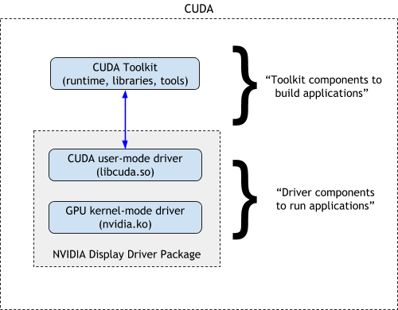
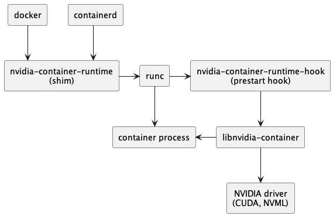
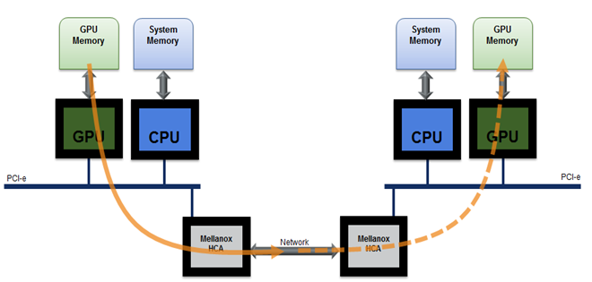

# The GPU Node Software Stack From Zero: Drivers, CUDA, NCCL and Fabric Bring-up

A GPU server fresh from the vendor is a box of very expensive silicon that does nothing. Before `torch.cuda.is_available()` returns `True` and an 8-node all-reduce runs at line rate, about a dozen pieces of software have to be installed at matching versions, in the right order, on the host or in the container. Each one can be missing, the wrong version or half-loaded. When that happens the failure usually shows up somewhere else: NCCL complains, PyTorch hangs, or a job runs at a tenth of the speed it should.

This chapter goes through that stack one layer at a time, from firmware up to framework wheels. For each layer it covers what the layer is, why it exists, which versions must match, how to install and pin it on Ubuntu, and how to check it is healthy. The chapter then builds a node acceptance script that checks the whole stack and prints PASS or FAIL. An operator runs something like it on every node before a scheduler is allowed to give that node to users. It ends with troubleshooting: reading Xid and ECC errors, running diagnostics, deciding reset vs RMA, and the AMD equivalents.

Conventions:

- Python marked **[ran]** was executed on an Apple Silicon Mac (CPython 3.14.5, macOS 15) while writing this chapter. The output pasted under it is the real output.
- Package names and versions marked **[apt, verified]** were read from the Ubuntu 24.04 and NVIDIA CUDA apt repositories on 2026-11-05, using `apt-cache policy <package>` (which prints the versions apt could install and from which repository) inside an `ubuntu:24.04` amd64 container. They will drift, so treat them as "as of Nov 2026".
- Shell sessions on GPU nodes (`nvidia-smi`, `ibstat`, `dcgmi`, ...) are **untested** here, because there was no GPU or InfiniBand hardware. Their output is sketched from the tools' documented formats with the details trimmed. The commands and flags are real. The specific numbers in the sketched output are only examples.

## Prerequisites

- [Linux and the OS](../foundations/linux-and-os.md), especially [shared libraries and `LD_LIBRARY_PATH`](../foundations/linux-and-os.md#shared-libraries-and-ld_library_path), [CUDA driver vs runtime vs toolkit](../foundations/linux-and-os.md#cuda-driver-vs-runtime-vs-toolkit-why-cuda-version-mismatch-happens), [systemd](../foundations/linux-and-os.md#systemd-and-services) and [package management](../foundations/linux-and-os.md#package-management-apt-vs-conda-vs-pip-vs-uv).
- [Computer architecture](../foundations/computer-architecture.md): [PCIe](../foundations/computer-architecture.md#pcie), [DMA](../foundations/computer-architecture.md#dma), [GPUDirect](../foundations/computer-architecture.md#gpudirect-cutting-the-cpu-and-its-memory-out-of-the-path), [NVLink and NVSwitch](../foundations/computer-architecture.md#nvlink-and-nvswitch) and [the map of a GPU server](../foundations/computer-architecture.md#a-map-of-a-gpu-server).
- [Networking](../foundations/networking.md), especially [HPC networking: RDMA, InfiniBand, RoCE, EFA](../foundations/networking.md#hpc-networking-rdma-infiniband-roce-efa).
- [Toolkit](../foundations/toolkit.md): the terminal basics, Make and the "compiling C" sections (section 5 builds perftest with `./configure` and `make`, section 6 builds nccl-tests with `make`), and regular expressions (the acceptance script's parsers).
- [Linux and the OS](../foundations/linux-and-os.md) also for the shell itself: [pipes and redirection](../foundations/linux-and-os.md#pipes-and-redirection), [scripting essentials](../foundations/linux-and-os.md#scripting-essentials) (`for` loops, `$(...)`), [/proc and /sys](../foundations/linux-and-os.md#proc-and-sys-the-kernel-as-files), [logs: journalctl and dmesg](../foundations/linux-and-os.md#logs-journalctl-and-dmesg) (Xid errors) and [how torchrun spawns workers](../foundations/linux-and-os.md#how-torchrun-spawns-workers).
- [Containers and virtualization](../foundations/containers-and-virtualization.md), for the container half of the host-vs-container split, especially [GPUs in containers](../foundations/containers-and-virtualization.md#6-gpus-in-containers) and [IOMMU, VFIO and PCIe passthrough](../foundations/containers-and-virtualization.md#iommu-vfio-and-pcie-passthrough) (IOMMU, ACS, SR-IOV).
- [Distributed systems](../foundations/distributed-systems.md): ranks, launchers and [collectives](../foundations/distributed-systems.md#collectives-the-workhorse-of-distributed-training); and [Networking](../foundations/networking.md#how-pytorch-distributed-bootstraps) for how NCCL bootstraps and picks interfaces.
- Helpful: [the GPU execution model](accelerator/execution-model.md) and [writing kernels](accelerator/writing-kernels.md) (where `nvcc`, PTX and SASS come from).
- Forward links (later chapters, not needed first): [collectives internals](../network/collectives-internals.md) (algbw/busbw, NCCL algorithms), [Slurm from zero](../orchestration/slurm/from-zero.md) (`srun`, `scontrol`, draining, health checks), [Kubernetes from zero](../orchestration/kubernetes-from-zero.md) and [orchestration internals](../orchestration/internals.md) (DaemonSets, taints, device plugins, the GPU Operator). Where this chapter uses their commands it explains just enough to follow.


## 1. The map: what runs where

### The layers, bottom to top

Each layer of the stack depends only on the layers below it. Here it is from the bottom up:

```
                                                         lives in        changes how often
 +--------------------------------------------------+
 | your code: train.py, vLLM, ...                    |   container/venv  every commit
 | framework: torch, jax (+ triton)                  |   container/venv  weeks
 | CUDA libraries: cuBLAS, cuDNN, NCCL, cuFFT, ...   |   container/venv  weeks (pip wheels)
 | CUDA runtime: libcudart.so                        |   container/venv  with the framework
 +--------------------------------------------------+  <- the container boundary
 | user-space driver: libcuda.so, libnvidia-ml.so    |   HOST (injected) must equal kernel module
 | container runtime hook: nvidia-container-toolkit  |   HOST            months
 | driver daemons: nvidia-persistenced, fabricmanager|   HOST            with the driver
 |   nvidia-dcgm, nv-hostengine                      |
 | RDMA user space: libibverbs, librdmacm, providers |   both (see 6)    months
 | kernel modules: nvidia, nvidia_uvm, nvidia_peermem|   HOST            months (driver upgrade)
 |   mlx5_core, mlx5_ib, ib_uverbs                   |
 | Linux kernel                                      |   HOST            months
 | BIOS/UEFI settings, BMC                           |   HOST (board)    rarely
 | firmware: GPU VBIOS, NVSwitch, NIC (ConnectX), PSU|   on the devices  rarely, by vendor bundle
 +--------------------------------------------------+
```

Some terms, one sentence each:

- **Firmware** is software stored on a device's own flash memory that runs on the device itself, for example the GPU's VBIOS or the NIC's firmware. The operating system never runs it. It can only flash a new version.
- The **BMC** (baseboard management controller) is a small computer on the motherboard with its own network port. It lets you power-cycle the server, open its console and flash firmware even when the OS is dead.
- A **kernel module** (`.ko` file) is code loaded into the running Linux kernel. GPU and NIC drivers are kernel modules because only the kernel may program device registers, handle interrupts and map device memory.
- The **user-space driver** (`libcuda.so`) is the library your process calls to talk to that kernel module. It is part of the "driver", not part of "CUDA", and it must have exactly the same version as the kernel module.
- The **CUDA runtime** (`libcudart.so`) is the friendlier API (`cudaMalloc`, `cudaMemcpy`, kernel launches) built on top of `libcuda`. It ships with the toolkit and with framework wheels.
- The **CUDA toolkit** is the developer kit: the `nvcc` compiler, headers, the runtime and the math libraries. You need it to *compile* CUDA code, but not to run PyTorch from a wheel.

NVIDIA's own diagram of the boundary between "driver" and "toolkit":



([source](https://docs.nvidia.com/deploy/cuda-compatibility/))

### Why the split is where it is

The dividing line is "kernel vs process". The kernel module and `libcuda.so` speak a private protocol to each other through `ioctl` calls on `/dev/nvidia*` (an `ioctl` is the generic "send this device a driver-specific command" [system call](../foundations/linux-and-os.md#system-calls-the-only-door); `/dev/nvidia*` are the [device files](../foundations/linux-and-os.md#everything-is-a-file) the driver creates). Because that protocol changes between driver versions, the two must match exactly. Everything above `libcuda` uses a stable, versioned API, so it can be newer or older within the rules of [section 2](#2-versions-and-the-compatibility-rules).

That one fact explains the host-vs-container split:

- **Host only:** the kernel is shared by every container on the machine. So `nvidia.ko`, and therefore `libcuda.so` (which must match it), have to come from the host. The NVIDIA Container Toolkit mounts the host's `libcuda.so` into each GPU container when it starts ([section 4](#4-containers-and-the-gpu)).
- **In the container or venv:** the CUDA runtime, cuBLAS, cuDNN, NCCL and the framework. These are ordinary user-space libraries, so each image can bring its own, and two jobs on the same node can use different CUDA runtimes.

So "CUDA 12.8 on the node" is usually a meaningless phrase. The node has a *driver*. Each image or venv has a *runtime*. The admin owns the first and the user owns the second.

### Taking inventory of a node, layer by layer

These are the commands that answer "what is installed at each layer?" **[untested: needs a Linux GPU node]**

```bash
# firmware / hardware
sudo dmidecode -s system-product-name              # e.g. "PowerEdge XE9680"
nvidia-smi --query-gpu=index,name,vbios_version --format=csv,noheader
lspci -nn | grep -Ei 'nvidia|mellanox'             # GPUs, NVSwitches, ConnectX NICs
cat /sys/class/infiniband/mlx5_0/fw_ver            # NIC firmware, e.g. 28.43.1014

# kernel + modules
uname -r                                           # e.g. 6.8.0-87-generic
cat /proc/driver/nvidia/version                    # the LOADED nvidia.ko, and whether it is the open flavor
lsmod | grep -E '^(nvidia|mlx5|ib_)'               # which modules are loaded
dkms status                                        # which modules are built for which kernels

# user-space driver + daemons
nvidia-smi | head -4                               # driver version, max CUDA the driver supports
systemctl is-active nvidia-persistenced nvidia-fabricmanager nvidia-dcgm

# runtime + libraries (per environment, not per node!)
python -c 'import torch; print(torch.__version__, torch.version.cuda, torch.cuda.nccl.version())'
nvcc --version 2>/dev/null | tail -1               # only if a toolkit is installed
```

Sketch of the interesting lines on an 8x H100 node:

```
$ cat /proc/driver/nvidia/version
NVRM version: NVIDIA UNIX Open Kernel Module for x86_64  580.95.05  Release Build  (dvs-builder@U16-I1-N08-12-1)  ...
GCC version:  gcc version 13.3.0 (Ubuntu 13.3.0-6ubuntu2~24.04)

$ lsmod | grep -E '^(nvidia|mlx5|ib_)'
nvidia_peermem         16384  0
nvidia_uvm           2088960  4
nvidia_drm            135168  0
nvidia_modeset       1638400  1 nvidia_drm
nvidia              104701952  110 nvidia_uvm,nvidia_peermem,nvidia_modeset
mlx5_ib               520192  0
mlx5_core            2723840  1 mlx5_ib
ib_uverbs             200704  3 nvidia_peermem,rdma_ucm,mlx5_ib
```

Tools in that block, one line each: `dmidecode` reads the motherboard's description of itself (model, BIOS version); `lspci` lists every device on the PCIe bus ([PCIe](../foundations/computer-architecture.md#pcie)); `lsmod` lists the kernel modules currently loaded (`modprobe <name>` loads one, `modprobe -r <name>` unloads it); `dkms` is explained [below](gpu-software-stack-reference.md#dkms-why-the-driver-gets-rebuilt-when-the-kernel-changes); `systemctl is-active` asks systemd whether a [service](../foundations/linux-and-os.md#systemd-and-services) is running.

The modules: `nvidia` is the core driver. `nvidia_uvm` handles unified memory and is needed by CUDA. `nvidia_modeset` and `nvidia_drm` handle display and are harmless on servers. `nvidia_peermem` lets the NIC DMA directly into GPU memory ([GPUDirect RDMA](#gpudirect-rdma-the-nic-reads-gpu-memory)). `mlx5_core` and `mlx5_ib` are the ConnectX NIC driver and its InfiniBand/RDMA part. `ib_uverbs` exposes RDMA to user space.

On this Mac, the framework layer exists but there is nothing underneath it. That makes the point that `torch.version.cuda` describes the wheel, not the machine: **[ran]**

```python
import torch
print(torch.__version__, torch.version.cuda, torch.cuda.is_available(), torch.backends.mps.is_available())
```

```
2.15.0 None False True
```

The macOS wheel is built without CUDA (`None`). On Linux, `pip install torch` 2.15.0 pulls in a whole CUDA user space as wheels. This is the wheel's real dependency list from PyPI on 2026-11-05: **[ran]**

```bash
curl -s https://pypi.org/pypi/torch/json | python3 -c "
import json,sys; d=json.load(sys.stdin); print(d['info']['version'])
[print(r) for r in d['info']['requires_dist'] if 'nvidia' in r or 'cuda' in r]"
```

```
2.15.0
cuda-toolkit[cublas,cudart,cufft,cufile,cupti,cusolver,cusparse,nvjitlink,nvrtc,nvtx]==13.2.2; platform_system == "Linux"
cuda-bindings<14,>=13.0.3; platform_system == "Linux" and python_version < "3.15"
nvidia-cudnn-cu13==9.26.0.51; platform_system == "Linux"
nvidia-cusparselt-cu13==0.8.1; platform_system == "Linux"
nvidia-nccl-cu13==2.30.7; platform_system == "Linux"
nvidia-nvshmem-cu13==3.7.2; platform_system == "Linux"
```

So the default PyPI `torch` 2.15.0 brings CUDA runtime 13.2.2 and NCCL 2.30.7, and it needs a driver that speaks CUDA 13 (`>= 580`, see below). No `nvcc` and no `libcuda` are in that list. `libcuda` always comes from the host.


## 2. Versions and the compatibility rules

### Reading the three version numbers

The [Linux chapter's table](../foundations/linux-and-os.md#cuda-driver-vs-runtime-vs-toolkit-why-cuda-version-mismatch-happens) introduced the four "CUDA versions". Here is what each one tells an operator:

```
$ nvidia-smi | head -4
+-----------------------------------------------------------------------------------------+
| NVIDIA-SMI 580.95.05              Driver Version: 580.95.05      CUDA Version: 13.0     |
+-----------------------------------------+------------------------+----------------------+
$ python -c 'import torch; print(torch.version.cuda)'
13.2
$ nvcc --version | tail -1
Cuda compilation tools, release 12.8, V12.8.93
```

- `Driver Version: 580.95.05` is the version of the user-space driver that `nvidia-smi` loaded. It is read as `<branch>.<minor>.<patch>`. The **branch** (580) is what matters for compatibility. Patches inside a branch are bug and security fixes.
- `CUDA Version: 13.0` is the newest CUDA API that this driver *natively* implements. It is not an installed toolkit.
- `torch.version.cuda` is the runtime the framework was built against and ships with.
- `nvcc` is the toolkit on `PATH`, if any. It matters only when you compile extensions. Its *major* version must match `torch.version.cuda`'s major version.

Here the runtime is 13.2 and the driver's native version is 13.0, and that works. The next section explains why.

### The four rules

As of CUDA 13.5 (November 2026), from [NVIDIA's compatibility guide](https://docs.nvidia.com/deploy/cuda-compatibility/):

1. **Backward compatibility.** A newer driver runs anything built for an older CUDA. A 620 driver runs a CUDA 11.8 binary.
2. **Minor-version compatibility (CUDA 11+).** Within one CUDA major version, a runtime from a newer minor version runs on any driver at or above that major version's floor, with a limited feature set (features that need a newer driver, such as some PTX JIT paths, will fail). The floors are 11.x: `>= 450.80.02`, 12.x: `>= 525.60.13`, 13.x: `>= 580` (NVIDIA's own example uses 580.65.06, the driver released with 13.0). This is why runtime 13.2 runs on driver 580.
3. **Forward compatibility across major versions** needs the `cuda-compat-<major>-<minor>` package, and **only on datacenter GPUs** (plus some RTX "NGC-ready" SKUs and Jetson, NVIDIA's embedded boards). That package is a newer `libcuda.so` placed in `/usr/local/cuda-X.Y/compat/` and loaded through `LD_LIBRARY_PATH`. It runs on top of an older kernel module, and only on specific supported driver branches.
4. **Architecture support is separate.** The runtime and the binary must also know your GPU. Each GPU has a **compute capability** (`sm_80` for A100, `sm_90` for H100/H200, `sm_100` for B200). A binary contains machine code (SASS) for some capabilities and maybe PTX, an intermediate code the driver can JIT-compile for newer ones. CUDA added `sm_90` support in 11.8 and Blackwell `sm_100` in 12.8. A CUDA 12.4 wheel on a B200 therefore fails with `no kernel image is available for execution on the device` even with a perfect driver.

Rules 1 to 3 as code, so you can paste in the two numbers from a node and get an answer: **[ran]**

```python
# cuda_compat.py - can this CUDA runtime run on this driver? (rules as of CUDA 13.5 / Nov 2026)
MIN_DRIVER = {11: (450, 80, 2), 12: (525, 60, 13), 13: (580, 65, 6)}  # minor-version-compat floor per major

def v(s):
    return tuple(int(x) for x in s.split("."))

def verdict(driver, runtime, datacenter_gpu=True):
    d, (major, minor) = v(driver), v(runtime)[:2]
    native_major = max(m for m, floor in MIN_DRIVER.items() if d >= floor) if d >= MIN_DRIVER[11] else None
    if native_major is None:
        return "FAIL: driver older than any CUDA 11+ floor"
    if major <= native_major:
        return f"OK: driver speaks CUDA {native_major}.x; runtime {runtime} runs (backward/minor-version compat)"
    if datacenter_gpu:
        return f"NEEDS cuda-compat-{major}-{minor}: newer major than driver, forward-compat package (datacenter GPUs only)"
    return "FAIL: runtime major newer than driver and forward compat is datacenter-only"

if __name__ == "__main__":
    for drv, rt, dc in [("550.54.15", "12.1", True), ("550.54.15", "12.8", True), ("575.57.08", "13.2", True),
                        ("575.57.08", "13.2", False), ("580.95.05", "13.2", True), ("620.70.06", "11.8", True),
                        ("418.87.01", "12.1", True)]:
        print(f"driver {drv:<10} runtime {rt:<5} dc={dc!s:<5} -> {verdict(drv, rt, dc)}")
    assert verdict("580.95.05", "13.2").startswith("OK")
    assert verdict("575.57.08", "13.2").startswith("NEEDS")
    assert verdict("575.57.08", "13.2", False).startswith("FAIL")
```

```
driver 550.54.15  runtime 12.1  dc=True  -> OK: driver speaks CUDA 12.x; runtime 12.1 runs (backward/minor-version compat)
driver 550.54.15  runtime 12.8  dc=True  -> OK: driver speaks CUDA 12.x; runtime 12.8 runs (backward/minor-version compat)
driver 575.57.08  runtime 13.2  dc=True  -> NEEDS cuda-compat-13-2: newer major than driver, forward-compat package (datacenter GPUs only)
driver 575.57.08  runtime 13.2  dc=False -> FAIL: runtime major newer than driver and forward compat is datacenter-only
driver 580.95.05  runtime 13.2  dc=True  -> OK: driver speaks CUDA 13.x; runtime 13.2 runs (backward/minor-version compat)
driver 620.70.06  runtime 11.8  dc=True  -> OK: driver speaks CUDA 13.x; runtime 11.8 runs (backward/minor-version compat)
driver 418.87.01  runtime 12.1  dc=True  -> FAIL: driver older than any CUDA 11+ floor
```

The script does not check rule 4 (architecture). To check that on a GPU, run `python -c 'import torch; print(torch.cuda.get_arch_list(), torch.cuda.get_device_capability())'` and make sure your device's `sm_XY` (or an older PTX) is in the list. **[untested]**

### Which driver branch ships with which toolkit

Each CUDA minor release is built and tested with one driver branch, and its `cuda-compat` package contains that branch's `libcuda`. Reading the `cuda-compat-*` versions from NVIDIA's apt repo gives the pairing **[apt, verified]**:

| CUDA toolkit | cuda-compat package version (= driver branch) |
|---|---|
| 12.4 | 550.163.01 |
| 12.6 | 560.35.05 |
| 12.8 | 570.211.01 |
| 12.9 | 575.57.08 |
| 13.0 | 580.196.07 |
| 13.1 | 590.48.01 |
| 13.2 | 595.112.07 |
| 13.3 | 610.57.04 |
| 13.4 | 615.71.10 |
| 13.5 | 620.70.06 |

The package versions are the *latest patch* of each branch, not the version that originally shipped with the toolkit. Use this table to see which branch belongs with which toolkit, not to find exact minimums.

The CUDA container images encode the same rules in an environment variable that the container toolkit checks at launch. From `nvidia/cuda:13.0.2-base-ubuntu24.04` (trimmed, **[ran]** on 2026-11-05 by inspecting the image):

```
CUDA_VERSION=13.0.2
NVIDIA_REQUIRE_CUDA=cuda>=13.0 brand=tesla,driver>=535,driver<536 brand=tesla,driver>=550,driver<551
                    brand=tesla,driver>=565,driver<566 brand=tesla,driver>=570,driver<571 brand=tesla,driver>=575,driver<576 ...
```

Read it as: "this image needs a driver that natively speaks CUDA >= 13.0, **or** one of the datacenter ("tesla") branches 535/550/565/570/575, which can run it through the bundled forward-compat `libcuda`". Those are the branches NVIDIA supports for forward compatibility. A driver from any other pre-580 branch is refused.

### How a version mismatch shows up

| Symptom | Layer | Cause | Fix |
|---|---|---|---|
| `Failed to initialize NVML: Driver/library version mismatch` | kernel module vs `libnvidia-ml` | apt upgraded the user-space libraries, but the old `nvidia.ko` is still loaded | reboot (or unload and reload the modules, [the driver install reference](gpu-software-stack-reference.md#upgrading-without-breaking-the-node)) |
| `CUDA driver version is insufficient for CUDA runtime version` / `torch.cuda.is_available()` is `False` with a warning | runtime vs driver | runtime major is newer than the driver | upgrade the driver, use a `cu12x` wheel, or `cuda-compat` |
| `no kernel image is available for execution on the device` | binary vs GPU | wheel or extension built without your `sm_XY` | newer wheel, or rebuild with `TORCH_CUDA_ARCH_LIST` |
| `The detected CUDA version (12.8) mismatches the version that was used to compile PyTorch (13.2)` | `nvcc` vs torch | compiling an extension with the wrong toolkit | point `CUDA_HOME` at a toolkit with the matching major version |
| `cudaErrorSystemNotReady` / "system not yet initialized" (error 802) | Fabric Manager | NVSwitch system and FM not running or not finished | [section 3](#fabric-manager-required-on-nvswitch-systems) |
| `nvidia-smi` hangs for seconds, first CUDA call slow | persistence | no persistence daemon, so the driver tears down state between processes | [persistence mode](#persistence-mode) |
| `libcuda.so.1: cannot open shared object file` in a container | container runtime | started without `--gpus` or without the NVIDIA runtime | [section 4](#4-containers-and-the-gpu) |

To see which libraries a process actually loaded, use the [`LD_DEBUG` and `/proc/<pid>/maps` recipes in the Linux chapter](../foundations/linux-and-os.md#shared-libraries-and-ld_library_path). The one-line version for CUDA: **[untested]**

```bash
python -c 'import torch; torch.zeros(1).cuda(); import os; os.system(f"grep -oE \"/[^ ]*(libcuda|libcudart|libnccl)[^ ]*\" /proc/{os.getpid()}/maps | sort -u")'
# /usr/lib/x86_64-linux-gnu/libcuda.so.580.95.05                              <- host driver
# /venv/lib/python3.12/site-packages/nvidia/cu13/lib/libcudart.so.13           <- wheel runtime
# /venv/lib/python3.12/site-packages/nvidia/nccl/lib/libnccl.so.2              <- wheel NCCL
```


> **Moved to the reference part:** [Installing and upgrading the NVIDIA driver on Ubuntu](gpu-software-stack-reference.md#installing-and-upgrading-the-nvidia-driver-on-ubuntu). Read it when you need it.

## 3. Driver-level services and GPU health

### Persistence mode

Normally the kernel driver tears down a GPU's state when the last process using it exits, and rebuilds it when the next process opens it. On datacenter GPUs that rebuild takes from hundreds of milliseconds to a few seconds per GPU. It makes every `nvidia-smi` call slow, and it resets settings such as application clocks between jobs. **Persistence mode** keeps the driver state alive with no clients. The supported way to get it is the `nvidia-persistenced` daemon, which holds the device files open. The older `nvidia-smi -pm 1` sets a legacy flag inside the driver. **[untested]**

```bash
$ sudo systemctl enable --now nvidia-persistenced
$ nvidia-smi --query-gpu=index,persistence_mode --format=csv,noheader
0, Enabled
...
7, Enabled
$ time nvidia-smi -L >/dev/null     # with persistence: well under a second on an idle node
```

### Fabric Manager: required on NVSwitch systems

On an HGX/DGX board, the 8 GPUs are not wired directly to each other. Each GPU connects to several **NVSwitch** chips, and the switches route NVLink traffic between them. Someone has to program the switches' routing tables and assign GPUs to partitions at boot. That is **Fabric Manager** (FM), a host daemon (`nvidia-fabricmanager.service`). Until FM has finished, CUDA on these systems refuses to start, and new CUDA processes get `cudaErrorSystemNotReady`. PCIe GPUs (L4, L40S, H100 PCIe) and machines without NVSwitch don't need FM.

Rules (as of driver 620, from the [Fabric Manager user guide](https://docs.nvidia.com/datacenter/tesla/fabric-manager-user-guide/index.html)):

- **For drivers before 620, the FM package version must match the driver version exactly.** A 580.95.05 driver with FM 580.82.07 refuses to start. This is why the pinning file above includes `src:nvidia-fabricmanager`. Starting with 620, FM is versioned separately (the repo has `nvidia-fabricmanager` as a transitional package to `nvidia-fabricmanager-direct 2.0.0` **[apt, verified]**). I haven't seen this on hardware, so check the guide for which FM version goes with which driver.
- On **HGX B200/B300**, the 4th-generation NVSwitches share their design with InfiniBand switches, and FM also needs the **NVLink Subnet Manager** (`nvlsm` package) plus an OFED/rdma-core stack. The shipped `nv-fabricmanager-start.sh` starts FM and NVLSM as the platform requires.
- Rack-scale NVL72 systems manage NVLink from the switch trays (NVIDIA calls this NMX) and use `nvidia-imex` for cross-node GPU memory sharing. That is beyond a single-node bring-up.

Install, start, verify. **[untested]**

```bash
$ sudo apt install -y nvidia-fabricmanager            # pinned to the driver branch by the pinning package
$ sudo systemctl enable --now nvidia-fabricmanager
$ systemctl is-active nvidia-fabricmanager
active
$ nvidia-smi -q -i 0 | grep -i -A 2 Fabric
    Fabric
        State                             : Completed
        Status                            : Success
```

`State: In Progress` is normal for a few seconds after boot. Anything other than `Completed / Success` once FM is up means the GPU isn't part of the NVLink fabric. Look at `journalctl -u nvidia-fabricmanager` and `/var/log/fabricmanager.log`.

### NVLink and topology checks

Once FM is happy, check that the links actually trained and at what speed, and look at how GPUs and NICs connect. [NVLink error counters](gpu-software-stack-reference.md#nvlink-error-counters) in the troubleshooting reference covers the error counters, and [P2P checks](../network/measuring-and-debugging.md#how-to-check-if-p2p-is-supported) whether GPUs can reach each other directly. The bring-up version: **[untested]**

```bash
$ nvidia-smi nvlink -s | head -4                 # every link should show a speed, none "<inactive>"
GPU 0: NVIDIA H100 80GB HBM3 (UUID: GPU-...)
         Link 0: 26.562 GB/s
         Link 1: 26.562 GB/s
         ...
$ nvidia-smi nvlink -s | grep -c 'GB/s'          # 8 GPUs x 18 links on H100 = 144
144
$ nvidia-smi topo -m                             # trimmed
        GPU0  GPU1  ...  NIC0  NIC1  ...  CPU Affinity  NUMA Affinity
GPU0     X    NV18  ...  PIX   NODE  ...  0-55          0
GPU1    NV18   X    ...  NODE  PIX   ...  0-55          0
NIC0    PIX   NODE  ...   X    NODE
Legend: NV# = NVLink (# links), PIX = same PCIe switch, NODE = same NUMA node, SYS = across sockets
```

The two things to check in `topo -m`: every GPU pair is `NV18` (all 18 links, on H100), and every GPU has a NIC at `PIX` distance. A GPU whose nearest NIC is `SYS` sends its network traffic across the CPU socket link, which roughly halves its inter-node bandwidth. If that happens, something is wrong with the cabling, the BIOS or the slot assignment.

18 links times 25 GBps per link per direction gives the H100's advertised 450 GBps per direction. The 26.562 shown per link is the raw signalling rate before encoding overhead. [NVLink](../network/interconnects.md#nvlink) has the arithmetic.

### ECC, row remapping, clocks and GPU reset

**ECC** (error-correcting code) memory stores a few extra check bits per word, so the hardware can fix single-bit flips and at least detect multi-bit ones. A *corrected* error is silent and harmless; an *uncorrected* one means data was lost and the process using it is killed. **Row remapping** is how HBM retires a bad memory row: the GPU records the row and swaps in a spare one at the next reset. These health fields are queryable in one CSV line per GPU. The acceptance script below uses exactly this query. The troubleshooting reference explains how to read [row remapping](gpu-software-stack-reference.md#checking-row-remapping-health-before-a-job-dies) and [Xid errors](gpu-software-stack-reference.md#xid-errors-reading-finding-and-looking-them-up). **[untested]**

```bash
$ nvidia-smi --query-gpu=index,ecc.mode.current,ecc.errors.uncorrected.volatile.total,remapped_rows.pending,remapped_rows.failure,pcie.link.width.current,pcie.link.width.max,clocks_event_reasons.hw_slowdown --format=csv,noheader
0, Enabled, 0, No, No, 16, 16, Not Active
...
$ sudo nvidia-smi -i 3 -r          # reset one GPU (needs no processes on it, and on NVSwitch systems often all GPUs)
```

Two traps. First, the PCIe *generation* drops on an idle GPU to save power, so check link *width* at idle and check generation only under load. Second, ECC mode changes take effect only after a reset. ECC should always be enabled on training nodes.

### DCGM: the health daemon and diagnostics

**DCGM** (Data Center GPU Manager) is NVIDIA's fleet-management layer. It runs a host engine daemon (`nv-hostengine`, packaged as the `nvidia-dcgm` service) that watches health continuously, collects metrics (exported via `dcgm-exporter` to Prometheus, a widely used time-series database that polls services for numbers and feeds dashboards and alerts) and runs diagnostic suites (`dcgmi diag`). As of DCGM 4.7.1 the Ubuntu packages are split by CUDA major version: `datacenter-gpu-manager-4-cuda13`, `-cuda12`, `-cuda11`, `-cuda-all` **[apt, verified]**. The CUDA-specific part is the stress kernels the diagnostics run. **[untested]**

```bash
$ sudo apt install -y datacenter-gpu-manager-4-cuda13
$ sudo systemctl enable --now nvidia-dcgm
$ dcgmi discovery -l | head -6            # does DCGM see all 8 GPUs and the NVSwitches?
8 GPUs found.
+--------+----------------------------------------------------------------------+
| GPU ID | Device Information                                                   |
+--------+----------------------------------------------------------------------+
| 0      | Name: NVIDIA H100 80GB HBM3                                          |
$ dcgmi health -s a                       # enable background watches for all subsystems
$ dcgmi health -c                         # ...and later ask whether anything tripped
$ dcgmi diag -r 1                         # seconds: deployment/software checks
$ dcgmi diag -r 2                         # ~minutes: + short stress, PCIe, memory
```

Level 1 belongs in every job prolog (a **prolog** is a script the scheduler runs on each node just before a job starts; an **epilog** runs just after it ends. Slurm's are introduced in [Slurm from zero](../orchestration/slurm/from-zero.md#what-happens-from-sbatch-to-processes-on-nodes)). Level 2 belongs in acceptance and after any hardware intervention. Levels 3 and 4 (tens of minutes) are for burn-in and RMA evidence. [Running diagnostics with `dcgmi diag`](gpu-software-stack-reference.md#running-diagnostics-with-dcgmi-diag) in the troubleshooting reference has example failure output and a Slurm script.

### Sharing one GPU: MIG and MPS

Training nodes use whole GPUs. Inference and RL rollout fleets often have many small workloads, such as a 1B reward model or a tokenizer service, and one H100 per small workload is wasteful. There are three ways to share a GPU:

| | Isolation | How it works | Use when |
|---|---|---|---|
| **Time-slicing** (default) | none: shared memory space, context switches | the driver round-robins contexts | dev boxes |
| **MPS** (Multi-Process Service) | memory not isolated, compute can be capped | a daemon merges many processes' work into one GPU context so their kernels run *concurrently* | many cooperative processes of one user, e.g. MPI ranks or a rollout worker pool |
| **MIG** (Multi-Instance GPU, A100/H100/B200) | hardware: separate SMs, L2 slices, memory controllers | the GPU is partitioned into up to 7 instances, each of which looks like its own GPU | multi-tenant inference, guaranteed QoS (quality of service: a promised share of throughput and latency) |

MIG. Each profile name is `<compute slices>g.<memory>gb`. An H100 80GB has 7 compute slices, so it can be split into seven `1g.10gb` instances. **[untested]**

```bash
$ sudo nvidia-smi -i 0 -mig 1                       # enable MIG mode on GPU 0 (may require a GPU reset)
$ nvidia-smi mig -i 0 -lgip                         # list GPU-instance profiles and how many fit
|   0  MIG 1g.10gb       19     7/7        9.75       No     16     1     0   |
|   0  MIG 3g.40gb        9     2/2       39.25       No     60     3     0   |
|   0  MIG 7g.80gb        0     1/1       79.25       No    132     7     0   |
$ sudo nvidia-smi mig -i 0 -cgi 3g.40gb,1g.10gb,1g.10gb -C   # create GPU instances + compute instances
$ nvidia-smi -L
GPU 0: NVIDIA H100 80GB HBM3 (UUID: GPU-...)
  MIG 3g.40gb     Device  0: (UUID: MIG-1f0e...)
  MIG 1g.10gb     Device  1: (UUID: MIG-7a31...)
  MIG 1g.10gb     Device  2: (UUID: MIG-c55d...)
$ CUDA_VISIBLE_DEVICES=MIG-7a31... python serve.py   # a process sees exactly one instance
$ sudo nvidia-smi mig -i 0 -dci && sudo nvidia-smi mig -i 0 -dgi   # tear down
```

MPS. **[untested]**

```bash
export CUDA_MPS_PIPE_DIRECTORY=/tmp/mps-pipe CUDA_MPS_LOG_DIRECTORY=/tmp/mps-log
sudo nvidia-smi -i 0 -c EXCLUSIVE_PROCESS     # only the MPS server may open the GPU directly
nvidia-cuda-mps-control -d                    # start the control daemon
CUDA_MPS_ACTIVE_THREAD_PERCENTAGE=25 python worker.py &   # each client capped at 25% of SMs
CUDA_MPS_ACTIVE_THREAD_PERCENTAGE=25 python worker.py &
echo quit | nvidia-cuda-mps-control           # stop
```

The MPS caveat: a fatal fault in one client (an illegal memory access, for example) can take down every client sharing that MPS server. MPS is for cooperating processes, not for isolating tenants. On Kubernetes (taught later, in [Kubernetes from zero](../orchestration/kubernetes-from-zero.md)), the NVIDIA **device plugin** (an agent on each node that tells the cluster how many GPUs, or MIG slices, the node has) and the **GPU Operator** (a bundle that installs the driver, container toolkit and device plugin on every node) expose MIG and time-slicing as schedulable resources ([device plugins](../orchestration/internals.md#exposing-gpus-device-plugins), [GPU Operator components](../orchestration/internals.md#nvidia-gpu-operator-components)).


## 4. Containers and the GPU

### What `--gpus all` actually does

A container is a normal process with its own namespaces ([containers chapter](../foundations/containers-and-virtualization.md)). This section is the operator's view of [GPUs in containers](../foundations/containers-and-virtualization.md#6-gpus-in-containers); re-read [what a CUDA program needs from the host](../foundations/containers-and-virtualization.md#what-a-cuda-program-needs-from-the-host) and [the NVIDIA Container Toolkit](../foundations/containers-and-virtualization.md#the-nvidia-container-toolkit) if the details have faded, and [the run flags that matter for ML](../foundations/containers-and-virtualization.md#the-run-flags-that-matter-for-ml) for `docker run` options such as `--rm`, `--gpus` and `--ulimit`. To use the GPU it needs three things the image cannot provide: the device nodes `/dev/nvidia0..7`, `/dev/nvidiactl` and `/dev/nvidia-uvm`; the host's `libcuda.so` and `libnvidia-ml.so`, which match the host's kernel module; and binaries such as `nvidia-smi`. The **NVIDIA Container Toolkit** injects all three when the container starts. It works as a hook in the OCI runtime ([OCI and runc](../foundations/containers-and-virtualization.md#4-the-standards-oci-containerd-runc-and-cri)) that runs after the container's filesystem is set up but before your process starts:



([source](https://docs.nvidia.com/datacenter/cloud-native/container-toolkit/latest/arch-overview.html))

The proof that `libcuda` is not in the image: this is the CUDA 13.0 base image, inspected without a GPU **[ran]**:

```bash
docker run --rm --platform linux/amd64 nvidia/cuda:13.0.2-base-ubuntu24.04 \
  bash -c 'find / -xdev -name "libcuda.so*"; echo ---; env | grep ^LD_LIBRARY_PATH; dpkg -l | grep -E "cuda|nvidia" | awk "{print \$2, \$3}"'
```

(trimmed to the relevant lines)

```
/usr/local/cuda-13.0/compat/libcuda.so.580.95.05
/usr/local/cuda-13.0/compat/libcuda.so.1
/usr/local/cuda-13.0/compat/libcuda.so
---
LD_LIBRARY_PATH=/usr/local/nvidia/lib:/usr/local/nvidia/lib64:/usr/local/cuda/lib64
cuda-compat-13-0 580.95.05-0ubuntu1
cuda-cudart-13-0 13.0.96-1
cuda-toolkit-13-0-config-common 13.0.96-1
cuda-toolkit-13-config-common 13.0.96-1
cuda-toolkit-config-common 13.0.96-1
```

The only `libcuda` in the image is the **forward-compat** copy (rule 3 above), which is used only when the host driver is too old. Otherwise the toolkit mounts the host's `/usr/lib/x86_64-linux-gnu/libcuda.so.<host-version>` and the dynamic loader uses that one. The image brings the runtime (`cuda-cudart-13-0`) and nothing else. The `-runtime` and `-devel` image variants add the math libraries and `nvcc`.

### Installing and configuring the toolkit

As of Nov 2026 the toolkit is `nvidia-container-toolkit 1.20.1` in NVIDIA's repo **[apt, verified]**. There are two ways to hand GPUs to containers. The legacy runtime hook is what `--gpus` uses. **CDI** (Container Device Interface) is a vendor-neutral YAML spec that lists the device nodes and mounts. Docker 25+, Podman and containerd all understand CDI, and Kubernetes is moving to it. **[untested]**

```bash
sudo apt install -y nvidia-container-toolkit
sudo nvidia-ctk runtime configure --runtime=docker && sudo systemctl restart docker   # legacy hook path
docker run --rm --gpus all nvidia/cuda:13.0.2-base-ubuntu24.04 nvidia-smi -L

sudo nvidia-ctk cdi generate --output=/etc/cdi/nvidia.yaml                            # CDI path
nvidia-ctk cdi list            # nvidia.com/gpu=0 ... nvidia.com/gpu=7, nvidia.com/gpu=all
docker run --rm --device nvidia.com/gpu=all nvidia/cuda:13.0.2-base-ubuntu24.04 nvidia-smi -L
```

Regenerate the CDI spec after every driver upgrade. It contains versioned library paths such as `libcuda.so.580.95.05`, so a stale spec points at files that no longer exist.

For multi-node training containers you also need the RDMA devices (`/dev/infiniband/*`), `--ulimit memlock=-1` (RDMA pins memory) and a larger `/dev/shm`. Those are listed in [NCCL with docker containers](../network/measuring-and-debugging.md#nccl-with-docker-containers).


## 5. The RDMA side of the node

The GPUs talk to each other inside the node over NVLink. Between nodes they talk through NICs on the **backend network**, usually InfiniBand or RoCE ([cluster networks](../network/interconnects.md#cluster-networks)). The [networking foundations chapter](../foundations/networking.md#hpc-networking-rdma-infiniband-roce-efa) explains RDMA, queue pairs and verbs. This section is the operator's view of the same thing: what to install, what healthy looks like, and how to measure it.

### The software: inbox rdma-core vs DOCA-OFED

The RDMA stack has the same shape as the GPU stack:

```
 libnccl / UCX / MPI / perftest            (apps)
 libibverbs + librdmacm + provider (libmlx5)   <- user space, "rdma-core"
 ------------------------------------------------
 ib_uverbs, rdma_ucm, ib_core               <- kernel RDMA core
 mlx5_ib (RDMA part) + mlx5_core (NIC)      <- kernel driver for ConnectX
 ConnectX firmware                           <- on the NIC
```

Two ways to get it:

- **Inbox**: the mainline Linux kernel's `mlx5` drivers plus Ubuntu's `rdma-core` packages. In Ubuntu 24.04 these are `rdma-core`, `ibverbs-utils`, `infiniband-diags` and `perftest`, all version 50.0 (perftest 24.01) **[apt, verified]**. This is enough for NCCL over InfiniBand or RoCE on recent kernels.
- **DOCA-OFED**: NVIDIA's packaged, newer copy of the same drivers and libraries, plus tools such as `mlnx_qos` and `show_gids`. It is the successor to **MLNX_OFED**, which NVIDIA has been retiring in favor of DOCA ([DOCA host installation](https://docs.nvidia.com/doca/sdk/doca-host-installation-and-upgrade/index.html)). Vendors' reference stacks and the NVIDIA GPU Operator's network operator usually assume it. It installs DKMS kernel modules, so the same header and pinning discipline as the GPU driver applies.

Pick one per fleet. Mixing inbox and OFED libraries on the same node produces confusing errors such as `libibverbs: Warning: couldn't load driver 'mlx5'`.

Inbox install and first look. **[untested]**

```bash
sudo apt install -y rdma-core ibverbs-utils infiniband-diags perftest
lsmod | grep -E '^(mlx5_ib|ib_uverbs|rdma_ucm)'
rdma link show
# link mlx5_0/1 state ACTIVE physical_state LINK_UP netdev ibp24s0
# link mlx5_1/1 state ACTIVE physical_state LINK_UP netdev ibp41s0
# ...
# link mlx5_8/1 state ACTIVE physical_state LINK_UP netdev enp157s0f0np0     <- frontend Ethernet NIC
```

### NIC firmware and port mode

ConnectX NICs are both InfiniBand and Ethernet adapters, and the port type is a firmware setting. A NIC that arrived configured as Ethernet will never join your InfiniBand fabric, however correct the software is. The tools are NVIDIA's **MFT** (Mellanox Firmware Tools): `mst` to discover devices, `mlxconfig` for settings and `mlxfwmanager` for firmware. **[untested]**

```bash
sudo mst start
sudo mlxfwmanager --query | grep -E 'Device Type|Versions|FW'        # firmware per NIC, and if an update is available
sudo mlxconfig -d /dev/mst/mt4129_pciconf0 query | grep -E 'LINK_TYPE|ADVANCED_PCI_SETTINGS|ATS'
#  LINK_TYPE_P1    IB(1)        <- 1 = InfiniBand, 2 = Ethernet
sudo mlxconfig -d /dev/mst/mt4129_pciconf0 set LINK_TYPE_P1=1         # takes effect after a reboot or firmware reset
```

Firmware must be the same on every NIC in the fleet, as with the GPU VBIOS and NVSwitch firmware. Most vendors ship a firmware bundle per server model. Apply the whole bundle rather than individual components.

### InfiniBand for operators: ports, the subnet manager, LIDs

An InfiniBand fabric does not configure itself. A **subnet manager** (SM), running on a managed switch or on one host as `opensm`, discovers every port, assigns each one a **LID** (a 16-bit local address used for switch forwarding) and computes the routing tables. Until the SM has done this, a cabled and lit port sits in the `Initialize` state and carries no traffic. Each port moves through **Down → Initialize → Armed → Active**. **Physical state** (`LinkUp`, `Polling`, `Disabled`) is the electrical layer underneath. Each device also has a permanent 64-bit **GUID**, like a MAC address.

Healthy output. **[untested]**

```
$ ibstat mlx5_0
CA 'mlx5_0'
        CA type: MT4129
        Number of ports: 1
        Firmware version: 28.43.1014
        Port 1:
                State: Active
                Physical state: LinkUp
                Rate: 400
                Base lid: 112
                SM lid: 1
                Port GUID: 0x946dae03004f1a2c
                Link layer: InfiniBand

$ ibv_devinfo -d mlx5_0 | grep -E 'hca_id|fw_ver|state|active_mtu|link_layer'
hca_id: mlx5_0
        fw_ver:                         28.43.1014
                        state:                  PORT_ACTIVE (4)
                        active_mtu:             4096 (5)
                        link_layer:             InfiniBand
```

How to read a bad port:

| What you see | Meaning | Look at |
|---|---|---|
| `State: Initialize`, `Physical state: LinkUp` | cable fine, no SM reached this port | is `opensm` / the switch SM running? is the port on the right fabric partition? |
| `State: Down`, `Physical state: Polling` | no electrical link | cable, transceiver, switch port disabled |
| `Rate: 200` on a 400G fabric | link trained at a lower speed or fewer lanes | bad cable or transceiver, usually. Reseat, then swap |
| `link_layer: Ethernet` on a port meant for IB | firmware port type | `mlxconfig LINK_TYPE_P1` |

Everything `ibstat` prints is also in sysfs (the `/sys` tree of kernel-provided files, see [/proc and /sys](../foundations/linux-and-os.md#proc-and-sys-the-kernel-as-files)) as plain files, which is what scripts should read: **[untested]**

```bash
for p in /sys/class/infiniband/*/ports/*; do
  echo "$(basename $(dirname $(dirname $p)))/$(basename $p): $(cat $p/state) | $(cat $p/rate) | $(cat $p/link_layer)"
done
# mlx5_0/1: 4: ACTIVE | 400 Gb/sec (4X NDR) | InfiniBand
```

For the whole fabric, `iblinkinfo` (every link the SM sees) and `ibdiagnet` (a full fabric scan with error report) are switch-team tools, but worth knowing by name.

### RoCE in one page

**RoCEv2** carries the InfiniBand transport inside UDP/IP over Ethernet ([foundations](../foundations/networking.md#roce-and-lossless-ethernet)). For an operator, three things differ from IB:

1. **No subnet manager, so addressing is IP.** Each port has a table of **GIDs** (global IDs). Each entry is an IP address paired with a RoCE version. NCCL must be told which entry to use with `NCCL_IB_GID_INDEX`. Index 3 is typically RoCEv2 over IPv4, but always check rather than assume.
2. **Losslessness is your problem.** RDMA's transport tolerates loss badly, so RoCE fabrics use **PFC** (priority flow control, pause frames on one traffic class) and **ECN** (switches mark packets during congestion, and the receiver sends back **CNP** packets that slow the sender). The NIC and the switches must agree on which traffic class carries RoCE.
3. **MTU**: jumbo frames (9000) on the Ethernet, and a 4096 RDMA MTU on top.

Finding the right GID index with nothing but sysfs: **[untested]**

```bash
d=/sys/class/infiniband/mlx5_0/ports/1
for i in $(ls $d/gids); do
  gid=$(cat $d/gids/$i 2>/dev/null); type=$(cat $d/gid_attrs/types/$i 2>/dev/null)
  [ "$gid" != "0000:0000:0000:0000:0000:0000:0000:0000" ] && echo "$i  $type  $gid  $(cat $d/gid_attrs/ndevs/$i 2>/dev/null)"
done
# 0  IB/RoCE v1  fe80:0000:0000:0000:...          ens1np0
# 1  RoCE v2     fe80:0000:0000:0000:...          ens1np0
# 2  IB/RoCE v1  0000:0000:0000:0000:0000:ffff:0a00:130c  ens1np0
# 3  RoCE v2     0000:0000:0000:0000:0000:ffff:0a00:130c  ens1np0   <- IPv4 10.0.19.12, RoCEv2: use 3
```

### Counters: how to tell a sick link from a busy one

Each port keeps hardware counters in `/sys/class/infiniband/<dev>/ports/<n>/counters/` (IB-spec counters) and `hw_counters/` (mlx5-specific counters, the interesting ones for RoCE). The ones to alert on:

| Counter | Healthy | Non-zero means |
|---|---|---|
| `symbol_error` | 0, or growing very slowly | bit errors on the wire: cable or transceiver degrading |
| `link_downed` | 0 since boot | the link flapped. Each flap stalls or kills NCCL jobs |
| `port_rcv_errors` | 0 | malformed packets received |
| `local_link_integrity_errors`, `excessive_buffer_overrun_errors` | 0 | link quality / flow-control trouble |
| `port_xmit_wait` | grows under load | time spent waiting for credit: congestion, not a fault |
| `hw_counters/out_of_sequence`, `packet_seq_err` (RoCE) | ~0 | packet loss on a "lossless" fabric: PFC/ECN misconfigured |
| `hw_counters/np_cnp_sent`, `rp_cnp_handled` (RoCE) | grows under load | congestion control is working, which is fine in moderation |

`port_xmit_data` and `port_rcv_data` count bytes **divided by 4**. The IB spec counts in 4-byte words, and many hand-rolled dashboards are off by 4x because of it. To turn two samples into a rate: **[ran]**

```python
# ib_counters.py - turn two samples of port_xmit_data into Gb/s.
# port_xmit_data / port_rcv_data count octets DIVIDED BY 4 (IB spec "PortXmitData"), so multiply by 4.
def gbps(sample0, sample1, seconds):
    return (sample1 - sample0) * 4 * 8 / seconds / 1e9

if __name__ == "__main__":
    # e.g. two reads of /sys/class/infiniband/mlx5_0/ports/1/counters/port_xmit_data 10 s apart
    s0, s1 = 1_000_000_000, 1_000_000_000 + 117_187_500_000
    print(f"{gbps(s0, s1, 10.0):.1f} Gb/s")
    assert abs(gbps(0, 125_000_000_000, 10.0) - 400.0) < 1e-9
```

```
375.0 Gb/s
```

`perfquery -x` (from `infiniband-diags`) reads the same counters through the management interface, and `perfquery -x -R` resets them. Resetting before a test makes any errors during the test stand out.

### perftest: measuring one link

`ib_write_bw` measures a single NIC-to-NIC path with RDMA writes and no NCCL involved. It is the first thing to run between two new nodes. [network/README.md](../network/interconnects-reference.md#measuring-the-inter-node-fabric-on-its-own) explains what it does and does not isolate. **[untested]**

```bash
# node A (server)
ib_write_bw -d mlx5_0 -F --report_gbits -D 10
# node B (client): same flags + server address. RoCE: add -x <gid index> on both sides
ib_write_bw -d mlx5_0 -F --report_gbits -D 10 10.0.19.12
---------------------------------------------------------------------------------------
 #bytes     #iterations    BW peak[Gb/sec]    BW average[Gb/sec]   MsgRate[Mpps]
 65536      ...            0.00               391.27               0.746
---------------------------------------------------------------------------------------
ib_write_lat -d mlx5_0 -F 10.0.19.12         # latency: expect low single-digit microseconds
```

The expected result is a little below line rate. A 400 Gb/s NDR port typically gives somewhere in the high 300s ([why](../foundations/networking.md#units-reading-spec-sheets-without-getting-fooled)). In bytes: 400 Gb/s / 8 = 50 GB/s per NIC, and 400 GB/s for a node with eight. Run the test for every NIC pair (`mlx5_0` to `mlx5_0`, and so on), not just one. A single slow rail limits every collective that uses it.

`--use_cuda=<gpu index>` makes perftest register GPU memory instead of host memory. That tests GPUDirect RDMA, next. It requires a perftest built with CUDA support (`./configure` from the [perftest repo](https://github.com/linux-rdma/perftest) with CUDA headers available; `./configure` is the conventional script that inspects your system and writes a Makefile, after which `make` compiles the C code, see the Make and compiling-C sections of the [toolkit](../foundations/toolkit.md#reading-c)). I have not checked whether Ubuntu's `perftest` package is built that way, so assume you have to build it.

### GPUDirect RDMA: the NIC reads GPU memory

Without **GPUDirect RDMA** (GDR), NCCL sending a GPU buffer to another node copies it to host memory first and lets the NIC read it from there. With GDR, the NIC DMAs straight out of GPU memory across the PCIe switch they share ([why that matters](../foundations/computer-architecture.md#gpudirect-cutting-the-cpu-and-its-memory-out-of-the-path)). For that, the RDMA stack must be able to *register* GPU memory: pin it and get bus addresses the NIC can use. There are two mechanisms:

- **`nvidia_peermem`**, a kernel module shipped with the driver (since R470) that plugs into the RDMA core's peer-memory interface. Load it with `modprobe nvidia_peermem` and persist it in `/etc/modules-load.d/`.
- **DMA-BUF**, the mainline Linux mechanism for sharing device memory between drivers (kernel 5.12+). It needs the open GPU kernel modules and a NIC driver and rdma-core that support it. Recent NCCL versions use it automatically when it is available, so `nvidia_peermem` is not needed on such systems.

The GDR path between two nodes: the orange line goes GPU memory, PCIe, NIC (HCA), network, NIC, PCIe, GPU memory, and never touches system memory or the CPU.



([source](https://developer.nvidia.com/blog/accelerating-io-in-the-modern-data-center-network-io/))

The PCIe side must also cooperate. **ACS** (Access Control Services) on PCIe switches forces peer-to-peer traffic up to the root complex, which kills GDR performance. Disable it for bare metal ([how](../network/measuring-and-debugging.md#disable-access-control-services)). An IOMMU in translating mode can do the same, so `iommu=pt` (passthrough) on the kernel command line (the boot options the bootloader hands to Linux; you can read the current ones in `/proc/cmdline`) is common on GPU nodes. ACS and the IOMMU were introduced in [IOMMU, VFIO and PCIe passthrough](../foundations/containers-and-virtualization.md#iommu-vfio-and-pcie-passthrough).

Checking that GDR is actually used. The NCCL log is the ground truth. `NCCL_DEBUG=INFO` makes NCCL print its setup decisions and `NCCL_DEBUG_SUBSYS` limits that to some subsystems; `torchrun ...` stands for whatever launch command your job uses ([how NCCL builds its connections and how to read these lines](../foundations/networking.md#step-2-nccl-builds-its-own-connections)). **[untested]**

```bash
$ lsmod | grep nvidia_peermem || echo "no peermem (fine if NCCL uses DMA-BUF)"
$ NCCL_DEBUG=INFO NCCL_DEBUG_SUBSYS=INIT,NET torchrun ... 2>&1 | grep -E 'GPU Direct RDMA|DMA-BUF|via NET'
NCCL INFO NET/IB : GPU Direct RDMA (nvidia-peermem) enabled for HCA 0 'mlx5_0'
NCCL INFO Channel 00/0 : 0[0] -> 8[0] [send] via NET/IB/0/GDRDMA
```

`via NET/IB/0/GDRDMA` means GDR is used. `via NET/IB/0` without `/GDRDMA` means traffic is staged through host memory. `via NET/Socket` means no RDMA at all, which is the order-of-magnitude slowdown [network debug](../network/measuring-and-debugging.md#how-to-diagnose-nccl-multi-gpu-and-multi-node-connectivity-issues) teaches you to spot. The exact wording of these log lines changes between NCCL versions, so grep loosely.


## 6. NCCL: install, configure, test

### Which NCCL you are running

**NCCL** is the library that implements collectives (all-reduce, all-gather, ...) across GPUs. It picks NVLink, PCIe, InfiniBand or sockets per connection ([collectives internals](../network/collectives-internals.md)). It is a user-space library, so it lives with the framework, not on the host: `torch` 2.15.0 pins `nvidia-nccl-cu13==2.30.7`, while the CUDA apt repo had `libnccl2 2.32.3-1+cuda13.4` and PyPI had `nvidia-nccl-cu13 2.32.3` **[apt, verified; ran]**. Two NCCLs on one node is normal. What matters is which one *your process* loaded. **[untested]**

```bash
python -c 'import torch; print(torch.cuda.nccl.version())'               # (2, 30, 7): what torch was built with
NCCL_DEBUG=VERSION torchrun --nproc_per_node 2 your_script.py 2>&1 | grep 'NCCL version'
# NCCL INFO NCCL version 2.30.7+cuda13.2                                  # what actually got loaded
```

An `LD_LIBRARY_PATH` or `LD_PRELOAD` (a list of libraries the [dynamic loader](../foundations/linux-and-os.md#shared-libraries-and-ld_library_path) loads into the process before anything else, so their symbols win) pointing at a system `libnccl.so.2` can make torch load a different NCCL than the one it was built with. Sometimes that is deliberate, to pick up a fix. Sometimes it is an accident that causes hangs. The `NCCL version` line settles which one you got.

### Network plugins

NCCL natively speaks IB verbs (which covers RoCE) and TCP sockets. Other fabrics use a **net plugin**, a shared library NCCL loads at start-up (`libnccl-net.so`, or one chosen with `NCCL_NET_PLUGIN`). Examples: AWS's `aws-ofi-nccl` for EFA, Google's plugins for GPUDirect-TCPX/gIB, and the SHARP plugin for in-network reductions on IB. If a cloud image ships a plugin, it must be visible inside your container too. A missing plugin shows up as a silent fallback to `NET/Socket`.

### The environment variables an operator sets

The full list is in [NCCL's env docs](https://docs.nvidia.com/deeplearning/nccl/user-guide/docs/env.html). Debug variables are explained in [network debug](../network/measuring-and-debugging.md#useful-nccl-debug-environment-variables) and performance variables in [network benchmarks](../network/measuring-and-debugging.md#performance-oriented-nccl-environment-variables). The ones that are really *node configuration* rather than tuning, and so belong in `/etc/nccl.conf` or the cluster's job environment (the networking chapter showed [which interface NCCL picks and why `NCCL_SOCKET_IFNAME` matters](../foundations/networking.md#which-interface-does-nccl-pick)):

```bash
# /etc/nccl.conf  (NCCL reads KEY=VALUE lines from here; the environment overrides it)
NCCL_SOCKET_IFNAME=enp157s0f0np0     # bootstrap/OOB (out-of-band setup traffic) interface: the frontend NIC, NOT docker0/lo
NCCL_IB_HCA=mlx5_0,mlx5_1,mlx5_2,mlx5_3,mlx5_4,mlx5_5,mlx5_6,mlx5_7   # backend NICs only; excludes the frontend mlx5_8
NCCL_IB_GID_INDEX=3                  # RoCE only: the RoCEv2/IPv4 GID found above
# NCCL_NET_GDR_LEVEL=PIX             # only use GDR when NIC and GPU share a PCIe switch (default heuristics are usually right)
# NCCL_TOPO_DUMP_FILE=/tmp/topo.xml  # dump what NCCL thinks the topology is, for debugging
```

Everything else (`NCCL_ALGO`, `NCCL_PROTO`, channel counts) is tuning. Leave it at the defaults unless a benchmark shows a specific improvement.

### nccl-tests: single node, then two, then all

[nccl-tests](https://github.com/NVIDIA/nccl-tests) is the standard burn-in. [Network benchmarks](../network/measuring-and-debugging.md#nccl-tests) shows how to build it against the NCCL your PyTorch uses. For multi-node runs build with MPI (`make MPI=1 MPI_HOME=/usr/lib/x86_64-linux-gnu/openmpi`; `make VAR=value` passes a setting to the Makefile, see Make in the [toolkit](../foundations/toolkit.md#make-and-makefiles)). The bring-up sequence: **[untested]**

Just enough to read the launch lines below. **MPI** (Message Passing Interface) is the older HPC standard for multi-process programs; nccl-tests uses it only to start one process per GPU on every node and tell each its rank, the job `torchrun` does for PyTorch ([launchers](../foundations/distributed-systems.md#core-vocabulary)). `mpirun -np 16 -N 8 --hostfile hosts` starts 16 processes, 8 per node, on the machines listed one per line in the file `hosts` (over SSH), and `-x VAR` copies an environment variable to all of them. `srun -N 2 --ntasks-per-node=8 --gpus-per-task=1` is Slurm's way to do the same on 2 allocated nodes, with one GPU per process; `--mpi=pmix` tells Slurm to hand MPI the rank information through the PMIx interface. Slurm and `srun` are taught in [Slurm from zero](../orchestration/slurm/from-zero.md#srun-launching-a-step). In the nccl-tests flags, `-b`/`-e` are the smallest and largest message size, `-f 2` doubles the size each step, and `-g` is GPUs per process.

```bash
# 1. one node, NVLink only: one process driving 8 GPUs
./build/all_reduce_perf -b 8 -e 8G -f 2 -g 8
# 2. two nodes, one process per GPU (this is the shape training uses)
srun -N 2 --ntasks-per-node=8 --gpus-per-task=1 --mpi=pmix ./build/all_reduce_perf -b 8 -e 8G -f 2 -g 1
#    or without Slurm:
mpirun -np 16 -N 8 --hostfile hosts -x NCCL_DEBUG=WARN -x NCCL_IB_HCA ./build/all_reduce_perf -b 8 -e 8G -f 2 -g 1
# 3. the whole cluster, then bisect if a run is slow (halve the node list until the slow node is isolated)
```

Output, trimmed:

```
#       size         count      type   redop    root     time   algbw   busbw #wrong     time   algbw   busbw #wrong
#        (B)    (elements)                               (us)  (GB/s)  (GB/s)            (us)  (GB/s)  (GB/s)
  8589934592    2147483648     float     sum      -1    ...     ...     ...      0      ...     ...     ...      0
# Out of bounds values : 0 OK
# Avg bus bandwidth    : ...
```

Read `busbw` at the large sizes and `#wrong` everywhere. A non-zero `#wrong` means **data corruption**, which is a hardware problem: fail the node. `algbw` (algorithm bandwidth) is simply message size divided by time. $\text{busbw} = \text{algbw} \times 2(n-1)/n$ for all-reduce, where $2(n-1)/n$ is the per-rank traffic factor of the [ring all-reduce](../foundations/networking.md#ring-all-reduce-step-by-step) (the full derivation is in the next chapter, [algbw vs busbw](../network/collectives-internals.md#algbw-vs-busbw)). It is normalized so that it can be compared with link bandwidth regardless of $n$ ([derivation](../network/measuring-and-debugging.md#how-the-bandwidth-is-measured)). For $n=8$ the factor is $2 \cdot 7/8 = 1.75$. What "good" looks like depends on the SKU and the NCCL version. Don't use a number from a blog post. Record the value from a node you know is good and fail nodes that fall well below it. The acceptance script below has exactly that knob. [Network README](../network/interconnects-reference.md#real-network-throughput) lists measured numbers for several systems.

When nccl-tests hangs or is slow, work through [network debug](../network/measuring-and-debugging.md) and [NCCL performance debug](../network/measuring-and-debugging.md). Most of what you'll find is in the layers covered above: a missing `nvidia_peermem`, a port at the wrong rate, the wrong GID index, or FM not running.


> **Moved to the reference part:** [AMD / ROCm equivalents](gpu-software-stack-reference.md#amd--rocm-equivalents). Read it when you need it.

## 7. Bring-up order: the runbook

Bring a node up from the bottom of the stack to the top, and test each layer before moving to the next. A failure is then always in the layer you just added.

| # | Step | Gate (don't continue until) |
|---|---|---|
| 1 | Flash the vendor firmware bundle (BIOS, BMC, GPU VBIOS, NVSwitch, NIC) | versions match the fleet manifest |
| 2 | BIOS: SR-IOV/IOMMU as your design needs, Above-4G decoding on (lets the BIOS map devices with large memory windows, such as GPUs, above the 4 GB address line), ACS off (bare metal), performance power profile | `lspci` shows all GPUs and NICs at full width |
| 3 | OS image with kernel + headers pinned, nouveau blacklisted | `uname -r` = manifest |
| 4 | GPU driver (open, pinned) | `nvidia-smi -L` lists all GPUs |
| 5 | `nvidia-persistenced`, Fabric Manager (+ NVLSM on B200/B300) | fabric `Completed/Success`, all NVLinks active |
| 6 | DCGM | `dcgmi diag -r 2` passes |
| 7 | RDMA stack + NIC port type + `nvidia_peermem` / DMA-BUF | every backend port `Active` at line rate, zero error counters |
| 8 | Container toolkit (+ CDI spec) | `nvidia-smi -L` inside a container |
| 9 | Single-node nccl-tests | `#wrong` = 0, busbw at the fleet baseline |
| 10 | Two-node `ib_write_bw` per rail, then two-node nccl-tests | GDR in the log, busbw at the baseline |
| 11 | Hand to the scheduler, with the acceptance script as a health check | runs on every boot and as a prolog/epilog |

Write the expected versions for steps 1 to 8 into a **manifest** checked into git. Then the acceptance script can check "is this node what we said it is", not just "does this node work".


> **Moved to the reference part:** [A node acceptance script](gpu-software-stack-reference.md#a-node-acceptance-script), [Troubleshooting GPUs: errors, diagnostics and health checks](gpu-software-stack-reference.md#troubleshooting-gpus-errors-diagnostics-and-health-checks). Read it when you need it.

## You can now read

- [Debugging PyTorch](../development/debugging-pytorch.md) and [Debugging distributed training](../development/debugging-distributed.md): the software side of a crash or hang, once the [troubleshooting reference](gpu-software-stack-reference.md#troubleshooting-gpus-errors-diagnostics-and-health-checks) has cleared the hardware.
- [Network debug](../network/measuring-and-debugging.md) and [NCCL performance debug](../network/measuring-and-debugging.md): when nccl-tests is slow or hangs.
- [Network benchmarks](../network/measuring-and-debugging.md): `torch-dist-bench`, nccl-tests, nvbandwidth and what the numbers mean.
- [The network chapter](../network/interconnects.md): fabric generations, NVLink/IB/EFA numbers.
- [Kubernetes from zero](../orchestration/kubernetes-from-zero.md) and [Slurm](../orchestration/slurm/from-zero.md): where the acceptance script plugs in.
- [Decentralized training](../training/decentralized-training.md): what changes when the nodes aren't on one fabric.

Parts of this chapter are adapted from Stas Bekman's [Machine Learning Engineering Open Book](https://github.com/stas00/ml-engineering) (CC BY-SA 4.0).

## Further reading

- NVIDIA, [CUDA Compatibility](https://docs.nvidia.com/deploy/cuda-compatibility/): minor-version and forward compatibility, the source of the rules in section 2.
- NVIDIA, [Driver Installation Guide](https://docs.nvidia.com/datacenter/tesla/driver-installation-guide/index.html), especially the [Ubuntu page](https://docs.nvidia.com/datacenter/tesla/driver-installation-guide/ubuntu.html) and version locking.
- NVIDIA, [open-gpu-kernel-modules](https://github.com/NVIDIA/open-gpu-kernel-modules).
- NVIDIA, [Fabric Manager User Guide](https://docs.nvidia.com/datacenter/tesla/fabric-manager-user-guide/index.html).
- NVIDIA, [DCGM User Guide](https://docs.nvidia.com/datacenter/dcgm/latest/user-guide/index.html).
- NVIDIA, [MIG User Guide](https://docs.nvidia.com/datacenter/tesla/mig-user-guide/index.html) and [MPS](https://docs.nvidia.com/deploy/mps/index.html).
- NVIDIA, [Container Toolkit](https://docs.nvidia.com/datacenter/cloud-native/container-toolkit/latest/index.html).
- NVIDIA, [GPUDirect RDMA](https://docs.nvidia.com/cuda/gpudirect-rdma/index.html).
- NVIDIA, [DOCA host installation](https://docs.nvidia.com/doca/sdk/doca-host-installation-and-upgrade/index.html) (DOCA-OFED).
- [linux-rdma/rdma-core](https://github.com/linux-rdma/rdma-core) and [linux-rdma/perftest](https://github.com/linux-rdma/perftest).
- NVIDIA, [NCCL environment variables](https://docs.nvidia.com/deeplearning/nccl/user-guide/docs/env.html) and [nccl-tests](https://github.com/NVIDIA/nccl-tests).
- AMD, [ROCm documentation](https://rocm.docs.amd.com/en/latest/) and [rccl-tests](https://github.com/ROCm/rccl-tests).
