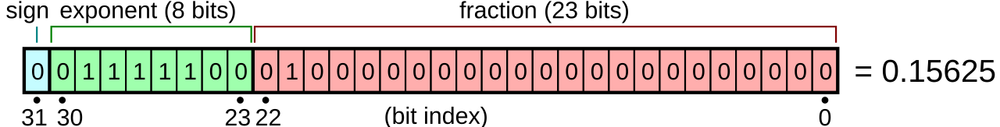
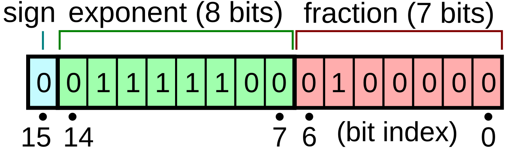
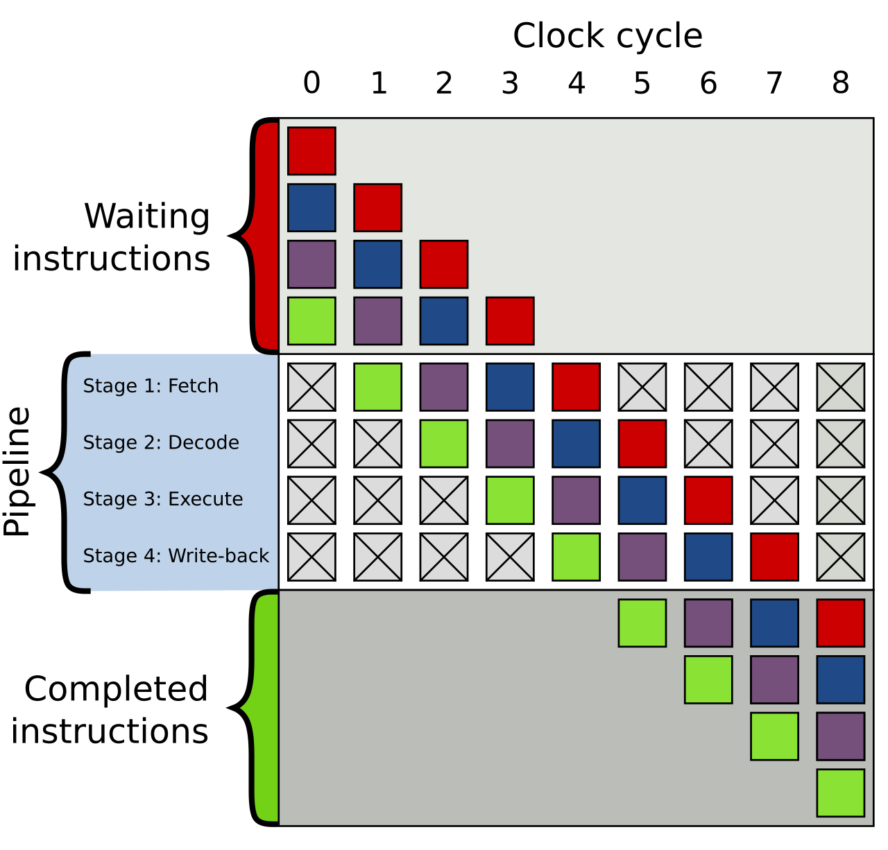
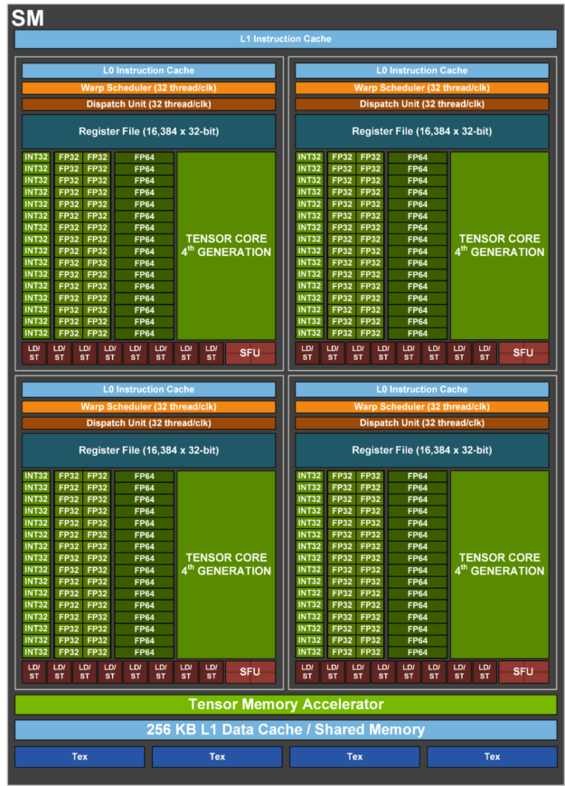

# Foundations: Computer Architecture for ML Engineers

This chapter is for the reader who can write a transformer from scratch in PyTorch but has never had to think about what happens beneath `tensor.cuda()`. It starts from bits and ends at the point where the rest of this book's hardware chapters - [compute](../compute/), [storage](../storage/README.md), [network](../network/README.md) - and the [GPU execution model](../compute/accelerator/execution-model.md) chapter should read as natural continuations rather than a wall of acronyms.

The goal is not to turn you into a hardware designer. The goal is that when someone says "this job is PCIe-bound", "the dataloader is on the wrong NUMA node" or "decode is memory-bandwidth-bound", you know what physical thing they mean, why it is the bottleneck, and how to check it with arithmetic before you check it with a profiler.

The chapter is organized bottom-up:

1. [Bits, bytes and number representation](#bits-bytes-and-number-representation)
2. [Units and the classic mistakes](#units-and-the-classic-mistakes)
3. [The CPU](#the-cpu)
4. [The memory hierarchy](#the-memory-hierarchy)
5. [Bandwidth vs latency](#bandwidth-vs-latency)
6. [Virtual memory at the hardware level](#virtual-memory-at-the-hardware-level)
7. [NUMA](#numa)
8. [Buses and interconnects](#buses-and-interconnects)
9. [Storage devices](#storage-devices)
10. [The GPU](#the-gpu)
11. [Arithmetic intensity and the roofline model](#arithmetic-intensity-and-the-roofline-model)
12. [A map of a GPU server](#a-map-of-a-gpu-server)
13. [You can now read](#you-can-now-read)
14. [Further reading](#further-reading)

A note on numbers: every hardware number in this chapter is either a published spec (stated as such), a derivation with the arithmetic shown, or an order-of-magnitude figure explicitly marked as approximate. Real hardware varies by SKU, firmware, BIOS settings and the phase of the moon, so treat the approximate figures as "the right power of ten", not as something to put in a capacity plan.


## Bits, bytes and number representation

### Why binary

A computer stores and moves information as voltages on wires and charges in capacitors. Distinguishing two levels (high/low) reliably at billions of transitions per second is much easier than distinguishing ten, so the unit of information is the **bit**: 0 or 1.

Eight bits make a **byte**, the smallest unit most hardware can address. A byte holds `2**8 = 256` distinct patterns. What those patterns *mean* is entirely a matter of convention - the same 8 bits `11111111` are 255 as an unsigned integer, -1 as a signed integer, and a NaN-ish garbage value if you reinterpret them as part of a float. The hardware doesn't know; the instruction you execute decides.

Bit patterns are usually written in **hexadecimal** (base 16), because one hex digit is exactly 4 bits: `0xFF = 1111 1111 = 255`, `0x3F80_0000` is a 32-bit pattern you'll meet below.

Multi-byte values have a byte order, **endianness**. x86 and (in practice) ARM servers are *little-endian*: the least significant byte sits at the lowest address. You will rarely care, except when parsing binary file formats by hand.

### Unsigned and signed integers

An unsigned n-bit integer is just the binary number: range `0 .. 2**n - 1`.

For signed integers essentially all hardware uses **two's complement**: the top bit has weight `-2**(n-1)` instead of `+2**(n-1)`. For int8:

```
bit weight:  -128  64  32  16   8   4   2   1
  0000 0001 =                                1   ->    1
  0111 1111 =        64 +32 +16  +8  +4  +2 +1   ->  127
  1000 0000 = -128                               -> -128
  1111 1111 = -128 + 127                         ->   -1
```

Why this odd scheme? Because addition is the *same circuit* for signed and unsigned numbers: you add the bits and throw away the carry out of the top. `-1 + 1 = 1111 1111 + 0000 0001 = 1 0000 0000`, drop the carry, get `0`. No special cases, no "negative zero". To negate: flip all bits and add 1.

The consequence you'll actually hit is **overflow wraps around** silently:

```python
import numpy as np
print(np.array([127], dtype=np.int8) + np.int8(1))   # [-128]
```

The ML-relevant integer limits:

| Type   | Range                          | Where it bites                                                  |
| :----- | :----------------------------- | :-------------------------------------------------------------- |
| int8   | -128 .. 127                    | quantized weights/activations, needs a scale factor             |
| int32  | -2,147,483,648 .. 2,147,483,647 | tensor indexing: a tensor with more than `2**31` elements breaks kernels that index with int32 |
| int64  | about +-9.2e18                 | PyTorch's default index type (`torch.long`), token ids           |

The int32 row is not hypothetical: a single `(B, T, V)` logits tensor of `8 x 8192 x 131072 = 8.6e9` elements is past `2**31 = 2.1e9`, and kernels that compute offsets in 32-bit arithmetic have historically produced wrong results or crashes on such tensors.

### Floating point: IEEE 754

Integers have uniform spacing. ML needs numbers from `1e-8` (small gradients) to `1e4` (unnormalized logits) with roughly constant *relative* precision. Floating point is scientific notation in binary:

```
value = (-1)**sign * 1.mantissa * 2**(exponent - bias)
```

A float32 laid out as sign, exponent and mantissa:



([source](https://commons.wikimedia.org/wiki/File:Float_example.svg))

- **sign**: 1 bit.
- **exponent**: e bits, stored with a **bias** (`2**(e-1) - 1`) so it can be negative. The exponent sets the **range**.
- **mantissa** (also called fraction or significand): m bits. Since every normalized binary number starts with `1.`, that leading 1 is implicit and not stored - a free bit. The mantissa sets the **precision**.

Two exponent values are reserved: all-zeros means **subnormal** numbers (the implicit leading bit becomes 0, letting values fade gradually to zero instead of jumping), and all-ones means infinity or NaN.

The key quantity for precision is **machine epsilon**, the gap between 1.0 and the next representable number: `2**-m`. Anything smaller than about half of that added to 1.0 simply vanishes.

Here are the formats you'll meet, with the limits derived from the bit layout (computed with Python, not copied):

| Format       | Sign | Exp | Mantissa | Bias | Max normal  | Min normal  | Epsilon `2**-m` | ~Decimal digits |
| :----------- | ---: | --: | -------: | ---: | ----------: | ----------: | --------------: | --------------: |
| fp32         |    1 |   8 |       23 |  127 | 3.40e38     | 1.18e-38    | 1.19e-7         |             7.2 |
| tf32 (compute only) | 1 | 8 |     10 |  127 | ~3.40e38    | 1.18e-38    | 9.77e-4         |             3.3 |
| bf16         |    1 |   8 |        7 |  127 | 3.39e38     | 1.18e-38    | 7.81e-3         |             2.4 |
| fp16         |    1 |   5 |       10 |   15 | 65504       | 6.10e-5     | 9.77e-4         |             3.3 |
| fp8 E5M2     |    1 |   5 |        2 |   15 | 57344       | 6.10e-5     | 0.25            |             0.9 |
| fp8 E4M3     |    1 |   4 |        3 |    7 | 448         | 1.56e-2     | 0.125           |             1.2 |
| fp4 E2M1     |    1 |   2 |        1 |    1 | 6           | 1.0         | 0.5             |             0.6 |

Bit layouts, most significant bit on the left:

```
fp32  S EEEEEEEE MMMMMMMMMMMMMMMMMMMMMMM   32 bits
bf16  S EEEEEEEE MMMMMMM                   16 bits  = top half of fp32
fp16  S EEEEE MMMMMMMMMM                   16 bits
E5M2  S EEEEE MM                            8 bits  = top half of fp16
E4M3  S EEEE MMM                            8 bits
E2M1  S EE M                                4 bits
```

Notes on the table:

- **E4M3** as used on NVIDIA/OCP hardware (sometimes called `E4M3FN`) breaks IEEE convention: it has no infinities and only uses the all-ones pattern for NaN, which is how it reaches 448 instead of 240. E5M2 keeps IEEE-style inf/NaN.
- **tf32** is not a storage format. It's what NVIDIA tensor cores use internally when you let them multiply fp32 inputs: the inputs are rounded to a 10-bit mantissa, the accumulation is in fp32. Tensors in memory remain 32 bits wide.
- fp4 values are so coarse (E2M1 can represent exactly `0, 0.5, 1, 1.5, 2, 3, 4, 6` and their negatives) that they are only usable with **block scaling**: a small block of values (e.g. 16 or 32 elements) shares a higher-precision scale factor. The MX formats (MXFP8, MXFP6, MXFP4) and NVIDIA's NVFP4 are such schemes. The same idea is increasingly applied to fp8.

You can see the bits yourself:

```python
import struct, numpy as np

def fp32_bits(x):
    (u,) = struct.unpack(">I", struct.pack(">f", x))
    b = f"{u:032b}"
    return f"{b[0]} {b[1:9]} {b[9:]}"          # sign | exponent | mantissa

def to_bf16(x):                                 # bf16 = top 16 bits of fp32, round-to-nearest-even
    (u,) = struct.unpack(">I", struct.pack(">f", x))
    u = (u + 0x7FFF + ((u >> 16) & 1)) & 0xFFFF0000
    return struct.unpack(">f", struct.pack(">I", u))[0]

for x in [1.0, 0.1, 65504.0, 70000.0, 1e-8]:
    print(f"{x:>9}  fp32 {fp32_bits(x)}  fp16={float(np.float16(x))!r:<24} bf16={to_bf16(x)!r}")
print("1 + 1e-3 in fp16:", float(np.float16(1) + np.float16(1e-3)))
print("1 + 1e-3 in bf16:", to_bf16(1 + 1e-3))
print("256 + 1  in bf16:", to_bf16(256 + 1))
print("2**24 + 1 in fp32:", np.float32(2**24) + np.float32(1))
```

Output (numpy will also warn about the fp16 overflow):

```
      1.0  fp32 0 01111111 00000000000000000000000  fp16=1.0                      bf16=1.0
      0.1  fp32 0 01111011 10011001100110011001101  fp16=0.0999755859375          bf16=0.10009765625
  65504.0  fp32 0 10001110 11111111110000000000000  fp16=65504.0                  bf16=65536.0
  70000.0  fp32 0 10001111 00010001011100000000000  fp16=inf                      bf16=70144.0
    1e-08  fp32 0 01100100 01010111100110001110111  fp16=0.0                      bf16=1.0011717677116394e-08
1 + 1e-3 in fp16: 1.0009765625
1 + 1e-3 in bf16: 1.0
256 + 1  in bf16: 256.0
2**24 + 1 in fp32: 16777216.0
```

Read that output carefully, because each line is an ML failure mode:

- `0.1` is not representable in any binary float. Every format stores a nearby value.
- `70000` overflows fp16 to `inf`. One overflowed activation or gradient and the loss is NaN.
- `1e-8` underflows fp16 to `0`. Small gradients silently vanish.
- `1 + 1e-3` in bf16 is `1.0`. bf16 can't see a 0.1% update to a value of magnitude 1. This is why optimizer states and master weights are kept in fp32 even in "bf16 training": `w += lr * g` with `lr * g ~ 1e-5` and `w ~ 1` is a no-op in bf16.
- `256 + 1` in bf16 is `256`. bf16 can't count past 256 exactly. fp32 can't count past `2**24 = 16,777,216` exactly - never accumulate a token counter or a long sum in a low-precision float.

### Why range vs precision is *the* ML tradeoff

With a fixed bit budget, every bit goes to either the exponent (range) or the mantissa (precision). The history of ML number formats is this tradeoff being renegotiated:

- **fp16** has 10 mantissa bits (good precision) but only 5 exponent bits: max 65504, smallest normal `6.1e-5`. Gradients routinely fall below that, so fp16 training needs **loss scaling**: multiply the loss by e.g. 1024 before backward so gradients land in range, divide them back before the optimizer step, and dynamically back off when you overflow.
- **bf16** ("brain float", from Google) takes fp32's 8-bit exponent and keeps just 7 mantissa bits. It has the *same range as fp32*, so no loss scaling, and converting fp32 to bf16 is just dropping (rounding off) the low 16 bits. Neural nets turned out to tolerate the low precision far better than the low range, which is why bf16 became the default training format.
- **fp8** halves the bytes again. The common recipe uses E4M3 (more precision) for weights and activations in the forward pass and E5M2 (more range) for gradients, with per-tensor or per-block scale factors maintained alongside.

bfloat16 keeps float32's 8 exponent bits and drops 16 mantissa bits:



([source](https://commons.wikimedia.org/wiki/File:Bfloat16_format.svg))

Why bother with fewer bits at all? Two reasons, both of which this chapter will quantify later:

1. **Bytes moved**. Half the bits means half the memory traffic. Many ML operations are limited by how fast bytes can be moved, not by arithmetic (see [roofline](#arithmetic-intensity-and-the-roofline-model)).
2. **Silicon area**. A multiplier's area grows roughly with the square of the mantissa width, so a chip can fit many more bf16 or fp8 multipliers than fp32 ones in the same area and power. That's why each halving of precision has historically roughly doubled the advertised peak tensor-core FLOPS - see the [TFLOPS comparison table](../compute/accelerator/README.md#tflops-comparison-table).

One more subtlety: low-precision matmuls almost always **accumulate** in higher precision. A bf16 matmul multiplies bf16 pairs but sums the products in fp32, because adding thousands of products in bf16 would lose most of the result to rounding (the `256 + 1 = 256` problem above, applied to a dot product of length 4096).


## Units and the classic mistakes

Getting units wrong by 8x or 7% is the most common arithmetic error in capacity planning. The rules:

**Decimal vs binary prefixes.**

| Decimal (SI)         | Binary (IEC)             | Ratio     |
| :------------------- | :----------------------- | --------: |
| 1 KB = 10**3 bytes   | 1 KiB = 2**10 = 1024     | 1.024     |
| 1 MB = 10**6         | 1 MiB = 2**20            | 1.049     |
| 1 GB = 10**9         | 1 GiB = 2**30            | 1.074     |
| 1 TB = 10**12        | 1 TiB = 2**40            | 1.100     |

The gap grows with each prefix: 2.4% at kilo, 10% at tera.

Who uses what, in practice:

- **Disks** are sold in decimal. A "1 TB" NVMe is `10**12 / 2**30 = 931 GiB`, which is what `df -h` will show you (it prints binary units but labels them `G`, not `Gi`).
- **DRAM and HBM capacity** is physically binary (DRAM dies come in power-of-two-ish densities) but often *printed* as GB. An "80GB" H100 has about 80GiB physically; `nvidia-smi` reports 81559MiB available, which is `81559 * 2**20 / 10**9 = 85.5` decimal GB. See the [accelerator memory section](../compute/accelerator/README.md#accelerator-memory-size-and-speed) for how messy this gets.
- **Bandwidth** (memory, PCIe, NVLink, network) is almost always decimal: 1 GBps = `10**9` bytes/s.
- **Software tools** are inconsistent. Python's `torch.cuda.memory_allocated()` returns bytes; you choose. `free -g` is GiB. `ls -lh` is binary with a misleading `G`.

**Bits vs bytes per second.** Network and serial-link speeds are quoted in **bits** per second (lowercase b): Gbps or Gb/s. Memory and storage are in **bytes** per second (uppercase B): GBps or GB/s. Divide bits by 8:

- a 400 Gbps NIC moves at most `400 / 8 = 50` GBps
- 8 such NICs per node is `8 * 50 = 400` GBps - which is less than the 450 GBps unidirectional NVLink bandwidth of a single H100. That one comparison explains a great deal of [model parallelism](../model-parallelism/) design.

**Transfers vs bytes.** Serial links (PCIe, DRAM pins) are quoted in **GT/s** (gigatransfers per second) per lane or per pin. One transfer is one bit per lane, minus **encoding overhead**: PCIe 3-5 use 128b/130b encoding (1.5% overhead), PCIe 6 uses a FLIT scheme with about 5.5% overhead. So "PCIe 5 is 32 GT/s" means `32 * 128/130 / 8 = 3.94` GBps per lane per direction. The [buses section](#buses-and-interconnects) does the full table.

**Unidirectional vs bidirectional.** Many links are full-duplex: they carry the full rate in each direction at once. Marketing often quotes the sum of both directions. NVLink 4 is "900 GBps" bidirectional, 450 GBps each way. If you're sending a tensor from GPU A to GPU B, the number that matters is 450. See [Unidirectional vs Bidirectional](../network/README.md#unidirectional-vs-bidirectional-duplex).

**FLOPs vs FLOPS.** FLOPs (lowercase s) is a count of floating point operations; FLOPS (or FLOP/s) is a rate. A multiply-add counts as 2 FLOPs. See [MACs vs FLOP vs FLOPS vs FLOP/s](../training/performance/README.md#macs-vs-flop-vs-flops-vs-flops).

**Dense vs sparse FLOPS.** Accelerator spec sheets often lead with a "with sparsity" number that is 2x the dense one, valid only for 2:4 structured-sparse matrices that ordinary training doesn't produce. Always use the dense number.

The checklist before trusting any bandwidth or capacity calculation: bits or bytes? decimal or binary? one direction or both? dense or sparse? spec or measured?


## The CPU

### Instructions and the clock

A CPU executes a stream of **instructions**: tiny operations like "load 8 bytes from address X into register R1", "add R1 and R2 into R3", "if R3 is zero, jump to address Y". The set of instructions a CPU understands is its **ISA** (instruction set architecture). Servers are almost all **x86-64** (Intel Xeon, AMD EPYC) or **ARM64** (e.g. NVIDIA Grace, AWS Graviton). Your Python interpreter, PyTorch's C++ core, and CUDA driver are all compiled down to one of these.

**Registers** are a few dozen named storage slots inside the core, each 64 bits wide (plus wider vector registers, below). All arithmetic happens on registers; memory is only reached via load and store instructions.

The CPU is driven by a **clock**: an oscillator ticking at, say, 3 GHz, i.e. one **cycle** every `1 / 3e9 = 0.33` ns. In 0.33 ns light travels about 10 cm. This is not a trivia point: it's why signals can't cross a large chip, let alone reach memory centimeters away, in one cycle, and why everything far from the core costs many cycles.

Why not just raise the clock? Dynamic power scales roughly with `capacitance * voltage**2 * frequency`, and higher frequency needs higher voltage, so power grows much faster than linearly with clock. Clocks hit a power/heat wall around 2005 at 3-5 GHz and have barely moved since. Every performance gain after that came from doing *more per cycle* and from *more cores* - which is the story of the rest of this section, and ultimately why GPUs won ML.

### Pipelining

Executing an instruction involves several steps: fetch it from memory, decode it, read its operands, execute, write the result. Doing them one instruction at a time leaves most of the circuitry idle. **Pipelining** overlaps them, like a laundry with a washer and a dryer: while instruction 1 executes, instruction 2 decodes and instruction 3 is fetched.

A 4-stage pipeline overlapping four instructions:



([source](https://commons.wikimedia.org/wiki/File:Pipeline,_4_stage.svg))

```
cycle:       1    2    3    4    5    6    7
instr 1:   [F]  [D]  [E]  [W]
instr 2:        [F]  [D]  [E]  [W]
instr 3:             [F]  [D]  [E]  [W]
instr 4:                  [F]  [D]  [E]  [W]
```

Each instruction still takes 4 cycles (**latency**), but one finishes every cycle (**throughput**). This latency-vs-throughput distinction will recur at every level of this chapter. Modern cores have pipelines of roughly 15-20 stages.

Pipelines stall on **hazards**: an instruction that needs the result of the previous one has to wait for it, and a branch (an `if`) means the CPU doesn't know which instruction to fetch next until the condition is computed.

### Superscalar and out-of-order execution

A modern core has several execution units (multiple integer ALUs, multiple vector units, multiple load/store ports) and can issue several independent instructions per cycle - it's **superscalar**. Current server cores can decode and retire roughly 4-8 instructions per cycle in the best case.

To find enough independent instructions, the core executes **out of order**: it looks ahead through a window of a few hundred upcoming instructions, runs whichever ones have their inputs ready, and retires results in the original order so the program can't tell. When one load is waiting on slow memory, the core keeps running unrelated instructions behind it. A large fraction of a CPU core's transistors exist purely to do this bookkeeping.

The metric for how well this works is **IPC** (instructions per cycle). Well-behaved numeric code may hit 2-4; code that constantly waits on memory can drop below 0.5.

### Branch prediction

With a 15-20 stage pipeline, waiting for every `if` to resolve would waste ~15-20 cycles per branch. Instead the CPU **predicts** which way the branch goes, based on its history, and speculatively executes down that path. Predictors are very good (well above 95% accuracy on typical code). A **misprediction** means throwing away the speculative work: a penalty on the order of 15-20 cycles, ~5 ns at 3-4 GHz.

ML relevance: mostly indirect. Data-dependent branching inside an inner loop (e.g. per-element `if` in a tokenizer or a custom data filter) can run several times slower on random data than on sorted data. And it's one reason GPU-style hardware, which has essentially no branch prediction, wants branch-free code.

### SIMD: one instruction, many numbers

A scalar `add` adds two 64-bit numbers. A **SIMD** (single instruction, multiple data) instruction adds two *vectors* held in wide registers:

| Extension      | Register width | fp32 lanes | bf16 lanes | Notes                                          |
| :------------- | -------------: | ---------: | ---------: | :--------------------------------------------- |
| SSE            | 128 bits       | 4          | -          | baseline x86-64                                |
| AVX2           | 256 bits       | 8          | -          | nearly universal on x86 servers                |
| AVX-512        | 512 bits       | 16         | 32         | Intel Xeon; AMD since Zen 4                     |
| ARM NEON       | 128 bits       | 4          | 8          | baseline ARM64                                 |
| ARM SVE/SVE2   | 128-2048 bits (implementation-defined) | varies | varies | Grace's Neoverse V2 implements 128-bit SVE2 |

A **fused multiply-add** (FMA) instruction computes `a * b + c` per lane, which counts as 2 FLOPs. Peak per-core FLOPS is therefore:

```
FLOPs/cycle/core = lanes * 2 (FMA) * number_of_FMA_units
AVX-512 fp32, 2 FMA units:  16 * 2 * 2 = 64 FLOPs/cycle
56 cores at 2.0 GHz:        64 * 2.0e9 * 56 = 7.2 TFLOPS fp32 (theoretical)
```

That 7.2 TFLOPS is an upper bound that real code rarely approaches - and some Intel generations lower the clock when heavy AVX-512 code runs.

**AMX** (Advanced Matrix Extensions, Intel Xeon since Sapphire Rapids) goes beyond vectors: it adds eight 1 KiB **tile** registers (16 rows of 64 bytes) and a matrix-multiply unit that multiplies tiles of bf16 or int8. Intel quotes 1024 bf16 operations per cycle per core. The same arithmetic as above, `1024 * 2.0e9 * 56 = 115` TFLOPS bf16, is a theoretical ceiling that I'd expect real kernels to land well below. It's the same idea as GPU tensor cores (a dedicated matrix unit), and it's why recent CPUs can do respectable small-batch inference, but it's still about an order of magnitude below a single H100's 989 dense bf16 TFLOPS.

You almost never write SIMD yourself. numpy, PyTorch's CPU kernels, and oneDNN do. What you need to know is that a loop in pure Python executes perhaps tens of millions of simple operations per second, while the same loop vectorized via numpy can be 100x faster - partly because it skips the interpreter, partly because of SIMD.

### Cores and hardware threads

A **core** is a complete copy of the above: pipeline, execution units, registers, L1/L2 caches. A server CPU **socket** (one physical chip, or several chiplets in one package) has tens to over a hundred cores. A server has one or two sockets.

**Simultaneous multithreading** (SMT; Intel calls it **Hyper-Threading**) lets one core hold the state of two instruction streams (two **hardware threads**) at once. When one stream is stalled waiting on memory, the other uses the idle execution units. It's a cheap way to fill pipeline bubbles, not a second core: two threads share one core's execution units and caches. For compute-bound SIMD code, the second hardware thread adds roughly nothing, sometimes less than nothing. For stall-heavy code (pointer chasing, I/O) it helps.

The trap: the OS, `nproc`, `os.cpu_count()` and `htop` count **hardware threads**, not cores. A machine showing 224 "CPUs" may have 2 sockets x 56 cores x 2 threads. Check:

```bash
lscpu | grep -E "^(Socket|Core|Thread|CPU\(s\)|NUMA node)"
```

Example output shape (fields are real, values illustrative):

```
CPU(s):                224
Thread(s) per core:    2
Core(s) per socket:    56
Socket(s):             2
NUMA node(s):          2
```

When the [CPU chapter](../compute/cpu/README.md#how-many-cpu-cores-do-you-need-for-dataloader-work) tells you to budget one core per `DataLoader` worker, it means physical cores.


## The memory hierarchy

### The problem: the memory wall

A core at 3 GHz can issue a couple of loads every 0.33 ns cycle. Main memory (DRAM) answers a request in roughly 80-120 ns - that's 250-400 cycles of doing nothing. Over decades, CPU speed improved much faster than DRAM latency, which has been roughly flat for 20 years. This gap is the **memory wall**, and the entire memory hierarchy exists to hide it.

The classic memory pyramid - faster and smaller towards the top:


([source](https://commons.wikimedia.org/wiki/File:ComputerMemoryHierarchy.svg))

Why is DRAM slow? A DRAM bit is a tiny capacitor that leaks and has to be refreshed; reading it means sensing a minuscule charge through long wires; and the DRAM chips sit centimeters away from the CPU on the motherboard. **SRAM**, the memory caches are built from, uses ~6 transistors per bit instead of 1 transistor + 1 capacitor: much faster, much less dense, much more expensive per bit. You can't build gigabytes of it on a CPU die, but you can build megabytes.

So we build a pyramid: small and fast near the core, big and slow far away.

```
          +-----------+   registers      ~1 KiB/core      ~0 cycles
          |    REG    |
         +-------------+  L1 cache       ~32-64 KiB/core  ~4-5 cycles
         |     L1      |
        +---------------+ L2 cache       ~1-2 MiB/core    ~12-16 cycles
        |      L2       |
      +-------------------+ L3 cache     ~tens-hundreds MiB/socket, shared  ~40-100+ cycles
      |        L3         |
   +-------------------------+ DRAM      ~hundreds GiB - few TiB  ~250-400 cycles
   |          DRAM           |
+-------------------------------+ NVMe   ~TBs   ~100,000+ cycles
|            storage            |
+-------------------------------+
```

Cache sizes and latencies vary considerably by generation and vendor (AMD's X3D parts stack extra L3 on top; large server meshes have notably slower L3 than desktop chips). Use the shape, not the exact numbers.

### Latency numbers every ML engineer should know

This is an updated version of the classic table attributed to Jeff Dean and Peter Norvig, adjusted toward 2024-2026 server hardware and extended with ML-relevant rows. These are **orders of magnitude**, not benchmarks: your hardware will differ, sometimes by 2x. The right column rescales so that 1 ns becomes 1 second, which makes the ratios visceral.

| Operation                                          | Approx. latency   | If 1 ns were 1 s |
| :------------------------------------------------- | ----------------: | ---------------: |
| One CPU cycle at 3 GHz                             | 0.3 ns            | 0.3 s            |
| L1 cache hit                                       | ~1 ns             | 1 s              |
| Branch mispredict                                  | ~5 ns             | 5 s              |
| L2 cache hit                                       | ~3-5 ns           | 4 s              |
| L3 cache hit                                       | ~10-35 ns         | 20 s             |
| Local DRAM access                                  | ~80-120 ns        | 1.5 min          |
| Remote-socket DRAM access (NUMA)                   | ~130-200 ns       | 3 min            |
| GPU: an SM reading HBM (uncached)                  | ~0.5 us (uncertain, see note) | 8 min |
| GPU: CPU-side cost of launching one CUDA kernel    | ~2-10 us          | 1.5 hours        |
| RDMA small message, same rack, one way             | ~1-3 us           | 30 min           |
| Small host-to-device `cudaMemcpy`                  | ~5-10 us          | 2 hours          |
| TCP round trip inside a datacenter                 | ~10-100 us        | 3-28 hours       |
| NVMe SSD 4 KiB random read                         | ~50-100 us        | ~22 hours        |
| Read 1 MB sequentially from NVMe at 7 GBps         | ~140 us           | 1.6 days         |
| HDD seek + rotational delay                        | ~5-10 ms          | ~2-4 months      |
| Round trip US east coast <-> west coast            | ~60-70 ms         | ~2 years         |

Notes:

- The GPU HBM latency row is the one I'm least sure of. Published microbenchmarks of recent NVIDIA datacenter GPUs put a global-memory miss in the hundreds of nanoseconds (several hundred to ~1000 cycles at ~1.5-2 GHz). The important point is that it's *worse* than CPU DRAM latency, not better - GPUs are fast because of bandwidth and parallelism, not latency.
- The kernel launch and `cudaMemcpy` rows are a large part of why small-batch inference and tiny ops are slow, and why CUDA Graphs and kernel fusion exist. Details are in the [execution model chapter](../compute/accelerator/execution-model.md).
- The coast-to-coast row is bounded by physics: light in fiber travels at ~200,000 km/s, so ~4,000 km takes ~20 ms one way, ~40 ms round trip at the very least; real routes are longer.

### Cache lines and locality

Caches don't store individual bytes. They store **cache lines**: aligned 64-byte blocks on x86 and most ARM server cores (Apple's M-series uses 128 bytes). When you read one `float32` from DRAM, the hardware fetches the whole 64-byte line containing it - 16 floats - because the cost of a DRAM access is dominated by latency, so you might as well bring the neighbors.

That bet pays off because real programs have **locality**:

- **Spatial locality**: if you touched address X, you'll probably touch X+4 soon. Walking an array sequentially uses every byte of every fetched line.
- **Temporal locality**: if you touched X, you'll probably touch X again soon. Reusing data while it's still in cache avoids going back to DRAM.

On top of caching, a **hardware prefetcher** watches the access pattern and, if it sees a steady stride, starts fetching lines *before* you ask for them. Sequential access is the easy case for prefetchers; random access defeats them.

Caches also keep the cores coherent: if core 0 writes a line that core 5 has cached, core 5's copy is invalidated. Two threads writing different variables that happen to sit in the same 64-byte line will ping-pong that line between cores (**false sharing**) - a classic way for a multi-threaded data pipeline to scale negatively.

### Experiment: why a strided loop is slow

Here's a tiny experiment you can run on any machine. We take a 256 MiB array - much bigger than any cache, so every line comes from DRAM - and sum every element, then every 2nd, every 4th, and so on:

```python
import time, numpy as np
a = np.ones(64 * 1024 * 1024, dtype=np.float32)  # 256 MiB, far bigger than any cache
def bench(f, reps=5):
    best = float("inf")
    for _ in range(reps):
        t = time.perf_counter(); f(); best = min(best, time.perf_counter() - t)
    return best
print(f"{'stride':>6} {'elems':>10} {'ms':>8} {'ns/elem':>8}")
for s in [1, 2, 4, 8, 16, 32, 64, 128]:
    v = a[::s]                                    # a view, no copy
    t = bench(lambda: v.sum())
    print(f"{s:>6} {v.size:>10} {t*1e3:>8.1f} {t/v.size*1e9:>8.2f}")
```

On the Apple M4 laptop this chapter was written on (128-byte cache lines), one run gave:

```
stride      elems       ms  ns/elem
     1   67108864      7.7     0.11
     2   33554432      4.1     0.12
     4   16777216      4.0     0.24
     8    8388608      4.0     0.47
    16    4194304      3.9     0.94
    32    2097152      5.1     2.45
    64    1048576      2.9     2.77
   128     524288      1.5     2.84
```

How to read it:

- From stride 2 to stride 32 we do **16x less arithmetic** and the time **doesn't change** (~4 ms). We're not paying for the additions; we're paying for cache lines. With 128-byte lines holding 32 floats, every stride up to 32 still touches every line of the array, so the same 256 MiB crosses the memory bus.
- At stride 64 the time finally halves, then halves again at 128: now we skip whole lines, and fewer lines are fetched.
- Stride 1 is ~2x slower than stride 2 in total time here, despite touching the same lines; my interpretation (not verified with hardware counters) is that at stride 1 the single core is limited by doing 2x the additions, not by fetching lines, while the strided runs are pure line-fetch cost. On an x86 machine with 64-byte lines, expect the plateau to end at stride 16 instead of 32.
- The cost per *useful* element goes from 0.11 ns to ~2.8 ns: **25x worse** for the same work, purely from access pattern.

The lesson generalizes directly to tensors. A PyTorch tensor is a flat buffer plus **strides**. `x.T` or `x[:, ::2]` creates a view with non-unit strides; a kernel reading it walks memory non-contiguously and wastes most of each line. This is why `.contiguous()` exists, why "channels-last" memory format matters for convolutions, and why the layout of the K matrix in attention matters. GPUs have the same issue, at a larger scale, under the name *memory coalescing* (covered in the [execution model chapter](../compute/accelerator/execution-model.md)).

A second experiment shows the prefetcher and the cost of randomness. Same indices, two orders:

```python
import time, numpy as np
n = 16 * 1024 * 1024                        # 16M float32 = 64 MiB
a = np.random.rand(n).astype(np.float32)
seq = np.arange(n)                          # visit in order
rnd = np.random.permutation(n)              # same indices, shuffled
for name, idx in [("sequential", seq), ("random", rnd)]:
    t = time.perf_counter(); a[idx].sum(); t = time.perf_counter() - t
    print(f"{name:>10}: {t*1e3:7.1f} ms  {t/n*1e9:5.2f} ns/elem")
```

On the same M4, random order was about 3x slower (two runs: 81.5 vs 34.6 ms, 92.5 vs 27.6 ms). Why only 3x when a DRAM miss is ~100 ns and we're at ~5 ns per element? Because these loads are *independent*: an out-of-order core keeps many misses in flight at once (memory-level parallelism), overlapping their latencies. If each address depended on the previous load's result (a linked list, a tree walk), no overlap would be possible and you'd pay the full latency on every step. Hold onto this idea - "keep many requests in flight to hide latency" - because it's precisely the principle a GPU is built around.

This is also the physical reason [random-access dataset reads are slower than sequential ones](../storage/README.md#sequential-vs-random-access-io), one level further down the hierarchy.


## Bandwidth vs latency

These are two different properties and confusing them is the root of many wrong predictions.

- **Latency**: how long until the *first* byte arrives. Units: seconds.
- **Bandwidth**: how many bytes per second flow once things are moving. Units: bytes/s.

The water-pipe intuition: latency is the length of the pipe - how long a drop takes to get from one end to the other. Bandwidth is the pipe's width - how much water per second comes out once it's flowing. A very long, very wide pipe (a transcontinental fiber, or HBM) has high latency and high bandwidth. A short narrow pipe has the opposite. Widening a pipe doesn't make the first drop arrive sooner.

The first-order model of moving `n` bytes is:

```
time = latency + n / bandwidth
```

and so the **effective** bandwidth you observe is:

```
effective_bandwidth = n / time = n / (latency + n / bandwidth)
```

Worked example: a host-to-device copy over PCIe 5 x16. Take ~55 GBps as the measured bandwidth (see [PCIe](../network/README.md#pcie), where an 8x H200 node measured 55.4 GBps) and assume ~10 us fixed overhead per copy (an illustrative round number in the range of the latency table above; measure your own):

| Bytes copied | time = 10 us + n / 55 GBps | Effective bandwidth | % of link |
| -----------: | -------------------------: | ------------------: | --------: |
| 4 B          | 10.0 us                    | 0.0004 GBps         | ~0%       |
| 4 KiB        | 10.1 us                    | 0.41 GBps           | 0.7%      |
| 1 MiB        | 29.1 us                    | 36 GBps             | 66%       |
| 1 GiB        | 19.5 ms                    | 55.0 GBps           | ~100%     |

The size at which you get half the peak bandwidth is `latency * bandwidth = 10e-6 * 55e9 = 550 KB`. Below that you're latency-bound and the link width is irrelevant; above it you're bandwidth-bound. Every link in the system - DRAM, PCIe, NVLink, InfiniBand, NVMe - has its own version of this crossover, and it's why:

- many small copies are catastrophically slower than one big copy,
- collective communication libraries bucket small gradients into large messages,
- [network benchmarks](../network/README.md#real-network-throughput) report bandwidth as a function of message size and small messages never reach the headline number.

**Little's law** ties the two together. To sustain bandwidth B over a path with latency L, you need `B * L` bytes **in flight** at all times:

```
DDR5 socket:   300 GBps  * 100 ns = 30 KB in flight  = ~470 outstanding 64-byte cache lines
H100 HBM3:    3.35 TBps * ~500 ns = ~1.7 MB in flight
NVMe:     QD = IOPS * latency  (more on this in the storage section)
```

A single CPU core can only track a limited number of outstanding cache misses (on the order of tens), which is why one thread can't saturate a socket's memory bandwidth and why memory-bound CPU code needs many threads. A GPU needs megabytes in flight, which is why it needs tens of thousands of threads. Same law, different scale.


## Virtual memory at the hardware level

This section covers the hardware mechanism. How the OS uses it - page faults, the page cache, `mmap`, swapping, overcommit - is covered in the sibling chapter [Foundations: Linux and the OS](linux-and-os.md).

### Pages and address translation

Every process sees its own private **virtual address space**: pointer values in your program are virtual addresses, not locations in physical DRAM. This gives isolation (one process can't scribble on another's memory) and flexibility (the OS can put your memory anywhere, or nowhere until you touch it).

Memory is managed in fixed-size **pages**, 4 KiB by default on x86-64. The OS keeps a **page table** per process mapping virtual page numbers to physical page frames. On x86-64 it's a 4-level (or 5-level) tree, so translating one address in software would take 4-5 dependent memory reads - unacceptable on every load.

The **MMU** (memory management unit) does translation in hardware, and the **TLB** (translation lookaside buffer) caches recent translations. A TLB hit costs roughly nothing. A TLB miss triggers a **page walk**: the hardware walks the page table tree, each step potentially a cache miss, costing from tens to hundreds of cycles.

### Huge pages and TLB reach

A TLB has a limited number of entries - on the order of 64 in the first-level data TLB and 1-2 thousand in the second level, depending on the core. The amount of memory the TLB can cover without misses is its **reach**:

```
2048 entries * 4 KiB pages = 8 MiB
2048 entries * 2 MiB pages = 4 GiB
```

(Real TLBs have separate, differently-sized entry pools for each page size, so treat this as illustrative.)

8 MiB is tiny compared to a multi-GiB working set like a dataset buffer, an embedding table being looked up at random, or a CPU-offloaded optimizer state. Every random access then pays a TLB miss on top of a cache miss. **Huge pages** (2 MiB, or 1 GiB on x86-64) cut the number of translations by 512x or 262144x. Linux can use them automatically (**transparent huge pages**, THP) or explicitly (`hugetlbfs`); the policy side is in the [Linux chapter](linux-and-os.md).

### Why this matters for GPUs: pinned memory

Devices like GPUs, NICs and NVMe drives copy memory using **DMA** (next sections), and DMA engines work with *physical* addresses (via an IOMMU, which is a TLB for devices). That creates a problem: the OS is free to move or swap out a virtual page at any moment, so a device can't safely DMA from an ordinary page.

The solution is **pinned** (page-locked) memory: pages the OS promises not to move. When you call `tensor.cuda()` on an ordinary ("pageable") CPU tensor, the CUDA driver first copies it into an internal pinned staging buffer and only then DMAs it to the GPU - two copies, and the call is synchronous. With `pin_memory=True` in the `DataLoader` the batch is placed in pinned memory up front, the copy is a single DMA, and `.to("cuda", non_blocking=True)` can overlap with compute. See [Pinned memory and non-blocking device copy](../training/performance/README.md#pinned-memory-and-non-blocking-device-copy).

Pinned memory is a finite resource: pinning tens of GiB reduces what the OS can manage and can starve the rest of the system.


## NUMA

### Multiple sockets, multiple memories

A dual-socket server is really two computers glued together. Each socket has its own **memory controllers** with its own DRAM attached, and the sockets are connected by a coherent link (Intel UPI, AMD Infinity Fabric / xGMI). Any core can read any memory, but reading memory attached to the *other* socket has to cross that link:

```
     +-------------------+        UPI / xGMI         +-------------------+
DRAM-| Socket 0 (NUMA 0) |<========================>| Socket 1 (NUMA 1) |-DRAM
DRAM-|  cores 0-55       |                           |  cores 56-111     |-DRAM
     |  PCIe root        |                           |  PCIe root        |
     +--------+----------+                           +---------+---------+
              |                                                |
          GPUs 0-3, NICs                                  GPUs 4-7, NICs
```

This is **NUMA** (non-uniform memory access): latency and bandwidth depend on *which* memory a core touches. Remote accesses typically cost roughly 1.5-2x the latency of local ones and see lower bandwidth, because the inter-socket link has less bandwidth than the local memory channels. (Exact ratios vary by platform; `numactl -H` prints the firmware's relative "distance" table, where 10 means local.)

Even a single socket can be split into several NUMA nodes - Intel's sub-NUMA clustering (SNC) and AMD's NPS (nodes-per-socket) BIOS settings expose the chip's internal topology the same way.

How much bandwidth does a socket's memory have? DDR channel arithmetic: a DDR5 channel is 64 bits (8 bytes) wide, so at 4800 MT/s it moves `4800e6 * 8 = 38.4` GBps.

| Configuration                    | Arithmetic             | Peak per socket |
| :------------------------------- | :--------------------- | --------------: |
| 8 channels DDR5-4800             | 8 * 4800e6 * 8 B       | 307 GBps        |
| 8 channels DDR5-5600             | 8 * 5600e6 * 8 B       | 358 GBps        |
| 12 channels DDR5-4800            | 12 * 4800e6 * 8 B      | 461 GBps        |
| 12 channels DDR5-6400            | 12 * 6400e6 * 8 B      | 614 GBps        |

These are spec ceilings, and only if every channel is populated - a server with half its DIMM slots empty has half the bandwidth. Compare with the 3,350 GBps of a single H100's HBM: one GPU has roughly 5-10x the memory bandwidth of a whole CPU socket.

### Why NUMA matters for ML

Each GPU and each NIC hangs off the PCIe lanes of one particular socket. Consider a `DataLoader` worker that runs on socket 1, builds a batch in socket 1's memory, and the training process for GPU 0 (attached to socket 0) copies it to the GPU. The DMA has to pull the bytes across the inter-socket link. Run all eight ranks this way and the socket link becomes a shared bottleneck, plus the cores pay remote latency for every cache miss in the data pipeline.

The fix is **affinity**: pin each rank's process, its dataloader workers and its memory allocations to the socket its GPU is attached to. To find out which that is:

```bash
nvidia-smi topo -m          # the "CPU Affinity" and "NUMA Affinity" columns per GPU
numactl -H                  # NUMA nodes, their CPUs, memory sizes and distances
lscpu | grep NUMA           # which CPU ids belong to which NUMA node
# a PCIe device's NUMA node, by its bus id (e.g. from nvidia-smi -q):
cat /sys/bus/pci/devices/0000:18:00.0/numa_node
```

How to apply it - `numactl`, `os.sched_setaffinity`, `pynvml`, `srun` - is in [NUMA affinity](../training/performance/README.md#numa-affinity).


## Buses and interconnects

### PCIe

**PCIe** (PCI Express) is the standard way to attach devices - GPUs, NICs, NVMe drives - to a CPU. It's a serial, point-to-point, packet-based link made of **lanes**; each lane is a pair of differential wires in each direction, so PCIe is full-duplex. A link bundles 1, 2, 4, 8 or 16 lanes, written x1 .. x16. GPUs use x16; NVMe drives typically x4.

Why serial lanes instead of a wide parallel bus? At multi-GHz rates, keeping 32 or 64 parallel wires perfectly in sync over centimeters of motherboard is a nightmare. A few independent very fast serial lanes, each recovering its own clock from the data, scale much better. (The same reasoning is behind NVLink, Ethernet and InfiniBand.)

Each generation roughly doubles the per-lane rate:

| Generation | Rate per lane | Encoding   | GBps per lane per direction | x4 per direction | x16 per direction |
| :--------- | ------------: | :--------- | --------------------------: | ---------------: | ----------------: |
| PCIe 3     | 8 GT/s        | 128b/130b  | 0.98                        | 3.9              | 15.8              |
| PCIe 4     | 16 GT/s       | 128b/130b  | 1.97                        | 7.9              | 31.5              |
| PCIe 5     | 32 GT/s       | 128b/130b  | 3.94                        | 15.8             | 63.0              |
| PCIe 6     | 64 GT/s       | PAM4 + FLIT (242/256) | 7.56             | 30.3             | 121               |

Arithmetic for PCIe 5 x16: `32e9 transfers/s * 128/130 * 16 lanes / 8 bits = 63.0` GBps in each direction, 126 GBps both ways combined. These are raw link rates after line encoding; packet headers and protocol overhead take more, so measured throughput is lower - the [PCIe section of the network chapter](../network/README.md#pcie) reports 55.4 GBps measured host-to-device on PCIe 5 x16, i.e. 88% of the spec.

A PCIe link runs at the *lowest* common generation and width of the two ends. A Gen5 GPU in a slot wired for x8, or behind a Gen4 switch, silently gets half. Check what was actually negotiated:

```bash
nvidia-smi --query-gpu=index,pcie.link.gen.current,pcie.link.width.current --format=csv
sudo lspci -vv | grep -E "LnkCap|LnkSta"   # capability vs actual status, every device
```

(GPUs may downshift link generation when idle to save power, so check under load.)

**Lanes are a budget.** A server CPU socket provides a fixed number of PCIe lanes - on the order of 80 (recent Intel Xeon) to 128 (AMD EPYC) per socket. Eight GPUs at x16 already need 128 lanes, before NICs and NVMe. This is why GPU servers have **PCIe switches**: a switch takes one x16 uplink from the CPU and fans it out to several x16 downstream devices. Devices under the same switch can talk to each other at full speed, but they *share* the uplink to the CPU. The CPU's PCIe controller is called the **root complex**.

### DMA

If the CPU had to move every byte to a device by executing load and store instructions, a 63 GBps link would occupy dozens of cores. Instead, devices do **DMA** (direct memory access): the CPU writes a small descriptor ("copy n bytes from physical address A to device address B") and the device's own **DMA engine** performs the transfer across PCIe while the CPU does other things, then raises an interrupt or sets a completion flag. NVIDIA GPUs have dedicated DMA engines called **copy engines**, which is why a host-to-device copy can run concurrently with a kernel.

DMA is why [pinned memory](#why-this-matters-for-gpus-pinned-memory) is needed, and why "zero-copy" designs are possible at all.

### GPUDirect: cutting the CPU and its memory out of the path

By default, data moving between a GPU and anything else goes through host memory: the device DMAs into a buffer in CPU DRAM, then the GPU DMAs it out again. That costs an extra copy, host memory bandwidth, and if the buffer is on the wrong NUMA node, a socket-link crossing. NVIDIA's **GPUDirect** family of technologies removes the host DRAM hop:

| Technology            | Path without it                         | Path with it                              |
| :-------------------- | :-------------------------------------- | :---------------------------------------- |
| GPUDirect P2P         | GPU A -> host DRAM -> GPU B             | GPU A -> GPU B over PCIe or NVLink        |
| GPUDirect RDMA        | GPU -> host DRAM -> NIC -> network      | GPU <-> NIC directly over PCIe            |
| GPUDirect Storage     | NVMe -> host DRAM (page cache) -> GPU   | NVMe -> GPU directly via DMA              |

What's bypassed is host memory and the CPU's involvement in the data movement; the bytes still travel over PCIe, so the path benefits a lot from the GPU and the NIC/NVMe being under the **same PCIe switch** (traffic never reaches the root complex). This is why GPU servers pair each GPU with a NIC on the same switch, and why `nvidia-smi topo -m` labels pairs as `PIX` (same switch), `PXB`, `PHB` (through the host bridge), `NODE` or `SYS` (across sockets) - the further down that list, the worse.

### NVLink and NVSwitch

PCIe is a general-purpose standard and, as the table above shows, a GPU's PCIe 5 x16 link gives ~63 GBps per direction. Training with tensor parallelism needs GPUs to exchange activations every layer, so NVIDIA built a dedicated GPU-to-GPU link, **NVLink**. An H100 has 18 NVLink 4 links totaling 450 GBps per direction, ~7x its PCIe bandwidth. An **NVSwitch** is a switch chip for NVLink: in an 8-GPU HGX board, every GPU connects to the NVSwitches, so any GPU can talk to any other at full NVLink bandwidth simultaneously. In rack-scale systems (GB200 NVL72) NVSwitch extends the same fabric across a whole rack of GPUs. AMD's equivalent is Infinity Fabric; the open-standard effort is UALink. All the numbers are in [NVLink](../network/README.md#nvlink).

**CXL** (Compute Express Link) is worth knowing by name: a protocol running over PCIe's physical layer that adds cache-coherent memory semantics, used for things like memory expansion cards. It's not (yet) central to GPU training, so I'll leave it there.


## Storage devices

Storage is the bottom of the hierarchy: persistent (survives power loss), huge, and slow. Three device classes matter:

| Device     | How it works                                  | Interface             | Sequential throughput | 4 KiB random IOPS        | Typical latency |
| :--------- | :-------------------------------------------- | :-------------------- | --------------------: | -----------------------: | --------------: |
| HDD        | spinning magnetic platters, moving head       | SATA/SAS              | ~200-280 MBps         | ~100-200                 | ~5-10 ms        |
| SATA SSD   | NAND flash, behind a disk-era protocol        | SATA III (6 Gbps)     | ~550 MBps (cap: 600)  | ~tens of thousands - ~100K | ~100 us        |
| NVMe SSD   | NAND flash, native PCIe                       | PCIe Gen4/Gen5 x4     | ~7 / ~14 GBps         | ~1M+ (high queue depth)  | ~50-100 us      |

These are typical datasheet-class figures for current drives, rounded; individual models vary a lot, especially for random writes and for sustained writes after the drive's fast cache fills.

Derivations worth knowing:

- **HDD IOPS**: a 7200 RPM disk takes `60 / 7200 = 8.3` ms per rotation, so on average 4.2 ms waiting for the right sector to come around, plus ~4 ms to move the head. `1 / (4.2 ms + 4 ms) = ~120` random IOPS. Mechanical physics, which no software will fix. HDDs are for cold storage and archives in ML, never for training data that's read randomly.
- **SATA SSD throughput**: SATA III signals at 6 Gbps with 8b/10b encoding: `6e9 * 8/10 / 8 = 600` MBps ceiling. The flash is faster than the interface; the protocol is the bottleneck.
- **NVMe**: the drive sits directly on PCIe (x4 Gen4 = 7.9 GBps spec, Gen5 = 15.8). NVMe was designed for flash: up to 64K command queues, each up to 64K deep, versus SATA/AHCI's single queue of 32 commands, so many cores can submit I/O in parallel without locking.

### IOPS vs throughput

Two separate metrics, the storage version of [latency vs bandwidth](#bandwidth-vs-latency):

- **IOPS**: I/O operations per second - matters for many small reads (individual small files, random samples, metadata).
- **Throughput**: bytes per second - matters for big sequential reads (a large shard, a checkpoint).
- They're related by block size: `throughput = IOPS * block_size`. 1M IOPS of 4 KiB blocks is `1e6 * 4096 = 4.1` GBps. A drive can be IOPS-limited for small blocks and throughput-limited for large ones.

### Queue depth

**Queue depth** (QD) is how many I/O requests are outstanding at once. Flash drives are internally massively parallel (many NAND dies and channels), but a single request only uses one of them. Little's law again:

```
IOPS = queue_depth / latency
QD 1 at 80 us latency:  1 / 80e-6     = 12,500 IOPS
to reach 1M IOPS:       1e6 * 80e-6   = QD 80
```

So a drive rated at 1M IOPS delivers ~1% of that to a single-threaded program that reads one file at a time and waits for each read. This is why dataloaders need many workers or async I/O, and why benchmarks must specify queue depth. See [Queue Depth](../storage/README.md#queue-depth) and [fio](../storage/README.md#fio) for measuring it.

Above the device sits the OS (page cache, buffered vs direct I/O, `mmap`) - see [Foundations: Linux and the OS](linux-and-os.md) and [Direct vs Buffered IO](../storage/README.md#direct-vs-buffered-io) - and above that, networked and parallel file systems, covered in the [storage chapter](../storage/README.md).


## The GPU

### Latency-optimized vs throughput-optimized

Go back over the CPU section and notice where the transistors went: branch predictors, out-of-order windows, big caches, prefetchers. All of that is there to make **one thread** finish as soon as possible - a **latency-optimized** design. That's the right choice for an OS, a web server, a Python interpreter: lots of branchy, serial, unpredictable code.

A matmul is the opposite: billions of identical, independent multiply-adds with no branches and perfectly predictable memory access. For that workload, the fancy single-thread machinery is wasted area. A **throughput-optimized** design spends the same transistors on:

- **many more, much simpler arithmetic units** - no big out-of-order engines, minimal branch prediction,
- **enormous register files**, so tens of thousands of threads can be resident at once,
- **very wide memory** (HBM), so those units can be fed.

And instead of avoiding memory stalls with caches and speculation, it **tolerates** them: when one group of threads waits on memory, the hardware instantly switches to another group that's ready. With enough groups, there's always someone ready to compute. This is the "keep many requests in flight" principle from the [random gather experiment](#experiment-why-a-strided-loop-is-slow) and [Little's law](#bandwidth-vs-latency), turned into a whole chip.

That is a GPU. It was built for graphics (millions of pixels, same shader program on each), and turned out to be exactly what neural networks need.

### The pieces

Using the NVIDIA H100 SXM as the concrete example (published specs):

| Component                    | H100 SXM                                 | Rough CPU analog                    |
| :--------------------------- | :--------------------------------------- | :---------------------------------- |
| SM (streaming multiprocessor) | 132                                     | a core                              |
| FP32 lanes ("CUDA cores")    | 128 per SM, 16,896 total                 | SIMD lanes                          |
| Tensor cores                 | 4 per SM, 528 total                      | AMX unit                            |
| Register file                | 256 KiB per SM, ~33 MiB total            | registers (~KiB per core)           |
| L1 / shared memory           | 256 KiB per SM, configurable split       | L1                                  |
| L2 cache                     | 50 MB                                    | L3                                  |
| HBM3                         | 80 GB at 3.35 TBps                       | DRAM (~0.3-0.6 TBps per socket)     |
| Dense bf16 tensor FLOPS      | 989 TFLOPS                               | ~10s of TFLOPS (AMX, theoretical)   |
| Clock                        | up to ~1.98 GHz boost                    | 2-4 GHz                             |

One of the H100's 132 SMs:



([source](https://developer.nvidia.com/blog/nvidia-hopper-architecture-in-depth/))

Note the register file: ~33 MiB of registers, more than the L2 cache. That's the storage for the state of tens of thousands of resident threads, which is what makes zero-cost switching between them possible.

Threads execute in groups of 32 called **warps**: one instruction is issued for all 32 threads at once (NVIDIA calls this **SIMT**, single instruction multiple threads - SIMD with a per-thread programming model). An SM holds up to 64 warps (2048 threads) resident at once on H100, and picks a ready warp to issue from every cycle. If threads in a warp take different sides of an `if`, both sides run with half the threads masked off (**divergence**) - the GPU's version of branch misprediction cost.

**Tensor cores** are where the FLOPS actually live: dedicated units that multiply small matrix tiles (e.g. 16x16-ish fragments) in a single operation. Of the H100's 989 dense bf16 TFLOPS, all of it is tensor cores; the general FP32 lanes manage about 67 TFLOPS. A workload that can't be expressed as matmuls (a sort, an elementwise op, a custom loop) only sees the small number. That's the hardware reason ML architectures are built out of matmuls.

**HBM** (high bandwidth memory) is DRAM stacked vertically into towers and placed right next to the GPU die on a silicon interposer, with a very wide connection: 1024 bits per stack. The H100 has 5 active stacks, a 5120-bit bus; `3.35e12 * 8 / 5120 = 5.2` Gbps per pin. Compare with a DDR5 channel's 64 bits. HBM's bandwidth comes from width and proximity, not from lower latency - per access it's no faster than ordinary DRAM. The tradeoff is capacity and cost: HBM is expensive and capacity-limited (80-288 GB per GPU), which is why "will it fit in GPU memory" is the first question in every training plan. Details in [Accelerator memory size and speed](../compute/accelerator/README.md#accelerator-memory-size-and-speed).

### The host/device split

A GPU is not a standalone computer. It's a **device** on the PCIe bus of a **host** (the CPU). The division of labor:

- The **CPU** runs your Python program, decides what to compute, and **launches kernels** - it writes a command ("run this function on that data with this many threads") into a queue (a **stream**) in memory the GPU can see.
- The **GPU** pulls commands from the stream and executes them, in order per stream.
- **Data has to be copied** between host DRAM and HBM explicitly - over PCIe, via the copy engines. A CPU tensor and a GPU tensor live in different physical memories.

Launches are **asynchronous**: the CPU enqueues and immediately moves on, running ahead of the GPU. This is a constant source of confusion:

```python
import torch, time                                     # requires a CUDA GPU
x = torch.randn(8192, 8192, device="cuda")
t = time.perf_counter()
y = x @ x                                              # enqueued, returns at once
print(f"launch returned after {(time.perf_counter()-t)*1e3:.2f} ms")
torch.cuda.synchronize()                               # wait for the GPU to finish
print(f"matmul finished after {(time.perf_counter()-t)*1e3:.2f} ms")
```

(Untested here - I don't have a GPU on the machine writing this chapter - but the first number should come out much smaller than the second; the exact values depend on the GPU.) Any operation that needs a GPU value on the CPU - `.item()`, `.cpu()`, `print(tensor)`, a Python `if` on a tensor - forces a **synchronization**: the CPU waits for the GPU to drain everything before it. Sprinkle those in a training loop and the CPU can no longer run ahead, so the GPU idles during every Python step. Timing GPU code without `torch.cuda.synchronize()` measures only launch time.

The host/device split also means two different failure modes for "the GPU is slow":

1. **The GPU is busy, but busy waiting on memory or doing small work** - a kernel efficiency problem. See the [roofline](#arithmetic-intensity-and-the-roofline-model).
2. **The GPU is idle, waiting for the CPU** - launch overhead from many tiny kernels, the dataloader not keeping up, synchronizations. That's a host-side problem, which no GPU upgrade fixes. With a kernel launch costing a few microseconds on the CPU, a model that runs thousands of tiny kernels per step can be entirely CPU-bound; this is what CUDA Graphs and `torch.compile` attack.

The [execution model chapter](../compute/accelerator/execution-model.md) takes all of this - kernels, grids, blocks, warps, occupancy, streams - to the next level of detail.


## Arithmetic intensity and the roofline model

Every operation needs two resources: arithmetic (FLOPs) and memory traffic (bytes moved between HBM and the chip). A kernel can't run faster than either allows:

```
time >= max( FLOPs / peak_FLOPS ,  bytes / peak_bandwidth )
```

The ratio that decides which one wins is the **arithmetic intensity** of the operation:

```
arithmetic_intensity = FLOPs / bytes_moved          (FLOP per byte)
```

and the hardware has a matching ratio, the **ridge point** (or machine balance):

```
ridge = peak_FLOPS / peak_bandwidth
H100 SXM, dense bf16:  989e12 / 3.35e12 = 295 FLOP/byte
```

If an operation does fewer than ~295 FLOPs per byte it moves, the H100 will spend its time waiting on HBM: **memory-bound**. More than that: **compute-bound**. Plotting attainable FLOPS against arithmetic intensity gives the **roofline**:

```
attainable = min(peak_FLOPS, arithmetic_intensity * peak_bandwidth)

TFLOPS (log)
  989 |                         ___________________________  compute roof
      |                       /
      |                     /
      |                   /     <- memory roof, slope = 3.35 TBps
      |                 /
      |               /
      |             /
      |           /
      +---------+-+------------------------------------------- FLOP/byte (log)
               ...  295 (ridge)
     elementwise     big matmul (n=4096): 1365
     ~0.17           GEMV (decode, batch 1): ~1
```

### Worked example 1: a big square matmul

`C = A @ B`, all `n x n` bf16 matrices, n = 4096.

```
FLOPs = 2 * n**3                 = 2 * 4096**3   = 1.37e11      (multiply + add per term)
bytes = 3 * n**2 * 2 bytes       = 3 * 4096**2*2 = 1.01e8 = 100.7 MB  (read A, B; write C - the minimum)
intensity = 1.37e11 / 1.01e8     = 1365 FLOP/byte   > 295  -> compute-bound

compute time = 1.37e11 / 989e12  = 139 us
memory time  = 1.01e8 / 3.35e12  =  30 us
lower bound  = max(139, 30)      = 139 us
```

In general for an `n x n x n` bf16 matmul the intensity is `2n**3 / (6n**2) = n / 3`, so it crosses the H100's ridge at about `n = 3 * 295 = 885`. Big matmuls are compute-bound and can approach peak; that's why training with large batch x sequence dimensions gets high [MFU](../training/performance/README.md#mfu-vs-hfu). (The "minimum bytes" assumes perfect on-chip reuse; real kernels re-read some tiles, but well-tuned ones get close - that reuse is exactly what tiling into shared memory and registers achieves.)

### Worked example 2: an elementwise op

`y = a + b`, bf16, n elements. Each element: read 2 bytes + 2 bytes, write 2 bytes, 1 FLOP.

```
intensity = 1 / 6 = 0.17 FLOP/byte    -- 1700x below the ridge
for n = 1e9:  bytes = 6e9, time = 6e9 / 3.35e12 = 1.8 ms
              FLOPs at that speed = 1e9 / 1.8e-3 = 0.56 TFLOPS = 0.06% of peak
```

No amount of tensor cores helps; only fewer bytes do. This is the hardware argument for **kernel fusion**: `gelu(x @ W + b)` as three separate kernels writes the matmul output to HBM, reads it back to add bias, writes it, reads it back for GeLU. A fused kernel does the bias and GeLU while the result is still in registers. It's also the argument for FlashAttention, which avoids materializing the `(B, H, T, T)` attention matrix in HBM.

### Worked example 3: LLM decode

At batch size 1, generating one token multiplies each weight matrix by a single vector (a GEMV). Each bf16 weight (2 bytes) is read once and used in one multiply-add (2 FLOPs): intensity ~1 FLOP/byte, ~300x below the ridge. So decode speed is set by how fast you can stream the weights from HBM:

```
8B-parameter model in bf16: 8e9 * 2 = 16 GB of weights
time per token >= 16e9 / 3.35e12 = 4.8 ms   ->  at most ~209 tokens/s on one H100
```

(ignoring the KV cache, which adds more bytes). Batching B requests reuses each weight B times, raising intensity ~B-fold, which is why inference servers batch aggressively and why decode throughput scales with batch size until the KV cache memory runs out. Quantizing weights to 8 or 4 bits speeds up decode almost proportionally for the same reason - fewer bytes - even if the arithmetic is done in bf16.

The roofline is the single most useful mental model in this book: before optimizing anything, compute its intensity and you know whether to attack FLOPs or bytes. It applies identically one level out - to PCIe, NVLink and network transfers versus compute - which is what [comms/compute overlap](../network/README.md#comms-and-compute-overlap) is about.


## A map of a GPU server

Putting it all together, here is a simplified typical 8-GPU HGX-style training node. Exact topologies vary by vendor and generation (number of PCIe switches, NICs per GPU, whether NVMe hangs off the switches or the CPU); `nvidia-smi topo -m` and `lspci -tv` show you the real one.

```
  DDR5 DIMMs                                                           DDR5 DIMMs
  |||||||||                                                            |||||||||
+-----------------------+          UPI / xGMI (socket link)          +-----------------------+
|   CPU socket 0        |<==========================================>|   CPU socket 1        |
|   NUMA node 0         |                                            |   NUMA node 1         |
|   PCIe root complex   |                                            |   PCIe root complex   |
+--+-------------+------+                                            +------+-------------+--+
   | x16 Gen5    | x16 Gen5      frontend NIC / boot NVMe on CPU lanes      | x16 Gen5    | x16 Gen5
   |             |                                                          |             |
+--+------+   +--+------+                                            +------+--+   +------+--+
| PCIe sw |   | PCIe sw |                                            | PCIe sw |   | PCIe sw |
+-+--+--+-+   +-+--+--+-+                                            +-+--+--+-+   +-+--+--+-+
  |  |  |       |  |  |                                                |  |  |       |  |  |
 G0 G1 NIC,NVMe G2 G3 NIC,NVMe                                        G4 G5 NIC,NVMe G6 G7 NIC,NVMe
  |  |          |  |                                                   |  |          |  |
  +--+----------+--+------------------+  +-----------------------------+--+----------+--+
                                      |  |
                         +------------+--+-------------+
                         |   NVSwitch chips            |   every GPU <-> every GPU
                         |   (NVLink, 450 GBps/dir     |   at full NVLink bandwidth
                         |    per GPU on H100)         |
                         +-----------------------------+

 NICs (e.g. 8x 400 Gbps = 8x 50 GBps) -> cluster backend network (InfiniBand / RoCE)
 Each GPU (G0-G7) has its own HBM (80-288 GB, 3-8 TBps).
```

The bandwidths along the way, using H100-generation numbers (per direction, spec):

| Link                                   | Bandwidth          | Notes                                     |
| :------------------------------------- | -----------------: | :---------------------------------------- |
| GPU <-> its own HBM                    | 3,350 GBps         | per GPU                                   |
| GPU <-> GPU via NVLink/NVSwitch        | 450 GBps           | per GPU                                   |
| GPU <-> PCIe switch (Gen5 x16)         | 63 GBps            | ~55 measured                              |
| PCIe switch <-> CPU (Gen5 x16 uplink)  | 63 GBps            | shared by everything under that switch   |
| CPU socket <-> its DRAM                | ~300-600 GBps      | depends on channels populated, see NUMA   |
| NIC <-> network                        | 50 GBps            | 400 Gbps / 8                              |
| one NVMe Gen4/Gen5 x4 drive            | ~7 / ~14 GBps      | sequential read                           |

Each step down that table is roughly an order of magnitude. The whole art of distributed training is arranging work so that the most traffic flows over the top rows.

### The path data takes from disk to GPU

Follow one training batch on a conventional setup:

```
1. NVMe --DMA over PCIe--> host DRAM (OS page cache)               [storage, ~7-14 GBps per drive]
2. page cache --memcpy--> DataLoader worker's buffer                [CPU, host DRAM bandwidth]
3. worker decodes/tokenizes/augments --> tensor                     [CPU cores]
4. tensor --shared memory--> main training process                  [host DRAM]
5. (pin_memory=True) --> copy into pinned buffer                    [CPU, host DRAM]
6. pinned buffer --copy engine DMA over PCIe--> GPU HBM             [~55 GBps]
7. kernels read it from HBM                                         [3,350 GBps]
```

Things that go wrong along this path, each of which you can now name:

- Step 1 is slow because reads are small and random at queue depth 1 (IOPS-bound, [queue depth](#queue-depth)), or because the data is on a network file system far away.
- Steps 2-5 bottleneck on too few CPU cores, or on workers running on the wrong [NUMA node](#numa), so every byte crosses the socket link.
- Step 5 is skipped (pageable memory), so step 6 becomes a synchronous double copy.
- Step 6 is many small copies instead of one big one ([latency-bound](#bandwidth-vs-latency)), or the GPU negotiated x8 or Gen4.

For scale: copying a 1 GB batch at the measured ~55 GBps takes `1e9 / 55e9 = 18` ms. If the training step takes 500 ms and the copy overlaps with compute, that's free; if it's synchronous and the step takes 50 ms, it's a 36% overhead. Arithmetic first, then the profiler.

With **GPUDirect Storage**, steps 1-6 collapse into one: NVMe DMAs straight into HBM through the PCIe switch, with no host memory hop - useful when the data needs no CPU-side processing (e.g. pre-tokenized shards, checkpoint loading). With **GPUDirect RDMA**, the same applies to the network: a gradient all-reduce goes HBM -> PCIe switch -> NIC -> wire, without touching host DRAM or CPU cores.


## You can now read

With this chapter behind you, these parts of the book should be accessible:

- [Compute: CPU](../compute/cpu/README.md) - core budgeting for dataloaders and sandboxes, CPU offload.
- [Compute: CPU memory](../compute/cpu-memory/README.md) - how much host DRAM a node needs and why.
- [Compute: Accelerators](../compute/accelerator/README.md) - TFLOPS tables (you now know why bf16 is 2x fp32 and why to ignore sparse numbers), [HBM](../compute/accelerator/README.md#accelerator-memory-size-and-speed), [caches](../compute/accelerator/README.md#caches), [clock speed](../compute/accelerator/README.md#clock-speed), [achievable vs theoretical FLOPS](../compute/accelerator/README.md#maximum-achievable-and-sustainable-flops).
- [GPU Execution Model and Kernels](../compute/accelerator/execution-model.md) - the next level of detail on SMs, warps, memory coalescing, occupancy and launch overhead.
- [Network](../network/README.md) - [PCIe](../network/README.md#pcie), [NVLink](../network/README.md#nvlink), [intra-node](../network/README.md#intra-node-networking) and [inter-node](../network/README.md#inter-node-networking) networking, [real vs advertised throughput](../network/README.md#real-network-throughput), [latency](../network/README.md#latency).
- [Storage](../storage/README.md) - queue depth, direct vs buffered I/O, sequential vs random, `fio` benchmarks.
- [Training performance](../training/performance/README.md) - [FLOPs and MFU](../training/performance/README.md#macs-vs-flop-vs-flops-vs-flops), [NUMA affinity](../training/performance/README.md#numa-affinity), [pinned memory](../training/performance/README.md#pinned-memory-and-non-blocking-device-copy), [vector and matrix size divisibility](../training/performance/README.md#vector-and-matrix-size-divisibility).
- [Foundations: Linux and the OS](linux-and-os.md) - the OS side of virtual memory, processes, the page cache and I/O.


## Further reading

Books and long-form references:

- John L. Hennessy and David A. Patterson, *Computer Architecture: A Quantitative Approach* - the standard graduate text; its memory hierarchy and data-level parallelism (SIMD/GPU) chapters cover this chapter in depth. Their *Computer Organization and Design* is the gentler undergraduate version.
- Randal E. Bryant and David R. O'Hallaron, *Computer Systems: A Programmer's Perspective* - the best book on how hardware looks *from the code's side*: data representation, caches, virtual memory, linking.
- Ulrich Drepper, [What Every Programmer Should Know About Memory](https://people.freebsd.org/~lstewart/articles/cpumemory.pdf) (2007) - DRAM, caches, TLBs and NUMA in exhaustive detail. Some numbers have aged; the principles haven't.
- David Goldberg, [What Every Computer Scientist Should Know About Floating-Point Arithmetic](https://docs.oracle.com/cd/E19957-01/806-3568/ncg_goldberg.html) (1991).

Papers and articles:

- Samuel Williams, Andrew Waterman, David Patterson, [Roofline: An Insightful Visual Performance Model for Multicore Architectures](https://dl.acm.org/doi/10.1145/1498765.1498785) (CACM 2009) - the original roofline paper.
- Paulius Micikevicius et al., [Mixed Precision Training](https://arxiv.org/abs/1710.03740) (2017) - fp16 training and loss scaling.
- Paulius Micikevicius et al., [FP8 Formats for Deep Learning](https://arxiv.org/abs/2209.05433) (2022) - the E4M3/E5M2 formats.
- [OCP Microscaling Formats (MX) Specification](https://www.opencompute.org/documents/ocp-microscaling-formats-mx-v1-0-spec-final-pdf) - block-scaled fp8/fp6/fp4.
- Horace He, [Making Deep Learning Go Brrrr From First Principles](https://horace.io/brrr_intro.html) - compute-bound vs memory-bound vs overhead-bound, from the PyTorch side.
- Colin Scott, [Latency Numbers Every Programmer Should Know (interactive)](https://colin-scott.github.io/personal_website/research/interactive_latency.html) - the classic table, extrapolated by year.

Vendor documentation:

- [NVIDIA CUDA C++ Programming Guide](https://docs.nvidia.com/cuda/cuda-c-programming-guide/) - the hardware model section, and the memory hierarchy.
- [NVIDIA H100 Tensor Core GPU Architecture whitepaper](https://resources.nvidia.com/en-us-tensor-core) - source for the H100 numbers above.
- [Chips and Cheese](https://chipsandcheese.com/) - independent microbenchmarks of cache and memory latency for CPUs and GPUs; the best place to replace this chapter's approximate latency figures with measured ones for your exact chip.
