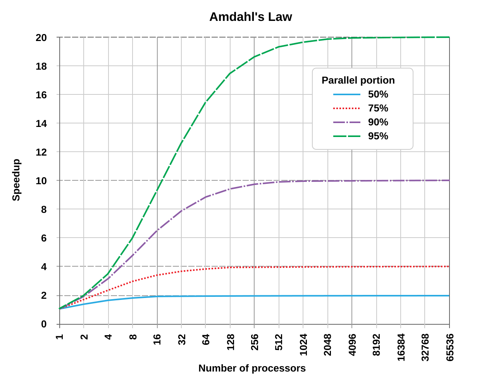

# Foundations: Concurrency and Parallelism for ML Engineers

Almost every confusing failure in ML engineering that isn't a math bug turns out to be a concurrency bug: a DataLoader that eats 200GB of RAM, a training step that looks fast in a profiler but slow in wall-clock time, a timing measurement that claims your matmul runs at 50 PFLOPS, a checkpoint that holds the weights of the wrong step, a 512-GPU job that freezes with no error, an inference server that stops answering while it tokenizes one long prompt.

This chapter assumes you know ML math and use Python and PyTorch, but have never studied concurrency. It starts at zero and builds up to the machinery you meet every day: DataLoader workers, CUDA streams, async checkpointing, NCCL hangs and serving engines. The goal is that you understand *why* these things behave the way they do, so the rest of this book reads as a set of applications rather than a set of spells.

Conventions:

- Every code block is runnable. Pure-Python examples need only `python3` (tested with CPython 3.14). Examples marked **[torch]** need `pip install torch numpy` and run on CPU. Examples marked **[GPU]** need a CUDA GPU; those were **not executed** while writing this chapter - they follow the documented PyTorch APIs, but treat them as untested.
- Any numbers printed by the examples depend on your machine. Where I quote a number from a run, I say so, and it is one run on one laptop - an anecdote, not a benchmark.


## Part 1: The basic vocabulary

### Concurrency vs parallelism

These two words are used interchangeably and they mean different things.

- **Concurrency** is about *structure*: a program has several tasks that are in progress at the same time, and their steps may interleave. A single CPU core can run a concurrent program by switching between the tasks.
- **Parallelism** is about *execution*: several things are literally executing at the same instant, on different cores, different GPUs or different machines.

A chef who puts the pasta water on, chops onions while it heats, then stirs the sauce while the pasta cooks is concurrent - one person, many tasks in flight. Three chefs each cooking a dish are parallel.

Why the distinction matters in ML: most of your performance wins come from concurrency even when no extra hardware is involved. A GPU sitting idle while the CPU decodes JPEGs is not a lack of parallel hardware, it's a lack of overlap. The DataLoader, CUDA streams and async checkpointing are all tools for *overlap*: arranging for slow waits to happen while something else useful is going on.

Parallelism is what you buy more GPUs for. Concurrency is what keeps the GPUs you have busy.

### Programs, processes and threads

When you run `python train.py`, the operating system (OS) creates a **process**. A process is a container that owns:

- an **address space**: its own private view of memory. Address `0x7f00...` in your process and the same address in another process refer to completely different physical memory.
- OS resources: open files, sockets, a current directory, environment variables.
- one or more **threads**.

A **thread** is a single sequence of instructions being executed: it has its own instruction pointer, its own registers, and its own stack (for local variables and function calls). All threads in a process **share the address space**: every thread can read and write every global variable, every heap object, every tensor.

| | Processes | Threads (in one process) |
|---|---|---|
| Memory | Separate; must explicitly share or copy | Shared; every thread sees everything |
| Communication | Pipes, sockets, shared memory, files - data is usually copied/serialized | Just read the variable - which is also the danger |
| Creation cost | Higher (new address space, possibly re-importing Python modules) | Lower |
| A crash | Kills only that process | Kills the whole process, all threads |
| Python CPU-bound parallelism | Yes | No, in the default build (the GIL, below) |
| Example in ML | DataLoader workers, one process per GPU under `torchrun` | DataLoader pin-memory thread, checkpoint writer thread, NCCL's internal threads |

The shared address space is the defining property. It's what makes threads cheap to communicate between - and what makes them dangerous, because two threads can modify the same thing at the same time. Processes are safer because nothing is shared unless you go out of your way to share it, but every byte that moves between them has to be copied or explicitly placed in shared memory.

### Scheduling and context switches

Your machine has, say, 64 cores but thousands of threads alive. The OS **scheduler** decides which threads run on which cores. A thread runs until it:

- blocks (waits on disk, network, a lock, `sleep`) - it voluntarily gives up the core,
- exhausts its time slice (typically on the order of milliseconds) - the OS preempts it,
- or a higher-priority thread needs the core.

Swapping one thread out and another in is a **context switch**. The direct cost is saving and restoring registers and kernel bookkeeping - on the order of a microsecond or a few microseconds on modern hardware (the exact figure varies a lot by CPU, OS and measurement method). The indirect cost is usually larger: the new thread finds the CPU caches and TLB full of the old thread's data and runs slowly until they warm up. Switching between *processes* additionally switches address spaces, which can invalidate more cached translation state.

Practical consequences for ML:

- **Oversubscription hurts.** If you run 8 training processes, each spawns a PyTorch intra-op thread pool sized to all 64 cores, plus 8 DataLoader workers each, you have hundreds of CPU-hungry threads fighting for 64 cores. They spend time context-switching and thrashing caches instead of working. This is why `torchrun` sets `OMP_NUM_THREADS=1` by default and prints a warning about it, and why DataLoader workers call `torch.set_num_threads(1)` inside each worker.
- **Pinning matters.** Keeping a process on the cores near its GPU and memory (NUMA affinity) avoids both migrations and remote memory access - see [NUMA affinity](../training/performance/README.md#numa-affinity).


## Part 2: Shared state and how it goes wrong

### Race conditions

A **race condition** is a bug where the result depends on the timing of threads - on which one "wins the race." The classic case is read-modify-write on shared data.

`counter += 1` looks like one step. It's three: read `counter`, compute `counter + 1`, write it back. If two threads both read `5`, both compute `6`, both write `6`, one increment is lost.

```python
# race.py
import threading, time

counter = 0

def work(n):
    global counter
    for _ in range(n):
        tmp = counter      # 1. read
        time.sleep(0)      # 2. yield the CPU -- stands in for "anything that takes time"
        counter = tmp + 1  # 3. write back

threads = [threading.Thread(target=work, args=(10_000,)) for _ in range(4)]
for t in threads: t.start()
for t in threads: t.join()
print(f"expected 40000, got {counter}")
```

A typical run prints something like `expected 40000, got 10024` - three quarters of the updates were lost. The `time.sleep(0)` widens the window between read and write so that the bug shows up every time. Without it, in recent CPython versions a bare `counter += 1` loop *usually* produces the right answer, because the interpreter rarely switches threads in the middle of those few bytecodes. "Usually" is the worst property a bug can have: it passes your tests and fails in production when something changes the timing - a slower machine, a log line, a free-threaded interpreter.

You can see the separate steps in the bytecode:

```python
import dis
dis.dis("counter += 1")   # LOAD_NAME, BINARY_OP (+=), STORE_NAME: three steps, not one
```

### Atomicity

An operation is **atomic** if no other thread can observe it half-done: it either hasn't happened or has fully happened. The fix for a race is to make the read-modify-write atomic. In hardware there are atomic instructions (compare-and-swap, fetch-and-add) for single machine words. For anything larger, you need a lock.

### Locks (mutexes)

A **lock** (or **mutex**, for *mut*ual *ex*clusion) is an object that at most one thread can hold at a time. A thread that tries to acquire a held lock blocks until it's released. The code between acquire and release is a **critical section**.

```python
# race_fixed.py
import threading

counter = 0
lock = threading.Lock()

def work(n):
    global counter
    for _ in range(n):
        with lock:         # acquire; released automatically, even on exceptions
            counter += 1

threads = [threading.Thread(target=work, args=(100_000,)) for _ in range(8)]
for t in threads: t.start()
for t in threads: t.join()
print(f"expected 800000, got {counter}")   # always correct
```

Locks cost something: an uncontended acquire is cheap (tens of nanoseconds in C), but a contended lock makes threads wait - which, if the critical section is the whole loop body, means your "parallel" program is now serial. Rules of thumb: protect *shared mutable* state only; keep critical sections short; never do I/O or a GPU sync while holding a lock if you can avoid it.

`threading.RLock` is a re-entrant lock: the same thread may acquire it multiple times (useful when a locked method calls another locked method). A plain `Lock` would deadlock against itself in that case.

### Semaphores

A **semaphore** is a counter with two operations: acquire (decrement; block if it would go below zero) and release (increment; wake a waiter). A lock is a semaphore that starts at 1. A semaphore that starts at N lets at most N threads into a region - perfect for "don't open more than N connections to the object store."

```python
# semaphore.py
import threading, time

max_inflight = threading.BoundedSemaphore(3)   # at most 3 concurrent "downloads"
active, peak, lock = 0, 0, threading.Lock()

def download(shard):
    global active, peak
    with max_inflight:
        with lock:
            active += 1; peak = max(peak, active)
        time.sleep(0.1)                         # pretend to fetch from object storage
        with lock:
            active -= 1

threads = [threading.Thread(target=download, args=(i,)) for i in range(12)]
for t in threads: t.start()
for t in threads: t.join()
print(f"peak concurrent downloads: {peak}")    # 3, never more
```

Note the second, ordinary lock protecting `active` and `peak`: the semaphore limits how many threads are inside, it does not make the bookkeeping inside atomic. `BoundedSemaphore` raises if you release more times than you acquired, which catches a common bug.

### Condition variables

Sometimes a thread needs to wait until some *condition on shared state* becomes true - "a new checkpoint exists", "the queue is non-empty". Polling (`while not ready: sleep(0.01)`) wastes CPU and adds latency. A **condition variable** lets a thread sleep until another thread signals that the state changed.

```python
# condvar.py
import threading, time

cond = threading.Condition()
latest_step = -1                  # shared state protected by cond's lock

def trainer():
    global latest_step
    for step in range(5):
        time.sleep(0.05)          # a training step
        with cond:
            latest_step = step
            cond.notify_all()     # wake anyone waiting for a new step

def evaluator(target):
    with cond:
        # wait_for re-checks the predicate after every wakeup (spurious wakeups are allowed)
        cond.wait_for(lambda: latest_step >= target)
        print(f"evaluator: step {latest_step} reached (wanted >= {target})")

e = threading.Thread(target=evaluator, args=(3,)); t = threading.Thread(target=trainer)
e.start(); t.start(); e.join(); t.join()
```

Two details are load-bearing. First, the condition variable is always paired with a lock; `wait()` atomically releases the lock and sleeps, then re-acquires it before returning. Without that atomicity, the notification could arrive between your check and your sleep and you'd sleep forever (a "lost wakeup"). Second, always re-check the condition in a loop (`wait_for` does this for you): a thread can wake up without the condition being true.

`threading.Event` is a simpler one-shot version: a flag that threads can `wait()` on until someone calls `set()`. DataLoader uses events internally to tell workers to shut down.

### Queues

In practice you should rarely touch locks and condition variables directly. Most concurrent programs are better written as threads that communicate by passing messages through a **thread-safe queue**. `queue.Queue` is built from exactly the primitives above (a lock and two condition variables, "not empty" and "not full"), and it handles all the subtle cases correctly. The queue *owns* the synchronization; each object is touched by one thread at a time; most races disappear by construction. We'll use queues for producer/consumer pipelines in Part 5.

Equivalents: `multiprocessing.Queue` across processes (data is pickled), `asyncio.Queue` inside an event loop (not thread-safe - for coroutines only).

### Deadlock

A **deadlock** is a state where a set of threads are each waiting for something that another thread in the set holds, so none of them can ever proceed. Nothing crashes; nothing errors; CPU usage drops to zero; the program simply stops.

```python
# deadlock.py
import threading, time

lock_a = threading.Lock()   # e.g. "the model weights"
lock_b = threading.Lock()   # e.g. "the metrics log"

def worker(name, first, second):
    with first:
        print(f"{name}: holding first lock, waiting for second")
        time.sleep(0.1)                      # make the bad interleaving certain
        if second.acquire(timeout=2):        # a real program would call second.acquire() and hang forever
            print(f"{name}: got both"); second.release()
        else:
            print(f"{name}: DEADLOCK - gave up after 2 s")

t1 = threading.Thread(target=worker, args=("T1", lock_a, lock_b))
t2 = threading.Thread(target=worker, args=("T2", lock_b, lock_a))   # opposite order!
t1.start(); t2.start(); t1.join(); t2.join()
```

T1 holds A and wants B; T2 holds B and wants A. The timeout is only there so the example terminates: one thread gives up, releases its lock, and the other then succeeds. Remove the timeout and the program hangs forever.

Deadlock requires all four of the **Coffman conditions** to hold simultaneously. Break any one and deadlock is impossible:

| Condition | Meaning | How to break it |
|---|---|---|
| Mutual exclusion | A resource can be held by only one thread | Use lock-free or immutable data; copy instead of share |
| Hold and wait | A thread holds one resource while waiting for another | Acquire everything you need at once, or nothing |
| No preemption | Resources can't be forcibly taken away | Use timeouts (`acquire(timeout=...)`), then release and retry |
| Circular wait | There's a cycle T1 -> T2 -> ... -> T1 in the waits-for graph | **Global lock ordering**: always acquire A before B, everywhere |

Lock ordering is the standard practical fix: if every thread acquires locks in the same global order, no cycle can form. Timeouts are the standard *detection* mechanism, and they're exactly what distributed training uses (more below).

### Livelock

A **livelock** is the polite cousin of deadlock: threads are not blocked - they're busy, actively responding to each other - but none makes progress. Think of two people in a corridor who both step aside the same way, over and over. The classic way to create one is to "fix" a deadlock by having each thread back off and retry when it can't get the second lock - and then have both threads retry in lock-step.

```python
# livelock.py
import threading

lock_a, lock_b = threading.Lock(), threading.Lock()
step = threading.Barrier(2)  # forces perfect lock-step: the worst case for livelock

def polite(name, first, second, attempts=5):
    for i in range(attempts):
        first.acquire()
        step.wait()                          # both now hold their first lock
        got_it = second.acquire(blocking=False)  # try the other one, don't block
        step.wait()                          # both have tried
        if got_it:
            print(f"{name}: success on attempt {i}")
            second.release(); first.release(); return
        first.release()                      # be polite: give up what we hold, retry
        print(f"{name}: attempt {i} failed, backed off")
        step.wait()                          # both have backed off
    print(f"{name}: LIVELOCK - {attempts} attempts, always busy, zero progress")

t1 = threading.Thread(target=polite, args=("T1", lock_a, lock_b))
t2 = threading.Thread(target=polite, args=("T2", lock_b, lock_a))
t1.start(); t2.start(); t1.join(); t2.join()
```

The barrier makes the synchronization perfect so you see the livelock deterministically; in real systems the threads are synchronized by accident (same timeout, same retry interval). The standard fix is **randomized backoff** - wait a random, growing interval before retrying - which is why network protocols and retry libraries use exponential backoff with jitter. (The real fix here is lock ordering, which avoids the conflict altogether.)

ML sightings: several workers retrying a contended file lock on a shared filesystem in step; a cluster job auto-restart loop that immediately crashes on the same bad node and restarts again, forever, consuming the allocation while making zero training progress.

### A distributed hang is a deadlock across machines

Now replace threads with processes on different machines, and locks with collective operations. In data-parallel training every rank calls `all_reduce` on gradients. An `all_reduce` cannot complete on any rank until **all** ranks have joined it - so each collective acts like a barrier that every participant must reach.

If rank 3 crashes, takes a different branch, or is stuck on a slow filesystem read, the other 511 ranks sit inside `all_reduce` waiting for it. That's "hold and wait" plus "circular wait" spread over a network: each rank holds its position in the collective sequence and waits for the others. GPU utilization often shows 100% during such a hang, because the NCCL kernel spins on the GPU waiting for data that never arrives - which is why "the GPUs are busy" is not evidence that training is progressing.

The tools to break it map onto the Coffman table: the process group **timeout** is the "no preemption" breaker (after the timeout, the collective is aborted and the job crashes loudly instead of hanging silently), and a consistent order of collectives across ranks is the "lock ordering" rule. See [Part 9](#part-9-distributed-concurrency-preview) for a runnable example, and [Diagnosing Hangings and Deadlocks in Multi-Node Multi-GPU Python Programs](../debug/torch-distributed-hanging-solutions.md) and [NCCL debug and performance](../debug/nccl-performance-debug.md) for how to find which rank is stuck where.


## Part 3: Python specifics

### The GIL

CPython - the standard Python interpreter - has a **Global Interpreter Lock (GIL)**: a single mutex per interpreter that a thread must hold to execute Python bytecode. In the default build, at any instant at most one thread in a process is running Python code.

What it protects: the interpreter's own internals. Every Python object has a reference count that's modified constantly (every assignment, every function call), and the memory allocator, the dict implementation, the list implementation, etc. all assume no concurrent modification. The GIL is one coarse lock that makes all of that safe, cheaply, for single-threaded code. It also means that individual operations on built-in types implemented in C (like `list.append` or `dict[key] = value`) don't corrupt the object when called from several threads.

What it does **not** protect: *your* invariants. The race in `race.py` happened with the GIL in place. The GIL makes single bytecodes safe, not sequences of them, and the interpreter can switch threads between any two bytecodes (CPython asks the running thread to release the GIL every 5 ms by default; see `sys.getswitchinterval()`).

When the GIL is released:

- During blocking I/O: `time.sleep`, file reads/writes, socket operations, `subprocess` waits.
- When C extensions choose to release it during long computations. NumPy releases it in many array operations; PyTorch releases it around most tensor operations, CUDA calls and collectives; compression, hashing (for large inputs) and image decoding libraries often do as well.

That gives the central rule of Python threading:

- **I/O-bound threads scale.** While one thread waits on the network, it doesn't hold the GIL, so others run.
- **Pure-Python CPU-bound threads don't scale.** They take turns holding the GIL. Four threads computing in Python take about as long as one thread doing four times the work - plus switching overhead.
- **Threads calling GIL-releasing native code can scale** - but only for the portion of time spent inside that native code.

```python
# gil.py
import time
from concurrent.futures import ThreadPoolExecutor, ProcessPoolExecutor

def cpu_task(_=None, n=5_000_000):
    s = 0
    for i in range(n):
        s += i * i
    return s

def io_task(_=None):
    time.sleep(0.5)  # stands in for a network/disk wait; releases the GIL

def bench(label, executor_cls, fn, workers=4, jobs=4):
    t0 = time.perf_counter()
    with executor_cls(max_workers=workers) as ex:
        list(ex.map(fn, range(jobs)))
    print(f"{label:<28} {time.perf_counter() - t0:6.2f} s")

if __name__ == "__main__":
    t0 = time.perf_counter(); cpu_task(); one = time.perf_counter() - t0
    print(f"{'1 cpu task, serial':<28} {one:6.2f} s")
    bench("4 cpu tasks, 4 threads", ThreadPoolExecutor, cpu_task)
    bench("4 cpu tasks, 4 processes", ProcessPoolExecutor, cpu_task)
    bench("4 io tasks, 4 threads", ThreadPoolExecutor, io_task)
```

What you should see: 4 CPU tasks on 4 threads take roughly 4x one task (no speedup); 4 processes take much less (real parallelism, minus process startup); 4 I/O tasks on 4 threads take about 0.5 s, not 2 s. On one laptop run: 0.14 s serial, 0.55 s threads, 0.24 s processes, 0.51 s I/O threads.

This is the single reason the PyTorch DataLoader uses **processes** for workers: a typical `__getitem__` does Python-level work (parsing, augmentation logic, tokenization glue) that would serialize on the GIL.

### Free-threaded Python (3.13t, 3.14t)

[PEP 703](https://peps.python.org/pep-0703/) added an optional CPython build with no GIL, the "free-threaded" build, usually installed as `python3.13t` / `python3.14t`. Status as I understand it at the time of writing (verify for your version):

- **3.13**: free-threaded build shipped as *experimental*.
- **3.14**: per [PEP 779](https://peps.python.org/pep-0779/) the free-threaded build is *officially supported* but still **optional**; the default `python3` still has the GIL. Single-threaded code runs somewhat slower on the free-threaded build (the overhead was reported to be considerably reduced in 3.14 versus 3.13; I won't quote a percentage - measure your workload).
- Built-in types use per-object locking so they stay internally consistent, but - again - your own read-modify-write sequences still need locks. Code that "worked" only because the GIL made races rare will start failing.
- C extensions must be explicitly built and marked as free-threading compatible; importing one that isn't may re-enable the GIL (with a warning). Ecosystem support - NumPy, PyTorch, and the long tail of data libraries - has been arriving gradually. PyTorch has published free-threaded wheels in recent releases; check the install matrix for your version and treat it as less battle-tested than the default build.
- You can check at runtime with `sys._is_gil_enabled()` (3.13+).

The long-term payoff for ML is that data loading, serving and preprocessing could use threads instead of processes - no pickling, no shared-memory gymnastics, no copy-on-write blowups. (PyTorch's `WorkerInfo` already carries a `worker_method` field with `"thread"` as a possible value in torch 2.15, though as far as I can see it's not a public `DataLoader` option yet.) Until your entire dependency stack supports it, assume the GIL.

### multiprocessing and the three start methods

To get around the GIL you run multiple processes. How a child process is created matters a lot:

| Start method | How it works | Startup cost | What the child inherits | Default on |
|---|---|---|---|---|
| `fork` | OS `fork()`: child is a copy-on-write clone of the parent at the moment of forking | Very low | *Everything*: all memory, imported modules, open files, held locks - but only the forking thread | Linux, Python <= 3.13 |
| `spawn` | Start a fresh interpreter, re-import the main module, unpickle the target function and arguments | High (imports torch again, etc.) | Only what you pass, pickled | macOS (since 3.8), Windows |
| `forkserver` | A clean single-threaded server process is started early; children are forked from *it* | Medium | What the server imported plus the pickled arguments | Linux, Python >= 3.14 |

The change of the Linux default to `forkserver` in Python 3.14 is significant and easy to miss: code that relied on fork semantics (globals set up in the parent being visible in children, unpicklable objects in dataset classes) can break when you upgrade Python. Set the method explicitly if you depend on it: `multiprocessing.set_start_method("fork")` once at startup, or per-object with `multiprocessing.get_context("fork")`, or `DataLoader(..., multiprocessing_context="fork")`.

Why does `spawn` require the `if __name__ == "__main__":` guard? Because the child re-imports your main module; without the guard, the child would execute your top-level code - including the code that spawns children.

#### Why fork and threads (and CUDA) don't mix

`fork()` copies the whole memory of the process but only *the one thread that called fork*. Any lock that another thread held at that moment is copied in its *held* state, and the thread that would have released it doesn't exist in the child. The child deadlocks the first time it touches that lock:

```python
# fork_lock.py  (Linux/macOS)
import os, threading, time

lock = threading.Lock()

def background():                 # e.g. a logging or metrics thread
    while True:
        with lock:
            time.sleep(0.01)

threading.Thread(target=background, daemon=True).start()
time.sleep(0.05)                  # let it grab the lock
pid = os.fork()                   # child gets a copy of memory -- including the *held* lock --
if pid == 0:                      # but NOT the thread that would release it
    ok = lock.acquire(timeout=2)
    print("child: got lock" if ok else "child: lock held forever by a thread that does not exist", flush=True)
    os._exit(0)
os.waitpid(pid, 0)
```

Python 3.12+ emits a `DeprecationWarning: This process ... is multi-threaded, use of fork() may lead to deadlocks in the child` for exactly this reason. Real-world sources of such locks: logging handlers, the allocator in some C libraries, OpenMP/MKL thread pools, gRPC, and the **CUDA driver**.

Once a process has initialized CUDA, the driver has background threads, a GPU context, and memory mappings that are not valid in a forked child. PyTorch detects this and refuses:

```
RuntimeError: Cannot re-initialize CUDA in forked subprocess. To use CUDA with multiprocessing, you must use the 'spawn' start method
```

Hence the rules:

- With `fork`, don't touch CUDA in the parent before forking if children need CUDA. DataLoader workers forked from a CUDA-using trainer are fine *as long as the workers themselves never touch CUDA* - which is why datasets should return CPU tensors and the main process moves them to the GPU.
- If children need CUDA (e.g. multi-GPU workers you launch yourself), use `spawn` (`torch.multiprocessing.spawn` does this) or, more commonly, let a launcher like `torchrun` start independent processes from scratch.

### Pickling: the hidden cost of processes

With `spawn`/`forkserver`, and for every object passed through a `multiprocessing.Queue`, Python serializes with `pickle`, pushes bytes through a pipe, and deserializes on the other side. For data made of many small Python objects that's slow, because pickling walks every object:

```python
# pickle_cost.py  [torch venv, needs numpy]
import pickle, time
import numpy as np

as_list = list(range(10_000_000))                 # 10M Python ints
as_array = np.arange(10_000_000, dtype=np.int64)  # same values, one contiguous 80 MB buffer

for name, obj in [("list", as_list), ("ndarray", as_array)]:
    t0 = time.perf_counter()
    blob = pickle.dumps(obj, protocol=pickle.HIGHEST_PROTOCOL)
    t1 = time.perf_counter()
    pickle.loads(blob)
    t2 = time.perf_counter()
    print(f"{name:8s} {len(blob)/1e6:6.1f} MB  dumps {t1-t0:5.3f} s  loads {t2-t1:5.3f} s")
```

On one run the 50 MB list pickle took ~0.26 s round trip and the 80 MB array ~0.02 s - more bytes, ~10x faster, because a contiguous buffer is a single memcpy. The general lesson: **move contiguous buffers between processes, not object graphs**. Things that can't be pickled at all - lambdas, open file handles, database connections, CUDA tensors under some paths, locks - produce `PicklingError`/`AttributeError` errors the moment you switch to `spawn`. Open such resources lazily inside the worker instead (e.g. in `worker_init_fn` or on first `__getitem__`).

### Shared memory

The way to avoid copying altogether is to put data in memory that both processes map. `multiprocessing.shared_memory` exposes named shared memory blocks (backed by `/dev/shm` on Linux):

```python
# shm.py  [needs numpy]
import numpy as np
from multiprocessing import Process, shared_memory

def worker(name, shape, dtype):
    shm = shared_memory.SharedMemory(name=name)          # attach by name, no copy
    arr = np.ndarray(shape, dtype=dtype, buffer=shm.buf)
    arr *= 2                                             # writes are visible to the parent
    del arr                                              # drop the view before closing
    shm.close()

if __name__ == "__main__":
    src = np.arange(8, dtype=np.float32)
    shm = shared_memory.SharedMemory(create=True, size=src.nbytes)
    arr = np.ndarray(src.shape, dtype=src.dtype, buffer=shm.buf)
    arr[:] = src
    p = Process(target=worker, args=(shm.name, src.shape, src.dtype)); p.start(); p.join()
    print(arr)                                           # [ 0.  2.  4. ... 14.]
    del arr
    shm.close(); shm.unlink()                            # unlink exactly once, by the owner
```

Shared memory brings back all the race conditions of threads - two processes writing the same array need synchronization (a `multiprocessing.Lock`, or a protocol where ownership is handed over through a queue). PyTorch does this for you: `torch.multiprocessing` and the DataLoader move tensors into shared memory and send only a small handle through the queue. This is why DataLoader with big batches inside Docker fails with errors about `/dev/shm` or "bus error" - Docker's default `/dev/shm` is 64 MB; raise it with `--shm-size` or `--ipc=host`.

### concurrent.futures

`concurrent.futures` is the high-level API you should reach for first. `ThreadPoolExecutor` and `ProcessPoolExecutor` share one interface: `submit(fn, *args)` returns a **Future** (a placeholder for a result that will exist later); `map` runs a function over an iterable; `as_completed` yields futures as they finish. You've already seen it in `gil.py`. Exceptions raised in the worker are re-raised when you call `future.result()` - which means if you never call it, the exception is silently swallowed. Always collect results, or at least check `future.exception()`.

### asyncio

Threads handle I/O concurrency well up to hundreds of connections. Beyond that, or when you want precise control over when switching happens, Python offers **asyncio**: cooperative concurrency on a *single thread*.

- A function defined with `async def` is a **coroutine**. Calling it doesn't run it; it produces a coroutine object.
- `await something` means "pause me here until `something` is done, and let other coroutines run meanwhile."
- The **event loop** is a scheduler that runs one coroutine at a time until it hits an `await` on something not yet ready, then switches to another ready coroutine, and uses the OS's efficient I/O multiplexing (epoll/kqueue) to know when sockets are ready.

Because switching only happens at `await`, there are no races between `await` points - a big simplification over threads. The price: **anything that blocks without awaiting freezes every coroutine in the process.** A CPU-heavy tokenization, a synchronous `requests.get`, a `torch.load`, a GPU sync - while it runs, the server answers nobody.

```python
# blocking_loop.py
import asyncio, time

def tokenize_blocking():          # CPU work or a sync library call (requests, torch.load, ...)
    time.sleep(0.2)

async def heartbeat():            # stands in for "all the other requests this server is handling"
    for _ in range(5):
        t0 = time.perf_counter(); await asyncio.sleep(0.05)
        print(f"  heartbeat late by {(time.perf_counter() - t0 - 0.05)*1000:5.0f} ms")

async def main():
    print("blocking call inside async def:")
    hb = asyncio.create_task(heartbeat()); await asyncio.sleep(0)
    tokenize_blocking()                       # freezes the whole event loop
    await hb
    print("same call via asyncio.to_thread:")
    hb = asyncio.create_task(heartbeat()); await asyncio.sleep(0)
    await asyncio.to_thread(tokenize_blocking)  # runs in a worker thread; loop keeps serving
    await hb

asyncio.run(main())
```

The first heartbeat is ~150 ms late in the blocking case and ~1 ms late with `asyncio.to_thread`. `to_thread` (or `loop.run_in_executor` with a process pool for pure-Python CPU work) is how you call blocking code from async code.

When to use what:

| Workload | Tool |
|---|---|
| Many concurrent network connections, mostly waiting (an HTTP inference frontend, a crawler, an eval harness calling a remote API) | `asyncio` |
| Moderate I/O concurrency with blocking libraries (parallel S3 downloads, writing checkpoint shards) | `ThreadPoolExecutor` |
| CPU-bound Python (decoding, augmentation, tokenization in pure Python) | Processes: `ProcessPoolExecutor`, DataLoader workers |
| CPU-bound native code that releases the GIL (NumPy, many tokenizers' Rust/C++ backends) | Threads may be enough - measure |

#### An inference-server batcher in 40 lines

This is the core pattern inside serving engines: requests arrive at random times over the network (asyncio), a single batching loop gathers them for up to a few milliseconds or until the batch is full, runs one forward pass for the whole batch, and resolves each request's future.

```python
# batcher.py
import asyncio, random, time

MAX_BATCH, MAX_WAIT_S = 8, 0.010

async def fake_model(prompts):            # stands in for one GPU forward pass
    await asyncio.sleep(0.030)            # pretend 30 ms per batch regardless of size
    return [p.upper() for p in prompts]

async def batcher(q):
    while True:
        prompt, fut = await q.get()       # wait for the first request
        batch = [(prompt, fut)]
        deadline = time.monotonic() + MAX_WAIT_S
        while len(batch) < MAX_BATCH and (left := deadline - time.monotonic()) > 0:
            try:
                batch.append(await asyncio.wait_for(q.get(), timeout=left))
            except asyncio.TimeoutError:
                break
        outs = await fake_model([p for p, _ in batch])
        for (_, f), out in zip(batch, outs):
            f.set_result(out)
        print(f"ran batch of {len(batch)}")

async def client(q, i):
    await asyncio.sleep(random.uniform(0, 0.1))   # requests arrive at random times
    fut = asyncio.get_running_loop().create_future()
    await q.put((f"req{i}", fut))
    return await fut                               # suspends this coroutine, not the server

async def main():
    q = asyncio.Queue()
    server = asyncio.create_task(batcher(q))
    t0 = time.perf_counter()
    results = await asyncio.gather(*(client(q, i) for i in range(32)))
    print(f"{len(results)} requests in {time.perf_counter() - t0:.2f} s "
          f"(serial would be {32 * 0.030:.2f} s)")
    server.cancel()

asyncio.run(main())
```

The `MAX_WAIT_S` knob is a direct latency/throughput trade-off: waiting longer fills bigger batches (more throughput per GPU) and adds that wait to every request's latency. Real engines (vLLM, SGLang, TGI) go further with *continuous batching* - inserting new requests into the running batch at every decode step rather than waiting for a whole batch to finish - and they typically keep the GPU-driving loop out of the asyncio thread entirely (in a separate thread or process) so that tokenization and HTTP handling never stall the GPU, and GPU syncs never stall HTTP. See [Inference](../inference/README.md).


## Part 4: How the PyTorch DataLoader works inside

With the vocabulary above, the DataLoader becomes easy to understand. With `num_workers=0`, everything happens in the main process: for each batch, the sampler produces indices, `dataset[i]` is called for each, and `collate_fn` stacks the results. The GPU waits while this happens.

With `num_workers=N > 0`:

```
 main process                                            worker processes (N)
 ┌──────────────────────────────────────────┐          ┌──────────────────────────┐
 │ sampler -> batch of indices              │  index   │ worker k:                │
 │   round-robin  ─────────────────────────────queue──>│   samples = [ds[i] ...]  │
 │                                          │   (per   │   batch = collate(...)   │
 │                                          │  worker) │   tensors -> shared mem  │
 │ result queue  <────────────────────────────────────── put(handle)             │
 │   │  (one, shared by all workers)        │          └──────────────────────────┘
 │   v                                      │
 │ pin_memory thread (if pin_memory=True)   │
 │   copies batch into page-locked memory   │
 │   │                                      │
 │   v                                      │
 │ __next__: reorder to sampler order,      │
 │   hand batch to training loop            │
 └──────────────────────────────────────────┘
```

Step by step:

1. **Workers are processes**, for the GIL reason above. Each gets a copy of the dataset object - via fork (cheap, copy-on-write) or via pickling (spawn/forkserver). Each worker sets `torch.set_num_threads(1)` and seeds `random`, `torch` and `numpy` with `base_seed + worker_id`-derived seeds, so augmentations differ across workers.
2. **The main process does the sampling.** It sends *batches of indices* to each worker's own index queue, round-robin. Workers don't decide what to load.
3. **Workers load and collate**, then put the batch on a single shared result queue. Tensors are moved into shared memory first, so only a small handle is pickled.
4. **`prefetch_factor`** (default 2 when `num_workers > 0`) is the number of batches each worker is allowed to have outstanding. At most `num_workers * prefetch_factor` batches are in flight. This is a bounded queue - the backpressure mechanism of Part 5 - preventing workers from racing ahead and filling RAM.
5. **The pin-memory thread** (when `pin_memory=True`) is a *thread* in the main process that takes batches off the result queue and copies them into page-locked (pinned) host memory, so the later host-to-device copy can be fast and asynchronous (Part 7). It's a thread, not a process, because the copy is native code that releases the GIL, and the pinned buffer has to live in the main process anyway.
6. **Reordering**: workers finish at different speeds, so batches can arrive out of order. By default the iterator holds early arrivals until the next-in-sequence batch shows up, so you get exactly the sampler's order - and one slow sample (a huge image, a slow network read) stalls everyone behind it (head-of-line blocking). Recent PyTorch versions have `in_order=False` to hand out batches as they complete, at the cost of determinism.
7. **`persistent_workers`** (default `False`): normally workers are shut down at the end of each epoch and started again for the next. With `spawn` that means re-importing torch and re-pickling the dataset every epoch, which can take seconds to minutes. `persistent_workers=True` keeps them alive.

You can watch workers do their thing:

```python
# dl_order.py  [torch]
import os, time, torch
from torch.utils.data import Dataset, DataLoader, get_worker_info

class Slow(Dataset):
    def __len__(self): return 16
    def __getitem__(self, i):
        time.sleep(0.05)                                   # pretend: read + decode one sample
        w = get_worker_info()
        return torch.tensor([i, w.id if w else -1, os.getpid()])

if __name__ == "__main__":
    for workers in (0, 4):
        dl = DataLoader(Slow(), batch_size=4, num_workers=workers)
        t0 = time.perf_counter()
        for b in dl:
            print(f"  samples {b[:, 0].tolist()}  worker {b[0, 1].item():2d}  pid {b[0, 2].item()}")
        print(f"num_workers={workers}: {time.perf_counter() - t0:.2f} s\n")
```

Batch `k` comes from worker `k % 4`, each worker is a different PID, and the 4-worker version takes roughly a quarter of the time *plus worker startup*. With `spawn` (the macOS default) that startup can dominate a toy example like this one - try `multiprocessing_context="fork"` to see the difference, and remember that the same startup is paid every epoch unless `persistent_workers=True`.

How many workers? The arithmetic: if one worker needs `t_load` seconds to produce a batch and the GPU consumes one every `t_step` seconds, you need at least `ceil(t_load / t_step)` workers to keep up, plus headroom for variance. E.g. 25 ms of decode per sample × batch 32 = 0.8 s per batch per worker; at a 0.2 s training step, 4 workers is the bare minimum. More workers beyond that buys nothing but RAM. And mind the memory of the prefetch buffer: a batch of 256 × 3×224×224 fp32 images is 154 MB; 8 workers × prefetch_factor 2 = 16 batches ≈ 2.5 GB in shared memory, per training process.

### The copy-on-write refcount problem

The most notorious DataLoader issue - "my memory grows every epoch until the OOM killer arrives" - is a direct consequence of `fork` plus Python reference counting ([pytorch#13246](https://github.com/pytorch/pytorch/issues/13246)).

`fork()` doesn't copy the parent's memory up front. Parent and child share the same physical pages, marked read-only; a page is copied only when someone *writes* to it (**copy-on-write**, CoW). So 8 workers forked from a parent holding a 20 GB dataset index cost nothing extra - in theory.

But in CPython, *reading* an object writes to it: every access increments and decrements the object's reference count, which lives in the object's header, on the same page as the object. A worker that iterates over a list of 50 million Python strings touches every one of them, dirtying every page, so each worker gradually ends up with its own private copy. With 8 workers per GPU and 8 GPUs per node, a 20 GB list of file paths becomes ~1.3 TB of demand. It looks like a memory leak (RSS grows steadily over the epoch) but it's just pages being copied one by one.

```python
# cow.py  [torch, plus: pip install psutil]
# Shows the fork + refcount copy-on-write problem. Linux behaviour; elsewhere we force fork.
import numpy as np, psutil
from torch.utils.data import Dataset, DataLoader

N = 2_000_000

class ListDS(Dataset):            # the common way people write it: a list of Python str
    def __init__(self): self.items = [f"/data/img_{i:08d}.jpg" for i in range(N)]
    def __len__(self): return N
    def __getitem__(self, i): return len(self.items[i])   # merely reading an object bumps its refcount

class ArrayDS(Dataset):           # same strings, packed into one numpy buffer: no per-item objects
    def __init__(self): self.items = np.array([f"/data/img_{i:08d}.jpg" for i in range(N)])
    def __len__(self): return N
    def __getitem__(self, i): return len(self.items[i])

def uss_mb(batch):                # collate_fn runs inside the worker: report its private memory
    return psutil.Process().memory_full_info().uss / 2**20

if __name__ == "__main__":
    for cls in (ListDS, ArrayDS):
        dl = DataLoader(cls(), batch_size=4096, num_workers=4, shuffle=True,
                        collate_fn=uss_mb, multiprocessing_context="fork")
        usage = list(dl)                               # one USS reading per batch
        print(f"{cls.__name__:8s} per-worker private memory: first batch {usage[0]:6.0f} MB, "
              f"last batch {usage[-1]:6.0f} MB")
```

USS ("unique set size") is the memory private to a process - exactly the pages that have been copied. On one laptop run, the list version's workers grew from ~70 MB to ~134 MB each over a single epoch, while the array version stayed at ~20-22 MB. Scale `N` and the number of workers up to production sizes and you get the OOM.

Fixes, in rough order of preference:

- Store per-sample metadata in **few big objects**: NumPy arrays (fixed-width strings, or one byte buffer plus an offsets array), tensors, Arrow tables, or a memory-mapped file. One object = one refcount, no matter how many elements.
- Load metadata lazily inside each worker (from a file or database) instead of in the parent.
- Don't measure with RSS: RSS counts shared pages in every process, so 8 workers sharing 10 GB look like 80 GB. Use USS/PSS (`psutil`'s `memory_full_info`, or `smem`).
- With `spawn`/`forkserver` the problem changes form: there's no sharing to lose, but each worker pays a full pickled copy of the dataset up front.


## Part 5: Pipelines, backpressure, and the laws of speedup

### Producer/consumer and backpressure

A training input pipeline is a chain of stages - read bytes, decode, augment, collate, pin, copy to GPU, compute - each potentially running concurrently with the others. The standard structure is **producer/consumer**: stages connected by queues. The throughput of a pipeline equals the throughput of its **slowest stage**; overlap hides the other stages' time but cannot beat the bottleneck.

When the producer is faster than the consumer, an unbounded queue grows until memory runs out. The solution is **backpressure**: a bounded queue where a full queue blocks the producer, automatically slowing it to the consumer's pace.

```python
# pipeline.py
import queue, threading, time

SENTINEL = None
q = queue.Queue(maxsize=4)   # bounded: this is the backpressure

def producer(n):              # e.g. "decode + augment images"
    for i in range(n):
        time.sleep(0.01)      # fast producer: 10 ms per item
        q.put(i)              # blocks when the queue is full -> producer slows to consumer's pace
    q.put(SENTINEL)

def consumer():               # e.g. "training step"
    while (item := q.get()) is not SENTINEL:
        time.sleep(0.05)      # slow consumer: 50 ms per item
        print(f"consumed {item:2d}, queue depth now {q.qsize()}")

t0 = time.perf_counter()
p = threading.Thread(target=producer, args=(10,)); c = threading.Thread(target=consumer)
p.start(); c.start(); p.join(); c.join()
print(f"total {time.perf_counter() - t0:.2f} s  (consumer-bound: 10 x 0.05 = 0.5 s)")
```

The queue sits near full and total time ≈ consumer time: the pipeline is consumer-bound, i.e. GPU-bound, which is what you want in training. If the queue is usually *empty*, the producer is the bottleneck - you're input-bound and the GPU is starving.

The queue depth is therefore the cheapest diagnostic there is. In a DataLoader, the equivalent question is "how long does `next(iter)` take?" - if the training loop spends noticeable time waiting for the next batch, you're input-bound; add workers, move work out of `__getitem__`, or precompute. See [DataLoader](../training/performance/README.md#dataloader). The same structure, with the same knobs, shows up in serving (request queue -> batcher -> GPU -> detokenizer -> network) and in checkpointing (snapshot -> serialize -> upload).

The sentinel value is the standard way to tell a consumer "no more items"; with multiple consumers, put one sentinel per consumer.

### Amdahl's law

If a fraction `p` of a program's work can be parallelized and the rest `(1 - p)` is serial, then with `N` workers the best possible speedup is:

```
S(N) = 1 / ((1 - p) + p / N)
```

Speedup vs number of processors for different parallel fractions - the curves flatten at `1 / (1 - p)`:



([source](https://commons.wikimedia.org/wiki/File:AmdahlsLaw.svg))

As `N` goes to infinity, `S` approaches `1 / (1 - p)`. The serial part caps you.

Worked numbers with `p = 0.95` (95% parallel):

| N | Speedup |
|---|---|
| 1 | 1.00 |
| 8 | 1 / (0.05 + 0.11875) = 5.93 |
| 64 | 1 / (0.05 + 0.01484) = 15.42 |
| 1024 | 1 / (0.05 + 0.00093) = 19.64 |
| ∞ | 20.00 |

At 64 workers you're at 24% efficiency (15.4 / 64). A 5% serial section is not a rounding error at scale. An ML example of Amdahl's law at work: a training job that blocks for 60 s to save a checkpoint every 30 minutes of compute spends 60 / 1860 = 3.2% of its wall-clock time not training, regardless of how many GPUs it has. Making the save asynchronous so only a 5 s snapshot blocks brings that to 5 / 1805 = 0.28% (illustrative numbers; see Part 8). Per-step serial pieces matter similarly: Python overhead in the main loop, logging that calls `.item()`, the rank-0-only evaluation others wait for.

### Gustafson's law

Amdahl assumes a fixed problem. In practice, when you get more hardware you grow the problem - a bigger global batch, a bigger model, more data. Gustafson's law measures the speedup when the problem scales with `N` and the serial part stays fixed in *time*:

```
S(N) = (1 - p) + p * N
```

where `p` is now the parallel fraction of time *on the scaled run*. With `p = 0.95`: `N = 8` gives `0.05 + 7.6 = 7.65`; `N = 64` gives `0.05 + 60.8 = 60.85`.

The two laws don't contradict each other; they answer different questions. Amdahl: "how much faster does *this* job get?" (strong scaling). Gustafson: "how much more work can I do in the same time?" (weak scaling). Data-parallel training with a fixed per-GPU batch is weak scaling, which is why it scales well until the communication cost - which grows with `N` - becomes the "serial" part. See [Model parallelism](../training/model-parallelism/README.md) for how that plays out.


## Part 6: Memory models in brief

So far we've assumed that when thread A writes `x = 1`, thread B reading `x` afterwards sees `1`. On real hardware, "afterwards" is surprisingly hard to define.

- **Visibility**: a write by one core may sit in that core's store buffer or cache for a while before other cores can see it.
- **Ordering**: compilers and CPUs reorder memory operations for speed. If A writes `data = 42` then `ready = True`, B may observe `ready == True` and still read the old `data`. x86 is relatively strict (it doesn't reorder stores with other stores); ARM - including Apple silicon and Grace CPUs - is weaker and permits more reorderings.

A **memory model** is the contract defining which reorderings are allowed and which operations create ordering guarantees. In C/C++ (where PyTorch's internals and your custom CUDA extensions live), plain variables have no inter-thread guarantees at all - a data race on a non-atomic variable is undefined behaviour. `std::atomic<T>` gives atomicity plus ordering controls (`memory_order_acquire`/`release`/`seq_cst`): a release-store to `ready` guarantees that everything written before it is visible to a thread that acquire-loads `ready` and sees the new value. Locks include these barriers internally, which is why correctly locked code doesn't need to think about any of this.

`volatile` is a common source of confusion. In C/C++, `volatile` only tells the compiler not to optimize away or merge accesses (meant for memory-mapped hardware registers); it gives **neither atomicity nor inter-thread ordering** and is not a synchronization tool. In Java and C#, `volatile` *does* provide visibility and ordering - same keyword, different meaning.

In Python, the GIL acts as a full barrier at every thread switch, so CPython programs effectively see sequentially consistent behaviour, and you can ignore this section for pure Python. (The free-threaded build preserves the same guarantees for built-in objects, but don't build clever lock-free tricks on top of that.)

Where it does reach ML engineers:

- **CUDA kernels**: the GPU memory model is weak. Threads in a block communicate through shared memory only after `__syncthreads()`; across blocks you need atomics and `__threadfence()`. Floating-point `atomicAdd` from many threads completes in nondeterministic order, and since float addition isn't associative, the result varies run to run in the last bits. That's why ops like `index_add_`/`scatter_add_` on CUDA are nondeterministic and why `torch.use_deterministic_algorithms(True)` exists - see [Reproducibility](../training/reproducibility/README.md).
- **False sharing**: caches move memory in **cache lines** (64 bytes on most x86 CPUs; 128 bytes on Apple M-series). If two threads on different cores write to *different* variables that happen to sit on the same cache line, the line ping-pongs between the cores' caches on every write, and both threads slow down dramatically - even though they share no data logically. The fix is padding or aligning per-thread data to separate cache lines (e.g. `alignas(64)` in C++). You'll meet it in custom C++/CUDA extensions, per-thread counters and lock-free queues; it's invisible from Python.


## Part 7: GPU concurrency

This is where the earlier ideas pay off most directly.

### The host launches, the device executes, asynchronously

When you write `y = x @ w` with CUDA tensors, Python does **not** wait for the matmul. PyTorch (on the CPU, the "host") picks a kernel, and the CUDA runtime enqueues a *launch command* into a queue for the GPU (the "device"); control returns to Python in microseconds while the GPU is still working - or hasn't even started. The CPU races ahead, enqueuing more kernels; the GPU drains the queue in order.

That queue is a **CUDA stream**: an ordered sequence of GPU operations. Operations within one stream execute in issue order; operations in different streams may run concurrently. Unless told otherwise, PyTorch issues everything to one default stream per device, which is why ordinary PyTorch code is correct without you thinking about any of this: each kernel waits for the previous one in the stream.

This asynchrony is a *producer/consumer pipeline* (Part 5) between CPU and GPU. In a healthy training loop, the CPU is several kernels ahead of the GPU, so the GPU never waits. If the CPU can't enqueue fast enough - many tiny kernels, each with a launch overhead of a few microseconds of CPU time, plus Python and dispatcher overhead - the GPU runs dry and you are **CPU-bound / launch-bound**. Remedies: bigger batches, fused kernels, `torch.compile`, and CUDA Graphs (record a sequence of launches once, replay them with a single launch).

### Synchronization points

The CPU only waits for the GPU when it needs a result *on the host*. Each such place is a **synchronization point**: the CPU blocks until the GPU has finished everything queued before it, draining the pipeline. Common ones:

| Operation | Why it syncs |
|---|---|
| `t.item()`, `t.tolist()`, `float(t)`, `print(t)` | The value must be copied to host memory |
| `t.cpu()`, `t.numpy()` (via `.cpu()`), `.to("cpu")` without `non_blocking` | Same |
| `if t > 0:` / `bool(t)` / `while not converged:` on a CUDA tensor | Python needs a host boolean |
| `torch.nonzero`, boolean-mask indexing `x[mask]`, `torch.unique` | Output *shape* depends on the data, so the host must learn it |
| `torch.cuda.synchronize()`, `stream.synchronize()`, `event.synchronize()` | Explicitly |
| Some memory operations (e.g. when the caching allocator must return memory to the driver) | `cudaFree` is synchronizing |

A single `loss.item()` per step for logging costs you the pipeline depth: the CPU can no longer queue the next step's kernels before the current step finishes, so the GPU idles while Python prepares the next step. Log every N steps, or accumulate on the GPU and sync rarely. PyTorch can warn about these: `torch.cuda.set_sync_debug_mode("warn")`.

### Why naive GPU timing is wrong

Because launches are asynchronous, this measures how long it took to *enqueue* the matmul, not to run it:

```python
# [GPU] -- WRONG
import time, torch
x = torch.randn(8192, 8192, device="cuda")
t0 = time.perf_counter()
y = x @ x
print(f"{(time.perf_counter() - t0) * 1e3:.3f} ms")   # tiny: only the launch was timed
```

Divide 2·8192³ ≈ 1.1 TFLOP by that "time" and you'll get a physically impossible FLOP/s figure. The opposite mistake happens too: a later, unrelated `.item()` absorbs all the queued work, and the profiler blames the wrong line. And the first call also includes one-off costs (CUDA context creation, cuBLAS handle creation, kernel selection, memory allocation).

The correct pattern: warm up, synchronize, record CUDA events *in the stream*, synchronize again, read the elapsed time between events.

```python
# [GPU] -- correct
import torch

def time_cuda(fn, warmup=5, iters=20):
    for _ in range(warmup):            # exclude one-off init, autotuning, allocator growth
        fn()
    torch.cuda.synchronize()           # don't let warmup work bleed into the measurement
    start = torch.cuda.Event(enable_timing=True)
    end = torch.cuda.Event(enable_timing=True)
    start.record()                     # a timestamp marker placed *in the stream*
    for _ in range(iters):
        fn()
    end.record()
    end.synchronize()                  # wait until the GPU has passed the end marker
    return start.elapsed_time(end) / iters   # milliseconds per call, measured on the GPU

x = torch.randn(8192, 8192, device="cuda")
ms = time_cuda(lambda: x @ x)
print(f"{ms:.3f} ms/iter, {2 * 8192**3 / (ms / 1e3) / 1e12:.1f} TFLOP/s")
```

Events are recorded into the stream like kernels, so `elapsed_time` measures GPU time between the two markers, independent of what the CPU was doing. Alternatively `torch.utils.benchmark.Timer` handles synchronization and warmup for you, and for "where does the time go" questions use the PyTorch profiler, which shows CPU and GPU timelines side by side - a gap in the GPU timeline is time the GPU was waiting for the CPU. Note also that results depend on input values and on GPU clock behaviour (see [Input data affects measured speed](../training/performance/README.md#input-data-affects-measured-speed)).

### Events

A CUDA **event** is a marker you record into a stream. Besides timing, events are *the* synchronization tool between streams and between host and device:

- `event.record(stream)`: place the marker.
- `event.query()`: non-blocking "has the GPU passed it yet?"
- `event.synchronize()`: block the CPU until it has.
- `other_stream.wait_event(event)`: make *another stream* wait for the marker - on the GPU, without blocking the CPU at all. This is the GPU equivalent of a condition variable.

### Overlapping copy and compute: pinned memory and non_blocking

A GPU has separate copy engines (DMA engines) that can move data over PCIe/NVLink while the SMs compute. To use them concurrently, you need two things:

1. **Pinned (page-locked) host memory.** Normal ("pageable") memory can be moved or swapped out by the OS at any time, so the GPU's DMA engine can't safely read from it directly. For a pageable source, the CUDA driver first copies the data into an internal pinned staging buffer on the CPU, then DMAs from there - extra memcpy, and the call effectively behaves synchronously with respect to the host. Pinned memory is guaranteed to stay put, so the DMA engine reads it directly and the copy can be truly asynchronous. This is what `pin_memory=True` in the DataLoader and `tensor.pin_memory()` provide. Pinned memory is a limited resource: pinning too much starves the OS of pageable memory.
2. **`non_blocking=True`** on the copy, e.g. `x.to("cuda", non_blocking=True)`. This enqueues the copy into the stream and returns immediately. For host-to-device copies from pinned memory, that's safe: later kernels in the same stream wait for the copy automatically.

The dangerous direction is **device-to-host**. `y_cpu = y.to("cpu", non_blocking=True)` returns immediately with a CPU tensor whose contents *have not arrived yet*. Reading it before synchronizing gives garbage or stale values, silently:

```python
# [GPU]
import torch
y = torch.randn(1_000_000, device="cuda") * 0 + 1   # all ones, computed on the GPU
y_cpu = y.to("cpu", non_blocking=True)               # copy enqueued, not finished
# print(y_cpu.sum())   # RACE: may print a wrong value
torch.cuda.current_stream().synchronize()            # or record an event and wait on it
print(y_cpu.sum())                                   # 1000000.
```

This is a race condition in exactly the sense of Part 2, between the GPU's DMA engine and your Python thread. The PyTorch tutorial "A guide on good usage of `non_blocking` and `pin_memory()`" (see Further reading) walks through the cases in detail; a notable conclusion there is that calling `.pin_memory()` yourself just before a single copy is usually *slower* than a plain copy, because pinning is itself a copy. The win comes when pinning happens off the critical path - e.g. in the DataLoader's pin-memory thread while the GPU computes the previous step.

### Multiple streams in PyTorch

Copies on the default stream still serialize with the compute on the default stream. To overlap the *next* batch's host-to-device copy with the *current* batch's compute, put the copy on a side stream:

```python
# [GPU]
import torch

class CUDAPrefetcher:
    """Wrap a DataLoader(pin_memory=True); copies batch i+1 while the model computes on batch i."""
    def __init__(self, loader, device="cuda"):
        self.it, self.device = iter(loader), device
        self.stream = torch.cuda.Stream()             # side stream for copies
        self._preload()

    def _preload(self):
        try:
            x, y = next(self.it)                      # pinned CPU tensors
        except StopIteration:
            self.next = None
            return
        with torch.cuda.stream(self.stream):          # kernels/copies below go to the side stream
            self.next = (x.to(self.device, non_blocking=True),
                         y.to(self.device, non_blocking=True))

    def __iter__(self):
        return self

    def __next__(self):
        if self.next is None:
            raise StopIteration
        main = torch.cuda.current_stream()
        main.wait_stream(self.stream)                 # GPU-side wait: compute must not start before the copy ends
        x, y = self.next
        x.record_stream(main); y.record_stream(main)  # tell the allocator these are used on `main` too
        self._preload()                               # start copying the following batch now
        return x, y
```

Three pieces of concurrency machinery are visible here:

- `torch.cuda.stream(s)` is a context manager that changes the *current* stream, so the copies are enqueued on the side stream.
- `main.wait_stream(self.stream)` inserts a GPU-side dependency: the default stream won't run past this point until the side stream's queued work is done. The CPU doesn't block. Forget it and the model reads a half-copied batch - a GPU race condition, no error message.
- `record_stream`: PyTorch's caching allocator associates each memory block with the stream it was allocated on, and considers it reusable as soon as it's freed *in that stream's order*. A tensor allocated on the side stream but consumed on the main stream could have its memory handed out again while the main stream is still reading it. `record_stream(main)` tells the allocator to wait for the main stream's pending work too.

Multiple streams also let independent *compute* kernels overlap (if neither fills the GPU), and they're how frameworks overlap communication with compute: DDP and FSDP issue NCCL collectives on separate streams so gradient all-reduce for layer `k` runs while backward computes layer `k-1`. Overlap is bounded by shared resources - SMs, memory bandwidth, copy engines - so measure with the profiler rather than assuming.


## Part 8: Async I/O for checkpoints and data

Storage is the slowest thing in the system, so it's where overlap buys the most.

### Async checkpointing

A synchronous checkpoint stops training for the entire time it takes to copy state off the GPU, serialize it, and write it to (often networked) storage. Async checkpointing splits the work:

1. **Snapshot (blocking, fast):** copy the state to host memory. This must complete before the next optimizer step modifies the weights - otherwise you save a mixture of step N and step N+1. This is a race condition, and the snapshot is the critical section.
2. **Persist (background):** serialize and write the snapshot from a background thread or process while training continues.
3. **Backpressure:** don't start a new save while the previous one is in flight, or memory fills up with snapshots and storage falls ever further behind.

```python
# async_ckpt.py  [torch]
import threading, time, torch

model = torch.nn.Linear(1024, 1024)
opt = torch.optim.SGD(model.parameters(), lr=0.1)
writer = None                                    # the in-flight save, if any

def snapshot(module):
    # Synchronous, fast: copy tensors so later optimizer steps can't change what we save.
    return {k: v.detach().to("cpu", copy=True) for k, v in module.state_dict().items()}

def save_async(state, path):
    global writer
    if writer is not None:
        writer.join()                            # backpressure: at most one save in flight
    writer = threading.Thread(target=torch.save, args=(state, path))
    writer.start()                               # slow part (serialization + disk) runs off the training thread

for step in range(1, 7):
    loss = model(torch.randn(64, 1024)).pow(2).mean()
    opt.zero_grad(); loss.backward(); opt.step()
    if step % 3 == 0:
        save_async(snapshot(model), f"/tmp/ckpt_{step}.pt")
        saved_at = model.weight.detach().clone()

writer.join()                                    # never exit with a save half-written
on_disk = torch.load("/tmp/ckpt_6.pt")["weight"]
print("checkpoint matches weights at save time:", torch.equal(on_disk, saved_at))
```

Replace `snapshot(model)` with `model.state_dict()` and the background thread serializes tensors that the optimizer is mutating in place - the file may contain a later step's weights, or a mix, and nothing will tell you. A thread works for the write because file I/O releases the GIL; if serialization itself is CPU-heavy Python, a background *process* is better (at the cost of moving the snapshot to it through shared memory). Production versions add: pinned host staging buffers reused across saves, so the GPU-to-host copy is fast; writing to a temporary name and atomically renaming on completion, so a crash mid-write never leaves a corrupt "latest" checkpoint; and an `atexit`/signal handler that joins the writer. In PyTorch's distributed checkpointing, `torch.distributed.checkpoint.async_save` implements this pattern and returns a future. See [Checkpoints](../training/checkpoints/README.md) and [Fault tolerance](../training/fault-tolerance/README.md).

### Thread pools for storage

Object stores and parallel filesystems have high per-request latency but high aggregate bandwidth: one stream might get a fraction of what 16 concurrent streams get. Since reading and writing release the GIL, a thread pool is the natural tool to keep many requests in flight:

```python
# parallel_read.py
import os, tempfile, time
from concurrent.futures import ThreadPoolExecutor, as_completed

tmp = tempfile.mkdtemp()
paths = []
for i in range(16):                               # make 16 fake 8 MB shards
    p = os.path.join(tmp, f"shard_{i:02d}.bin")
    with open(p, "wb") as f: f.write(os.urandom(8 << 20))
    paths.append(p)

def read(path):
    with open(path, "rb") as f:                   # the GIL is released while the OS reads
        return path, len(f.read())

t0 = time.perf_counter()
with ThreadPoolExecutor(max_workers=8) as pool:   # the pool size *is* your concurrency limit
    futures = [pool.submit(read, p) for p in paths]
    total = sum(f.result()[1] for f in as_completed(futures))   # .result() re-raises worker errors
print(f"read {total / 2**20:.0f} MB in {time.perf_counter() - t0:.3f} s")
```

On a local SSD with warm page cache this won't show much difference from a serial loop; the payoff appears on network storage where each request spends most of its time waiting. The pool size is a semaphore in disguise: too small leaves bandwidth unused, too large overloads the storage service (which then throttles you - and every rank of a 1000-GPU job does this simultaneously). For data loading at scale this is how streaming dataset libraries fetch shards ahead of the training loop, and it composes with DataLoader workers: each worker process can run a small thread pool of its own. See [Storage](../storage/README.md).


## Part 9: Distributed concurrency preview

Distributed training adds machines, but conceptually it adds surprisingly little that's new.

### SPMD: every rank runs the same program

The standard model is **SPMD - Single Program, Multiple Data**. `torchrun --nproc-per-node 8 train.py` on each of 64 nodes starts 512 *independent* processes, each running the same `train.py`. There's no master process orchestrating them. Each process learns its identity from environment variables (`RANK`, `LOCAL_RANK`, `WORLD_SIZE`), picks its GPU and its shard of the data from that, and otherwise executes the same code. They coordinate *only* through collective operations: `all_reduce`, `all_gather`, `reduce_scatter`, `broadcast`, `barrier`.

A collective is a synchronization point across all participating ranks, matched by **order of issue**: the k-th collective call on rank 0 is matched with the k-th collective call on every other rank in that process group. Nothing checks that they are the same operation on the same shapes (unless you enable debug modes). This leads to the most important rule of distributed programming:

**Every rank must issue the same collectives, in the same order, with compatible shapes.**

Violations are always the same story: a data-dependent branch (`if batch is empty: continue`), an exception caught on one rank only, rank-0-only logic that calls something that does a collective internally (saving a sharded model, computing a global metric), uneven numbers of batches per rank, or a slow rank that's simply late.

```python
# spmd_hang.py  [torch, CPU]   run with:  torchrun --nproc-per-node 2 spmd_hang.py
import datetime, torch, torch.distributed as dist

dist.init_process_group("gloo", timeout=datetime.timedelta(seconds=10))
rank = dist.get_rank()

x = torch.tensor([float(rank)])
dist.all_reduce(x)                        # every rank calls this: fine
print(f"rank {rank}: first all_reduce -> {x.item()}", flush=True)

if rank != 0:                             # BUG: a data-dependent branch, e.g. "skip empty batch"
    dist.all_reduce(x)                    # rank 1 waits for a partner that never comes
print(f"rank {rank}: done", flush=True)   # rank 0 thinks it's done...
dist.barrier()                            # ...and its barrier is mismatched with rank 1's all_reduce
dist.destroy_process_group()
```

Both ranks print the first all_reduce result (`1.0`), rank 0 prints "done", and then both sit there until the 10 s timeout fires and they crash with `Timed out waiting ...` errors - rank 1 inside its `all_reduce`, rank 0 inside its `barrier`. (If `torchrun`'s rendezvous hangs on a laptop, add `--master-addr 127.0.0.1` and, on macOS, `GLOO_SOCKET_IFNAME=lo0`.) Here a mismatched pair of collectives timed out; in other cases two mismatched calls of compatible shape can pair up and silently exchange the wrong tensors, which is worse.

With NCCL on GPUs the same thing happens, with two twists. First, NCCL operations are themselves asynchronous kernels on a CUDA stream, so the Python call returns immediately and the hang shows up later at a sync point - one more reason a stack trace of a hung job can point at an innocent line. Second, the default timeouts are long (minutes - 10 minutes for NCCL in recent PyTorch versions, as far as I know; check `torch.distributed.constants` for your version), so a hung 512-GPU job can burn thousands of GPU-minutes before it errors out. PyTorch's NCCL watchdog thread monitors collectives and aborts the process group on timeout; `TORCH_NCCL_ASYNC_ERROR_HANDLING` controls what happens then; and the flight recorder (`TORCH_NCCL_TRACE_BUFFER_SIZE`) records recent collectives per rank so you can see which rank diverged. `TORCH_DISTRIBUTED_DEBUG=DETAIL` adds checks that collectives match across ranks, at a performance cost. Verify these environment variable names against your PyTorch version; they have been renamed before (the `NCCL_*` prefixed forms were the older spelling).

Everything from Part 2 transfers: collectives are barriers, a missing rank is a deadlock, timeouts are preemption, and consistent collective order is lock ordering. The rest of the story - process groups, rendezvous, failure detection, and why distributed systems are hard - is in [Foundations: Distributed Systems](distributed-systems.md). For collective algorithms and their costs see [Network communications](../network/comms.md); for finding the stuck rank in practice see [Diagnosing Hangings and Deadlocks](../debug/torch-distributed-hanging-solutions.md) and the [NCCL debug notes](../debug/nccl-performance-debug.md).


## You can now read

With this chapter behind you, the following parts of the book should read as applications of ideas you already have:

- [Software Tune Up For The Best Performance](../training/performance/README.md) - especially the DataLoader, NUMA affinity and `torch.distributed` sections: workers, pinning, oversubscription.
- [Checkpoints](../training/checkpoints/README.md) and [Fault Tolerance](../training/fault-tolerance/README.md) - async saves, atomic renames, and what happens when a rank dies.
- [Diagnosing Hangings and Deadlocks in Multi-Node Multi-GPU Python Programs](../debug/torch-distributed-hanging-solutions.md) - `py-spy` dumps of every rank are how you find the one that's in a different collective.
- [NCCL: Debug and Performance](../debug/nccl-performance-debug.md) and [Network](../network/README.md) - collectives, overlap of communication with compute.
- [Reproducibility](../training/reproducibility/README.md) - nondeterminism from atomics and from DataLoader worker seeding.
- [Model Parallelism](../training/model-parallelism/README.md) - pipeline parallelism is a producer/consumer pipeline across GPUs, with bubbles where stages starve.
- [Inference](../inference/README.md) - batching, continuous batching, and why serving engines separate the HTTP event loop from the GPU loop.
- [Storage](../storage/README.md) - why concurrency levels matter for networked filesystems.
- [Foundations: Distributed Systems](distributed-systems.md) - the next step up: failures, consensus and coordination across machines.


## Further reading

- Allen B. Downey, [The Little Book of Semaphores](https://greenteapress.com/wp/semaphores/) - free; synchronization puzzles with solutions, in Python-like pseudocode. The best way to build intuition for locks, semaphores and condition variables.
- Remzi and Andrea Arpaci-Dusseau, [Operating Systems: Three Easy Pieces](https://pages.cs.wisc.edu/~remzi/OSTEP/) - free; the "Concurrency" part (threads, locks, condition variables, semaphores, common concurrency bugs, event-based concurrency) and the chapters on processes and scheduling.
- Python docs: [`threading`](https://docs.python.org/3/library/threading.html), [`multiprocessing`](https://docs.python.org/3/library/multiprocessing.html) (especially "Contexts and start methods" and "Programming guidelines"), [`concurrent.futures`](https://docs.python.org/3/library/concurrent.futures.html), [`asyncio`](https://docs.python.org/3/library/asyncio.html), and the [free-threading HOWTO](https://docs.python.org/3/howto/free-threading-python.html).
- [PEP 703 - Making the Global Interpreter Lock Optional in CPython](https://peps.python.org/pep-0703/) and [PEP 779](https://peps.python.org/pep-0779/).
- PyTorch docs: [CUDA semantics](https://pytorch.org/docs/stable/notes/cuda.html) (asynchronous execution, streams, the caching allocator, `record_stream`), [Multiprocessing best practices](https://pytorch.org/docs/stable/notes/multiprocessing.html), [`torch.utils.data`](https://pytorch.org/docs/stable/data.html) (including the "Multi-process data loading" and "Memory Pinning" sections), and the tutorial [A guide on good usage of `non_blocking` and `pin_memory()`](https://pytorch.org/tutorials/intermediate/pinmem_nonblock.html).
- [pytorch/pytorch#13246](https://github.com/pytorch/pytorch/issues/13246) - the long thread on DataLoader memory growth from copy-on-write.
- NVIDIA, [CUDA C++ Programming Guide](https://docs.nvidia.com/cuda/cuda-c-programming-guide/) - sections on asynchronous concurrent execution, streams, events, and the memory consistency model.
- Hennessy and Patterson, *Computer Architecture: A Quantitative Approach* - caches, coherence, memory consistency, and the original framing of Amdahl's law in hardware terms.
- Herb Sutter, "The Free Lunch Is Over" (2005) - the short essay on why concurrency stopped being optional.
