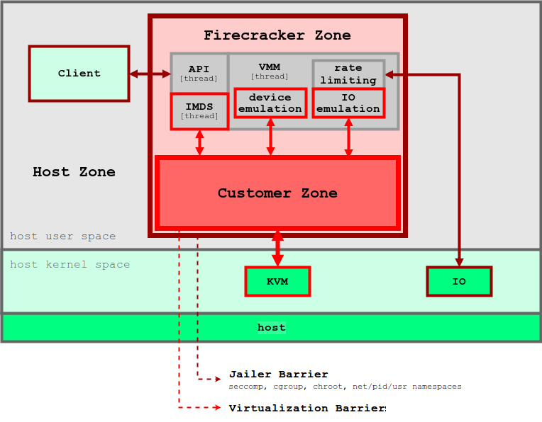
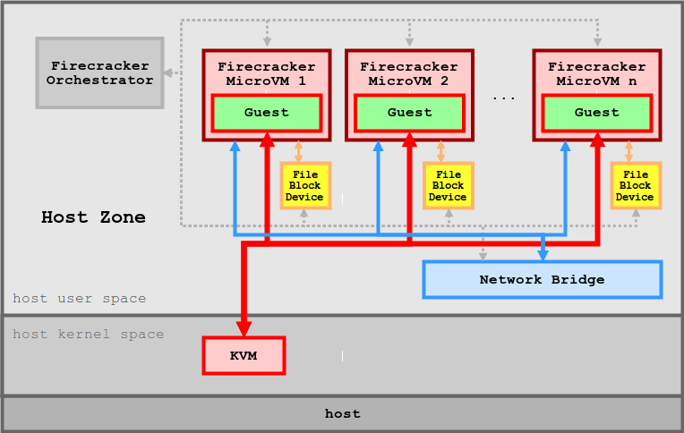

# Foundations: Containers, VMs, MicroVMs and Sandboxing

Nearly every ML system you'll work on runs inside something: a training job inside a container on a Kubernetes or SLURM node, an inference server inside a container inside a cloud VM, and an RL environment executing model-written code inside a sandbox that is meant to survive that code trying to break out. When one of these layers misbehaves you get confusing failures. The DataLoader dies with `Bus error`. `nvidia-smi` works on the host but `torch.cuda.is_available()` is `False` in the container. NCCL is 5x slower inside the container than outside. A job is "killed" with no traceback. Or a policy learns that the easiest way to pass the unit tests is to edit them.

This chapter starts from zero: what isolation is and why it exists. It then builds a container by hand from Linux kernel primitives, so you can see there's no magic underneath. From there it covers Docker properly, the standards and runtimes underneath Docker, GPUs in containers, hardware virtualization, microVMs such as Firecracker, user-space kernels such as gVisor, and finally how to design a sandbox for code you don't trust.

Conventions:

- `$` is a shell prompt on the host, and `/ #` is a prompt inside a container.
- **Everything marked "ran" was executed while writing this chapter.** The machine was an Apple Silicon Mac with Docker Desktop 28.5.1. Docker Desktop runs a small Linux VM (kernel `6.10.14-linuxkit`, cgroup v2, overlayfs storage driver), so all Linux examples ran inside that VM, mostly inside `--privileged` containers that stood in for a Linux host. Output was pasted from those runs.
- Anything that needs an NVIDIA GPU, `/dev/kvm`, a real HPC cluster, Firecracker, gVisor or Kata is marked **untested**. Those examples follow the documented interfaces, but nobody ran them for this chapter. The Docker Desktop VM exposes no `/dev/kvm` (checked: `ls: /dev/kvm: No such file or directory`), so nothing that needs hardware virtualization could run.
- Partway through writing, Docker use was stopped on this machine. A few Docker examples written after that point (`docker save`, the `--memory` OOM check, the `--docker` mode of the sandbox harness) are marked untested. The node-agent and sandbox demos in sections 8 and 10 use only the Python standard library and ran without Docker.
- Version-sensitive facts carry an "as of" note. Check them against your versions.


## Prerequisites

- [Foundations: Linux and Operating Systems](linux-and-os.md): processes, system calls, `/proc`, signals, mounts, cgroups and namespaces at a high level, and the CUDA driver vs runtime split. This chapter assumes all of it.
- [Foundations: Computer Architecture](computer-architecture.md): privilege levels, virtual memory and page tables, PCIe and DMA. These are needed for the virtualization half.
- [Foundations: Networking](networking.md): IP addresses, ports, bridges, NAT and DNS. These are needed for container networking.
- [Foundations: Concurrency](concurrency.md) is helpful for the DataLoader and `/dev/shm` discussion.


## 1. Why isolation exists

### Four problems that isolation solves

**Isolation** means that one piece of software can't see, affect or depend on another piece of software beyond what you explicitly allow. In ML infrastructure we need it for four different reasons, and each reason calls for a different amount of isolation.

1. **Dependency isolation.** Project A needs PyTorch 2.3 with CUDA 12.1, project B needs PyTorch 2.6 with CUDA 12.6, and both need to run on the same machine. A virtualenv isolates Python packages but not `libc`, `libstdc++`, NCCL or system tools. An image isolates the whole user space.
2. **Resource isolation.** Eight jobs share one 8-GPU node. One job leaks host memory, and you want *that job* to be OOM-killed rather than the node. One job forks 10,000 processes, and the others should still be able to `fork`.
3. **Security isolation.** You run code you didn't write and don't trust. Examples are model-generated code in a code-RL environment, an agent with a shell tool, a customer's inference container, or a pickle file someone uploaded. Here the question isn't "does it work" but "what is the worst thing it can do if it tries".
4. **Reproducibility and portability.** "It works on my machine" goes away when "my machine" is a content-addressed image digest. The same bytes then run on a laptop, a CI runner and 512 cluster nodes.

The first two reasons are about *accidents*, and the third is about *adversaries*. That difference is the most important idea in this chapter. Containers are excellent against accidents. Against a determined adversary they are one layer among several, because every container on a host shares one kernel.

### The isolation spectrum

From the weakest boundary to the strongest:

| Mechanism | What is shared with the host | Startup | Overhead | Boundary an attacker must cross |
|---|---|---|---|---|
| Plain process (+ rlimits) | everything: filesystem, network, kernel | ~ms | none | file permissions, UID |
| Container (namespaces + cgroups + seccomp) | **the host kernel** | ~100 ms to 1 s | ~none for compute | one kernel bug, or one runtime bug, or one misconfiguration |
| gVisor (user-space kernel) | host kernel, but through a narrow syscall surface | ~containers | syscall- and I/O-heavy work slower | gVisor's Sentry *and then* the host kernel |
| MicroVM (Firecracker, Cloud Hypervisor) | the hardware, the KVM module and a tiny VMM | ~100s of ms | a few MiB per VM plus guest memory | guest kernel, then the VMM or KVM |
| Full VM (QEMU/KVM, cloud instance) | the hardware and a larger device model | seconds to minutes | GBs of RAM for the guest | same as above, with more code to attack |
| Separate physical machine | the network | minutes | a whole machine | the network |

Startup and overhead figures are orders of magnitude, not benchmarks. The Firecracker numbers come from its paper and are discussed in section 8.

A **kernel** is the privileged program that owns the hardware and that every process asks for services through system calls (see [linux-and-os.md](linux-and-os.md#the-kernel-and-why-it-exists)). The "boundary" column is a rough measure of how much code sits between an attacker and the host. The Linux kernel exposes around 450 system calls (Docker's default seccomp profile allows 426 by name; see section 2) and millions of lines of driver code. A microVM exposes the KVM interface and a handful of emulated devices.

### What "containers share the kernel" looks like

A container is a normal Linux process that the kernel shows a restricted view of the world. You can see this directly (ran). First, look from inside a default container:

```console
$ docker run --rm alpine:3.20 sh -c 'echo "my pid: $$"; ps; hostname; uname -r; ls -l /proc/self/ns'
my pid: 1
PID   USER     TIME  COMMAND
    1 root      0:00 sh -c echo "my pid: $$"; ...
    7 root      0:00 ps
d1583b4009ea
6.10.14-linuxkit
cgroup -> cgroup:[4026532560]
ipc -> ipc:[4026532558]
mnt -> mnt:[4026532556]
net -> net:[4026532561]
pid -> pid:[4026532559]
time -> time:[4026531834]
user -> user:[4026531837]
uts -> uts:[4026532557]
```

Now look at the *host's* PID 1 (the VM's `/init`) from a container that joins the host PID namespace:

```console
$ docker run --rm --privileged --pid=host alpine:3.20 ls -l /proc/1/ns
cgroup -> cgroup:[4026531835]
ipc -> ipc:[4026531839]
mnt -> mnt:[4026531841]
net -> net:[4026531840]
pid -> pid:[4026531836]
time -> time:[4026531834]
user -> user:[4026531837]
uts -> uts:[4026531838]
```

The container has its own `cgroup`, `ipc`, `mnt`, `net`, `pid` and `uts` namespaces, which is why the numbers differ. It shares the host's `time` and `user` namespaces, which is why `4026531834` and `4026531837` are identical. The kernel version `6.10.14-linuxkit` is the host's kernel, because there is no other kernel. The container's shell believes it is PID 1, but the host sees it as an ordinary process with an ordinary PID.

Two consequences:

- **GPUs work in containers** without any virtualization, because the container's CUDA libraries talk to the host's `nvidia.ko` driver through device files (section 6).
- **A kernel bug is a container escape.** If an unprivileged process can exploit a kernel bug, then so can a container. Dirty Pipe (CVE-2022-0847) and Dirty COW (CVE-2016-5195) are the classic examples (section 10).


## 2. The Linux primitives underneath

Docker, Podman, containerd, Kubernetes and Apptainer are all front-ends for the same handful of kernel features. Once you know the features, every container behaviour becomes explainable.

### Namespaces: private views of global resources

A **namespace** wraps a global kernel resource so that the processes inside it see their own private instance. The process table, the mount table and the network stack are examples of such resources. A process is always in exactly one namespace of each type, and its children inherit them unless told otherwise.

| Namespace | Isolates | Flag | What you see inside |
|---|---|---|---|
| `mnt` | mount table | `CLONE_NEWNS` | its own `/`, mounts don't leak out |
| `pid` | process IDs | `CLONE_NEWPID` | first process is PID 1; can't see or signal host processes |
| `net` | interfaces, routes, iptables, sockets, ports | `CLONE_NEWNET` | only `lo` until someone adds an interface |
| `uts` | hostname, domain name | `CLONE_NEWUTS` | its own `hostname` |
| `ipc` | SysV IPC, POSIX message queues | `CLONE_NEWIPC` | its own shared memory segments |
| `user` | UIDs/GIDs, capabilities | `CLONE_NEWUSER` | can be "root" inside while being UID 1001 outside |
| `cgroup` | view of the cgroup tree | `CLONE_NEWCGROUP` | its own cgroup appears as `/` |
| `time` | `CLOCK_MONOTONIC`/`BOOTTIME` offsets | `CLONE_NEWTIME` | used for checkpoint/restore; Docker doesn't use it |

Three system calls do all the work. `clone(flags)` creates a child in new namespaces, `unshare(flags)` moves the caller into new namespaces, and `setns(fd)` joins an existing namespace through a file in `/proc/<pid>/ns/`. The `unshare(1)` command-line tool wraps the second one. Below, a PID and UTS namespace are created by hand inside a privileged container (ran):

```console
$ docker run --rm --privileged ubuntu:24.04 bash -c '
    unshare --uts --pid --fork --mount-proc bash -c "
      hostname sandbox; echo inside: host=\$(hostname) my pid=\$\$; ps -e; true"'
inside: host=sandbox my pid=1
    PID TTY          TIME CMD
      1 ?        00:00:00 bash
      4 ?        00:00:00 ps
```

`--fork` is needed because a PID namespace applies only to the caller's *children*: the first child becomes PID 1. `--mount-proc` mounts a fresh `/proc`. Without it, `ps` would read the old `/proc` and show the outer process table. `/proc` is a view of the PID namespace that *mounted* it, not of the process reading it.

**The user namespace** is the one that makes rootless containers possible. An unprivileged user can create a user namespace and be mapped to UID 0 inside it. That user then has full capabilities *over resources owned by that namespace*, and none over anything else (ran):

```console
$ docker run --rm --privileged ubuntu:24.04 bash -c '
    useradd -m alice
    su alice -c "id; unshare --user --map-root-user bash -c \"id; cat /proc/self/uid_map; touch /etc/pwned\""'
uid=1001(alice) gid=1001(alice) groups=1001(alice)
uid=0(root) gid=0(root) groups=0(root)
         0       1001          1
touch: cannot touch '/etc/pwned': Permission denied
```

The `uid_map` line reads "UID 0 inside maps to UID 1001 outside, for a range of 1 UID". Inside the namespace, alice is root. To the real `/etc`, which is owned by host root, she is still 1001. This is the mechanism behind rootless Podman, rootless Docker and Apptainer's `--fakeroot`.

Unprivileged user namespaces also widen the kernel attack surface a lot. Code paths that used to need real root, such as mounting some filesystems and configuring network namespaces, become reachable by anyone. Many kernel privilege-escalation exploits start with `unshare(CLONE_NEWUSER)`. This is why Docker's default seccomp profile blocks namespace creation (below), and why some distributions restrict unprivileged user namespaces with sysctls or AppArmor (as of Ubuntu 23.10+).

### cgroups v2: limits and accounting

A **control group (cgroup)** is a set of processes that the kernel accounts and limits *as a group*. cgroup v2 is a single tree of directories under `/sys/fs/cgroup`. Each directory is a cgroup, each process belongs to exactly one leaf, and control files in each directory set the limits. (cgroup v1 had a separate tree per controller. It is mostly gone on current distributions, but old clusters still have it. `stat -fc %T /sys/fs/cgroup` prints `cgroup2fs` on v2.)

The files you'll use:

| File | Meaning |
|---|---|
| `cgroup.procs` | PIDs in this cgroup; write a PID to move it in |
| `cgroup.subtree_control` | which controllers (`cpu memory pids io ...`) children get |
| `memory.max` | hard limit. Over it, the kernel reclaims, then OOM-kills inside the group |
| `memory.high` | soft limit. Over it, the kernel throttles and reclaims aggressively |
| `memory.swap.max` | swap allowed; set to 0 for predictable OOMs |
| `memory.current`, `memory.peak`, `memory.events` | usage, high-water mark, counters for `oom`/`oom_kill` |
| `pids.max` | max number of tasks (processes plus threads). This is the fork-bomb defense |
| `cpu.max` | `"$QUOTA $PERIOD"` in µs. `50000 100000` = half a CPU |
| `cpu.weight` | relative share when CPUs are contended (default 100) |
| `cpu.stat` | `usage_usec`, `nr_throttled`, `throttled_usec` |
| `io.max` | per-device bytes/s and IOPS limits |
| `cpuset.cpus`, `cpuset.mems` | pin to specific cores and NUMA nodes |

One rule surprises everyone the first time: **"no internal processes"**. A non-root cgroup that has processes can't hand controllers to its children. You must move the processes into a leaf first. The script in the next section hits this rule and works around it.

Limits measured inside the hand-built container below, with `memory.max=64M`, `pids.max=32` and `cpu.max="50000 100000"` (ran):

```console
/ # head -c 209715200 /dev/zero | tail > /dev/null; echo "exit status: $?"   # buffer 200MB
Killed
exit status: 137
/ # grep -E "^(oom|oom_kill) " /sys/fs/cgroup/memory.events; cat /sys/fs/cgroup/memory.peak
oom 2
oom_kill 1
67108864

/ # for i in $(seq 1 100); do sleep 5 & done      # start 100 processes
/bin/sh: can't fork: Resource temporarily unavailable
/ # cat /sys/fs/cgroup/pids.peak; grep max /sys/fs/cgroup/pids.events
32
max 1

/ # timeout 2 sh -c "while :; do :; done"         # spin for 2 s of wall clock
Terminated
/ # grep -E "usage_usec|nr_throttled|throttled_usec" /sys/fs/cgroup/cpu.stat
usage_usec 1059508
nr_throttled 20
throttled_usec 977083
```

How to read this:

- **Memory.** The process was SIGKILLed. Exit status 137 = 128 + 9, the signal number. `memory.peak` sat exactly at the 64 MiB limit (64 × 2^20 = 67,108,864). An exit code 137 with no Python traceback is almost always a cgroup OOM kill. Kubernetes shows it as `OOMKilled`. `dmesg` on the host shows `Memory cgroup out of memory: Killed process ...`. Note that host RAM was plentiful. The *cgroup* ran out.
- **pids.** Forks failed with `EAGAIN` once 32 tasks existed, and the shell survived. Threads count too, so a PyTorch process with 64 OpenMP threads plus DataLoader workers can hit a small `pids.max`. Kubernetes and Docker `--pids-limit` set this value.
- **CPU.** Over 2 s of wall time the loop got 1.06 s of CPU: 1059508 / 2e6 = 0.53 cores against a quota of 0.5. It was throttled 20 times, once per 100 ms period. CPU quotas don't make code fail. They make it *slow* in bursts, which shows up as a periodic stall. A container with `--cpus=4` running a 32-thread BLAS, or a DataLoader with 16 workers, burns its quota in the first few ms of each 100 ms period and then sits frozen. Size thread pools to the quota, not to `os.cpu_count()`.

### Capabilities: root split into pieces

Traditional Unix had two classes of process: UID 0 could do anything, and everyone else was checked against file permissions. **Capabilities** split root's power into about 40 separate privileges, which the kernel checks individually. Examples are `CAP_NET_ADMIN` (configure network interfaces), `CAP_SYS_ADMIN` (mount, plus a long list of other things), `CAP_SYS_PTRACE` (debug other processes) and `CAP_CHOWN` (change file ownership). A process has several capability sets. The two that matter are:

- **effective**: the capabilities checked right now,
- **bounding**: the ceiling. A process can never gain a capability that isn't in its bounding set, even by exec'ing a setuid binary.

The sets are bitmasks in `/proc/self/status`. A small decoder (ran):

```python
# capdecode.py - decode the CapEff hex mask from /proc/<pid>/status
import sys
# bit index -> name, from include/uapi/linux/capability.h (Linux 5.9+ has 41 caps)
CAPS = """CHOWN DAC_OVERRIDE DAC_READ_SEARCH FOWNER FSETID KILL SETGID SETUID SETPCAP
LINUX_IMMUTABLE NET_BIND_SERVICE NET_BROADCAST NET_ADMIN NET_RAW IPC_LOCK IPC_OWNER
SYS_MODULE SYS_RAWIO SYS_CHROOT SYS_PTRACE SYS_PACCT SYS_ADMIN SYS_BOOT SYS_NICE
SYS_RESOURCE SYS_TIME SYS_TTY_CONFIG MKNOD LEASE AUDIT_WRITE AUDIT_CONTROL SETFCAP
MAC_OVERRIDE MAC_ADMIN SYSLOG WAKE_ALARM BLOCK_SUSPEND AUDIT_READ PERFMON BPF
CHECKPOINT_RESTORE""".split()

for mask_hex in sys.argv[1:]:
    mask = int(mask_hex, 16)
    names = [c for i, c in enumerate(CAPS) if mask >> i & 1]
    print(f"{mask_hex}: {len(names)} caps: {' '.join(names)}")
```

Collect the masks from containers started in different ways (ran):

```console
$ docker run --rm ubuntu:24.04 grep CapEff /proc/self/status
CapEff:	00000000a80425fb
$ docker run --rm --privileged alpine:3.20 grep CapEff /proc/self/status
CapEff:	000001ffffffffff
$ docker run --rm --user 1000:1000 ubuntu:24.04 grep -E "Cap(Eff|Prm|Bnd)" /proc/self/status
CapPrm:	0000000000000000
CapEff:	0000000000000000
CapBnd:	00000000a80425fb

$ python3 capdecode.py 00000000a80425fb 000001ffffffffff
00000000a80425fb: 14 caps: CHOWN DAC_OVERRIDE FOWNER FSETID KILL SETGID SETUID SETPCAP NET_BIND_SERVICE NET_RAW SYS_CHROOT MKNOD AUDIT_WRITE SETFCAP
000001ffffffffff: 41 caps: CHOWN DAC_OVERRIDE DAC_READ_SEARCH ... SYS_ADMIN SYS_MODULE ... BPF CHECKPOINT_RESTORE
```

"Root in a default Docker container" has 14 capabilities. It lacks `SYS_ADMIN`, `SYS_MODULE` (load kernel modules), `SYS_PTRACE`, `NET_ADMIN` and `SYS_RAWIO`, among others. `--privileged` grants all 41 and, as shown later, much more besides. A non-root user in a container has no effective capabilities at all, but still has the 14 in its bounding set. That is why `--security-opt no-new-privileges` matters: it stops a setuid binary from raising the process back up to those 14.

Dropping everything works fine for most Python workloads (ran):

```console
$ docker run --rm ubuntu:24.04 bash -c 'touch /f; chown nobody /f && echo chown ok; mknod /dev/x c 1 3 && echo mknod ok'
chown ok
mknod ok
$ docker run --rm --cap-drop ALL ubuntu:24.04 bash -c 'grep CapEff /proc/self/status; touch /f; chown nobody /f && echo chown ok; id'
CapEff:	0000000000000000
chown: changing ownership of '/f': Operation not permitted
uid=0(root) gid=0(root) groups=0(root)
```

`id` still says root, but this root can't do any of the things that make root special. Capabilities, not the UID, are what the kernel checks.

ML-relevant capabilities you may be asked to add:

| Capability | Why an ML container might want it | Risk |
|---|---|---|
| `IPC_LOCK` | pin large amounts of memory for RDMA and GPUDirect (often paired with `--ulimit memlock=-1`) | low |
| `SYS_NICE` | set thread priorities and NUMA policies (`numactl --membind` needs it in some setups) | low |
| `SYS_PTRACE` | `py-spy dump`, `gdb -p` on another process in the container | medium: can read other processes' memory |
| `SYS_ADMIN` | mounting FUSE filesystems, some profilers | **high**: it's "the new root" |
| `NET_ADMIN` | configure interfaces, tc shaping | high on shared hosts |

### seccomp: filtering system calls

**seccomp** ("secure computing") lets a process install a filter that the kernel runs on *every system call* the process makes from then on. The filter can allow the call, fail it with an errno, kill the process, or notify a supervisor. Filters are inherited by children and can't be removed. That is the property that makes seccomp a sandbox primitive: code you hand control to can't undo the filter.

The original 2005 "strict mode" allowed only `read`, `write`, `_exit` and `sigreturn`. It still exists and makes a vivid demo (ran):

```python
# strict_seccomp.py - the original 2005 seccomp: after this, only read/write/_exit/sigreturn
import ctypes, os, sys
libc = ctypes.CDLL(None, use_errno=True)
PR_SET_SECCOMP, SECCOMP_MODE_STRICT = 22, 1
print("before: pid", os.getpid(), flush=True)
rc = libc.prctl(PR_SET_SECCOMP, SECCOMP_MODE_STRICT, 0, 0, 0)
if rc != 0: sys.exit(f"prctl failed: {os.strerror(ctypes.get_errno())}")
os.write(1, b"write() still works\n")      # allowed
os.getpid()                                  # not allowed -> kernel sends SIGKILL
os.write(1, b"never printed\n")
```

```console
$ docker run --rm -v $PWD:/s:ro python:3.12-slim python /s/strict_seccomp.py; echo "exit=$?"
before: pid 1
prctl failed: Invalid argument
exit=1
$ docker run --rm --security-opt seccomp=unconfined -v $PWD:/s:ro python:3.12-slim python /s/strict_seccomp.py; echo "exit=$?"
before: pid 1
write() still works
exit=137
```

The first run is a useful accident. Docker had already put the process in filter mode (`Seccomp: 2` in `/proc/self/status`), and the kernel refuses to switch a filtered process to strict mode, so `prctl` returns `EINVAL`. With Docker's filter removed, strict mode engages and the `getpid()` system call kills the process (137 = SIGKILL).

Modern seccomp uses **seccomp-bpf** filters: small classic-BPF programs that look at the syscall number and its arguments (register values only, so they can't follow pointers). Docker, containerd and Kubernetes ship a default profile as JSON, which `libseccomp` compiles into BPF. Here is what Docker's default profile actually contains. The file was downloaded from `moby/profiles` and parsed (ran):

```console
$ curl -sLO https://raw.githubusercontent.com/moby/profiles/main/seccomp/default.json
$ python3 -c '
import json; d=json.load(open("default.json"))
print("defaultAction", d["defaultAction"], "defaultErrnoRet", d.get("defaultErrnoRet"))
allow=[n for s in d["syscalls"] if s["action"]=="SCMP_ACT_ALLOW" for n in s["names"]]
print("names in ALLOW rules:", len(set(allow)))
for s in d["syscalls"]:
  if "unshare" in s["names"] or "clone" in s["names"] or "bpf" in s["names"]: print(json.dumps(s)[:200])'
defaultAction SCMP_ACT_ERRNO defaultErrnoRet 1
names in ALLOW rules: 426
{"names": ["bpf", "clone", "clone3", "fanotify_init", "fsconfig", "fsmount", ..., "mount", ..., "setns", "syslog", "umount", "umount2", "unshare"], "action": "SCMP_ACT_ALLOW", "includes": ...
{"names": ["clone"], "action": "SCMP_ACT_ALLOW", "args": [{"index": 0, "value": 2114060288, "op": "SCMP_CMP_MASKED_EQ"}], "excludes": {"caps": ["CAP_SYS_ADMIN"], ...}}
{"names": ["bpf"], "action": "SCMP_ACT_ALLOW", "includes": {"caps": ["CAP_BPF"]}}
```

Here's how to read it:

- The profile is an **allowlist**. Anything not listed fails with errno 1 (`EPERM`).
- `mount`, `unshare`, `setns` and friends are allowed **only if the container has `CAP_SYS_ADMIN`**. The profile is capability-aware.
- Plain `clone` is allowed without `CAP_SYS_ADMIN` only if `flags & 0x7e020000 == 0`. Decoding that mask (`python3 -c 'print(hex(2114060288))'` gives `0x7e020000`) gives `CLONE_NEWNS | NEWCGROUP | NEWUTS | NEWIPC | NEWUSER | NEWPID | NEWNET`. In other words: you may create threads and processes, but not namespaces.

Here is that rule in action (ran):

```console
$ docker run --rm ubuntu:24.04 unshare --user --map-root-user id
unshare: unshare failed: Operation not permitted
$ docker run --rm --security-opt seccomp=unconfined ubuntu:24.04 unshare --user --map-root-user id
uid=0(root) gid=0(root) groups=0(root)
$ docker run --rm --security-opt seccomp=unconfined ubuntu:24.04 unshare --uts true; echo "exit=$?"
unshare: unshare failed: Operation not permitted
exit=1
$ docker run --rm --cap-add SYS_ADMIN ubuntu:24.04 unshare --uts true; echo "exit=$?"
exit=0
```

The user-namespace attempt is blocked by seccomp alone. The UTS attempt is blocked by the *missing capability* even with seccomp off. Adding `SYS_ADMIN` satisfies both, because the profile relaxes itself when that capability is present. Two independent layers, each sufficient on its own: that is the defense-in-depth pattern in miniature.

You can write your own profile. This one denies `mkdir` (ran):

```json
{
  "defaultAction": "SCMP_ACT_ALLOW",
  "syscalls": [
    { "names": ["mkdir", "mkdirat"], "action": "SCMP_ACT_ERRNO", "errnoRet": 1 }
  ]
}
```

```console
$ docker run --rm --security-opt seccomp=$PWD/no-mkdir.json alpine:3.20 sh -c 'grep Seccomp /proc/self/status; touch /ok && echo "touch ok"; mkdir /nope'
Seccomp:	2
Seccomp_filters:	1
touch ok
mkdir: can't create directory '/nope': Operation not permitted
```

Real profiles are allowlists (`"defaultAction": "SCMP_ACT_ERRNO"`). The denylist above only shows the mechanism. A denylist misses every syscall you didn't think of, including ones added in the next kernel release (`clone3`, `io_uring_setup`, ...). Docker's profile blocks `io_uring_*` in recent versions; io_uring has been a rich source of kernel bugs. To build a tight profile for a specific workload, trace it first: `strace -f -c -o counts.txt python train.py` lists every syscall it makes.

### overlayfs: layered, copy-on-write filesystems

An image is a stack of read-only directory trees. A container needs a writable `/` on top of that stack without copying gigabytes for each container. **overlayfs** is the kernel filesystem that merges several read-only "lower" directories and one writable "upper" directory into a single view (ran):

```console
$ docker run --rm --privileged ubuntu:24.04 bash -c '
mount -t tmpfs tmpfs /mnt && cd /mnt && mkdir l1 l2 up wk merged
echo "from base layer" > l1/a.txt; echo "base" > l1/b.txt
echo "from top layer"  > l2/a.txt          # l2 shadows l1
mount -t overlay overlay -o lowerdir=l2:l1,upperdir=up,workdir=wk merged
echo "== merged view";  head merged/*
echo "new" > merged/c.txt; echo "edited" >> merged/b.txt; rm merged/a.txt
echo "== merged after write/append/delete:"; ls merged
echo "== upper dir (the container layer):"; ls -l up
echo "== lower dirs untouched:"; cat l1/b.txt l1/a.txt l2/a.txt'
== merged view
==> merged/a.txt <==
from top layer

==> merged/b.txt <==
base
== merged after write/append/delete:
b.txt
c.txt
== upper dir (the container layer):
total 8
c--------- 2 root root 0, 0 Nov  5 21:16 a.txt
-rw-r--r-- 1 root root   12 Nov  5 21:16 b.txt
-rw-r--r-- 1 root root    4 Nov  5 21:16 c.txt
== lower dirs untouched:
base
from base layer
from top layer
```

Everything an image layer does can be read off this output:

- **Lookup** walks the layers top-down: `upper`, then `l2`, then `l1`. The first match wins, so `l2/a.txt` shadows `l1/a.txt`.
- **New files** go straight into `upper` (`c.txt`).
- **Modifying a lower file triggers a copy-up.** The *whole file* is copied into `upper` before the write lands (`b.txt`, now 12 bytes). Appending one byte to a 10 GB file in an image layer copies 10 GB. Don't write checkpoints or datasets into the container filesystem. Use a volume (section 3).
- **Deleting a lower file** creates a **whiteout**: a character device with number 0/0 in `upper` (`c--------- 0, 0 a.txt`). The lower layers are immutable, so deletion has to be recorded as a marker. This is also why `RUN rm -rf /big` in a Dockerfile never shrinks an image: the bytes stay in the earlier layer, and the later layer just adds a whiteout.
- `workdir` is overlayfs's scratch space for atomic copy-ups. It must be on the same filesystem as `upper`.

Docker's `overlay2` storage driver (shown as `overlayfs` under the containerd image store) does exactly this. Each image layer is one `lowerdir`, and each container gets one `upperdir`. `docker diff` lists what's in the upper layer (ran):

```console
$ docker run --name tmp1 alpine:3.20 sh -c 'echo data > /out.txt'; docker diff tmp1; docker rm tmp1
A /out.txt
```

### LSMs and no_new_privs

Two more pieces finish the default container security setup.

- **Linux Security Modules (LSMs)** are mandatory access control systems that check operations against a policy, in addition to the normal permission checks. **AppArmor** (Ubuntu, Debian) uses path-based profiles, and Docker loads a profile called `docker-default` for each container. **SELinux** (RHEL, Fedora) uses label-based policies: containers run with the label `container_t`, and their files get unique category labels so that two containers can't read each other's files even as root. When a container gets "permission denied" while running as root with every capability, the cause is usually an LSM. Check `dmesg` or `journalctl` for `apparmor="DENIED"` or `avc: denied`.
- **`no_new_privs`** is a per-process flag that, once set, makes `execve` unable to grant privileges, so setuid bits and file capabilities are ignored. It is also what lets an *unprivileged* process install a seccomp filter.

```console
$ docker run --rm --security-opt no-new-privileges alpine:3.20 grep NoNewPrivs /proc/self/status   # untested; default run showed "NoNewPrivs: 0"
NoNewPrivs:	1
$ docker run --rm --security-opt apparmor=docker-default ...      # explicit; this is the default on AppArmor hosts
$ docker run --rm --security-opt label=type:container_t ...       # SELinux, illustrative
```

### Build a container by hand

Now combine the pieces. The script below starts from a tarball of the Alpine root filesystem and does the core of what `runc` does. The tarball was made with `docker export $(docker create alpine:3.20) > alpine-rootfs.tar`, which is 9.1 MB. The script uses no Docker. It needs only `mount`, `unshare`, `pivot_root` and the cgroup filesystem (ran, as root inside a `--privileged` Ubuntu container standing in for a Linux host):

```bash
#!/bin/bash
# minicontainer.sh - a container from raw Linux primitives. Run as root on Linux.
set -euo pipefail
ROOTFS_TAR=$1; shift            # e.g. alpine-rootfs.tar (from `docker export`)
export CMD=${1:-/bin/sh}      # one string, run by the container's /bin/sh
export B=/run/mini; mkdir -p $B; mount -t tmpfs tmpfs $B   # overlay upperdir can't live on overlayfs
mkdir -p $B/lower $B/upper $B/work $B/rootfs
tar -xf "$ROOTFS_TAR" -C $B/lower

# 1. overlayfs: read-only image layer + writable layer = the container's /
mount -t overlay overlay -o lowerdir=$B/lower,upperdir=$B/upper,workdir=$B/work $B/rootfs
mount -t tmpfs -o mode=755 tmpfs $B/rootfs/dev             # a minimal /dev, as runc creates
for d in null zero random urandom tty; do touch $B/rootfs/dev/$d; mount --bind /dev/$d $B/rootfs/dev/$d; done

# 2. cgroup v2: memory, pids, cpu limits
CG=/sys/fs/cgroup
mkdir -p $CG/init && for p in $(cat $CG/cgroup.procs); do echo $p > $CG/init/cgroup.procs 2>/dev/null || true; done
echo "+memory +pids +cpu" > $CG/cgroup.subtree_control   # "no internal processes" rule: root had to be emptied first
mkdir -p $CG/mini
echo 64M  > $CG/mini/memory.max
echo 0    > $CG/mini/memory.swap.max
echo 32   > $CG/mini/pids.max
echo "50000 100000" > $CG/mini/cpu.max     # 50ms per 100ms = half a core
echo $$ > $CG/mini/cgroup.procs              # this shell and all its children are now limited

# 3. namespaces + pivot_root
exec unshare --mount --uts --ipc --net --pid --fork --cgroup --mount-proc=$B/rootfs/proc \
  /bin/bash -c '
    set -e
    mount --make-rprivate /                       # our mounts must not propagate back to the host
    cd $B/rootfs && mkdir -p oldroot && pivot_root . oldroot && cd /
    umount -l /oldroot && rmdir /oldroot          # the host filesystem is now unreachable
    hostname mini
    exec /bin/sh -c "$CMD"'
```

Run it (ran):

```console
$ docker run --rm --privileged -v $PWD/scripts:/s:ro -v $PWD/data:/d:ro ubuntu:24.04 \
    /s/minicontainer.sh /d/alpine-rootfs.tar 'echo "--- id: $(id)  hostname: $(hostname)"; head -2 /etc/os-release;
      echo "--- ps:"; ps; echo "--- net:"; ip -o link | cut -c1-40; echo "--- cgroup:"; cat /proc/self/cgroup;
      echo "--- mounts:"; cat /proc/mounts'
--- id: uid=0(root) gid=0(root) groups=0(root)  hostname: mini
NAME="Alpine Linux"
ID=alpine
--- ps:
PID   USER     TIME  COMMAND
    1 /bin/sh -c echo "--- id: ...
   11 root      0:00 ps
--- net:
1: lo: <LOOPBACK> mtu 65536 qdisc noop
2: tunl0@NONE: <NOARP> mtu 1480 qdisc no
...                                    (only down tunnel stubs, no eth0)
--- cgroup:
0::/
--- mounts:
overlay / overlay rw,relatime,lowerdir=/run/mini/lower,upperdir=/run/mini/upper,workdir=/run/mini/work,uuid=on 0 0
proc /proc proc rw,nosuid,nodev,noexec,relatime 0 0
```

An Ubuntu host is now running an Alpine user space as PID 1, with its own hostname, an empty network namespace, a cgroup that looks like `/`, and an overlay root. The memory, pids and CPU measurements in the cgroups section above came from this exact container. When the `/dev` lines were missing from the script, `head -c ... /dev/zero` failed with `No such file or directory`, because an exported rootfs contains no device nodes. Runtimes create `/dev` for you, and now you know why they have to.

The order of steps is deliberate:

1. **Overlay before namespaces**, so the rootfs exists when we pivot into it.
2. **cgroup before `unshare`**, so that every process the container ever creates is born inside the limits. If you move a process in afterwards, its children that already exist stay outside.
3. **`pivot_root` rather than `chroot`.** `chroot` only changes how *this process* resolves `/`. The old root stays mounted, and a root process can escape by `chroot`ing into a subdirectory and walking `..` past the jail (the classic chroot escape). `pivot_root` swaps the mount namespace's root mount, after which we unmount the old root entirely. Inside a fresh mount namespace, nothing refers to the host tree any more.

### What a real runtime adds

`runc` does everything the script does, plus the following. Each item closes a hole the script leaves open, so treat the list as a checklist of what a container actually is:

| Missing from the script | Why it matters |
|---|---|
| user namespace (optional in runc, default in rootless mode) | root in the container is root on the host without one |
| dropping capabilities to the 14 defaults | our script runs with all 41 |
| seccomp filter | all ~450 syscalls reachable |
| `no_new_privs`, AppArmor/SELinux profile | setuid binaries and LSM confinement |
| masked/read-only paths: `/proc/kcore`, `/proc/sys`, `/sys/firmware`, `/proc/sysrq-trigger` ... | the host's kernel memory and tunables are visible through `/proc` and `/sys` |
| a veth pair plus bridge for networking | our netns has no connectivity at all |
| `/dev/pts`, `/dev/shm`, `/dev/mqueue`, `/etc/hosts`, `/etc/resolv.conf`, `/etc/hostname` | programs expect them |
| rlimits, `oom_score_adj`, the right UID/GID, env vars, working directory | from the image config |
| mounts set up in the *container's* mount namespace | our overlay and `/dev` mounts were made in the outer namespace and stay visible there |
| a supervising shim that reaps the process and keeps its stdio | otherwise exit codes and logs are lost |

If you want to see the full list, `runc spec` prints the default OCI `config.json`, covered in section 4.


## 3. Docker from zero

### The moving parts

**Docker** is a client and a daemon for building, distributing and running containers. When you type `docker run`, the request goes through several programs:

```
docker CLI ──REST over /var/run/docker.sock──> dockerd (image mgmt, networks, volumes, build)
                                                 │ gRPC
                                                 v
                                            containerd (images, snapshots, container lifecycle)
                                                 │ spawns, one per container
                                                 v
                                     containerd-shim-runc-v2 ──exec──> runc ──clone()+setup──> your process
                                     (stays alive: holds stdio,        (exits once the
                                      reaps exit code)                  container starts)
```

- `dockerd` runs as root and anyone who can talk to its socket can start a `--privileged` container with `-v /:/host`. **Access to the Docker socket is equivalent to root on the host.** This is why HPC sites don't offer Docker (section 5) and why mounting `/var/run/docker.sock` into a container hands that container the host.
- On macOS and Windows, **Docker Desktop** runs these components inside a Linux VM. The `uname -r` of `6.10.14-linuxkit` seen earlier is that VM's kernel, and `docker info` reports `Operating System: Docker Desktop`, `CPUs: 10`, `Total Memory: 7.654GiB`: the VM's resources, not the Mac's. Bind-mounted files cross a VM boundary through a file-sharing layer, which is why bind-mount I/O on a Mac is much slower than on Linux.
- An `arm64` Mac pulls `arm64` images by default. An `amd64` CUDA image built on a Mac needs `--platform linux/amd64`, which runs through emulation and is slow. Build CUDA images on Linux x86 machines or in CI.

### Images and layers

An **image** is an ordered list of layers plus a JSON config. Each layer is a tarball of filesystem changes. The config holds the environment, the entrypoint, the working directory and so on. Each Dockerfile step that changes files makes a layer. `docker history` shows them (ran):

```console
$ docker history --format '{{.Size}}\t{{.CreatedBy}}' python:3.12-slim | cut -c1-110
0B	CMD ["python3"]
16.4kB	RUN /bin/sh -c set -eux;  for src in idle3 pip3 pydoc3 python3 python3-config; do ...
44.7MB	RUN /bin/sh -c set -eux;   savedAptMark="$(apt-mark showmanual)";  apt-get update; ...
0B	ENV PYTHON_SHA256=b5796915dc45ff745cfb4e990a7e7c93d6f546328a102ce31448d69ebc37575c
0B	ENV PYTHON_VERSION=3.12.16
0B	ENV GPG_KEY=7169605F62C751356D054A26A821E680E5FA6305
4.97MB	RUN /bin/sh -c set -eux;  apt-get update;  apt-get install -y --no-install-recommends ca-certificates ...
0B	ENV LANG=C.UTF-8
0B	ENV PATH=/usr/local/bin:/usr/local/sbin:/usr/local/bin:/usr/sbin:/usr/bin:/sbin:/bin
110MB	# debian.sh --arch 'arm64' out/ 'trixie' '@1793827419'
$ docker image inspect python:3.12-slim --format '{{len .RootFS.Layers}} layers, arch={{.Architecture}}'
4 layers, arch=arm64
```

`ENV` and `CMD` change only the config, so they show 0B and produce no filesystem layer. The four real layers are the Debian base (110 MB), the CA certificates (5 MB), the Python build (44.7 MB) and the symlinks (16 kB), each listed uncompressed.

**Tags and digests.** `python:3.12-slim` is a *tag*: a mutable pointer that moves when the maintainers rebuild, which happened 13 hours before this run. `python@sha256:4840d5...` is a *digest*: the SHA-256 of the manifest, which is immutable. Always pin by digest for anything you need to reproduce. A tag pinned last month can silently give you a different libc tomorrow.

Layers are shared. Sixty-four images built on the same 10 GB CUDA+PyTorch base, each adding 200 MB of code, occupy 10 + 64 × 0.2 = 22.8 GB on a node and in the registry, instead of 652.8 GB if nothing were shared (computed). This is why a team should standardize on a small number of base images.

### The Dockerfile

A **Dockerfile** is a build recipe. Each instruction runs in order on top of the previous result:

| Instruction | Does | Makes a layer? |
|---|---|---|
| `FROM image[@digest] [AS name]` | starting point; `scratch` = empty | - |
| `RUN cmd` | runs a command in a temporary container and snapshots the changes | yes |
| `COPY src dst` / `ADD` | copies files from the build context (or `--from=stage`) | yes |
| `WORKDIR /app` | sets the cwd (creates it) | tiny |
| `ENV K=V` | env var for later steps *and* at runtime | config only |
| `ARG K=V` | build-time variable only | config only |
| `USER uid:gid` | user for later `RUN` steps and at runtime | config only |
| `EXPOSE 8000` | documentation only; publishes nothing | config only |
| `ENTRYPOINT [...]` / `CMD [...]` | what runs; `CMD` provides default args to `ENTRYPOINT` | config only |
| `HEALTHCHECK` | a command Docker runs periodically to report container health | config only |

Use the JSON ("exec") form `CMD ["python", "train.py"]`, not `CMD python train.py`. The string form wraps your program in `/bin/sh -c`. The shell then becomes PID 1 and doesn't forward `SIGTERM` to your program, so `docker stop` waits 10 s and then sends SIGKILL. See [the PID 1 gotcha](linux-and-os.md#docker-and-apptainer-for-ml).

### The build cache

**BuildKit** is Docker's build engine. It caches each step under a key made from the parent layer plus the instruction. For `COPY` and `ADD`, the key also includes a checksum of the files copied. If the key matches a cached result, the step is skipped. **Once one step misses the cache, every step after it reruns.** So order steps from least to most frequently changed (ran):

```dockerfile
FROM python:3.12-slim
WORKDIR /app
COPY requirements.txt .
RUN pip install --no-cache-dir -r requirements.txt
COPY train.py .
CMD ["python", "train.py"]
```

```console
$ echo "numpy==2.1.3" > requirements.txt; time docker build -t cachedemo:v1 .
#8 [4/5] RUN pip install --no-cache-dir -r requirements.txt
#8 DONE 15.4s
...                                          26.4 s total
$ vim train.py      # edit the code only
$ time docker build --progress=plain -t cachedemo:v2 .
#6 [2/5] WORKDIR /app
#6 CACHED
#7 [3/5] COPY requirements.txt .
#7 CACHED
#8 [4/5] RUN pip install --no-cache-dir -r requirements.txt
#8 CACHED
#9 [5/5] COPY train.py .
...                                          0.94 s total
$ docker run --rm cachedemo:v2
step 0 loss (edited) 0.4992131372497772
```

The anti-pattern is `COPY . .` before `pip install`, which makes any code change invalidate the dependency layer (ran):

```console
$ cat Dockerfile.bad
FROM python:3.12-slim
WORKDIR /app
COPY . .
RUN pip install --no-cache-dir -r requirements.txt
CMD ["python", "train.py"]
$ echo "# x" >> train.py; time docker build -f Dockerfile.bad -t cachebad .
#7 [3/4] COPY . .
#8 [4/4] RUN pip install --no-cache-dir -r requirements.txt
real 11.29
```

That is 11.3 s instead of 0.9 s for a one-line change, with only numpy to install. With `torch` plus CUDA wheels the dependency step takes minutes and gigabytes. Other cache rules worth knowing:

- `RUN apt-get update` on its own line gets cached forever, and a later `apt-get install` then uses stale package lists. Always write `RUN apt-get update && apt-get install -y --no-install-recommends ... && rm -rf /var/lib/apt/lists/*` as one step.
- A `RUN` step is cached by its *text*, not by what it downloads. `RUN pip install torch` stays cached after a new torch release. Pin versions so the text changes when you mean it to.
- **Cache mounts** keep a package cache across builds without putting it in the image. You need the BuildKit syntax `RUN --mount=type=cache,target=/root/.cache/pip pip install -r requirements.txt` (untested here, but documented BuildKit syntax).
- **Secrets**: never `COPY` a token or `ARG HF_TOKEN=...`, because both are recorded in layers and history. Use `RUN --mount=type=secret,id=hf,env=HF_TOKEN ...` with `docker build --secret id=hf,env=HF_TOKEN` (untested; the `env=` target needs a recent Dockerfile frontend).

### .dockerignore and the build context

`docker build .` sends the **build context** to the builder: the whole directory, minus whatever `.dockerignore` excludes. Run a build from a repo with `checkpoints/` and `wandb/` in it and you'll upload 200 GB to the builder before the first step runs. Start every project with:

```gitignore
# .dockerignore
.git
**/__pycache__
*.pt
*.safetensors
checkpoints/
wandb/
data/
.venv/
```

### Multi-stage builds

A **multi-stage build** uses one fat stage for compiling and copies only the artifacts into a slim final stage. Compilers, headers and caches never ship (ran):

```dockerfile
# stage 1: a fat image with a compiler
FROM alpine:3.20 AS build
RUN apk add --no-cache gcc musl-dev
COPY hello.c .
RUN gcc -O2 -static -o /hello hello.c

# stage 2: ship only the artifact
FROM scratch
COPY --from=build /hello /hello
ENTRYPOINT ["/hello"]
```

```console
$ docker build -q -t hello:multi . && docker build -q --target build -t hello:build .
$ docker run --rm hello:multi
hello from a static binary
$ docker image ls hello --format '{{.Tag}}\t{{.Size}}'
multi	176kB
build	218MB
```

The final image is 1,200x smaller. In ML the same pattern looks like this: build `flash-attn` or a custom CUDA extension in a `-devel` CUDA image that contains `nvcc`, then copy the virtualenv into a `-runtime` image (see the CUDA Dockerfile below). Smaller images matter more than they seem to, because of pull time.

### Registries and pull time

A **registry** is an HTTP server that stores image manifests and layer blobs by digest. Examples are Docker Hub, `ghcr.io`, `nvcr.io`, ECR, GCR/Artifact Registry and a self-hosted `registry:2` or Harbor. The protocol is simple enough to drive with Python's standard library alone (ran, no Docker involved):

```python
# registry_peek.py - talk to a registry with plain HTTP: index -> manifest -> config
import json, urllib.request
REPO, TAG = "library/alpine", "3.20"
ACCEPT = ", ".join(["application/vnd.oci.image.index.v1+json",
                    "application/vnd.oci.image.manifest.v1+json",
                    "application/vnd.docker.distribution.manifest.list.v2+json",
                    "application/vnd.docker.distribution.manifest.v2+json"])

def get(url, token=None, accept=ACCEPT):
    req = urllib.request.Request(url, headers={"Accept": accept})
    if token: req.add_header("Authorization", f"Bearer {token}")
    with urllib.request.urlopen(req) as r:
        return r.headers, r.read()

_, body = get(f"https://auth.docker.io/token?service=registry.docker.io&scope=repository:{REPO}:pull")
tok = json.loads(body)["token"]                       # anonymous pull token
base = f"https://registry-1.docker.io/v2/{REPO}"

h, body = get(f"{base}/manifests/{TAG}", tok)          # 1. the index: one entry per platform
index = json.loads(body)
print("index", h["Content-Type"], "digest", h["Docker-Content-Digest"][:19] + "...")
for m in index["manifests"]:
    p = m.get("platform", {})
    plat = "/".join(x for x in (p.get("os"), p.get("architecture"), p.get("variant")) if x)
    print(f"  {plat:16s} {m['digest'][:19]}...")   # unknown/unknown = attestation (SBOM/provenance)

arm = next(m for m in index["manifests"] if m["platform"]["architecture"] == "arm64")
_, body = get(f"{base}/manifests/{arm['digest']}", tok)  # 2. the per-platform manifest
man = json.loads(body)
print("manifest config:", man["config"]["mediaType"], man["config"]["size"], "bytes")
for l in man["layers"]:
    print("  layer", l["mediaType"], l["size"], "bytes", l["digest"][:19] + "...")

_, body = get(f"{base}/blobs/{man['config']['digest']}", tok, accept="*/*")  # 3. the config blob
cfg = json.loads(body)
print("config.rootfs.diff_ids:", [d[:19] + "..." for d in cfg["rootfs"]["diff_ids"]])
print("config.config.Cmd:", cfg["config"].get("Cmd"), " Env:", cfg["config"].get("Env"))

import gzip, hashlib                                     # 4. verify content addressing
layer = man["layers"][0]
_, blob = get(f"{base}/blobs/{layer['digest']}", tok, accept="*/*")
print("sha256(compressed blob) == layer digest:",
      "sha256:" + hashlib.sha256(blob).hexdigest() == layer["digest"])
print("sha256(uncompressed tar) == diff_id:   ",
      "sha256:" + hashlib.sha256(gzip.decompress(blob)).hexdigest() == cfg["rootfs"]["diff_ids"][0])
```

```console
$ python3 registry_peek.py
index application/vnd.oci.image.index.v1+json digest sha256:d9e853e87e55...
  linux/amd64      sha256:c64c687cbea9...
  unknown/unknown  sha256:6243dec92868...
  linux/arm/v6     sha256:37753b296504...
  ...
  linux/arm64/v8   sha256:45e09956dc66...
  unknown/unknown  sha256:1db32a7978ca...
  linux/riscv64    sha256:c47cbcc0d9c7...
  linux/s390x      sha256:856b20bf4946...
  unknown/unknown  sha256:ba51d5564234...
manifest config: application/vnd.oci.image.config.v1+json 628 bytes
  layer application/vnd.oci.image.layer.v1.tar+gzip 4092319 bytes sha256:3f26bc2dec0b...
config.rootfs.diff_ids: ['sha256:88b4fba61c4c...']
config.config.Cmd: ['/bin/sh']  Env: ['PATH=/usr/local/sbin:/usr/local/bin:/usr/sbin:/usr/bin:/sbin:/bin']
sha256(compressed blob) == layer digest: True
sha256(uncompressed tar) == diff_id:    True
```

The whole design is **content addressing**. Every object is named by the hash of its bytes, so a name can't be served with the wrong content, identical layers are stored once, and clients can fetch blobs from any cache or mirror and still verify them. Two hashes are in play. The *layer digest* is the hash of the compressed blob, used for transfer. The *diff_id* is the hash of the uncompressed tar, used to identify the layer once it's unpacked.

**Pull-time arithmetic** (computed). Big ML images take real time to pull:

```console
$ python3 -c '
img_GB=15; nodes=512
for gbps in (1,10,100): print(f"one node, {gbps:3d} Gbit/s: {img_GB*8/gbps:7.1f} s")
reg=25; print(f"{nodes} nodes from one registry at {reg} Gbit/s egress: {nodes*img_GB*8/reg/60:.1f} min")'
one node,   1 Gbit/s:   120.0 s
one node,  10 Gbit/s:    12.0 s
one node, 100 Gbit/s:     1.2 s
512 nodes from one registry at 25 Gbit/s egress: 41.0 min
```

These are line-rate lower bounds. Real pulls are also slowed by decompression (gzip is single-threaded per layer) and by unpacking many small files. A 512-node job that pulls at start-up can spend 40 minutes doing nothing, and it does so again on every restart onto fresh nodes. Fixes, roughly from cheapest to most work:

- pre-pull images onto nodes,
- run a pull-through cache or registry mirror in the cluster,
- use peer-to-peer distribution (Dragonfly, Spegel, Kraken),
- use lazy-pulling snapshotters (stargz/eStargz, SOCI, Nydus) that fetch file chunks on first access,
- use zstd-compressed layers,
- on HPC, use a single squashfs/SIF file on the parallel filesystem (section 5).

### Volumes and bind mounts

A container's writable layer disappears when the container is removed, and writes to it go through overlay copy-up. Real data should live elsewhere:

- **bind mount** `-v /host/path:/ctr/path`: a host directory mounted directly. Use it for datasets, checkpoints on a shared filesystem, and code during development.
- **named volume** `-v ckpts:/ckpt`: a directory managed by Docker (`/var/lib/docker/volumes/<name>/_data`) that outlives containers.
- **tmpfs** `--tmpfs /scratch:size=10g`: RAM-backed and gone on exit.

Here is a named volume outliving its container (ran):

```console
$ docker volume create ckpts
$ docker run --rm -v ckpts:/ckpt alpine:3.20 sh -c 'echo step-1000 > /ckpt/latest'
$ docker run --rm -v ckpts:/ckpt:ro alpine:3.20 cat /ckpt/latest
step-1000
$ docker run --rm -v ckpts:/ckpt:ro alpine:3.20 sh -c 'echo x > /ckpt/y'
sh: can't create /ckpt/y: Read-only file system
$ docker volume inspect ckpts --format '{{.Mountpoint}}'
/var/lib/docker/volumes/ckpts/_data
```

Bind mounts have one sharp edge: **UIDs are numbers**. A container running as root writes checkpoint files owned by UID 0 onto your NFS home directory, and then you can't delete them. A container running as `--user 1000` can't read a dataset owned by UID 1234. Pass `--user $(id -u):$(id -g)` for bind-mounted work, or use rootless or user-namespace remapping.

### Networking

Each container gets its own network namespace, and Docker connects it to the outside in one of several modes. On the default **bridge** network, a **veth pair** (a virtual cable with one end in the container as `eth0` and the other end on the host) plugs into a Linux bridge `docker0`, and NAT carries traffic out (ran):

```console
$ docker run --rm alpine:3.20 sh -c 'ip -o -4 addr; ip route'
1: lo    inet 127.0.0.1/8 scope host lo
11: eth0    inet 172.17.0.3/16 brd 172.17.255.255 scope global eth0
default via 172.17.0.1 dev eth0
172.17.0.0/16 dev eth0 scope link  src 172.17.0.3

$ docker run --rm --network none alpine:3.20 sh -c 'ip -o addr; wget -q -T 3 -O- http://example.com || echo "no network: wget failed"'
1: lo    inet 127.0.0.1/8 scope host lo
1: lo    inet6 ::1/128 scope host
no network: wget failed
```

On a **user-defined network**, containers find each other by name through Docker's embedded DNS server at `127.0.0.11`. `-p HOST:CTR` publishes a container port on the host (ran):

```console
$ docker network create mlnet
$ docker run -d --rm --name inference --network mlnet -p 8080:8000 python:3.12-slim python -m http.server 8000
$ docker run --rm --network mlnet alpine:3.20 sh -c 'grep nameserver /etc/resolv.conf; nslookup inference | grep -A1 Name; wget -qO- http://inference:8000/ | head -1'
nameserver 127.0.0.11
Name:	inference
Address: 172.21.0.2
<!DOCTYPE HTML>
$ curl -s -o /dev/null -w "from the Mac via published port: HTTP %{http_code}\n" http://localhost:8080/
from the Mac via published port: HTTP 200
$ docker port inference
8000/tcp -> 0.0.0.0:8080
8000/tcp -> [::]:8080
```

Notice `0.0.0.0:8080`. Publishing binds to *all* interfaces by default, so a Jupyter server or an unauthenticated vLLM endpoint started with `-p 8000:8000` on a cloud VM is reachable from the internet unless a firewall stops it. Docker also inserts its own iptables rules, which can bypass host firewalls such as `ufw`. Use `-p 127.0.0.1:8000:8000` and an SSH tunnel.

For **multi-node training, use `--network host`**. The bridge adds NAT and a veth hop, and more importantly NCCL needs to see the real high-speed interfaces, InfiniBand/RoCE devices and their IPs. `--network host` skips the network namespace entirely. Kubernetes pods for training typically use `hostNetwork: true` or an SR-IOV/RDMA network plugin (section 7, and [kubernetes-from-zero.md](../orchestration/kubernetes-from-zero.md)).

### The run flags that matter for ML

| Flag | Why | What fails without it |
|---|---|---|
| `--gpus all` or `--device nvidia.com/gpu=all` | inject GPU device nodes and driver libs (section 6) | `torch.cuda.is_available() == False` |
| `--ipc=host` or `--shm-size=32g` | `/dev/shm` defaults to **64 MB** | DataLoader `Bus error` (SIGBUS) with `num_workers>0`; NCCL shm transport errors |
| `--ulimit memlock=-1` | unlimited pinned memory | RDMA/NCCL "cannot register memory", slow pinned copies |
| `--ulimit stack=67108864` | large stack, recommended by NVIDIA's PyTorch containers | rare deep-recursion crashes |
| `--network host` | NCCL sees real NICs | slow or failing inter-node collectives |
| `--device /dev/infiniband --cap-add IPC_LOCK` | RDMA verbs in a container | NCCL falls back to TCP sockets, silently and slowly |
| `--init` | tiny init as PID 1, forwards signals, reaps zombies | `docker stop` takes 10 s; zombie DataLoader workers |
| `--memory=200g --memory-swap=200g` | cgroup memory limit, no swap | the host OOM killer picks a victim instead |
| `--cpus=32 --cpuset-cpus=0-31 --cpuset-mems=0` | CPU quota, NUMA pinning | throttling stalls, cross-socket memory traffic |
| `--user $(id -u):$(id -g)` | files on bind mounts owned by you | root-owned checkpoints on NFS |
| `-e HF_HOME=/cache -v /nvme/hf:/cache` | keep model downloads out of the container layer | re-downloading 100 GB on every run |

Here is the `/dev/shm` default with its two fixes (ran). The 3.8G value is half of the Docker Desktop VM's RAM, the usual tmpfs default for the host's own `/dev/shm`:

```console
$ docker run --rm alpine:3.20 df -h /dev/shm | tail -1
shm                      64.0M         0     64.0M   0% /dev/shm
$ docker run --rm --shm-size=8g alpine:3.20 df -h /dev/shm | tail -1
shm                       8.0G         0      8.0G   0% /dev/shm
$ docker run --rm --ipc=host alpine:3.20 df -h /dev/shm | tail -1
shm                       3.8G         0      3.8G   0% /dev/shm
```

A memory-limited container dies with exit code 137, and `docker inspect` shows `"OOMKilled": true` in its state. This is the same kernel mechanism as the hand-built cgroup above:

```console
$ docker run --name oomtest --memory=256m --memory-swap=256m python:3.12-slim python -c "x = bytearray(1 << 30)"
$ echo $?; docker inspect oomtest --format '{{.State.OOMKilled}} {{.State.ExitCode}}'   # untested
137
true 137
```

A typical single-node GPU training invocation (untested on this Mac, no GPU):

```bash
docker run --rm -it --gpus all --ipc=host --ulimit memlock=-1 --ulimit stack=67108864 \
  --init --network host --user $(id -u):$(id -g) \
  -v /data:/data:ro -v /nvme/ckpt:/ckpt -v /nvme/hf:/cache -e HF_HOME=/cache \
  myteam/train@sha256:<digest> torchrun --nproc-per-node 8 train.py --out /ckpt
```

### A real CUDA + PyTorch Dockerfile

This is a production-shaped image for training (untested: it needs an x86_64 Linux build host, and actually exercising it needs a GPU). It is written against the documented `nvidia/cuda` tags and PyTorch's wheel index. Check that the tags still exist before relying on it:

```dockerfile
# syntax=docker/dockerfile:1
# ---------- stage 1: build everything that needs nvcc ----------
FROM nvidia/cuda:12.4.1-cudnn-devel-ubuntu22.04 AS build
ENV DEBIAN_FRONTEND=noninteractive \
    UV_PYTHON_INSTALL_DIR=/opt/python \
    UV_LINK_MODE=copy \
    UV_COMPILE_BYTECODE=1
RUN apt-get update && apt-get install -y --no-install-recommends \
        curl ca-certificates git build-essential ninja-build \
    && rm -rf /var/lib/apt/lists/*
COPY --from=ghcr.io/astral-sh/uv:0.5.11 /uv /usr/local/bin/uv

# a self-contained Python + venv under /opt, so stage 2 can copy them verbatim
RUN uv python install 3.11 && uv venv /opt/venv --python 3.11
ENV VIRTUAL_ENV=/opt/venv PATH=/opt/venv/bin:$PATH

# 1) the heavy, rarely-changing layer: torch built against CUDA 12.4
RUN --mount=type=cache,target=/root/.cache/uv \
    uv pip install torch==2.5.1 --index-url https://download.pytorch.org/whl/cu124

# 2) project deps; changes occasionally
COPY requirements.txt /tmp/requirements.txt
RUN --mount=type=cache,target=/root/.cache/uv uv pip install -r /tmp/requirements.txt

# 3) CUDA extensions compiled here; list only the archs you deploy on
ENV TORCH_CUDA_ARCH_LIST="8.0;9.0" MAX_JOBS=16
COPY csrc/ /src/csrc/
COPY setup.py /src/
RUN cd /src && uv pip install --no-build-isolation .

# ---------- stage 2: runtime, no compiler ----------
FROM nvidia/cuda:12.4.1-cudnn-runtime-ubuntu22.04
ENV DEBIAN_FRONTEND=noninteractive
RUN apt-get update && apt-get install -y --no-install-recommends \
        tini ca-certificates libibverbs1 ibverbs-providers \
    && rm -rf /var/lib/apt/lists/*
COPY --from=build /opt/python /opt/python
COPY --from=build /opt/venv   /opt/venv
ENV PATH=/opt/venv/bin:$PATH \
    PYTHONUNBUFFERED=1 \
    HF_HOME=/cache/hf \
    NCCL_DEBUG=WARN

# code last: edits only rebuild this tiny layer
WORKDIR /app
COPY src/ /app/src/
RUN useradd -m -u 1000 trainer
USER trainer
ENTRYPOINT ["/usr/bin/tini", "--"]
CMD ["python", "-m", "src.train"]
```

Why each choice was made:

- **devel vs runtime.** `-devel` images include `nvcc` and headers, which you need only to *compile* extensions. `-runtime` images include just the shared libraries. PyTorch pip wheels bundle their own CUDA runtime, cuBLAS, cuDNN and NCCL as `nvidia-*` pip packages, so for a pure-PyTorch project the runtime stage could even start from plain `ubuntu:22.04`. The CUDA base image is still useful if any of your code links the system CUDA libraries.
- **The driver is not in the image.** `libcuda.so` comes from the host at run time (section 6). The image's CUDA 12.4 needs a host driver that supports 12.4. See the [CUDA driver vs runtime table](linux-and-os.md#cuda-driver-vs-runtime-vs-toolkit-why-cuda-version-mismatch-happens).
- **Copying `/opt/python` together with `/opt/venv`.** A venv contains symlinks to the interpreter it was created with. Copying the venv without the interpreter, or to a different path, breaks it. Installing a uv-managed Python into a fixed directory makes both relocatable as a pair.
- **`TORCH_CUDA_ARCH_LIST`.** It compiles kernels only for A100 (8.0) and H100 (9.0). Compiling every architecture multiplies build time and binary size, but an architecture you leave out fails at runtime with `no kernel image is available for execution on the device`.
- **`tini` as PID 1** for signal forwarding, because Kubernetes has no `--init` flag. **A non-root user**, so a compromise of the training code isn't root in the container. **`libibverbs`** for InfiniBand. NCCL loads it dynamically, and without it NCCL silently falls back to TCP.
- If you use NVIDIA's NGC images (`nvcr.io/nvidia/pytorch:YY.MM-py3`), you get a tested PyTorch/CUDA/NCCL/cuDNN/Transformer Engine combination, at a cost of tens of GB per image. That is often the right trade for training; for inference, prefer slim images.

### Debugging a container

```bash
docker ps -a                                   # including exited ones
docker logs -f --tail 100 <ctr>                # stdout/stderr captured by the shim
docker exec -it <ctr> bash                     # new process inside the same namespaces
docker inspect <ctr> | less                    # State.ExitCode, State.OOMKilled, Mounts, HostConfig
docker stats                                   # live cgroup CPU/mem/IO per container
docker diff <ctr>                              # what the container wrote to its upper layer
docker cp <ctr>:/app/core.123 .                # pull files out of a dead container

# from the Linux host: enter a container's namespaces with host tools (py-spy, gdb, strace)
pid=$(docker inspect -f '{{.State.Pid}}' <ctr>)
sudo nsenter -t $pid -m -u -i -n -p -- ps aux  # untested here; standard util-linux usage
sudo py-spy dump --pid <host-pid-of-python>    # py-spy works from the host using the host PID
```

`docker exec` runs `setns()` into the container's namespaces and joins its cgroup, the same as `nsenter`. That is why it sees the container's filesystem and processes, and why it is subject to the same limits.


## 4. The standards: OCI, containerd, runc and CRI

Docker's internals were split into standard pieces around 2015-2017. Knowing the pieces explains why a Kubernetes node without Docker can run your Docker-built image, and how gVisor and Kata plug in.

### OCI: three specs

The **Open Container Initiative (OCI)** maintains three specifications:

1. **Image spec**: the manifest, config and layer formats you just fetched with `registry_peek.py`. An *index* points to per-platform *manifests*. A *manifest* points to one *config* and N *layers*, all by digest. An abridged real manifest has this shape:

   ```json
   {
     "schemaVersion": 2,
     "mediaType": "application/vnd.oci.image.manifest.v1+json",
     "config": { "mediaType": "application/vnd.oci.image.config.v1+json",
                 "digest": "sha256:...", "size": 628 },
     "layers": [ { "mediaType": "application/vnd.oci.image.layer.v1.tar+gzip",
                   "digest": "sha256:3f26bc2dec0b...", "size": 4092319 } ]
   }
   ```

2. **Distribution spec**: the HTTP API (`/v2/<repo>/manifests/<ref>`, `/v2/<repo>/blobs/<digest>`) the script used. Registries now also store non-image artifacts this way, such as Helm charts, SBOMs and model weights, because content-addressed blob storage is useful for anything.
3. **Runtime spec**: what a *runtime* such as `runc` consumes. The input is a **bundle**, a directory with a `rootfs/` and a `config.json` that describes namespaces, mounts, capabilities, seccomp, cgroup limits and the process to run.

`docker save` writes an image as an OCI layout on disk (untested here; the Docker run was stopped before this step):

```console
$ docker save alpine:3.20 -o alpine.tar && mkdir img && tar -xf alpine.tar -C img && ls img
blobs  index.json  manifest.json  oci-layout
$ cat img/oci-layout
{"imageLayoutVersion":"1.0.0"}
```

### runc and the runtime spec by hand

`runc` is the reference runtime spec implementation, written in Go. Given a bundle, it does what `minicontainer.sh` does plus everything in the "what a real runtime adds" table (untested here, but it is the standard `runc` workflow):

```console
# mkdir -p bundle/rootfs && tar -xf alpine-rootfs.tar -C bundle/rootfs
# cd bundle && runc spec            # writes a default config.json
# jq '.process.args, .linux.namespaces, .process.capabilities.bounding' config.json
["sh"]
[{"type":"pid"},{"type":"network"},{"type":"ipc"},{"type":"uts"},{"type":"mount"},{"type":"cgroup"}]
["CAP_AUDIT_WRITE","CAP_KILL","CAP_NET_BIND_SERVICE"]
# runc run mybox                    # you are now in the container
/ # exit
# runc spec --rootless              # adds a user namespace with uid/gid mappings
```

The default `runc spec` capability set is even smaller than Docker's: three capabilities. Docker generates its own `config.json` from your `docker run` flags. Every `--cap-add`, `--security-opt`, `-v` and `--memory` you pass ends up as a field in that JSON.

Other runtimes implement the same spec, which is why they can be swapped in: `crun` (C, faster start-up, default on some Podman setups), `runsc` (gVisor), `kata-runtime` (Kata Containers), `youki` (Rust).

### containerd, shims and snapshotters

**containerd** is the daemon that manages everything above a single container: it pulls and stores images, unpacks layers through a **snapshotter** (overlayfs, or lazy-pulling snapshotters such as stargz), and starts containers through a **shim**. A shim is a small per-container process (`containerd-shim-runc-v2`, `containerd-shim-runsc-v1`, `containerd-shim-kata-v2`) that calls the actual runtime, keeps the container's stdio, and reports its exit status. Because of the shim, containerd can be restarted without killing your running containers. Its CLI tools are `ctr` (low-level) and `nerdctl` (Docker-compatible):

```bash
# untested here; standard containerd tooling on a Linux host
sudo ctr images pull docker.io/library/alpine:3.20
sudo ctr run --rm -t docker.io/library/alpine:3.20 demo sh
sudo ctr --namespace k8s.io containers ls        # what Kubernetes is running on this node
sudo nerdctl run --rm --gpus all nvidia/cuda:12.4.1-base-ubuntu22.04 nvidia-smi
```

### CRI and Kubernetes RuntimeClass

The **Container Runtime Interface (CRI)** is the gRPC API through which the kubelet (Kubernetes' node agent) asks a runtime to create pods and containers. containerd and CRI-O implement it. Kubernetes removed its built-in Docker support ("dockershim") in v1.24, which didn't matter in practice: Docker-built images are OCI images, and containerd runs them. `crictl` is the debugging CLI for any CRI runtime:

```bash
sudo crictl ps                 # containers on this node (untested here)
sudo crictl inspect <id> | jq .info.runtimeSpec.linux.resources   # the OCI config the kubelet asked for
```

A **RuntimeClass** selects which shim runs a pod. This is how a cluster runs normal workloads on runc and untrusted workloads on gVisor or Kata (untested; see [kubernetes-from-zero.md](../orchestration/kubernetes-from-zero.md)):

```yaml
apiVersion: node.k8s.io/v1
kind: RuntimeClass
metadata:
  name: gvisor
handler: runsc          # must match a runtime configured in containerd's config.toml
---
apiVersion: v1
kind: Pod
metadata:
  name: untrusted-eval
spec:
  runtimeClassName: gvisor
  containers:
  - name: sandbox
    image: python:3.12-slim
    command: ["python", "-c", "print('hello from gVisor')"]
```

### Rootless containers and Podman

**Podman** is a daemonless, Docker-compatible CLI (`alias docker=podman` mostly works). Combined with user namespaces, it runs containers as an ordinary user: "root" in the container maps to your UID, and other container UIDs map to a range listed in `/etc/subuid`. No root daemon means no root-equivalent socket. The trade-offs are networking (rootless networks run through a user-space network stack, `pasta` or `slirp4netns`, and are slower) and some filesystem and device features. GPU access works through CDI (section 6):

```bash
podman run --rm --device nvidia.com/gpu=all nvidia/cuda:12.4.1-base-ubuntu22.04 nvidia-smi   # untested
grep $USER /etc/subuid      # e.g. alice:100000:65536 -> container UIDs 1..65536 map to host 100000..165535
```


## 5. Apptainer for HPC

On a shared SLURM cluster, nobody gets root, users' jobs share nodes, home directories sit on a parallel filesystem, and the scheduler, not a daemon, owns process lifetimes. Docker fits badly: its daemon is root-equivalent, its images are piles of layers in `/var/lib/docker`, and its networking assumes it owns the network stack.

**Apptainer** (formerly Singularity, now a Linux Foundation project; the fork SingularityCE also exists) was designed for this environment:

- **No daemon.** `apptainer exec` is a normal program that sets up namespaces and execs your process *as you*, with your UID inside and outside. Depending on how the site configured it, it uses unprivileged user namespaces or a setuid starter.
- **Images are single files** (`.sif`, the Singularity Image Format): a squashfs filesystem plus metadata and an optional signature. One 15 GB file on Lustre or GPFS is read by thousands of nodes, mounted read-only through a loop device or squashfuse. Pulling from a registry isn't needed per node, and the parallel filesystem handles one big file far better than millions of small ones.
- **Integration by default.** Your home directory, `/tmp` and the current directory are bind-mounted in. The host network is used with no network namespace, so InfiniBand works with no flags. Environment variables pass through. The container is closer to "a different user space" than "a separate machine".

The common commands (untested here, no HPC cluster available; the syntax follows the Apptainer docs):

```bash
# convert an OCI image into a SIF (flattens all layers into one squashfs)
apptainer build pytorch.sif docker://nvcr.io/nvidia/pytorch:24.05-py3

# run with GPUs (--nv binds host driver libs and /dev/nvidia*), bind data in
apptainer exec --nv --bind /lustre/data:/data pytorch.sif python train.py

# isolate more: no automatic home mount, clean environment, private /tmp
apptainer exec --nv --containall --cleanenv --bind $PWD:/work pytorch.sif python /work/train.py

# inside SLURM: srun starts one apptainer per task; ranks talk over the host network
srun --nodes=4 --ntasks-per-node=8 --gpus-per-node=8 \
  apptainer exec --nv pytorch.sif python train.py
```

A definition file is Apptainer's equivalent of a Dockerfile:

```
# train.def  ->  apptainer build --fakeroot train.sif train.def
Bootstrap: docker
From: nvcr.io/nvidia/pytorch:24.05-py3

%files
    requirements.txt /opt/requirements.txt

%post
    pip install --no-cache-dir -r /opt/requirements.txt

%environment
    export HF_HOME=/scratch/$USER/hf

%runscript
    exec python "$@"
```

`--fakeroot` uses a user namespace so you can run `apt install` in `%post` without real root. SIF images are read-only. For a writable scratch layer use `--overlay overlay.img` or `--writable-tmpfs`.

The other common HPC option is NVIDIA's **enroot + pyxis**. enroot turns OCI images into squashfs files and runs them unprivileged. pyxis is a SLURM plugin that adds `--container-image` to `srun`:

```bash
srun --container-image=nvcr.io#nvidia/pytorch:24.05-py3 \
     --container-mounts=/lustre/data:/data python train.py        # untested
```

Security posture: Apptainer protects the *cluster* from users mostly by ensuring you are never more privileged than yourself. It isn't designed to sandbox hostile code from *you*. Your home directory is mounted in, after all. Use it for reproducible environments on HPC, not as a sandbox. See [orchestration/slurm](../orchestration/slurm/README.md).


## 6. GPUs in containers

### What a CUDA program needs from the host

Since containers share the host kernel, "giving a container a GPU" doesn't involve virtualization. It means making three things visible inside the container:

1. **Device nodes**: `/dev/nvidia0..N` (one per GPU), `/dev/nvidiactl`, `/dev/nvidia-uvm` and `/dev/nvidia-uvm-tools` (unified memory), and `/dev/nvidia-modeset`. With MIG there are also `/dev/nvidia-caps/*`. The device cgroup, or the eBPF device filter on cgroup v2, must allow them.
2. **User-space driver libraries** that match the host kernel module *exactly*: `libcuda.so`, `libnvidia-ml.so` (NVML, used by `nvidia-smi`), `libnvidia-ptxjitcompiler.so`, and others. These are version-locked to `nvidia.ko`. If you baked them into the image, the image would only work on hosts with that exact driver, which is why images must *not* contain them.
3. **Binaries** such as `nvidia-smi`, and optionally `nvidia-persistenced`'s socket.

The CUDA *runtime* (`libcudart`, cuBLAS, NCCL, ...) comes from the image or from the PyTorch wheel. The image brings the runtime and the host brings the driver.

```
container                          │ host
  python → torch → libcudart (img) │
                → libcuda.so ──────┼── bind-mounted from host, must match ──┐
  /dev/nvidia0, /dev/nvidiactl ────┼── device nodes ──> nvidia.ko (kernel) <┘
```

### The NVIDIA Container Toolkit

The **NVIDIA Container Toolkit** automates that injection. It has gone through several designs, so you'll meet all of them:

- **The legacy hook (`nvidia-container-runtime-hook`).** An OCI *prestart hook*: a program the runtime runs after creating the container's namespaces and before starting the process. `libnvidia-container` finds the driver files on the host and bind-mounts them in. `docker run --gpus all` drives this path.
- **`nvidia-container-runtime`.** A thin wrapper around `runc` that edits the OCI `config.json` to add the GPU devices and mounts, then calls `runc`. Kubernetes nodes running the GPU Operator typically configure containerd to use it.
- **CDI (Container Device Interface).** A vendor-neutral spec: a YAML/JSON file in `/etc/cdi/` or `/var/run/cdi/` that lists exactly which device nodes, mounts, environment variables and hooks a named device needs. Runtimes such as containerd, CRI-O, Podman and Docker apply these edits themselves, with no NVIDIA-specific runtime involved. This is the direction NVIDIA is moving (as of Toolkit 1.14-1.17, 2024-2025).

Setting it up on a Linux host (untested here; commands from the NVIDIA Container Toolkit docs):

```bash
# after installing nvidia-container-toolkit from NVIDIA's apt/yum repo:
sudo nvidia-ctk runtime configure --runtime=docker     # edits /etc/docker/daemon.json
sudo systemctl restart docker
docker run --rm --gpus all nvidia/cuda:12.4.1-base-ubuntu22.04 nvidia-smi

# select GPUs
docker run --rm --gpus '"device=0,1"' ...             # by index
docker run --rm -e NVIDIA_VISIBLE_DEVICES=GPU-<uuid> --runtime=nvidia ...   # env-var interface

# CDI mode
sudo nvidia-ctk cdi generate --output=/etc/cdi/nvidia.yaml
nvidia-ctk cdi list                                    # nvidia.com/gpu=0, nvidia.com/gpu=all, ...
docker run --rm --device nvidia.com/gpu=all ubuntu nvidia-smi   # needs CDI enabled in dockerd (version-dependent)
podman run --rm --device nvidia.com/gpu=0 ubuntu nvidia-smi
```

A CDI spec is just a declarative list of edits. Here is an abridged, illustrative fragment; the generated file lists dozens of library mounts:

```yaml
cdiVersion: 0.5.0
kind: nvidia.com/gpu
devices:
- name: "0"
  containerEdits:
    deviceNodes:
    - path: /dev/nvidia0
containerEdits:                      # applied for any device of this kind
  deviceNodes:
  - path: /dev/nvidiactl
  - path: /dev/nvidia-uvm
  mounts:
  - hostPath: /usr/lib/x86_64-linux-gnu/libcuda.so.550.54.15
    containerPath: /usr/lib/x86_64-linux-gnu/libcuda.so.550.54.15
    options: [ro, nosuid, nodev, bind]
  hooks:
  - hookName: createContainer
    path: /usr/bin/nvidia-ctk
    args: [nvidia-ctk, hook, update-ldcache, --folder, /usr/lib/x86_64-linux-gnu]
```

In Kubernetes, the **NVIDIA device plugin** advertises `nvidia.com/gpu: 8` per node. A pod that requests `nvidia.com/gpu: 2` gets two specific GPUs through the same mechanism. See [kubernetes-from-zero.md](../orchestration/kubernetes-from-zero.md) and [gpu-software-stack.md](../compute/gpu-software-stack.md).

### The failure checklist

| Symptom | Usual cause |
|---|---|
| `nvidia-smi: not found` in container | started without `--gpus`/CDI, so nothing was injected |
| `Failed to initialize NVML: Unknown Error` | device cgroup lost GPU access, e.g. after `systemctl daemon-reload` with the cgroupfs driver; a known toolkit issue |
| `CUDA driver version is insufficient for CUDA runtime version` | image's CUDA newer than the host driver supports |
| `torch.cuda.device_count()` is lower than expected | `CUDA_VISIBLE_DEVICES`/`NVIDIA_VISIBLE_DEVICES` restricted it. GPUs are renumbered from 0 in the container |
| NCCL falls back to `NET/Socket` | no `/dev/infiniband`, no `libibverbs` in image, or bridge networking |
| P2P/NVLink slow in container | usually not the container. Check `nvidia-smi topo -m` and ACS/IOMMU settings (section 7) |

```bash
# inside the container, the four checks (untested here)
nvidia-smi -L
python -c "import torch; print(torch.version.cuda, torch.cuda.is_available(), torch.cuda.device_count())"
ls /dev/infiniband 2>/dev/null; ibv_devinfo | head
NCCL_DEBUG=INFO torchrun --nproc-per-node 2 -m torch.distributed.run ... 2>&1 | grep -E "NET/|via"
```

### RDMA and InfiniBand in containers

Multi-node training needs the container to reach the RDMA NICs too: `/dev/infiniband/uverbs*` and `rdma_cm`, the user-space verbs library from the image, `IPC_LOCK` with unlimited memlock for registering memory, and, for GPUDirect RDMA, the host's `nvidia-peermem` module. Kubernetes uses an RDMA shared device plugin or SR-IOV device plugin for this. See [networking.md](networking.md) and [../network/README.md](../network/README.md).

```bash
docker run --gpus all --network host --device /dev/infiniband --cap-add IPC_LOCK \
  --ulimit memlock=-1 --ipc=host myteam/train torchrun ...          # untested
```

### Sharing GPUs and what GPUs isolate

- **MIG (Multi-Instance GPU, A100/H100 and later)** partitions one GPU in hardware into up to 7 instances, each with its own SMs, L2 slices and memory. Each instance appears as a separate device that can be given to a different container. This is real performance isolation.
- **Time-slicing** (device plugin config) and **MPS** (Multi-Process Service) let several containers share one GPU, with no memory isolation in the time-slicing case and limited isolation with MPS. Use them only for trusted co-tenants.
- **Security:** every container with a GPU talks to the same huge kernel driver through `ioctl`s on `/dev/nvidia*`. Driver bugs are kernel bugs (NVIDIA publishes security bulletins for the GPU driver regularly). The container toolkit itself has had container-escape CVEs, for example CVE-2024-0132, a TOCTOU in the NVIDIA Container Toolkit's handling of images, fixed in 1.16.2. For mutually untrusted tenants, give each tenant whole GPUs or MIG slices *inside separate VMs* (section 7), or use a sandbox designed for GPUs (gVisor's `nvproxy`, section 9).


## 7. Hardware virtualization

### What a hypervisor does

A **virtual machine (VM)** runs a complete guest operating system, with its own kernel, on virtual hardware. A **hypervisor** (or VMM, virtual machine monitor) creates that virtual hardware. The guest kernel believes it owns the CPU's privileged mode, page tables and devices, so the hypervisor has to intercept everything privileged without slowing down everything else.

Early x86 couldn't do this cleanly. Some privileged instructions failed silently instead of trapping, so VMware used binary translation and Xen used *paravirtualization*: modified guest kernels that called the hypervisor directly. Since about 2006, CPUs have had **hardware virtualization extensions**: Intel VT-x, AMD-V, and the ARM virtualization extensions with EL2. They add a new mode:

- The guest runs in **non-root mode** (VMX non-root on Intel) at full speed, rings 0-3 included. Ordinary instructions, including most kernel code, execute natively.
- Sensitive events cause a **VM exit**: a hardware switch to the hypervisor in root mode. Examples are I/O port access, some MSR and CPUID reads, external interrupts, and accesses to unmapped "device" memory (MMIO). The hypervisor emulates the event and does a **VM entry** back. An exit-plus-entry round trip costs on the order of a microsecond (it varies by CPU generation and exit reason). Hypervisor performance work is mostly about *avoiding exits*.
- **Second-level address translation** (Intel EPT, AMD NPT) lets the guest manage its own page tables (guest-virtual to guest-physical) while hardware applies a second table owned by the hypervisor (guest-physical to host-physical). Before EPT/NPT, the hypervisor had to maintain "shadow page tables", which was slow. The remaining cost is TLB misses: a full two-dimensional page walk with 4-level tables on both sides touches up to (4+1) × (4+1) - 1 = **24** memory references instead of 4, and with 5-level tables it is 35 (computed). Huge pages on *both* the guest and host side cut this sharply, which is one reason GPU cloud VMs back guest memory with 1 GiB host huge pages.

### KVM and QEMU

On Linux, **KVM** (Kernel-based Virtual Machine) is a kernel module that turns Linux into a hypervisor. It exposes `/dev/kvm`, and a user-space program drives it with `ioctl`s:

1. `open("/dev/kvm")`, then `KVM_CREATE_VM` returns a VM file descriptor.
2. `KVM_SET_USER_MEMORY_REGION` says "guest-physical 0..N is backed by this `mmap`ed range of my process". **Guest RAM is ordinary memory of the VMM process.**
3. `KVM_CREATE_VCPU` returns a vCPU fd, and `mmap`ing it gives a shared `kvm_run` struct.
4. A loop on `ioctl(vcpu, KVM_RUN)` runs the guest until a VM exit that KVM can't handle in-kernel. The ioctl then returns with an exit reason such as `KVM_EXIT_IO` or `KVM_EXIT_MMIO`, and the VMM emulates the device.

Here is the start of that sequence in Python. It is **untested**, because this machine has no `/dev/kvm`. The ioctl numbers are the `_IO(0xAE, n)` values from `linux/kvm.h`:

```python
# kvm_probe.py - talk to KVM directly (Linux with /dev/kvm; untested here)
import fcntl, os
KVM_GET_API_VERSION  = 0xAE00   # _IO(KVMIO, 0x00)
KVM_CREATE_VM        = 0xAE01   # _IO(KVMIO, 0x01)
KVM_CHECK_EXTENSION  = 0xAE03   # _IO(KVMIO, 0x03)
KVM_CAP_NR_VCPUS     = 9

kvm = os.open("/dev/kvm", os.O_RDWR | os.O_CLOEXEC)
print("API version:", fcntl.ioctl(kvm, KVM_GET_API_VERSION))       # 12 on every modern kernel
print("recommended max vCPUs:", fcntl.ioctl(kvm, KVM_CHECK_EXTENSION, KVM_CAP_NR_VCPUS))
vm = fcntl.ioctl(kvm, KVM_CREATE_VM, 0)                             # returns a new fd
print("VM fd:", vm)   # next: KVM_SET_USER_MEMORY_REGION, KVM_CREATE_VCPU, mmap kvm_run, loop KVM_RUN
```

Every VMM is "that loop plus device emulation": QEMU, Firecracker, Cloud Hypervisor, crosvm. The VMMs differ in *how much* device emulation they carry. **QEMU** emulates almost everything: dozens of machine types, legacy PCI devices, USB, sound, floppy controllers. Its breadth is its attack surface, and the VENOM bug (CVE-2015-3456) was a guest-to-host escape through QEMU's *floppy controller* emulation. A minimal QEMU invocation (untested):

```bash
qemu-system-x86_64 -enable-kvm -cpu host -smp 4 -m 8G \
  -drive file=ubuntu.qcow2,if=virtio \
  -netdev user,id=n0,hostfwd=tcp::2222-:22 -device virtio-net-pci,netdev=n0 \
  -nographic
```

### virtio: devices designed for VMs

Emulating a real NIC such as an Intel e1000 means trapping every register access, which costs a VM exit per access. **virtio** is a family of *paravirtual* devices designed to be cheap to virtualize. The guest knows it's virtualized and uses **virtqueues**: ring buffers in shared memory where the guest posts descriptors (buffer address, length) and kicks the host with a single notification. The host processes a batch and signals back. That is one exit per batch instead of one per register access.

| Device | Purpose |
|---|---|
| virtio-net | network; `vhost-net` moves the data path into the host kernel, `vhost-user` into a user-space switch such as DPDK |
| virtio-blk / virtio-scsi | block storage |
| virtio-fs | share a host directory with the guest at near-native speed (FUSE over virtqueues plus DAX) |
| virtio-vsock | host-guest sockets with no network config, used by Firecracker and Kata agents |
| virtio-balloon | the host asks the guest to give memory back |

Virtio is the reason VM storage and network performance is acceptable. It is also why a minimal VMM can get away with implementing only a few devices.

### IOMMU, VFIO and PCIe passthrough

For GPUs, emulation is out of the question. You **pass the physical device through**: give the guest direct access to the real PCIe device's MMIO registers, and let the device DMA directly into guest memory.

The danger is **DMA**. A device can read and write *any* physical address. A guest that controls a GPU could program it to DMA over the host kernel. The **IOMMU** (Intel VT-d, AMD-Vi, ARM SMMU) is an MMU for devices. It translates and checks every DMA address through per-device page tables, so the hypervisor can confine a device to "guest memory only". It also remaps interrupts so the device can't inject arbitrary interrupts into the host.

Linux exposes this to user space through **VFIO**. You unbind the device from its host driver, bind it to `vfio-pci`, and the VMM maps its BARs (the PCIe regions holding device registers and memory) into the guest and programs the IOMMU. The steps (untested, Linux host with VT-d or AMD-Vi enabled in the BIOS):

```bash
# 1. kernel cmdline: intel_iommu=on iommu=pt   (AMD: amd_iommu=on is usually default)
# 2. list IOMMU groups: devices in one group can't be isolated from each other
for g in /sys/kernel/iommu_groups/*; do
  echo "group ${g##*/}:"; for d in $g/devices/*; do echo "   $(lspci -nns ${d##*/})"; done
done
# 3. bind the GPU (vendor:device from lspci -nn, e.g. 10de:2330 for H100 SXM) to vfio-pci
echo 10de 2330 | sudo tee /sys/bus/pci/drivers/vfio-pci/new_id
# 4. give it to QEMU
qemu-system-x86_64 -enable-kvm -cpu host -m 64G -device vfio-pci,host=0000:17:00.0 ...
```

The details that bite in practice:

- **IOMMU groups.** The IOMMU can only isolate what the PCIe topology lets it tell apart. Devices behind a PCIe switch without **ACS** (Access Control Services) land in one group, because they could do peer-to-peer DMA without passing through the IOMMU. All of them must then go to the same VM.
- **ACS versus GPU peer-to-peer.** ACS forces peer traffic up to the root complex for checking. That's good for isolation and bad for bandwidth: GPUDirect P2P between GPUs, or between a GPU and a NIC under the same switch, slows down or breaks. Bare-metal training nodes often disable ACS for performance, and VMs need it for isolation. This tension is real and it shows up in NCCL bandwidth numbers on VMs.
- **`iommu=pt`** (passthrough mode) skips translation for devices the host keeps for itself, avoiding the IOTLB overhead on host-owned NICs.
- **Cloud GPU instances** are VMs with GPUs (and often NICs) passed through like this. NVLink and NVSwitch work inside the VM when the whole set of GPUs and NVSwitches is passed through together. Compute inside the VM runs at essentially native speed, because CUDA kernels never cause VM exits.

### SR-IOV

Passthrough gives a whole device to one VM. **SR-IOV** (Single Root I/O Virtualization) lets one physical device present many lightweight PCIe functions. There is one **PF** (Physical Function, the full device, managed by the host driver) and many **VFs** (Virtual Functions, each with its own queues and its own PCIe ID, so each can be passed through via VFIO to a different VM or container). The device multiplexes them in hardware.

```bash
# untested; NIC must support SR-IOV (e.g. NVIDIA ConnectX, Intel E810)
cat /sys/class/net/ens1f0/device/sriov_totalvfs        # max VFs the NIC offers
echo 8 | sudo tee /sys/class/net/ens1f0/device/sriov_numvfs
lspci | grep -i "virtual function"
```

In ML clusters, SR-IOV is mostly used for **NICs**. Each training pod or VM gets its own RDMA VF on a ConnectX or EFA-class NIC, with near-native latency and no software switch in the path (the Kubernetes SR-IOV device plugin automates this). For GPUs, MIG plus passthrough of MIG-backed devices and NVIDIA vGPU (a licensed mediated-device product) fill the same role. Details are vendor- and version-specific.

### Confidential computing, briefly

AMD **SEV-SNP** and Intel **TDX** encrypt a VM's memory with keys the hypervisor can't access, and provide **attestation**: a signed report of what was booted, which a remote party can verify. The threat model flips. Now the *guest* is protected from the *host operator*. NVIDIA H100 and later have a confidential-computing mode that extends this to GPU memory and encrypts CPU-GPU transfers, at some cost to transfer bandwidth. This is relevant if you're asked to run inference on someone's private weights or data, or to prove which code produced a result (as of 2025, still maturing; check vendor docs).


## 8. MicroVMs

### Why microVMs

Containers start in about 100 ms but share the kernel. Classic VMs isolate well but carry a BIOS, a large device model and seconds of boot time. A **microVM** is a VM stripped to the minimum needed to run one Linux workload: no BIOS (the VMM loads the kernel directly into guest memory and jumps to it), no PCI bus or legacy devices, and just a few virtio devices. You get the *hardware* isolation boundary of a VM with start-up and density close to a container's.

The canonical example is AWS **Firecracker**, which runs Lambda and Fargate. From the paper (Agache et al., "Firecracker: Lightweight Virtualization for Serverless Applications", NSDI 2020) and the project README:

- written in Rust, roughly 50k lines, against QEMU's roughly 1.4M (paper figures; both have grown since),
- boots a minimal Linux guest to user space in **about 125 ms**,
- **under 5 MiB** of memory overhead per microVM,
- up to **150 microVMs per second per host** can be created.

The device model is deliberately tiny: virtio-net, virtio-block, virtio-vsock, a serial console, a minimal keyboard controller (used only so the guest can request a reset), a balloon device and an entropy device. Historically there was no PCI, no GPU and no USB. Recent releases have been adding optional PCI support, so check the current docs before assuming either way.



([source](https://github.com/firecracker-microvm/firecracker/blob/main/docs/design.md))

The figure shows the two concentric barriers. The guest (customer zone) must first escape the VM through KVM or Firecracker's device emulation. Even then, it lands in a Firecracker process that the **jailer** has wrapped in seccomp, cgroups, chroot and namespaces, running as an unprivileged user. One Firecracker process runs one microVM, so a compromised VMM holds exactly one tenant's memory.

### The Firecracker API, step by step

Firecracker is configured over a REST API on a Unix socket. A full boot looks like this (**untested**: it needs `/dev/kvm`. The endpoints and fields follow the Firecracker getting-started guide and its OpenAPI spec; check them against your release):

```bash
# 0. a kernel (vmlinux, uncompressed) and an ext4 rootfs image, from the getting-started guide
API=/tmp/fc.sock; rm -f $API
firecracker --api-sock $API &

fc() { curl -s --unix-socket $API -X "$1" "http://localhost$2" \
         -H 'Content-Type: application/json' -d "$3"; }

# 1. machine shape
fc PUT /machine-config '{"vcpu_count": 2, "mem_size_mib": 1024, "smt": false}'

# 2. kernel + command line (console on serial, no PCI probing)
fc PUT /boot-source '{"kernel_image_path": "./vmlinux",
                      "boot_args": "console=ttyS0 reboot=k panic=1 pci=off"}'

# 3. root disk: a host file presented as virtio-blk
fc PUT /drives/rootfs '{"drive_id": "rootfs", "path_on_host": "./rootfs.ext4",
                        "is_root_device": true, "is_read_only": false}'

# 4. network: a host tap device presented as virtio-net (create it first: ip tuntap add tap0 mode tap)
fc PUT /network-interfaces/eth0 '{"iface_id": "eth0", "guest_mac": "AA:FC:00:00:00:01",
                                  "host_dev_name": "tap0"}'

# 5. go
fc PUT /actions '{"action_type": "InstanceStart"}'
```

Everything else is a host-side concern you build yourself: the tap device and its routing or NAT, the rootfs image (often built by exporting a Docker image into an ext4 file), and a way to get commands in and results out. **vsock** is the usual channel for that: an agent in the guest listens on a vsock port, and the host connects through a Unix socket that Firecracker exposes.

```bash
fc PUT /vsock '{"guest_cid": 3, "uds_path": "./v.sock"}'   # before InstanceStart; untested
```

Rate limiters on the drive and network objects (`"rate_limiter": {"bandwidth": {"size": ..., "refill_time": ...}}`) cap each VM's I/O, so one tenant can't saturate the host disk.

### Snapshots: starting from a warm VM

Booting in 125 ms is fast. *Restoring* a VM that has already booted, imported numpy and loaded your environment is faster, and it skips all your own initialization. Firecracker can snapshot a paused microVM into a small *state file* (vCPU registers, device state) plus a *memory file* (all guest RAM), and later restore it (untested; API per Firecracker's snapshot docs):

```bash
fc PATCH /vm '{"state": "Paused"}'
fc PUT /snapshot/create '{"snapshot_type": "Full",
                          "snapshot_path": "./warm.state", "mem_file_path": "./warm.mem"}'

# later, in a fresh firecracker process:
fc PUT /snapshot/load '{"snapshot_path": "./warm.state",
                        "mem_backend": {"backend_type": "File", "backend_path": "./warm.mem"},
                        "resume_vm": true}'
```

On restore, the memory file is `mmap`ed with copy-on-write, so pages load lazily on first touch. Restore cost then scales with the memory the workload actually *touches*, not with the VM size. One memory file can back many clones, and their untouched pages are shared through the page cache. With `"backend_type": "Uffd"`, a user-space page-fault handler serves pages on demand, from the network for example. "Diff" snapshots record only dirty pages since the last snapshot.

Snapshots carry a real correctness trap: **every clone is identical**. Clones share the same RNG state (the kernel CRNG, Python's `random`, NumPy seeds), the same MAC and IP, the same TLS session keys, UUIDs generated before the snapshot, and the same notion of time until the clock is corrected. For RL environments this is a silent correlation bug: a thousand "independent" episodes that draw identical random numbers. Re-seed after restore, explicitly, with entropy injected from the host. The VM Generation ID device was designed to tell guests "you've been cloned", but don't rely on user-space libraries to react to it.

```python
# run inside the guest immediately after restore (sketch): fresh seeds from host-injected entropy
import os, random, numpy as np
seed = int.from_bytes(os.urandom(8), "little")   # only safe if the guest CRNG was reseeded after restore
random.seed(seed); np.random.seed(seed % 2**32)
```

### The jailer

`jailer` is Firecracker's companion launcher. It sets up the second barrier from the figure and then execs Firecracker. It creates a chroot containing only the files that this VM needs, enters new mount, PID and (optionally) network namespaces, places the process in cgroups, drops to an unprivileged UID/GID, and Firecracker then installs its own seccomp filters, one per thread. Here is the shape of the invocation (untested; check `jailer --help` for your version):

```bash
sudo jailer --id vm-0042 --exec-file /usr/bin/firecracker --uid 10042 --gid 10042 \
     --chroot-base-dir /srv/jailer --netns /var/run/netns/vm-0042 --daemonize \
     -- --api-sock /run/firecracker.socket
# -> chroot at /srv/jailer/firecracker/vm-0042/root/ ; kernel, rootfs and tap must be placed/linked inside
```

Production deployments run the jailer every time. Firecracker without it is a much weaker boundary than the paper describes.

### The node runtime: from assignment to ready

Everything above is a single VM. A sandbox platform runs a **node agent** on every host: a long-lived daemon that receives "run sandbox X with spec Y" from a central scheduler and turns it into a running, healthy microVM, then cleans up afterwards. Most of the engineering of a sandbox platform lives here, not in the VMM. Seen from the node agent, the lifecycle is a state machine:

```
 ASSIGNED ──admit?──> ALLOCATING ──> PREPARING ──> LAUNCHING ──> CONFIGURING ──> BOOTING ──> READY ──> (exec...) ──> TEARDOWN
    │ node full          cores, IP,     disk CoW      jailer +      PUT /machine-config,  wait for    liveness:     kill VMM, delete tap
    v                    tap, cgroup    clone, net    firecracker   /boot-source, /drives, guest agent VMM alive +   + nft rules, release
  REJECTED                              setup         API socket    /network-interfaces,   on vsock    agent ping    IP/cores, rm chroot
                                                      appears       /vsock, InstanceStart  (deadline)
        any step fails or times out ─────────────────────────────────────────────────────────────────────> FAILED ──> TEARDOWN
```

The rules that make this robust:

- **Every step has a deadline.** A VMM that never opens its API socket, a guest that never boots (bad kernel, broken rootfs, kernel panic) and an agent that stops answering must all become `FAILED` within bounded time, never "stuck in BOOTING forever".
- **Readiness means the guest agent answered**, not "the VMM process exists" or "InstanceStart returned 204". `InstanceStart` only means the vCPUs began executing. The kernel still has to boot, init has to run, and your agent has to start listening on vsock.
- **Liveness is checked continuously.** `waitpid` catches VMM death. A periodic ping over vsock catches a hung guest. Either one triggers teardown and a report to the scheduler.
- **Teardown is idempotent and complete.** It must be safe to call twice, or after a crash at any step, and it must release *every* resource: the VMM process group, tap device, nftables entries, cgroup, chroot directory, disk clone, IP and cores. Leaked taps and IPs are the classic slow failure of node agents: the node is "full" after a week of uptime.
- **Reconcile on restart.** When the node agent itself restarts, it scans for orphans (jailer chroot directories, `tap-*` interfaces, cgroups, firecracker processes) and either re-adopts or destroys them. The kernel's state is the source of truth, not the agent's memory.

Here is a toy node agent that implements this lifecycle against a **fake VMM** (ran on the Mac; stdlib only, no Docker, no KVM). The fake VMM is a subprocess serving a subset of the Firecracker API over a Unix socket: it validates required fields, rejects configuration after start, simulates boot time, then brings up a fake guest agent on a second Unix socket that stands in for vsock. It can also be told to crash mid-boot or to hang without ever becoming ready. The agent allocates cores and a /30 subnet per VM, makes a copy-on-write clone of a cached rootfs image, launches the VMM, configures it through the API, waits for readiness with a deadline, supervises liveness, and tears down. The networking commands are recorded rather than executed, since they need root on Linux.

```python
# nodeagent.py - a toy node agent driving a *fake* Firecracker-style VMM through the
# sandbox lifecycle: assign -> allocate -> prepare disk -> launch VMM -> configure via
# REST-over-Unix-socket -> InstanceStart -> wait for guest agent -> ready -> exec -> teardown.
# Stdlib only. No Docker, no KVM: the "VMM" is a subprocess that speaks a subset of the
# Firecracker API and fakes a guest agent (vsock is simulated by a second Unix socket).
import http.client, http.server, ipaddress, json, os, shutil, signal, socket
import socketserver, subprocess, sys, tempfile, threading, time

# ----------------------------------------------------------------- the fake VMM
REQUIRED = {"/machine-config": {"vcpu_count", "mem_size_mib"},
            "/boot-source": {"kernel_image_path", "boot_args"}}

def fake_vmm(api_sock, mode, boot_ms):
    cfg, state = {}, {"state": "Not started"}

    def guest_agent(path):                     # what the in-guest agent would do over vsock
        srv = socket.socket(socket.AF_UNIX); srv.bind(path); srv.listen()
        while True:
            c, _ = srv.accept()
            req = c.recv(1024).decode()
            c.sendall(b"PONG\n" if req.startswith("PING") else
                      f"ran {req[5:].strip()!r} on {cfg['/machine-config']['vcpu_count']} vCPUs\n".encode())
            c.close()

    def boot():
        time.sleep(boot_ms / 1000)             # "kernel boot + init + agent start"
        if mode == "crash": os._exit(1)        # VMM dies mid-boot (e.g. KVM error, bad kernel)
        if mode == "hang": return              # guest never brings its agent up (bad rootfs, panic)
        state["state"] = "Running"
        guest_agent(cfg["/vsock"]["uds_path"])

    class H(http.server.BaseHTTPRequestHandler):
        def log_message(self, *a): pass
        def reply(self, code, body=b""):
            self.send_response(code); self.send_header("Content-Length", str(len(body)))
            self.end_headers(); self.wfile.write(body)
        def do_GET(self): self.reply(200, json.dumps(state).encode())
        def do_PUT(self):
            body = json.loads(self.rfile.read(int(self.headers["Content-Length"])) or b"{}")
            key = "/" + self.path.strip("/").split("/")[0]
            if state["state"] != "Not started": return self.reply(400, b'{"fault_message":"already started"}')
            if key == "/actions":
                if body.get("action_type") != "InstanceStart": return self.reply(400)
                if not {"/machine-config", "/boot-source", "/drives", "/vsock"} <= cfg.keys():
                    return self.reply(400, b'{"fault_message":"incomplete config"}')
                state["state"] = "Booting"; threading.Thread(target=boot, daemon=True).start()
                return self.reply(204)
            missing = REQUIRED.get(key, set()) - body.keys()
            if missing: return self.reply(400, json.dumps({"fault_message": f"missing {missing}"}).encode())
            cfg[key] = body; self.reply(204)

    class S(socketserver.ThreadingMixIn, socketserver.UnixStreamServer):
        daemon_threads = True
    S(api_sock, H).serve_forever()

# ----------------------------------------------------------------- node agent
class UnixHTTP(http.client.HTTPConnection):
    def __init__(self, path, timeout):
        super().__init__("localhost", timeout=timeout); self.path = path
    def connect(self):
        self.sock = socket.socket(socket.AF_UNIX); self.sock.settimeout(self.timeout)
        self.sock.connect(self.path)

class SandboxFailed(Exception): pass

class NodeAgent:
    def __init__(self, root, cores=8, subnet="172.16.0.0/24"):
        self.root = root
        self.lock = threading.Lock()                        # Note: one lock, fine for ~100s of VMs/node
        self.free_cores = list(range(cores))
        self.free_nets = list(ipaddress.ip_network(subnet).subnets(new_prefix=30))  # one /30 per VM
        self.vms = {}
        self.base_rootfs = os.path.join(root, "images", "sha256-abc.ext4")
        os.makedirs(os.path.dirname(self.base_rootfs))
        with open(self.base_rootfs, "wb") as f: f.truncate(256 << 20)   # sparse 256 MiB "image"

    def log(self, vm, msg):
        print(f"{time.monotonic() - T0:6.3f}s  {vm['id']:8s} {msg}", flush=True)

    def _api(self, vm, method, path, body, timeout=1.0):
        c = UnixHTTP(vm["api"], timeout); c.request(method, path, json.dumps(body),
                                                     {"Content-Type": "application/json"})
        r = c.getresponse(); data = r.read(); c.close()
        if r.status >= 300: raise SandboxFailed(f"{method} {path} -> {r.status} {data.decode()}")
        return data

    def _guest(self, vm, msg, timeout=0.5):
        s = socket.socket(socket.AF_UNIX); s.settimeout(timeout)
        try: s.connect(vm["vsock"]); s.sendall(msg.encode()); return s.recv(1024).decode()
        finally: s.close()

    def create(self, sid, vcpus=2, mem_mib=512, mode="ok", boot_ms=150, boot_timeout=1.0):
        vm = {"id": sid, "state": "ASSIGNED", "t": {"assigned": time.monotonic()}}
        d = vm["dir"] = os.path.join(self.root, "vms", sid); os.makedirs(d)
        vm["api"], vm["vsock"] = os.path.join(d, "api.sock"), os.path.join(d, "v.sock")
        self.vms[sid] = vm
        try:
            with self.lock:                                   # 1. allocate node resources
                if len(self.free_cores) < vcpus or not self.free_nets: raise SandboxFailed("node full")
                vm["cores"] = [self.free_cores.pop() for _ in range(vcpus)]
                vm["net"] = self.free_nets.pop(0)
            host_ip, guest_ip = list(vm["net"].hosts())
            vm["tap"] = f"tap-{sid}"[:15]                     # IFNAMSIZ: interface names max 15 chars
            self.log(vm, f"allocated cores={vm['cores']} net={vm['net']} tap={vm['tap']}")
            # 2. network plan (a real agent runs these; see the networking section)
            vm["net_cmds"] = [f"ip tuntap add {vm['tap']} mode tap",
                              f"ip addr add {host_ip}/30 dev {vm['tap']}", f"ip link set {vm['tap']} up",
                              f"nft add element inet sbx allowed_taps {{ {vm['tap']} }}"]
            # 3. per-VM writable disk: CoW clone of the cached base image (APFS clonefile / reflink)
            disk = os.path.join(d, "rootfs.ext4")
            subprocess.run(["cp", "-c" if sys.platform == "darwin" else "--reflink=auto",
                            self.base_rootfs, disk], check=True)
            self.log(vm, f"disk cloned ({os.stat(disk).st_blocks * 512 >> 10} KiB actually allocated)")
            # 4. launch the VMM (a real agent would exec `jailer ... -- firecracker --api-sock ...`)
            vm["proc"] = subprocess.Popen([sys.executable, "-I", __file__, "vmm", vm["api"], mode,
                                           str(boot_ms)], start_new_session=True)
            deadline = time.monotonic() + 1.0
            while not os.path.exists(vm["api"]):
                if time.monotonic() > deadline or vm["proc"].poll() is not None:
                    raise SandboxFailed("API socket never appeared")
                time.sleep(0.005)
            vm["t"]["vmm_up"] = time.monotonic()
            # 5. configure and start
            boot_args = (f"console=ttyS0 reboot=k panic=1 pci=off "
                         f"ip={guest_ip}::{host_ip}:255.255.255.252::eth0:off")
            self._api(vm, "PUT", "/machine-config", {"vcpu_count": vcpus, "mem_size_mib": mem_mib, "smt": False})
            self._api(vm, "PUT", "/boot-source", {"kernel_image_path": "vmlinux", "boot_args": boot_args})
            self._api(vm, "PUT", "/drives/rootfs", {"drive_id": "rootfs", "path_on_host": disk,
                                                   "is_root_device": True, "is_read_only": False})
            self._api(vm, "PUT", "/network-interfaces/eth0", {"iface_id": "eth0", "host_dev_name": vm["tap"]})
            self._api(vm, "PUT", "/vsock", {"guest_cid": 3, "uds_path": vm["vsock"]})
            self._api(vm, "PUT", "/actions", {"action_type": "InstanceStart"})
            vm["state"] = "BOOTING"; vm["t"]["started"] = time.monotonic()
            # 6. readiness: the guest agent answers. Bounded by boot_timeout; VMM death is fatal.
            deadline = time.monotonic() + boot_timeout
            while True:
                if vm["proc"].poll() is not None: raise SandboxFailed(f"VMM exited rc={vm['proc'].returncode}")
                if time.monotonic() > deadline: raise SandboxFailed(f"not ready after {boot_timeout}s")
                try:
                    if self._guest(vm, "PING") == "PONG\n": break
                except OSError: time.sleep(0.01)
            vm["state"] = "READY"; vm["t"]["ready"] = time.monotonic()
            t = vm["t"]
            self.log(vm, f"READY: vmm {1e3*(t['vmm_up']-t['assigned']):.0f}ms, "
                         f"boot {1e3*(t['ready']-t['started']):.0f}ms, total {1e3*(t['ready']-t['assigned']):.0f}ms")
            return vm
        except (SandboxFailed, OSError) as e:
            vm["state"] = "FAILED"; vm["error"] = str(e); self.log(vm, f"FAILED: {e}")
            self.teardown(sid)
            return vm

    def supervise(self, period=0.05):                  # liveness loop: VMM alive + agent answers
        while self.vms:
            for vm in list(self.vms.values()):
                if vm["state"] != "READY": continue
                try:
                    alive = vm["proc"].poll() is None and self._guest(vm, "PING", 0.2) == "PONG\n"
                except OSError:
                    alive = False
                if not alive:
                    vm["state"] = "FAILED"; self.log(vm, "liveness check failed -> teardown")
                    self.teardown(vm["id"])
            time.sleep(period)

    def teardown(self, sid):                           # idempotent: safe to call twice or after a crash
        vm = self.vms.pop(sid, None)
        if vm is None: return
        p = vm.get("proc")
        if p and p.poll() is None:
            os.killpg(p.pid, signal.SIGTERM)
            try: p.wait(0.5)
            except subprocess.TimeoutExpired: os.killpg(p.pid, signal.SIGKILL); p.wait()
        shutil.rmtree(vm["dir"], ignore_errors=True)   # disk clone, sockets, logs
        with self.lock:                                # ...and a real agent: ip link del tap, nft delete element
            self.free_cores += vm.get("cores", [])
            if "net" in vm: self.free_nets.append(vm["net"])
        self.log(vm, f"torn down (state was {vm['state']})")

# ----------------------------------------------------------------- demo
if __name__ == "__main__":
    if sys.argv[1:2] == ["vmm"]:
        fake_vmm(sys.argv[2], sys.argv[3], int(sys.argv[4])); sys.exit()
    T0 = time.monotonic()
    root = tempfile.mkdtemp(prefix="node-")
    agent = NodeAgent(root)
    n_nets = len(agent.free_nets)
    jobs = [("sb-ok1", "ok", 150), ("sb-ok2", "ok", 120), ("sb-hang", "hang", 150),
            ("sb-crash", "crash", 100), ("sb-big", "ok", 100)]
    out = {}
    def go(sid, mode, ms):
        out[sid] = agent.create(sid, vcpus=4 if sid == "sb-big" else 2, mode=mode, boot_ms=ms)
    threads = [threading.Thread(target=go, args=j) for j in jobs]
    [t.start() for t in threads]; [t.join() for t in threads]

    ready = [s for s, v in out.items() if v["state"] == "READY"]
    print("ready:", sorted(ready), " failed:", sorted(s for s in out if s not in ready))
    sup = threading.Thread(target=agent.supervise, daemon=True); sup.start()
    print("exec:", agent._guest(out["sb-ok1"], "EXEC python -c 'print(42)'").strip())
    os.killpg(out["sb-ok2"]["proc"].pid, signal.SIGKILL)   # chaos: VMM dies while READY
    time.sleep(0.3)
    for sid in list(agent.vms): agent.teardown(sid)

    assert sorted(agent.free_cores) == list(range(8)), agent.free_cores   # nothing leaked
    assert len(agent.free_nets) == n_nets
    assert os.listdir(os.path.join(root, "vms")) == []
    assert out["sb-hang"]["error"].startswith("not ready") and "exited" in out["sb-crash"]["error"]
    shutil.rmtree(root)
    print("all resources returned; no VM dirs left")
```

```console
$ python3 -I nodeagent.py
 0.001s  sb-ok2   allocated cores=[7, 6] net=172.16.0.0/30 tap=tap-sb-ok2
 0.001s  sb-ok1   allocated cores=[5, 4] net=172.16.0.4/30 tap=tap-sb-ok1
 0.001s  sb-hang  allocated cores=[3, 2] net=172.16.0.8/30 tap=tap-sb-hang
 0.002s  sb-big   FAILED: node full
 0.002s  sb-crash allocated cores=[1, 0] net=172.16.0.12/30 tap=tap-sb-crash
 0.005s  sb-big   torn down (state was FAILED)
 0.005s  sb-ok2   disk cloned (0 KiB actually allocated)
 0.005s  sb-hang  disk cloned (0 KiB actually allocated)
 0.006s  sb-ok1   disk cloned (0 KiB actually allocated)
 0.007s  sb-crash disk cloned (0 KiB actually allocated)
 0.160s  sb-crash FAILED: VMM exited rc=1
 0.161s  sb-crash torn down (state was FAILED)
 0.182s  sb-ok2   READY: vmm 43ms, boot 134ms, total 181ms
 0.207s  sb-ok1   READY: vmm 43ms, boot 160ms, total 206ms
 1.052s  sb-hang  FAILED: not ready after 1.0s
 1.054s  sb-hang  torn down (state was FAILED)
ready: ['sb-ok1', 'sb-ok2']  failed: ['sb-big', 'sb-crash', 'sb-hang']
exec: ran "python -c 'print(42)'" on 2 vCPUs
 1.109s  sb-ok2   liveness check failed -> teardown
 1.109s  sb-ok2   torn down (state was FAILED)
 1.361s  sb-ok1   torn down (state was READY)
all resources returned; no VM dirs left
$ pgrep -fl nodeagent.py || echo "no stray processes"
no stray processes
```

Each lifecycle rule shows up in this output:

- **Admission control.** `sb-big` asked for 4 cores when only 2 were left, and was rejected in 2 ms instead of half-starting. A real scheduler should rarely send such requests, but the node must still enforce its own capacity, because the scheduler's view is always slightly stale.
- **Crash during boot.** It was detected by `poll()` at the next readiness check and torn down.
- **Hang during boot.** It was caught by the 1 s readiness deadline. Without that deadline, the sandbox would sit in `BOOTING` holding two cores and an IP forever.
- **Death after ready.** `SIGKILL` of a ready VMM was caught by the supervisor within one 50 ms period.
- **No leaks.** The asserts at the end check that every core and every /30 came back and that no VM directories remain.
- **The disk clone is free.** "0 KiB actually allocated" means the 256 MiB image (sparse here) was cloned with APFS `clonefile`. `cp --reflink` on XFS or btrfs does the same on Linux. Real images aren't sparse, but the clone still shares their blocks until the guest writes.
- **The timings are the fake's.** "vmm 43ms" is Python interpreter start-up for the fake VMM process, and "boot" is the configured sleep. Real Firecracker process start-up is a few ms, and guest boot is covered under performance numbers below.

What the toy leaves out, and a production agent needs: actually executing the network and cgroup commands (next sections), persisting state for reconciliation after an agent restart, per-step metrics and traces (time-in-state histograms are the main SLO signal), capturing the serial console log for debugging failed boots, and backpressure toward the scheduler.

### VM networking: taps, addressing and egress policy

A Firecracker NIC is backed by a **tap device**: a virtual Ethernet interface on the host whose "wire" is a file descriptor held by the VMM. Frames the guest sends on `eth0` come out of the tap on the host, and frames written to the tap are delivered to the guest. Everything else is ordinary Linux host networking, set up by the node agent.



([source](https://github.com/firecracker-microvm/firecracker/blob/main/docs/design.md))

There are three common topologies:

| Topology | How | Pros | Cons |
|---|---|---|---|
| **Routed tap per VM** | each tap gets its own /30 (host .1, guest .2); host routes and NATs | no shared L2, so VMs can't ARP-spoof each other; per-VM rules match on `iifname` | one route and subnet per VM |
| **Bridge** | all taps join `br0`, one subnet, the bridge is the gateway | simple, VMs can talk if you want | shared L2: needs anti-spoofing (ebtables or nft bridge rules) and isolation |
| **netns per VM** | jailer `--netns`; the tap lives in a per-VM network namespace, connected to the host by a veth pair | the namespace bounds everything, and the guest IP can be identical in every VM, which suits snapshot clones | more moving parts |

The netns-per-VM layout matters for **snapshots**. A restored clone keeps the guest IP and MAC that were configured when the snapshot was taken. If every VM lives in its own network namespace, every clone can keep `172.16.0.2`, and the host side NATs it to a unique address.

Per-VM setup for the routed layout (untested; needs root on Linux):

```bash
TAP=tap-sb-ok1; HOST_IP=172.16.0.5; GUEST_IP=172.16.0.6      # the /30 172.16.0.4/30 from the agent run
ip tuntap add dev $TAP mode tap user 10042                    # owned by the jailed VMM's UID
ip addr add $HOST_IP/30 dev $TAP
ip link set $TAP up
sysctl -w net.ipv4.ip_forward=1                               # once per host
# the guest configures itself from the kernel cmdline the agent passed:
#   ip=172.16.0.6::172.16.0.5:255.255.255.252::eth0:off
#   (client-ip : server-ip : gateway : netmask : hostname : device : autoconf)
# Firecracker's MMDS (an in-VMM metadata service the guest reaches at a link-local IP) is the
# other common way to hand the guest its config and per-VM secrets; see the Firecracker MMDS docs.
```

Address budgeting (computed): a /16 holds 2^(30-16) = **16,384** /30 subnets, so one /30 per VM is plenty per node. It wastes 3 of every 4 addresses, which is why some agents use /31 point-to-point links (32,768 per /16) or per-VM namespaces with identical guest IPs.

The **egress policy** is the security-critical part. A single nftables table, with a set the node agent adds taps to and removes them from (untested; standard nftables syntax, adapt the addresses to your node):

```
# /etc/nftables.d/sbx.nft - load with: nft -f sbx.nft
table inet sbx {
    set allowed_taps { type ifname; }                 # agent: nft add element inet sbx allowed_taps { tap-sb-ok1 }
    set blocked_v4   { type ipv4_addr; flags interval;
                       elements = { 169.254.169.254,          # cloud metadata: instance credentials
                                    10.0.0.0/8,               # cluster / control plane
                                    172.16.0.0/12 } }         # other sandboxes

    chain input {                                     # traffic from a VM *to the node itself*
        type filter hook input priority 0; policy accept;
        iifname "tap-*" tcp dport 3128 accept         # the node-local egress proxy
        iifname "tap-*" udp dport 53 accept           # node-local DNS resolver
        iifname "tap-*" drop                          # everything else, including the agent's API
    }
    chain forward {                                   # traffic from a VM *through* the node
        type filter hook forward priority 0; policy drop;
        ct state established,related accept
        iifname @allowed_taps ip daddr @blocked_v4 drop
        iifname @allowed_taps oifname "eth0" accept   # "open internet" sandboxes only; omit for proxy-only
    }
    chain postrouting {
        type nat hook postrouting priority srcnat;
        iifname @allowed_taps oifname "eth0" masquerade
    }
}
```

Per-VM anti-spoofing is one more rule, which the agent adds when it creates the VM: `nft add rule inet sbx forward iifname "tap-sb-ok1" ip saddr != 172.16.0.6 drop`. Policy notes:

- **Default deny.** Without the forward accept rule, a sandbox can reach only the node-local proxy and DNS. The proxy enforces a domain allowlist, such as a PyPI mirror or a Hugging Face mirror, and logs every request. That gives you per-sandbox network policy by *name*, which IP rules can't express.
- **Block the metadata IP even for "open" sandboxes.** Reaching it from a VM means stealing the node's cloud credentials.
- **Rate-limit at two levels.** Firecracker's `rate_limiter` on the network interface caps bandwidth and packets per second at the VMM, and `tc` on the tap does it in the host kernel.
- Remove the tap from the set and delete it on teardown. `ip link del` removes the interface, and named sets don't auto-expire unless you give them timeouts.

### VM storage: images, CoW and caching

Firecracker exposes block devices to the guest as virtio-blk, backed by plain files or block devices on the host. It takes **raw** images only (no qcow2), and as of recent versions it has no virtio-fs. Cloud Hypervisor and Kata support virtio-fs when you need to share a host directory. The node agent therefore has to turn a container-style image into a block device quickly, and give each VM a private writable copy.

**Building rootfs images from OCI images** happens once per image digest, on the node or in a build service (untested; `skopeo`, `umoci` and `mkfs.ext4 -d` are standard tools):

```bash
skopeo copy docker://python:3.12-slim oci:/cache/oci:py312          # fetch, no Docker daemon
umoci unpack --rootless --image /cache/oci:py312 /tmp/bundle        # flatten layers into a dir
cp guest-agent init /tmp/bundle/rootfs/sbin/                         # add your vsock agent + init
mkfs.ext4 -q -d /tmp/bundle/rootfs -L rootfs /cache/images/sha256-<digest>.ext4 2G   # dir -> ext4 image
```

**Per-VM writable disks** come from one of three CoW strategies:

| Strategy | How | Notes |
|---|---|---|
| reflink clone | `cp --reflink=always base.ext4 vm.ext4` on XFS/btrfs (APFS `clonefile` on macOS, used above) | O(1), shares blocks until written; simplest |
| device-mapper thin snapshot | thin-pool volume per image, `dmsetup` thin snapshot per VM | block-level CoW, what firecracker-containerd's devmapper snapshotter uses; fast and space-efficient, more ops complexity |
| read-only root + overlay in guest | base image attached `is_read_only: true` and shared by all VMs; a small scratch drive; guest init mounts overlayfs (lower = ro root, upper = scratch) | the base is page-cache-shared across VMs on the host; no clone at all |

**Snapshots must include the disk.** A Firecracker snapshot captures memory and device state, *not* the drive contents. Restoring a memory image against a disk that has changed since the snapshot corrupts the guest's filesystem, because the guest's page cache and the disk disagree. Snapshot the disk at the same paused moment (a reflink copy or a thin snapshot), and restore each clone onto its own CoW copy of *that* disk. For a whole template, the warm-start recipe is:

```bash
# untested sketch of building a "warm template" once per image + config
fc PUT /actions '{"action_type": "InstanceStart"}'        # boot, let the agent import numpy/torch, then:
fc PATCH /vm '{"state": "Paused"}'
fc PUT /snapshot/create '{"snapshot_type":"Full","snapshot_path":"tpl.state","mem_file_path":"tpl.mem"}'
cp --reflink=always vm.ext4 tpl.ext4                      # disk frozen at the same instant
# per sandbox: reflink tpl.ext4 -> sb.ext4 at the same path the snapshot expects (e.g. inside its jailer chroot), then
fc PUT /snapshot/load '{"snapshot_path":"tpl.state","mem_backend":{"backend_type":"File","backend_path":"tpl.mem"},"resume_vm":true}'
```

The drive path is recorded in the snapshot, which is one more reason the per-VM chroot layout from the jailer is convenient: every clone sees the same in-chroot path pointing at its own file.

**Node image cache.** The node keeps a content-addressed directory of ext4 images (and snapshot templates) keyed by digest, evicts least-recently-used entries when disk runs low, and pre-fetches popular images. The cold path, an image not yet on the node, dominates tail latency, so production systems pull block-level chunks lazily on first access instead of the whole image. AWS describes doing this for Lambda, with chunked, deduplicated and cached container images, in Brooker et al., "On-demand Container Loading in AWS Lambda", USENIX ATC 2023. On the I/O path, Firecracker drives can use a `Sync` or an io_uring-based `Async` engine (`"io_engine"` on the drive object; check its status for your version), and `rate_limiter` on drives stops one VM from consuming the node's disk bandwidth.

### Resource controls around the VMM

A microVM consumes host resources through a few ordinary Linux processes and threads: the Firecracker process has one thread per vCPU (named `fc_vcpu 0`, `fc_vcpu 1`, ...), an API thread, and a VMM thread doing device emulation. So every host control from section 2 applies to them.

**cgroups around the VMM.** The jailer can place Firecracker in a cgroup at launch, with flags like `--cgroup-version 2 --cgroup cpuset.cpus=4-5 --cgroup memory.max=...` (check `jailer --help` for your version). The memory limit must cover *guest memory plus VMM overhead plus margin*. If it is set too tight, the host kernel OOM-kills the VMM, and the whole VM disappears without a guest-side OOM message. Give the guest its own limit via `mem_size_mib`, so that the guest kernel's OOM killer handles the workload's runaway memory *inside* the VM and the sandbox can report it.

**vCPU pinning** (untested):

```bash
pid=$(pgrep -f "firecracker.*vm-0042")
for t in /proc/$pid/task/*; do
  case "$(cat $t/comm)" in
    "fc_vcpu 0") taskset -pc 4 ${t##*/} ;;   # vCPU 0 -> core 4
    "fc_vcpu 1") taskset -pc 5 ${t##*/} ;;   # vCPU 1 -> core 5
    *)           taskset -pc 0-1 ${t##*/} ;; # VMM/API threads on housekeeping cores
  esac
done
```

Pin when you need predictable performance, such as timing-sensitive evaluations or noisy-neighbour complaints. Leave it unpinned, with `cpu.max` quotas, when you want density. Turn SMT off in the guest (`"smt": false`) and avoid putting mutually untrusted VMs on sibling hyperthreads if side channels are in your threat model.

**Memory overcommit and ballooning.** Guest memory is lazily backed, so configuring 2,000 VMs × 1 GiB on a node with 960 GiB usable is a 2.08x overcommit (computed). It is safe only if the *touched* memory stays below what the host has: at a mean of 50% touched that's 1,000 GiB, which is already over. Overcommit is therefore a statistical bet that needs telemetry and a reclaim path. The **balloon device** is that path. The host asks the guest to "inflate" a balloon, and the guest kernel hands those pages back (untested; Firecracker balloon API):

```bash
fc PUT   /balloon '{"amount_mib": 0, "deflate_on_oom": true, "stats_polling_interval_s": 1}'   # before boot
fc PATCH /balloon '{"amount_mib": 256}'          # reclaim 256 MiB from a running guest
fc GET   /balloon/statistics                     # guest-reported free/available memory
```

Huge pages for guest memory (a `huge_pages` machine-config option in recent Firecracker versions) reduce TLB cost, as explained in section 7, but make lazy faulting and ballooning coarser. Decide based on whether you need performance or density.

CPU overcommit is gentler, because idle vCPUs cost nothing. 2,000 VMs × 2 vCPUs on 192 cores is 20.8x (computed), which is fine for sandboxes that mostly wait on an LLM, and terrible for sandboxes that all run test suites at once. The metric to watch is vCPU run-queue delay, which `/proc/<tid>/schedstat` exposes per thread.

### Performance numbers that matter

| Metric | Figure | Source / status |
|---|---|---|
| Boot to guest user space | about 125 ms | Firecracker README and NSDI 2020 paper (minimal kernel and rootfs) |
| VMM memory overhead | under 5 MiB per microVM | Firecracker README / paper |
| Creation rate | up to 150 microVMs/s per host | Firecracker README / paper |
| Firecracker process start-up, API config | a few ms | order of magnitude; the repo's `SPECIFICATION.md` lists the targets it tests for |
| Snapshot restore | dominated by page faults on the memory file, so it scales with the working set, not VM size | Ustiugov et al., "Benchmarking, Analysis, and Optimization of Serverless Function Snapshots" (REAP), ASPLOS 2021, which prefetches the recorded working set to cut this |
| App warm-up (`import torch`, load env) | seconds | the main thing snapshots remove; measure your own |
| Toy agent end-to-end (above) | ~180-210 ms, of which the fake boot was 120-150 ms | ran; fake VMM, not representative of real KVM |

Treat everything without "ran" as a vendor or paper figure for a specific minimal configuration. Your kernel config, rootfs, init system and guest agent decide the real number. A practical boot-to-ready budget is: jailer and VMM start plus API config (single-digit ms) + guest kernel boot (tens of ms with a stripped kernel and `pci=off`) + init and agent start (depends on you; systemd can easily cost more than the kernel) + workload warm-up (seconds unless restored from a snapshot). Instrument each segment separately, exactly as the toy agent's `vmm` / `boot` / `total` split does.

### Density arithmetic

The practical question for an RL or agent platform is how many concurrent sandboxes fit on one host (computed):

```console
$ python3 -c '
n=1000
for name,per in (("container (python proc ~50MiB RSS)",50),("microVM 256MiB guest + 5MiB VMM",261)):
  print(f"{n} sandboxes, {name}: {n*per/1024:.1f} GiB")'
1000 sandboxes, container (python proc ~50MiB RSS): 48.8 GiB
1000 sandboxes, microVM 256MiB guest + 5MiB VMM: 254.9 GiB
```

The 254.9 GiB is the *worst case*. Guest memory is allocated lazily, so a microVM uses only what the guest touches, plus whatever the guest kernel's page cache grabs. Snapshot clones share untouched pages. Memory ballooning and free-page reporting give memory back. So the real ratio sits between 1x and 5x container memory, depending on the workload. CPU density is about the same for both, because vCPUs are just threads. The lesson: microVM isolation costs you memory and engineering, not compute.

### Other microVM and VMM projects

- **Cloud Hypervisor** (Rust, shares the `rust-vmm` crates with Firecracker): more features, including PCI, hotplug, VFIO passthrough and virtio-fs, so it can do GPU passthrough. It's a common choice under Kata.
- **QEMU `microvm` machine type**: QEMU with a Firecracker-like minimal machine.
- **crosvm** (ChromeOS) and **libkrun** (a VMM as a library; Podman uses it via `krun`).


## 9. gVisor and Kata Containers

Both projects plug into the OCI runtime slot, so `docker run --runtime=...` or a Kubernetes RuntimeClass selects them. They take opposite routes to the same goal: keep untrusted code away from the host kernel.

### gVisor: a kernel in user space

**gVisor** (Google; runs parts of Cloud Run, App Engine and GKE Sandbox) implements the Linux system-call interface *in a user-space program*, the **Sentry**, written in Go. The application's system calls are intercepted and handled by the Sentry, which keeps its own process table, memory management, VFS and TCP/IP stack (netstack). The Sentry itself uses only a small, seccomp-restricted set of host syscalls. File access goes through a separate **Gofer** process, or a direct host-file mode in newer versions.

```
  app ──syscall──> [platform intercepts] ──> Sentry (Go "kernel")  ──small seccomp'd syscall set──> host kernel
                                              │ files via Gofer/host fd donation
```

How the interception happens is called the **platform**: `systrap` (the default as of 2023+; uses seccomp traps), `KVM` (uses virtualization hardware to run the Sentry as a "guest kernel", faster when nested virtualization isn't needed), and the old `ptrace` (deprecated). So an attacker must first exploit the Sentry, which is memory-safe Go, and then the narrow host surface the Sentry is allowed to use.

Setting it up (untested here; per gvisor.dev):

```bash
# install runsc, then register it with Docker
sudo runsc install                         # adds to /etc/docker/daemon.json:
#   { "runtimes": { "runsc": { "path": "/usr/local/bin/runsc" } } }
sudo systemctl restart docker
docker run --rm --runtime=runsc alpine uname -r   # prints the kernel version gVisor emulates, not the host's
docker run --rm --runtime=runsc alpine dmesg      # gVisor's whimsical fake boot log
```

The trade-offs:

- **Compatibility.** gVisor implements most, but not all, of the Linux syscall surface. Unusual syscalls, some `/proc` files, and some ioctls are missing. Most Python and ML user-space code runs fine. Things that poke at the kernel directly may not.
- **Performance.** Pure compute is native, because no syscalls are involved. Syscall-heavy and I/O-heavy work pays for the extra hop. Expect some workloads to run measurably slower, which matters for builds, many-small-file I/O, and network-heavy servers. Measure your workload rather than trusting anyone's number.
- **GPUs.** gVisor has `nvproxy`, which proxies NVIDIA driver ioctls from the sandbox to the host driver after checking them against an allowlist. It's enabled with `--nvproxy` and supports a specific list of driver versions (as of 2024-2025; check the docs). This is one of the few ways to give untrusted code a GPU without a VM.

### Kata Containers: a VM per pod

**Kata Containers** takes the VM route. Each pod (or container) runs inside its own lightweight VM, using QEMU, Cloud Hypervisor or Firecracker as the hypervisor, with a guest kernel and a `kata-agent` inside that runs the actual containers. From Kubernetes' point of view it's still a pod with OCI containers. Underneath, it has a hardware virtualization boundary.

```yaml
# untested; handler names depend on how Kata was installed (kata, kata-qemu, kata-clh, kata-fc ...)
apiVersion: node.k8s.io/v1
kind: RuntimeClass
metadata: {name: kata}
handler: kata
```

```bash
docker run --rm --runtime=io.containerd.kata.v2 alpine uname -r   # untested; shows the *guest* kernel version
```

Costs: VM boot time (hundreds of ms or more per pod), guest memory overhead, and data moving across the VM boundary through virtio-fs (bind mounts) and virtio-net. GPUs require VFIO passthrough, and Kata documents GPU passthrough setups for it. Kata is the natural fit for running untrusted pods while keeping Kubernetes semantics.

### Comparison

| | runc | gVisor (runsc) | Kata | Firecracker (direct) |
|---|---|---|---|---|
| Boundary | namespaces + seccomp on shared kernel | user-space kernel + seccomp | hardware VM | hardware VM + jailer |
| Host kernel attack surface | all allowed syscalls | small Sentry syscall set | KVM + VMM | KVM + tiny VMM |
| Startup | fastest | similar to runc | slower (VM boot) | fast boot, faster from snapshot |
| Syscall/I/O overhead | ~none | noticeable | virtio hop | virtio hop |
| Compatibility | full | most of Linux | full (real guest kernel) | full guest kernel; you build the plumbing |
| GPU | native | nvproxy (allowlisted drivers) | VFIO passthrough | not historically |
| Kubernetes | default | RuntimeClass | RuntimeClass | via Kata or custom |
| Good for | trusted workloads | untrusted CPU code at high density | untrusted pods | your own sandbox platform |


## 10. Running untrusted code safely

### The threat model in ML

Untrusted code is now routine in ML systems:

- **Code RL and agentic RL.** The policy writes code, and the environment executes it to compute a reward: unit tests, a judge, a SWE-style repository task. This happens millions of times per training run.
- **Agents with tools.** A shell, a Python interpreter, a browser, a filesystem. The input is model output conditioned on untrusted documents, so prompt injection is in scope.
- **Evaluation harnesses.** HumanEval, MBPP and SWE-bench all *execute* model completions. The HumanEval repo ships with execution disabled by default and a warning for exactly this reason.
- **Model artifacts.** `torch.load` on a pickle file executes arbitrary code. Use `weights_only=True` (the default since PyTorch 2.6) or safetensors.
- **Multi-tenant inference and fine-tuning platforms.** Customer containers, customer LoRA code, custom kernels.

Model-generated code has one property ordinary untrusted code lacks: **it is optimized against your sandbox.** A policy doesn't need to be malicious to find an escape. Gradient descent on reward will find any path that raises reward. That includes paths that just break the *grader* without touching the host: overwriting the test file, `sys.exit(0)` before the asserts run, monkeypatching `unittest`, reading the reference solution from disk, printing the string the grader greps for, or killing the grader process. Reports of reward hacking in code RL describe exactly these behaviours. So the sandbox has two jobs:

1. **Host integrity**: protect the machine, the cluster, the credentials and the network.
2. **Reward integrity**: make sure the reward measures what you meant.

### The main escape classes

| Class | Examples | Defense |
|---|---|---|
| Kernel bugs reachable by syscalls | Dirty COW (CVE-2016-5195), Dirty Pipe (CVE-2022-0847), many io_uring and netfilter bugs, user-namespace-reachable bugs | tight seccomp; no user namespaces inside; gVisor or a VM boundary; patch kernels |
| Container runtime bugs | runc CVE-2019-5736 (overwrite host `runc` binary via `/proc/self/exe`); runc CVE-2024-21626 "Leaky Vessels" (leaked fd to host cwd); NVIDIA Container Toolkit CVE-2024-0132 | patch; user namespaces (they limited 2019-5736); VM boundary |
| Misconfiguration | `--privileged`; mounting `docker.sock`; `-v /:/host`; `hostPID`/`hostNetwork`; `CAP_SYS_ADMIN`; writable host paths | policy (admission controllers), review, defaults that deny |
| Network | cloud metadata at `169.254.169.254` (steals instance credentials); internal services with no auth; data exfiltration; downloading second-stage payloads | `--network none` or an egress allowlist proxy; block metadata IPs; separate VPC |
| Secrets in reach | API keys in env vars, `~/.aws`, mounted kubeconfig, HF tokens, the training code's own credentials | scrub env; mount nothing you don't need; separate identities per sandbox |
| Resource exhaustion | fork bombs, memory bombs, disk fill, output floods, infinite loops | cgroups (`pids`, `memory`, `cpu`, `io`), timeouts, quotas, output caps |
| Hypervisor/VMM bugs | VENOM (CVE-2015-3456, QEMU floppy emulation) | minimal device model (Firecracker), jailer, patch |
| Side channels | Spectre/MDS-class leaks between tenants sharing a core | don't co-locate mutually hostile tenants on SMT siblings; mitigations on |
| Persistence across episodes | state left in a reused sandbox influences the next episode or tenant | fresh sandbox per episode (snapshot restore makes this cheap) |
| GPU driver | ioctl surface of `nvidia.ko` | no GPU for untrusted code unless needed; nvproxy or VM passthrough |

Here is what `--privileged` really means, from the measurements above: all 41 capabilities (`CapEff: 000001ffffffffff`), seccomp and AppArmor off, every host device in `/dev`, and writable `/sys`. With that, `mount /dev/sda1 /mnt` mounts the host disk, and loading a kernel module is one `insmod` away. **A privileged container is not a sandbox.** It's a convenience wrapper around root on the host. The same goes for mounting the Docker socket: `docker -H unix:///var/run/docker.sock run --privileged -v /:/host ...` from inside the container is a full host takeover, with no exploit needed.

### Defense in depth: a reference design

No single layer is trusted. Each layer assumes the one inside it has failed:

```
 trainer / orchestrator  (holds credentials; never runs untrusted code)
   │  submit(code, tests, limits)            ▲ reward computed HERE from raw artifacts
   v                                          │
 sandbox scheduler ── pool of pre-warmed microVMs restored from snapshot (fresh per episode)
   │
   │   ┌─────────────────── microVM (KVM boundary; jailer: seccomp, cgroup, chroot, netns, uid) ──┐
   │   │  guest kernel                                                                          │
   │   │   └─ agent (vsock) ── runs: container/process as uid 65534                              │
   │   │        no capabilities, seccomp allowlist, no_new_privs, read-only rootfs,              │
   │   │        tmpfs scratch, rlimits, cgroup mem/pids/cpu, wall-clock timeout, output cap      │
   │   └────────────────────────────────────────────────────────────────────────────────────────┘
   │        network: none, or tap → egress proxy with allowlist (e.g. a package mirror only);
   │                  metadata IPs and the cluster network blocked at the host
   v
 logs/telemetry: exit reason, resource peaks, syscalls denied, wall time  → anomaly alerts
```

The design choices behind it:

- **Pick the outer boundary by what's at stake.** For internal research code RL on a dedicated cluster with no secrets on the nodes, a hardened container (layers 1 and 2 below) may be acceptable. For anything multi-tenant, anything with credentials nearby, or anything on shared infrastructure, use a VM-class boundary: Firecracker, Kata or gVisor. The Linux kernel's syscall surface is too large to trust.
- **Fresh sandbox per episode.** Restoring from a snapshot makes this affordable and removes cross-episode contamination. Destroy, don't clean.
- **The grader runs outside the sandbox.** The sandbox *produces artifacts*: its stdout, a results file, a patched repo. A trusted process outside then evaluates those artifacts, ideally by re-running the tests in a *separate* clean sandbox, with test files the policy never had write access to. Never trust the sandbox's exit code or its own report of "tests passed".
- **Bound everything**: CPU seconds, wall clock, memory, processes, disk, output bytes, network bytes. Each bound is also a signal. A policy that hits the memory limit 30% of the time is telling you something about the reward.
- **Instrument it.** Log why each sandbox ended (`exit`, `timeout`, `oom`, `pids`, `seccomp`) as metrics. A sudden rise in seccomp denials or timeouts during RL is often the first visible sign of reward hacking.

### A minimal harness, layer by layer

The innermost layer is a fresh process with rlimits, a timeout, a capped output and a scrubbed environment. The `--docker` flag wraps the same process in a locked-down container. The default (local) mode ran on the Mac; **the `--docker` mode is untested**, because Docker use was stopped before it could run:

```python
# sandbox.py - run untrusted Python (e.g. model-generated code) with layered limits.
# Layer 1 (this file, always): fresh process, rlimits, wall-clock timeout, output cap, scrubbed env.
# Layer 2 (--docker): the same process inside a locked-down container.
# Neither layer is enough alone for hostile code; see the defense-in-depth table in the text.
import resource, subprocess, sys, tempfile, os

MAX_OUT = 64 * 1024        # bytes of stdout/stderr we keep
WALL_S = 5                 # wall-clock timeout, catches sleep() and blocked I/O
CPU_S = 2                  # CPU-seconds, catches busy loops

def _limits():             # runs in the child between fork and exec
    resource.setrlimit(resource.RLIMIT_CPU, (CPU_S, CPU_S))
    resource.setrlimit(resource.RLIMIT_FSIZE, (1 << 20, 1 << 20))   # max 1MB per written file
    resource.setrlimit(resource.RLIMIT_CORE, (0, 0))
    os.setsid()            # own process group, so we can kill all of its children

def docker_cmd(path):
    return ["docker", "run", "--rm", "-i",
            "--network", "none",                       # no exfiltration, no downloading payloads
            "--read-only", "--tmpfs", "/tmp:size=64m",  # immutable rootfs, small scratch
            "--cap-drop", "ALL", "--security-opt", "no-new-privileges",
            "--user", "65534:65534",                   # nobody, not root
            "--memory", "512m", "--memory-swap", "512m",
            "--pids-limit", "64", "--cpus", "1",
            "-v", f"{path}:/code.py:ro",
            "python:3.12-slim", "python", "-I", "/code.py"]

def run(code, use_docker=False):
    with tempfile.NamedTemporaryFile("w", suffix=".py", delete=False) as f:
        f.write(code)
    cmd = docker_cmd(f.name) if use_docker else [sys.executable, "-I", f.name]
    p = subprocess.Popen(cmd, stdout=subprocess.PIPE, stderr=subprocess.STDOUT,
                         env={"PATH": "/usr/bin:/bin"},   # no API keys leak via the environment
                         preexec_fn=_limits)
    try:
        out, _ = p.communicate(timeout=WALL_S)
        status = f"exit={p.returncode}"
    except subprocess.TimeoutExpired:
        os.killpg(p.pid, 9)    # Note: with --docker this kills the client; add `docker kill <name>` for prod
        out, _ = p.communicate()
        status = "wall-clock timeout"
    finally:
        os.unlink(f.name)
    return status, out[:MAX_OUT].decode(errors="replace")

if __name__ == "__main__":
    use_docker = "--docker" in sys.argv
    tests = {
        "ok":         "print(sum(range(10)))",
        "busy loop":  "while True: pass",
        "sleeper":    "import time; time.sleep(60)",
        "big file":   "open('/tmp/sbx_big','wb').write(b'x' * (10 << 20))",
        "env secret": "import os; print(os.environ.get('OPENAI_API_KEY'))",
        "flood":      "print('A' * 10_000_000)",
    }
    os.environ["OPENAI_API_KEY"] = "sk-should-not-leak"
    for name, code in tests.items():
        status, out = run(code, use_docker)
        print(f"{name:11s} {status:20s} {len(out):6d}B  {out.strip()[-60:]!r}")
    assert run("print(1+1)", use_docker)[1].strip() == "2"
```

```console
$ python3 -I sandbox.py          # ran on macOS, layer 1 only
ok          exit=0                    3B  '45'
busy loop   exit=-24                  0B  ''
sleeper     wall-clock timeout        0B  ''
big file    exit=1                  274B  '~~~~~~^^^^^^^^^^^^^^^^^^^\nOSError: [Errno 27] File too large'
env secret  exit=0                    5B  'None'
flood       exit=0                65536B  'AAAAAAAAAAAAAAAAAAAAAAAAAAAAAAAAAAAAAAAAAAAAAAAAAAAAAAAAAAAA'
$ ls -la /tmp/sbx_big
-rw-r--r--  1 ibrahimansari  wheel  1048576 Nov  5 16:20 /tmp/sbx_big
```

What each result shows:

- **busy loop**: `-24` is SIGXCPU, signal 24. `RLIMIT_CPU` caught it after 2 CPU-seconds.
- **sleeper**: a sleeping process uses no CPU, so only the wall-clock timeout catches it. You need both limits.
- **env secret**: the parent's `OPENAI_API_KEY` didn't leak, because `env=` replaced the environment.
- **big file**: `RLIMIT_FSIZE` stopped it at 1 MiB. But look at the `ls`: **the untrusted code wrote a file onto the real host `/tmp`.** Layer 1 limits *how much*, not *where*. It has no filesystem, network or kernel isolation at all, and the same code could just as easily have read `~/.ssh/id_ed25519` or opened a socket. This is exactly why the layers stack.
- **flood**: the output was truncated to 64 KiB, but `communicate()` first buffered all 10 MB in the parent. A production harness reads incrementally and kills the child at the cap. That ceiling is noted in the code.
- **Missing from layer 1 on macOS**: memory limits (`RLIMIT_AS` isn't enforced on macOS, and on Linux it counts virtual address space, which breaks CUDA and many allocators; use a cgroup), process limits (`RLIMIT_NPROC` is per-user, not per-sandbox; use `pids.max`), and network denial. The `--docker` layer adds all three via cgroups and `--network none`, plus a read-only root, no capabilities and a non-root user. For the outer VM layer, the same `docker_cmd` would become "send the code over vsock to an agent in a restored microVM".

### Reward integrity checklist for code RL

```python
# grade.py - sketch of a grader that doesn't trust the sandbox (untested end-to-end)
import hashlib, json, pathlib

TESTS = pathlib.Path("tests/test_task.py")
TESTS_SHA = hashlib.sha256(TESTS.read_bytes()).hexdigest()    # recorded when the task was built

def grade(sandbox_run, workspace):
    # 1. the policy's sandbox only produced a patched workspace; its exit code is ignored
    # 2. tests are copied in fresh, read-only, from outside the policy's reach
    assert hashlib.sha256(TESTS.read_bytes()).hexdigest() == TESTS_SHA
    # 3. a *second*, clean sandbox runs the tests; results come back as structured JSON
    #    written to a path the code-under-test can't write (e.g. a separate fd or vsock channel)
    result = sandbox_run(workspace, tests=TESTS, report_to="fd:3")
    report = json.loads(result.report)
    # 4. require positive evidence: N tests collected and N passed, not "exit code 0"
    return float(report["collected"] > 0 and report["passed"] == report["collected"])
```

- Tests and reference solutions are never in the policy's filesystem, or are mounted read-only and verified by hash.
- Pass/fail comes from a structured report through a channel the code can't forge, never from parsing stdout and never from exit codes alone.
- Count collected tests. "0 tests ran, exit 0" must score zero.
- Diff the workspace and flag edits outside the allowed paths (tests, `conftest.py`, `sitecustomize.py`, `.pth` files).
- Sample and *read* trajectories with unusually high reward. Every reward-hacking report started with someone reading the transcripts.

### Throughput: sandboxes are part of the step time

In RL, sandbox latency sits directly inside the rollout loop. Here is an example budget (illustrative arithmetic, not measurements): a batch of 1,024 rollouts, each running tests for 2 s, on 64 sandbox hosts with 32 concurrent sandboxes each (2,048 slots). That's one wave of 2 s. Add 1 s of cold start per sandbox and the wave takes 3 s, so start-up is 33% of environment time. Add a 15 GB image pull on a fresh node and the first wave takes minutes. This is why serious RL environment platforms keep **warm pools**: pre-booted or snapshot-restored sandboxes waiting for work. Restoring from a snapshot turns "boot plus import torch" into "map a memory file". The platform side of this, including schedulers, pools and environment servers, is in [rl-infrastructure.md](../platform/rl-infrastructure.md) and [control-planes.md](../platform/control-planes.md).

```console
$ python3 -c '
rollouts, test_s, slots = 1024, 2.0, 64*32
waves = -(-rollouts // slots)
for cold in (0.0, 0.1, 1.0, 5.0):
    t = waves*(test_s+cold); print(f"cold start {cold:3.1f}s -> env time {t:4.1f}s, startup share {cold/(test_s+cold):4.0%}")'
cold start 0.0s -> env time  2.0s, startup share   0%
cold start 0.1s -> env time  2.1s, startup share   5%
cold start 1.0s -> env time  3.0s, startup share  33%
cold start 5.0s -> env time  7.0s, startup share  71%
```

### A hardening checklist

- [ ] Untrusted code never runs in the same kernel as credentials or the trainer. Use a VM-class boundary for multi-tenant or exposed systems.
- [ ] No `--privileged`, no Docker socket, no host paths except read-only inputs, no `CAP_SYS_ADMIN`.
- [ ] `--cap-drop ALL`, `no-new-privileges`, non-root UID, read-only rootfs, tmpfs scratch with a size limit.
- [ ] seccomp allowlist (Docker's default at minimum). No user namespaces or io_uring inside.
- [ ] cgroup limits on memory (with swap = memory), pids, CPU and I/O, plus CPU and wall-clock timeouts and an output byte cap.
- [ ] `--network none` by default. Otherwise an allowlist egress proxy, with `169.254.169.254` and cluster CIDRs blocked at the host.
- [ ] Fresh sandbox per episode or tenant. Re-seed RNGs after snapshot restore.
- [ ] Grader outside the sandbox, with tests verified by hash and structured results.
- [ ] Kernel, runc, containerd, the NVIDIA toolkit, Firecracker and gVisor patched on a schedule. Escape CVEs land several times a year.
- [ ] Metrics on termination reasons and denials, with alerts on shifts.


## You can now read

- [Kubernetes from Zero](../orchestration/kubernetes-from-zero.md): pods are the cgroup, namespace and runtime machinery from this chapter, managed by a control plane; RuntimeClass, device plugins and CDI are how GPUs and sandboxes enter.
- [Orchestration Internals](../orchestration/internals.md) and [SLURM](../orchestration/slurm/README.md): cgroups are how schedulers enforce allocations; Apptainer and pyxis are how containers run there.
- [The GPU Software Stack](../compute/gpu-software-stack.md): driver, runtime and libraries, which this chapter split between host and image.
- [RL Infrastructure](../platform/rl-infrastructure.md): environment servers, sandbox pools and rollout throughput, built on section 10.
- [Services and Control Planes](../platform/control-planes.md): running the sandbox scheduler and inference servers as services.
- [Serving Hands-On](../inference/serving-hands-on.md): packaging and running inference servers in containers with the flags from section 3.
- [Storage and Data](storage-and-data.md): where volumes and bind mounts actually point, and why image distribution is a storage problem.
- [Network](../network/README.md): RDMA, InfiniBand and why `--network host` and SR-IOV matter for collectives.
- [Debugging](../debug/README.md): `nsenter`, `py-spy` from the host, and OOM-kill forensics apply directly.


## Further reading

- Linux man pages: [namespaces(7)](https://man7.org/linux/man-pages/man7/namespaces.7.html), [user_namespaces(7)](https://man7.org/linux/man-pages/man7/user_namespaces.7.html), [cgroups(7)](https://man7.org/linux/man-pages/man7/cgroups.7.html), [capabilities(7)](https://man7.org/linux/man-pages/man7/capabilities.7.html), [seccomp(2)](https://man7.org/linux/man-pages/man2/seccomp.2.html), [pivot_root(2)](https://man7.org/linux/man-pages/man2/pivot_root.2.html).
- Kernel docs: [Control Group v2](https://docs.kernel.org/admin-guide/cgroup-v2.html), [Overlay Filesystem](https://docs.kernel.org/filesystems/overlayfs.html), [Seccomp BPF](https://docs.kernel.org/userspace-api/seccomp_filter.html), [The KVM API](https://docs.kernel.org/virt/kvm/api.html), [VFIO](https://docs.kernel.org/driver-api/vfio.html).
- Liz Rice, *Container Security* (O'Reilly, 2020), and her talk "Containers From Scratch" (a Go version of section 2's script).
- [Docker docs](https://docs.docker.com/): Dockerfile reference, BuildKit cache and secret mounts, [seccomp profiles](https://docs.docker.com/engine/security/seccomp/), [rootless mode](https://docs.docker.com/engine/security/rootless/). Default seccomp profile: [moby/profiles](https://github.com/moby/profiles/blob/main/seccomp/default.json).
- OCI specs: [image](https://github.com/opencontainers/image-spec), [runtime](https://github.com/opencontainers/runtime-spec), [distribution](https://github.com/opencontainers/distribution-spec). [runc](https://github.com/opencontainers/runc), [containerd](https://containerd.io/), [CDI](https://github.com/cncf-tags/container-device-interface).
- [NVIDIA Container Toolkit docs](https://docs.nvidia.com/datacenter/cloud-native/container-toolkit/latest/), including the CDI section; [NVIDIA CUDA Compatibility](https://docs.nvidia.com/deploy/cuda-compatibility/).
- [Apptainer User Guide](https://apptainer.org/docs/user/latest/); [NVIDIA enroot](https://github.com/NVIDIA/enroot) and [pyxis](https://github.com/NVIDIA/pyxis).
- Agache et al., [Firecracker: Lightweight Virtualization for Serverless Applications](https://www.usenix.org/conference/nsdi20/presentation/agache), NSDI 2020; Firecracker [design doc](https://github.com/firecracker-microvm/firecracker/blob/main/docs/design.md), [getting started](https://github.com/firecracker-microvm/firecracker/blob/main/docs/getting-started.md), [snapshot docs](https://github.com/firecracker-microvm/firecracker/tree/main/docs/snapshotting), [jailer](https://github.com/firecracker-microvm/firecracker/blob/main/docs/jailer.md).
- Young et al., "The True Cost of Containing: A gVisor Case Study", HotCloud 2019; [gVisor docs](https://gvisor.dev/docs/) (architecture, platforms, GPU support).
- Brooker et al., "On-demand Container Loading in AWS Lambda", USENIX ATC 2023 (arXiv:2305.13162): chunked, deduplicated, lazily loaded images on a fleet of microVM hosts.
- Ustiugov et al., "Benchmarking, Analysis, and Optimization of Serverless Function Snapshots" (REAP), ASPLOS 2021: why snapshot restore is page-fault-bound and how working-set prefetch fixes it.
- Firecracker [network setup](https://github.com/firecracker-microvm/firecracker/blob/main/docs/network-setup.md), [ballooning](https://github.com/firecracker-microvm/firecracker/blob/main/docs/ballooning.md) and [MMDS](https://github.com/firecracker-microvm/firecracker/tree/main/docs/mmds) docs; [nftables wiki](https://wiki.nftables.org/).
- [Kata Containers docs](https://katacontainers.io/docs/), including GPU passthrough guides.
- Popek and Goldberg, "Formal Requirements for Virtualizable Third Generation Architectures", CACM 1974: the original definition of what makes an ISA virtualizable.
- Bugs worth reading the write-ups of: [CVE-2019-5736](https://nvd.nist.gov/vuln/detail/CVE-2019-5736) (runc), [CVE-2024-21626](https://nvd.nist.gov/vuln/detail/CVE-2024-21626) (runc "Leaky Vessels"), [CVE-2022-0847](https://dirtypipe.cm4all.com/) (Dirty Pipe), [CVE-2015-3456](https://nvd.nist.gov/vuln/detail/CVE-2015-3456) (VENOM), [CVE-2024-0132](https://nvd.nist.gov/vuln/detail/CVE-2024-0132) (NVIDIA Container Toolkit).
- Chen et al., [Evaluating Large Language Models Trained on Code](https://arxiv.org/abs/2107.03374) (arXiv:2107.03374): the HumanEval paper, whose released harness ships with code execution disabled and a sandboxing warning.
