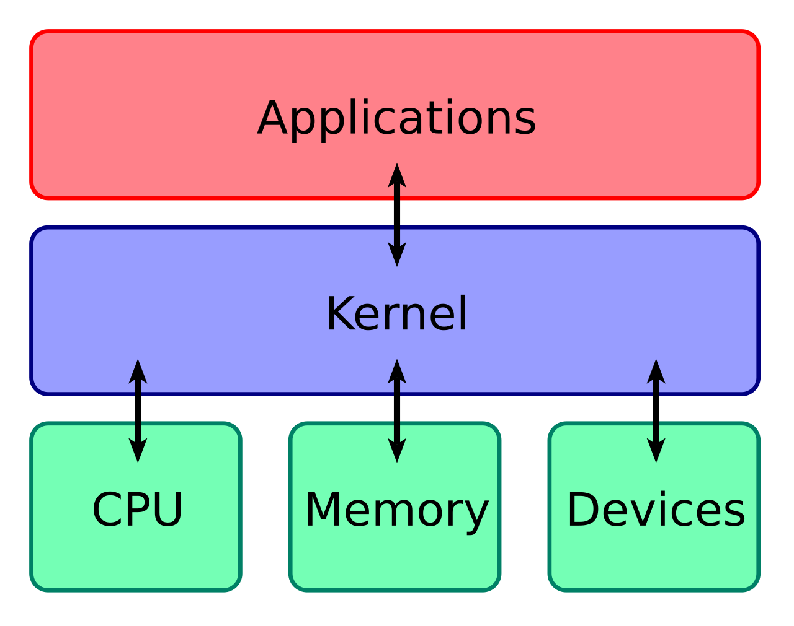
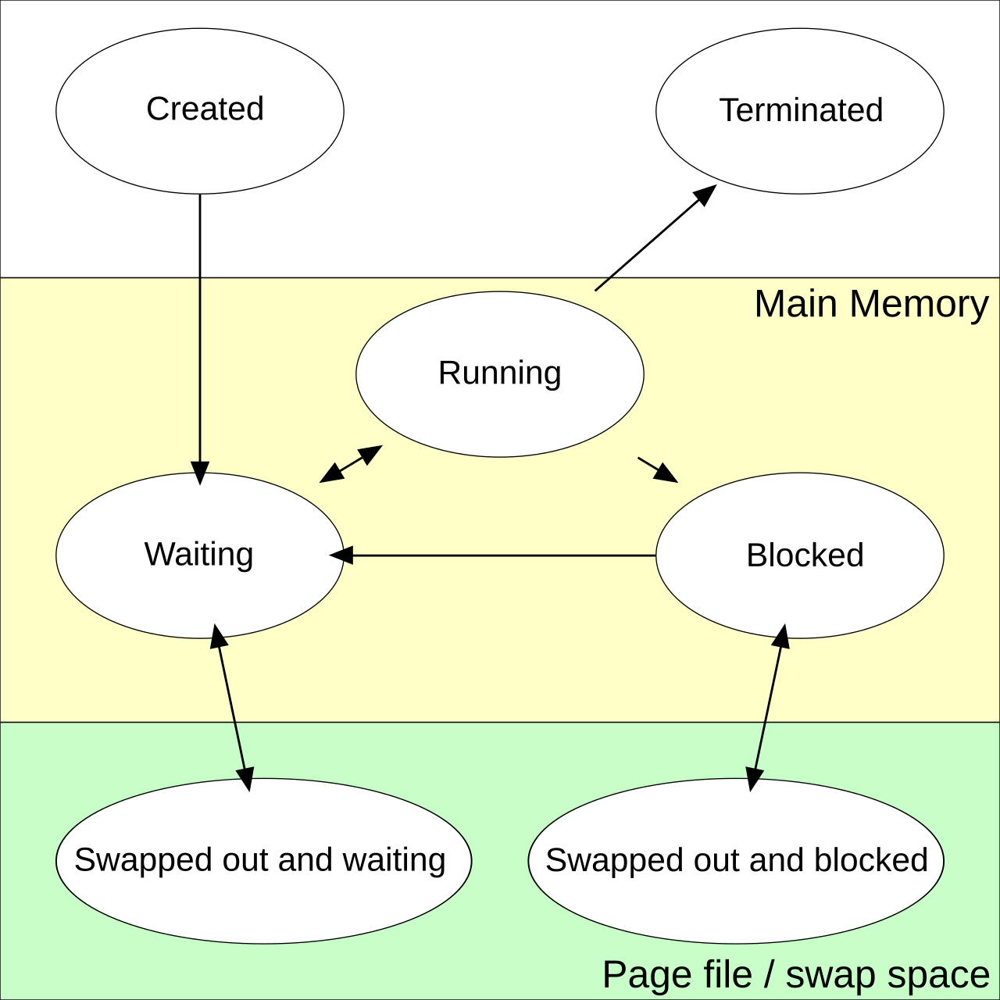
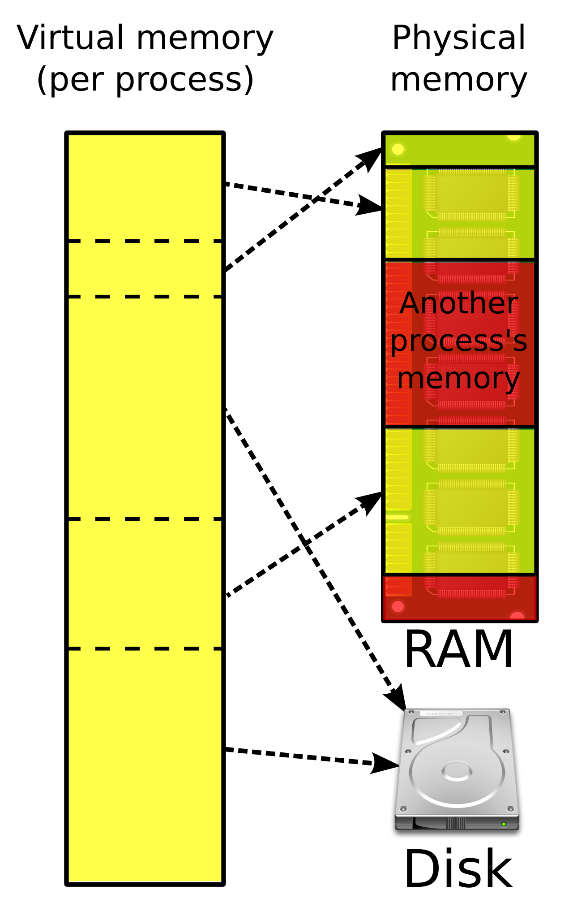

# Foundations: Linux and Operating Systems for ML Engineers

You know backprop, you know what `loss.backward()` does, and you can write a training loop in your sleep. But the first time you `ssh` into a GPU cluster you meet a different world: your job dies with `exit code 137`, a checkpoint you "saved" is zero bytes after a node crash, the DataLoader eats 200GB of RAM, `nvidia-smi` says CUDA 12.4 while `torch` says 12.1, and SLURM "sent SIGUSR1" to something. None of this is ML. It is the operating system.

This chapter starts from zero and builds up exactly the Linux and OS knowledge needed to work productively on a GPU cluster and to read the rest of this book, in particular the [Debugging](../debug/README.md), [SLURM](../orchestration/slurm/README.md) and [Storage](../storage/README.md) chapters. The emphasis is on *why* things behave the way they do, because the "why" is what lets you debug a failure you have never seen before.

All commands assume a modern Ubuntu (22.04 or 24.04) server. Most work on any recent Linux distribution. Output shown is sketched and trimmed; your numbers will differ.

Conventions used below:

```bash
$ command typed by a regular user
# command typed by root (or prefixed with sudo)
```

When a line starts with `$` or `#` inside a code block, don't type the prompt itself.


## 1. What an operating system actually does

### The kernel and why it exists

A computer has CPUs, RAM, disks, network cards and GPUs. If every program talked to the hardware directly, then:

- any program could overwrite any other program's memory (or the disk's partition table),
- two programs writing to the same disk sector at once would corrupt it,
- one program in an infinite loop would freeze the whole machine.

The kernel sits between applications and the hardware:



([source](https://commons.wikimedia.org/wiki/File:Kernel_Layout.svg))

The **kernel** is the one program that is allowed to touch the hardware directly. Everything else asks the kernel to do things on its behalf. The kernel provides four big abstractions, and almost every topic in this chapter is one of them:

| Abstraction | What you see | What it hides |
|---|---|---|
| **Process** | "my program is running" | sharing a few CPU cores between thousands of programs |
| **Virtual memory** | "my program has a big flat address space" | physical RAM, swap, other programs' memory |
| **File** | "a named sequence of bytes" | disks, network filesystems, devices, kernel state |
| **Socket** | "a pipe to another machine" | network cards, TCP/IP, retransmissions |

"Linux" strictly means the kernel. Ubuntu is a *distribution*: the Linux kernel plus a large set of user programs (`bash`, `ls`, `apt`, `systemd`, ...), most of them from the GNU project.

### User space vs kernel space

The CPU itself enforces the split. It runs in one of (at least) two privilege levels:

- **Kernel mode** (ring 0 on x86): can execute any instruction, touch any memory, talk to devices.
- **User mode** (ring 3): cannot touch hardware or other processes' memory. An attempt to do so traps into the kernel, which typically kills the program (that's what a `Segmentation fault` is).

Your Python interpreter, PyTorch, NCCL and the CUDA user-space libraries all run in user mode. The NVIDIA kernel module (`nvidia.ko`), the filesystem code and the network stack run in kernel mode.

### System calls: the only door

Since user programs can't touch hardware, how does `print("hi")` reach your terminal? Through a **system call** (syscall): a special instruction that switches the CPU into kernel mode at a fixed kernel entry point, with arguments in registers. The kernel checks permissions, does the work, and returns a result.

There are a few hundred syscalls. The ones you will see constantly:

| Syscall | Purpose |
|---|---|
| `openat`, `read`, `write`, `close` | file I/O |
| `mmap`, `munmap`, `brk` | ask for memory |
| `clone`, `execve`, `wait4`, `exit_group` | create/replace/reap/end processes |
| `kill` | send a signal |
| `ioctl` | "device-specific command" - how CUDA talks to the NVIDIA driver |
| `futex` | the building block for locks; a hung process is often sitting in `futex` |
| `fsync` | force data to stable storage |

You can watch every syscall a program makes with `strace`. Install it with `sudo apt install strace`.

```bash
$ strace -f -e trace=openat,write python -c 'print("hi")' 2>&1 | tail -5
openat(AT_FDCWD, "/usr/lib/python3.12/encodings/__pycache__/__init__.cpython-312.pyc", O_RDONLY|O_CLOEXEC) = 3
...
write(1, "hi\n", 3hi
)                     = 3
+++ exited with 0 +++
```

Read that last line: `write(1, "hi\n", 3) = 3` means "write 3 bytes to file descriptor 1 (stdout)", and the kernel returned 3 (bytes written). Everything Python does - however many layers of abstraction - ends up as calls like this.

A summary is often more useful than the full trace:

```bash
$ strace -c -f python -c 'import torch' 2>&1 | head -15
% time     seconds  usecs/call     calls    errors syscall
------ ----------- ----------- --------- --------- ----------------
 30.12    0.041000           4      9100      7900 newfstatat
 21.55    0.029330           5      5400      4300 openat
 ...
```

The thousands of failed `openat`/`newfstatat` calls are Python searching `sys.path` for modules. On a network filesystem each one is a round-trip to a metadata server - which is why `import torch` can take 30+ seconds on a busy shared filesystem but 2 seconds on a local disk. (The exact counts vary a lot by environment; the pattern doesn't.)

Key takeaway: **when something is slow or stuck and Python gives you no clue, the syscall layer usually does.** We'll come back to `strace` in the debugging section.


## 2. The shell

### What a shell is

The **shell** (`bash` on most servers, `zsh` on macOS) is just a user program that reads a line, splits it into words, and asks the kernel to run the named program with those words as arguments. It is also a programming language. When you `ssh` into a node, you are talking to a shell.

```bash
$ echo $SHELL
/bin/bash
$ which python
/home/me/miniconda3/envs/train/bin/python
```

### Anatomy of a command

```bash
$ ls -lh /data/checkpoints
#  ^   ^    ^
#  |   |    argument
#  |   option (flags), -l long format, -h human-readable sizes
#  program, found by searching $PATH
```

Help is always nearby: `man ls`, `ls --help`, or `tldr ls` (if installed, gives examples).

### Core navigation and file commands

```bash
pwd                         # where am I?
cd /scratch/$USER           # go somewhere; `cd` alone goes home, `cd -` goes back
ls -la                      # list including hidden (dot) files
ls -lhtr                    # sorted by time, newest last - great for "which checkpoint is latest"
mkdir -p runs/exp1/logs     # -p: create parents, no error if exists
cp -r src/ dst/             # copy directory
mv old new                  # rename/move (instant on the same filesystem)
rm -r dir                   # delete - there is no trash can. Ever.
cat file; less file         # print; page through (q to quit, / to search)
head -n 20 file; tail -n 20 file
tail -f train.log           # follow a log as it grows - you'll use this daily
```

### Finding things

```bash
# all checkpoints older than 7 days
find /scratch/$USER -name "*.pt" -mtime +7

# files bigger than 10GB
find . -type f -size +10G -exec ls -lh {} +

# where is libcudart on this system?
find / -name "libcudart.so*" 2>/dev/null
```

`grep` searches inside files:

```bash
grep -n "loss" train.log | tail          # -n line numbers
grep -ri "nccl" logs/                    # -r recursive, -i case-insensitive
grep -E "error|Traceback" *.out          # -E extended regex: alternation
grep -v "INFO" train.log                 # -v invert: lines NOT matching
```

If available, `rg` (ripgrep) is a much faster `grep -r`.

### Just enough awk and sed

`awk` splits each line into whitespace-separated fields `$1, $2, ...`. `sed` edits streams of text. You need maybe five idioms:

```bash
# log line: "step 1200 loss 2.314 lr 3e-4"
grep "^step" train.log | awk '{print $2, $4}'           # print step and loss
grep "^step" train.log | awk '{s+=$4; n++} END {print s/n}'  # mean loss

nvidia-smi --query-gpu=memory.used --format=csv,noheader,nounits | awk '{s+=$1} END {print s " MiB"}'

sed -i 's/lr: 3e-4/lr: 1e-4/' config.yaml               # in-place replace
sed -n '100,120p' train.log                              # print lines 100-120
```

### Disk usage: du and df

```bash
$ df -h /scratch           # how full is the filesystem?
Filesystem              Size  Used Avail Use% Mounted on
10.0.0.5@tcp:/scratch   2.0P  1.7P  300T  85% /scratch

$ du -sh /scratch/$USER/* | sort -h | tail     # what's using my space?
120G    /scratch/me/datasets
1.4T    /scratch/me/checkpoints

$ df -i /home               # inodes - you can run out of these with free space left!
```

`du` walks every file, so on a network filesystem with millions of files it can take hours and hammer the metadata server. Many clusters provide a quota tool instead (`lfs quota` on Lustre, or a site-specific command) - prefer that.

### Pipes and redirection

Every process starts with three open file descriptors (more on these later):

| fd | name | default |
|---|---|---|
| 0 | stdin | keyboard |
| 1 | stdout | terminal |
| 2 | stderr | terminal |

Python's `print` goes to stdout; tracebacks and `logging` (by default) go to stderr. That distinction matters as soon as you redirect:

```bash
python train.py > out.log           # stdout to file; errors still on screen
python train.py 2> err.log          # only stderr to file
python train.py > all.log 2>&1      # both to file. Order matters!
python train.py 2>&1 > all.log      # WRONG: stderr goes to the old stdout (screen)
python train.py &> all.log          # bash shorthand for "both"
python train.py 2>&1 | tee all.log  # both to file AND screen
python train.py >> all.log 2>&1     # append instead of overwrite
```

Why does order matter? `2>&1` means "make fd 2 point wherever fd 1 points *right now*". Redirections are processed left to right.

A **pipe** `a | b` connects a's stdout to b's stdin. Both run concurrently; the kernel buffers between them (64KiB by default on Linux). This is how you compose small tools:

```bash
ps aux | grep python | grep -v grep | wc -l     # count python processes
```

A common surprise: when stdout is a pipe or file instead of a terminal, Python buffers its output in blocks (~8KiB), so `tail -f` shows nothing for minutes. Fix with `python -u` or `PYTHONUNBUFFERED=1`, or `print(..., flush=True)`.

### Exit codes

Every process exits with an integer 0-255. **0 means success; anything else is failure.** The shell stores the last one in `$?`:

```bash
$ python -c 'import sys; sys.exit(3)'; echo $?
3
$ python -c 'raise ValueError'; echo $?
...
ValueError
1
```

When a process is killed by a signal, the shell reports `128 + signal number`. Memorize these - they show up in SLURM and Kubernetes job reports:

| Exit code | Meaning | Typical ML cause |
|---|---|---|
| 0 | success | |
| 1 | generic error | Python exception |
| 2 | misuse / bad args | argparse error |
| 127 | command not found | wrong `PATH`, env not activated |
| 130 | 128+2, SIGINT | you pressed Ctrl-C |
| 134 | 128+6, SIGABRT | C++ `abort()`, failed assertion in a CUDA lib |
| 135 | 128+7, SIGBUS | `/dev/shm` full (DataLoader), truncated mmapped file |
| 137 | 128+9, SIGKILL | **OOM killer**, or `scancel`/timeout after grace period |
| 139 | 128+11, SIGSEGV | segfault in a C extension |
| 143 | 128+15, SIGTERM | polite kill: SLURM time limit, preemption, `docker stop` |

`&&` and `||` use exit codes: `make && ./run` runs `./run` only if `make` succeeded.

In a pipeline, `$?` is the exit code of the *last* command, so `python train.py | tee log` "succeeds" even when training crashes. Use `set -o pipefail` (below) or `${PIPESTATUS[0]}`.

### Environment variables and PATH

Every process has an **environment**: a list of `KEY=value` strings inherited from its parent. This is how configuration flows from your shell into SLURM into `torchrun` into each training worker.

```bash
$ export CUDA_VISIBLE_DEVICES=0,1      # set and export to children
$ python -c 'import os; print(os.environ["CUDA_VISIBLE_DEVICES"])'
0,1
$ CUDA_VISIBLE_DEVICES=3 python train.py   # set for one command only
$ env | grep -i nccl                       # list matching variables
$ unset CUDA_VISIBLE_DEVICES
```

A variable set *without* `export` is a shell-local variable and is **not** seen by child processes - a very common "but I set it!" bug.

`PATH` is a colon-separated list of directories the shell searches for programs:

```bash
$ echo $PATH
/home/me/miniconda3/envs/train/bin:/usr/local/cuda/bin:/usr/bin:/bin
$ which -a python      # every python on PATH, first one wins
$ type python          # also reveals aliases and shell functions
```

"Activating" a conda or venv environment is mostly just prepending its `bin/` to `PATH`. If `python` runs the wrong interpreter, check `which python` first.

Environment variables you'll meet constantly in ML: `CUDA_VISIBLE_DEVICES`, `NCCL_DEBUG`, `NCCL_SOCKET_IFNAME`, `MASTER_ADDR`, `MASTER_PORT`, `RANK`, `LOCAL_RANK`, `WORLD_SIZE`, `HF_HOME`, `OMP_NUM_THREADS`, `PYTHONPATH`, `LD_LIBRARY_PATH`, and the whole `SLURM_*` family.

Shell startup files: interactive login shells read `~/.bash_profile` (or `~/.profile`), interactive non-login shells read `~/.bashrc`. On Ubuntu the default `~/.profile` sources `~/.bashrc`. Put your `export`s and aliases in `~/.bashrc`. Note that SLURM batch scripts are non-interactive and, depending on how they're invoked, may not read `~/.bashrc` - don't rely on it for anything a job needs; set it in the job script.

### Quoting: the source of many bugs

The shell splits on whitespace and expands `$var`, `*`, `~` *before* the program sees the arguments.

```bash
name="my run"
mkdir $name         # creates TWO dirs: "my" and "run"
mkdir "$name"       # creates one dir "my run"
echo '$HOME'        # single quotes: literal, prints $HOME
echo "$HOME"        # double quotes: expands, no word splitting
rm -rf $DIR/        # if DIR is unset/empty, this is `rm -rf /`. Quote and guard:
rm -rf "${DIR:?DIR is unset}/"
```

Rule: **always double-quote variable expansions** unless you specifically want splitting.

The most ML-relevant quoting trap is *when* expansion happens. In a SLURM script:

```bash
srun bash -c "python train.py --rank $SLURM_PROCID"    # expanded NOW, on the batch node -> same value everywhere
srun bash -c "python train.py --rank \$SLURM_PROCID"   # escaped -> expanded by each task -> correct
```

The book discusses this in [SLURM_PROCID early interpolation](../orchestration/slurm/users.md#slurm_procid-early-interpolation).

### Scripting essentials

A minimal robust bash script:

```bash
#!/bin/bash
set -euo pipefail      # -e: exit on error, -u: error on unset var, pipefail: pipeline fails if any stage fails

OUT_DIR=${OUT_DIR:-/scratch/$USER/run1}    # default value if unset
mkdir -p "$OUT_DIR"

for seed in 1 2 3; do
    echo "seed=$seed"
    python train.py --seed "$seed" --out "$OUT_DIR/seed$seed" 2>&1 | tee "$OUT_DIR/seed$seed.log"
done

N_GPUS=$(nvidia-smi -L | wc -l)            # command substitution
echo "found $N_GPUS GPUs; half is $((N_GPUS / 2))"   # arithmetic

if [[ -f "$OUT_DIR/done" ]]; then
    echo "already finished"
fi

cleanup() { echo "cleaning up"; }
trap cleanup EXIT                           # run on any exit
```

Make it executable with `chmod +x run.sh`, run with `./run.sh`. The `#!` line ("shebang") tells the kernel which interpreter to use.

Debugging scripts: `bash -x run.sh` prints each command after expansion - invaluable for quoting bugs.

### Working remotely: ssh, scp, rsync

```bash
ssh me@login.cluster.org
ssh-keygen -t ed25519                 # once, on your laptop
ssh-copy-id me@login.cluster.org      # install your public key, no more passwords
```

`~/.ssh/config` saves typing and handles jump hosts (compute nodes are often reachable only via a login node):

```
Host cluster
    HostName login.cluster.org
    User me
    IdentityFile ~/.ssh/id_ed25519

Host gpu-*
    ProxyJump cluster
    User me
```

Now `ssh cluster` and `ssh gpu-017` just work.

Port forwarding, e.g. to view TensorBoard running on a compute node in your laptop's browser:

```bash
ssh -L 6006:localhost:6006 gpu-017      # then open http://localhost:6006 locally
```

Copying files:

```bash
scp model.pt cluster:/scratch/me/                       # simple copy
rsync -avP ./code/ cluster:/home/me/code/               # incremental, resumable, shows progress
rsync -avP --exclude '*.pt' --exclude '.git' ./ cluster:proj/
```

`rsync` only transfers what changed and can resume interrupted transfers; prefer it for anything large. The trailing slash on the source matters: `src/` copies the *contents* of src, `src` copies the directory itself.

### tmux: don't lose work when your laptop sleeps

When your ssh connection drops, the shell on the server receives `SIGHUP` ("hang up") and, by default, it and the programs it started die. A **terminal multiplexer** keeps a session alive on the server, independent of your connection.

```bash
tmux new -s train          # start a named session
# ... run things ...
# detach: Ctrl-b then d
tmux ls                    # list sessions
tmux attach -t train       # reattach later, even from a different laptop
```

Inside tmux: `Ctrl-b c` new window, `Ctrl-b n`/`p` next/previous, `Ctrl-b %` and `Ctrl-b "` split panes, `Ctrl-b [` scroll mode (q to exit). `screen` is the older equivalent (`screen -S train`, detach `Ctrl-a d`, `screen -r train`).

Caveats on clusters: tmux on a *login node* survives your disconnect, but login nodes are shared and sometimes reboot; for real training use the scheduler (`sbatch`), and use tmux for interactive sessions and monitoring. Some sites kill user processes on login nodes after a while. `nohup cmd &` is the poor man's alternative: it ignores `SIGHUP` and writes output to `nohup.out`.


## 3. Files and filesystems

### Everything is a file

Unix's central design idea: many things are accessed through the same `open`/`read`/`write`/`close` interface.

- Regular files and directories
- Devices: `/dev/nvidia0` (a GPU), `/dev/nvme0n1` (an NVMe disk), `/dev/null` (discards everything)
- Pipes and sockets
- Kernel state: `/proc/meminfo`, `/sys/class/net/`

That's why `cat /proc/cpuinfo` works, and why `fuser -v /dev/nvidia*` can tell you which processes have a GPU open.

### Inodes, names and links

A file on disk is really two things:

1. An **inode**: metadata (size, owner, permissions, timestamps, where the data blocks are) - but *not* the name.
2. **Directory entries**: names that point to an inode. A directory is just a table of `name -> inode number`.

```bash
$ stat model.pt
  File: model.pt
  Size: 497764122   Blocks: 972200   IO Block: 4096   regular file
Device: 259,2   Inode: 1835123   Links: 1
Access: (0644/-rw-r--r--)  Uid: ( 1000/  me)   Gid: ( 1000/  me)
Modify: 2025-03-01 12:00:00.000000000 +0000
```

Consequences that matter:

- **Filesystems have a fixed or limited number of inodes** (or, on Lustre-like systems, metadata capacity). A dataset of 50 million small JPEGs can exhaust inodes while `df -h` says 40% free - check `df -i`. This is one reason large-scale training data is packed into shards (WebDataset tar files, Arrow, Parquet, etc.).
- **`mv` within the same filesystem is instant**: it only rewrites a directory entry. Across filesystems it's a full copy plus delete. And a `rename` within one filesystem is *atomic* - the foundation of safe checkpoint writing (see fsync below).
- **Deleting a file that's still open doesn't free the space.** The inode lives until the last name *and* the last open file descriptor are gone. If `df` says full but `du` can't find the files, a process is holding deleted files open: `lsof +L1` lists them.

**Links:**

```bash
ln target hardlink        # second name for the same inode (same filesystem only)
ln -s target symlink      # a tiny file containing a path; can dangle, can cross filesystems
ls -l symlink
lrwxrwxrwx 1 me me 6 ... symlink -> target
```

The HuggingFace Hub cache uses symlinks heavily: `snapshots/<rev>/model.safetensors -> ../../blobs/<sha>`.

### Permissions, ownership, umask

```bash
$ ls -l train.py
-rwxr-x--- 1 alice mlteam 2048 Mar  1 12:00 train.py
# ^ type (- file, d dir, l link)
#  ^^^ owner (alice): read, write, execute
#     ^^^ group (mlteam): read, execute
#        ^^^ others: nothing
```

Numeric (octal) form: r=4, w=2, x=1, so `rwxr-x---` = `750`.

```bash
chmod 640 secrets.env          # owner rw, group r, others none
chmod -R g+rwX shared/         # add group rw recursively; X = execute only on dirs (and already-executable files)
chown alice:mlteam file        # change owner (needs root) / group (must be a member)
id                             # my uid, gid and groups
```

For directories, `x` means "may enter / traverse" and `r` means "may list". You need `x` on every directory in a path to reach a file.

**umask** decides default permissions of new files. Files start from 666, directories from 777, and the umask bits are removed:

```bash
$ umask
0022              # new files 644 (rw-r--r--), dirs 755
$ umask 002       # new files 664, dirs 775 - group-writable
```

Shared team directories: set `umask 002` in `~/.bashrc` and set the **setgid** bit on the shared directory (`chmod g+s /data/team`) so that new files inherit the directory's group rather than your personal group. Forgetting this is the classic "my teammate can't overwrite the checkpoint I wrote" problem.

Network filesystems may have their own ACL or ID-mapping rules; `ls -l` may not tell the whole story there (`getfacl` shows POSIX ACLs).

### Mount points: one tree, many filesystems

Linux has a single directory tree rooted at `/`. Different storage devices and network filesystems are *mounted* onto directories in that tree.

```bash
$ df -hT
Filesystem          Type     Size  Used Avail Use% Mounted on
/dev/nvme0n1p2      ext4     1.8T  200G  1.5T  12% /
/dev/md0            xfs       28T  3.1T   25T  11% /local_nvme
tmpfs               tmpfs    1.0T  2.0G 1022G   1% /dev/shm
nfs01:/home         nfs4      50T   41T  9.0T  82% /home
10.0.0.5@o2ib:/lus  lustre   10P   7P    3P   70% /scratch

$ findmnt /scratch          # which filesystem is this path on?
```

That `Type` column is the single most important thing to know about a path you're about to hammer with I/O. `cd /scratch` looks like `cd /tmp`, but one is a local disk with ~100µs latency and the other is a cluster of servers across the network.

### /proc and /sys: the kernel as files

These are not on disk; the kernel generates their content on read.

```bash
cat /proc/cpuinfo | grep "model name" | head -1
cat /proc/meminfo | head -5          # MemTotal, MemFree, MemAvailable, Buffers, Cached
cat /proc/loadavg
nproc                                 # CPUs available to *this process* (respects affinity/cgroups)

# per-process: /proc/<PID>/
cat /proc/$$/status | grep -E "VmRSS|Threads"    # $$ = this shell's PID
tr '\0' '\n' < /proc/12345/environ   # environment of process 12345 (yours only)
tr '\0' ' '  < /proc/12345/cmdline   # its full command line
ls -l /proc/12345/fd                  # its open files
ls -l /proc/12345/cwd                 # its working directory

# /sys: devices and kernel tunables
ls /sys/class/net/                    # network interfaces (useful for NCCL_SOCKET_IFNAME)
cat /sys/class/net/ib0/mtu
ls /sys/bus/pci/devices/              # PCI devices; GPUs live here
cat /sys/kernel/mm/transparent_hugepage/enabled
```

Kernel tunables are under `/proc/sys/` and are managed with `sysctl`:

```bash
sysctl vm.overcommit_memory
sudo sysctl -w vm.swappiness=10
```

### /dev/shm: RAM pretending to be a disk

`/dev/shm` is a `tmpfs` - a filesystem whose files live in RAM (page cache), not on any disk. By default its size limit is 50% of RAM. It's used for POSIX shared memory, and **PyTorch DataLoader worker processes pass batches to the main process through shared memory**.

Two consequences:

- Files you put in `/dev/shm` consume RAM and vanish on reboot. Great for a small hot dataset; dangerous if you forget it's there.
- Docker gives containers only a **64MB** `/dev/shm` by default. DataLoader with `num_workers > 0` then dies with `Bus error` (SIGBUS, exit 135) or `RuntimeError: DataLoader worker (pid X) is killed by signal: Bus error`. Fix: `docker run --shm-size=32g ...` or `--ipc=host`.

```bash
$ df -h /dev/shm
tmpfs    252G  1.2G  251G   1% /dev/shm
```

### The page cache: why the second read is fast

The kernel uses otherwise-free RAM to cache file contents. When you read a file, its data is kept in the **page cache**; the next read of the same data is served from RAM.

```bash
$ time cat /local_nvme/shard-000.tar > /dev/null
real    0m4.210s           # ~2.4GB/s, from disk
$ time cat /local_nvme/shard-000.tar > /dev/null
real    0m0.390s           # from page cache
```

`free -h` shows it:

```bash
$ free -h
               total        used        free      shared  buff/cache   available
Mem:           2.0Ti       310Gi        20Gi       2.1Gi       1.7Ti       1.6Ti
Swap:             0B          0B          0B
```

Don't panic at `free: 20Gi`. The `buff/cache` RAM is reclaimable on demand; **`available`** is the number that tells you how much memory a new program can get.

Why you care:

- **Benchmarks lie unless you account for it.** Reading a dataset the second time measures RAM, not storage. To measure cold reads: `sync; echo 3 | sudo tee /proc/sys/vm/drop_caches` (root only), or use files larger than RAM, or use `O_DIRECT` (e.g. `fio --direct=1`). See the [Storage chapter](../storage/README.md) for benchmarking with `fio`.
- **Epoch 1 slow, epoch 2+ fast** is often the page cache, not a data-loading bug.
- **Writes go to the cache first**, which leads to the next topic.

Network filesystems also cache on the client, but with weaker and FS-specific consistency guarantees (e.g. NFS's "close-to-open" consistency: another node is only guaranteed to see your writes after you `close()` and it `open()`s).

### fsync and durability: why checkpoints get lost

When `write()` returns, your data is in the page cache in RAM, *not on disk*. The kernel flushes dirty pages to storage in the background, typically within ~30 seconds (governed by `vm.dirty_expire_centisecs` and related settings). If the node loses power or the kernel panics before that, the data is gone - and the file may exist with the right name but be truncated or zero-filled.

`fsync(fd)` blocks until the file's data and metadata have reached stable storage (as far as the device honours it). `close()` does **not** imply `fsync()`.

As far as I know, `torch.save` does not call `fsync` itself (verify for your version). The robust pattern for writing a checkpoint:

```python
import os, torch

def atomic_save(obj, path):
    tmp = path + ".tmp"
    with open(tmp, "wb") as f:
        torch.save(obj, f)
        f.flush()                 # Python's buffer -> kernel
        os.fsync(f.fileno())      # kernel -> disk
    os.replace(tmp, path)         # atomic rename: readers see old or new, never half
    dfd = os.open(os.path.dirname(path) or ".", os.O_RDONLY)
    os.fsync(dfd)                 # make the rename itself durable
    os.close(dfd)
```

Why each step:

- Writing to `.tmp` then renaming means a crash mid-write leaves the *previous* checkpoint intact instead of a corrupt one.
- `fsync` on the file makes the bytes durable; `fsync` on the directory makes the new name durable.
- Also write a "latest" marker or a final `done` file *after* everything else is synced, and have the resume logic trust only complete checkpoints.

On parallel/network filesystems (Lustre, GPFS, NFS, object-store FUSE mounts) the semantics of `fsync` and `rename` vary; some FUSE mounts for object stores don't support atomic rename at all. Check your filesystem's documentation. Also note `fsync` on a multi-GB file can take seconds - that's the honest cost of durability, and it's why [frequent checkpoint saving](../training/fault-tolerance/README.md#frequent-checkpoint-saving) needs a fast filesystem.

### Local vs network filesystems

| | Local NVMe | NFS | Parallel FS (Lustre, GPFS, WekaFS, ...) |
|---|---|---|---|
| Visible from | one node | all nodes | all nodes |
| Latency per op | ~10-100µs | ~0.5-few ms | ~0.1-few ms, metadata can be much slower under load |
| Small-file / metadata ops | great | poor | often the bottleneck |
| Big sequential throughput | a few GB/s per drive | limited | can be 100s of GB/s aggregate |
| Survives node loss | no | yes | yes |

Typical cluster layout: `/home` on NFS (small, backed up, slow), `/scratch` or `/data` on a parallel FS (big, fast, often *not* backed up, sometimes auto-purged), and a node-local NVMe at `/tmp` or `/local` (fast, wiped after the job). Put code on a shared FS, stream data from the parallel FS or stage it to local NVMe, and write checkpoints to the parallel FS. The [Storage chapter](../storage/README.md) covers this in depth.

Two habits that save a shared filesystem (and your colleagues' sanity): don't put conda environments with 100k small files on a slow NFS `/home` if you can avoid it, and never run `find` / `du` / `ls -R` over the whole parallel FS.


## 4. Processes

### What a process is

A **process** is a running instance of a program: its own virtual address space, one or more threads, a set of open file descriptors, an environment, a current directory, a user identity, and a PID (process ID). A **thread** is an execution context *within* a process; threads of one process share memory.

The states a process moves through:



([source](https://commons.wikimedia.org/wiki/File:Process_states.svg))

```bash
$ ps -ef --forest | grep -A3 slurmstepd
root   4001     1  slurmstepd: [12345.0]
me     4010  4001   \_ /usr/bin/python -m torch.distributed.run --nproc-per-node 8 train.py
me     4033  4010       \_ /usr/bin/python -u train.py --local-rank=0
me     4034  4010       \_ /usr/bin/python -u train.py --local-rank=1
```

Columns: user, PID, PPID (parent PID), command. Other everyday views:

```bash
ps aux --sort=-%mem | head          # biggest memory users
pgrep -af train.py                  # PIDs + command lines matching a pattern
pstree -p $USER                     # tree of my processes
top                                 # live view; press 1 for per-CPU, M sort by mem, P by CPU, q quit
htop                                # nicer top (apt install htop); F5 tree view, F4 filter
```

In `top`, the load average (`load average: 95.2, 90.1, 88.0`) is the average number of runnable (or uninterruptible-waiting) tasks over 1/5/15 minutes. Compare it to the number of cores; a load far above the core count means oversubscription (e.g. too many DataLoader workers times too many OpenMP threads).

The `S` / `STAT` column is the process state:

| State | Meaning |
|---|---|
| `R` | running or runnable |
| `S` | sleeping (waiting for an event) - normal for most processes |
| `D` | uninterruptible sleep, usually waiting on I/O. Many `D` processes = storage trouble. Cannot be killed until the I/O completes. |
| `Z` | zombie (see below) |
| `T` | stopped (Ctrl-Z, or `SIGSTOP`) |

A training process stuck in `D` state on a hung NFS mount is a classic: even `kill -9` doesn't work until the filesystem responds.

### fork and exec: how processes are born

Linux creates processes with two separate steps:

1. **`fork()`** clones the calling process. The child is a near-identical copy (same memory contents, same open files), differing in PID and the return value of `fork`.
2. **`execve()`** replaces the current process's program with a new one, keeping the PID and (by default) open file descriptors and environment.

When you type `python train.py`, bash forks itself, the child calls `execve("/usr/bin/python", ...)`, and the parent bash waits for it. (Modern implementations often use `clone`/`vfork`/`posix_spawn` variants under the hood; conceptually it's still fork+exec.)

Why split it? Between fork and exec the child can set up its own environment - redirect fds, change directory, set env vars - which is how `> out.log` and `VAR=x cmd` work. And fork without exec is how Python `multiprocessing` (with the `fork` start method) and DataLoader workers get a copy of the parent's state cheaply (see copy-on-write in the memory section).

### Parents, children, exit status, zombies and orphans

When a process exits, it leaves behind an exit status for its parent to collect with `wait()`. Until the parent does so, the dead process remains in the process table as a **zombie** (`Z`, `<defunct>` in `ps`). It uses no memory or CPU, just a PID slot. A handful of zombies is harmless; thousands means a buggy parent that never reaps its children.

If a parent dies before its children, the children become **orphans** and are re-parented to PID 1 (`systemd` on the host, or a designated "subreaper"), which reaps them when they exit.

The ML-relevant case is not the zombie itself but the **orphaned worker that's still alive**: your main training process crashes, but a DataLoader worker or a `torchrun` child keeps running and keeps holding GPU memory. The next job on that node then fails with CUDA OOM. Find them with:

```bash
nvidia-smi --query-compute-apps=pid,process_name,used_memory --format=csv
sudo fuser -v /dev/nvidia*           # every process with a GPU device open
```

The book's SLURM chapter has a section on [zombies](../orchestration/slurm/users.md#zombies) in exactly this sense.

### Signals

A **signal** is a small asynchronous notification sent to a process by the kernel or another process. Each has a default action (terminate, ignore, core dump, stop), and a process can install a **handler** to do something else - except for `SIGKILL` and `SIGSTOP`, which cannot be caught or ignored.

| Signal | # (x86-64) | Default | Who sends it, typically | Can catch? |
|---|---|---|---|---|
| `SIGHUP` | 1 | terminate | terminal/ssh closed | yes |
| `SIGINT` | 2 | terminate | Ctrl-C | yes - Python raises `KeyboardInterrupt` |
| `SIGQUIT` | 3 | core dump | Ctrl-\ | yes |
| `SIGABRT` | 6 | core dump | `abort()`, C++ assertion | yes |
| `SIGKILL` | 9 | terminate | `kill -9`, OOM killer, SLURM after grace period | **no** |
| `SIGUSR1` | 10 | terminate | user-defined; SLURM `--signal` | yes |
| `SIGSEGV` | 11 | core dump | invalid memory access | (yes, but don't) |
| `SIGTERM` | 15 | terminate | `kill`, `scancel`, time limit, `docker stop`, k8s | yes |
| `SIGCHLD` | 17 | ignore | a child exited | yes |
| `SIGCONT` / `SIGSTOP` | 18 / 19 | continue / stop | `fg`, Ctrl-Z (`SIGTSTP`, 20) | STOP: no |

Signal numbers above are for Linux on x86-64 and ARM64; use names, not numbers, in scripts (`kill -TERM`, not `kill -15`) for portability. `kill -l` lists them.

```bash
kill 4010              # SIGTERM (default): "please exit"
kill -INT 4010         # like Ctrl-C
kill -USR1 4010        # custom: e.g. "save a checkpoint"
kill -9 4010           # SIGKILL: no cleanup, no flush, no checkpoint. Last resort.
pkill -f train.py      # by command-line pattern - careful, it matches broadly
```

**Why the distinction between SIGTERM and SIGKILL matters for you:** a SIGTERM gives your program a chance to finish the current step, write a checkpoint, flush logs and exit cleanly. A SIGKILL is the kernel removing the process immediately - buffered log lines and half-written checkpoints are lost.

Catching signals in Python:

```python
import signal, sys

stop_requested = False
def handler(signum, frame):
    global stop_requested
    print(f"got signal {signum}, will checkpoint and exit", flush=True)
    stop_requested = True

signal.signal(signal.SIGUSR1, handler)
signal.signal(signal.SIGTERM, handler)

for step in range(start, max_steps):
    train_step()
    if stop_requested:
        save_checkpoint()
        sys.exit(0)
```

Two subtleties: Python runs signal handlers only in the main thread, between bytecode instructions - so if the main thread is blocked inside a long C call (e.g. a collective that's hung), the handler is delayed until it returns. And in distributed training, each rank must agree to stop at the same step, otherwise some ranks wait forever in a collective; usually you set the flag on every rank (signal sent to all) or all-reduce the flag.

**How SLURM uses signals.** By default, when a job hits its time limit (or is cancelled or preempted), SLURM sends `SIGTERM` to the job's processes, waits `KillWait` seconds (cluster config; 30s by default), then sends `SIGKILL`. 30 seconds is rarely enough to checkpoint a large model. So you ask for an earlier warning:

```bash
#SBATCH --signal=USR1@600        # send SIGUSR1 to job steps 600s (approx.) before time limit
#SBATCH --signal=B:USR1@600      # B: send it only to the batch shell script instead
```

Your training code traps `SIGUSR1`, saves, and exits. The book covers the full pattern, including which process actually receives the signal, in [Dealing with forced job preemption](../training/fault-tolerance/README.md#dealing-with-forced-job-preemption). Note SLURM's timing is approximate - the signal can arrive up to a minute or so off the requested time.

A bash gotcha relevant to the `B:` variant: while bash is waiting for a foreground child, it does not run its `trap` handlers until the child exits, and it does not forward signals to the child. If your batch script needs to react to a signal, run the main command in the background and `wait`:

```bash
trap 'echo got USR1; kill -USR1 "$child"' USR1
python train.py & child=$!
wait "$child"
```

Or use `exec python train.py` so python *replaces* bash and receives signals directly.

### Process groups and sessions

Processes are organized into **process groups** (e.g. all processes of one pipeline) and **sessions** (all groups started from one terminal). Ctrl-C sends `SIGINT` to the entire *foreground process group*, which is why it stops both sides of `a | b` and all the workers your script spawned in the foreground.

```bash
ps -o pid,pgid,sid,cmd -u $USER
kill -TERM -- -4010           # negative PID: signal the whole process group 4010
setsid python train.py        # start in a new session, detached from the terminal
```

Signalling a group is how you clean up a launcher and all its children at once. SLURM tracks job processes with cgroups (next section) rather than process groups, so even processes that escape their group are found and killed when the job ends.

### How torchrun spawns workers

`torchrun` (alias of `python -m torch.distributed.run`) is an ordinary process that acts as a per-node "agent":

1. It parses `--nnodes`, `--nproc-per-node`, `--rdzv-endpoint`, etc. and performs a rendezvous with the agents on other nodes to agree on ranks.
2. It launches `nproc-per-node` worker processes (as subprocesses running your script), each with a different environment: `RANK`, `LOCAL_RANK`, `WORLD_SIZE`, `LOCAL_WORLD_SIZE`, `MASTER_ADDR`, `MASTER_PORT`, among others.
3. It monitors the workers. If one dies, it terminates the rest (sending `SIGTERM`, then `SIGKILL` after a timeout) and, if `--max-restarts` allows, restarts the whole group.
4. If `torchrun` itself receives `SIGTERM`/`SIGINT`, it forwards a termination signal to the workers.

So a typical multi-node job is a three-level tree: `slurmstepd` -> `torchrun` (one per node) -> 8 workers, each of which may fork N DataLoader workers. When you see "which process gets the signal?" questions in the fault-tolerance chapter, draw this tree. (The details of signal forwarding and timeouts have changed across PyTorch versions; check `torch/distributed/elastic/` for your version if it matters.)

Inspect what a worker actually got:

```bash
tr '\0' '\n' < /proc/4033/environ | grep -E "^(RANK|LOCAL_RANK|WORLD_SIZE|MASTER)"
```

### File descriptors and ulimits

A **file descriptor** (fd) is a small integer that a process uses to refer to an open file, pipe, socket or device. `open()` returns one; `read(fd, ...)` uses it; `close(fd)` releases it.

```bash
$ ls -l /proc/4033/fd | head
lr-x------ 1 me me 64 ... 0 -> /dev/null
l-wx------ 1 me me 64 ... 1 -> /scratch/me/logs/job-12345.out
lrwx------ 1 me me 64 ... 7 -> /dev/nvidia0
lrwx------ 1 me me 64 ... 9 -> socket:[884213]
$ ls /proc/4033/fd | wc -l
1874
```

Each process has resource limits, viewed and set with `ulimit` (per shell, inherited by children):

```bash
$ ulimit -a
open files                      (-n) 1024
max locked memory       (kbytes, -l) 8192
stack size              (kbytes, -s) 8192
max user processes              (-u) 2063437
...
$ ulimit -n 65536       # raise soft limit (up to the hard limit, `ulimit -Hn`)
```

ML-relevant limits:

- **open files (`-n`)**: a soft default of 1024 is common. Many DataLoader workers, many shards open at once, NCCL sockets, and PyTorch's `file_system` tensor-sharing strategy can all exceed it: `OSError: [Errno 24] Too many open files`. Raise it in the job script.
- **max locked memory (`-l`)**: limits pinned memory. RDMA / InfiniBand and some NCCL configurations need this to be `unlimited`; otherwise you'll get errors about registering memory. Admins usually set this cluster-wide (`/etc/security/limits.conf`, and SLURM's `PropagateResourceLimits` determines whether your login shell's limits are propagated to jobs).
- **core file size (`-c`)**: 0 disables core dumps; raise it if you want to `gdb` a crash post-mortem.

Hard limits can only be raised by root.


## 5. Memory from the OS point of view

### Virtual memory and pages

Every process sees its own private **virtual address space**: on x86-64, a 128TiB range for user space. Addresses your program uses are virtual; the CPU's MMU translates them to physical RAM addresses through **page tables** maintained by the kernel.

Each process sees one contiguous virtual address space, backed by scattered physical pages (or disk):



([source](https://commons.wikimedia.org/wiki/File:Virtual_memory.svg))

Memory is managed in **pages**, 4KiB by default on x86-64. A virtual page may be:

- mapped to a physical RAM page,
- not yet backed by anything (allocated but never touched),
- backed by a file (memory-mapped file, shared library, executable),
- swapped out to disk.

Why virtual memory exists: isolation (process A can't name process B's memory), the illusion of contiguous memory, lazy allocation, and sharing (one physical copy of `libtorch_cuda.so` mapped into many processes).

### Page faults and lazy allocation

When a process touches a virtual page that has no physical page behind it, the CPU raises a **page fault** and the kernel handles it:

- **Minor fault**: just allocate a zeroed page, or map a page already in the page cache. Microseconds.
- **Major fault**: data must be read from disk (a memory-mapped file not yet cached, or swapped-out memory). Milliseconds.

Consequence: `malloc(100GB)` or `np.empty(...)` "succeeds" instantly and uses no RAM until you write to it. This is also how `mmap`-based loading (e.g. `safetensors`, `np.load(mmap_mode="r")`, Arrow datasets) works: the file is mapped into the address space and pages are read from disk only when touched, then live in the page cache shared by all processes mapping the same file.

```bash
/usr/bin/time -v python -c 'import torch' 2>&1 | grep -E "Maximum resident|page faults"
        Maximum resident set size (kbytes): 412000
        Major (requiring I/O) page faults: 0
        Minor (reclaiming a frame) page faults: 98000
```

### RSS vs VSZ (and PSS)

`ps`/`top` show two memory numbers per process:

- **VSZ / VIRT**: total virtual address space reserved. Often huge and meaningless - a CUDA process routinely shows hundreds of GB or even TBs of VIRT because the CUDA driver reserves large address ranges for unified addressing.
- **RSS / RES**: resident set size - physical RAM pages currently mapped. This is the number to watch... mostly.

RSS counts shared pages in *every* process that maps them. Eight training ranks each mapping the same 2GB of shared libraries and mmapped data each report that 2GB, so summing RSS overcounts. **PSS** (proportional set size) splits shared pages among sharers and sums correctly:

```bash
grep -E "^(Rss|Pss|Shared|Private|Swap)" /proc/4033/smaps_rollup
# or, for a nice table: sudo apt install smem; smem -tk -P train.py
```

### Swap

**Swap** is disk space used as overflow for anonymous memory (memory not backed by a file). When RAM is tight, the kernel writes cold pages to swap. It keeps a machine from dying under memory pressure but makes it crawl. Many GPU clusters run with **no swap at all**, so that memory exhaustion fails fast via the OOM killer instead of turning a node into molasses. `free -h` and `swapon --show` tell you.

### Overcommit and the OOM killer

By default (`vm.overcommit_memory=0`), Linux lets processes allocate more virtual memory than RAM+swap exists, betting they won't touch it all (lazy allocation makes this usually true). Mode 1 always allows; mode 2 enforces a strict limit.

When processes *do* touch more memory than exists, the kernel's **OOM killer** picks a victim (roughly: the process using the most memory, adjusted by `/proc/<pid>/oom_score_adj`) and sends it `SIGKILL`. Your program gets no warning and no traceback. The only evidence:

- exit code **137** (128+9), or SLURM state `OUT_OF_MEMORY`,
- in DataLoader: `RuntimeError: DataLoader worker (pid 1234) is killed by signal: Killed.`
- in the kernel log:

```bash
$ sudo dmesg -T | grep -i -E "killed process|out of memory"
[Mon Mar  3 10:12:01 2025] Out of memory: Killed process 4033 (python) total-vm:310000000kB, anon-rss:190000000kB, ...
```

On clusters, the limit is usually per job via cgroups (see below), not the whole machine. The kernel log then says `Memory cgroup out of memory`, and SLURM typically prints something like `slurmstepd: error: Detected 1 oom_kill event in StepId=12345.0. Some of your processes may have been killed by the cgroup out-of-memory handler.` (exact wording varies by version). Ask for more with `#SBATCH --mem=...`.

Note: this is *CPU RAM* OOM. GPU OOM (`torch.cuda.OutOfMemoryError: CUDA out of memory`) is a completely different thing raised by the CUDA allocator - a Python exception, not a kill.

### Pinned (page-locked) memory and why CUDA wants it

GPUs copy data from host RAM using a **DMA** engine that reads physical addresses directly over PCIe, without the CPU. But the OS is free to move or swap out ordinary ("pageable") pages at any time, which would pull the memory out from under an in-flight DMA. So:

- A copy from **pageable** memory: the CUDA driver first copies your data into an internal pinned staging buffer (a CPU memcpy), then DMAs from there. Slower, and synchronous with respect to the host.
- A copy from **pinned** (page-locked) memory: the kernel has promised never to move or swap those pages, so the GPU can DMA directly, at full PCIe bandwidth, and asynchronously so the CPU can keep working.

In PyTorch:

```python
loader = DataLoader(ds, batch_size=64, num_workers=8, pin_memory=True)
for x, y in loader:
    x = x.to("cuda", non_blocking=True)   # async only works for pinned source tensors
```

`pin_memory=True` makes a background thread copy each batch into pinned memory. Pinned memory is a scarce resource: it can't be swapped or reclaimed, so pinning tens of GB reduces what's available to everything else, and pinning itself is expensive (allocate once, reuse). It's also subject to the `ulimit -l` locked-memory limit in some setups. RDMA networking (InfiniBand, RoCE, GPUDirect) relies on the same idea: the NIC DMAs to/from registered (pinned) memory.

### Huge pages

With 4KiB pages, 1TB of RAM is 268 million pages. The CPU caches address translations in a small **TLB**; when a workload touches memory randomly over a huge range, TLB misses add up. **Huge pages** (2MiB or 1GiB on x86-64) cut the number of translations by 512x or 262144x.

- **Transparent Huge Pages (THP)**: the kernel automatically uses 2MiB pages where it can.

```bash
$ cat /sys/kernel/mm/transparent_hugepage/enabled
always [madvise] never        # bracketed = current setting
```

`madvise` means only regions that request it get huge pages. `always` can help large-memory workloads but can also cause latency spikes from background compaction; some databases recommend `never`. For typical PyTorch training the effect is usually small; measure before changing (and it needs root).

- **Explicit huge pages (hugetlbfs)**: reserved up front (`/proc/sys/vm/nr_hugepages`); used by some high-performance networking/storage software. Rarely touched by ML users directly.

### Shared memory

Processes don't share memory by default, but they can explicitly: by mapping the same file (`mmap` with `MAP_SHARED`), by POSIX shared memory (files in `/dev/shm`), or by inheriting shared mappings across `fork`. `torch.multiprocessing` moves tensors between processes by putting their storage in shared memory and sending only a handle - that's how DataLoader workers hand you batches without copying through a pipe. On the GPU, CUDA IPC does the same for GPU tensors.

### Copy-on-write after fork, and the DataLoader memory "leak"

After `fork()`, parent and child would each need a full copy of memory. Copying 100GB would be ruinously slow, so Linux uses **copy-on-write (COW)**: both processes share the same physical pages, marked read-only; when either one *writes* to a page, the kernel copies just that 4KiB page for the writer.

This is why spawning 16 DataLoader workers from a process holding a 20GB in-memory dataset doesn't immediately need 340GB. But here's the trap specific to Python:

**In CPython, merely *reading* an object writes to it.** Every Python object has a reference count in its header; `x = data[i]` increments the refcount of `data[i]`, writing to the page that holds it. (The cyclic GC also touches object headers.) So if your dataset is a Python `list` of a million `dict`s or `str`s, each worker that iterates over it gradually touches every page and triggers a copy. Memory grows epoch over epoch until each worker has its own full copy, and then the OOM killer arrives. It *looks* like a leak; it's COW + refcounts. This is the well-known PyTorch issue [#13246](https://github.com/pytorch/pytorch/issues/13246).

Signs: RSS of every worker climbs towards the size of the dataset; summed RSS (or better, PSS) grows with `num_workers`.

Fixes, roughly from best to worst:

- Store data in a few big buffers with no per-item Python objects: NumPy arrays, torch tensors, Arrow tables (HF `datasets` does this and memory-maps from disk). For strings, concatenate into one bytes/uint8 array plus an offsets array.
- Load lazily from disk / mmap in `__getitem__` instead of holding everything in RAM.
- Fewer workers, or create the data inside each worker (`worker_init_fn`) rather than in the parent.

Related: on Linux the default `multiprocessing` start method has historically been `fork`; Python 3.14 changed the default to `forkserver` on Linux. With `spawn`/`forkserver`, workers start fresh and get the dataset by pickling, which avoids COW sharing entirely (but costs startup time and duplicates memory differently). How DataLoader interacts with that default depends on your PyTorch version; set `multiprocessing_context=` explicitly if it matters. (Uncertain detail - verify for your stack.)

Another fork gotcha: never fork after initializing CUDA. A forked child can't use the parent's CUDA context and you'll get `Cannot re-initialize CUDA in forked subprocess`. That's why DataLoader workers should only do CPU work, and why `spawn` is required if children must use the GPU.


## 6. Scheduling and resource control

### The CPU scheduler

At any moment there are far more threads than cores. The kernel's scheduler (CFS, replaced by EEVDF since kernel 6.6 - Ubuntu 24.04 ships 6.8) time-slices runnable threads across cores, aiming for fairness weighted by priority.

Practical consequence: if 8 training ranks each spawn 8 DataLoader workers, each of which spawns `nproc` OpenMP threads for NumPy/torch CPU ops, you can have thousands of runnable threads fighting over 96 cores, and everything slows down. Set `OMP_NUM_THREADS` sensibly (`torchrun` sets it to 1 by default and prints a warning about it), and see [How many CPU cores do you need for DataLoader work](../compute/cpu/README.md#how-many-cpu-cores-do-you-need-for-dataloader-work).

### nice

Priority for normal processes is the **nice** value, -20 (highest) to 19 (lowest), default 0. Regular users can only lower their priority.

```bash
nice -n 19 tar czf backup.tgz checkpoints/   # be nice while the training job runs
renice -n 10 -p 4321
ionice -c3 rsync -a src/ dst/                # also lower I/O priority (idle class)
```

### CPU affinity and taskset

The scheduler may move a thread between cores; each move costs cache warmth. You can restrict a process to a set of cores:

```bash
taskset -c 0-23 python train.py      # run on cores 0-23 only
taskset -pc 4033                     # show affinity of a running process
pid 4033's current affinity list: 0-23
```

`nproc` and `os.sched_getaffinity(0)` report the allowed cores - use those, not `os.cpu_count()`, to size worker pools, because inside a SLURM job or container you may be allowed far fewer cores than the machine has.

### NUMA and numactl

On multi-socket servers, each CPU socket has its own RAM attached. Memory attached to your socket is local; memory attached to the other socket is reached over an inter-socket link with higher latency and lower bandwidth. This is **NUMA** (Non-Uniform Memory Access). GPUs and NICs are also attached via PCIe to a specific socket.

```bash
$ numactl --hardware
available: 2 nodes (0-1)
node 0 cpus: 0-47 96-143
node 0 size: 1031000 MB
node 1 cpus: 48-95 144-191
node 1 size: 1032000 MB
node distances:
node   0   1
  0:  10  32
  1:  32  10

$ nvidia-smi topo -m        # shows which CPU cores / NUMA node each GPU is closest to
        GPU0  GPU1 ... CPU Affinity   NUMA Affinity
GPU0     X    NV18 ... 0-47,96-143    0
GPU4    NV18   X   ... 48-95,144-191  1
```

Binding a process to the right node:

```bash
numactl --cpunodebind=0 --membind=0 python train.py --local-rank 0
```

For GPU training, rank `i` should run on cores and allocate its host memory (pinned buffers!) on the NUMA node closest to GPU `i`; otherwise host-to-device copies cross the socket link. See [NUMA affinity](../compute/cpu/README.md#numa-affinity) for how to do this per rank. `lscpu` gives a quick summary of sockets, cores, threads and NUMA nodes.

### cgroups: limits for groups of processes

**Control groups (cgroups)** let the kernel account for and limit resources for a *group* of processes: CPU set and share, memory limit, I/O bandwidth, number of PIDs, device access. Ubuntu 22.04+ uses the unified **cgroup v2** hierarchy, mounted at `/sys/fs/cgroup`.

```bash
$ cat /proc/self/cgroup
0::/system.slice/slurmstepd.scope/job_12345/step_0/user/task_0
$ cat /sys/fs/cgroup/system.slice/slurmstepd.scope/job_12345/memory.max
549755813888
$ cat /sys/fs/cgroup/system.slice/slurmstepd.scope/job_12345/cpuset.cpus.effective
0-47
```

(Paths depend on the site's SLURM and systemd configuration.)

This is how SLURM enforces your allocation: with the cgroup plugins enabled, your job can only use the cores, memory and GPUs it was given, and when the job ends SLURM kills everything in the cgroup, including processes that daemonized or escaped their process group. It's also why a job can OOM while `free` on the node shows plenty of memory - the limit is the cgroup's, not the machine's.

### Namespaces + cgroups = containers

A **namespace** gives a group of processes its own private view of some global resource:

| Namespace | Isolates |
|---|---|
| `mnt` | the mount table (so a container has its own `/`) |
| `pid` | process IDs (the container's first process is PID 1) |
| `net` | network interfaces, IPs, ports |
| `uts` | hostname |
| `ipc` | System V IPC, POSIX message queues (shared memory isolation) |
| `user` | user/group ID mapping (root inside, unprivileged outside) |
| `cgroup`, `time` | the cgroup tree view, clocks |

A **container** is nothing more than an ordinary Linux process running in a set of namespaces, constrained by cgroups, with a filesystem image mounted as its root. There's no hypervisor and no separate kernel: **containers share the host kernel** - and therefore the host's NVIDIA kernel driver. That single fact explains most GPU-container behaviour.

```bash
lsns                               # list namespaces on this machine
sudo unshare --pid --fork --mount-proc bash   # a shell in its own PID namespace
ps aux                             # inside: only bash and ps, bash is PID 1
```

### Docker and Apptainer for ML

**Docker** runs a root daemon; users talk to it. Typical GPU invocation (requires the NVIDIA Container Toolkit on the host):

```bash
docker run --gpus all --ipc=host --ulimit memlock=-1 --ulimit stack=67108864 \
    -v /data:/data -v $PWD:/workspace -w /workspace \
    -it --rm nvcr.io/nvidia/pytorch:24.05-py3 \
    python train.py
```

- `--gpus all`: the toolkit injects `/dev/nvidia*` devices and the host's user-space driver libraries (`libcuda.so`, `libnvidia-ml.so`) into the container. The image brings its own CUDA runtime/toolkit; the host brings the driver.
- `--ipc=host` (or `--shm-size=...`): fixes the 64MB `/dev/shm` problem for DataLoader.
- `--ulimit memlock=-1`: unlimited pinned memory.
- `-v host:container`: bind-mount host directories; the container's filesystem is otherwise throwaway.

The PID 1 gotcha: inside a container your program may be PID 1, and the kernel doesn't apply default "terminate" actions to PID 1 for signals it hasn't installed a handler for. So `docker stop` sends `SIGTERM`, your Python script (which has no SIGTERM handler) ignores it, and after 10 seconds Docker sends `SIGKILL`. Use `docker run --init` (adds a tiny init process that forwards signals and reaps zombies) or install a SIGTERM handler.

Docker generally isn't available on shared HPC clusters, because access to the Docker daemon is effectively root on the host. **Apptainer** (formerly Singularity) is the HPC alternative: no daemon, runs as your own user, images are single `.sif` files that sit happily on a shared filesystem, and it uses the host network and filesystems by default.

```bash
apptainer pull pytorch.sif docker://nvcr.io/nvidia/pytorch:24.05-py3   # convert a Docker image
apptainer exec --nv pytorch.sif python -c 'import torch; print(torch.cuda.device_count())'
8
apptainer exec --nv --bind /scratch:/scratch pytorch.sif python train.py
```

`--nv` plays the role of `--gpus`: bind in host GPU devices and driver libraries. Some SLURM sites also provide container plugins (e.g. `pyxis`/`enroot` with `srun --container-image=...`).


## 7. Users, software and libraries

### Users, root and sudo

Every process runs as a user (UID) and group(s). **root** (UID 0) bypasses permission checks. `sudo cmd` runs one command as root if you're allowed (`/etc/sudoers`). On a shared cluster you almost certainly don't have sudo; on a cloud VM or a dedicated node you probably do. Things that need root, so you'll ask an admin on a cluster: installing system packages, loading kernel modules, changing `sysctl`s, dropping caches, reading other users' processes, and `dmesg` on systems where `kernel.dmesg_restrict=1` (Ubuntu's default).

### Package management: apt vs conda vs pip vs uv

| Tool | Installs | Scope | Needs root | Use it for |
|---|---|---|---|---|
| `apt` | system packages (`.deb`): libraries, tools, drivers | whole machine | yes | `htop`, `strace`, `build-essential`, NVIDIA drivers |
| `conda` / `mamba` | any binaries (Python, CUDA libs, compilers, `ffmpeg`) | an environment dir | no | when you need non-Python native deps without root |
| `pip` | Python packages (wheels / source) | the active Python env | no (in a venv) | Python packages |
| `uv` | Python packages + Python itself; very fast pip/venv replacement | a project/venv | no | fast, reproducible Python envs (`uv venv`, `uv pip install`, `uv sync`) |

Guidelines:

- Never `sudo pip install` into the system Python; Ubuntu 24.04 actively blocks it (PEP 668 "externally managed environment"). Use a venv, conda, or uv.
- PyTorch wheels from pip bundle their own CUDA runtime libraries (as `nvidia-*` pip packages), so you usually don't need a system CUDA toolkit just to *run* PyTorch. You do need a sufficiently new NVIDIA *driver*.
- Mixing conda and pip in one env works but is a common source of confusing duplicate libraries; if you mix, install conda packages first, then pip.
- Many clusters use `module` (Environment Modules / Lmod): `module avail`, `module load cuda/12.4`. A module mostly edits `PATH` and `LD_LIBRARY_PATH`.

### Shared libraries and LD_LIBRARY_PATH

Most compiled code doesn't contain all of its dependencies. It references **shared libraries** (`.so` files) that the dynamic loader (`ld.so`) finds and maps into the process at startup (or at `dlopen()` time).

```bash
$ ldd $(python -c 'import torch, os; print(os.path.join(os.path.dirname(torch.__file__), "lib", "libtorch_cuda.so"))') | head
    libcudart.so.12 => /home/me/venv/lib/python3.12/site-packages/nvidia/cuda_runtime/lib/libcudart.so.12
    libnccl.so.2 => /home/me/venv/lib/python3.12/site-packages/nvidia/nccl/lib/libnccl.so.2
    libstdc++.so.6 => /lib/x86_64-linux-gnu/libstdc++.so.6
    ...
```

The loader's search order (simplified): paths embedded in the binary (`RPATH`/`RUNPATH`; PyTorch wheels use these to find the `nvidia-*` packages), then `LD_LIBRARY_PATH`, then the system cache (`/etc/ld.so.conf`, `ldconfig -p`), then default dirs like `/lib` and `/usr/lib`. (Exact precedence differs between `RPATH` and `RUNPATH`: `LD_LIBRARY_PATH` overrides `RUNPATH` but not `RPATH`.)

Why this matters: `LD_LIBRARY_PATH` set by some `module load` or an old `.bashrc` line can make PyTorch load a *different* `libnccl` or `libcudart` than the one it was built with, causing crashes, hangs, or `undefined symbol` errors. When things are weird, check:

```bash
echo $LD_LIBRARY_PATH
LD_DEBUG=libs python -c 'import torch' 2>&1 | grep -i nccl | head    # what the loader actually picks
cat /proc/4033/maps | grep -E "nccl|cudart" | awk '{print $6}' | sort -u   # what a running process has loaded
```

A common one: `ImportError: /lib/x86_64-linux-gnu/libstdc++.so.6: version 'GLIBCXX_3.4.30' not found`. A library was compiled against a newer C++ runtime than the one being loaded - usually conda's newer `libstdc++` vs the system's older one, or vice versa.

### CUDA driver vs runtime vs toolkit: why "CUDA version mismatch" happens

"CUDA version" means at least four different things:

| Component | What it is | Where it comes from | How to see it |
|---|---|---|---|
| **Kernel driver** | `nvidia.ko` kernel module | host OS (apt / NVIDIA installer); shared by containers | `cat /proc/driver/nvidia/version`, `nvidia-smi` top line "Driver Version" |
| **User-space driver** | `libcuda.so`, `libnvidia-ml.so` | installed with the driver, must exactly match the kernel module | (same version as above) |
| **CUDA runtime + libs** | `libcudart`, cuBLAS, cuDNN, NCCL | bundled in PyTorch wheels / conda / container image | `python -c 'import torch; print(torch.version.cuda)'` |
| **CUDA toolkit** | `nvcc` compiler, headers | `/usr/local/cuda`, conda, `module load cuda` | `nvcc --version` |

And the confusing one: **the "CUDA Version: 12.4" in the top-right of `nvidia-smi` is not an installed CUDA. It is the newest CUDA runtime version that this driver supports.**

```bash
$ nvidia-smi | head -4
| NVIDIA-SMI 550.54.15    Driver Version: 550.54.15    CUDA Version: 12.4 |
$ python -c 'import torch; print(torch.__version__, torch.version.cuda)'
2.3.0+cu121 12.1
$ nvcc --version | tail -1
Cuda compilation tools, release 11.8, V11.8.89
```

All three numbers differ, and this setup is *fine* for running PyTorch. The rules:

1. **Runtime <= driver's supported version.** A newer driver runs older runtimes (backward compatible). A runtime newer than the driver supports fails with errors like `CUDA driver version is insufficient for CUDA runtime version` or `torch.cuda.is_available()` returning `False` with a warning about an old driver. Within a major version (CUDA 11+), "minor version compatibility" lets a newer minor runtime run on an older driver of the same major, with limitations (e.g. features needing PTX JIT). Fix: upgrade the driver (admin) or install a PyTorch build for an older CUDA (`cu118`, `cu121`, ...).
2. **When compiling CUDA extensions** (flash-attention, apex, custom kernels), `nvcc`'s major version must match `torch.version.cuda`'s major version, and PyTorch's build tooling checks this and errors out on a mismatch. Fix: `module load` / install a matching toolkit, or point `CUDA_HOME` at it.
3. **`Failed to initialize NVML: Driver/library version mismatch`**: the user-space driver libraries (updated by an `apt upgrade`) no longer match the loaded kernel module (still the old one in memory). Fix: reboot, or reload the module (admin). This one is purely a driver-installation issue, nothing to do with your Python env.
4. In containers: the image's CUDA runtime must be supported by the *host's* driver, since the kernel driver is shared. A `cuda:12.6` image on a host with a 12.2-era driver may fail (or work under the compatibility rules with forward-compat packages) - check NVIDIA's compatibility tables.


## 8. Services, logs and scheduled jobs

### systemd and services

PID 1 on Ubuntu is **systemd**. It starts and supervises long-running background programs called **services** (or daemons). On a GPU node you'll find, among others: `slurmd` (SLURM's node agent), `nvidia-persistenced` (keeps the GPU driver initialized so the first CUDA call doesn't take seconds), `nvidia-fabricmanager` (required on NVSwitch systems like HGX/DGX), `nvidia-dcgm` (GPU health/metrics), `sshd`, and network or filesystem client daemons.

```bash
systemctl status slurmd                  # running? recent log lines
systemctl list-units --type=service --state=running
sudo systemctl restart nvidia-persistenced
systemctl --user ...                     # per-user services, if enabled
```

### Logs: journalctl and dmesg

Services log to the **systemd journal**; the kernel logs to the **kernel ring buffer**.

```bash
journalctl -u slurmd --since "1 hour ago"      # a service's log (often needs sudo or group adm)
journalctl -u slurmd -f                        # follow
journalctl -k -b                               # kernel messages since this boot
journalctl -b -1 -p err                        # errors from the PREVIOUS boot - what happened before the crash?

sudo dmesg -T | tail -50                       # kernel log with human timestamps
sudo dmesg -T | grep -i -E "xid|nvrm"          # NVIDIA driver errors
sudo dmesg -T | grep -i -E "oom|killed process"
sudo dmesg -T | grep -i -E "nfs|lustre|lnet"   # network FS trouble
```

The kernel log is where hardware and driver problems appear that your program never sees: GPU **Xid** errors (`NVRM: Xid (PCI:0000:3b:00): 79, GPU has fallen off the bus`), ECC errors, PCIe errors, OOM kills, network filesystem timeouts, NIC link flaps. When a job dies mysteriously, `dmesg` on the node is the second place to look (after your own stderr). Interpreting Xids is covered in [Troubleshooting NVIDIA GPUs](../compute/accelerator/nvidia/debug.md#xid-errors).

Plain-text logs also still live in `/var/log/` (`syslog`, `kern.log`, sometimes `slurm/`).

### cron

**cron** runs commands on a schedule. `crontab -e` edits your table; each line is five time fields plus a command:

```
# min hour day-of-month month day-of-week  command
*/15  *    *            *     *            /home/me/bin/check_disk.sh >> /home/me/cron.log 2>&1
0     3    *            *     0            /home/me/bin/cleanup_old_ckpts.sh
```

That's "every 15 minutes" and "03:00 every Sunday". Cron runs with a minimal environment (short `PATH`, no `.bashrc`), so use absolute paths and set what you need inside the script - the #1 reason "it works in my shell but not in cron".

On clusters you often can't use cron on login nodes; SLURM offers `scrontab` and self-resubmitting jobs instead. See [the book's cron-style SLURM jobs](../orchestration/slurm/cron-daily.slurm) and the fault-tolerance chapter's [scheduled watchdogs](../training/fault-tolerance/README.md#scheduled-watchdogs).


## 9. A beginner's debugging toolkit

When something is wrong, ask in order: **Is it running? Where is it stuck? What is it waiting on? Who killed it?**

### nvidia-smi

```bash
nvidia-smi                                         # overview: memory, utilization, processes
watch -n 1 nvidia-smi                              # refresh every second
nvidia-smi --query-gpu=index,utilization.gpu,memory.used,memory.total,temperature.gpu,power.draw \
           --format=csv -l 1                       # compact, loggable
nvidia-smi -L                                      # list GPUs and UUIDs
nvidia-smi topo -m                                 # interconnect and CPU/NUMA affinity
```

The "GPU-Util" column is the fraction of time *any* kernel was running, not how busy the SMs are - 100% can still mean poor efficiency. See [How to get the real GPU utilization metrics](../compute/accelerator/nvidia/debug.md#how-to-get-the-real-gpu-utilization-metrics). Inside a SLURM job or container, you'll see only your allocated GPUs, renumbered from 0.

### top / htop

First check: is the process using CPU? `R` at 100% in a Python process with GPU-Util at 0% usually means a CPU bottleneck (data loading, tokenization, Python overhead). All processes at 0% CPU and GPU-Util at 100% with no progress is a typical hung collective (NCCL kernels spin on the GPU while waiting). `D` state means I/O wait. A high `wa` (iowait) in top's CPU line also points at storage.

### py-spy: what is Python doing right now?

`py-spy` (`pip install py-spy`) reads a running Python process's stack from outside, without stopping or modifying it. This is the single most useful tool for a hung training job.

```bash
$ py-spy dump --pid 4033
Thread 4033 (active): "MainThread"
    all_reduce (torch/distributed/distributed_c10d.py:2501)
    reduce_gradients (my_trainer.py:211)
    train_step (my_trainer.py:180)
    main (train.py:88)

py-spy dump --pid 4033 --native      # include C/C++ frames
py-spy top --pid 4033                # live "top" for Python functions
py-spy record -o profile.svg --pid 4033 --duration 30   # flamegraph
```

Dump every rank on a node: `pgrep -f train.py | xargs -I{} py-spy dump --pid {}`. If rank 3 is in `all_reduce` while all others are in `barrier`, you've found your desync.

Permissions: on Ubuntu, `kernel.yama.ptrace_scope=1` by default, which only allows tracing your own *descendant* processes. So `py-spy dump --pid` on a process you didn't start from this shell needs `sudo`, or an admin setting `ptrace_scope=0`; in Docker add `--cap-add=SYS_PTRACE`. The same applies to `strace -p` and `gdb -p`.

The book's [Diagnosing Hangings and Deadlocks](../debug/pytorch.md#diagnosing-crashes-hangs-and-tracing-execution) and [torch-distributed-hanging-solutions](../debug/torch-distributed-hanging-solutions.md) build on this.

### strace: what is the process asking the kernel for?

```bash
strace -f -tt -p 4033                       # attach; -f follow threads; -tt timestamps
strace -f -e trace=file python train.py     # only file-related syscalls (opens, stats)
strace -f -e trace=network python train.py  # sockets: who is it trying to connect to?
strace -c -f -p 4033                        # Ctrl-C after a while for a syscall summary
```

What you might see:

- endless `futex(... FUTEX_WAIT ...)`: waiting on a lock or another thread (common in hangs; follow up with `py-spy`).
- `openat(...) = -1 ENOENT` repeated: looking for a missing file or library.
- `connect(... sin_port=htons(29500) ...) = -1 ECONNREFUSED`: rendezvous can't reach `MASTER_ADDR:MASTER_PORT`.
- a single `read`/`write`/`fsync` that takes seconds (with `-T`): storage problem.

`strace` slows the traced process noticeably; don't leave it attached to a production job.

### lsof and ss: open files and network ports

```bash
lsof -p 4033 | less                 # all files/sockets of a process
lsof +D /scratch/me/ckpt            # who has files open in this dir (slow on big trees)
lsof +L1                            # deleted-but-open files holding disk space
lsof -i :29500                      # who is using the rendezvous port?
ss -ltnp                            # listening TCP sockets and their processes
```

`RuntimeError: ... address already in use` at startup means a previous run (maybe an orphan) still holds `MASTER_PORT`. `lsof -i` / `ss -ltnp` tells you who.

### gdb basics

When a C/C++/CUDA extension segfaults or hangs below Python, `gdb` shows native stacks.

```bash
gdb -p 4033                         # attach to a live process (pauses it!)
(gdb) thread apply all bt           # backtrace of every thread
(gdb) detach
(gdb) quit

gdb --args python train.py          # run under gdb from the start
(gdb) run
... Program received signal SIGSEGV ...
(gdb) bt
```

If your Python build ships the gdb helpers (`python3-dbg` on Ubuntu provides them for the system Python), `py-bt` prints Python-level frames inside gdb. Getting this to work with conda/venv Pythons is hit-or-miss; `py-spy dump --native` is usually easier. To enable core dumps for post-mortem debugging: `ulimit -c unlimited` (where cores go is set by `/proc/sys/kernel/core_pattern`; on Ubuntu it's often piped to `apport` or `systemd-coredump`, see `coredumpctl`).

Also handy for Python-level crashes: `python -X faulthandler train.py` (or `PYTHONFAULTHANDLER=1`) prints the Python traceback on a segfault, and `faulthandler.dump_traceback_later()` can dump stacks on a timer.

### A triage checklist for "my job died"

1. Read the end of stderr / the SLURM `.out` file. Python traceback? Done.
2. Exit code: 137? Check `dmesg`/SLURM for OOM. 143? Time limit or preemption (`sacct -j JOBID --format=JobID,State,ExitCode,Elapsed,MaxRSS`). 135? `/dev/shm`. 139? Native crash - faulthandler/gdb.
3. `dmesg -T` on the node for Xid, ECC, NFS/Lustre errors.
4. Hung rather than dead? `py-spy dump` every rank, then `strace -p` the odd one out.
5. Check for leftovers before relaunching: `nvidia-smi`, `fuser -v /dev/nvidia*`, `lsof -i :$MASTER_PORT`.


## 10. Putting it together: one training job, end to end

Here's what happens when you submit a 2-node job, with every OS concept from this chapter marked:

1. You `ssh` to a login node (a **process** `sshd` forks a **bash** for you) and `sbatch job.slurm`.
2. SLURM picks two nodes; on each, the `slurmd` **service** creates a **cgroup** limiting your job to 8 GPUs, 96 cores and 1.5TB RAM, and runs your script as **your user**, with `SLURM_*` **environment variables**.
3. `srun` launches one `torchrun` per node (**fork+exec**); each spawns 8 workers with `RANK`/`LOCAL_RANK` in their **environment**, ideally each bound to the right **NUMA** node.
4. Each worker `import torch`s - thousands of `openat`/`stat` **syscalls** against a **network filesystem** - and the dynamic loader resolves `libcudart`, `libnccl` via **RPATH / LD_LIBRARY_PATH**. CUDA talks to the shared **kernel driver** via `ioctl` on `/dev/nvidia*` (**everything is a file**).
5. Workers **fork** DataLoader workers, which share the dataset via **copy-on-write** (watch the refcounts) and hand batches back through **`/dev/shm`**; batches are copied into **pinned memory** and DMA'd to the GPU.
6. The dataset's second epoch is faster because of the **page cache**.
7. Every N steps, rank 0 writes a checkpoint: `write` into the page cache, `fsync` to make it **durable**, atomic `rename`.
8. Ten minutes before the time limit, SLURM sends **SIGUSR1**; your **handler** sets a flag, all ranks checkpoint and exit 0. If you hadn't handled it, `SIGTERM` then `SIGKILL` (exit **137**) would have taken you out mid-step.
9. When the job ends, SLURM kills everything left in the cgroup, so **orphaned** DataLoader workers don't hold the GPUs for the next user.


## You can now read

- [Storage: File Systems and IO](../storage/README.md) - local vs network filesystems, `fio` benchmarking, page cache effects, inode/metadata limits.
- [SLURM for Users](../orchestration/slurm/users.md) - partitions, `srun`/`sbatch`, environment variable export, signals, zombies, job arrays.
- [SLURM Administration](../orchestration/slurm/admin.md) and [SLURM performance](../orchestration/slurm/performance.md) - cgroups, CPU binding, node states.
- [Fault tolerance](../training/fault-tolerance/README.md) - preemption signals, watchdogs, checkpoint frequency, slow memory leaks.
- [Debugging and Troubleshooting](../debug/README.md), [Debugging PyTorch programs](../debug/pytorch.md), [Hanging solutions](../debug/torch-distributed-hanging-solutions.md), [Debug Tools](../debug/tools.md) - `py-spy`, `strace`, `gdb` applied to distributed training.
- [CPU](../compute/cpu/README.md) and [CPU memory](../compute/cpu-memory/README.md) - cores for DataLoaders, NUMA affinity, hyperthreads, host RAM needs.
- [Troubleshooting NVIDIA GPUs](../compute/accelerator/nvidia/debug.md) - Xid errors from `dmesg`, diagnostics, health checks.


## Further reading

- Remzi and Andrea Arpaci-Dusseau, *Operating Systems: Three Easy Pieces* - free at https://pages.cs.wisc.edu/~remzi/OSTEP/. The virtualization (processes, scheduling, memory) and persistence (filesystems, crash consistency) parts map directly onto this chapter.
- William Shotts, *The Linux Command Line* - free at https://linuxcommand.org/tlcl.php. The best from-scratch shell book.
- Michael Kerrisk, *The Linux Programming Interface* - the definitive reference on syscalls, signals, processes and memory. Also the `man7.org` man pages he maintains (`man 7 signal`, `man 2 fork`, `man 5 proc`, `man 7 cgroups`, `man 7 namespaces`).
- Brendan Gregg, *Systems Performance* (2nd ed.) and his "Linux Performance" page (https://www.brendangregg.com/linuxperf.html) - for when you need to find where time actually goes.
- Julia Evans' zines (https://wizardzines.com) - short, illustrated explanations of strace, /proc, signals, containers.
- NVIDIA, *CUDA Compatibility* guide (https://docs.nvidia.com/deploy/cuda-compatibility/) - the authoritative source on driver/runtime version rules.
- PyTorch issue [#13246](https://github.com/pytorch/pytorch/issues/13246) - the long thread on DataLoader memory growth from copy-on-write.
