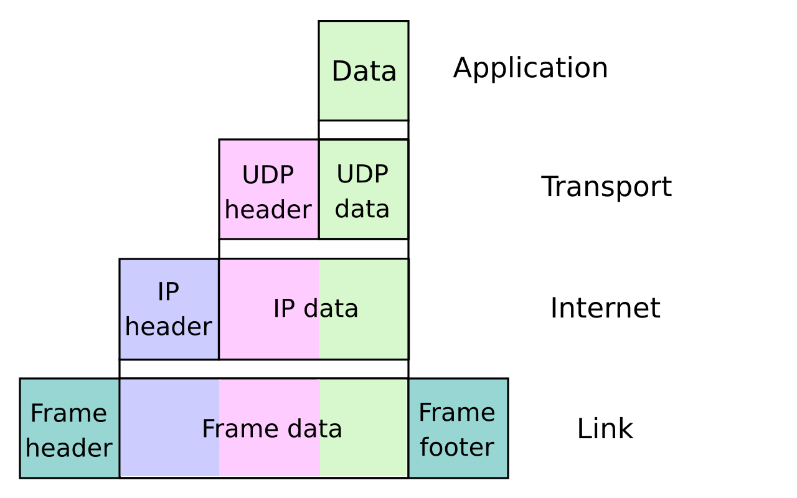
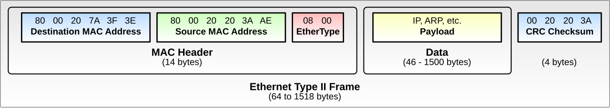
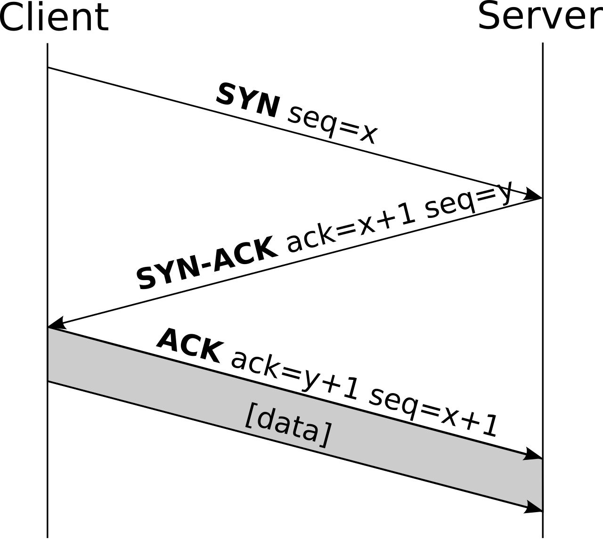
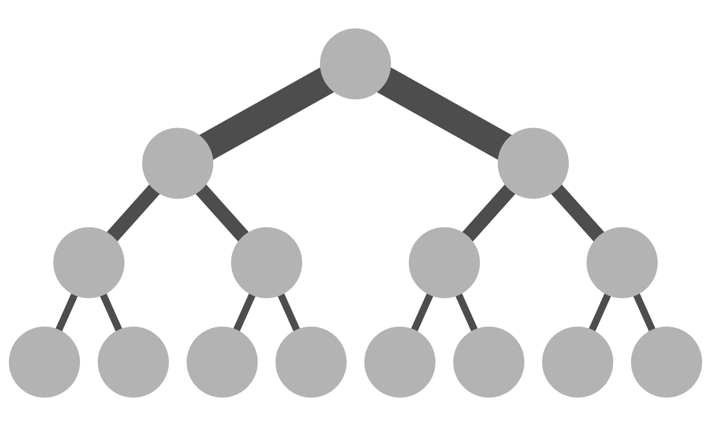

# Foundations: Computer Networking for ML Engineers

This chapter is for readers who know the ML math well but have never had to learn how computers talk to each other. Networking does not stay hidden for long once you work at scale. Your first multi-node job will hang at `init_process_group`. Your all-reduce will run at a tenth of the advertised speed. Somebody will ask you whether the cluster is "3:1 oversubscribed". This chapter builds the vocabulary from zero. By the end you should be able to read the [network chapter](../network/interconnects.md), [communication patterns](../network/collectives-internals.md), [network debug](../network/measuring-and-debugging.md), [network benchmarks](../network/measuring-and-debugging.md) and the more advanced [collective communication internals](../network/collectives-internals.md).

The goal is to explain why things are the way they are, not only what to type. Most networking failures in ML clusters make sense once you know which layer they happen at.

All the arithmetic in this chapter was checked with `python3`. Where a number depends on hardware generation or vendor, the text says so.

## Prerequisites

- [The toolkit](toolkit.md) for the terminal and a Python environment with `torch` for the **[torch]** examples.
- [Computer architecture](computer-architecture.md) for PCIe, DMA, memory bandwidth, bits vs bytes, and the GPU-side pieces (NVLink/NVSwitch, GPUDirect).
- [Linux and the OS](linux-and-os.md) for the shell, processes, file descriptors, system calls, environment variables (`MASTER_ADDR`, `RANK`, ...), `ssh`, and [how `torchrun` spawns workers](linux-and-os.md#how-torchrun-spawns-workers). A socket is a file descriptor.
- [Concurrency](concurrency.md) for threads, `asyncio` and blocking I/O (the asyncio server below assumes you have seen an event loop), and for the distributed-training vocabulary this chapter uses from the first page: rank, process group, collective, all-reduce, NCCL and Gloo ([A distributed hang is a deadlock across machines](concurrency.md#a-distributed-hang-is-a-deadlock-across-machines)).

Forward links: Slurm and Kubernetes appear only in passing here and are taught in [Slurm from zero](../orchestration/slurm/from-zero.md) and [Kubernetes from zero](../orchestration/kubernetes-from-zero.md); containers in [Containers and virtualization](containers-and-virtualization.md); the parallelism strategies (data, tensor, pipeline) in [Parallelism from first principles](../training/model-parallelism/derivations.md).

Conventions for the code in this chapter:

- Pure-Python examples need only `python3` and the standard library. They were run on an Apple M4 MacBook (macOS 15, CPython 3.14), and the output shown is from that run. Anything that went over the Internet (DNS, TLS to `example.com`) depends on your network, so your numbers will differ.
- Examples marked **[torch]** need `pip install torch` and run on CPU with the Gloo backend (tested with torch 2.15).
- Commands marked **untested on this Mac** are Linux-only (`ip`, `ss`, `ethtool`, `ibstat`, `nvidia-smi`, ...) or need a GPU cluster. Their output is a sketch of what you should expect, not a capture.
- Where real output contained my laptop's LAN addresses, I replaced them with `192.168.1.x`-style placeholders. Everything else is verbatim.

## Why an ML engineer needs this

Training a large model is a distributed program. Every optimizer step, thousands of accelerators exchange gradients, parameters or activations. On a good day the network keeps up with the compute. On a bad day, the GPUs that cost the most in the whole system sit idle while bytes crawl across a misconfigured link.

Three kinds of problems show up over and over:

1. **Connectivity:** process A cannot reach process B at all. Typical causes are a wrong IP, a blocked port, a hostname that resolves to the wrong address, or the wrong network interface.
2. **Performance:** things work, but slowly. Typical causes are traffic going over TCP instead of RDMA, the wrong NIC, an oversubscribed fabric, or a misread spec sheet. (A **NIC**, network interface card, is the hardware that connects a machine to the network. **RDMA** is a way for NICs to move data directly between machines' memories without the operating system in the path; it is what GPU clusters use for gradients, and it gets [its own section](#hpc-networking-rdma-infiniband-roce-efa) below. Every other term here is built up in this chapter.)
3. **Reliability:** things work and then stop. Typical causes are a flapping link, a congested switch, or a timeout.

Each section below gives you the concepts needed to reason about one or more of these.

The three classes look different from a program's point of view, and you can provoke all three on one laptop. Connectivity problems surface as exceptions, performance problems as numbers, and reliability problems as exceptions that arrive late:

```python
# three_problems.py
import socket, time
t0 = time.perf_counter()
try:
    socket.create_connection(("127.0.0.1", 1), timeout=2)          # nothing listens on port 1
except OSError as e:
    print(f"connectivity: {type(e).__name__} after {time.perf_counter()-t0:.3f} s")
t0 = time.perf_counter()
try:
    socket.create_connection(("10.255.255.1", 29500), timeout=2)   # packets go nowhere
except OSError as e:
    print(f"connectivity: {type(e).__name__} after {time.perf_counter()-t0:.3f} s")
```

```
connectivity: ConnectionRefusedError after 0.000 s
connectivity: TimeoutError after 2.002 s
```

An instant refusal and a two-second silence mean very different things. By the end of the chapter you will know exactly which.

### Try this

1. Run `three_problems.py`. Then change the timeout to 30 seconds and time it again. A timeout error always takes exactly as long as you allow, which is why default timeouts in distributed launchers (often 10-30 minutes) make hangs feel endless.
2. Write down the last multi-node failure you saw (or invent one) and classify it: connectivity, performance or reliability. Come back to it at the end of the chapter.

## Layers: the mental model

Network software is built in layers. Each layer offers a service to the layer above and relies only on the layer below. When you send bytes over a TCP socket, you do not care whether they travel over copper, fiber or Wi-Fi. That indifference is the whole point of layering.

### OSI vs TCP/IP

Textbooks teach the 7-layer OSI model. The Internet actually runs on the 4- or 5-layer TCP/IP model. Here is how they map, and what each layer means for you:

| OSI layer | TCP/IP layer | Example | What it means for you |
|---|---|---|---|
| 7 Application | Application | HTTP, SSH, DNS, NCCL bootstrap, gRPC | Your program's protocol |
| 6 Presentation | (folded into app) | TLS, serialization | Rarely a separate concern |
| 5 Session | (folded into app) | | Ignore |
| 4 Transport | Transport | TCP, UDP | Ports, reliability, congestion control |
| 3 Network | Internet | IP (v4/v6) | Addresses, subnets, routing between networks |
| 2 Data link | Link | Ethernet, InfiniBand link layer | MAC addresses, switches, frames, MTU |
| 1 Physical | Link (physical) | Copper, fiber, transceivers, cables | Link speed, cable faults, optics |

Two entries in the first row need a word. **gRPC** is Google's framework for **RPC** (remote procedure call: calling a function that runs on another machine, as if it were local); it runs on top of HTTP/2 and is common in serving and control-plane code. **NCCL bootstrap** is the start-up conversation NCCL's processes have over ordinary TCP before any GPU data moves; it's dissected in [How PyTorch distributed bootstraps](#how-pytorch-distributed-bootstraps).

You can see layers 3 and 4 in the arguments of every socket call. `getaddrinfo` (the function that turns a name into addresses, covered later) returns one entry per combination of address family (L3: IPv4 or IPv6) and socket type (L4: stream = TCP, datagram = UDP). The `proto` column is the number that goes into the IP header's protocol field:

```python
# layers.py
import socket
for fam, typ, proto, _, addr in socket.getaddrinfo("localhost", 29500):
    print(f"L3 family={fam.name:8} L4 type={typ.name:12} proto={proto:2} -> {addr}")
```

```
L3 family=AF_INET6 L4 type=SOCK_DGRAM   proto=17 -> ('::1', 29500, 0, 0)
L3 family=AF_INET6 L4 type=SOCK_STREAM  proto= 6 -> ('::1', 29500, 0, 0)
L3 family=AF_INET  L4 type=SOCK_DGRAM   proto=17 -> ('127.0.0.1', 29500)
L3 family=AF_INET  L4 type=SOCK_STREAM  proto= 6 -> ('127.0.0.1', 29500)
```

Your program picks L3 and L4. The kernel picks L2 (which interface, which MAC) from the routing table. The application protocol (L7) is whatever bytes you write into the socket.

People say "L2" and "L3" all the time, and they mean the OSI numbers: an "L2 switch" forwards Ethernet frames, an "L3 switch" or router forwards IP packets, and an "L4 load balancer" looks at TCP/UDP ports. Layers 5 and 6 almost never come up.

One important note for later: **InfiniBand is a complete stack of its own.** It has its own physical, link, network and transport layers and does not use Ethernet or (by default) IP. RDMA over Converged Ethernet (RoCE) takes the InfiniBand transport and runs it on top of Ethernet/IP. Keep this in mind when we get to HPC networking.

### Encapsulation: packets, frames, headers

Each layer wraps the data from the layer above with its own header. This is called encapsulation. Suppose your program sends 1000 bytes over TCP on Ethernet:

```
  application data (1000 B)
  +--------------------------------------------+
  |                payload                     |
  +--------------------------------------------+

  TCP segment: TCP header (20 B, often 32 B with options) + payload
  +--------+-----------------------------------+
  |  TCP   |                payload            |
  +--------+-----------------------------------+

  IP packet: IPv4 header (20 B) + TCP segment
  +------+--------+----------------------------+
  |  IP  |  TCP   |                payload     |
  +------+--------+----------------------------+

  Ethernet frame: Eth header (14 B) + IP packet + FCS checksum (4 B)
  +-----+------+--------+--------------+-----+
  | Eth |  IP  |  TCP   |   payload    | FCS |
  +-----+------+--------+--------------+-----+
```

Each layer wraps the one above in its own header:



([source](https://commons.wikimedia.org/wiki/File:UDP_encapsulation.svg))

The names change by layer. TCP calls its unit a **segment**, IP a **packet**, and Ethernet a **frame**. In casual speech everything is a "packet".

Each header holds the information its layer needs:

- **Ethernet:** destination MAC, source MAC, EtherType (what is inside, for example IPv4).
- **IP:** source IP, destination IP, time-to-live (TTL), protocol (TCP=6, UDP=17).
- **TCP:** source port, destination port, sequence number, acknowledgment number, flags, window size.

On the receiving side the layers unwrap in reverse order. A switch only looks at the Ethernet header. A router looks at the IP header. Only the end host looks at TCP.

Headers are just packed bytes. Building one frame by hand with `struct` makes the byte counts concrete. The IP header also carries a checksum, a 16-bit ones'-complement sum that lets a router detect a corrupted header; a correct header sums to zero. (Python's `struct.pack(fmt, ...)` turns integers into bytes. In the format string, `!` means network byte order, which is big-endian (endianness is in [Why binary](computer-architecture.md#why-binary)); `B`, `H` and `I` are 1-, 2- and 4-byte unsigned integers; `4s` is 4 raw bytes. `struct.unpack` reverses it.)

```python
# encap.py
import struct

payload = b"x" * 1000

# TCP: src port, dst port, seq, ack, data offset (5 words) + flags, window, checksum, urgent
tcp = struct.pack("!HHIIBBHHH", 51515, 29500, 1, 0, 5 << 4, 0x18, 65535, 0, 0)

def ip_checksum(hdr: bytes) -> int:           # ones'-complement sum of 16-bit words
    s = sum(struct.unpack(f"!{len(hdr)//2}H", hdr))
    while s >> 16:
        s = (s & 0xFFFF) + (s >> 16)
    return ~s & 0xFFFF

ver_ihl = (4 << 4) | 5                        # IPv4, header = 5 x 32-bit words = 20 bytes
total_len = 20 + len(tcp) + len(payload)
ip = struct.pack("!BBHHHBBH4s4s", ver_ihl, 0, total_len, 0, 0, 64, 6, 0,   # TTL=64, proto=6 (TCP)
                 bytes([10, 1, 2, 8]), bytes([10, 1, 2, 7]))
ip = ip[:10] + struct.pack("!H", ip_checksum(ip)) + ip[12:]

eth = bytes.fromhex("3cfdfea1b2c3") + bytes.fromhex("3cfdfea1b2c4") + struct.pack("!H", 0x0800)
frame = eth + ip + tcp + payload               # the NIC appends the 4-byte FCS

print(f"payload {len(payload)}  +TCP {len(tcp)}  +IP {len(ip)}  +Eth {len(eth)}  = {len(frame)} B (+4 FCS)")
print("IP header :", ip.hex(" "))
print("checksum verifies:", ip_checksum(ip) == 0)
```

```
payload 1000  +TCP 20  +IP 20  +Eth 14  = 1054 B (+4 FCS)
IP header : 45 00 04 10 00 00 00 00 40 06 5e d8 0a 01 02 08 0a 01 02 07
checksum verifies: True
```

Read the IP header bytes left to right: `45` is version 4 with a 5-word header, `04 10` is the total length (1040), `40` is TTL 64, `06` is TCP, and the last eight bytes are `10.1.2.8` and `10.1.2.7`. Wireshark (a graphical packet-capture viewer; its command-line cousin `tcpdump` is in [Practical tools](#tcpdump-basics)) shows you exactly this, decoded.

### MTU and jumbo frames

The **MTU** (Maximum Transmission Unit) is the largest IP packet a link will carry in one frame. Standard Ethernet MTU is **1500 bytes**. **Jumbo frames** are usually **9000 bytes**. Switches often allow a bit more, such as 9216, to leave room for extra headers.

Why does MTU matter? Every frame has a fixed cost: headers on the wire plus per-packet processing in the NIC and the kernel. On the wire, Ethernet adds 38 bytes beyond the IP packet: 8 preamble, 14 header, 4 FCS and a 12-byte inter-frame gap. With IPv4+TCP headers taking 40 bytes of the MTU:

| MTU | TCP payload per frame | Bytes on the wire | Payload efficiency | Frames/s to fill 100 Gbps |
|---|---|---|---|---|
| 1500 | 1460 | 1538 | 94.9% | ~8.1 million |
| 9000 | 8960 | 9038 | 99.1% | ~1.4 million |

```python
# mtu.py
for mtu in (1500, 9000):
    payload = mtu - 40                 # IPv4 20 + TCP 20
    wire = mtu + 38                    # preamble 8 + eth hdr 14 + FCS 4 + inter-frame gap 12
    print(f"MTU {mtu}: payload {payload}, wire {wire}, eff {payload/wire:.1%}, "
          f"frames/s @100G {100e9/8/wire/1e6:.2f} M")
```

```
MTU 1500: payload 1460, wire 1538, eff 94.9%, frames/s @100G 8.13 M
MTU 9000: payload 8960, wire 9038, eff 99.1%, frames/s @100G 1.38 M
```

The bandwidth gain is only about 4%. The bigger effect is in the last column. Handling 8 million packets per second in software is a lot of CPU work, which is one reason TCP at 100+ Gbps is hard (more on this below). NIC offloads like TSO/GRO (TCP segmentation offload, generic receive offload) hide some of the cost by letting the kernel deal with large chunks while the NIC splits and merges them.

The classic MTU failure is a **mismatch**. One host is set to 9000, a switch in the path is at 1500, and small packets (like ping or SSH handshakes) get through while large transfers hang or crawl. If "ping works but the transfer stalls", check MTU along the path:

```bash
ip link show eth0                  # look for "mtu 9000"
ping -M do -s 8972 other-host      # 8972 + 8 ICMP + 20 IP = 9000; -M do forbids fragmentation
```

(Linux syntax, untested on this Mac. `ip` is Linux's network configuration tool, used throughout this chapter. `ping` sends small ICMP packets, ICMP being the IP layer's own control protocol, and times the replies; it's covered under [ping](#ping). `-s` sets the payload size.) If the large ping fails while a plain `ping other-host` succeeds, something in the path has a smaller MTU. On macOS the equivalents are `ifconfig en0 | grep mtu` and `ping -D -s 1472 host` (`-D` sets don't-fragment). For reference, a Mac's loopback interface has a 16 KiB MTU and its Wi-Fi a standard 1500:

```
$ ifconfig lo0 | head -1
lo0: flags=8049<UP,LOOPBACK,RUNNING,MULTICAST> mtu 16384
$ ifconfig en0 | grep mtu
en0: flags=8863<UP,BROADCAST,SMART,RUNNING,SIMPLEX,MULTICAST> mtu 1500
$ ping -D -s 1472 -c 1 1.1.1.1 | tail -1          # 1472 + 8 + 20 = 1500: fits
round-trip min/avg/max/stddev = 29.224/29.224/29.224/0.000 ms
$ ping -D -s 1473 -c 1 1.1.1.1 | tail -1          # 1501: needs fragmenting, DF forbids it
1 packets transmitted, 0 packets received, 100.0% packet loss
```

That one-byte difference is a path-MTU probe, and it is exactly the test to run between two cluster nodes that are supposed to have jumbo frames.

InfiniBand has its own MTU, usually 4096 bytes (IB supports 256 to 4096). RoCE deployments also commonly use a 4096-byte RDMA MTU on top of jumbo Ethernet frames.

### Try this

1. Run `encap.py`, change the payload to 1460 bytes and check that the frame is exactly 1514 bytes (+4 FCS = 1518, the classic maximum Ethernet frame).
2. Flip one byte of the IP header after the checksum is computed and confirm `ip_checksum(ip) != 0`. That is all a router does to detect a damaged header.
3. Extend `mtu.py` with a column for frames per second at 400 Gbps and MTU 4096 (an RDMA MTU). How many packets per second does the NIC handle in hardware?
4. Open `curl -v http://example.com` and label each output line with its layer (DNS, TCP, HTTP). (`curl` fetches a URL from the command line, and `-v` prints each step; see [curl](#curl). Come back to this one after the [HTTP section](#http11-from-raw-sockets) if the output means nothing yet.)

## Ethernet, switches and routers

### MAC addresses and Ethernet

Every network interface card (NIC) has a **MAC address**, a 48-bit identifier written like `3c:fd:fe:a1:b2:c3`. It is burned in by the manufacturer, although it can be overridden. MAC addresses are flat: nothing in the address tells you where the device is. That is fine within one local network and useless at Internet scale, which is why IP exists.

An Ethernet II frame:



([source](https://commons.wikimedia.org/wiki/File:Ethernet_Type_II_Frame_format.svg))

Ethernet is the link layer that nearly every data center uses for general traffic. Speeds you will see: 1, 10, 25, 100, 200, 400 and 800 Gbps.

The first three bytes of a MAC are the **OUI** (Organizationally Unique Identifier), a vendor prefix. Two bits of the first byte have meaning: bit 0 marks a multicast address, and bit 1 marks a "locally administered" address, one that software made up rather than the factory. Laptops and phones now randomize their MACs for privacy, so you will often see that bit set:

```python
# mac.py
import uuid
n = uuid.getnode()                     # 48-bit MAC of one interface (random if none found)
mac = ":".join(f"{(n >> s) & 0xff:02x}" for s in range(40, -1, -8))
print("MAC:", mac)
first = (n >> 40) & 0xff
print("multicast bit:", first & 1, " locally-administered bit:", (first >> 1) & 1)
print("OUI (vendor prefix):", mac[:8])
```

```
MAC: 26:9b:53:0a:b6:84
multicast bit: 0  locally-administered bit: 1
OUI (vendor prefix): 26:9b:53
```

On this Mac the address is locally administered (macOS private Wi-Fi addresses), so the "OUI" identifies no vendor. On a server NIC, the OUI usually identifies the manufacturer, which is a quick way to tell a Mellanox/NVIDIA port from an Intel one in a MAC table. To list MACs on Linux: `ip -br link` (untested on this Mac); on macOS: `ifconfig en0 | grep ether`.

### Switches vs routers

A **switch** (L2) connects devices in the same local network, also called a broadcast domain or VLAN (a virtual LAN: one physical switch carved into several separate L2 networks by tagging frames with a VLAN number). It learns which MAC address sits behind which port by watching source addresses on incoming frames. It then forwards each frame only to the port where the destination lives. If it does not know the destination yet, it floods the frame to all ports.

A **router** (L3) connects different IP networks. It reads the destination IP, looks it up in a routing table and forwards the packet to the next hop. It also decrements the TTL so a packet caught in a loop eventually dies.

In modern data centers the line is blurry. "L3 switches" do both, at line rate, in hardware. What matters conceptually:

- Inside one subnet, hosts reach each other directly through switches using MAC addresses.
- Between subnets, traffic must go through a router (a gateway).

A learning switch is simple enough to write in fifteen lines. The table it builds is called the **MAC table** or forwarding database (FDB):

```python
# switch.py
class Switch:
    def __init__(self, nports): self.nports, self.table = nports, {}
    def frame(self, in_port, src, dst):
        self.table[src] = in_port                          # learn where src lives
        if dst in self.table:
            return [self.table[dst]]                       # forward to one port
        return [p for p in range(self.nports) if p != in_port]   # unknown: flood

sw = Switch(4)
print("A->B", sw.frame(0, "aa", "bb"))   # B unknown: flood to 1,2,3
print("B->A", sw.frame(2, "bb", "aa"))   # A was learned on port 0
print("A->B", sw.frame(0, "aa", "bb"))   # B now learned on port 2
print("table", sw.table)
```

```
A->B [1, 2, 3]
B->A [0]
A->B [2]
table {'aa': 0, 'bb': 2}
```

Two consequences follow directly. Flooding means a broadcast domain cannot grow forever: every unknown or broadcast frame reaches every host. And a loop in the cabling makes flooded frames circulate forever, which is why L2 networks run a loop-prevention protocol (Spanning Tree) and why large data centers prefer routing (L3) everywhere except the last hop.

How does a host learn the MAC address for an IP on its own subnet? It uses **ARP** (Address Resolution Protocol). It broadcasts "who has 10.1.2.7?" and the owner answers with its MAC. `ip neigh` shows the resulting cache on Linux (untested on this Mac). On macOS it is `arp -a`:

```
$ arp -a | head -2
? (192.168.1.1) at c4:eb:39:xx:xx:xx on en0 ifscope [ethernet]
? (192.168.1.2) at d8:8b:4c:xx:xx:xx on en0 ifscope [ethernet]
```

### Try this

1. Extend `switch.py` with an `age` so entries expire after N frames, and show that a host which moved to another port is found again after flooding. Real switches age entries after about 5 minutes by default (vendor-dependent).
2. Add a broadcast destination `ff:ff:ff:ff:ff:ff` that is always flooded. Count how many frames a single ARP request generates in a 48-port switch.
3. Run `arp -a` (macOS) or `ip neigh` (Linux) before and after `ping`ing a new host on your LAN. Watch the entry appear.

## IP addressing, subnets and routing

### IPv4 addresses and CIDR

An IPv4 address is 32 bits, written as four bytes: `10.1.2.7`. Addresses are grouped into **subnets** using **CIDR** notation: `10.1.2.0/24` means "the first 24 bits are the network, the remaining 8 bits pick a host". That gives $2^8 = 256$ addresses, `10.1.2.0` to `10.1.2.255`.

| CIDR | Netmask | Addresses | Range |
|---|---|---|---|
| `10.1.2.0/24` | 255.255.255.0 | 256 | 10.1.2.0 – 10.1.2.255 |
| `10.1.0.0/22` | 255.255.252.0 | 1024 | 10.1.0.0 – 10.1.3.255 |
| `10.0.0.0/8` | 255.0.0.0 | 16,777,216 | 10.0.0.0 – 10.255.255.255 |

So `10.1.3.77` is inside `10.1.0.0/22` and `10.1.4.1` is not. The quickest way to check is with Python's standard library:

```python
import ipaddress
ipaddress.ip_address("10.1.3.77") in ipaddress.ip_network("10.1.0.0/22")  # True
ipaddress.ip_address("10.1.4.1")  in ipaddress.ip_network("10.1.0.0/22")  # False
```

In each subnet the first address is the network address and the last is the broadcast address, so neither can be assigned to a host. That leaves 254 usable addresses in a /24.

### Private ranges

Three ranges are reserved for private networks (RFC 1918). They are not routed on the public Internet, and cluster-internal networks almost always use them:

| Range | CIDR | Size |
|---|---|---|
| 10.0.0.0 – 10.255.255.255 | `10.0.0.0/8` | 16.7M |
| 172.16.0.0 – 172.31.255.255 | `172.16.0.0/12` | 1M |
| 192.168.0.0 – 192.168.255.255 | `192.168.0.0/16` | 65,536 |

A few other special ranges you will see:

- `127.0.0.0/8`: loopback. `127.0.0.1` is "this machine". Traffic never leaves the host.
- `169.254.0.0/16`: link-local. A host gives itself one of these when DHCP (the protocol that hands out IP addresses automatically when a machine joins a network) failed. On clouds, `169.254.169.254` is the instance metadata service: a web server, reachable only from inside each VM, that tells the machine about itself (instance type, region, temporary credentials).
- `172.17.0.0/16`: the default Docker bridge network (the virtual network Docker creates on a host so its containers can talk to each other; containers are introduced in [Docker and Apptainer for ML](linux-and-os.md#docker-and-apptainer-for-ml)). It is a private range like any other, but it often confuses NCCL because it looks like a real interface (see below).

`ipaddress` knows all of these, which is handy for sanity checks in launch scripts (for example, refusing to start if `MASTER_ADDR` is loopback while `WORLD_SIZE` spans several nodes):

```python
# private.py
import ipaddress
for a in ["10.1.2.7", "172.17.0.1", "172.32.0.1", "192.168.1.5", "127.0.1.1",
          "169.254.169.254", "8.8.8.8", "fe80::1"]:
    ip = ipaddress.ip_address(a)
    print(f"{a:16} private={ip.is_private!s:5} loopback={ip.is_loopback!s:5} "
          f"link_local={ip.is_link_local!s:5} global={ip.is_global}")
net = ipaddress.ip_network("10.1.0.0/22")
print(net, "netmask", net.netmask, "hosts", net.num_addresses - 2,
      "first", next(net.hosts()), "broadcast", net.broadcast_address)
print(list(net.subnets(new_prefix=24)))
```

```
10.1.2.7         private=True  loopback=False link_local=False global=False
172.17.0.1       private=True  loopback=False link_local=False global=False
172.32.0.1       private=False loopback=False link_local=False global=True
192.168.1.5      private=True  loopback=False link_local=False global=False
127.0.1.1        private=True  loopback=True  link_local=False global=False
169.254.169.254  private=True  loopback=False link_local=True  global=False
8.8.8.8          private=False loopback=False link_local=False global=True
fe80::1          private=True  loopback=False link_local=True  global=False
10.1.0.0/22 netmask 255.255.252.0 hosts 1022 first 10.1.0.1 broadcast 10.1.3.255
[IPv4Network('10.1.0.0/24'), IPv4Network('10.1.1.0/24'), IPv4Network('10.1.2.0/24'), IPv4Network('10.1.3.0/24')]
```

Note `172.32.0.1`: just outside `172.16.0.0/12`, it is a public address. People get the /12 boundary wrong regularly. Note also that `127.0.1.1`, the Debian hostname trap described below, is loopback.

IPv6 uses 128-bit addresses like `fe80::1`. Most HPC clusters still run IPv4 internally. If you see IPv6 in error messages, it is usually because a hostname resolved to an IPv6 address you were not expecting.

### Interfaces and the routing table

A machine has several **network interfaces**: loopback `lo`, one or more Ethernet NICs (`eth0`, `ens5`, `enp65s0f0` and similar), maybe InfiniBand IP interfaces (`ib0`), Docker bridges (`docker0`) and VPN tunnels. Each interface can have one or more IP addresses.

```bash
$ ip -br addr          # brief view: interface, state, addresses
lo               UNKNOWN        127.0.0.1/8 ::1/128
ens5             UP             10.1.2.7/24
ib0              UP             192.168.100.7/24
docker0          DOWN           172.17.0.1/16
```

A real GPU node often has many more: one management/frontend NIC plus 8 backend NICs, one per GPU. The output above is illustrative.

The **routing table** decides which interface and next hop each outgoing packet uses:

```bash
$ ip route
default via 10.1.2.1 dev ens5
10.1.2.0/24 dev ens5 proto kernel scope link src 10.1.2.7
192.168.100.0/24 dev ib0 proto kernel scope link src 192.168.100.7
```

Read it as follows. To reach `10.1.2.x`, send directly out of `ens5`. To reach `192.168.100.x`, send directly out of `ib0`. For anything else, send to the gateway `10.1.2.1` via `ens5`. When several routes match, the most specific one (longest prefix) wins.

To ask the kernel which route it would use for a given destination:

```bash
$ ip route get 192.168.100.9
192.168.100.9 dev ib0 src 192.168.100.7
```

This one command answers "will traffic to that node go over the fast network or the slow one?" It is worth remembering.

The `ip` commands above are Linux-only (untested on this Mac). The macOS equivalents, with real output (LAN addresses replaced):

```
$ netstat -rn -f inet | head -6
Routing tables

Internet:
Destination        Gateway            Flags               Netif Expire
default            192.168.1.1        UGScg                 en0
127                127.0.0.1          UCS                   lo0
$ route -n get 1.1.1.1 | grep -E 'gateway|interface'
    gateway: 192.168.1.1
  interface: en0
```

You can also ask the kernel from Python, portably. "Connecting" a UDP socket sends no packet, but it makes the kernel choose a route and a source address, which you can then read back:

```python
def source_ip_for(dest: str) -> str:
    import socket
    with socket.socket(socket.AF_INET, socket.SOCK_DGRAM) as u:
        u.connect((dest, 9))          # no packet is sent for UDP connect
        return u.getsockname()[0]     # the local IP the route would use

print(source_ip_for("127.0.0.1"), source_ip_for("1.1.1.1"))
```

```
127.0.0.1 192.168.1.23
```

On a GPU node, `source_ip_for(master_ip)` tells you which of your many interfaces a TCP connection to the master would leave from. That is the same decision PyTorch's store client makes.

### DNS, /etc/hosts and hostname resolution

People and scripts use names (`node-017`). Sockets need IP addresses. **Name resolution** turns one into the other. On Linux the order is set by `/etc/nsswitch.conf` and is usually `files dns`: check `/etc/hosts` first, then ask a DNS server (configured in `/etc/resolv.conf`, often through `systemd-resolved`).

```bash
getent hosts node-017     # resolves the same way programs do (honors /etc/hosts + DNS)
hostname                  # this machine's name
hostname -I               # all of this machine's IPs (Linux)
```

Use `getent` rather than `nslookup` or `dig` when debugging cluster jobs. `nslookup` and `dig` query DNS directly and skip `/etc/hosts`, so they can disagree with what your program actually sees.

Hostname resolution failures that are typical on clusters:

1. **The hostname resolves to loopback.** Debian/Ubuntu images often ship with a line like `127.0.1.1 node-017` in `/etc/hosts`. If you then set `MASTER_ADDR=$(hostname)`, the master binds to or advertises `127.0.1.1`, and other nodes cannot connect to it. Check with `getent hosts $(hostname)`. If you see a 127.x address, use the real IP instead.
2. **The name resolves to the wrong interface.** The hostname maps to the frontend/management IP, while you wanted traffic on another network. For bootstrap this is usually fine. It becomes a problem when a firewall sits between the networks.
3. **Short vs fully qualified names.** `node-017` resolves but `node-017.cluster.local` does not, or the reverse, depending on the `search` line in `/etc/resolv.conf`.
4. **Inconsistent `/etc/hosts` across nodes.** The file was edited on one node but not on the others.
5. **DNS overload at startup.** Thousands of ranks resolve names at the same moment and the DNS server times out. It is rare, but it does happen at scale. Resolve once in the launcher and pass IPs around.

The SLURM idiom for choosing a master is:

```bash
export MASTER_ADDR=$(scontrol show hostnames "$SLURM_JOB_NODELIST" | head -n 1)
```

(Just enough to follow it: SLURM is the job scheduler most GPU clusters use; you met a job script in [Putting it together](linux-and-os.md#10-putting-it-together-one-training-job-end-to-end), and it's taught in [Slurm from zero](../orchestration/slurm/from-zero.md). Inside a job, SLURM sets `SLURM_JOB_NODELIST` to a compressed list of the job's nodes such as `node-[017-018]`; `scontrol show hostnames` expands it to one name per line, and `head -n 1` keeps the first, which becomes the master.)

This relies on that hostname resolving correctly from every node. Verify it with `getent hosts $MASTER_ADDR` on a worker. Resolving names from Python, and the hostname-to-loopback trap reproduced on a laptop, are in [DNS lookups in code](#dns-lookups-in-code) below.

### Try this

1. Using `ipaddress`, write `same_subnet(a, b, prefix)` and check whether `10.1.3.77` and `10.1.4.1` can talk without a router at /22 and at /16.
2. A cluster has 1,000 nodes, each with 8 backend NICs that each need their own IP. What is the smallest single prefix that fits them all? (Answer: 8,000 addresses need 13 bits, so a /19 with 8,192.)
3. Run `source_ip_for()` against `127.0.0.1`, your router and a public IP. Explain each result using the routing table you printed.
4. On a Linux box (untested here), run `ip route get` for each address in `/etc/hosts` and check that the backend addresses really leave through the backend interface.

## Transport: TCP and UDP

IP delivers packets between hosts, best effort. Packets can be lost, duplicated or reordered. The transport layer adds two things on top: **ports**, which identify which program on the host gets the data, and, in TCP's case, **reliability**.

### Ports and sockets

A **port** is a 16-bit number (0 to 65535). A connection is identified by a 5-tuple: (protocol, source IP, source port, destination IP, destination port). Servers listen on well-known ports, for example SSH on 22, HTTPS on 443, and torch distributed's default `MASTER_PORT` of 29500. Clients get a random **ephemeral port**. On Linux the default range is 32768 to 60999, visible in `/proc/sys/net/ipv4/ip_local_port_range`. macOS uses the IANA range, `sysctl net.inet.ip.portrange.first net.inet.ip.portrange.last` prints `49152` and `65535`. A server that picks a fixed port inside the ephemeral range can collide with some unrelated outgoing connection that got that port by chance, which is one reason `MASTER_PORT` defaults to 29500, below both ranges.

Ports below 1024 need root to bind. Only one process can listen on a given (IP, port, protocol) at a time. That rule is why "address already in use" happens when a previous training run is still alive, or a leftover process from a crashed run is still holding port 29500.

A **socket** is the operating system's handle for one endpoint of communication. Here is a complete TCP server and client in Python. This is the same pattern that sits under PyTorch's TCP store (the small key-value server that ranks use to find each other at start-up; see [Step 1](#step-1-rendezvous-over-tcp-the-store) below).

```python
# server.py -- run on the "master" node
import socket

with socket.socket(socket.AF_INET, socket.SOCK_STREAM) as s:   # IPv4, TCP
    s.setsockopt(socket.SOL_SOCKET, socket.SO_REUSEADDR, 1)    # allow quick restart
    s.bind(("0.0.0.0", 29500))     # 0.0.0.0 = listen on all interfaces
    s.listen()
    print("listening on port 29500")
    conn, addr = s.accept()        # blocks until a client connects
    with conn:
        print("connection from", addr)
        while data := conn.recv(4096):   # b"" means the peer closed
            conn.sendall(data.upper())
```

```python
# client.py -- run on any node: python client.py <master-ip>
import socket, sys

host = sys.argv[1] if len(sys.argv) > 1 else "127.0.0.1"
with socket.create_connection((host, 29500), timeout=5) as s:
    s.sendall(b"hello from rank 1")
    print(s.recv(4096))            # b'HELLO FROM RANK 1'
```

This pair was tested on localhost. Across two nodes, a 5-second timeout on the client means one of these is true: a firewall dropped the packets, nothing is listening, or there is no route. A "Connection refused" means the host is reachable but nothing is listening on that port. That difference is a very useful diagnostic, and it comes back in the tools section.

Note the `0.0.0.0` in `bind`. If the server binds to `127.0.0.1` instead, only local clients can connect. A server bound to localhost is one of the most common reasons "it works on one node but not across nodes".

### The TCP handshake and reliability

TCP gives you a reliable, ordered byte stream on top of unreliable IP packets. Opening a connection takes a three-way handshake:

```
  client                                 server (listening)
    |  ---- SYN (seq=x) ---------------->  |
    |  <--- SYN-ACK (seq=y, ack=x+1) ----  |
    |  ---- ACK (ack=y+1) -------------->  |
    |        connection established        |
```

The three-way handshake:



([source](https://commons.wikimedia.org/wiki/File:Tcp-handshake.svg))

That costs one round trip before any data flows. After that, TCP:

- numbers every byte (sequence numbers),
- has the receiver acknowledge (ACK) what it received,
- retransmits anything not ACKed within a timeout, or after duplicate ACKs signal a gap,
- reorders out-of-order segments before handing the bytes to the application.

A firewall that silently drops packets causes the client's SYN to be retransmitted with exponential backoff. That is why a blocked port shows up as a long hang rather than an immediate error.

### Flow control and congestion control

TCP has two separate "slow down" mechanisms:

- **Flow control** protects the *receiver*. The receiver advertises a **window**: how many more bytes it has buffer space for. The sender may not have more than that much unacknowledged data in flight.
- **Congestion control** protects the *network*. The sender keeps a congestion window. It starts small (slow start), grows while ACKs come back, and shrinks sharply when it detects loss, which it takes as a sign of congestion. Linux defaults to CUBIC; BBR is a common alternative.

So a TCP sender can never have more than `min(receive window, congestion window)` bytes in flight. That leads directly to the most useful formula in networking.

Flow control is easy to watch. Below, the receiving socket never calls `recv()`. The sender keeps writing in non-blocking mode until the kernel says "would block": the receiver's buffer is full, its advertised window is zero, and the sender's own buffer has filled behind it:

```python
# flowctl.py
import socket

srv = socket.create_server(("127.0.0.1", 0))   # port 0 = let the kernel pick a free port
cli = socket.create_connection(srv.getsockname())
peer, _ = srv.accept()                         # 'peer' never reads
print("SO_SNDBUF", cli.getsockopt(socket.SOL_SOCKET, socket.SO_SNDBUF),
      "SO_RCVBUF", peer.getsockopt(socket.SOL_SOCKET, socket.SO_RCVBUF))

cli.setblocking(False)
sent, chunk = 0, b"\0" * 65536
try:
    while True:
        sent += cli.send(chunk)
except BlockingIOError:                        # would block = no window, no buffer left
    print(f"sender stalled after {sent/1024:.0f} KiB in flight (kernel buffers on both ends)")

got = 0
peer.setblocking(False)
try:
    while True:
        got += len(peer.recv(1 << 20))
except BlockingIOError:
    pass
print(f"receiver drained {got/1024:.0f} KiB; sender can continue:", cli.send(chunk) > 0)
```

```
SO_SNDBUF 146988 SO_RCVBUF 408300
sender stalled after 535 KiB in flight (kernel buffers on both ends)
receiver drained 535 KiB; sender can continue: True
```

This is the mechanism behind a classic distributed-training hang: if a rank stops reading (because it is stuck in a long compute step, or deadlocked), its peers' `send()` calls eventually block too, and the stall spreads backwards through the job. In blocking mode `send()` would simply sit there.

Congestion control is easiest to understand as a loop. Here is a toy version of the classic Reno behaviour: double the window every round trip (slow start) until a threshold, then add one packet per round trip, and halve on loss. The "network" drops packets whenever the window exceeds 40:

```python
# aimd.py
cwnd, ssthresh, cap = 1, 64, 40          # cap = packets the bottleneck can absorb per RTT
trace = []
for rtt in range(30):
    trace.append(cwnd)
    if cwnd > cap:                       # loss detected
        ssthresh = max(cwnd // 2, 2); cwnd = ssthresh       # multiplicative decrease
    elif cwnd < ssthresh:
        cwnd *= 2                        # slow start: exponential
    else:
        cwnd += 1                        # congestion avoidance: additive increase
print(" ".join(map(str, trace)))
```

```
1 2 4 8 16 32 64 32 33 34 35 36 37 38 39 40 41 20 21 22 23 24 25 26 27 28 29 30 31 32
```

The sawtooth is the signature of loss-based congestion control (AIMD, additive increase multiplicative decrease). Its average sits well below the capacity of 40, and every loss costs many round trips to recover. CUBIC grows the window along a cubic curve instead of linearly to recover faster on fat links, and BBR estimates bandwidth and RTT directly instead of waiting for loss; neither is modelled here.

### Latency, bandwidth, throughput

These three words get mixed up constantly:

- **Latency:** how long one small message takes to arrive, usually measured as round-trip time (RTT). It is set by distance (light in fiber covers about 200,000 km/s, so 100 m of fiber is about 0.5 µs one way and 4000 km is about 20 ms), switch hops, and software overhead.
- **Bandwidth:** the maximum rate the link can carry, such as 400 Gbps. It is a property of the pipe.
- **Throughput:** the rate you actually achieve. It is always at most the bandwidth, and often much less.

A useful first-order model for the time to send a message of $S$ bytes:

$$
\text{time} \approx \text{latency} + \frac{S}{\text{bandwidth}}
$$

Small messages are dominated by latency, large ones by bandwidth. Sending 1 GiB over a 400 Gbps link takes at least $2^{30} \times 8 / (400 \times 10^9) \approx 21.5\ \text{ms}$, and the latency term is negligible. Sending 8 bytes takes as long as the latency, whatever the bandwidth. This is why the benchmark chapters plot bandwidth as a function of message size: small messages never reach the peak.

### Bandwidth-delay product

To keep a pipe full you need enough data in flight to cover a full round trip. The **bandwidth-delay product** (BDP) is:

$$
\text{BDP (bytes)} = \frac{\text{bandwidth (bits/s)} \times \text{RTT (s)}}{8}
$$

Worked numbers:

| Link | Bandwidth | RTT | BDP |
|---|---|---|---|
| Home connection | 1 Gbps | 20 ms | 2.5 MB |
| Data center 10GbE | 10 Gbps | 0.2 ms | 250 KB |
| InfiniBand NDR, same rack | 400 Gbps | 5 µs | 250 KB |
| Cross-region cloud link | 100 Gbps | 70 ms | 875 MB |

```python
# bdp.py
links = [("home", 1e9, 20e-3), ("10GbE DC", 10e9, 0.2e-3),
         ("IB NDR rack", 400e9, 5e-6), ("cross-region", 100e9, 70e-3)]
for name, bw, rtt in links:
    bdp = bw * rtt / 8
    capped = 65536 * 8 / rtt                     # throughput with a 64 KiB window
    print(f"{name:13} BDP {bdp/1e6:8.3f} MB   64 KiB window caps at {min(capped, bw)/1e9:8.4f} Gbps")
```

```
home          BDP    2.500 MB   64 KiB window caps at   0.0262 Gbps
10GbE DC      BDP    0.250 MB   64 KiB window caps at   2.6214 Gbps
IB NDR rack   BDP    0.250 MB   64 KiB window caps at 104.8576 Gbps
cross-region  BDP  875.000 MB   64 KiB window caps at   0.0075 Gbps
```

The implication: if a TCP connection's window is capped at 64 KiB, throughput is capped at $\text{window} / \text{RTT}$. That is $65536 \times 8 / 0.2\ \text{ms} \approx 2.6\ \text{Gbps}$ in the data center and only about 7.5 Mbps across a 70 ms link, no matter how fat the pipe is. Linux autotunes socket buffers. The typical default maxima are around 6 MB receive and 4 MB send (`net.ipv4.tcp_rmem` / `tcp_wmem`; check your distro). That is plenty for the data center but far short of the 875 MB a cross-region 100 Gbps link would need. This is why copying a checkpoint across regions over a single TCP stream is slow, and why tools open many parallel streams.

The InfiniBand row is worth a second look (NDR is the name of InfiniBand's 400 Gbps generation; [InfiniBand](#infiniband) below has the details). The BDP is small because the latency is tiny. On that fabric, software overhead per message, not the window, is the bottleneck.

### UDP

**UDP** is the minimal transport: ports plus a checksum, and nothing else. There is no handshake, no ordering, no retransmission and no congestion control. Each `send` is one datagram that may or may not arrive. It is used where the application wants control: DNS, video, QUIC (HTTP/3), and, importantly for us, **RoCEv2, which encapsulates InfiniBand transport packets inside UDP** (destination port 4791). UDP is used there purely as a cheap, routable wrapper. Reliability is provided by the RDMA transport inside it.

Two properties of UDP surprise people who know only TCP: message boundaries are preserved (one `sendto` is one `recvfrom`), and errors are not reported where you expect:

```python
# udp.py
import socket
rx = socket.socket(socket.AF_INET, socket.SOCK_DGRAM)
rx.bind(("127.0.0.1", 0))
tx = socket.socket(socket.AF_INET, socket.SOCK_DGRAM)
for msg in (b"one", b"two", b"three"):
    tx.sendto(msg, rx.getsockname())         # no connect, no handshake
for _ in range(3):
    print(rx.recvfrom(65535))                # message boundaries are preserved
# A datagram larger than the buffer you pass is truncated, not split:
tx.sendto(b"x" * 100, rx.getsockname())
print(len(rx.recv(10)), "bytes delivered of 100 (rest discarded)")
# UDP to a port nobody listens on: send() "succeeds"; the error comes back later, if at all.
c = socket.socket(socket.AF_INET, socket.SOCK_DGRAM)
c.connect(("127.0.0.1", 9)); c.send(b"hi"); c.settimeout(0.5)
try:
    c.recv(10)
except OSError as e:
    print("connected UDP socket got:", type(e).__name__, e)
```

```
(b'one', ('127.0.0.1', 62062))
(b'two', ('127.0.0.1', 62062))
(b'three', ('127.0.0.1', 62062))
10 bytes delivered of 100 (rest discarded)
connected UDP socket got: ConnectionRefusedError [Errno 61] Connection refused
```

The last line is an ICMP "port unreachable" message from the kernel, delivered on the *next* call on that socket. Across a real network, a firewall usually eats that ICMP too, so a UDP sender sees nothing at all. Loopback never loses packets; across a network, a UDP application must handle loss and reordering itself.

### Why TCP is slow for HPC

TCP is excellent for the Internet. For moving gradients between GPUs it has three structural costs:

1. **Copies.** Sending GPU memory over a TCP socket goes like this: GPU memory → host memory (`cudaMemcpy`, the CUDA call that copies between GPU and CPU memory) → kernel socket buffer (copy during `send`) → NIC (DMA). The receive side repeats it in reverse. Each copy uses memory bandwidth and adds latency.
2. **CPU and kernel overhead.** Every send and receive is a system call. The kernel runs the TCP state machine, computes checksums (unless offloaded) and handles interrupts. At 100 Gbps and 1500 MTU that is about 8 million packets per second. A single TCP stream typically cannot saturate a 100+ Gbps NIC on one core, so you need many streams and many cores. Those cores are the same ones running your data loader.
3. **Latency floor.** A round trip through the kernel stack on a LAN is typically tens of microseconds. RDMA hardware achieves low single-digit microseconds. Exact numbers depend heavily on hardware and tuning.

You can measure the software tax without any network at all. Over loopback there is no wire, so the time goes entirely to system calls, the TCP state machine and memory copies. Sending 1 GiB in different chunk sizes:

```python
# tput.py
import socket, threading, time

TOTAL = 1 << 30                                    # 1 GiB per test

def sink(srv):
    conn, _ = srv.accept()
    buf = bytearray(1 << 20)
    while conn.recv_into(buf):                     # recv_into avoids allocating per call
        pass

for size in (64, 1024, 16384, 262144, 4194304):
    srv = socket.create_server(("127.0.0.1", 0))
    t = threading.Thread(target=sink, args=(srv,)); t.start()
    c = socket.create_connection(srv.getsockname())
    msg = b"\0" * size
    n = min(TOTAL // size, 2_000_000)              # cap the tiny-message runs
    t0 = time.perf_counter()
    for _ in range(n):
        c.sendall(msg)
    c.close(); t.join()
    dt = time.perf_counter() - t0
    print(f"send size {size:>8} B: {n*size*8/dt/1e9:6.1f} Gbit/s  {n/dt/1e6:6.2f} M sends/s")
```

```
send size       64 B:    0.3 Gbit/s    0.60 M sends/s
send size     1024 B:    3.5 Gbit/s    0.43 M sends/s
send size    16384 B:   18.1 Gbit/s    0.14 M sends/s
send size   262144 B:   48.0 Gbit/s    0.02 M sends/s
send size  4194304 B:   59.5 Gbit/s    0.00 M sends/s
```

(One run, Apple M4, one sender thread. An anecdote, not a benchmark.) Two lessons. Small messages are bounded by calls per second, not bytes: about half a million `send()` calls per second is the ceiling here, and Python adds its own overhead on top of the kernel's. And even with 4 MiB sends and no wire, one TCP stream on one core reaches about 60 Gbit/s, roughly one seventh of a single 400 Gbps NIC, while burning a full core. An RDMA NIC moves 400 Gbit/s with the CPU idle.

NCCL can run over plain TCP sockets (its "Socket" transport). When the RDMA path is misconfigured, NCCL may silently fall back to it, and all-reduce bandwidth drops by an order of magnitude or more. Spotting `NET/Socket` instead of `NET/IB` (IB = InfiniBand, the RDMA fabric covered [below](#infiniband)) in `NCCL_DEBUG=INFO` output (the environment variable that makes NCCL log its choices) is one of the most valuable debugging skills covered in [network debug](../network/measuring-and-debugging.md).

### Try this

1. In `flowctl.py`, set `cli.setsockopt(socket.SOL_SOCKET, socket.SO_SNDBUF, 1 << 20)` before connecting. How much more fits in flight? (The kernel may round or cap the value; print it back.)
2. Run `tput.py` with two and four sender threads on separate connections. Does aggregate throughput scale? That is the "many streams" fix that `iperf3 -P` (a throughput-testing tool; `-P` sets the number of parallel streams; see [iperf3](#iperf3)) and checkpoint uploaders use.
3. Change `aimd.py` so the loss threshold drops from 40 to 20 at round trip 15 (a competing flow arrives). How many round trips until the sawtooth adapts?
4. In `udp.py`, send 10,000 datagrams in a tight loop without reading, then read with a timeout and count how many arrived. On loopback you may still lose some when the receive buffer overflows. That is UDP loss without any network.

## Socket programming beyond hello world

The echo server earlier works on localhost and hides four problems that every real network program (a rendezvous store, a rollout worker talking to a trainer, an inference gateway) has to solve: message boundaries, timeouts, port reuse after a restart, and small-message latency. Then there is serving many clients at once. This section takes each in turn. Everything here runs on one laptop.

### TCP is a byte stream: framing

TCP delivers a stream of bytes, not a sequence of messages. The kernel is free to merge several of your `send()` calls into one `recv()`, or to split one `send()` across many. Code that assumes "one send = one recv" works in testing on localhost and corrupts data under load. The fix is **framing**: a convention for where each message ends. The two common ones are a delimiter (HTTP headers end with `\r\n\r\n`, Redis commands with `\r\n`; Redis is a popular in-memory key-value database) and a **length prefix**: send the message length as a fixed-size integer, then the message.

```python
# framing.py
import socket, struct, threading, json

def recv_exact(sock, n):
    """Loop until exactly n bytes arrive; recv() may return fewer."""
    buf = bytearray()
    while len(buf) < n:
        chunk = sock.recv(n - len(buf))
        if not chunk:
            raise ConnectionError(f"peer closed after {len(buf)}/{n} bytes")
        buf += chunk
    return bytes(buf)

def send_msg(sock, obj):
    body = json.dumps(obj).encode()
    sock.sendall(struct.pack("!I", len(body)) + body)   # 4-byte big-endian length, then body

def recv_msg(sock):
    (n,) = struct.unpack("!I", recv_exact(sock, 4))
    return json.loads(recv_exact(sock, n))

a, b = socket.socketpair()                     # two connected stream sockets

# 1) the bug: three sends, how many recvs?
for s in (b"set k1 v1\n", b"set k2 v2\n", b"get k1\n"):
    a.sendall(s)
print("naive recv got:", b.recv(4096))

# 2) a 4 MiB message arrives in pieces
big = b"\0" * (4 << 20)
threading.Thread(target=a.sendall, args=(big,)).start()
sizes = []
while sum(sizes) < len(big):
    sizes.append(len(b.recv(1 << 20)))
print(f"4 MiB arrived in {len(sizes)} recv() calls, first few sizes: {sizes[:4]}")

# 3) the fix
send_msg(a, {"op": "set", "key": "rank0_addr", "value": "10.1.2.7:41234"})
send_msg(a, {"op": "get", "key": "rank0_addr"})
print(recv_msg(b)); print(recv_msg(b))
a.close()
try:
    recv_msg(b)
except ConnectionError as e:
    print("after close:", e)
```

```
naive recv got: b'set k1 v1\nset k2 v2\nget k1\n'
4 MiB arrived in 512 recv() calls, first few sizes: [8192, 8192, 8192, 8192]
{'op': 'set', 'key': 'rank0_addr', 'value': '10.1.2.7:41234'}
{'op': 'get', 'key': 'rank0_addr'}
after close: peer closed after 0/4 bytes
```

Three sends became one receive, and one send became 512 receives, even though we asked for up to 1 MiB each time. (`socketpair` gives a Unix-domain stream socket; TCP behaves the same way, with chunk sizes that depend on the MSS (maximum segment size: the largest TCP payload per packet, the MTU minus the IP and TCP headers) and buffer state.) `recv_exact` plus a length prefix is the entire fix. `sendall` is the sending half of the same idea: plain `send()` may write only part of the buffer and return the count, and `sendall` loops for you.

Two things to add before using this on a network: cap `n` (a corrupted or malicious 4-byte header can claim 4 GiB and make you allocate it), and use a binary format such as `struct`, msgpack or protobuf (compact binary serialization formats; protobuf is the one gRPC uses) instead of JSON for tensors. Never use `pickle` on bytes from a socket you do not fully trust; unpickling runs arbitrary code.

### Timeouts and the errors you will actually see

A blocking socket waits forever by default. On a cluster, "forever" is how one dead node freezes 500 healthy ones. Always set a timeout (`socket.create_connection(addr, timeout=...)` or `sock.settimeout(...)`), and learn the error each failure produces:

```python
# errors.py
import socket, time, errno, struct

def try_connect(addr, timeout=2):
    t0 = time.perf_counter()
    try:
        socket.create_connection(addr, timeout=timeout).close()
        r = "connected"
    except OSError as e:
        r = f"{type(e).__name__}: {e}"
    print(f"{addr}: {r}  ({time.perf_counter()-t0:.3f} s)")

srv = socket.create_server(("127.0.0.1", 0))
try_connect(srv.getsockname())                 # something listening
try_connect(("127.0.0.1", 1))                  # nothing listening -> RST -> refused, instantly
try_connect(("10.255.255.1", 29500))           # black-holed -> SYNs vanish -> timeout

# Address already in use: a second listener on the same port
port = srv.getsockname()[1]
s2 = socket.socket()
try:
    s2.bind(("127.0.0.1", port)); s2.listen()
except OSError as e:
    print("second bind:", e, "| errno == EADDRINUSE:", e.errno == errno.EADDRINUSE)

# Connection reset: the peer aborts (SO_LINGER with timeout 0 makes close() send RST)
srv2 = socket.create_server(("127.0.0.1", 0))
c = socket.create_connection(srv2.getsockname()); p, _ = srv2.accept()
p.setsockopt(socket.SOL_SOCKET, socket.SO_LINGER, struct.pack("ii", 1, 0)); p.close()
time.sleep(0.05)
try:
    c.recv(10)
except OSError as e:
    print("recv after peer RST:", type(e).__name__, e)
```

```
('127.0.0.1', 50705): connected  (0.003 s)
('127.0.0.1', 1): ConnectionRefusedError: [Errno 61] Connection refused  (0.000 s)
('10.255.255.1', 29500): TimeoutError: timed out  (2.002 s)
second bind: [Errno 48] Address already in use | errno == EADDRINUSE: True
recv after peer RST: ConnectionResetError [Errno 54] Connection reset by peer
```

The errno numbers are macOS's; Linux uses 111 for refused, 98 for address in use and 104 for reset, with the same names. `ConnectionResetError` mid-run usually means the process on the other end died (a crashed rank, an OOM-killed worker) and its kernel answered your next packet with a reset. A clean close by the peer, in contrast, shows up as `recv()` returning `b""`.

`10.255.255.1` works as a black hole only because nothing on my network routes it. On your network it may be something real; any address that silently drops packets will do.

### SO_REUSEADDR and TIME_WAIT

When a TCP connection closes, the side that closed first keeps a record of it in the **TIME_WAIT** state for a while (twice the maximum segment lifetime, 60 seconds on Linux; on macOS `sysctl net.inet.tcp.msl` reports 15000 ms, so 30 seconds), so that stray late packets from the old connection cannot be mistaken for a new one. While a TIME_WAIT entry exists for a port, a plain `bind()` to it fails. That is why restarting a crashed server on the same port gives "Address already in use" even though no process holds it. `SO_REUSEADDR` tells the kernel that binding over TIME_WAIT entries is fine:

```python
# reuse.py
import socket

def serve_once(port):
    s = socket.socket()
    s.bind(("127.0.0.1", port)); s.listen()
    c = socket.create_connection(("127.0.0.1", port)); p, _ = s.accept()
    p.close(); c.close(); s.close()       # server side closes first -> TIME_WAIT

port = 47123
serve_once(port)
for reuse in (False, True):
    s = socket.socket()
    if reuse:
        s.setsockopt(socket.SOL_SOCKET, socket.SO_REUSEADDR, 1)
    try:
        s.bind(("127.0.0.1", port)); print(f"rebind reuse={reuse}: ok")
    except OSError as e:
        print(f"rebind reuse={reuse}: {e}")
    s.close()
```

```
rebind reuse=False: [Errno 48] Address already in use
rebind reuse=True: ok
$ netstat -an -p tcp | grep 47123
tcp4       0      0  127.0.0.1.47123        127.0.0.1.50730        TIME_WAIT
tcp4       0      0  127.0.0.1.50730        127.0.0.1.47123        TIME_WAIT
```

`socket.create_server()` sets `SO_REUSEADDR` for you on POSIX, which is why the other examples here never hit this. `SO_REUSEADDR` does **not** let two live processes listen on the same port; that error (from a stale rank 0 still running) is real and the fix is to kill the old process or pick another port. (`SO_REUSEPORT` is a different option that does allow several listeners, for load-spreading; you rarely want it in training code.) On Linux, `ss -tan state time-wait` lists TIME_WAIT sockets (untested on this Mac).

### Nagle's algorithm and TCP_NODELAY

**Nagle's algorithm** makes TCP hold back a small segment while an earlier small segment is still unacknowledged, so that many tiny writes get coalesced into fewer packets. Combined with **delayed ACKs** (the receiver waits briefly before acknowledging, hoping to piggyback the ACK on a reply), a "write header, write body, wait for response" pattern can stall for the receiver's delayed-ACK timer on every request. **TCP_NODELAY** turns Nagle off. Latency-sensitive RPC frameworks (gRPC, NCCL's socket transport, PyTorch's store) set it.

```python
# nagle.py
import socket, threading, time

def server(srv):
    conn, _ = srv.accept()
    while True:
        hdr = conn.recv(4)                       # expects a 4-byte header ...
        if not hdr: return
        body = b""
        while len(body) < 4:
            body += conn.recv(4 - len(body))     # ... then a 4-byte body
        conn.sendall(b"ok")

for nodelay in (0, 1):
    srv = socket.create_server(("127.0.0.1", 0))
    threading.Thread(target=server, args=(srv,), daemon=True).start()
    c = socket.create_connection(srv.getsockname())
    c.setsockopt(socket.IPPROTO_TCP, socket.TCP_NODELAY, nodelay)
    N = 50
    t0 = time.perf_counter()
    for _ in range(N):
        c.send(b"HDR!")          # write 1
        c.send(b"BODY")          # write 2: Nagle may hold it until write 1 is ACKed
        c.recv(2)
    print(f"TCP_NODELAY={nodelay}: {(time.perf_counter()-t0)/N*1e3:7.3f} ms per request")
    c.close()
```

```
TCP_NODELAY=0:   0.055 ms per request
TCP_NODELAY=1:   0.037 ms per request
```

Honest result: on macOS loopback the effect is small (about 18 µs here), because the loopback path ACKs almost immediately. Across a real network on Linux, where the minimum delayed-ACK timeout is commonly quoted as 40 ms, the same pattern is the textbook cause of "every request takes 40 ms more than it should" (untested here). The better fix is to not split one message into two writes in the first place: build the frame and `sendall` it once, as `send_msg` above does.

### Many clients at once: an asyncio TCP server

A server that handles one connection at a time cannot be a rendezvous point for 1,000 ranks. The three classic designs are a thread per connection, a process per connection, and an **event loop**: one thread that waits on all sockets at once (using `epoll` on Linux, `kqueue` on macOS) and runs whichever handler has data ready. `asyncio` is Python's event loop; see [concurrency](concurrency.md) for how it works. Here is a tiny TCPStore-like key-value server: `SET k v`, `GET k`, and `WAIT k`, which blocks the caller until some other client sets `k`. Four "ranks" connect to it, rank 0 publishes an id late, and everyone waits for it, exactly the shape of NCCL's unique-id exchange ([Step 2](#step-2-nccl-builds-its-own-connections) below):

```python
# akv.py
import asyncio

store: dict[str, str] = {}
changed = asyncio.Condition()

async def handle(reader: asyncio.StreamReader, writer: asyncio.StreamWriter):
    peer = writer.get_extra_info("peername")
    try:
        while line := await reader.readline():          # newline framing; b"" on EOF
            cmd, key, *val = line.decode().split(maxsplit=2)
            if cmd == "SET":
                async with changed:
                    store[key] = val[0].strip(); changed.notify_all()
                writer.write(b"OK\n")
            elif cmd == "GET":
                writer.write(f"{store.get(key, '')}\n".encode())
            elif cmd == "WAIT":
                async with changed:
                    await changed.wait_for(lambda: key in store)
                writer.write(f"{store[key]}\n".encode())
            await writer.drain()                        # backpressure: wait if the send buffer is full
    except ConnectionResetError:
        pass
    finally:
        writer.close()
        print("closed", peer)

async def rank(r: int, port: int):
    reader, writer = await asyncio.open_connection("127.0.0.1", port)
    async def call(s):
        writer.write(s.encode() + b"\n"); await writer.drain()
        return (await reader.readline()).decode().strip()
    if r == 0:
        await asyncio.sleep(0.2)                        # rank 0 is slow to publish
        await call("SET nccl_id deadbeef")
    uid = await asyncio.wait_for(call("WAIT nccl_id"), timeout=5)
    await call(f"SET rank{r} up")
    writer.close(); await writer.wait_closed()
    return f"rank {r} got id {uid}"

async def main():
    server = await asyncio.start_server(handle, "127.0.0.1", 0)
    port = server.sockets[0].getsockname()[1]
    print(await asyncio.gather(*(rank(r, port) for r in range(4))))
    await asyncio.sleep(0.05)
    print("store:", store)
    server.close(); await server.wait_closed()

asyncio.run(main())
```

```
closed ('127.0.0.1', 50786)
closed ('127.0.0.1', 50787)
closed ('127.0.0.1', 50788)
closed ('127.0.0.1', 50785)
['rank 0 got id deadbeef', 'rank 1 got id deadbeef', 'rank 2 got id deadbeef', 'rank 3 got id deadbeef']
store: {'nccl_id': 'deadbeef', 'rank1': 'up', 'rank2': 'up', 'rank3': 'up', 'rank0': 'up'}
```

Three ranks sit in `WAIT` on one thread without blocking each other or the server. `await writer.drain()` is the asyncio face of TCP flow control: if a client stops reading, `drain()` suspends that handler instead of buffering unboundedly in memory. This toy trusts its input completely (a malformed line raises and drops the connection, and there is no authentication); PyTorch's real TCPStore is a C++ server with a binary protocol, but the shape is the same.

### Port forwarding is just a relay

`ssh -L` (covered in the tools section) sounds magical until you write the unencrypted version yourself. A relay accepts a connection, opens one to the target, and copies bytes in both directions:

```python
# relay.py -- python relay.py 9999 127.0.0.1 8765
import asyncio, sys

LISTEN, TARGET = int(sys.argv[1]), (sys.argv[2], int(sys.argv[3]))

async def pump(r, w):
    try:
        while data := await r.read(65536):
            w.write(data); await w.drain()
    finally:
        w.close()

async def handle(cr, cw):
    tr, tw = await asyncio.open_connection(*TARGET)
    await asyncio.gather(pump(cr, tw), pump(tr, cw))

async def main():
    srv = await asyncio.start_server(handle, "127.0.0.1", LISTEN)
    print(f"forwarding 127.0.0.1:{LISTEN} -> {TARGET[0]}:{TARGET[1]}", flush=True)
    async with srv:
        await srv.serve_forever()

asyncio.run(main())
```

To try it: `python3 -m http.server` is the standard library's tiny web server (it serves the current directory), the trailing `&` runs each command in the background ([job control](linux-and-os.md#job-control--jobs-fg-bg-ctrl-z)), and `curl` fetches a URL (`-s` silent, `-o /dev/null` discard the body, `-w` print the listed fields; see [curl](#curl)).

```
$ python3 -m http.server 8765 --bind 127.0.0.1 &
$ python3 relay.py 9999 127.0.0.1 8765 &
forwarding 127.0.0.1:9999 -> 127.0.0.1:8765
$ curl -s -o /dev/null -w 'via relay: HTTP %{http_code}, %{size_download} bytes\n' http://127.0.0.1:9999/
via relay: HTTP 200, 1731 bytes
```

SSH does the same thing, except that the bytes between your laptop and the remote end travel inside the encrypted SSH connection, and the "open a connection to the target" step happens on the remote machine. Kubernetes' `kubectl port-forward` and every L4 load balancer are variations on this loop. (Kubernetes is a system for running containers across a cluster of machines, and `kubectl` is its command-line client; both are taught in [Kubernetes from zero](../orchestration/kubernetes-from-zero.md).)

### Try this

1. Break framing on purpose: in `framing.py`, send a 4-byte length of 100 followed by only 50 bytes, then close. Confirm `recv_exact` raises instead of returning a short message.
2. Add a `MAX = 64 << 20` check to `recv_msg` and test it with a forged header `struct.pack("!I", 2**31)`.
3. In `akv.py`, start 1,000 ranks instead of 4. Does it still work? Where does it break first? (Each connection costs two file descriptors here, client and server end, in one process. Check `ulimit -n`; the launchd default soft limit on macOS, `launchctl limit maxfiles`, is 256, though many shells raise it.)
4. Kill a rank mid-`WAIT` (close its writer without reading) and confirm the server logs the closed peer and keeps serving the others.
5. Rewrite `nagle.py` to send header and body in one `sendall` with `TCP_NODELAY=0`. Compare.

## Application protocols: DNS, HTTP and TLS

Three application-layer protocols show up in every ML system even if you never train across nodes: DNS turns names into addresses, HTTP carries almost every API call (model hubs, object stores, inference servers), and TLS encrypts and authenticates both.

### DNS lookups in code

Programs resolve names with the C library function `getaddrinfo`, exposed in Python as `socket.getaddrinfo`. It follows the system configuration (`/etc/hosts`, then DNS servers, in the order `/etc/nsswitch.conf` says on Linux) and returns every address it found, IPv6 and IPv4. Code that blindly takes the first result is how a job ends up trying IPv6 on a cluster that only routes IPv4.

```python
# dns.py
import socket, time

for name in ("localhost", socket.gethostname(), "huggingface.co", "no-such-host.invalid"):
    t0 = time.perf_counter()
    try:
        infos = socket.getaddrinfo(name, 443, type=socket.SOCK_STREAM)
        r = sorted({(fam.name, sa[0]) for fam, _, _, _, sa in infos})[:3]
    except socket.gaierror as e:
        r = f"gaierror: {e}"
    print(f"{name:22} {1e3*(time.perf_counter()-t0):6.1f} ms  {r}")

# IPv4 only (what you usually want for MASTER_ADDR):
print(socket.getaddrinfo("huggingface.co", None, family=socket.AF_INET)[0][4][0])
print(socket.gethostbyname("localhost"))    # old IPv4-only API; still common in launch scripts
```

```
localhost                19.2 ms  [('AF_INET', '127.0.0.1'), ('AF_INET6', '::1')]
my-laptop.local           9.7 ms  [('AF_INET', '127.0.0.1'), ('AF_INET', '192.168.1.23'), ('AF_INET6', '2001:db8::7067')]
huggingface.co           29.1 ms  [('AF_INET', '65.8.70.10'), ('AF_INET', '65.8.70.35'), ('AF_INET', '65.8.70.61')]
no-such-host.invalid     90.7 ms  gaierror: [Errno 8] nodename nor servname provided, or not known
65.8.70.10
127.0.0.1
```

Look at the second line: this laptop's own hostname resolves to `127.0.0.1` *as well as* its LAN address. That is the `127.0.1.1` trap from the hostname section in another form. A launcher that does `MASTER_ADDR=$(hostname)` and resolves it on the master could advertise loopback. Note also that a lookup takes tens of milliseconds and a failed one even longer, which is why thousands of ranks resolving at once can overload a DNS server.

The command-line tools ask a DNS server directly, bypassing `/etc/hosts`. DNS stores typed **records**: an `A` record maps a name to an IPv4 address and an `AAAA` record to an IPv6 address. `dig name A` asks for the A records; `+short` prints only the answers, and `+noall +answer +stats` prints just the answer section plus timing:

```
$ dig +short huggingface.co A
65.8.70.35
65.8.70.97
65.8.70.61
$ dig huggingface.co A +noall +answer +stats | grep -E 'IN|Query time'
huggingface.co.		54	IN	A	65.8.70.35
huggingface.co.		54	IN	A	65.8.70.97
huggingface.co.		54	IN	A	65.8.70.61
huggingface.co.		54	IN	A	65.8.70.10
;; Query time: 16 msec
$ nslookup localhost | tail -2
Name:	localhost.example-isp.net
Address: 127.0.0.1
```

The `54` is the record's **TTL** (time to live): how many seconds resolvers may cache the answer. The `nslookup` result shows the `search` domain at work: `nslookup` appended the ISP's search domain to the bare name before asking. These are the "short vs fully qualified names" surprises from earlier. (Domain names changed; the behaviour is verbatim.)

DNS itself is a small binary protocol, usually over UDP port 53. Building a query by hand shows there is no magic:

```python
# dnsraw.py
import socket, struct, random

def query(name, server="1.1.1.1"):
    qid = random.randrange(1 << 16)
    header = struct.pack("!HHHHHH", qid, 0x0100, 1, 0, 0, 0)   # flags: recursion desired; 1 question
    qname = b"".join(bytes([len(p)]) + p.encode() for p in name.split(".")) + b"\0"
    packet = header + qname + struct.pack("!HH", 1, 1)          # QTYPE=A, QCLASS=IN
    s = socket.socket(socket.AF_INET, socket.SOCK_DGRAM); s.settimeout(2)
    s.sendto(packet, (server, 53))
    resp, _ = s.recvfrom(512)
    rid, flags, qd, an, _, _ = struct.unpack("!HHHHHH", resp[:12])
    assert rid == qid, "response id mismatch"
    i = 12 + len(qname) + 4                                     # skip the echoed question
    out = []
    for _ in range(an):
        i += 2 if resp[i] & 0xC0 == 0xC0 else len(qname)        # name: usually a 2-byte pointer
        rtype, _, ttl, rdlen = struct.unpack("!HHIH", resp[i:i+10]); i += 10
        if rtype == 1:
            out.append((socket.inet_ntoa(resp[i:i+4]), f"ttl={ttl}"))
        i += rdlen
    return f"rcode={flags & 0xF} answers={an}", out

print(query("huggingface.co"))
print(query("no-such-host.invalid"))
```

```
('rcode=0 answers=4', [('65.8.70.35', 'ttl=26'), ('65.8.70.61', 'ttl=26'), ('65.8.70.97', 'ttl=26'), ('65.8.70.10', 'ttl=26')])
('rcode=3 answers=0', [])
```

`rcode=3` is NXDOMAIN, "no such name". The name parser is simplified (it assumes answers point back at the question name, which is typical but not guaranteed); use a library such as `dnspython` for anything real. One practical point falls out of the code: DNS over UDP has a timeout and retries, so a resolver that is down costs every lookup several seconds before failing.

### HTTP/1.1 from raw sockets

HTTP/1.1 is text over TCP: a request line, headers, a blank line, and an optional body. The response has the same shape with a status line. Writing it by hand against a local `http.server`:

```python
# rawhttp.py
import socket, threading, http.server, functools

handler = functools.partial(http.server.SimpleHTTPRequestHandler, directory="/tmp/netch")
http.server.SimpleHTTPRequestHandler.log_message = lambda *a: None   # quiet
httpd = http.server.ThreadingHTTPServer(("127.0.0.1", 0), handler)
threading.Thread(target=httpd.serve_forever, daemon=True).start()
host, port = httpd.server_address

def http_get(host, port, path):
    with socket.create_connection((host, port), timeout=5) as s:
        req = (f"GET {path} HTTP/1.1\r\n"
               f"Host: {host}:{port}\r\n"           # mandatory in HTTP/1.1
               f"Connection: close\r\n"             # ask the server to close when done
               f"\r\n")                             # blank line ends the headers
        s.sendall(req.encode())
        resp = b""
        while chunk := s.recv(4096):                # read until the server closes
            resp += chunk
    head, _, body = resp.partition(b"\r\n\r\n")    # delimiter framing for the headers
    return head.decode(), body

head, body = http_get(host, port, "/udp.py")
print(head); print("--- body:", len(body), "bytes; first line:", body.split(b"\n")[0])
print(http_get(host, port, "/nope")[0].splitlines()[0])
httpd.shutdown()
```

```
HTTP/1.0 200 OK
Server: SimpleHTTP/0.6 Python/3.14.5
Date: Thu, 05 Nov 2026 21:18:30 GMT
Content-type: text/x-python
Content-Length: 847
Last-Modified: Thu, 05 Nov 2026 21:14:58 GMT
--- body: 847 bytes; first line: b'import socket'
HTTP/1.0 404 File not found
```

(Set `directory=` to any folder with a file in it.) Python's simple server answers in HTTP/1.0, which always closes the connection after one response, so "read until EOF" is a valid way to find the end of the body. With HTTP/1.1 **keep-alive** the connection stays open for the next request, and the client must use `Content-Length` (or `Transfer-Encoding: chunked`) to know where the body ends: framing again. Keep-alive matters for performance because it skips a new TCP (and TLS) handshake per request. HTTP/2, which gRPC uses, multiplexes many requests as binary frames over one connection, and HTTP/3 does the same over QUIC on UDP. `curl -v` shows the same exchange, layer by layer:

```
$ curl -v http://127.0.0.1:8765/ -o /dev/null 2>&1 | grep -E '^[*<>]' | head -8
* Connected to 127.0.0.1 (127.0.0.1) port 8765
> GET / HTTP/1.1
> Host: 127.0.0.1:8765
> User-Agent: curl/8.7.1
> Accept: */*
>
* Request completely sent off
* HTTP 1.0, assume close after body
```

### TLS basics

**TLS** (Transport Layer Security; "SSL" is its obsolete predecessor's name) sits between TCP and the application. It gives three guarantees: **confidentiality** (bytes are encrypted), **integrity** (tampering is detected), and **authentication** (you are talking to the host you named). Authentication works through **certificates**. (Public-key cryptography in two sentences: a key pair has a private key the owner keeps secret and a public key anyone may see; data signed with the private key can be checked with the public key, which proves the signer holds the private key. A certificate is a small file containing a name and a public key, signed by someone else.) The server presents a certificate binding its public key to its name, signed by a **certificate authority (CA)** that your machine already trusts, possibly through a chain of intermediate CAs. The client checks the signature chain up to a trusted root, checks the validity dates, and checks that the name it asked for appears in the certificate's **Subject Alternative Name (SAN)** list. Because one IP can host many sites, the client also sends the name it wants in the clear at the start of the handshake. That is **SNI** (Server Name Indication), and it is what `server_hostname=` sets in Python.

```python
# tls.py
import socket, ssl, time

host = "example.com"
ctx = ssl.create_default_context()           # verifies the chain against system CAs + checks hostname
print("verify_mode:", ctx.verify_mode.name, " check_hostname:", ctx.check_hostname)

t0 = time.perf_counter()
raw = socket.create_connection((host, 443), timeout=5)
t1 = time.perf_counter()
tls = ctx.wrap_socket(raw, server_hostname=host)   # server_hostname -> SNI + hostname check
t2 = time.perf_counter()
print(f"TCP connect {1e3*(t1-t0):.1f} ms, TLS handshake {1e3*(t2-t1):.1f} ms")
print("version:", tls.version(), " cipher:", tls.cipher()[0])
cert = tls.getpeercert()
print("subject:", dict(x[0] for x in cert["subject"]))
print("issuer :", dict(x[0] for x in cert["issuer"]).get("organizationName"))
print("valid  :", cert["notBefore"], "->", cert["notAfter"])
print("SANs   :", [v for k, v in cert["subjectAltName"]][:4])

tls.sendall(f"GET / HTTP/1.1\r\nHost: {host}\r\nConnection: close\r\n\r\n".encode())
resp = b""
while chunk := tls.recv(4096):
    resp += chunk
print(resp.split(b"\r\n")[0].decode(), "|", len(resp), "bytes total")
tls.close()

# What verification failure looks like (badssl.com hosts deliberately broken certificates):
for bad in ("expired.badssl.com", "wrong.host.badssl.com", "self-signed.badssl.com"):
    try:
        with socket.create_connection((bad, 443), timeout=5) as s:
            ctx.wrap_socket(s, server_hostname=bad)
        print(bad, "-> connected?!")
    except ssl.SSLCertVerificationError as e:
        print(f"{bad:24} -> {e.verify_message}")
```

```
verify_mode: CERT_REQUIRED  check_hostname: True
TCP connect 42.9 ms, TLS handshake 32.6 ms
version: TLSv1.3  cipher: TLS_AES_256_GCM_SHA384
subject: {'commonName': 'example.com'}
issuer : SSL Corporation
valid  : Sep 26 22:49:11 2026 GMT -> Dec 25 22:56:35 2026 GMT
SANs   : ['example.com', '*.example.com']
HTTP/1.1 200 OK | 932 bytes total
expired.badssl.com       -> certificate has expired
wrong.host.badssl.com    -> Hostname mismatch, certificate is not valid for 'wrong.host.badssl.com'.
self-signed.badssl.com   -> self-signed certificate
```

The TLS 1.3 handshake cost one extra round trip on top of TCP's, which is why connection reuse (keep-alive, connection pools) matters for chatty clients. Note the 90-day certificate lifetime: certificates expire, and an expired internal certificate is a classic cause of a fleet-wide outage at 00:00 UTC.

`openssl s_client` is the command-line equivalent and the first thing to run when a client says "certificate verify failed". `-connect host:port` opens the TLS connection and `-servername` sets the SNI; the `echo |` feeds it an empty input so it exits after the handshake instead of waiting for you to type; `openssl x509 -noout -dates -ext subjectAltName` parses the certificate it printed and shows just the validity dates and the SAN list:

```
$ echo | openssl s_client -connect example.com:443 -servername example.com 2>/dev/null \
    | grep -E 'subject=|issuer=|Protocol|Verify return'
subject=CN=example.com
issuer=C=US, O=SSL Corporation, CN=Cloudflare TLS Issuing ECC CA 3
Protocol: TLSv1.3
Verify return code: 0 (ok)
$ echo | openssl s_client -connect example.com:443 -servername example.com 2>/dev/null \
    | openssl x509 -noout -dates -ext subjectAltName
notBefore=Sep 26 22:49:11 2026 GMT
notAfter=Dec 25 22:56:35 2026 GMT
X509v3 Subject Alternative Name:
    DNS:example.com, DNS:*.example.com
```

Internal services (a model registry, an inference endpoint inside the cluster) often use a private CA. The correct way to talk to them is to trust that CA, not to turn verification off. To try it locally, this command makes a throwaway **self-signed** certificate (one that signs itself, so it acts as its own CA): `req -x509` creates a certificate rather than a signing request, `-newkey rsa:2048 -nodes` generates a new RSA key without a password, `-keyout`/`-out` name the key and certificate files, `-days 7` sets the lifetime, `-subj "/CN=localhost"` sets the name, and `-addext` adds the SAN entries a modern client checks:

```bash
openssl req -x509 -newkey rsa:2048 -nodes -keyout key.pem -out cert.pem \
  -days 7 -subj "/CN=localhost" -addext "subjectAltName=DNS:localhost,IP:127.0.0.1"
```

```python
# tlslocal.py
import socket, ssl, threading

srv_ctx = ssl.SSLContext(ssl.PROTOCOL_TLS_SERVER)
srv_ctx.load_cert_chain("cert.pem", "key.pem")
lsock = socket.create_server(("127.0.0.1", 0))
port = lsock.getsockname()[1]

def serve():
    for _ in range(2):
        conn, _ = lsock.accept()
        try:
            with srv_ctx.wrap_socket(conn, server_side=True) as t:
                t.sendall(b"hello over TLS\n")
        except ssl.SSLError as e:
            print("  server saw:", e.reason)
threading.Thread(target=serve, daemon=True).start()

# 1) default client context: rejects the unknown CA
try:
    with socket.create_connection(("127.0.0.1", port)) as s:
        ssl.create_default_context().wrap_socket(s, server_hostname="localhost")
except ssl.SSLCertVerificationError as e:
    print("default trust store:", e.verify_message)

# 2) trust exactly this cert (a private CA of one) -> works, still fully verified
ctx = ssl.create_default_context(cafile="cert.pem")
with socket.create_connection(("127.0.0.1", port)) as s:
    with ctx.wrap_socket(s, server_hostname="localhost") as t:
        print("with cafile:", t.version(), t.recv(100))
```

```
default trust store: self-signed certificate
  server saw: TLSV1_ALERT_UNKNOWN_CA
with cafile: TLSv1.3 b'hello over TLS\n'
```

The tools have equivalent knobs: `curl --cacert ca.pem`, `requests.get(url, verify="ca.pem")`, and the `SSL_CERT_FILE` / `REQUESTS_CA_BUNDLE` environment variables. `verify=False` or `curl -k` makes the connection encrypted but unauthenticated, so anyone on the path can impersonate the server. It is fine for a one-off on your laptop and wrong anywhere else. Corporate proxies that intercept TLS are the usual reason `pip install` or a Hub download fails with "certificate verify failed" on a cluster; the fix is to add the proxy's CA to the trust store. **Mutual TLS (mTLS)**, where the client also presents a certificate, is how service meshes and many internal control planes authenticate machines to each other; see [services and control planes](../platform/control-planes.md).

### Try this

1. Resolve your own hostname with `getaddrinfo` and with `getent hosts $(hostname)` (Linux) or `dscacheutil -q host -a name $(hostname)` (macOS). Do they agree? Is any answer a loopback address?
2. Use `dnsraw.py` to query `AAAA` records (QTYPE 28) for `huggingface.co` and print the 16-byte addresses with `socket.inet_ntop(socket.AF_INET6, ...)`.
3. Change `rawhttp.py` to send two requests on one connection with `Connection: keep-alive` against a server that speaks HTTP/1.1 (set `handler.protocol_version = "HTTP/1.1"`), using `Content-Length` to split the responses.
4. Time 20 HTTPS requests to the same host with a new connection each time versus one `http.client.HTTPSConnection` reused. Where does the difference come from?
5. Run `curl -sS -o /dev/null -w 'dns=%{time_namelookup} connect=%{time_connect} tls=%{time_appconnect} total=%{time_total}\n' https://huggingface.co`. One run here printed `dns=0.026 connect=0.047 tls=0.079 total=0.183`; the timings are cumulative, so the TLS handshake took about 32 ms.

## Units: reading spec sheets without getting fooled

Networking people and ML people use different units, and vendors take advantage of the confusion.

**Bits vs bytes.** Network links are quoted in **bits per second** with decimal prefixes: 400 Gbps = $400 \times 10^9$ bits/s. Memory and file sizes are in bytes. Divide by 8:

```
400 Gbps NIC          = 50 GB/s
8 x 400 Gbps per node = 3200 Gbps = 400 GB/s
```

Watch the capitalization. `Gb` is gigabit and `GB` is gigabyte. Some benchmark tools also report GiB/s ($2^{30}$ bytes/s), which is about 7% less than GB/s for the same number.

**Line rate vs payload.** The quoted rate is the raw signaling rate after line encoding. Packet headers, as in the MTU table above, plus protocol overhead mean that application payload always comes out a few percent lower. A well-tuned 400 Gbps InfiniBand link typically delivers somewhere in the high 300s Gbps in `ib_write_bw` (an RDMA bandwidth benchmark from the `perftest` suite; see [iperf3](#iperf3)). Do not expect 400.

**Unidirectional vs bidirectional.** A full-duplex link can send at full rate in both directions at once. Many vendors quote the *sum of both directions*. NVIDIA's "900 GB/s NVLink" for H100 is bidirectional: it is 450 GB/s in each direction. A ring all-reduce sends in one direction on each link, so the per-direction number is the one that matters. The [network chapter](../network/interconnects.md#unidirectional-vs-bidirectional-duplex) covers this in detail. **Always ask "per direction or both?"**

**Aggregate vs per-link.** "3.2 Tbps per node" may mean 8 NICs × 400 Gbps. One process talking to one peer through one NIC gets only one NIC's worth.

**Theoretical vs achieved.** Peak numbers assume large messages, perfect topology and no congestion. Real collectives on real jobs achieve less. That is why the book stresses measuring with [benchmarks](../network/measuring-and-debugging.md) rather than trusting the brochure.

Put the conversions in code once and stop doing them in your head:

```python
# units.py
def gbps_to_GBps(gbps): return gbps / 8                 # decimal bits -> decimal bytes
def GBps_to_GiBps(x):   return x * 1e9 / 2**30

print("400 Gbps NIC          =", gbps_to_GBps(400), "GB/s =", round(GBps_to_GiBps(50), 2), "GiB/s")
print("8 x 400 Gbps per node =", gbps_to_GBps(8 * 400), "GB/s")
print("H100 NVLink 900 GB/s bidirectional =", 900 / 2, "GB/s per direction")
print("NVLink/NIC per-GPU ratio:", 450 / gbps_to_GBps(400))
print("1 GiB over 400 Gbps:", round(2**30 * 8 / 400e9 * 1e3, 2), "ms")
```

```
400 Gbps NIC          = 50.0 GB/s = 46.57 GiB/s
8 x 400 Gbps per node = 400.0 GB/s
H100 NVLink 900 GB/s bidirectional = 450.0 GB/s per direction
NVLink/NIC per-GPU ratio: 9.0
1 GiB over 400 Gbps: 21.47 ms
```

### Try this

1. A vendor quotes "1.6 Tbps per node" and "800 GB/s NVLink". Convert both to GB/s per direction per GPU for an 8-GPU node, assuming the 1.6 Tbps is 8 NICs and the NVLink number is bidirectional. Which is the bottleneck for cross-node traffic?
2. `tput.py` printed Gbit/s. Rewrite its output in GiB/s and check by hand that the 4 MiB row is about 6.9 GiB/s.
3. Find a real NIC or switch datasheet and write down, for each bandwidth figure, whether it is per port or aggregate, and per direction or both. If the sheet does not say, assume the larger interpretation was chosen.

## Practical tools

Most of these are installed by default or one package away. All examples assume Linux. On your own machines, install `iperf3`, `netcat-openbsd` (or `ncat`), `tcpdump` and `traceroute` through your package manager.

### ping

```bash
ping -c 4 node-017
```

```
$ ping -c 3 127.0.0.1 | tail -1
round-trip min/avg/max/stddev = 0.055/0.059/0.064/0.004 ms
$ ping -c 3 huggingface.co | tail -1
round-trip min/avg/max/stddev = 17.428/18.509/20.264/1.252 ms
```

Loopback is 59 µs round trip through the kernel's ICMP path; a CDN edge (a content provider's nearby cache server) across town is about 18 ms. Inside a data center expect tens to low hundreds of microseconds between hosts. `ping` sends ICMP (Internet Control Message Protocol, the IP layer's own signalling protocol) echo requests and reports round-trip time. It answers "is the host reachable at the IP layer, and what is the latency?" Caveat: many cloud environments and firewalls block ICMP, so a failed ping does not prove the host is unreachable. Use `nc` (below) to test a TCP port directly.

### traceroute / tracepath

```bash
traceroute -n node-017     # -n: don't resolve names, faster
tracepath -n node-017      # no root needed, also discovers path MTU
```

These show each router hop between you and the target. Inside one subnet there is just one hop. Use them to answer "is my traffic leaving through the gateway I expect?" `traceroute` works by sending packets with TTL 1, 2, 3, ... and listening for the "time exceeded" ICMP each router sends when it drops one. A run from this laptop (addresses after the first hop are the ISP's):

```
$ traceroute -n -m 6 -q 1 -w 1 1.1.1.1
traceroute to 1.1.1.1 (1.1.1.1), 6 hops max, 40 byte packets
 1  192.168.1.1  9.967 ms
 2  10.66.120.1  19.894 ms
 3  10.0.81.5  18.969 ms
 4  10.0.48.13  18.739 ms
 5  108.162.239.252  16.981 ms
 6  108.162.239.18  17.011 ms
```

Hops 2-4 are private `10.x` addresses inside the ISP's network, a reminder that RFC 1918 ranges are reused everywhere. `tracepath` is Linux-only (untested on this Mac).

### ss (and netstat)

`ss` is the modern replacement for `netstat`:

```bash
ss -tlnp                   # TCP, listening, numeric, show process (-p needs root for others' processes)
ss -tnp state established  # current TCP connections
ss -tlnp | grep 29500      # is anything (e.g. a stale rank-0) listening on MASTER_PORT?
```

If `ss -tlnp` shows your server listening on `127.0.0.1:29500` instead of `0.0.0.0:29500` or the node's IP, other nodes cannot reach it. (`ss` is Linux-only, untested on this Mac.) A sketch of what to expect on a master node during a run:

```
$ ss -tlnp | grep 29500
LISTEN 0  4096   *:29500   *:*   users:(("torchrun",pid=41721,fd=5))
```

On macOS the equivalents are `lsof` and `netstat`, run here against `python3 -m http.server 8765 --bind 127.0.0.1`:

```
$ lsof -nP -iTCP:8765 -sTCP:LISTEN
COMMAND   PID          USER   FD   TYPE             DEVICE SIZE/OFF NODE NAME
Python  53468 you              3u  IPv4 0xb842af7a915e1c80      0t0  TCP 127.0.0.1:8765 (LISTEN)
$ netstat -an -p tcp | grep 8765
tcp4       0      0  127.0.0.1.8765         *.*                    LISTEN
tcp4       0      0  127.0.0.1.52628        127.0.0.1.8765         TIME_WAIT
```

`lsof -nP -iTCP:29500` also works on Linux and is the quickest way to find the PID of the stale process holding your port.

### nc (netcat)

The Swiss-army knife for testing TCP/UDP connectivity:

```bash
# on node A: listen on a port
nc -l 29500                # OpenBSD netcat; some variants need: nc -l -p 29500

# on node B: test whether the port is reachable
nc -zv nodeA 29500         # -z: just scan, -v: verbose
```

All three outcomes, reproduced on this Mac (macOS `nc` uses `-G` for the connect timeout):

```
$ nc -zv 127.0.0.1 8765
Connection to 127.0.0.1 port 8765 [tcp/ultraseek-http] succeeded!
$ nc -zv 127.0.0.1 8766
nc: connectx to 127.0.0.1 port 8766 (tcp) failed: Connection refused
$ nc -zv -G 2 10.255.255.1 29500
nc: connectx to 10.255.255.1 port 29500 (tcp) failed: Operation timed out
```

Read the three outcomes like this:

- `succeeded` / `open`: the path works.
- `Connection refused`: the host is reachable, but nothing is listening, or a firewall actively rejected the connection.
- Hang, then timeout: the packets are being dropped. Usually a firewall, a security group, or no route.

This is the fastest way to tell whether `MASTER_PORT` is reachable before you blame PyTorch.

### iperf3

Measures TCP/UDP throughput between two hosts:

```bash
iperf3 -s                       # on server
iperf3 -c server -t 10          # on client: single stream, 10 seconds
iperf3 -c server -t 10 -P 8     # 8 parallel streams
iperf3 -c server -R             # reverse direction (server sends)
```

`iperf3` was not installed on this Mac, so the commands above are untested here; `brew install iperf3` or your distro package provides it. A sketch of the client's summary lines:

```
[ ID] Interval           Transfer     Bitrate         Retr
[  5]   0.00-10.00  sec  27.4 GBytes  23.5 Gbits/sec    0             sender
[  5]   0.00-10.00  sec  27.4 GBytes  23.5 Gbits/sec                  receiver
```

The `Retr` column counts TCP retransmissions; a nonzero count on a supposedly idle data center link is a sign of loss (a bad cable, a congested switch). `tput.py` in the TCP section is a poor man's `iperf3` for loopback.

If one stream gets 20 Gbps on a 100 Gbps NIC and 8 streams get 90, the limit is per-stream CPU or window, not the wire. `iperf3` only tests the TCP/IP path. To test RDMA, use the `perftest` suite (`ib_write_bw`, `ib_read_lat`), and to test the whole GPU communication stack use `nccl-tests` or the book's [torch-dist-bench](../network/measuring-and-debugging.md#torch-dist-bench).

### curl

```bash
curl -v http://localhost:6006/              # is TensorBoard up? -v shows the connection + headers
curl -sS -o /dev/null -w '%{http_code} %{time_total}\n' https://huggingface.co
curl -s http://169.254.169.254/latest/meta-data/   # AWS metadata (IMDSv1; IMDSv2 requires a token)
```

`curl -v` shows DNS resolution, the TCP connection, the TLS handshake and HTTP status, layer by layer. That makes it a good example of the layering in action. `-w` with timing variables gives a per-layer latency breakdown in one line (real output from this Mac; each value is cumulative from the start):

```
$ curl -sS -o /dev/null -w '%{http_code} dns=%{time_namelookup} connect=%{time_connect} tls=%{time_appconnect} total=%{time_total}\n' https://huggingface.co
200 dns=0.025616 connect=0.046746 tls=0.078820 total=0.183267
```

### tcpdump basics

`tcpdump` captures packets on an interface. It needs root.

```bash
sudo tcpdump -i ens5 -nn port 29500           # watch traffic on MASTER_PORT
sudo tcpdump -i ens5 -nn 'tcp[tcpflags] & tcp-syn != 0'   # only SYN packets (connection attempts)
sudo tcpdump -i ens5 -nn -w capture.pcap      # save to file, open later in Wireshark
```

`tcpdump` was not run for this chapter (it needs `sudo`). A sketch of what a successful connection to `MASTER_PORT` looks like, three lines per handshake (flags: `S` SYN, `S.` SYN-ACK, `.` ACK):

```
IP 10.1.2.8.51234 > 10.1.2.7.29500: Flags [S], seq 1880341221, win 64240, length 0
IP 10.1.2.7.29500 > 10.1.2.8.51234: Flags [S.], seq 30912211, ack 1880341222, win 65160, length 0
IP 10.1.2.8.51234 > 10.1.2.7.29500: Flags [.], ack 1, win 502, length 0
```

On macOS the loopback interface is `lo0`, so `sudo tcpdump -i lo0 -nn port 8765` lets you watch the examples in this chapter.

Debugging a hanging rendezvous: run tcpdump on the master and start a worker. If SYNs arrive but no SYN-ACK goes back, the master's firewall or listener is the problem. If no SYNs arrive at all, the problem is on the worker side or in the network between. tcpdump does **not** see RDMA traffic. RDMA bypasses the kernel, which is exactly the point.

### ssh: keys, config, tunnels

You will use SSH constantly, and multi-node launchers (pdsh, which runs one command on many hosts in parallel; the DeepSpeed launcher; MPI, the classic HPC library and launcher for multi-process programs) often use it to start processes on other nodes. ([Working remotely](linux-and-os.md#working-remotely-ssh-scp-rsync) covered the basics; this section adds what clusters need.)

**Keys.** Use key pairs instead of passwords:

```bash
ssh-keygen -t ed25519                  # creates ~/.ssh/id_ed25519 (private) and .pub (public)
ssh-copy-id user@login.cluster.org     # appends your public key to the remote ~/.ssh/authorized_keys
```

Launchers that ssh between compute nodes need passwordless SSH from node to node. On clusters with a shared home directory, that means your own public key must be in your own `~/.ssh/authorized_keys`.

**Config.** Put repeated options in `~/.ssh/config`:

```
Host login
    HostName login.cluster.org
    User you
    IdentityFile ~/.ssh/id_ed25519

Host gpu-*
    ProxyJump login              # reach compute nodes through the login node
    User you
```

Now `ssh gpu-017` hops through the login node automatically. `ssh -G` prints the configuration ssh *would* use for a host without connecting, which is the way to debug a config file. Real output on this Mac with the config above saved as `ssh_config` (and `alice` / `login.cluster.example.org` as the user and host):

```
$ ssh -F ssh_config -G gpu-017 | grep -E '^(hostname|user|port|proxyjump) '
user alice
hostname gpu-017
port 22
proxyjump login
```

A few more options that save beginners hours on clusters (all standard OpenSSH, see `man ssh_config`):

```
Host *
    ServerAliveInterval 60        # send a keepalive every 60 s so idle sessions behind NAT (address-translating home/office routers) don't drop
    ControlMaster auto            # reuse one TCP+SSH connection for later sessions to the same host
    ControlPath ~/.ssh/cm-%r@%h:%p
    ControlPersist 10m
```

`ControlMaster` matters when a launcher runs `ssh` hundreds of times: every new SSH session costs a TCP handshake, a key exchange and an authentication round trip. The file must not be writable by others (`chmod 600 ~/.ssh/config`), and your private key must be `600` too, or `ssh` refuses to use it.

**Port forwarding (tunnels).** Jupyter (8888) and TensorBoard (6006) on a compute node listen on that node's localhost. Compute nodes are normally not reachable from your laptop. A **local port forward** fixes this:

```bash
# laptop's localhost:8888  -->  (via login)  -->  gpu-017's localhost:8888
ssh -N -L 8888:localhost:8888 gpu-017
# then open http://localhost:8888 on the laptop
```

`-L local_port:target_host:target_port` means "listen on my local port, and forward each connection through the SSH session to `target_host:target_port` *as seen from the remote end*". `-N` means "do not run a remote command, just forward". Two variations are worth knowing. `-L 6006:gpu-017:6006 login` forwards through the login node to the compute node, which works only if the service on gpu-017 listens on a non-localhost interface. `-R` (remote forward) works in the opposite direction.

This is far safer than starting Jupyter with `--ip=0.0.0.0` on a shared cluster, which exposes it to everyone on the network. The tunnel commands were not run for this chapter (no remote host), so treat them as untested; `relay.py` in the socket section is a runnable local model of what `-L` does.

### Firewalls and why MASTER_PORT gets blocked

A **firewall** filters packets by rules on IPs, ports and protocols. On Linux the host firewall is `nftables`, often managed through `ufw` (Ubuntu) or `firewalld` (RHEL). In clouds there is another layer outside the host: **security groups** or **VPC firewall rules** (a VPC, virtual private cloud, is your private network inside the cloud provider; a security group is a named set of allow rules attached to machines in it, enforced by the provider).

Common ways distributed training trips over firewalls:

- Only SSH (22) is allowed between nodes, so `MASTER_PORT=29500` hangs at rendezvous.
- The master port is open, but **NCCL and Gloo open more connections on random ephemeral ports** after bootstrap. If only 29500 is open, rendezvous succeeds and then NCCL init hangs or fails. The usual fix on a trusted cluster network is to allow all traffic between cluster nodes (for example, a security group that allows all traffic from itself).
- On AWS EFA specifically, the security group must allow all inbound and outbound traffic to and from itself. EFA's own traffic is not TCP, but it still goes through the security group.

To check the host firewall:

```bash
sudo nft list ruleset          # raw rules
sudo ufw status                # Ubuntu
sudo firewall-cmd --list-all   # RHEL/Rocky
```

(Linux, untested on this Mac.) Firewall rules come in two flavours, and they look different from the client, which is the single most useful fact about them. A **REJECT** rule answers with a TCP reset or an ICMP error, so the client sees "Connection refused" (or "No route to host") immediately. A **DROP** rule silently discards the packet, so the client retransmits SYNs until it times out. The `errors.py` output above shows both shapes. Cloud security groups always drop.

A sketch of an `nftables` rule set for a trusted cluster subnet (untested, and do not paste firewall rules onto a remote machine without console access, since a mistake locks you out):

```
table inet filter {
  chain input {
    type filter hook input priority 0; policy drop;
    ct state established,related accept
    iif lo accept
    tcp dport 22 accept
    ip saddr 10.1.0.0/16 accept          # everything from cluster nodes: store, NCCL, Gloo
  }
}
```

Read it top to bottom: a table of rules for IPv4 and IPv6 (`inet`); one chain that sees every incoming packet (`hook input`) and drops anything no rule accepts (`policy drop`); then accept replies to connections this host opened (`ct state established,related`), anything on loopback (`iif lo`), SSH (`tcp dport 22`), and every packet whose source address is in the cluster subnet (`ip saddr 10.1.0.0/16`).

### Try this

1. Start `python3 -m http.server 8000 --bind 127.0.0.1` and find it with `lsof -nP -iTCP -sTCP:LISTEN` (or `ss -tlnp` on Linux). Then restart it with `--bind 0.0.0.0` and spot the difference in the listing.
2. Reproduce all three `nc -zv` outcomes on your machine. Time each with `time`.
3. Write the `~/.ssh/config` stanza for your own cluster, then check it with `ssh -G <host>` before connecting.
4. On a Linux box you control, run `sudo tcpdump -i lo -nn port 29500` in one terminal and the `server.py`/`client.py` pair from the TCP section in two others. Find the SYN, SYN-ACK and ACK, then the data and the FIN packets.

## Data center networking

Now zoom out from one link to the whole building.

### Top-of-rack, leaf-spine, fat-tree

Servers sit in racks. Each rack traditionally has a **top-of-rack (ToR)** switch that all servers in the rack connect to. In modern terms the ToR is a **leaf**. Every leaf connects to every **spine** switch:

```
             +--------+    +--------+    +--------+    +--------+
  spine:     | spine1 |    | spine2 |    | spine3 |    | spine4 |
             +--------+    +--------+    +--------+    +--------+
                  \\\\        \\\\  ////       ////
                   full mesh: every leaf has one uplink
                   to every spine (4 uplinks per leaf here)
                  ////        ////  \\\\       \\\\
             +--------+    +--------+    +--------+    +--------+
  leaf/ToR:  | leaf1  |    | leaf2  |    | leaf3  |    | leaf4  |
             +--------+    +--------+    +--------+    +--------+
              | | | |       | | | |       | | | |       | | | |
             servers       servers       servers       servers
```

A fat tree:



([source](https://commons.wikimedia.org/wiki/File:Fat_tree_network.svg))

Properties that matter:

- Any two servers on *different* leaves are exactly 3 switch hops apart: leaf → spine → leaf. Latency is predictable.
- There are as many equal-length paths between two leaves as there are spines. That is the raw material for ECMP (below).
- To grow, you add leaves. To get more bandwidth between leaves, you add spines.

The size limit comes from switch port counts. With 64-port switches, a two-tier non-blocking leaf-spine gives each leaf 32 ports down and 32 up, and each spine can connect to 64 leaves. That caps it at $64 \times 32 = 2048$ servers. Beyond that you add a third tier.

A **fat-tree** (a folded Clos network) is the general multi-tier version of this idea. Links get "fatter" (more aggregate bandwidth) toward the root, so the bandwidth between any two halves of the network stays constant. A classic 3-tier fat-tree built from k-port switches connects $k^3/4$ hosts at full bandwidth. For $k = 64$ that is 65,536. InfiniBand AI clusters are commonly built as fat-trees.

AI clusters add a twist: **rail-optimized** topologies. In an 8-GPU node, NIC 0 of every node connects to the "rail 0" leaf switches, NIC 1 to rail 1, and so on. GPU *i* on one node reaches GPU *i* on another node in a single leaf hop, and NCCL arranges its traffic to exploit this.

### Oversubscription

A leaf's **oversubscription ratio** is downlink bandwidth to servers divided by uplink bandwidth to spines. A 64-port leaf with 48 ports down to servers and 16 ports up to spines (all at the same speed) is **3:1 oversubscribed**. If every server sends off-rack at full rate at the same time, each gets only one third.

For web traffic, where most servers are idle most of the time, 3:1 is cheap and fine. For training, where *every* GPU communicates at the same moment during an all-reduce, oversubscription directly cuts collective bandwidth. AI backend fabrics are therefore usually built **non-blocking (1:1)**, or close to it, at least within a job's scale unit. Ask the provider. It is one of the most important questions about a cluster you are renting.

What 3:1 does to a cross-rack data-parallel all-reduce, using the ring formula from the collectives section below. Taking it on trust for now: in a ring all-reduce of `S` bytes over `N` ranks, each rank sends `2(N-1)/N × S` bytes, so the time is roughly that divided by each rank's bandwidth ([derived below](#ring-all-reduce-step-by-step)):

```python
# oversub.py
down_ports, up_ports, gbps = 48, 16, 400
ratio = down_ports / up_ports
print(f"leaf: {down_ports} down x {gbps}G, {up_ports} up x {gbps}G -> {ratio:.0f}:1")
per_server_offrack = gbps / ratio
print(f"all servers sending off-rack at once: {per_server_offrack:.0f} Gbps each "
      f"= {per_server_offrack/8:.1f} GB/s instead of {gbps/8:.0f} GB/s")
S, N = 14e9, 64                         # 7B params in bf16, 64 ranks spread across racks
bytes_per_rank = 2 * (N - 1) / N * S
for bw in (gbps / 8 * 1e9, per_server_offrack / 8 * 1e9):
    print(f"  all-reduce at {bw/1e9:5.1f} GB/s: {bytes_per_rank / bw:.2f} s")
```

```
leaf: 48 down x 400G, 16 up x 400G -> 3:1
all servers sending off-rack at once: 133 Gbps each = 16.7 GB/s instead of 50 GB/s
  all-reduce at  50.0 GB/s: 0.55 s
  all-reduce at  16.7 GB/s: 1.65 s
```

An extra 1.1 seconds per step is the difference between a step that hides communication behind compute and one that does not. (This assumes every hop of the ring crosses the rack boundary; NCCL's topology-aware rings cross it less often, so this is the worst case.)

### ECMP

**ECMP** (Equal-Cost Multi-Path) is how a leaf spreads traffic across its many uplinks. Hashing each packet's 5-tuple (src/dst IP, src/dst port, protocol) picks one of the equal-cost paths. All packets of one flow take the same path, which keeps them in order, and different flows spread out.

The catch for ML: ECMP balances *flows*, not bytes. A training job has a few very large, long-lived flows (sometimes called "elephant flows"). If two elephants happen to hash onto the same uplink, that link is congested while others sit idle. With few flows, bad luck is likely. A simulation with random 5-tuples hashed onto 8 uplinks:

```python
# ecmp.py
import random, zlib, math
random.seed(0)

def worst_link_load(n_flows, n_links):
    load = [0] * n_links
    for _ in range(n_flows):
        five_tuple = (random.getrandbits(32), random.getrandbits(32),
                      random.randrange(32768, 61000), 4791, 17)   # src ip, dst ip, sport, dport, proto
        load[zlib.crc32(repr(five_tuple).encode()) % n_links] += 1
    return max(load)

links, trials = 8, 10_000
for flows in (8, 16, 64, 512):
    mean_worst = sum(worst_link_load(flows, links) for _ in range(trials)) / trials
    ideal = flows / links
    print(f"{flows:4} flows on {links} links: busiest link carries {mean_worst:5.2f} flows "
          f"(ideal {ideal:5.1f}) -> slowest flow at {ideal/mean_worst:4.0%} of fair share")
print(f"P(8 flows land on 8 distinct links) = {math.factorial(8)/8**8:.4f}")
```

```
   8 flows on 8 links: busiest link carries  2.61 flows (ideal   1.0) -> slowest flow at  38% of fair share
  16 flows on 8 links: busiest link carries  4.20 flows (ideal   2.0) -> slowest flow at  48% of fair share
  64 flows on 8 links: busiest link carries 12.22 flows (ideal   8.0) -> slowest flow at  65% of fair share
 512 flows on 8 links: busiest link carries 75.63 flows (ideal  64.0) -> slowest flow at  85% of fair share
P(8 flows land on 8 distinct links) = 0.0024
```

With 8 elephant flows on 8 links, a perfect spread happens 0.24% of the time, and the busiest link typically carries 2-3 flows. In a synchronous collective the slowest flow sets the pace for everyone, so the job runs at roughly 40% of the fabric's capability. More flows average out the bad luck. Mitigations include more connections per peer (for example `NCCL_IB_QPS_PER_CONNECTION`, covered in [benchmarks](../network/measuring-and-debugging.md#nccl_ib_qps_per_connection)), InfiniBand **adaptive routing**, which picks paths per packet based on congestion, and newer Ethernet designs that spray packets across all paths.

### East-west vs north-south

- **North-south** traffic enters or leaves the data center: users hitting your inference API, downloading datasets from the Internet, pushing to the Hub.
- **East-west** traffic stays between servers inside the data center: gradient all-reduce, reading from a parallel filesystem, checkpoint writes.

Training is overwhelmingly east-west. Clusters often physically separate these into a **frontend network** (Ethernet: SSH, storage, the Internet) and a **backend/compute network** (InfiniBand or RoCE, GPU-to-GPU only), plus an **out-of-band management network** for BMCs (baseboard management controllers: a small independent computer on each server's motherboard that lets admins power-cycle it and reach its console even when the OS is dead). The [network chapter](../network/interconnects.md#cluster-networks) describes these. When debugging, always know which of these networks a given connection is supposed to use.

The volume difference is large. A back-of-envelope comparison for one data-parallel job, a 7B model in bf16 on 64 GPUs taking one step every 2 seconds, against the north-south traffic of its data and checkpoints:

```python
# east_west.py
params, step_s, N = 7e9, 2.0, 64
grad_bytes = params * 2                                  # bf16 gradients
ring_per_gpu = 2 * (N - 1) / N * grad_bytes              # bytes each GPU sends per step
ew_per_day = ring_per_gpu * N * 86400 / step_s           # summed over GPUs
ckpt_per_day = params * 16 * 24                          # hourly full checkpoint incl. fp32 Adam state, ~16 B/param
tokens_per_day = 4e6 * 86400 / step_s                    # 4M tokens per step
data_per_day = tokens_per_day * 4                        # ~4 bytes of text per token
print(f"east-west (all-reduce): {ew_per_day/1e15:8.1f} PB/day")
print(f"checkpoints to storage: {ckpt_per_day/1e15:8.3f} PB/day")
print(f"training data read    : {data_per_day/1e15:8.4f} PB/day")
```

```
east-west (all-reduce):     76.2 PB/day
checkpoints to storage:    0.003 PB/day
training data read    :   0.0007 PB/day
```

Gradient traffic is tens of petabytes per day and never leaves the backend fabric. Hourly checkpoints (about 2.7 TB/day) and the text dataset (about 0.7 TB/day) are rounding errors next to it. (Checkpoints also go to a storage system inside the data center, so strictly they are east-west too; they just use the frontend or storage network rather than the GPU fabric. See [storage and data](storage-and-data.md).)

### Try this

1. In `oversub.py`, find the oversubscription ratio at which the all-reduce takes longer than a 2-second compute step.
2. Re-run `ecmp.py` with 64 links (a bigger spine). Does adding spines help 8 elephant flows? Why does spraying packets per-packet (instead of per-flow) fix it?
3. Using the 64-port leaf-spine numbers above, how many 8-GPU servers with 8 backend NICs each fit in a non-blocking two-tier fabric? (2048 ports / 8 = 256 servers = 2,048 GPUs, if every NIC needs its own leaf port.)
4. Change `east_west.py` to an inference fleet: 1,000 requests/s, 2 KB in and 4 KB out each. Compare its north-south bytes per day with the training job's east-west bytes.

## HPC networking: RDMA, InfiniBand, RoCE, EFA

### What RDMA removes

**RDMA** (Remote Direct Memory Access) lets the NIC on one machine read or write memory on another machine directly. The remote CPU is not involved, and on the data path the operating system kernel is not involved on either side.

Compare the TCP send path with the RDMA one:

```
TCP:                                         RDMA:
 app buffer                                   app buffer (pre-registered)
   | copy (send syscall, CPU)                   |
 kernel socket buffer                           | NIC DMAs directly from app memory
   | TCP/IP processing (CPU)                    | (no syscall, no copy, no kernel)
 NIC --- wire --- NIC                         NIC --- wire --- NIC
   | interrupt, TCP processing (CPU)            | NIC DMAs directly into app memory
 kernel socket buffer                           |
   | copy (recv syscall, CPU)                 app buffer (pre-registered)
 app buffer
```

RDMA removes four things:

1. **Kernel involvement on the data path** (kernel bypass). The application posts work requests to queues that the NIC reads directly.
2. **Intermediate copies** (zero-copy). The NIC DMAs to and from the application's own buffers.
3. **Remote CPU involvement.** In a one-sided RDMA WRITE, the remote CPU does not even learn that its memory was written, unless it checks.
4. **Software transport processing.** Reliability, ordering and segmentation are implemented in NIC hardware.

The price is setup complexity. Memory must be **registered** (pinned and made known to the NIC) before use. Connections are set up out of band, which is where TCP comes back in during bootstrap. The programming model is much lower level than sockets.

### InfiniBand

**InfiniBand (IB)** is a networking technology designed from scratch for HPC, with RDMA as its native mode. NVIDIA (through its acquisition of Mellanox) is effectively the only vendor. The key pieces:

- **HCA** (Host Channel Adapter): the IB NIC, for example a ConnectX card. It shows up as a device such as `mlx5_0`.
- **Subnet Manager (SM):** software, either OpenSM or NVIDIA UFM, running on a switch or a host. It discovers the fabric topology, assigns addresses, and computes forwarding tables for all switches. Without a running SM, IB ports stay in the `INIT` state and do not pass traffic. "Port state INIT" means "go check the SM".
- **LID** (Local Identifier): a 16-bit address the SM assigns to each port. It plays the role of a MAC/IP address inside an IB subnet. Ports also have permanent 64-bit **GUIDs**, similar to MAC addresses.
- **Verbs:** the IB/RDMA programming interface (`libibverbs`). The core objects are the **Queue Pair (QP)**, a send queue plus a receive queue representing one connection, the **Completion Queue (CQ)**, where the NIC reports finished work, and **Memory Regions (MR)**, which are registered buffers. NCCL, MPI and UCX (another communication library used under MPI and some serving stacks) all speak verbs. You will rarely write verbs code yourself, but `NCCL_IB_*` environment variables and error messages use these terms.
- **Credit-based flow control:** IB is **lossless** at the link layer. A sender transmits only when the receiver has advertised buffer credits, so switches do not drop packets because of congestion. This is a big reason IB performance is so predictable.

IB link generations are named by per-lane speed: EDR, HDR, NDR, XDR. A typical port today is 4 lanes, for example NDR 4x = 400 Gbps. The [network chapter](../network/interconnects.md#infiniband) has the table.

Useful commands (from the `infiniband-diags` and `rdma-core` packages):

```bash
ibstat                 # HCA ports: State: Active, Rate: 400, LID
ibv_devinfo            # verbs-level view of devices
ibv_devices            # list RDMA devices
rdma link show         # iproute2 view of RDMA links (works for IB and RoCE)
```

None of these exist on a Mac, so the following is a sketch of healthy output on a Linux node with ConnectX HCAs (untested here; fields abridged):

```
$ ibstat mlx5_0
CA 'mlx5_0'
        CA type: MT4129
        Number of ports: 1
        Port 1:
                State: Active
                Physical state: LinkUp
                Rate: 400
                Base lid: 17
                Link layer: InfiniBand
$ ibv_devices
    device                 node GUID
    ------              ----------------
    mlx5_0              b83fd20300a1b2c3
    mlx5_1              b83fd20300a1b2c4
```

The three fields to check on every port of every node are `State: Active` (not `Init`, which means no subnet manager, and not `Down`), `Physical state: LinkUp`, and `Rate` matching what you paid for. A port that trained down to a lower rate (a bad cable often does that) still works, just slowly, and drags every collective it is part of. `Link layer: Ethernet` instead of `InfiniBand` means the same card is running RoCE.

IB can also carry IP traffic (**IPoIB**, the `ib0` interface). IPoIB is convenient for bootstrap and SSH, but it is not the fast path. NCCL uses verbs directly.

### RoCE and lossless Ethernet

**RoCE** (RDMA over Converged Ethernet) runs the InfiniBand transport over Ethernet. RoCEv1 is plain L2 Ethernet and not routable. **RoCEv2** wraps it in UDP/IP so it can be routed, and RoCEv2 is what everyone means today. You get RDMA semantics using Ethernet switches and Ethernet operational knowledge.

The problem: Ethernet drops packets when buffers fill, and the RDMA transport in NICs historically handles loss poorly. Its recovery is crude (go-back-N), and throughput collapses under loss. RoCE deployments therefore try to make Ethernet behave **losslessly**, using two mechanisms:

- **PFC** (Priority Flow Control, IEEE 802.1Qbb). When a switch buffer for a traffic class nears full, it sends a "pause" frame upstream, telling the sender to stop that class briefly. It prevents drops, but pauses can propagate backwards and cause "head-of-line blocking" and, in pathological cases, deadlock. It is a blunt tool.
- **ECN** (Explicit Congestion Notification). Instead of dropping, a congested switch *marks* packets. The receiver reflects the mark back to the sender, which reduces its rate. On RoCE NICs this loop is usually **DCQCN** (Data Center Quantized Congestion Notification, the standard rate-control algorithm built into RoCE NICs). ECN acts earlier and more gently than PFC. PFC stays as a backstop.

Why does loss hurt so much? The classic RDMA NIC recovery is **go-back-N**: on a gap, the receiver discards everything after the missing packet and the sender resends from the missing one onwards. TCP instead does **selective** retransmission of only what was lost. A simulation with a window of 256 packets in flight (illustrative; the real window depends on the bandwidth-delay product):

```python
# gbn.py
import random

def goodput(loss, W=256, n=200_000, selective=False, seed=0):
    rng = random.Random(seed)
    sent = delivered = 0
    while delivered < n:
        sent += 1
        if rng.random() < loss:
            if not selective:
                sent += W - 1          # the W-1 packets behind it are discarded and resent
        else:
            delivered += 1
    return delivered / sent

print(f"{'loss':>8} {'go-back-N':>10} {'selective':>10}")
for loss in (0, 1e-5, 1e-4, 1e-3, 1e-2):
    print(f"{loss:>8} {goodput(loss):>10.1%} {goodput(loss, selective=True):>10.1%}")
```

```
    loss  go-back-N  selective
       0     100.0%     100.0%
   1e-05     100.0%     100.0%
  0.0001      98.4%     100.0%
   0.001      81.2%      99.9%
    0.01      27.5%      99.0%
```

At 0.1% loss, go-back-N throws away a fifth of the link; at 1%, three quarters. Hence the effort to make the fabric lossless instead of making the transport smarter. (This model ignores timeouts, which make real losses even more expensive.)

Getting PFC/ECN configured consistently on every NIC and switch is the main operational burden of RoCE. When it is wrong, the symptoms are mysterious tail-latency spikes and bandwidth collapse under load. Newer designs, such as the Ultra Ethernet Consortium specifications and vendor-specific NICs, aim to tolerate loss and reduce the dependence on PFC. This area is evolving, so treat any specific claim about it as dated.

### GPUDirect RDMA

Plain RDMA still lands data in *host* memory. For GPU data that adds a copy: GPU memory → host memory → NIC. **GPUDirect RDMA** lets the NIC DMA directly to and from **GPU memory** over PCIe, so the bytes never touch host RAM:

```
without GPUDirect RDMA:    GPU mem --PCIe--> host RAM --PCIe--> NIC --> wire
with GPUDirect RDMA:       GPU mem --PCIe (through a PCIe switch)--> NIC --> wire
```

Requirements: a supported NIC and GPU, and a kernel module or mechanism that lets the NIC driver access GPU memory. That is the `nvidia-peermem` module, or the newer dma-buf path on recent drivers and kernels. Placement also matters: it works best when the GPU and NIC sit under the same PCIe switch. In NCCL logs, GPUDirect RDMA shows up as `GDRDMA` on the transport line, and `NCCL_NET_GDR_LEVEL` controls when NCCL uses it. If the module is missing, NCCL quietly stages through host memory and runs slower. To check on a node (untested on this Mac; the module name is as of recent NVIDIA drivers):

```bash
lsmod | grep -E 'nvidia_peermem|nv_peer_mem'    # loaded? (absent is fine if the dma-buf path is used)
nvidia-smi topo -m                              # GPU-to-NIC affinity: want PIX or PXB, not SYS
NCCL_DEBUG=INFO python train.py 2>&1 | grep -m3 GDRDMA
```

### EFA (AWS)

AWS does not offer InfiniBand. Its HPC network is **EFA** (Elastic Fabric Adapter). EFA provides OS-bypass networking using AWS's own **SRD** (Scalable Reliable Datagram) protocol. SRD sprays packets across many paths and handles reordering and retransmission in the NIC. That is a different design choice from IB and RoCE: tolerate loss and spread load, rather than make the network lossless.

Software-wise, EFA is accessed through **libfabric** (also called OFI, OpenFabrics Interfaces: a user-space library that gives one API over many fabrics, with a "provider" per fabric, here `efa`), and NCCL reaches it through the **aws-ofi-nccl** plugin (a shared library NCCL loads at start-up that translates NCCL's network calls into libfabric calls). Practical consequences:

- NCCL logs show `NET/OFI` (the plugin) instead of `NET/IB`.
- You need the EFA driver, libfabric and the plugin installed in your container (the packaged software environment your job runs in; see [Docker and Apptainer for ML](linux-and-os.md#docker-and-apptainer-for-ml)), at compatible versions. A missing plugin means NCCL falls back to TCP sockets, and that fallback is a very common cause of "training on AWS is mysteriously slow".
- `fi_info -p efa` lists EFA devices. If it shows nothing, EFA is not usable from this environment. A sketch of healthy output (untested here; abridged):

```
$ fi_info -p efa -t FI_EP_RDM
provider: efa
    fabric: efa
    domain: rdmap16s27-rdm
    type: FI_EP_RDM
    protocol: FI_PROTO_EFA
```

  One entry per EFA device is typical, so a p5-class instance (AWS's 8×H100 machine type, which has many EFA NICs) lists many. "No data available" means no EFA device is visible, usually because the container was started without the devices passed through.
- As noted above, the security group must allow all traffic within itself.

Other clouds have their own equivalents. Google Cloud, for example, has GPUDirect-TCPX/TCPXO and RDMA-capable offerings on newer instance types. These details change frequently, so check the provider's current docs.

### Try this

1. In `gbn.py`, find the loss rate at which go-back-N goodput falls below 90% for W = 256 and for W = 2048. Why does a bigger window (a faster or longer link) make loss *more* expensive?
2. Derive the go-back-N curve analytically: each loss costs W packets, so goodput is about 1 / (1 + p(W-1)). Check it against the simulation at p = 1e-3 (the formula gives 79.7%; one simulated run gave 81.2%, since only about 200 losses happen in 200,000 packets).
3. On an IB cluster, write a one-liner that prints `State` and `Rate` for every HCA port on every node (for example with `pdsh` or `srun` and `ibstat`), and flag any port that is not `Active` at the expected rate.
4. On AWS, run `fi_info -p efa` inside and outside your training container. If the results differ, look at how the container is started.

## Inside the node: a network inside the box

Everything so far was *between* machines. A modern 8-GPU server also has a high-performance network *inside* it, and for many workloads that is where most of the communication happens.

```
          +------------------------- one 8-GPU node --------------------------+
          |                                                                   |
          |   GPU0  GPU1  GPU2  GPU3  GPU4  GPU5  GPU6  GPU7                  |
          |    ||    ||    ||    ||    ||    ||    ||    ||    NVLink         |
          |  +-----------------------------------------------+               |
          |  |         NVSwitch chips (all-to-all fabric)     |               |
          |  +-----------------------------------------------+               |
          |    |     |     |     |     |     |     |     |      PCIe         |
          |  [PCIe switch]..[PCIe switch]..  each with GPU(s) + NIC(s)        |
          |       |               |                                           |
          |      CPU0 ========== CPU1    (CPU-CPU link: UPI / Infinity Fabric)|
          |       |               |                                           |
          |     NIC0..NIC3      NIC4..NIC7  ---> to the backend fabric        |
          +-------------------------------------------------------------------+
```

(A schematic. Real layouts vary by vendor and model; see `nvidia-smi topo -m` for yours.)

### PCIe

**PCIe** is the general-purpose bus connecting the CPU to GPUs, NICs and NVMe drives. It is a point-to-point, packet-based link organized as a tree, with PCIe switches in the middle. Approximate per-direction bandwidth for an x16 slot is about 32 GB/s for Gen4, about 64 GB/s for Gen5 and about 128 GB/s for Gen6, before protocol overhead.

Compare that to a 400 Gbps NIC: 50 GB/s needs a Gen5 x16 slot to avoid being bottlenecked by PCIe. This is why NIC-GPU-PCIe-switch placement matters. If a GPU's traffic to its NIC has to cross the CPU, or worse, cross between two CPU sockets, bandwidth drops and latency rises. `nvidia-smi topo -m` prints the relationships: `PIX` (same PCIe switch) is best, `SYS` (crosses the inter-socket link) is worst.

Those per-generation numbers come from the lane rate times the lane count times the encoding efficiency (Gen3-5 use 128b/130b encoding; Gen6 switches to PAM4 signalling with FLIT-mode framing, whose few-percent overhead is ignored here):

```python
# pcie.py
gens = {"Gen3": (8, 128/130), "Gen4": (16, 128/130), "Gen5": (32, 128/130), "Gen6": (64, 1.0)}
nic_gbs = 400 / 8                               # 400 Gbps NIC in GB/s
for g, (gts, eff) in gens.items():
    x16 = gts * eff * 16 / 8                    # GT/s per lane x efficiency x 16 lanes / 8 bits
    print(f"{g}: {x16:6.1f} GB/s per direction x16 | a 400G NIC needs {nic_gbs/x16:4.0%} of it")
```

```
Gen3:   15.8 GB/s per direction x16 | a 400G NIC needs 317% of it
Gen4:   31.5 GB/s per direction x16 | a 400G NIC needs 159% of it
Gen5:   63.0 GB/s per direction x16 | a 400G NIC needs  79% of it
Gen6:  128.0 GB/s per direction x16 | a 400G NIC needs  39% of it
```

A 400G NIC in a Gen4 slot can never exceed about 31 GB/s (250 Gbps) no matter how good the fabric is. On Linux, check what a device actually negotiated (untested on this Mac; the bus address comes from `lspci`):

```
$ sudo lspci -s 41:00.0 -vv | grep -E 'LnkCap|LnkSta'
        LnkCap: Port #0, Speed 32GT/s, Width x16, ...
        LnkSta: Speed 32GT/s, Width x16, ...
```

`LnkSta` lower than `LnkCap` (for example `Speed 16GT/s` or `Width x8`) means the card trained down, often because of the slot, a riser or BIOS settings.

### NVLink and NVSwitch

**NVLink** is NVIDIA's dedicated GPU-to-GPU link, far faster than PCIe. H100 has 18 NVLink 4 links totaling 900 GB/s bidirectional (450 GB/s per direction). B200 doubles that. **NVSwitch** chips connect all GPUs in a node, so any GPU can talk to any other at full NVLink bandwidth. It is literally a switch, like the leaf switches above, but inside the box, carrying load/store and copy traffic between GPU memories.

Compare the numbers per GPU and per direction: about 450 GB/s over NVLink inside the node versus about 50 GB/s through a 400 Gbps NIC between nodes. That is roughly a 9x gap, and it is why parallelism strategies put the chattiest communication (tensor parallelism) inside the NVLink domain and the less frequent communication (data parallelism, pipeline stages) across nodes. In one sentence each (all derived in [Parallelism from first principles](../training/model-parallelism/derivations.md)): **data parallelism** gives every GPU a full model copy and all-reduces gradients once per step; **tensor parallelism (TP)** splits each layer's weight matrices across GPUs, so they must exchange activations inside every layer; **pipeline parallelism** gives each GPU a contiguous block of layers (a stage) and passes activations from stage to stage, one **micro-batch** (a slice of the batch) at a time. Rack-scale systems such as NVL72 extend the NVLink domain to 72 GPUs across a rack, which shifts that boundary. AMD has the equivalent Infinity Fabric/xGMI. See the [intra-node section](../network/interconnects.md#intra-node-networking).

A sketch of `nvidia-smi topo -m` on an 8-GPU NVSwitch node (untested here; trimmed to four GPUs and two NICs, real tables list all devices):

```
        GPU0  GPU1  GPU2  GPU3  NIC0  NIC1  CPU Affinity  NUMA Affinity
GPU0     X    NV18  NV18  NV18  PIX   SYS   0-55          0
GPU1    NV18   X    NV18  NV18  SYS   PIX   0-55          0
GPU2    NV18  NV18   X    NV18  SYS   SYS   0-55          0
GPU3    NV18  NV18  NV18   X    SYS   SYS   0-55          0
NIC0    PIX   SYS   SYS   SYS    X    SYS
NIC1    SYS   PIX   SYS   SYS   SYS    X
```

`NV18` means the pair is connected through 18 NVLinks (on H100, through the NVSwitches). `PIX` between GPU0 and NIC0 means they share a PCIe switch, which is what GPUDirect RDMA wants. `nvidia-smi nvlink --status` shows per-link state and speed.

The bandwidth gap translates directly into time. Moving one layer's activations or a tensor-parallel all-reduce payload:

```python
# nvlink_vs_nic.py
nvlink, nic = 450e9, 50e9                       # bytes/s per GPU per direction (H100-class)
for mb in (1, 64, 1024):
    b = mb * 2**20
    print(f"{mb:5} MiB: NVLink {b/nvlink*1e3:7.3f} ms   NIC {b/nic*1e3:7.3f} ms")
```

```
    1 MiB: NVLink   0.002 ms   NIC   0.021 ms
   64 MiB: NVLink   0.149 ms   NIC   1.342 ms
 1024 MiB: NVLink   2.386 ms   NIC  21.475 ms
```

Tensor parallelism communicates several times per layer per micro-batch, so the NIC column multiplied by layers is why TP stays inside the node.

NCCL picks the intra-node transport automatically:

- **P2P**: direct GPU-to-GPU over NVLink, or over PCIe when the topology allows.
- **SHM**: through host shared memory, when P2P is not possible.
- **NET**: through the NIC, between nodes.

### Try this

1. Run `pcie.py` for x8 slots. Which generations can feed a 200 Gbps NIC from an x8 slot?
2. On a GPU node, run `nvidia-smi topo -m` and draw the tree it describes: which GPU sits next to which NIC, and which pairs cross the CPU socket boundary (`SYS`)?
3. With `nvlink_vs_nic.py`, estimate the per-step communication time of tensor parallelism for a 70B model with hidden size 8192, 80 layers, 4 all-reduces of one `(B, T, hidden)` bf16 activation per layer, B=1, T=4096, once inside a node and once across nodes. (Ignore the ring factor first, then add `2(N-1)/N`.)

## How PyTorch distributed bootstraps

Now we can follow what happens when you run a multi-node job, for example:

```bash
# on each of 2 nodes
torchrun --nnodes=2 --nproc-per-node=8 --node-rank=$NODE_RANK \
         --master-addr=10.1.2.7 --master-port=29500 train.py
```

and `train.py` calls `torch.distributed.init_process_group("nccl")`.

### Step 1: rendezvous over TCP (the store)

The processes need to find each other first. Nobody yet knows the others' addresses except for one agreed point: **`MASTER_ADDR:MASTER_PORT`**. There, a **TCPStore** runs. It is a simple key-value server over plain TCP, conceptually just like the socket example above.

```
      node 0 (10.1.2.7)                         node 1
  +-------------------------+          +-------------------------+
  | rank 0                  |          | ranks 8..15             |
  |  TCPStore server :29500 | <--TCP-- |  TCPStore clients       |
  | ranks 1..7 (clients)    |          |                         |
  +-------------------------+          +-------------------------+
       set/get keys: "who is out there?", "here is the NCCL unique id"
```

Every rank connects to the store. The world size is checked, and processes block until all ranks have arrived. That blocking is the hang you see when one node never shows up. With `torchrun`, the elastic agent (the per-node `torchrun` process from [How torchrun spawns workers](linux-and-os.md#how-torchrun-spawns-workers)) manages this rendezvous; the details depend on `--rdzv-backend`. With a plain `init_method="env://"`, the `MASTER_ADDR`, `MASTER_PORT`, `RANK` and `WORLD_SIZE` environment variables drive it.

The store is low-bandwidth control traffic. Its only requirements are that every rank can open a TCP connection to `MASTER_ADDR:MASTER_PORT`, and that the master listens on an address the others can reach.

You can use the store directly. **[torch]** Three "ranks" as threads in one process, each registering an address and waiting for a go signal:

```python
# store_demo.py
import torch.distributed as dist, threading, datetime

PORT = 29511
master = dist.TCPStore("127.0.0.1", PORT, world_size=3, is_master=True, wait_for_workers=False,
                       timeout=datetime.timedelta(seconds=10))

def worker(rank):
    s = dist.TCPStore("127.0.0.1", PORT, world_size=3, is_master=False,
                      timeout=datetime.timedelta(seconds=10))
    s.set(f"addr/{rank}", f"10.1.2.{rank}:4000{rank}")
    s.wait(["go"])                                  # block until rank 0 says go
    print(f"rank {rank} sees peers:", [s.get(f"addr/{r}").decode() for r in (1, 2)])

ts = [threading.Thread(target=worker, args=(r,)) for r in (1, 2)]
for t in ts: t.start()
master.wait(["addr/1", "addr/2"])                   # rank 0 waits for everyone to register
print("all registered")
master.set("go", "1")
for t in ts: t.join()
print("add() is an atomic counter:", master.add("arrived", 1), master.add("arrived", 1))
try:
    master.wait(["never"], datetime.timedelta(seconds=1))
except Exception as e:                              # this is what a missing rank looks like
    print(type(e).__name__, str(e).splitlines()[0][:100])
```

```
all registered
rank 2 sees peers: ['10.1.2.1:40001', '10.1.2.2:40002']
rank 1 sees peers: ['10.1.2.1:40001', '10.1.2.2:40002']
add() is an atomic counter: 1 2
DistStoreError wait timeout after 1000ms, keys: /never
```

(torch 2.15, CPU. torch also logs a `[c10d] waitForInput ... timed out` warning to stderr for the last call.) That last line is the shape of every rendezvous hang: someone is waiting for a key that a missing rank was supposed to set. Without `wait_for_workers=False`, the master's constructor itself blocks until `world_size` clients have connected, and the first attempt at this example failed with `DistStoreError: Timed out after 11 seconds waiting for clients. 1/3 clients joined.` for exactly that reason.

### Step 2: NCCL builds its own connections

When the first collective runs on a process group (or when it is eagerly initialized), NCCL initializes its *communicator*:

1. Rank 0 creates an `ncclUniqueId`, which contains the address of NCCL's own bootstrap socket. It publishes the id through the TCPStore.
2. Every rank fetches the id and connects to NCCL's **bootstrap network**, a TCP socket ring separate from the TCPStore and on different, ephemeral ports. Over it, ranks exchange their connection info and topology: which GPUs, which NICs, NVLink or PCIe.
3. NCCL computes rings and trees over the topology and establishes the **data connections**: P2P/SHM inside the node, and IB verbs QPs, EFA endpoints, or, as a fallback, TCP sockets between nodes.

Only after that does data flow, over the fast transports. You can watch the extra connections appear with Gloo on a laptop. **[torch]**

```python
# ddp_gloo.py
# torchrun --nnodes=1 --nproc-per-node=2 --master-addr=127.0.0.1 --master-port=29512 ddp_gloo.py
import os, torch, torch.distributed as dist

dist.init_process_group("gloo")                  # reads MASTER_ADDR/PORT, RANK, WORLD_SIZE from env
r, w = dist.get_rank(), dist.get_world_size()
x = torch.arange(3, dtype=torch.float32) * 10 ** r          # (3,)  rank0 [0,1,2]  rank1 [0,10,20]
dist.all_reduce(x)                                           # sum, in place, on every rank
print(f"rank {r}/{w} MASTER={os.environ['MASTER_ADDR']}:{os.environ['MASTER_PORT']} -> {x.tolist()}")
dist.destroy_process_group()
```

```
rank 0/2 MASTER=127.0.0.1:29512 -> [0.0, 11.0, 22.0]
rank 1/2 MASTER=127.0.0.1:29512 -> [0.0, 11.0, 22.0]
```

With a `time.sleep(15)` added before `destroy_process_group()`, listing the TCP sockets of the `torchrun` agent (PID 52705) and its two workers (52719, 52720) mid-run, using master port 29514:

```
$ lsof -nP -iTCP -a -p 52705,52719,52720 | awk 'NR>1{print $2,$9,$10}' | sort -u
52705 *:29514 (LISTEN)
52705 127.0.0.1:29514->127.0.0.1:52191 (ESTABLISHED)
52705 127.0.0.1:29514->127.0.0.1:52192 (ESTABLISHED)
52705 127.0.0.1:29514->127.0.0.1:52196 (ESTABLISHED)
52705 127.0.0.1:52191->127.0.0.1:29514 (ESTABLISHED)
52719 [::1]:52195 (LISTEN)
52719 [::1]:52195->[::1]:52200 (ESTABLISHED)
52719 127.0.0.1:52192->127.0.0.1:29514 (ESTABLISHED)
52720 [::1]:52199 (LISTEN)
52720 [::1]:52200->[::1]:52195 (ESTABLISHED)
52720 127.0.0.1:52196->127.0.0.1:29514 (ESTABLISHED)
```

Read it line by line. The `torchrun` agent hosts the TCPStore on `*:29514`, and the agent plus both workers are connected to it. Then each worker opened its *own* listener on a random ephemeral port (52195, 52199), and the workers connected to each other directly (`52200 -> 52195`): that is Gloo's data connection, entirely separate from `MASTER_PORT`. A firewall that allows only 29514 lets the store work and breaks this. And note the `[::1]`: Gloo resolved this Mac's hostname to IPv6 loopback, the same hostname-resolution behaviour as in `dns.py`, which works on one machine and would be wrong across two. NCCL behaves the same way with its bootstrap and data sockets.

So there are three layers of connectivity that can each fail independently:

| Phase | Transport | Ports | Fails as |
|---|---|---|---|
| TCPStore rendezvous | TCP | `MASTER_PORT` | Hang or timeout in `init_process_group` |
| NCCL bootstrap | TCP | ephemeral | Hang or error at first collective, "socket" errors |
| NCCL data | IB/RoCE/EFA/NVLink (or TCP fallback) | n/a for RDMA | Errors at first collective, or just slow |

### Which interface does NCCL pick?

For its bootstrap sockets, and for the Socket transport if it falls back to it, NCCL must pick an IP interface. By default it prefers interfaces whose name starts with `ib`, then any other interface except `lo` (loopback) and `docker*`. That heuristic goes wrong when a node has several interfaces: a VPN tunnel, a virtual bridge, a management NIC that cannot reach the other nodes. Then you override it:

```bash
export NCCL_SOCKET_IFNAME=ens5          # use exactly this interface (prefix match by default)
export NCCL_SOCKET_IFNAME=^docker,lo    # anything except these prefixes
export GLOO_SOCKET_IFNAME=ens5          # the same for the Gloo backend (CPU collectives)
export NCCL_IB_HCA=mlx5_0,mlx5_1        # which RDMA devices to use for the data path
```

On a GPU cluster, `NCCL_DEBUG=INFO` tells you what NCCL decided. A sketch of the lines to look for (untested here; abridged and illustrative, exact wording varies by NCCL version):

```
node0:41721:41721 [0] NCCL INFO Bootstrap : Using ens5:10.1.2.7<0>
node0:41721:41721 [0] NCCL INFO NET/IB : Using [0]mlx5_0:1/IB [1]mlx5_1:1/IB ... ; OOB ens5:10.1.2.7<0>
node0:41721:41721 [0] NCCL INFO Using network IB
node0:41721:41790 [0] NCCL INFO Channel 00/0 : 0[0] -> 1[1] via P2P/IPC
node0:41721:41790 [0] NCCL INFO Channel 00/0 : 8[0] -> 0[0] [receive] via NET/IB/0/GDRDMA
```

Each line starts with `host:pid:thread [local GPU index]`. In the `Channel` lines, `0[0] -> 1[1]` means global rank 0 on GPU 0 sends to rank 1 on GPU 1. `Bootstrap : Using ens5` is the interface choice for the TCP bootstrap. `Using network IB` (versus `Socket`) is the inter-node transport. `via P2P/IPC` is NVLink/PCIe inside the node, and `NET/IB/0/GDRDMA` is RDMA on HCA 0 with GPUDirect. A bad line to see is `NET/Socket : Using [0]ens5:...` on a cluster that has InfiniBand.

`NCCL_SOCKET_IFNAME` selects an *IP interface* (from `ip addr`). `NCCL_IB_HCA` selects *RDMA devices* (from `ibv_devices`). They are different namespaces, and mixing them up is a common mistake. See [network debug](../network/measuring-and-debugging.md#nccl_socket_ifname) for details.

### Common failures, mapped to layers

| Symptom | Likely layer | First check |
|---|---|---|
| Hangs in `init_process_group`, then times out | TCP to `MASTER_PORT` | `nc -zv $MASTER_ADDR $MASTER_PORT` from a worker; firewall; `ss -tlnp` on master |
| `Address already in use` | Port | Stale process on master: `ss -tlnp \| grep 29500`; choose another port |
| Workers connect to `127.0.1.1` / wrong IP | Name resolution | `getent hosts $MASTER_ADDR` on each node |
| Rendezvous OK, first all-reduce hangs | NCCL bootstrap / interface | `NCCL_DEBUG=INFO`; which interface it chose; set `NCCL_SOCKET_IFNAME`; allow all intra-cluster ports |
| Works, but all-reduce bandwidth is tiny | Transport fallback | `NCCL_DEBUG=INFO`: look for `NET/Socket` vs `NET/IB` / `NET/OFI`; `GDRDMA` present? |
| Works on 1 node, fails on 2 | Inter-node path | Intra-node uses NVLink and never touches the network; test with `nc`, `ib_write_bw` |
| Works in bare metal, fails in Docker | Interfaces/devices in container | `docker run` flags: `--network=host` (use the host's interfaces instead of the Docker bridge), pass RDMA devices into the container, `--ipc=host`/shm size; see [Containers](containers-and-virtualization.md#3-docker-from-zero) |
| Random NCCL timeouts mid-run | Fabric | Link errors, congestion; see [network debug](../network/measuring-and-debugging.md) |

Most rows of that table can be checked before launch with a few lines of Python run on every node. `preflight.py` resolves the local hostname (flagging loopback), resolves the master, asks the kernel which source IP it would use to reach it, and probes the port:

```python
# preflight.py -- python preflight.py <master_addr> <port>
import socket, sys

host = sys.argv[1] if len(sys.argv) > 1 else "127.0.0.1"
port = int(sys.argv[2]) if len(sys.argv) > 2 else 29500
me = socket.gethostname()
print("hostname:", me)
for fam, _, _, _, sa in socket.getaddrinfo(me, None, type=socket.SOCK_STREAM):
    flag = "  <-- loopback! don't use $(hostname) as MASTER_ADDR" if sa[0].startswith(("127.", "::1")) else ""
    print(f"  {me} -> {sa[0]}{flag}")
ip = socket.getaddrinfo(host, port, family=socket.AF_INET, type=socket.SOCK_STREAM)[0][4][0]
print(f"MASTER_ADDR {host} -> {ip}")
u = socket.socket(socket.AF_INET, socket.SOCK_DGRAM); u.connect((ip, port))   # sends nothing
print("outgoing source IP for that route:", u.getsockname()[0]); u.close()
try:
    socket.create_connection((ip, port), timeout=3).close(); print(f"TCP {ip}:{port}: open")
except ConnectionRefusedError:
    print(f"TCP {ip}:{port}: REFUSED (host up, nothing listening)")
except TimeoutError:
    print(f"TCP {ip}:{port}: TIMEOUT (firewall / no route / wrong IP)")
```

```
$ python3 preflight.py 127.0.0.1 29500
hostname: my-laptop.local
  my-laptop.local -> ::1  <-- loopback! don't use $(hostname) as MASTER_ADDR
  my-laptop.local -> fe80::1
  my-laptop.local -> 127.0.0.1  <-- loopback! don't use $(hostname) as MASTER_ADDR
  my-laptop.local -> 192.168.1.23
  my-laptop.local -> 2001:db8::7067
MASTER_ADDR 127.0.0.1 -> 127.0.0.1
outgoing source IP for that route: 127.0.0.1
TCP 127.0.0.1:29500: REFUSED (host up, nothing listening)
```

(Some IPv6 lines removed.) Run it from every node while the master is up and you have covered names, routes and reachability in one second. The script does not check the NCCL data path; for that you need an actual collective.

A good habit for the first run on any new cluster is to run a minimal all-reduce test before the real training job. The [torch-dist-bench](../network/measuring-and-debugging.md#torch-dist-bench) and the [network debug](../network/measuring-and-debugging.md) chapter provide exactly that.

### Try this

1. Run `ddp_gloo.py` with `--nproc-per-node=4` and add a `time.sleep` so you can list its sockets. How many ephemeral listeners and peer connections does Gloo open for 4 ranks?
2. Start `torchrun --nnodes=2 --node-rank=0 --nproc-per-node=1 --master-addr=127.0.0.1 --master-port=29600 ddp_gloo.py` and never start node 1. Watch it hang, and read the timeout message it eventually prints. That is a missing node.
3. Run two `torchrun` jobs with the same `--master-port` at the same time. Which error do you get, and from which process?
4. Set `GLOO_SOCKET_IFNAME=lo0` (macOS) and then `GLOO_SOCKET_IFNAME=en0`, and repeat the socket listing. Which addresses does Gloo listen on now?
5. Turn `preflight.py` into a check that exits non-zero on any problem, and run it as the first line of your SLURM batch script on every node with `srun python preflight.py $MASTER_ADDR $MASTER_PORT` (`srun` launches a command on the job's nodes; see [Slurm from zero](../orchestration/slurm/from-zero.md#interactive-work-salloc-and-srun)).

## Collective communication: an intuitive introduction

Point-to-point communication is "rank A sends a tensor to rank B". Distributed training mostly uses **collectives**, where every rank in a group takes part and the result is defined over all of them. The [communication patterns](../network/collectives-internals.md) chapter has diagrams for each. Here is what each one *computes*, with tiny arrays. Let there be 3 ranks, each holding a vector:

```
rank 0: [ 1,   2,   3 ]
rank 1: [10,  20,  30 ]
rank 2: [100, 200, 300]
```

**Broadcast** (root = rank 0): every rank ends with the root's data.

```
all ranks: [1, 2, 3]
```

Used for distributing initial weights.

**Reduce** (sum, to root 0): the root gets the elementwise sum. The others get nothing new.

```
rank 0: [111, 222, 333]
```

**All-reduce** (sum): *every* rank gets the elementwise sum.

```
all ranks: [111, 222, 333]
```

This is data-parallel gradient synchronization. Divide by 3 and you have averaged gradients.

**All-gather:** every rank gets everyone's pieces, concatenated in rank order.

```
all ranks: [1, 2, 3, 10, 20, 30, 100, 200, 300]
```

ZeRO/FSDP uses it to reassemble sharded parameters before a layer runs. (ZeRO and FSDP are variants of data parallelism in which each rank stores only a 1/N **shard** of the parameters, gradients and optimizer state instead of a full copy; see [ZeRO and FSDP](../training/model-parallelism/derivations.md#zero-and-fsdp).)

**Reduce-scatter** (sum): reduce, then split the result so each rank keeps one chunk.

```
rank 0: [111]
rank 1: [222]
rank 2: [333]
```

FSDP uses it for gradients: each rank keeps only the summed gradient shard it owns.

The key identity is **all-reduce = reduce-scatter followed by all-gather**. Reduce-scatter leaves each rank with one reduced chunk, and all-gather spreads those chunks to everyone. This is exactly how the ring algorithm works, and it is why FSDP can do "all-reduce in two halves" with compute in between.

**All-to-all:** rank *i* sends its *j*-th chunk to rank *j*, like a matrix transpose across ranks. It is used for expert parallelism in mixture-of-experts models (models whose feed-forward layer is many "expert" sub-networks with a router sending each token to a few of them; with experts on different GPUs, every token must be shipped to its experts' GPUs and back; see [Expert parallelism](../training/model-parallelism/derivations.md#expert-parallelism)).

```
rank 0: [1, 10, 100]
rank 1: [2, 20, 200]
rank 2: [3, 30, 300]
```

### Ring all-reduce, step by step

How do you compute an all-reduce without sending everything to one rank, which would make that rank's link the bottleneck? Arrange the ranks in a ring, `0 → 1 → 2 → 0`, where each rank only sends to its right neighbor. Split each vector into N=3 chunks (here each chunk is one number). Call the chunks c0, c1, c2.

The same idea as a picture, one chunk travelling around the ring:


([source](https://images.nvidia.com/events/sc15/pdfs/NCCL-Woolley.pdf))

**Phase 1: reduce-scatter (N−1 = 2 steps).** In step *k*, rank *r* sends chunk `(r − k) mod N` to rank `r+1`, which adds it to its own copy.

```
start:            rank0 [  1,   2,   3]   rank1 [ 10,  20,  30]   rank2 [100, 200, 300]

step 1 sends:     r0 -> r1: c0=1      r1 -> r2: c1=20      r2 -> r0: c2=300
after step 1:     rank0 [  1,   2, 303]   rank1 [ 11,  20,  30]   rank2 [100, 220, 300]

step 2 sends:     r0 -> r1: c2=303    r1 -> r2: c0=11      r2 -> r0: c1=220
after step 2:     rank0 [  1, 222, 303]   rank1 [ 11,  20, 333]   rank2 [111, 220, 300]
                               ^^^                         ^^^         ^^^
```

Each rank now owns one *fully reduced* chunk: rank 0 has c1=222, rank 1 has c2=333 and rank 2 has c0=111. That is a reduce-scatter.

**Phase 2: all-gather (N−1 = 2 steps).** Each rank passes its completed chunk around the ring. Receivers *overwrite* their copy instead of adding.

```
step 1 sends:     r0 -> r1: c1=222    r1 -> r2: c2=333     r2 -> r0: c0=111
after step 1:     rank0 [111, 222, 303]   rank1 [ 11, 222, 333]   rank2 [111, 220, 333]

step 2 sends:     r0 -> r1: c0=111    r1 -> r2: c1=222     r2 -> r0: c2=333
after step 2:     rank0 [111, 222, 333]   rank1 [111, 222, 333]   rank2 [111, 222, 333]
```

Done. Every rank has `[111, 222, 333]`. The trace was generated by this simulation, which you can extend to any N:

```python
# ring.py
def ring_allreduce(data):
    N = len(data)
    data = [row[:] for row in data]
    for k in range(N - 1):                                   # phase 1: reduce-scatter
        sends = [(r, (r - k) % N, data[r][(r - k) % N]) for r in range(N)]
        for r, c, v in sends:                                # all sends of a step happen "at once"
            data[(r + 1) % N][c] += v
    for k in range(N - 1):                                   # phase 2: all-gather
        sends = [(r, (r + 1 - k) % N, data[r][(r + 1 - k) % N]) for r in range(N)]
        for r, c, v in sends:
            data[(r + 1) % N][c] = v                         # overwrite, don't add
    return data

x = [[1, 2, 3], [10, 20, 30], [100, 200, 300]]
print(ring_allreduce(x))
import random
for N in (2, 5, 8):
    d = [[random.randint(0, 9) for _ in range(N)] for _ in range(N)]
    want = [sum(col) for col in zip(*d)]
    assert all(row == want for row in ring_allreduce(d)), N
print("matches sum() for N = 2, 5, 8")

S, N = 7e9 * 2, 8
print(f"bytes sent per rank: 2(N-1)/N * S = {2*(N-1)/N*S/1e9:.1f} GB -> {2*(N-1)/N*S/50e9:.2f} s at 50 GB/s")
```

```
[[111, 222, 333], [111, 222, 333], [111, 222, 333]]
matches sum() for N = 2, 5, 8
bytes sent per rank: 2(N-1)/N * S = 24.5 GB -> 0.49 s at 50 GB/s
```

Building the `sends` list before applying it matters: every rank sends the value it held at the *start* of the step, as real ranks do in parallel. Applying sends one at a time would let a chunk travel two hops in one step and give wrong answers.

Why this is a good algorithm:

- **Every link is busy at every step**, each rank sending one chunk and receiving one. No rank is a hotspot.
- Each rank sends $2(N-1)$ chunks of size $S/N$, so $\frac{2(N-1)}{N} \times S$ bytes in total. As $N$ grows this approaches **$2S$, independent of the number of ranks**. Adding GPUs does not increase the bytes per GPU.

Worked example: data-parallel all-reduce of bf16 gradients for a 7B-parameter model, $S = 7 \times 10^9 \times 2\ \text{bytes} = 14\ \text{GB}$, across $N = 8$ ranks. Each rank sends $2 \times \frac{7}{8} \times 14 = 24.5\ \text{GB}$. At an achieved 50 GB/s per direction (one 400 Gbps NIC's worth), that takes about 0.49 s per step, before any overlap with compute. That is the kind of arithmetic to do before choosing a parallelism layout.

The catch is **latency**. A ring takes $2(N-1)$ sequential steps, so for small messages or very large $N$ the per-step latency dominates. That is why NCCL also uses **tree** algorithms (logarithmic depth) and, on NVSwitch systems, in-switch reduction (NVLS/SHARP). The full cost models (the alpha-beta model, bus bandwidth vs algorithm bandwidth, when trees beat rings, and how NCCL chooses) are in [collective communication internals](../network/collectives-internals.md). The `busbw` numbers you see in nccl-tests and the book's benchmarks are normalized by exactly the $2(N-1)/N$ factor derived above, so that they can be compared directly with link bandwidth.

The same all-reduce, for real, over Gloo and TCP on a laptop, is `ddp_gloo.py` in the bootstrap section: `[0, 1, 2] + [0, 10, 20] = [0, 11, 22]` on both ranks.

### Try this

1. Add a counter to `ring.py` for the number of values each rank sends, and confirm it is `2(N-1)` chunks for every rank.
2. Implement the naive alternative: every rank sends its whole vector to rank 0, rank 0 sums and sends the result back to everyone. Count the values rank 0 sends and receives as a function of N. That is the hotspot the ring removes.
3. Write all-gather and reduce-scatter separately using the two halves of `ring_allreduce`, and check that composing them gives all-reduce.
4. Using the alpha-beta model `time = steps * alpha + bytes / bandwidth`, with alpha = 5 µs per step, find the message size below which a ring of 512 ranks spends more time on latency than on bandwidth at 50 GB/s.

## Putting it together: a debugging walk-through

Your 2-node job hangs at startup. Using only this chapter, work from the bottom of the stack up:

1. **Names:** `getent hosts $MASTER_ADDR` on node 1. Is it the right, non-loopback IP?
2. **Route:** `ip route get <master-ip>`. Which interface does it go out of?
3. **Reachability:** `ping <master-ip>` (if ICMP is allowed), then `nc -zv <master-ip> 29500` while the job is starting. Refused, timeout or open?
4. **Listener:** on the master, `ss -tlnp | grep 29500`. Is it listening, and on which address?
5. **Firewall:** host rules, cloud security groups. Are *all* ports allowed between nodes, not just 29500?
6. **NCCL:** rerun with `NCCL_DEBUG=INFO`. Which interface did it pick? Which `NET/` transport? Set `NCCL_SOCKET_IFNAME` if needed.
7. **Fabric:** `ibstat` (ports Active? correct rate?), then `ib_write_bw` between the two nodes, then an all-reduce benchmark.

Most hangs are found by step 5. Most slowdowns are found at step 6.

One reason to use `nc` in step 3 rather than reading PyTorch's error: PyTorch retries refused connections until its timeout, so "nothing is listening" and "the packets are being dropped" produce the same message. **[torch]**

```python
# hang.py -- python hang.py tcp://127.0.0.1:29599   (refused)
#            python hang.py tcp://10.255.255.1:29500 (black hole)
import datetime, sys, time, torch.distributed as dist

target = sys.argv[1]
t0 = time.perf_counter()
try:
    dist.init_process_group("gloo", init_method=target, rank=1, world_size=2,
                            timeout=datetime.timedelta(seconds=5))
except Exception as e:
    print(f"{time.perf_counter()-t0:5.1f} s  {type(e).__name__}: {str(e).splitlines()[0][:110]}")
```

```
  7.3 s  DistNetworkError: The client socket has timed out after 5000ms while trying to connect to (127.0.0.1, 29599).
  5.0 s  DistNetworkError: The client socket has timed out after 5000ms while trying to connect to (10.255.255.1, 29500).
```

The first case was an instant `Connection refused` at the socket level, as `errors.py` and `nc` show; PyTorch hid it behind retries. `nc -zv` takes milliseconds to tell the two apart.

### Try this

1. Break a working two-process `ddp_gloo.py` run in five different ways, one at a time, and record the error and the time to failure for each: wrong `MASTER_PORT` on one rank; wrong `MASTER_ADDR`; `WORLD_SIZE=3` with only two ranks; a second job already holding the port; and killing one rank with `kill -9` after `init_process_group`. Map each to a row of the failure table.
2. For each failure, write the one command from this chapter that would have diagnosed it in under a minute.
3. Go back to the failure you classified at the start of the chapter. Which layer was it, and which step of the walk-through would have caught it?

## You can now read

- [Inter-node and intra-node networking hardware](../network/interconnects.md). The glossary, unidirectional vs bidirectional, frontend/backend/out-of-band networks, PCIe/NVLink/NVSwitch tables, InfiniBand/RoCE/EFA specs. You now know what each row means.
- [Communication patterns](../network/collectives-internals.md). The collective diagrams and the ring/tree algorithms.
- [Network debug](../network/measuring-and-debugging.md). The NCCL debug env vars (`NCCL_DEBUG`, `NCCL_SOCKET_IFNAME`, `NCCL_IB_HCA`, `NCCL_P2P_DISABLE`), P2P checks, Docker gotchas.
- [Network benchmarks](../network/measuring-and-debugging.md). How `busbw` is computed, latency vs message size, NCCL performance knobs, InfiniBand adaptive routing.
- [Collective communication internals and cost models](../network/collectives-internals.md). The quantitative treatment of everything in the last section.

## Further reading

- James Kurose and Keith Ross, *Computer Networking: A Top-Down Approach*. The standard textbook. Read the chapters on the transport and network layers.
- Brian "Beej" Hall, *Beej's Guide to Network Programming*, https://beej.us/guide/bgnet/. Sockets from C, free and very readable.
- W. Richard Stevens, *TCP/IP Illustrated, Volume 1*. The deep reference for how TCP/IP actually behaves on the wire.
- NVIDIA networking documentation (InfiniBand, ConnectX, UFM, OpenSM), https://docs.nvidia.com/networking/. Also the *RDMA Aware Networks Programming User Manual* for verbs.
- NCCL documentation, environment variables: https://docs.nvidia.com/deeplearning/nccl/user-guide/docs/env.html
- PyTorch distributed docs: `torch.distributed`, `torchrun` and rendezvous, https://pytorch.org/docs/stable/distributed.html
- AWS EFA documentation: https://docs.aws.amazon.com/AWSEC2/latest/UserGuide/efa.html
- Al-Fares, Loukissas, Vahdat, *A Scalable, Commodity Data Center Network Architecture* (SIGCOMM 2008). The fat-tree paper.
- Patarasuk and Yuan, *Bandwidth Optimal All-reduce Algorithms for Clusters of Workstations* (2009). The ring all-reduce bandwidth argument.
