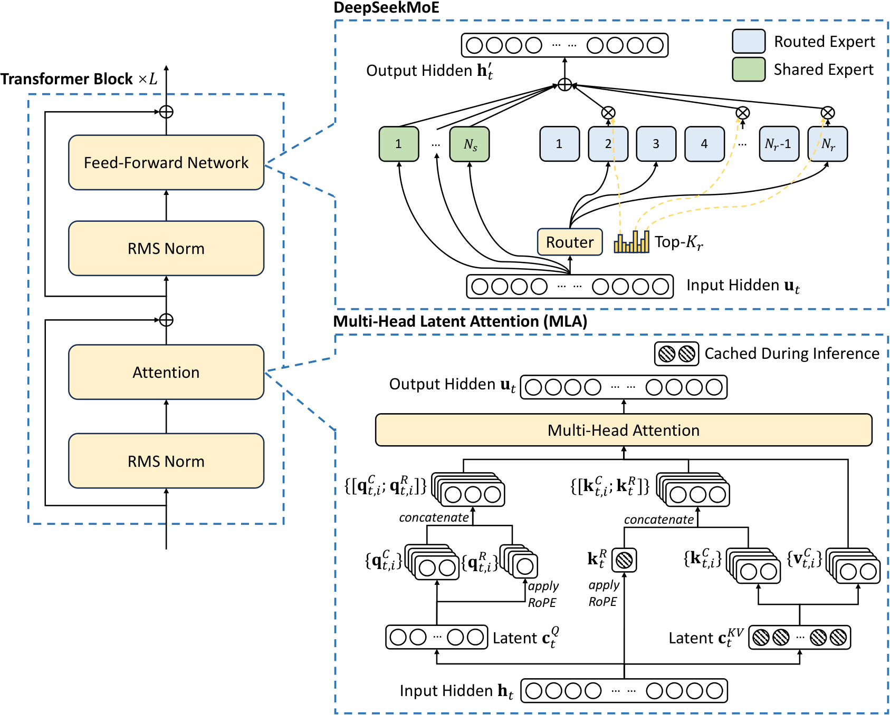
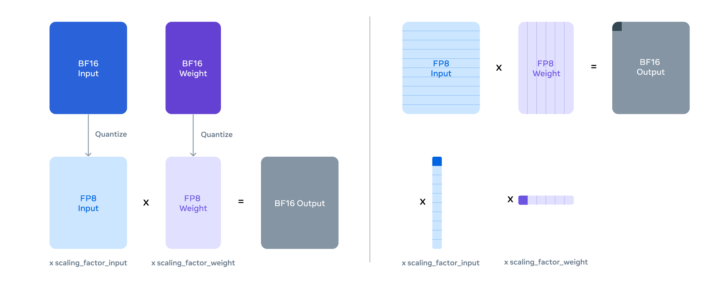
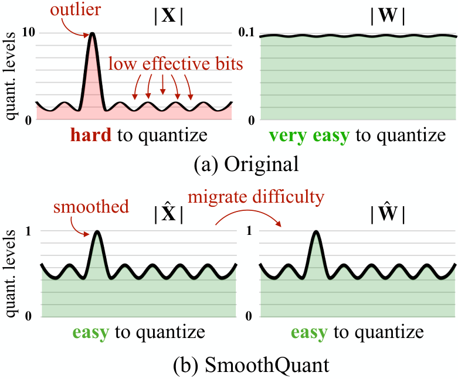
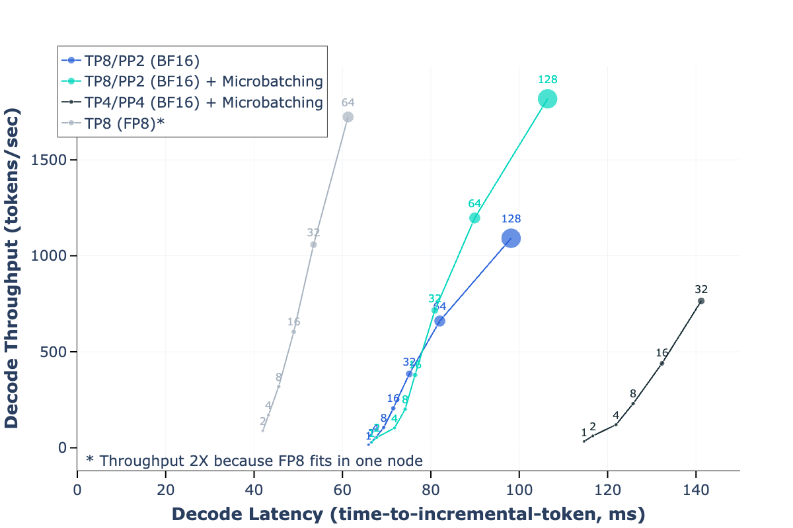

# Inference Internals I: The Arithmetic of LLM Inference

## Prerequisites

This chapter assumes you know transformer math and PyTorch, and nothing about the hardware or systems underneath. Read these first if a term below is unfamiliar:

- [Computer architecture](../foundations/computer-architecture.md) - memory hierarchy, bandwidth vs compute, why moving bytes costs more than doing math on them. Everything in this chapter is that idea applied to one workload.
- [Networking](../foundations/networking.md) - links, latency vs bandwidth, what an interconnect is. Needed for the tensor-parallel and expert-parallel communication sections.
- [Distributed systems](../foundations/distributed-systems.md) - collectives (all-reduce, all-to-all), sharding, load balancing. Needed for the TP and MoE sections.
- [Model architectures](../models/architectures.md) - MHA, GQA, MQA, MLA, sliding-window attention and MoE, whose KV cache and FLOPs we size here.

You do not need the Linux, concurrency or beyond-transformers chapters for this one.

This chapter does the arithmetic the [inference overview](README.md) only gestures at: why decode is memory-bound, how big the KV cache really is, what the lower bound on per-token latency is, what tensor parallelism costs, what MoE and quantization do to bytes and FLOPs, and how to size a deployment against an SLO. How a serving engine actually schedules work - PagedAttention, continuous batching, chunked prefill, speculative decoding, prefix caching - is in the sibling chapter [Inference Internals II: Inside a Serving Engine](serving-engine-internals.md).

Every number below comes with the arithmetic that produced it; all non-trivial calculations were checked with Python. Numbers labelled **bound** are theoretical roofline limits, not measurements. Real systems are slower than every bound here. The only measured numbers used are ones the repo already publishes (matmul ceilings and all-reduce latencies) and ones from cited papers.


## Notation and hardware numbers

| Symbol | Meaning |
| :----- | :------ |
| `N` | parameter count (total) |
| `N_act` | parameters touched per token (MoE) |
| `L` | number of layers |
| `h` | hidden size (`d_model`) |
| `n_q`, `n_kv` | query heads, key/value heads |
| `d` | head dim |
| `g = n_q / n_kv` | queries per KV head (GQA group size) |
| `B` | number of sequences decoded in one step (batch) |
| `T` | KV length per sequence (tokens already in context) |
| `b_w`, `b_a`, `b_kv` | bytes per weight, per activation, per KV element |
| `P` | tensor-parallel degree |

Some hardware terms used throughout:

- **HBM** (High Bandwidth Memory) is the stacked DRAM sitting next to the GPU die - the "GPU memory" whose size you see in `nvidia-smi` and whose bandwidth bounds decode.
- **SRAM** is the small on-chip memory (registers, shared memory/L1, L2) - tens of MB in total, roughly an order of magnitude faster than HBM.
- A **kernel** is one function launched on the GPU (one matmul, one attention call). A decode step of a 70B model is a few hundred to a few thousand kernels.
- An **SM** (streaming multiprocessor) is one of the ~100-150 independent compute units on an NVIDIA GPU; each has **tensor cores** (fixed-function matrix-multiply units, where the advertised TFLOPS live) and **CUDA cores** (general-purpose scalar ALUs, ~15-30x slower for math).

The spec numbers used everywhere below are dense (no sparsity) peaks, taken from the repo's [accelerator chapter](../compute/accelerator/README.md#tflops-comparison-table) and [memory table](../compute/accelerator/README.md):

| Accelerator | BF16 TFLOPS | FP8 TFLOPS | FP4 TFLOPS | HBM | HBM TB/s |
| :---------- | ----------: | ---------: | ---------: | --: | -------: |
| NVIDIA H100 SXM | 989 | 1979 | - | 80GB HBM3 | 3.35 |
| NVIDIA H200 SXM | 989 | 1979 | - | 141GB HBM3e | 4.8 |
| NVIDIA B200 SXM | 2250 | 4500 | 9000 | 180GB HBM3e | 8.0 |
| AMD MI300X | 1300 | 2610 | - | 192GB HBM3 | 5.3 |

Achievable is lower. The repo's [measured matmul ceilings](../compute/accelerator/README.md#maximum-achievable-and-sustainable-matmul-flops-comparison-table) (MAMF) are 853 BF16 / 1535 FP8 TFLOPS on H100 SXM (86% / 78% of spec), 1737 / 3350 on B200, and 634 / 1230 on MI300X (~48%). The MAMF numbers are for large, well-shaped matmuls; decode-shaped matmuls get less. Wherever a calculation needs a realistic compute number it uses MAMF and says so.


## Arithmetic intensity and the roofline

**Arithmetic intensity** (AI) is FLOPs performed per byte moved between HBM and the chip. The **roofline model** (Williams, Waterman, Patterson, CACM 2009) says a kernel's runtime is at least `max(FLOPs / peak_FLOPS, bytes / peak_BW)`. The crossover - the **ridge point** - is at `AI* = peak_FLOPS / peak_BW`. Below it the kernel is memory-bound: tensor cores sit idle waiting for bytes. Above it, compute-bound.

Ridge points from the table above:

| Accelerator | BF16 ridge (FLOP/B) | FP8 ridge (FLOP/B) |
| :---------- | ------------------: | -----------------: |
| H100 SXM | `989/3.35 = 295` | `1979/3.35 = 591` |
| H200 SXM | `989/4.8 = 206` | `1979/4.8 = 412` |
| B200 SXM | `2250/8.0 = 281` | `4500/8.0 = 562` |
| MI300X | `1300/5.3 = 245` | `2610/5.3 = 492` |

Note H200 has the *lowest* ridge: same compute as H100, 43% more bandwidth. It is the most "decode-friendly" of the four per FLOP, which is the whole point of that SKU.

### Linear layers

A decode step multiplies the current token's activations for `B` sequences by every weight matrix:

```python
# X: (B, K)  activations, one new token per sequence
# W: (K, N)  weight
# Y: (B, N)  = X @ W
flops = 2 * B * K * N
bytes = b_w * K * N + b_a * B * K + b_a * B * N    # read W, read X, write Y
AI    = 2 * B * K * N / (b_w * K * N + b_a * B * (K + N))
```

For `B << K, N` the weight term dominates the denominator and

```
AI ≈ 2 * B / b_w
```

So in BF16 (`b_w = 2`) the arithmetic intensity of a decode matmul is simply `B`: one FLOP pair per weight byte per sequence. Exact values for a `K = N = 8192` layer in BF16: `B=1 -> 1.0`, `B=64 -> 63.0`, `B=256 -> 240.9`, `B=1024 -> 819.2`. The approximation is good until `B` is within ~10x of `K`.

Setting `2B / b_w = AI*` gives the **crossover batch** at which linear layers stop being memory-bound:

```
B* = AI* * b_w / 2 = (peak_FLOPS / peak_BW) * (bits_per_weight / 16)
```

with `peak_FLOPS` taken at the precision the tensor cores actually run in. This one formula explains most of the quantization trade-offs later in the chapter:

| Accelerator | W16A16 (BF16 TC) | W8A8 (FP8 TC) | W4A16 at 4.25 bpw (BF16 TC) | W4A8 at 4.25 bpw (FP8 TC) |
| :---------- | ---------------: | ------------: | --------------------------: | ------------------------: |
| H100 SXM | 295 | 295 | 78 | 157 |
| H200 SXM | 206 | 206 | 55 | 110 |
| B200 SXM | 281 | 281 | 75 | 149 |
| MI300X | 245 | 246 | 65 | 131 |

On B200 with NVFP4 weights and activations on FP4 tensor cores: `B* = 1125 * 4.5 / 16 = 316`.

Two non-obvious consequences:

1. **W8A8 FP8 does not move the crossover batch.** Halving the bytes and doubling the FLOPS cancel. FP8 makes every regime ~2x faster; it does not change which regime you are in.
2. **Weight-only INT4 moves the crossover down by ~4x.** Above `B ≈ 78` on H100, a W4A16 model is compute-bound at *BF16* tensor-core rate, which is half the FP8 rate. At large batch, W4A16 is strictly slower than W8A8 FP8 on Hopper even before counting dequantization. The [Marlin paper (arXiv:2408.11743)](https://arxiv.org/abs/2408.11743) measures exactly this shape: close to the ideal 4x speedup over FP16 up to batch 16-32, then gradually decreasing gains up to batch 64-128.

The batch `B` here is tokens per step through the matmul, not requests. During prefill, or with chunked prefill mixing prompt tokens into decode steps, `B` is the total token count of the step, which is why prefill is compute-bound: a single 512-token prompt already gives `AI ≈ 512 > 295`.

### Attention in decode

Attention is different because there is no shared operand across sequences: each sequence has its own KV cache. Per layer, per KV head, for one sequence:

```python
# q: (g, d)      g query heads share this KV head
# K: (T, d)      cached keys
# V: (T, d)      cached values
s = q @ K.T      # (g, T)   2*g*T*d FLOPs
o = softmax(s) @ V   # (g, d)  2*g*T*d FLOPs
flops = 4 * g * T * d
bytes = 2 * T * d * b_kv          # read K and V; q/o negligible
AI    = 2 * g / b_kv
```

Decode attention AI is **independent of both batch size and context length**: batching adds more sequences, each bringing its own KV bytes. It depends only on the GQA group size and the KV dtype:

| Attention | `g` | AI with BF16 KV | AI with FP8 KV |
| :-------- | --: | --------------: | -------------: |
| MHA (e.g. Llama-2-7B) | 1 | 1 | 2 |
| GQA, Llama-3-70B (64 q / 8 kv) | 8 | 8 | 16 |
| MQA, 64 q heads | 64 | 64 | 128 |
| MLA, DeepSeek-V3, absorbed (all 128 heads) | 128 | 242 | 484 |

Everything except MLA is deeply memory-bound on every GPU in the table: decode attention runs at HBM bandwidth, full stop. The only levers are fewer KV bytes (GQA/MQA/MLA, KV quantization, sliding window) or more queries per KV read (larger `g`, or several speculative tokens per sequence - see the [sibling chapter](serving-engine-internals.md)).

The MLA row comes from the "absorbed" formulation in the [DeepSeek-V2 paper (arXiv:2405.04434)](https://arxiv.org/abs/2405.04434): the per-head up-projections `W_UK` and `W_UV` are folded into the query and output projections, so all 128 heads attend directly over one shared latent of `kv_lora_rank + qk_rope_head_dim = 512 + 64 = 576` dims per token:

```
flops per token per layer = 2*128*576 (scores) + 2*128*512 (values) = 278,528
bytes per token per layer = 576 * 2 (BF16)                          = 1,152
AI = 278,528 / 1,152 = 242
```

That is 82% of the H100 BF16 ridge: MLA decode attention is close to compute-bound, which is why DeepSeek's [FlashMLA](https://github.com/deepseek-ai/FlashMLA) kernel is a compute-optimized kernel and not a bandwidth-optimized one. The catch: this only holds if one GPU sees all 128 heads of a sequence. Under tensor parallelism `P=8` each GPU holds 16 heads but must still read the *full* 576-dim latent, so per-GPU `AI = 2*16*1088/1152 = 30` and the latent cache is duplicated 8 times. This is why DeepSeek serves MLA with data-parallel attention (each GPU owns whole sequences) rather than TP - see the [MoE section](#moe-inference-arithmetic).

### Attention in prefill

For a prompt of `T` tokens, causal attention does `2 * n_q * d * T^2` FLOPs per layer (`QK^T` plus `PV`, halved for causality) while reading `O(T * d)` bytes, so `AI ∝ T`. With [FlashAttention (arXiv:2205.14135)](https://arxiv.org/abs/2205.14135) the `T x T` score matrix never touches HBM, and prefill attention is compute-bound for any non-trivial prompt.

How big is attention compared to the linear layers? Per token, attention FLOPs are `4 * L * n_q * d * T` against `2 * N` for the matmuls. For Llama-3-70B: `4*80*64*128*T / (2*70.55e9)`, which is `0.076` at `T=4096` and `0.61` at `T=32768`. Above ~50k tokens of context, attention FLOPs exceed weight FLOPs per token. The common "`2N` FLOPs per token" rule ([Kaplan et al., arXiv:2001.08361](https://arxiv.org/abs/2001.08361)) is a short-context approximation.

### What this means for prefill vs decode

- **Prefill**: `B_tokens` in the thousands, linear AI in the thousands, attention AI ∝ `T`. Compute-bound. Time ≈ `2 * N * T_prompt / achieved_FLOPS`.
- **Decode**: linear AI ≈ `2B/b_w`, attention AI ≈ `2g/b_kv`. Memory-bound until `B` reaches a few hundred, and attention stays memory-bound forever (except MLA). Time ≈ `bytes_per_step / achieved_BW`.

The two phases want different hardware, different parallelism and different batch sizes, which is the motivation for prefill/decode disaggregation ([Splitwise, arXiv:2311.18677](https://arxiv.org/abs/2311.18677); [DistServe, arXiv:2401.09670](https://arxiv.org/abs/2401.09670); [Mooncake, arXiv:2407.00079](https://arxiv.org/abs/2407.00079)).


## KV cache sizing

The KV cache (introduced in the [overview](README.md#kv-caching)) stores every past token's keys and values so they need not be recomputed.

### Formulas

```python
# bytes per token, across all layers
mha_gqa = 2 * L * n_kv * d * b_kv               # 2 = K and V; MHA: n_kv = n_q, MQA: n_kv = 1
mla     = L * (kv_lora_rank + qk_rope_head_dim) * b_kv   # one latent, no separate K/V
# bytes for a batch
kv_bytes = per_token * sum(T_i for each sequence i)
# sliding window W on a subset of layers (hybrid local/global)
per_seq  = 2 * n_kv * d * b_kv * (L_global * T + L_local * min(T, W))
```

What each variant caches per token:


([source](https://arxiv.org/abs/2405.04434))

Under tensor parallelism `P`, GQA KV heads are split across GPUs, so per-GPU KV is `per_token / P` as long as `P <= n_kv`. If `P > n_kv` the KV heads are replicated and per-GPU KV stops shrinking. MLA's latent is shared by all heads, so under TP it is fully replicated on every GPU.

### Real configs

All configs below were read from the models' `config.json` on Hugging Face.

DeepSeek-V2's block, where only the compressed latent `c_KV` (plus the decoupled RoPE key) is cached:



([source](https://arxiv.org/abs/2405.04434))

| Model | L | n_q | n_kv | d | Attention | KV/token (BF16) |
| :---- | -: | --: | ---: | --: | :-- | --------------: |
| Llama-3-8B | 32 | 32 | 8 | 128 | GQA g=4 | `2*32*8*128*2 = 131,072 B = 128 KiB` |
| Llama-3-70B | 80 | 64 | 8 | 128 | GQA g=8 | `2*80*8*128*2 = 327,680 B = 320 KiB` |
| Mixtral-8x7B | 32 | 32 | 8 | 128 | GQA g=4 | `128 KiB` (same attention as Llama-3-8B) |
| DeepSeek-V3 | 61 | 128 | - | 576 latent | MLA | `61*576*2 = 70,272 B = 68.6 KiB` |

For comparison, Llama-3-70B as MHA would be `2*80*64*128*2 = 2,560 KiB/token` (8x more); as MQA `40 KiB/token`. DeepSeek-V3 with plain MHA over its 128 heads (K dim 192 = 128 nope + 64 rope, V dim 128) would be `61*128*(192+128)*2 = 4.77 MiB/token`, 71x the MLA figure. DeepSeek-V3 is a 671B-parameter model with a smaller per-token KV than Llama-3-8B.

Per sequence:

| Model | 4k ctx | 32k ctx | 128k ctx |
| :---- | -----: | ------: | -------: |
| Llama-3-8B / Mixtral-8x7B | 0.54 GB | 4.29 GB | 17.2 GB |
| Llama-3-70B | 1.34 GB | 10.7 GB | 43.0 GB |
| DeepSeek-V3 (MLA, BF16) | 0.29 GB | 2.30 GB | 9.2 GB |

At 128k context, one Llama-3-70B sequence's KV cache (43 GB) is 30% of the model's BF16 weights (141 GB).

### Sliding window

[Mistral-7B-v0.1 (arXiv:2310.06825)](https://arxiv.org/abs/2310.06825) uses `sliding_window: 4096` on every layer, so its KV is capped at `128 KiB * 4096 = 512 MiB` per sequence regardless of context. Note that the [Mixtral-8x7B](https://arxiv.org/abs/2401.04088) `config.json` has `sliding_window: null` - it uses full attention - despite inheriting the Mistral architecture; numbers above treat it as full attention.

Modern models mix local and global layers. Gemma-3-27B ([arXiv:2503.19786](https://arxiv.org/abs/2503.19786); config: 62 layers, 16 KV heads, `d=128`, `sliding_window=1024`, `sliding_window_pattern=6`, i.e. 5 local layers per global one) has 10 global and 52 local layers. Per sequence at BF16: `8 KiB * (10*T + 52*min(T,1024))` where `8 KiB = 2*16*128*2`. At 32k that is 3.12 GB vs 16.6 GB if all layers were global (5.3x); at 128k 11.2 GB vs 66.6 GB (6.0x). The ratio approaches `62/10 = 6.2` as `T -> ∞`. Sliding window shrinks KV memory *and* KV bandwidth per step by the same factor - it is one of the few changes that helps decode attention directly.

### Max concurrent sequences

```
kv_budget_per_gpu = HBM * util - weights / P - reserve
max_tokens        = kv_budget_per_gpu / kv_bytes_per_token_per_gpu
max_seqs          = max_tokens / T_avg
```

`util = 0.9` below mirrors the default `gpu_memory_utilization` of vLLM; the remaining 10% covers activations, CUDA graphs and communication buffers. Real engines allocate KV in fixed-size **pages** (blocks of e.g. 16 tokens, the same idea as OS virtual-memory pages), so expect a few percent of fragmentation on top - see [PagedAttention](serving-engine-internals.md).

| Deployment | Weights/GPU | KV budget/GPU | KV/token/GPU | Max tokens | @4k | @32k | @128k |
| :--------- | ----------: | ------------: | -----------: | ---------: | --: | ---: | ----: |
| Llama-3-8B BF16, 1x H100 | 16.1 GB | 55.9 GB | 128 KiB | 427k | 104 | 13 | 3 |
| Llama-3-70B BF16, 8x H100 TP8 | 17.6 GB | 54.4 GB | 40 KiB | 1.33M | 324 | 40 | 10 |
| Llama-3-70B FP8 W + FP8 KV, 8x H100 TP8 | 8.8 GB | 63.2 GB | 20 KiB | 3.09M | 753 | 94 | 23 |
| Llama-3-70B BF16, 4x H200 TP4 | 35.3 GB | 91.6 GB | 80 KiB | 1.12M | 273 | 34 | 8 |
| Mixtral-8x7B BF16, 1x H200 | 93.4 GB | 33.5 GB | 128 KiB | 256k | 62 | 7.8 | 1.9 |
| Mixtral-8x7B BF16, 2x H100 TP2 | 46.7 GB | 25.3 GB | 64 KiB | 386k | 94 | 11.8 | 2.9 |
| DeepSeek-V3 FP8, 8x H200, TP8 attention | 83.9 GB | 43.0 GB | 68.6 KiB (replicated) | 612k | 149 | 18.7 | 4.7 |
| DeepSeek-V3 FP8, 8x H200, DP8 attention | 83.9 GB | 43.0 GB x 8 | 68.6 KiB (own seqs) | 4.90M | 1196 | 150 | 37 |

Parameter counts used: Llama-3-8B 8.03B, Llama-3-70B 70.55B, Mixtral 46.70B, DeepSeek-V3 671.0B (all recomputed from the configs, matching the published totals). DeepSeek-V3 weights are approximated at 1 byte/param (the released checkpoint is FP8 with BF16 for some small tensors, so this is a slight underestimate).

Read the last two rows together: the same hardware holds 8x more DeepSeek-V3 context when attention is data-parallel instead of tensor-parallel, because TP replicates the MLA latent. The Llama-3-70B FP8 row shows FP8 KV more than doubling capacity: halving KV bytes *and* freeing 8.8 GB/GPU of weights.


## Decode latency lower bound

In a memory-bound decode step every weight is read once from HBM (shared across the batch) and every sequence's KV cache is read once:

```
bytes_step = N * b_w + B * T * kv_bytes_per_token
t_mem      = bytes_step / (P * HBM_BW)
t_compute  = (2 * N * B + 4 * L * n_q * d * T * B) / (P * peak_FLOPS)
t_step    >= max(t_mem, t_compute) + t_comm
TPOT       = t_step            # per user: one token per sequence per step
throughput = B / t_step        # tokens/s for the whole replica
```

`t_comm` is the tensor-parallel all-reduce cost, derived in the next section. `max(...)` assumes perfect overlap of memory and compute within a kernel, which is optimistic; `sum(...)` is a pessimistic alternative.

### Worked example: Llama-3-70B on 8x H100 SXM, TP=8

Assumptions, all stated:

- H100 SXM spec: 3.35 TB/s, 989 BF16 / 1979 FP8 TFLOPS. Bound uses 100% of spec bandwidth; real kernels typically reach less, so scale `t_mem` by `1 / achieved_fraction` once you have measured it.
- `T` is the KV length of every sequence in the batch at this step (steady state).
- `t_comm = 160 * t_allreduce(B * 8192 * 2 bytes)`, with `t_allreduce` from the repo's [measured 8x H200 latencies](../network/benchmarks/README.md#latency): 20 µs at 16 KiB (`B=1`), 27.7 µs at 1 MiB (`B=64`), and ~53 µs at 4 MiB (`B=256`, linearly extrapolated from the 256 KiB-1 MiB slope, not measured). H200 and H100 use the same NVLink 4 / NVSwitch fabric, so the H200 measurement is used as a proxy.
- Cost at **$2.00 per GPU-hour** (the rate DeepSeek used in its own cost statement, cited below). `$/1M = $2 * 8 / 3600 / throughput * 1e6`.
- "fits" means `weights + KV <= 8 * 80 GB * 0.9 = 576 GB`.

| Weights / KV | ctx | B | KV GB | fits? | t_mem ms | t_compute ms | t_comm ms | step ms | tok/s/user | tok/s/node | tok/s/GPU | $/1M out |
| :----------- | --: | --: | ----: | :---: | -------: | -----------: | --------: | ------: | ---------: | ---------: | --------: | -------: |
| BF16 / BF16 | 4k | 1 | 1.3 | yes | 5.32 | 0.02 | 3.20 | 8.52 | 117 | 117 | 15 | 37.84 |
| BF16 / BF16 | 4k | 64 | 85.9 | yes | 8.47 | 1.23 | 4.43 | 12.90 | 78 | 4960 | 620 | 0.90 |
| BF16 / BF16 | 4k | 256 | 343.6 | yes | 18.09 | 4.91 | 8.46 | 26.55 | 38 | 9642 | 1205 | 0.46 |
| BF16 / BF16 | 32k | 1 | 10.7 | yes | 5.67 | 0.03 | 3.20 | 8.87 | 113 | 113 | 14 | 39.40 |
| BF16 / BF16 | 32k | 64 | 687.2 | **no** | 30.91 | 1.84 | 4.43 | 35.34 | 28 | 1811 | 226 | 2.45 |
| BF16 / BF16 | 32k | 256 | 2748.8 | **no** | 107.83 | 7.34 | 8.46 | 116.30 | 9 | 2201 | 275 | 2.02 |
| FP8 / BF16 | 4k | 1 | 1.3 | yes | 2.68 | 0.01 | 3.20 | 5.88 | 170 | 170 | 21 | 26.14 |
| FP8 / BF16 | 4k | 64 | 85.9 | yes | 5.84 | 0.61 | 4.43 | 10.27 | 97 | 6232 | 779 | 0.71 |
| FP8 / BF16 | 4k | 256 | 343.6 | yes | 15.45 | 2.46 | 8.46 | 23.92 | 42 | 10704 | 1338 | 0.42 |
| FP8 / BF16 | 32k | 1 | 10.7 | yes | 3.03 | 0.01 | 3.20 | 6.23 | 160 | 160 | 20 | 27.70 |
| FP8 / BF16 | 32k | 64 | 687.2 | **no** | 28.27 | 0.92 | 4.43 | 32.71 | 31 | 1957 | 245 | 2.27 |
| FP8 / BF16 | 32k | 256 | 2748.8 | **no** | 105.20 | 3.67 | 8.46 | 113.66 | 9 | 2252 | 282 | 1.97 |
| FP8 / FP8 | 4k | 1 | 0.7 | yes | 2.66 | 0.01 | 3.20 | 5.86 | 171 | 171 | 21 | 26.03 |
| FP8 / FP8 | 4k | 64 | 42.9 | yes | 4.24 | 0.61 | 4.43 | 8.67 | 115 | 7384 | 923 | 0.60 |
| FP8 / FP8 | 4k | 256 | 171.8 | yes | 9.04 | 2.46 | 8.46 | 17.51 | 57 | 14623 | 1828 | 0.30 |
| FP8 / FP8 | 32k | 1 | 5.4 | yes | 2.83 | 0.01 | 3.20 | 6.03 | 166 | 166 | 21 | 26.81 |
| FP8 / FP8 | 32k | 64 | 343.6 | yes | 15.45 | 0.92 | 4.43 | 19.89 | 50 | 3218 | 402 | 1.38 |
| FP8 / FP8 | 32k | 256 | 1374.4 | **no** | 53.92 | 3.67 | 8.46 | 62.38 | 16 | 4104 | 513 | 1.08 |

Rows marked **no** don't fit on one node; they show what the bound would be if they did (e.g. via a second node or KV offload, both of which add cost the table does not include).

What to read off it:

1. **At `B=1` the bound is set by weights and communication, not context.** `141.1 GB / 8 / 3.35 TB/s = 5.26 ms` of weight reads, plus 3.2 ms of all-reduce latency. Communication is 38% of the BF16 step and 54% of the FP8 step. FP8 weights halve `t_mem` but leave `t_comm` alone, so the end-to-end gain is only `8.52 / 5.88 = 1.45x`, not 2x.
2. **Batching is nearly free until KV dominates.** From `B=1` to `B=64` at 4k, throughput rises 42x (117 -> 4960 tok/s) while per-user speed drops only 34% (117 -> 78 tok/s). Cost per token drops from $37.84 to $0.90 per 1M.
3. **KV reads overtake weight reads at `B*T = N*b_w / kv_bytes_per_token`**: `141.1e9 / 327,680 = 430k` tokens for BF16, i.e. `B ≈ 105` sequences at 4k. Past that point, the "memory-bound on weights" mental model is wrong; you are memory-bound on KV, and FP8 KV (row group 3) helps more than FP8 weights. At `B=256, 4k`, FP8 KV takes the step from 23.9 to 17.5 ms.
4. **Long context kills batching.** At 32k, even the FP8/FP8 configuration tops out around `B=64` (`70.5 + 343.6 = 414 GB` of the 576 GB budget) and delivers 402 tok/s/GPU vs 1828 at 4k with `B=256`. Cost per token at 32k is 4.6x the 4k cost.
5. **Compute is never the bottleneck in this table.** The largest `t_compute` is 7.3 ms against a 116 ms step. Even `B=256` at 32k is memory-bound, because attention AI is 8 regardless of batch.

All of these are lower bounds on latency and upper bounds on throughput. They exclude: kernel-launch gaps (largely removed by CUDA graphs - a recorded sequence of kernels replayed with one launch), sampling, scheduler overhead in Python, the HBM efficiency gap, and prefill interference. Measure against them; don't quote them as achieved numbers.


## Tensor-parallel communication in decode

**Tensor parallelism** (TP) splits every weight matrix across `P` GPUs so each GPU reads `1/P` of the weights per step. In the Megatron layout each transformer layer has two points where the partial outputs on the `P` GPUs must be summed: after the attention output projection and after the MLP down projection. That sum is an **all-reduce** - a collective operation in which every GPU contributes a tensor and every GPU receives the elementwise sum. A **collective** is any communication operation that all participating GPUs call together; on NVIDIA hardware they are implemented by **NCCL** (NVIDIA's collective communication library). Inside an 8-GPU node the traffic travels over **NVLink** (NVIDIA's direct GPU-to-GPU link, 450 GB/s per direction per GPU on H100/H200, 900 GB/s on B200 - see the [network chapter](../network/README.md#intra-node-networking)) through an **NVSwitch** (a switch chip that gives every GPU full NVLink bandwidth to every other GPU).

Per decode step:

```
n_allreduce = 2 * L                     # 160 for Llama-3-70B
msg_bytes   = B * h * b_a               # (B, h) activations; 16 KiB at B=1, 1 MiB at B=64 (BF16, h=8192)
t_comm      = n_allreduce * t_allreduce(msg_bytes)
t_allreduce(m) ≈ alpha + m * 2*(P-1)/P / busbw
```

`alpha` is the fixed per-call latency; `busbw` is the bus bandwidth NCCL reports. For decode-sized messages `alpha` dominates completely: the repo measures an 8-byte all-reduce on 8x H200 at 15.2 µs, and everything up to 256 KiB at 15-22 µs ([source](../network/benchmarks/README.md#latency)). Pure bandwidth time for 16 KiB at 450 GB/s is `16384 * 1.75 / 450e9 = 0.06 µs` - the link is idle 99.7% of the call. A faster link does nothing for decode TP; fewer or cheaper calls do.

Consequences:

- **The 160-call floor.** `160 * 15 µs = 2.4 ms` per token is a floor for Llama-3-70B on TP=8 regardless of model precision or GPU generation. At FP8 weights the floor is comparable to the entire HBM time (2.63 ms). On B200 (8 TB/s) FP8 weight reads would take `70.5e9 / 8 / 8e12 = 1.10 ms`, and the repo's measured 23.5 µs small all-reduce on 8x B200 would make communication `160 * 23.5 = 3.8 ms`, more than three times the HBM time. Faster HBM makes TP communication relatively worse.
- **The diminishing returns of larger P.** Raising `P` divides `t_mem` by `P` but leaves `t_comm` (per call) roughly constant or growing. Llama-3-70B FP8 at `B=1`: TP4 gives `70.5e9/4/3.35e12 + 160*alpha = 5.26 + 2.4..3.2 ms`, TP8 gives `2.63 + 2.4..3.2 ms`. Doubling GPUs buys ~30% latency. Past the node boundary the all-reduce latency roughly quadruples (82 µs on 4x B200 nodes vs 23 µs intra-node, from the same repo measurement), so cross-node TP for decode is almost always wrong.
- **Mitigations**, in order of how often they matter: symmetric-memory / one-shot all-reduce kernels, which the repo measures at roughly half the latency for small messages (8.1 µs vs 15.2 µs at 8 B on H200); fusing the all-reduce with the following RMSNorm and residual add; overlapping the all-reduce of one micro-batch with compute of another (splitting the batch in two, as DeepSeek does for MoE below); or using fewer TP ranks with data parallelism across replicas.
- **The host matters.** If the CPU issues each all-reduce through PyTorch without CUDA graphs, add ~20-30 µs of host overhead per call (repo measurement), which would double `t_comm`. Decode servers therefore capture the whole decode step into a CUDA graph.

### Prefill is the opposite regime

In prefill, `msg_bytes = T_prompt * h * 2` is large (32 MiB for a 2048-token chunk of Llama-3-70B), so `t_comm` is bandwidth-bound. Its ratio to compute is independent of `T`:

```
t_comm / t_compute = [2 * T*h*b_a * 2(P-1)/P / busbw] / [2 * N_layer * T / (P * F)]
                   = 2 * h * b_a * (2(P-1)/P) * P * F / (busbw * N_layer)      # with b_a = 2
```

For Llama-3-70B (`N_layer = 855.6M`), `P=8`, `F = 1535` TFLOPS (H100 FP8 MAMF): the ratio is 1.71 at `busbw = 240 GB/s`, 1.14 at 360 GB/s, 0.86 at 480 GB/s. The `busbw` values are **assumptions** (the repo reports 32 MiB as roughly the half-peak point on 8x H200, and NVLS all-reduce peaking near 480 GB/s on NVLink 4); measure yours. Either way, TP=8 FP8 prefill on H100 spends about as long communicating as computing unless the all-reduce is overlapped with compute. The ratio scales with `F / busbw`, so it gets *worse* as tensor cores get faster relative to NVLink.


## MoE inference arithmetic

A mixture-of-experts layer replaces the dense MLP with `E` expert MLPs and a router that sends each token to `k` of them. Per token, FLOPs scale with active parameters; per step, bytes scale with the number of *distinct* experts the batch touches.

### Active vs total parameters

Recomputed from the configs:

| Model | Total | Active/token | Expert size | Experts/layer | top-k |
| :---- | ----: | -----------: | ----------: | ------------: | ----: |
| Mixtral-8x7B | 46.70B | 12.88B | 176.2M (`3*4096*14336`) | 8 | 2 |
| DeepSeek-V3 | 671.0B | 37.6B | 44.0M (`3*7168*2048`) | 256 routed + 1 shared | 8 |

DeepSeek-V3: 3 dense layers, 58 MoE layers; routed experts are 653.9B of the 671B. The remaining 17.1B (MLA, shared experts, dense layers, embeddings) is what every token always touches.

### Distinct experts touched per step

If `B` tokens each choose `k` of `E` experts uniformly at random, the expected number of distinct experts per layer is

```
E_touched(B) = E * (1 - (1 - k/E)^B)
```

| B | Mixtral (8, top-2) | DeepSeek-V3 (256, top-8) |
| --: | --: | --: |
| 1 | 2.0 | 8 |
| 4 | 5.5 | - |
| 8 | 7.2 | 57 |
| 16 | 7.9 | - |
| 32 | 8.0 | 163 |
| 128 | 8.0 | 252 |
| 512 | 8.0 | 256 |

Real routing is not uniform, which pushes these numbers down somewhat; treat them as an upper estimate.

Mixtral bytes per step in BF16: 25.8 GB at `B=1` (like a 13B dense model), 64.9 GB at `B=4`, 92.5 GB at `B=16`, 93.4 GB at `B=64`. DeepSeek-V3 weight bytes per step in FP8: 37 GB at `B=1`, 164 GB at `B=8`, 434 GB at `B=32`, 660 GB at `B=128`.

So MoE decode is memory-bound *differently* from dense:

- At `B=1` it is as fast as a dense model of `N_act` parameters. This is the latency win.
- Bytes per step grow with `B` until every expert is touched (`B ≈ 16` for Mixtral, `B ≈ 128-256` for DeepSeek-V3); in that region adding a sequence costs bandwidth, unlike dense, where weights are read once regardless.
- After saturation, you read all `N` parameters per step but each expert only sees `B * k / E` tokens. Expert-GEMM AI is `2 * (B*k/E) / b_w`, i.e. the dense formula with `B` replaced by tokens per expert.

### Batch needed for expert GEMMs to be compute-bound

Set tokens per expert equal to the crossover batch from the [roofline section](#linear-layers):

```
B_global* = B* * E / k
```

On H100 (`B* = 295` for both BF16 and W8A8 FP8): Mixtral needs `295 * 8/2 = 1,180` tokens per step; DeepSeek-V3 needs `295 * 256/8 = 9,440`. An MoE with sparsity `E/k` needs `E/k` times the batch of a dense model to reach the same arithmetic intensity on its experts: 4x for Mixtral, 32x for DeepSeek-V3.

9,440 tokens per step does not fit on one node's KV budget at realistic contexts, and that is the arithmetic case for **expert parallelism** (EP): put different experts on different GPUs across many nodes, so the aggregate batch (and aggregate KV memory) grows with the number of GPUs while each GPU reads only its own few experts. Each token's hidden state is sent to the GPUs holding its `k` experts (**dispatch**) and the results are sent back and summed (**combine**); both are **all-to-all** collectives, in which every GPU sends a different chunk to every other GPU.

### Cross-check against DeepSeek's published production numbers

DeepSeek's [inference system overview](https://github.com/deepseek-ai/open-infra-index/blob/main/202502OpenSourceWeek/day_6_one_more_thing_deepseekV3R1_inference_system_overview.md) (Feb 2025) states: decode runs with routed experts at EP144 over 18 nodes of H800, MLA and shared expert data-parallel (DP144), 2 routed experts plus 1 shared per GPU, 32 redundant experts (`256 + 32 = 288 = 144 * 2`); average output 20-22 tok/s per user; ~14.8k output tok/s per node in decode; average KV length 4,989 tokens; $2/GPU-hour assumed.

Back-of-envelope from those numbers (my derivation, not DeepSeek's):

```
tok/s/GPU         = 14,800 / 8 = 1,850
seqs/GPU          ≈ 1,850 / 21 ≈ 88                (throughput / per-user speed)
global seqs       ≈ 88 * 144 ≈ 12,700
tokens/expert/step≈ 12,700 * 8 / 256 ≈ 396         (> 295 crossover: expert GEMMs compute-bound)
latent KV/GPU     ≈ 88 * 4,989 * 70,272 B ≈ 30.9 GB
expert weights/GPU= 2 * 44.0M * 58 layers * 1 B ≈ 5.1 GB
```

That is self-consistent: ~396 tokens per expert per step puts the FP8 expert GEMMs just past the H800 ridge (H800 has H100's tensor cores and HBM), and 31 GB of latent cache plus 5 GB of experts plus the replicated non-expert weights fits in 80 GB. The design point is exactly "the smallest EP degree whose aggregate batch makes the experts compute-bound". The 88 seqs/GPU estimate ignores multi-token-prediction speculation (which makes steps fewer than tokens) and so is approximate.

### Load imbalance

The step time of an EP layer is set by the most-loaded GPU. Even with perfectly uniform routing, multinomial noise gives `max/mean` load of (simulated, 20-500 trials each):

- 256 experts on 128 ranks of 2, 12,672 tokens: 1.09
- 256 experts, one per rank, 1,024 tokens: 1.52
- Mixtral EP8, 64 tokens: 1.34

i.e. the imbalance factor is roughly `1 + sqrt(2 ln(ranks) / tokens_per_rank)` - small batches per rank are expensive. Real routers are skewed toward hot experts, which is worse; DeepSeek's answer is redundant replicas of hot experts placed by a load balancer (EPLB). Independently, [Towards MoE Deployment (arXiv:2303.06182)](https://arxiv.org/abs/2303.06182) measures skewed expert popularity at inference and proposes expert buffering and load balancing.

### EP communication volume

Per token per MoE layer, DeepSeek-V3 dispatches `k * h` FP8 values and combines `k * h` BF16 values: `8 * 7168 * (1 + 2) = 172 KB`, i.e. 10.0 MB per token per step over 58 layers. At 88 sequences/GPU that is 0.88 GB per GPU per step; over a 400 Gb/s (50 GB/s) InfiniBand NIC - the inter-node network, which uses **RDMA** (remote direct memory access: one GPU's NIC writes straight into another machine's GPU memory without involving either CPU) - that is ~17.6 ms per step if not overlapped. This is the same order as the step itself, which is why DeepSeek splits each batch into two micro-batches and runs one's all-to-all during the other's compute. If you cannot overlap, EP across nodes pays off only when the bandwidth saved by reading fewer experts per GPU exceeds this communication time.


## Quantization internals

Every scheme below is judged by three questions: how many bytes per weight (and per KV element) it moves, which tensor-core rate the matmul runs at, and how many CUDA-core instructions it spends unpacking. See [dtypes](../training/dtype.md) for the bit layouts.

### Bits per weight including metadata

Group quantization stores one scale (and optionally a zero point) per `G` elements:

```
bits_per_weight = bits_elem + (bits_scale + bits_zero) / G
```

| Format | bits/weight | Llama-3-70B weights | Weight read, 1x H200 @ 4.8 TB/s |
| :----- | ----------: | ------------------: | ------------------------------: |
| BF16 | 16.000 | 141.1 GB | 29.4 ms |
| FP8 E4M3, per-tensor scale | 8.000 | 70.5 GB | 14.7 ms |
| FP8 E4M3, per-channel FP32 scale (K=8192) | 8.004 | 70.6 GB | 14.7 ms |
| FP8 E4M3, 128x128 block FP32 scale (DeepSeek-V3) | 8.002 | 70.6 GB | 14.7 ms |
| MXFP8 (E8M0 scale / 32) | 8.250 | 72.8 GB | 15.2 ms |
| INT4, G=128, FP16 scale + FP16 zero | 4.250 | 37.5 GB | 7.8 ms |
| INT4, G=128, FP16 scale + 4-bit zero | 4.156 | 36.7 GB | 7.6 ms |
| INT4, G=64, FP16 scale + zero | 4.500 | 39.7 GB | 8.3 ms |
| INT4, G=32, FP16 scale + zero | 5.000 | 44.1 GB | 9.2 ms |
| MXFP4 (E2M1, E8M0 scale / 32) | 4.250 | 37.5 GB | 7.8 ms |
| NVFP4 (E2M1, E4M3 scale / 16, + FP32 per tensor) | 4.500 | 39.7 GB | 8.3 ms |

(The 70B model doesn't fit one H200 in BF16; the column is a bandwidth comparison, not a deployment.) Group-size overhead is not small: going from G=128 to G=32 costs 18% more bytes for INT4. In practice the embedding and `lm_head` (2.1B params for Llama-3-70B) are often left in BF16, which adds `2.1e9 * (16 - 4.25) / 8 = 3.1 GB` to the INT4 rows.

### Weight-only INT4: GPTQ vs AWQ

Both produce W4A16 checkpoints (4-bit weights, 16-bit activations); they differ in what they optimize.

- **[GPTQ (arXiv:2210.17323)](https://arxiv.org/abs/2210.17323)** minimizes the layer-output reconstruction error `||W X - Ŵ X||_F^2` on calibration activations `X`. It is Optimal Brain Surgeon applied column by column: quantize one input column of `W`, then update the not-yet-quantized columns to compensate, using the inverse of the Hessian `H = 2 X X^T` (computed once via Cholesky). The weights that come out are *not* rounded originals - they have been adjusted to absorb error. The "act-order" option quantizes columns in order of decreasing `diag(H)`, i.e. largest activation energy first.
- **[AWQ (arXiv:2306.00978)](https://arxiv.org/abs/2306.00978)** does no error feedback. It observes that ~1% of input channels (those with large activation magnitude) dominate the error, and protects them by a per-input-channel scale `s`: quantize `W * diag(s)` and fold `diag(s)^-1` into the previous op. `s = s_X^alpha` with `s_X` the mean activation magnitude per channel and `alpha` chosen by grid search on `[0, 1]` to minimize output error of the quantized layer. The output is plain round-to-nearest of rescaled weights, which tends to overfit the calibration set less.

Neither changes the runtime format: both are a packed INT4 tensor with per-group scales (and zeros), executed by the same kernels (Marlin, Machete, ExLlama, etc.). The runtime arithmetic is identical; only accuracy differs.

### When the kernel becomes dequant-bound

A W4A16 kernel loads 4-bit weights, converts them to BF16 on the CUDA cores, then runs BF16 tensor-core MMAs. Three times compete per step:

```
t_mem   = N * bpw/8 / HBM_BW
t_tc    = 2 * N * B / TC_FLOPS                # BF16 rate
t_deq   = N * c / ALU_rate                    # c = CUDA-core instructions per weight element
```

Each weight is dequantized once per step when the whole batch fits in one tile (true for decode), so `t_deq` does not grow with `B`. The kernel is dequant-bound even at `B=1` if `t_deq > t_mem`, i.e. if

```
c > ALU_rate * (bpw/8) / HBM_BW
```

Taking `ALU_rate` as FP32 TFLOPS / 2 (one instruction per lane per clock; FMA counts as 2 FLOPs) and `bpw = 4.25`:

| GPU | ALU instr/s | Budget `c` (instr/weight) |
| :-- | ----------: | ------------------------: |
| H100 SXM | `67/2 = 33.5T` | `33.5e12 * 0.531 / 3.35e12 = 5.3` |
| H200 SXM | 33.5T | 3.7 |
| B200 SXM | `80/2 = 40T` | 2.7 |

This is a rough model (it ignores instruction issue limits, conversion instructions that run below full rate, and scale application), but the trend is the point: every generation adds HBM bandwidth faster than CUDA-core throughput, so the dequantization budget shrinks. A naive unpack (shift, mask, int-to-float, subtract zero, multiply scale) is 4-5 instructions per element and already dequant-bound on H200. Production kernels use bit tricks (e.g. `lop3` plus magic-number float construction, two elements per instruction) to get `c` near 1. [QServe (arXiv:2405.04532)](https://arxiv.org/abs/2405.04532) measures 20-90% runtime overhead from dequantization in existing INT4 kernels and is built around keeping CUDA-core work off the critical path. Native low-precision tensor cores (FP8 on Hopper, FP4 on Blackwell) remove `t_deq` entirely, which is the real reason NVFP4/MXFP4 matter on B200: block scales are applied inside the tensor core.

Combining with the crossover table: on H100, W4A16 wins over FP8 only in the regime `B < ~78` *and* only if `c` is small; above that, W8A8 FP8 is faster per step. For a latency-optimized single-user deployment, W4A16; for throughput serving on Hopper, FP8.

### FP8 E4M3 and its scaling granularities

E4M3: max magnitude 448, smallest normal `2^-6`, smallest subnormal `2^-9`, 3 mantissa bits, i.e. ~2 significant decimal digits ([FP8 Formats for Deep Learning, arXiv:2209.05433](https://arxiv.org/abs/2209.05433)). E5M2 (max 57344) is used for gradients in training and rarely in inference. Quantization is `x_q = round_to_fp8(x / s)`, and the choice is where `s` lives:

- **Per-tensor** (`s = amax / 448` for the whole tensor): one FP32 scalar, applied in the GEMM epilogue. Cheapest; one outlier channel sets the scale for everything.
- **Per-channel (weights) / per-token (activations)**: a vector of scales on the output dim of `W` and the token dim of `X`. Still applied in the epilogue, since `(s_x[i] * s_w[j])` factors out of the dot product along `K`. Dynamic per-token activation scales cost one reduction over `h` per token.
- **Block-wise**: DeepSeek-V3 ([arXiv:2412.19437](https://arxiv.org/abs/2412.19437), Sec. 3.3) uses `1x128` tiles for activations and `128x128` blocks for weights. Scales now vary *along* `K`, so they can't go in the epilogue; partial sums must be rescaled every 128 elements of `K`. The paper also reports that Hopper's FP8 tensor-core accumulation keeps only ~14 bits of precision and promotes partial sums to FP32 on the CUDA cores every 128 elements to compensate. Byte overhead is negligible (`32/16384` bits per weight); the cost is extra CUDA-core work in the main loop.

Tensor-wise vs row-wise scaling as used for Llama 3 405B FP8 inference:



([source](https://arxiv.org/abs/2407.21783))

### W8A8 INT8 and SmoothQuant

INT8 weights and activations run on INT8 tensor cores at the same rate as FP8 on Hopper (1979 TOPS) and on Ampere at 2x BF16. The problem is activations: a few channels have magnitudes ~100x the rest ([LLM.int8(), arXiv:2208.07339](https://arxiv.org/abs/2208.07339)), which wrecks per-tensor INT8. [SmoothQuant (arXiv:2211.10438)](https://arxiv.org/abs/2211.10438) migrates that difficulty into the weights with an exact rescaling:

```
Y = (X diag(s)^-1) (diag(s) W),    s_j = max|X_j|^alpha / max|W_j|^(1 - alpha)
```

SmoothQuant's intuition - divide activation channels by `s` and multiply the weights by `s`, so neither has extreme outliers:



([source](https://arxiv.org/abs/2211.10438))

with `alpha = 0.5` by default (the paper uses larger values for some models). `diag(s)^-1` is folded into the preceding LayerNorm, so there is zero runtime cost. Bytes and FLOP rate are the same as FP8 W8A8; the difference is that E4M3's exponent already tolerates outliers better than INT8, so on Hopper and later FP8 usually replaces SmoothQuant-INT8. Rotation methods such as [QuaRot (arXiv:2404.00456)](https://arxiv.org/abs/2404.00456) go further, applying Hadamard rotations that spread outliers across channels to enable 4-bit activations.

### KV cache quantization

KV bytes dominate decode once `B*T` exceeds `N*b_w / kv_bytes_per_token` (430k tokens for Llama-3-70B BF16, computed above). In that regime KV quantization is the highest-leverage change, and it helps capacity and bandwidth by the same factor.

- **FP8 KV** (per-tensor or per-head scale): halves bytes; the attention kernel converts to BF16 in registers or runs FP8 MMAs directly (FlashAttention-3, [arXiv:2407.08608](https://arxiv.org/abs/2407.08608), supports FP8). In the table above, FP8 KV takes Llama-3-70B at `B=256, 4k` from 23.9 to 17.5 ms per step and makes `B=64, 32k` fit on one node.
- **INT4/INT2 KV**: [KIVI (arXiv:2402.02750)](https://arxiv.org/abs/2402.02750) quantizes keys per-channel (keys have outlier channels) and values per-token, keeping a small recent window in full precision. [KVQuant (arXiv:2401.18079)](https://arxiv.org/abs/2401.18079) adds pre-RoPE key quantization and non-uniform datatypes. QServe uses 4-bit KV with "SmoothAttention".
- Dequant budget for KV is tighter than for weights: attention AI is only `2g/b_kv` (16 for Llama-3-70B with FP8 KV), so each KV element gets ~`g` tensor-core FLOP pairs to hide unpacking behind. Low-bit KV kernels are where dequant-bound behaviour shows up first.

### NVFP4 and MXFP4

Both use an E2M1 element (values ±{0, 0.5, 1, 1.5, 2, 3, 4, 6}) with a block scale; see [fp4 formats](../training/dtype.md#fp4-formats).

- **MXFP4** ([OCP microscaling, arXiv:2310.10537](https://arxiv.org/abs/2310.10537)): block 32, E8M0 (power-of-two) scale -> 4.25 bits/weight. Power-of-two scales waste up to one binade of the E2M1 range per block.
- **NVFP4**: block 16, E4M3 scale, plus an FP32 per-tensor scale -> 4.5 bits/weight. Finer blocks and a fractional scale give lower quantization error at +6% bytes. NVIDIA reports pretraining in NVFP4 in [arXiv:2509.25149](https://arxiv.org/abs/2509.25149).

On B200 both run on FP4 tensor cores at 9000 dense TFLOPS with scaling inside the MMA, so `t_deq = 0` and the crossover batch is `316` (NVFP4 W4A4). Compared with FP8 W8A8 on the same B200, NVFP4 W4A4 halves decode weight bytes (minus 6% metadata) *and* doubles compute, so unlike W4A16 on Hopper it is faster in both regimes. Whether accuracy holds at W4A4 is model-dependent and must be measured; NVFP4 weights with FP8 activations is the conservative middle point.


## Latency metrics, Little's law and capacity planning

### Definitions

- **TTFT** (time to first token) = queueing + prefill (+ first decode step and network).
- **TPOT** (time per output token) = `(t_last - t_first) / (n_out - 1)`, a per-request average. **ITL** (inter-token latency) is the distribution of individual gaps; they differ when a request's decode steps are interrupted by other requests' prefill, which shows up as ITL spikes with the same mean.
- **E2E latency** = `TTFT + (n_out - 1) * TPOT`.
- **Goodput** = requests per second completed *within* SLO (term from DistServe).

User-experience framing of these metrics is in the [overview](README.md#key-inference-performance-metrics).

### The throughput-latency Pareto

From the decode bound, `TPOT(B) = t_0 + B * c_kv` where `t_0 = N*b_w/(P*BW) + t_comm` and `c_kv = T*kv_bytes/(P*BW)`, while throughput is `B / TPOT(B)`. Throughput approaches `1/c_kv` asymptotically while TPOT grows linearly. Each `B` is one point on the Pareto curve; quantization and smaller KV shift the whole curve outward, while parallelism choices trade `t_0` against `t_comm`. For Llama-3-70B FP8/FP8 at 4k on 8x H100: `B=1` gives (5.9 ms, 171 tok/s), `B=64` (8.7 ms, 7,384 tok/s), `B=256` (17.5 ms, 14,623 tok/s) - 85x throughput for 3x TPOT. Pick the `B` where TPOT meets SLO.

A measured version of this curve - Llama 3 405B decode, FP8 vs BF16, sweeping batch size:



([source](https://arxiv.org/abs/2407.21783))

### Little's law

For any stable system, `L = λ * W`: mean number of items in the system equals arrival rate times mean time in the system. No distributional assumptions. For serving:

```
concurrent_requests = QPS * E2E_latency
decode_batch        ≈ QPS * n_out * TPOT        # requests currently in their decode phase
kv_tokens_resident  ≈ decode_batch * (T_in + n_out/2)
```

Given a QPS and a TPOT you can therefore compute the batch the hardware must sustain, then check it against the KV budget and the TPOT bound, and iterate (TPOT depends on batch).

### Worked sizing example

**Requirement**: Llama-3-70B, 100 QPS Poisson arrivals, 2,048 prompt tokens, 256 output tokens, SLO mean TPOT <= 25 ms and mean TTFT <= 500 ms. Hardware 8x H100 SXM nodes, TP=8, FP8 weights and FP8 KV, prefill and decode colocated on the same replica. $2.00/GPU-hour.

**Per-request prefill time** (on one TP=8 replica):

```
flops   = 2 * 70.55e9 * 2048 + 2 * 80 * 64 * 128 * 2048^2  = 294.5 TFLOP
compute = 294.5e12 / (8 * 1535e12)                        = 24.0 ms   # MAMF, not spec
comm    = 160 * (2048*8192*2 B) * 1.75 / 360e9            = 26.1 ms   # busbw 360 GB/s ASSUMED
t_p     = 50.1 ms
```

**Decode step** `t_d(B)`: the bound from the latency section with `T = 2048 + 256/2 = 2176` (average context during decode), FP8 KV at 160 KiB/token, `t_compute` at MAMF, `t_comm` as measured above.

**Colocation model** (conservative): prefill and decode time-share the GPUs. The fraction of time spent in prefill is `ρ_p = λ * t_p`; decode only progresses in the rest, so

```
TPOT  = t_d(B) / (1 - ρ_p)
B     = λ * n_out * TPOT                        # Little's law, solved by fixed-point iteration
TTFT  ≈ t_p + ρ_p * t_p / (2 (1 - ρ_p)) + t_d(B)   # prefill + M/D/1 queue wait + current step
```

The M/D/1 term (Poisson arrivals, deterministic service) is a mean; it says nothing about p99. Real chunked-prefill engines piggyback prompt tokens onto decode steps and share the weight read, so they do better than strict time-sharing; that makes this an upper bound on TPOT given the roofline.

Solving per replica:

| λ per replica (QPS) | ρ_p | decode batch B | TPOT | TTFT | KV resident |
| ------------------: | --: | -------------: | ---: | ---: | ----------: |
| 4 | 0.20 | 8 | 7.6 ms | 62 ms | 3 GB |
| 8 | 0.40 | 22 | 10.9 ms | 73 ms | 8 GB |
| 12 | 0.60 | 60 | 19.5 ms | 96 ms | 23 GB |
| 13.1 | 0.66 | 84 | 25.0 ms | 106 ms | 32 GB |

The TPOT SLO binds first at 13.1 QPS per replica, with plenty of KV room (32 GB of the 505 GB free) and TTFT far under budget. TPOT degrades because prefill consumes 66% of the GPU time and stretches every decode gap, not because the decode batch is large. So:

```
replicas = ceil(100 / 13.1) = 8 nodes = 64 H100
cost     = 64 * $2.00 = $128/hour
output   = 100 * 256 * 3600 = 92.2M tokens/hour  -> $1.39 per 1M output tokens
all      = 100 * (2048 + 256) * 3600 = 829M tokens/hour -> $0.154 per 1M (input+output)
per GPU  = 100 * 256 / 64 = 400 output tok/s/GPU
```

What the arithmetic says to do next:

- Prefill, not decode, is the binding constraint at this prompt:output ratio (8:1). Halving `t_p` (TP=4 replicas to cut TP communication, overlap the prefill all-reduce, or prefix caching if prompts share a system prompt) moves the capacity more than any decode optimization.
- Disaggregating prefill onto separate GPUs removes the `1/(1-ρ_p)` stretch from TPOT entirely: decode replicas could then run at `B` in the hundreds within 25 ms. This is the DistServe/Splitwise argument, and with these numbers it is worth computing your actual split - see the [sibling chapter](serving-engine-internals.md).
- Everything above is a bound under stated assumptions. Before buying 64 GPUs, measure `t_p` and `t_d(B)` on one replica and substitute; the model structure stays the same.


## What the bounds leave out

Things that make real numbers worse than this chapter's bounds, roughly in order of magnitude for decode:

1. **Achieved HBM bandwidth** below spec, and worse for small or irregular reads (paged KV with small blocks, many short sequences).
2. **Per-kernel fixed overhead**: a decode step has ~10-20 kernels per layer; at a few µs each, an 80-layer model has a ~2-5 ms floor even with CUDA graphs if kernels are not fused.
3. **TP communication**, already included above, but sensitive to NCCL algorithm/protocol choice (see [protocols](../network/comms.md#protocols)).
4. **Host-side scheduling and sampling** in Python between steps, unless overlapped with the GPU.
5. **Prefill interference** on ITL in colocated serving.
6. **Variable-length batches**: attention time is set by the sum of context lengths, but many kernels pad or load-imbalance across SMs with uneven sequences.

Things that make real numbers *better*: speculative decoding (several tokens per weight read), prefix caching (prefill skipped for shared prefixes - 56.3% of DeepSeek's input tokens were cache hits in their published 24-hour window), and quantization beyond what's in the tables.


## Further reading

Papers (arXiv ids verified):

- [Efficiently Scaling Transformer Inference (Pope et al., arXiv:2211.05102)](https://arxiv.org/abs/2211.05102) - the canonical analysis of partitioning, memory and latency for TPU inference; much of this chapter's framing descends from it.
- [LLM Inference Unveiled: Survey and Roofline Model Insights (arXiv:2402.16363)](https://arxiv.org/abs/2402.16363)
- [Fast Transformer Decoding: One Write-Head is All You Need (MQA, arXiv:1911.02150)](https://arxiv.org/abs/1911.02150)
- [GQA (arXiv:2305.13245)](https://arxiv.org/abs/2305.13245)
- [DeepSeek-V2 (MLA, arXiv:2405.04434)](https://arxiv.org/abs/2405.04434), [DeepSeek-V3 Technical Report (arXiv:2412.19437)](https://arxiv.org/abs/2412.19437)
- [Mistral 7B (arXiv:2310.06825)](https://arxiv.org/abs/2310.06825), [Mixtral of Experts (arXiv:2401.04088)](https://arxiv.org/abs/2401.04088), [Gemma 3 (arXiv:2503.19786)](https://arxiv.org/abs/2503.19786), [Llama 3 Herd (arXiv:2407.21783)](https://arxiv.org/abs/2407.21783)
- [FlashAttention (arXiv:2205.14135)](https://arxiv.org/abs/2205.14135), [FlashAttention-3 (arXiv:2407.08608)](https://arxiv.org/abs/2407.08608)
- [GPTQ (arXiv:2210.17323)](https://arxiv.org/abs/2210.17323), [AWQ (arXiv:2306.00978)](https://arxiv.org/abs/2306.00978), [SmoothQuant (arXiv:2211.10438)](https://arxiv.org/abs/2211.10438), [LLM.int8() (arXiv:2208.07339)](https://arxiv.org/abs/2208.07339), [QuaRot (arXiv:2404.00456)](https://arxiv.org/abs/2404.00456)
- [MARLIN (arXiv:2408.11743)](https://arxiv.org/abs/2408.11743), [QServe (arXiv:2405.04532)](https://arxiv.org/abs/2405.04532)
- [FP8 Formats for Deep Learning (arXiv:2209.05433)](https://arxiv.org/abs/2209.05433), [Microscaling Data Formats (arXiv:2310.10537)](https://arxiv.org/abs/2310.10537), [Pretraining LLMs with NVFP4 (arXiv:2509.25149)](https://arxiv.org/abs/2509.25149)
- [KIVI (arXiv:2402.02750)](https://arxiv.org/abs/2402.02750), [KVQuant (arXiv:2401.18079)](https://arxiv.org/abs/2401.18079)
- [DeepSpeed-MoE (arXiv:2201.05596)](https://arxiv.org/abs/2201.05596), [Towards MoE Deployment (arXiv:2303.06182)](https://arxiv.org/abs/2303.06182)
- [Splitwise (arXiv:2311.18677)](https://arxiv.org/abs/2311.18677), [DistServe (arXiv:2401.09670)](https://arxiv.org/abs/2401.09670), [Mooncake (arXiv:2407.00079)](https://arxiv.org/abs/2407.00079), [Sarathi-Serve (arXiv:2403.02310)](https://arxiv.org/abs/2403.02310)
- [Demystifying NCCL (arXiv:2507.04786)](https://arxiv.org/abs/2507.04786)

Other:

- [DeepSeek-V3/R1 Inference System Overview](https://github.com/deepseek-ai/open-infra-index/blob/main/202502OpenSourceWeek/day_6_one_more_thing_deepseekV3R1_inference_system_overview.md) - the only public production-scale MoE serving numbers with enough detail to cross-check arithmetic.
- [FlashMLA](https://github.com/deepseek-ai/FlashMLA)
- Williams, Waterman, Patterson, "Roofline: An Insightful Visual Performance Model for Multicore Architectures", CACM 52(4), 2009.
- In this repo: [accelerator specs and measured matmul ceilings](../compute/accelerator/README.md), [all-reduce latency measurements](../network/benchmarks/README.md#latency), [dtypes](../training/dtype.md), [inference overview](README.md), [Inference Internals II](serving-engine-internals.md).
