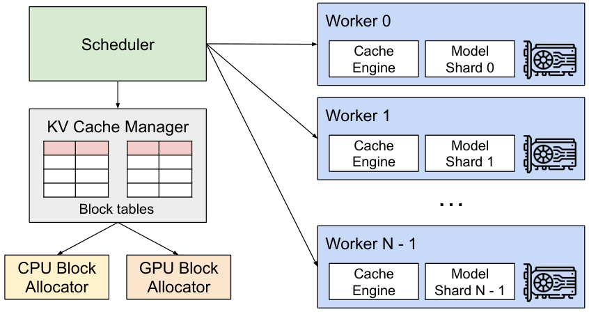
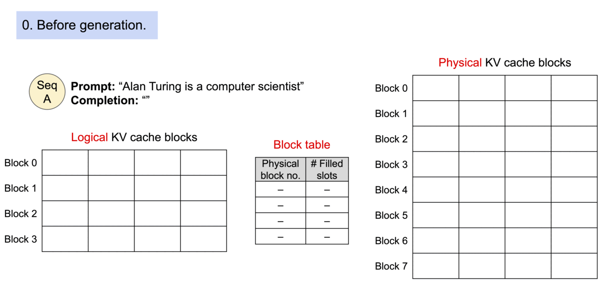
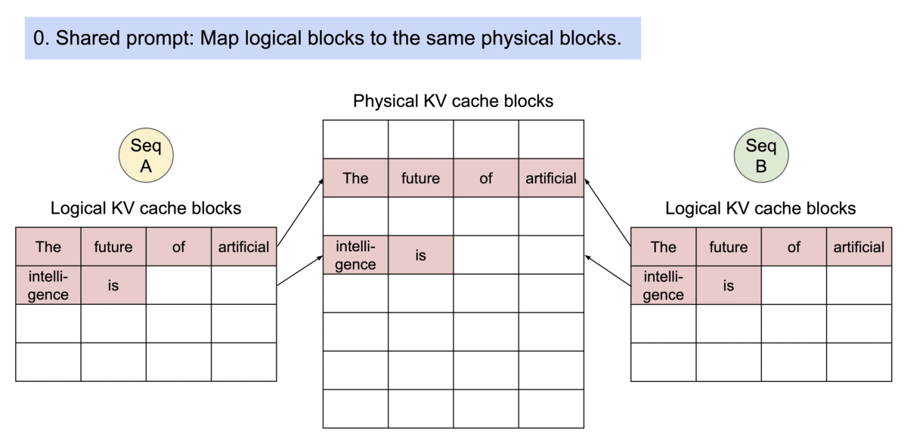
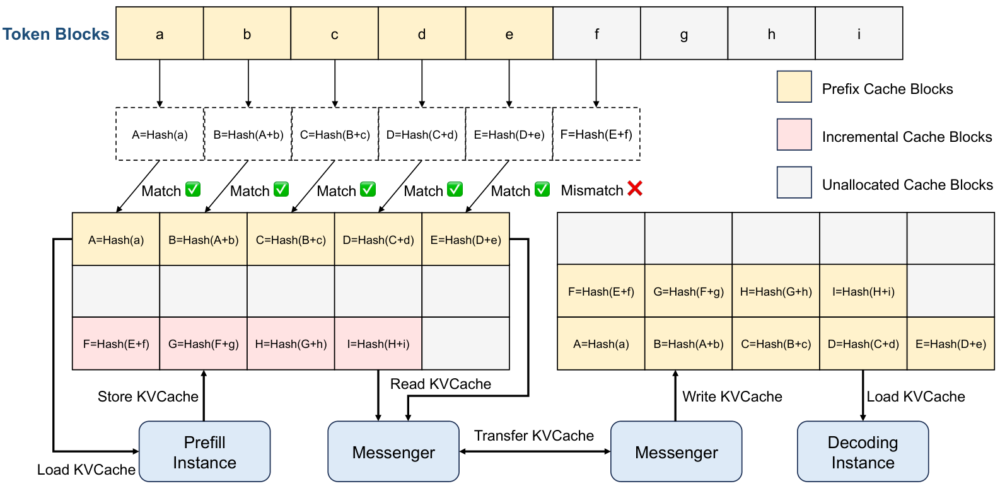
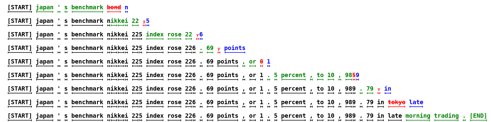
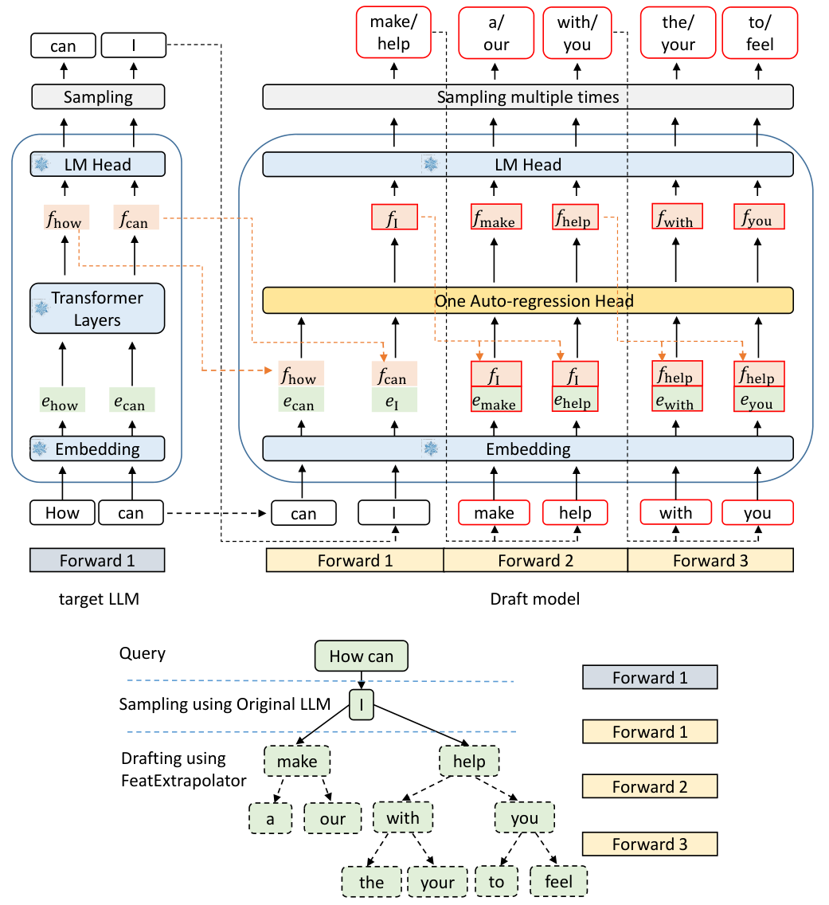
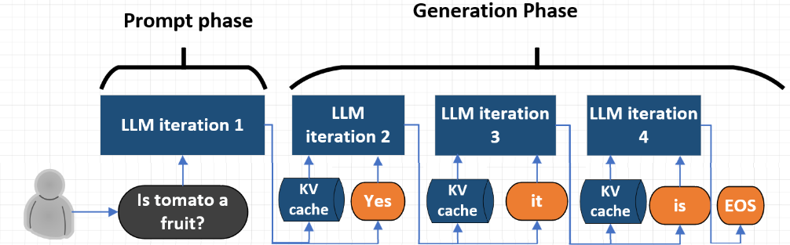
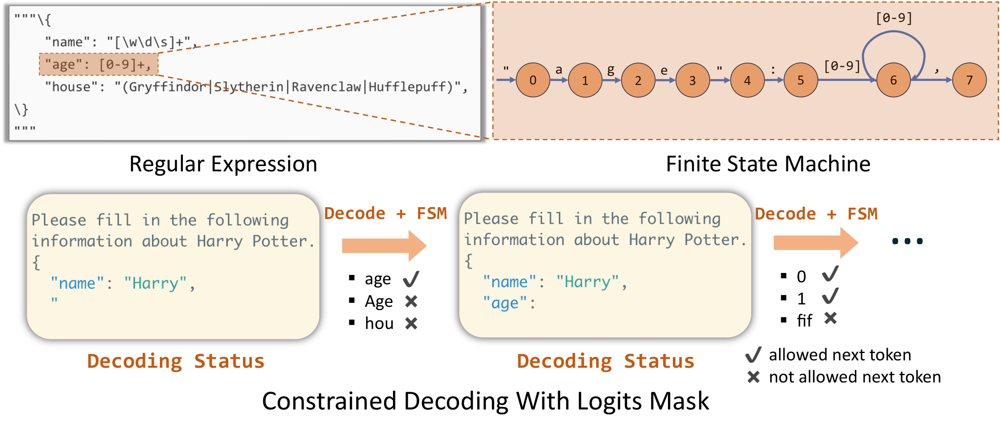

# Inference Internals II: Inside a Serving Engine

## Prerequisites

Read these first if the systems side is unfamiliar; the chapter defines each systems term once inline, but does not teach the background:

- [Computer Architecture](../foundations/computer-architecture.md) - GPU memory hierarchy, SMs, warps and the bandwidth-vs-compute distinction that every kernel discussion here relies on.
- [Linux and the OS](../foundations/linux-and-os.md) - processes, virtual memory and paging, which PagedAttention borrows directly.
- [Concurrency](../foundations/concurrency.md) - threads, the Python GIL, asynchronous execution and synchronization, needed for the engine-loop and async-scheduling sections.
- [Networking](../foundations/networking.md) - bandwidth vs latency, RDMA and NICs, needed for disaggregation and expert-parallel communication.
- [Distributed Systems](../foundations/distributed-systems.md) - collectives (all-reduce, all-to-all), load balancing and routing across replicas.
- [Model Architectures](../models/architectures.md) - GQA, MLA and MoE, whose shapes determine KV cache layout and the attention kernels discussed here.
- [GPU execution model](../compute/accelerator/execution-model.md) and [Writing GPU kernels](../compute/accelerator/writing-kernels.md) - SMs, CTAs (thread blocks), tensor cores and FlashAttention-style tiling, used in the attention-kernel and CUDA-graph sections.
- [Profiling and optimization](../training/profiling-and-optimization.md) - [Nsight Systems with NVTX](../training/profiling-and-optimization.md#nsight-systems-with-nvtx-ranges), [CPU-launch-bound loops](../training/profiling-and-optimization.md#cpu-launch-bound-loops), [torch.compile](../training/profiling-and-optimization.md#torchcompile) and [CUDA graphs](../training/profiling-and-optimization.md#cuda-graphs), which the engine-loop and compilation sections build on.
- [Inference Internals I](arithmetic.md) - the previous chapter: rooflines, KV sizing and quantization.

This chapter is about what happens inside a modern LLM serving engine - vLLM, SGLang, TensorRT-LLM and their relatives - at the level of the data structures, the scheduler loop and the kernels. It assumes [Inference Internals I: The Arithmetic of LLM Inference](arithmetic.md) for the vocabulary (prefill, decode, TTFT, TPOT/ITL, SLO, goodput) and for rooflines, KV cache sizing, quantization and capacity planning; none of that is repeated here. Continuous batching and speculative decoding are introduced in their own sections below. Links to the [Inference overview](README.md) point to an optional, lighter introduction; nothing here depends on having read it.

A note on accuracy: these engines change monthly. Where this chapter describes a specific engine's implementation it describes the design as publicly documented in its source, docs or design blogs around 2025-2026. Flag names and defaults drift - check the version you run. Where something is a recollection rather than a verified fact, it says so.

The running examples use two reference models so that the numbers are reproducible:

| Model | Layers | KV heads | Head dim | KV bytes/token (bf16) |
|-|-|-|-|-|
| Llama-3-8B-like | 32 | 8 | 128 | $2 \cdot 32 \cdot 8 \cdot 128 \cdot 2 = 131072$ = 128 KiB |
| Llama-3-70B-like | 80 | 8 | 128 | $2 \cdot 80 \cdot 8 \cdot 128 \cdot 2 = 327680$ = 320 KiB |

and one reference GPU: H100 SXM, ~989 dense bf16 TFLOPS, ~3.35 TB/s HBM (High Bandwidth Memory: the GPU's main on-package DRAM, where weights and KV cache live). Throughout, a *kernel* means one function launched by the CPU to run on the GPU (a matmul, an attention op), and the *host* means the CPU side. All arithmetic in this chapter was checked with `python3`.

### How to run the code in this chapter

Most sections include a toy implementation of the mechanism they describe: a paged KV cache, a scheduler simulation, two prefix caches, speculative sampling, samplers and a grammar-constrained decoder. Each one is small enough to read top to bottom and checks itself against a reference (contiguous attention, the exact target distribution, a regex). They need only Python 3 and PyTorch on CPU:

```bash
$ python3 -m venv /tmp/inf-venv && /tmp/inf-venv/bin/pip install -q torch numpy
$ /tmp/inf-venv/bin/python paged_kv.py        # file name = first comment line of each block
```

All outputs shown were pasted from runs on an Apple M4 laptop with PyTorch 2.15.0 and Python 3.14.5. Scripts marked **untested** need a CUDA GPU and were not run. Some scripts import from earlier ones (`step_cost.py`, `budget.py` and `spec_batch.py` import `sched_sim.py`; `order.py` imports `sampling.py`), so keep them all in one directory. Timing numbers from the laptop are one run on one machine; simulated numbers come from the stated cost models, not from a real engine.


## Request lifecycle

### The pipeline

Every engine has the same six logical stages, regardless of how they are mapped onto processes:

```
HTTP/gRPC  ->  tokenizer  ->  scheduler  ->  model runner  ->  sampler  ->  detokenizer  ->  stream to client
 (parse,       (chat         (pick which    (build input    (logit        (incremental
  validate)     template,     requests and   tensors, run    processors,   UTF-8 safe
                encode)       how many       forward,        top-k/p,      decode, stop
                              tokens each)   CUDA graphs)    sample)       strings)
```

The original vLLM architecture: a centralized scheduler driving workers that each hold a slice of the paged KV cache:



([source](https://arxiv.org/abs/2309.06180))

The first stage is the network front end. Clients send requests over HTTP ([taught in Networking](../foundations/networking.md#http11-from-raw-sockets)), almost always in the OpenAI-compatible JSON format shown in [Serving LLMs in Practice](serving-hands-on.md#the-openai-compatible-api-and-streaming). gRPC is the alternative: an RPC (remote procedure call) framework from Google that sends binary Protocol Buffers messages over HTTP/2 instead of JSON text; it is compared with HTTP/JSON in [Control Planes](../platform/control-planes.md). For this chapter it only matters that this stage parses bytes into a request object on the CPU.

Only the model runner and the sampler run on the GPU. Everything else is CPU work, and in a naive implementation all of it is on the critical path of every decode step.

Before reading on, it helps to see that the pipeline is just a loop. Here is a complete, runnable "engine" with every stage as a function: a fake model, a real scheduler step, sampling, detokenization and streaming. The rest of the chapter replaces each stage with the real mechanism:

```python
# tiny_engine.py - the whole request lifecycle as one loop (fake model, real structure)
import torch
torch.manual_seed(0)
VOCAB = list("abcdefgh ") + ["<eos>"]
EOS = len(VOCAB) - 1

def tokenize(text): return [VOCAB.index(c) for c in text]
def model_forward(batch_tokens):                  # stand-in for the GPU: (B, T) -> (B, V) logits
    return torch.randn(len(batch_tokens), len(VOCAB))
def sample(logits, temperature=0.8):
    return torch.multinomial((logits / temperature).softmax(-1), 1).squeeze(-1).tolist()

waiting = [{"id": i, "tokens": tokenize(p), "out": ""} for i, p in enumerate(["abc ", "hea", "fed g"])]
running, step = [], 0
while waiting or running:
    running += waiting; waiting = []              # scheduler: admit everything (no KV limit yet)
    next_ids = sample(model_forward([r["tokens"] for r in running]))   # model runner + sampler
    for r, t in zip(running, next_ids):           # output processing: append, detokenize, stop check
        r["tokens"].append(t)
        if t == EOS or len(r["out"]) >= 6:
            print(f"step {step}: request {r['id']} finished: {r['out']!r}")
            r["done"] = True
        else:
            r["out"] += VOCAB[t]                  # "stream" the delta
    running = [r for r in running if not r.get("done")]
    step += 1
```

```text
step 0: request 2 finished: ''
step 2: request 1 finished: ' a'
step 4: request 0 finished: 'gdab'
```

What the CPU does per step:

1. **Scheduling.** Walk the running and waiting queues, check KV block availability, decide preemptions, allocate new blocks for sequences crossing a block boundary.
2. **Input preparation.** Build `input_ids`, `positions`, `slot_mapping` (the physical KV slot each new token writes to), the block tables, `seq_lens`, `query_start_loc` for ragged batches, and the attention-backend metadata. For a batch of 256 sequences at 8k context and block size 16 the block table alone is $256 \times 512$ int32 entries.
3. **Sampling bookkeeping.** Per-request temperature, top-p, penalties, seeds, grammar masks.
4. **Output processing.** Append sampled token ids, incremental detokenization, stop-string matching, streaming the delta to the client.

### Why CPU overhead matters at decode

The GPU side of a decode step is short. For the 8B model at bf16 the step is bounded below by reading the weights once:

$$
16 \times 10^9\ \text{bytes} / (3.35 \times 10^{12}\ \text{bytes/s}) = 4.8\ \text{ms}
$$

If the CPU stages above take even 1-2 ms and run serially with the GPU, the GPU is idle for 17-30% of wall time. This is not hypothetical: the vLLM team's V1 re-architecture blog (January 2025) was motivated largely by CPU overhead becoming the bottleneck once kernels got fast. The exact fraction depends on batch size, Python version, sampling params in use and tokenizer, so measure it on your setup - `nsys` (NVIDIA's timeline profiler, recording when each CPU call and GPU kernel ran) with NVTX ranges (named markers you insert in code so they appear on that timeline) around schedule/prepare/forward/sample shows the gaps directly as idle stretches on the GPU timeline.

The arithmetic, for any CPU overhead you measure:

```python
# idle.py - fraction of wall time the GPU is idle when CPU work is serialized with each step
gpu_ms = 16e9 / 3.35e12 * 1e3                    # 8B bf16 weight read: 4.8 ms
for cpu_ms in (0.5, 1.0, 2.0, 4.0):
    print(f"CPU {cpu_ms:3.1f} ms/step -> GPU idle {cpu_ms / (cpu_ms + gpu_ms):4.0%} of wall time")
```

```text
CPU 0.5 ms/step -> GPU idle   9% of wall time
CPU 1.0 ms/step -> GPU idle  17% of wall time
CPU 2.0 ms/step -> GPU idle  30% of wall time
CPU 4.0 ms/step -> GPU idle  46% of wall time
```

Long prompts also have a tokenization cost: fast (Rust) tokenizers are linear in input length but still take on the order of milliseconds for 100k-token prompts, and chat-template rendering in Jinja is pure Python. (A chat template is a small program shipped with the model, in the Jinja text-templating language, that turns a list of `{"role", "content"}` messages into the single prompt string with the model's special tokens.) Python's GIL (Global Interpreter Lock: only one thread of a Python process executes Python code at a time) means that if that runs in the same process as the scheduler loop it stalls every running request.

### The fix: separate processes, persistent state, async scheduling

The engines converged on three structural changes.

**Multi-process split.** A process is an OS-level program instance with its own memory and its own GIL, so separate processes truly run in parallel on different CPU cores. vLLM V1 runs an API-server process (HTTP, tokenization, detokenization, output streaming) and an `EngineCore` process (scheduler + model executor) connected via ZeroMQ (a message-passing library for sending bytes between processes), so tokenization of a new 100k-token prompt no longer stalls the busy loop. With tensor parallelism, each GPU has its own worker process and the scheduler broadcasts a compact "scheduler output" (request ids, new token counts, new block ids) rather than full tensors. SGLang has an analogous split: a tokenizer manager, a scheduler process per TP group and a detokenizer manager process. TensorRT-LLM's runtime has historically been C++ (the executor API with in-flight batching), which removes most Python overhead from the loop by construction.

**Persistent batch.** Rebuilding all input tensors from Python lists every step is O(total tokens in batch). vLLM V1's model runner keeps persistent, pre-allocated GPU/CPU buffers for the batch state (token ids, block tables, sampling params) and applies only diffs: requests added, removed, or that received new blocks. The per-step CPU work becomes O(changes) plus a handful of small host-to-device copies (transfers from CPU RAM to GPU memory over PCIe, the CPU-GPU bus).

**Async / overlapped scheduling.** GPU kernel launches are asynchronous: the CPU enqueues work on a *stream* (an ordered GPU work queue) and returns immediately; it only blocks at a *sync*, e.g. when it reads a GPU tensor's value back. The fundamental serialization is that step $n+1$ needs the token sampled at step $n$. But the scheduler does not need the token's *value* to plan step $n+1$ - it only needs to know that each running request will have exactly one more token (absent spec decode and stop conditions). So the scheduler can plan step $n+1$ while the GPU executes step $n$, and the sampled token ids are fed into step $n+1$'s `input_ids` buffer on the GPU directly. SGLang calls this the overlap scheduler ("zero-overhead batch scheduler", introduced in v0.4, late 2024); vLLM V1 added it as `--async-scheduling`; TensorRT-LLM's PyTorch backend has an overlap scheduler too. The cost is one step of lag in detecting termination: a request that hit EOS at step $n$ has already been scheduled for step $n+1$, which wastes one slot and its KV write, and must be discarded on output.

The engine-loop sketch at the end of this subsection is not runnable on its own, but the effect is easy to reproduce. In this simulation a worker thread plays the GPU (kernels are enqueued and run asynchronously, and reading a result blocks), and the CPU spends 2 ms per step on scheduling and output processing:

```python
# overlap.py - serial vs overlapped engine loop; a worker thread plays the GPU
import threading, queue, time
GPU_MS, CPU_MS, STEPS = 5.0, 2.0, 200          # GPU step time, CPU schedule+prepare+output time

class FakeGPU:
    """Kernels are enqueued and run asynchronously; reading a result blocks (like .tolist())."""
    def __init__(self):
        self.q = queue.Queue(); threading.Thread(target=self._run, daemon=True).start()
    def _run(self):
        while True:
            done = self.q.get(); time.sleep(GPU_MS / 1e3); done.set()
    def launch(self):
        ev = threading.Event(); self.q.put(ev); return ev     # returns immediately

def cpu_work(): time.sleep(CPU_MS / 1e3)                     # scheduling, input prep, detok

def serial(gpu):
    for _ in range(STEPS):
        cpu_work()                  # schedule + prepare step n
        gpu.launch().wait()         # run step n and wait for its sampled tokens

def overlapped(gpu):
    prev = None
    for _ in range(STEPS):
        cpu_work()                  # schedule step n while step n-1 is still on the GPU
        fut = gpu.launch()          # step n's input ids come from step n-1's GPU buffer
        if prev is not None: prev.wait()   # only now read step n-1's tokens
        prev = fut
    prev.wait()

for fn in (serial, overlapped):
    t0 = time.perf_counter(); fn(FakeGPU()); dt = time.perf_counter() - t0
    print(f"{fn.__name__:10s} {dt/STEPS*1e3:5.2f} ms/step  GPU busy {GPU_MS*STEPS/1e3/dt:4.0%}")
```

Output of `python overlap.py`:

```text
serial      8.74 ms/step  GPU busy  57%
overlapped  6.16 ms/step  GPU busy  81%
```

The ideal numbers are 7 ms/step serial and 5 ms/step overlapped. The extra ~1 ms is macOS `sleep` and thread wake-up jitter, which is itself a small lesson: host-side timing below a millisecond is noisy, so measure it with a profiler rather than trusting `time.sleep` arithmetic.

```python
# Overlapped engine loop (sketch). GPU work is asynchronous; .tolist() is the only sync.
prev = None
while True:
    sched = scheduler.schedule()             # CPU: uses token *counts*, not values
    fut = runner.execute_async(sched)        # enqueue kernels; next input ids taken from
                                             # prev step's sampled-token GPU buffer
    if prev is not None:
        tokens = prev.sampled.tolist()       # sync on step n-1 while step n runs
        outputs = scheduler.update(prev.sched, tokens)  # stop checks, free finished blocks
        detok_queue.put(outputs)             # another process detokenizes and streams
    prev = fut
```

### Incremental detokenization

Detokenization is not `tokenizer.decode(new_token)`. BPE tokens can be partial UTF-8 byte sequences, and SentencePiece-style tokenizers attach leading spaces in a context-dependent way. Engines keep two offsets per request (vLLM's names: `prefix_offset`, `read_offset`), decode the window `tokens[prefix_offset:]`, and emit only the suffix beyond what `tokens[prefix_offset:read_offset]` decoded to, holding back output while the tail ends in an incomplete UTF-8 sequence (`�`). Stop strings must be matched on the detokenized text, and the engine must hold back up to `max(len(stop_string)) - 1` characters from the stream so it never emits a partial stop string it later has to retract.

A runnable version with a byte-level toy vocabulary, where `é` and `✓` are split across tokens exactly as byte-level BPE splits them:

```python
# detok.py - incremental detokenization with byte-level tokens and stop-string holdback
# Byte-level BPE vocabularies contain tokens that are fragments of a UTF-8 character.
text = "Café ✓ done. STOP here"
VOCAB = {}
def tok(b): VOCAB.setdefault(b, len(VOCAB)); return VOCAB[b]
raw = text.encode()
pieces = [raw[0:3], raw[3:4], raw[4:5], raw[5:6], raw[6:8], raw[8:9]] + \
         [raw[i:i + 2] for i in range(9, len(raw), 2)]           # 'é' and '✓' split across tokens
ids = [tok(p) for p in pieces]
INV = {v: k for k, v in VOCAB.items()}
def decode(ids): return b"".join(INV[i] for i in ids).decode("utf-8", errors="replace")

print("naive per-token decode:", [decode([i]) for i in ids[:6]])

class Detok:
    """vLLM-style offsets: emit only text that is final and cannot be part of a stop string."""
    def __init__(self, stop):
        self.ids, self.prefix, self.read, self.stop = [], 0, 0, stop
        self.text, self.sent = "", 0                     # full decoded text, chars already streamed
    def push(self, i):
        self.ids.append(i)
        prev = decode(self.ids[self.prefix:self.read])
        new = decode(self.ids[self.prefix:])
        if new.endswith("�"): return ""             # incomplete UTF-8: wait for more bytes
        self.text += new[len(prev):]
        self.prefix, self.read = self.read, len(self.ids)
        if self.stop in self.text:                       # finished: emit up to the stop string
            out = self.text[self.sent:self.text.index(self.stop)]; self.sent = len(self.text)
            return out + "<EOS>"
        safe = len(self.text) - (len(self.stop) - 1)     # hold back a possible partial stop string
        out = self.text[self.sent:max(safe, self.sent)]
        self.sent = max(safe, self.sent)
        return out

d = Detok(stop="STOP")
stream = []
for i in ids:
    delta = d.push(i)
    stream.append(delta)
    if delta.endswith("<EOS>"): break
print("streamed deltas:", stream)
print("client sees:", "".join(stream))
```

Output of `python detok.py`:

```text
naive per-token decode: ['Caf', '�', '�', ' ', '�', '�']
streamed deltas: ['', '', 'C', 'a', '', 'f', 'é ', '✓ ', 'do', 'ne', '. ', '<EOS>']
client sees: Café ✓ done. <EOS>
```

Decoding tokens one at a time yields `�` (the Unicode replacement character, shown as `�`) for the half-characters. The incremental detokenizer emits nothing until the bytes complete a character, and holds back the last `len("STOP") - 1 = 3` characters in case they turn out to be the start of the stop string. The `<EOS>` marks where the engine would end the stream.


## PagedAttention

The [overview](README.md#paged-attention) says what it is. This section is about how it works. The name comes from OS virtual memory, where a process sees contiguous addresses but the OS maps them in fixed-size *pages* onto scattered physical memory through a page table; here the "pages" are KV blocks and the page table is the block table. Reference: Kwon et al., "Efficient Memory Management for Large Language Model Serving with PagedAttention" (arXiv 2309.06180).

The problem it solves: a request's final length is unknown when it arrives. The pre-2023 approach reserved one contiguous KV region per request sized for `max_model_len`. Most requests end far shorter, so most of the reserved memory held nothing, and the scheduler could not admit more requests because the memory *looked* full. Paging allocates memory one small block at a time as the sequence actually grows. So the wasted memory is at most one partially filled block per sequence, and it shrinks from tens of percent to well under 1% (measured in [Block size tradeoffs](#block-size-tradeoffs)).

### Block tables

The KV cache is one large pre-allocated pool per layer, carved into fixed-size physical blocks of `block_size` tokens. Each sequence owns a block table: a list of physical block ids, one per `block_size` logical tokens. Token at logical position $t$ of sequence $s$ lives at:

```python
blk  = block_table[s, t // block_size]      # physical block id
slot = blk * block_size + t % block_size    # flat slot in the pool
```

The vLLM launch post animates how logical KV blocks map to non-contiguous physical blocks:



([source](https://blog.vllm.ai/2023/06/20/vllm.html))

The pool is allocated once at startup: the engine runs a profiling forward pass at max batched tokens, measures peak activation memory, and gives everything left under `gpu_memory_utilization` to KV blocks. For the 8B model on an 80 GB GPU at 0.9 utilization:

$$
(80 \cdot 0.9 - 16)\ \text{GB} = 56\ \text{GB of KV}
$$

$$
56 \times 10^9 / 131072\ \text{bytes/token} \approx 427\text{k tokens} \approx 26.7\text{k blocks of 16}
$$

Writing new KV: the model runner passes `slot_mapping` (one slot per new token, shape `(num_new_tokens,)`) and a `reshape_and_cache` kernel scatters the freshly computed K and V into those slots before or inside attention.

In PyTorch terms, the pool is one big tensor, a write is an indexed scatter, and a paged read is an indexed gather. The kernel-side detail is in the next subsections; the bookkeeping fits in a few lines:

```python
# slot_mapping.py - block table -> flat slot index for each new token, and the scatter that writes KV
import torch
BLOCK, H, D = 16, 8, 128
pool = torch.zeros(1000, BLOCK, H, D)                    # (num_blocks, block_size, kv_heads, head_dim)
block_table = [412, 7, 96]                               # this sequence's physical blocks, in order
positions = torch.arange(30, 34)                         # 4 new tokens at logical positions 30..33
blk = torch.tensor(block_table)[positions // BLOCK]      # which physical block each token lands in
slot_mapping = blk * BLOCK + positions % BLOCK           # (4,) flat slot ids
print("slot_mapping:", slot_mapping.tolist())
new_k = torch.randn(4, H, D)                             # (num_new_tokens, H, D) from the K projection
pool.view(-1, H, D)[slot_mapping] = new_k                # reshape_and_cache, as one scatter
print("token 32 lives in block", block_table[32 // BLOCK], "offset", 32 % BLOCK,
      "| written correctly:", torch.equal(pool[96, 0], new_k[2]))
```

```text
slot_mapping: [126, 127, 1536, 1537]
token 32 lives in block 96 offset 0 | written correctly: True
```

Layout matters for the attention kernel's access pattern. The original vLLM CUDA paged-attention kernel used a key cache of shape `(num_blocks, num_kv_heads, head_size // x, block_size, x)` with `x = 16 bytes / elem_size`, and values `(num_blocks, num_kv_heads, head_size, block_size)` - arranged so that a warp (a group of 32 GPU threads that execute in lockstep) reading one block reads contiguous 16-byte vectors - "coalesced" access, where neighbouring threads touch neighbouring addresses so the hardware can merge them into few wide memory transactions. FlashAttention/FlashInfer-backed paths use `(num_blocks, block_size, num_kv_heads, head_size)` per K and V (often stacked as a leading dimension of 2), which keeps `head_size` contiguous for tensor-core tiles. The exact layouts are backend-specific and have changed over versions; the invariant is that within a block the memory is contiguous, and between blocks there is one indirection through the block table.

### The kernel's memory access pattern

Decode attention for one `(sequence, kv_head)` pair reads $\text{seq len} \cdot \text{head dim} \cdot 2$ elements of K and V once and does $O(\text{seq len} \cdot \text{head dim})$ FLOPs per query head - arithmetic intensity of a few FLOPs per byte, so it is purely bandwidth-bound (see [Internals I](arithmetic.md) for why). The paged kernel therefore has one job: stream KV at near-peak bandwidth despite the indirection. It does that by:

- loading the block table entries for its sequence once (into registers/shared memory - the small, fast on-chip storage private to a thread or shared by a thread block),
- issuing loads one whole block at a time, so each physical block is a contiguous $\text{block size} \cdot \text{head dim} \cdot 2$ byte region (4 KiB per K or V block for `block_size=16, head_dim=128`, bf16),
- prefetching the next block while computing on the current one (software pipelining via `cp.async` or, on Hopper, TMA - hardware units that copy tiles from HBM to shared memory asynchronously).

Because blocks are big enough to fill a DRAM burst (the minimum contiguous chunk memory delivers efficiently) and a warp's loads, the indirection costs little. The overhead shows up only when blocks get very small (block size 1, as in token-granular radix caches) where every token's address is a separate gather - FlashInfer's page-size-1 path handles this but with lower achieved bandwidth than large pages, by an amount that depends on the GPU and head dim.

The sizes that matter for the access pattern:

```python
# block_bytes.py - bytes per KV block, and how many separate reads a 4k-token decode does per layer
head_dim, kv_heads, elem = 128, 8, 2
for block in (1, 16, 64):
    per_head = block * head_dim * elem                    # one K (or V) block for one KV head
    print(f"block {block:3d}: {per_head:6d} B contiguous per head per K/V, "
          f"{4096 // block * kv_heads * 2:6d} separate block reads per layer for a 4096-token sequence")
```

```text
block   1:    256 B contiguous per head per K/V,  65536 separate block reads per layer for a 4096-token sequence
block  16:   4096 B contiguous per head per K/V,   4096 separate block reads per layer for a 4096-token sequence
block  64:  16384 B contiguous per head per K/V,   1024 separate block reads per layer for a 4096-token sequence
```

At block size 16 each read is a 4 KiB contiguous run, which is plenty to keep the memory system streaming. At block size 1 each read is 256 bytes, and the kernel issues 16x more address lookups for the same data.

### Block size tradeoffs

Internal fragmentation is only in the last, partially filled block. If sequence lengths are uniformly distributed modulo `block_size`, the expected waste is $(B - 1) / 2$ tokens per sequence:

| Block size $B$ | Mean waste (tokens/seq) | Waste fraction at $L=500$ | at $L=2000$ |
|-|-|-|-|
| 8 | 3.5 | 0.7% | 0.17% |
| 16 | 7.5 | 1.5% | 0.37% |
| 32 | 15.5 | 3.0% | 0.77% |
| 64 | 31.5 | 5.9% | 1.6% |
| 128 | 63.5 | 11.3% | 3.1% |
| 256 | 127.5 | 20.3% | 6.0% |

Compare with static preallocation to `max_model_len`: a request reserving 8192 slots that ends at 1500 tokens uses $1500/8192 = 18\%$ of its reservation. That gap - not the few percent above - is what PagedAttention buys you.

Both numbers come from a direct simulation. Draw 10,000 request lengths, round each up to whole blocks, and compare with reserving 8,192 slots per request:

```python
# fragmentation.py - KV slots wasted: paged blocks vs reserving max_model_len per request
import random
random.seed(0)
lens = [random.randint(200, 4000) for _ in range(10_000)]     # final lengths of 10k requests
used = sum(lens)
print(f"static reservation of 8192/request: {used / (8192 * len(lens)):.1%} of reserved slots used")
for bs in (1, 8, 16, 32, 64, 128, 256):
    alloc = sum(-(-n // bs) * bs for n in lens)              # ceil to whole blocks
    print(f"block {bs:3d}: waste {(alloc-used)/len(lens):6.1f} tokens/seq "
          f"(theory {(bs-1)/2:6.1f}), {1-used/alloc:5.2%} of KV memory")
```

Output of `python fragmentation.py`:

```text
static reservation of 8192/request: 25.7% of reserved slots used
block   1: waste    0.0 tokens/seq (theory    0.0), 0.00% of KV memory
block   8: waste    3.5 tokens/seq (theory    3.5), 0.16% of KV memory
block  16: waste    7.4 tokens/seq (theory    7.5), 0.35% of KV memory
block  32: waste   15.4 tokens/seq (theory   15.5), 0.73% of KV memory
block  64: waste   31.4 tokens/seq (theory   31.5), 1.47% of KV memory
block 128: waste   63.5 tokens/seq (theory   63.5), 2.93% of KV memory
block 256: waste  128.6 tokens/seq (theory  127.5), 5.76% of KV memory
```

The $(B - 1) / 2$ rule holds, and even block size 256 wastes less than 6% for these lengths. Static reservation wastes 74%.

Why not block size 1? Costs that grow as blocks shrink:

- **Block table size and CPU bookkeeping.** A 128k-token sequence at $B=16$ is 8192 block ids; at $B=1$ it is 131072. Allocation, freeing and hashing are per block.
- **Kernel efficiency.** Discussed above.
- **Prefix caching granularity.** Hash-based caching (below) only caches full blocks, so smaller blocks give finer-grained reuse but more hash computations.

Why not block size 256? Fragmentation, and coarser copy-on-write and prefix sharing. In practice vLLM defaults to 16 on CUDA; some kernels require specific sizes (FlashMLA uses 64; some attention backends require multiples of 16 or 32). SGLang's radix cache historically used page size 1 (token-granular) and later made `page_size` configurable for kernels that prefer larger pages.

### Sharing and copy-on-write

Blocks carry a reference count. This gives sharing for free:

- **Parallel sampling ($n > 1$).** All $n$ children point at the same prompt blocks (`ref_count = n`). Each child's first generated token goes into the last prompt block if it is partially full; on write to a block with `ref_count > 1`, the allocator allocates a fresh block, copies the existing slots, decrements the original's count and updates that child's table. Only the partially filled last block is ever copied; full shared blocks are immutable.
- **Beam search.** Forking a beam is copying a block table and incrementing ref counts; pruning a beam decrements them. The copy cost per fork is bounded by one block.

Copy-on-write for parallel sampling, from the same post:



([source](https://blog.vllm.ai/2023/06/20/vllm.html))

vLLM V1 moved away from an explicit CoW path in the core: parallel sampling is fanned out into independent child requests that share prompt blocks through prefix caching (next section), and beam search was moved out of the engine core into a higher-level loop. The effect is the same - shared immutable full blocks - with one fewer mechanism in the core. (This reflects the V1 design as I understand it; verify against your version if you depend on it.)

The sketch below shows the allocator's core logic. The runnable version after it adds the pool tensors, slot mapping, a paged attention read that is checked against contiguous attention, and a parallel-sampling fork that triggers copy-on-write:

```python
class BlockAllocator:
    def __init__(self, n): self.free = deque(range(n)); self.ref = [0]*n
    def alloc(self):       b = self.free.popleft(); self.ref[b] = 1; return b
    def fork(self, table): [self._inc(b) for b in table]; return list(table)
    def _inc(self, b):     self.ref[b] += 1
    def release(self, b):
        self.ref[b] -= 1
        if self.ref[b] == 0: self.free.append(b)
    def writable_last(self, table, kv_pool):       # call before appending a token
        b = table[-1]
        if self.ref[b] > 1:                        # copy-on-write
            nb = self.alloc(); kv_pool[:, nb] = kv_pool[:, b]   # (layers, block, ...)
            self.release(b); table[-1] = nb
        return table[-1]
```

```python
# paged_kv.py - a paged KV cache with block tables, slot mapping, ref counts and copy-on-write
import torch
torch.manual_seed(0)
BLOCK, NUM_BLOCKS, H, D = 4, 32, 2, 8          # tiny: 4 tokens per block, 2 KV heads, head dim 8

class PagedKV:
    def __init__(self):
        # one pool for K and one for V: (num_blocks, block_size, kv_heads, head_dim)
        self.k = torch.zeros(NUM_BLOCKS, BLOCK, H, D)
        self.v = torch.zeros(NUM_BLOCKS, BLOCK, H, D)
        self.free = list(range(NUM_BLOCKS))[::-1]  # stack of free physical block ids
        self.ref = [0] * NUM_BLOCKS
        self.tables, self.lens = {}, {}            # seq_id -> [block ids], seq_id -> num tokens

    def _alloc(self):
        b = self.free.pop(); self.ref[b] = 1; return b

    def _release(self, b):
        self.ref[b] -= 1
        if self.ref[b] == 0: self.free.append(b)

    def new_seq(self, sid):
        self.tables[sid], self.lens[sid] = [], 0

    def fork(self, parent, child):              # parallel sampling / beam fork: share every block
        self.tables[child] = list(self.tables[parent])
        self.lens[child] = self.lens[parent]
        for b in self.tables[child]: self.ref[b] += 1

    def slots_for_append(self, sid, n):
        """Reserve slots for n new tokens; returns the flat slot index of each (the slot_mapping)."""
        table, slots = self.tables[sid], []
        for _ in range(n):
            t = self.lens[sid]
            if t % BLOCK == 0:                      # crossed into a new logical block
                table.append(self._alloc())
            elif self.ref[table[-1]] > 1:           # last block shared: copy-on-write
                old, new = table[-1], self._alloc()
                self.k[new], self.v[new] = self.k[old], self.v[old]
                self._release(old); table[-1] = new
                print(f"  CoW: seq {sid} copied block {old} -> {new}")
            slots.append(table[-1] * BLOCK + t % BLOCK)
            self.lens[sid] += 1
        return torch.tensor(slots)

    def write(self, slots, k, v):               # reshape_and_cache: scatter (n, H, D) into slots
        self.k.view(-1, H, D)[slots] = k
        self.v.view(-1, H, D)[slots] = v

    def gather(self, sid):                      # what a paged kernel reads, block by block
        idx = torch.tensor(self.tables[sid])
        n = self.lens[sid]
        return (self.k[idx].reshape(-1, H, D)[:n],      # (T, H, D)
                self.v[idx].reshape(-1, H, D)[:n])

    def free_seq(self, sid):
        for b in self.tables.pop(sid): self._release(b)
        del self.lens[sid]

def attention(q, k, v):                          # q: (H, D), k/v: (T, H, D) -> (H, D)
    s = torch.einsum("hd,thd->ht", q, k) / D ** 0.5
    return torch.einsum("ht,thd->hd", s.softmax(-1), v)

kv = PagedKV()
# prefill a 10-token prompt for seq 0 and check against a plain contiguous cache
kv.new_seq(0)
K_ref, V_ref = torch.randn(10, H, D), torch.randn(10, H, D)
slots = kv.slots_for_append(0, 10)
kv.write(slots, K_ref, V_ref)
print("block table seq0:", kv.tables[0], " slot_mapping:", slots.tolist())
q = torch.randn(H, D)
k, v = kv.gather(0)
assert torch.allclose(attention(q, k, v), attention(q, K_ref, V_ref))
print("paged attention == contiguous attention: OK")

# parallel sampling n=3: fork, then each child decodes 3 tokens
for c in (1, 2, 3): kv.fork(0, c)
kv.free_seq(0)                                   # parent no longer needed
print("after fork, ref counts of prompt blocks:", [kv.ref[b] for b in kv.tables[1]])
for step in range(3):
    for c in (1, 2, 3):
        s = kv.slots_for_append(c, 1)
        kv.write(s, torch.randn(1, H, D), torch.randn(1, H, D))
for c in (1, 2, 3): print(f"seq {c} table {kv.tables[c]} len {kv.lens[c]}")
used = NUM_BLOCKS - len(kv.free)
print(f"blocks in use: {used} (without sharing: {3 * -(-kv.lens[1] // BLOCK)})")
```

Output of `python paged_kv.py`:

```text
block table seq0: [0, 1, 2]  slot_mapping: [0, 1, 2, 3, 4, 5, 6, 7, 8, 9]
paged attention == contiguous attention: OK
after fork, ref counts of prompt blocks: [3, 3, 3]
  CoW: seq 1 copied block 2 -> 3
  CoW: seq 2 copied block 2 -> 4
seq 1 table [0, 1, 3, 5] len 13
seq 2 table [0, 1, 4, 6] len 13
seq 3 table [0, 1, 2, 7] len 13
blocks in use: 8 (without sharing: 12)
```

What happened: the 10-token prompt filled blocks 0 and 1 and the first 2 slots of block 2. After the fork, all three blocks have `ref = 3`. Child 1's first new token goes into block 2, which is shared, so it gets a private copy (block 3), and child 2 does the same (block 4). Child 3 is now the *only* user of block 2 (`ref` dropped to 1), so it writes in place with no copy. Full blocks 0 and 1 are never copied. Total: 8 blocks instead of 12 for three independent copies, and the saving grows with prompt length and $n$.


## Continuous batching and the scheduler

The [overview](README.md#continuous-batching-or-in-flight-batching) describes the idea. The original system is Orca (Yu et al., "Orca: A Distributed Serving System for Transformer-Based Generative Models", OSDI 2022 - not on arXiv as far as I know), which introduced iteration-level scheduling and *selective batching*: batch the token-wise ops (linear layers, norms) across requests of different lengths by flattening tokens, and run attention per request. That flattening is still how every engine works: the model sees a single ragged batch of shape `(total_tokens, hidden)` with no padding, and only attention needs per-sequence metadata.

**Static batching**, the thing continuous batching replaced, groups $B$ requests, runs them until the *longest* one finishes, and only then admits the next group. Two costs follow. Finished requests leave idle slots that keep being computed (or padded) until the batch ends. And a new request waits for the whole current batch, so its time to first token includes other people's generation time. **Continuous batching** (also called iteration-level scheduling or in-flight batching) re-decides the batch at *every* step: finished requests leave and waiting ones join immediately. The simulation in [A scheduler you can run](#a-scheduler-you-can-run) puts numbers on the difference.

### The unified scheduler

Modern schedulers no longer distinguish "prefill steps" from "decode steps". vLLM V1's scheduler, for example, produces a mapping `{request_id: num_tokens_to_compute_this_step}` under two budgets: `max_num_batched_tokens` (token budget per step) and `max_num_seqs`. A decode contributes 1 token (or $1 + k$ with speculation), a prefill chunk contributes up to whatever budget is left. A request is just "computed tokens so far" vs "tokens known so far" - prefill, chunked prefill, decode, spec-decode verification and resumption after preemption are all the same thing: catching `num_computed_tokens` up to `num_tokens`.

```python
def schedule(running, waiting, kv, token_budget, max_seqs):
    out = {}
    # 1. running requests first (decodes and in-progress chunked prefills)
    for r in list(running):
        n = min(r.num_tokens - r.num_computed, token_budget)
        while not kv.can_append(r, n):          # need new blocks for these tokens
            victim = running.pop()              # lowest priority / latest arrival
            kv.free(victim); victim.num_computed = 0   # recompute-style preemption
            waiting.appendleft(victim)
            if victim is r: break
        else:
            kv.append_slots(r, n); out[r.id] = n; token_budget -= n
        if token_budget == 0: return out
    # 2. admit waiting requests if KV and budget allow
    while waiting and token_budget > 0 and len(out) < max_seqs:
        r = waiting[0]
        hit = kv.lookup_prefix(r)               # prefix-cache hit, in tokens
        n = min(r.num_tokens - hit, token_budget)
        if not kv.can_allocate(r, hit + n, watermark=0.01):
            break                               # admission control: KV budget
        waiting.popleft(); r.num_computed = hit
        kv.allocate(r, hit + n); running.append(r)
        out[r.id] = n; token_budget -= n
    return out
```

### A scheduler you can run

The sketch above leaves out the time axis. This simulation adds it. A cost model gives each step's duration: the roofline for an 8B model on an H100, at 50% MFU plus 1 ms of fixed overhead, where a step reads the weights once plus every KV token it attends over. Requests arrive as a Poisson process at 6 per second. 90% have 200-800-token prompts and 10% have 8,000-token prompts, and outputs are 100-300 tokens. The same workload then runs under five policies: static batching, continuous batching that prefills each prompt whole, chunked prefill with two token budgets, and chunked prefill with a KV pool too small for the load, which forces recompute preemption:

```python
# sched_sim.py - simulate static batching, continuous batching and chunked prefill on one GPU
# Step-time model: Llama-3-8B-like on H100, roofline with 50% MFU and 1 ms fixed overhead.
import random, statistics as st
from collections import deque

W_BYTES, KV_TOK, BW, FLOPS = 16e9, 131072, 3.35e12, 989e12 * 0.5

def step_time(n_tokens, kv_tokens):
    t_mem = (W_BYTES + kv_tokens * KV_TOK) / BW            # read weights once + every KV token
    t_cmp = 2 * 8e9 * n_tokens / FLOPS
    return max(t_mem, t_cmp) + 1e-3

class Req:
    def __init__(self, i, arrival, prompt, out):
        self.id, self.arrival, self.prompt, self.out = i, arrival, prompt, out
        self.computed = 0                                   # tokens whose KV exists
        self.generated = 0
        self.token_times = []
    @property
    def total(self): return self.prompt + self.generated    # tokens known so far

def workload(seed=0, n=400, qps=6.0):
    rng = random.Random(seed); t = 0.0; reqs = []
    for i in range(n):
        t += rng.expovariate(qps)
        prompt = 8000 if rng.random() < 0.1 else rng.randint(200, 800)   # 10% long prompts
        reqs.append(Req(i, t, prompt, rng.randint(100, 300)))
    return reqs

def run(policy, budget=None, kv_capacity=400_000, max_seqs=128, batch=16):
    reqs = workload(); pending = deque(reqs); waiting, running = deque(), []
    now, preemptions = 0.0, 0
    while pending or waiting or running:
        while pending and pending[0].arrival <= now: waiting.append(pending.popleft())
        if not waiting and not running:
            now = pending[0].arrival; continue
        sched = {}                                          # req -> tokens to compute this step
        if policy == "static":                              # admit only when the batch is empty
            if not running:
                while waiting and len(running) < batch: running.append(waiting.popleft())
            for r in running: sched[r] = r.total - r.computed
        else:
            tok_budget = budget or 10**9
            for r in running:                               # running first: decodes, partial prefills
                n = min(r.total - r.computed, tok_budget)
                if n: sched[r] = n; tok_budget -= n
            while waiting and tok_budget > 0 and len(running) < max_seqs:
                r = waiting[0]
                used = sum(x.total for x in running)
                if used + min(r.prompt, tok_budget) > kv_capacity: break    # admission control
                waiting.popleft(); running.append(r)
                sched[r] = min(r.total - r.computed, tok_budget); tok_budget -= sched[r]
            while sum(x.computed + sched.get(x, 0) for x in running) > kv_capacity:
                victim = running.pop()                      # newest: recompute-style preemption
                sched.pop(victim, None); victim.computed = 0; waiting.appendleft(victim)
                preemptions += 1
        n_tok = sum(sched.values())
        kv_read = sum(r.computed for r in sched)
        now += step_time(n_tok, kv_read)
        for r, n in sched.items():
            r.computed += n
            if r.computed == r.total:                       # caught up: this step emitted a token
                r.generated += 1; r.token_times.append(now)
        done = [r for r in running if r.generated >= r.out]
        for r in done: running.remove(r)
        if policy == "static" and all(r.generated >= r.out for r in running): running = []
    ttft = [r.token_times[0] - r.arrival for r in reqs]
    itl = [b - a for r in reqs for a, b in zip(r.token_times, r.token_times[1:])]
    p = lambda xs, q: st.quantiles(xs, n=100)[q - 1] * 1e3
    tput = sum(r.generated for r in reqs) / now
    return p(ttft, 50), p(ttft, 99), p(itl, 50), p(itl, 99), max(itl) * 1e3, tput, preemptions

if __name__ == "__main__":
    print(f"{'policy':24s} {'TTFT p50':>8s} {'p99':>7s} {'ITL p50':>8s} {'p99':>6s} {'max':>6s} {'out tok/s':>9s} {'preempt':>7s}")
    for name, kw in (("static batch 16", dict(policy="static")),
                     ("continuous, no chunking", dict(policy="cont")),
                     ("chunked, budget 2048", dict(policy="cont", budget=2048)),
                     ("chunked, budget 512", dict(policy="cont", budget=512)),
                     ("chunked 512, KV=30k tok", dict(policy="cont", budget=512, kv_capacity=30_000))):
        r = run(**kw)
        print(f"{name:24s} {r[0]:8.0f} {r[1]:7.0f} {r[2]:8.1f} {r[3]:6.1f} {r[4]:6.0f} {r[5]:9.0f} {r[6]:7d}")
```

Output of `python sched_sim.py`:

```text
policy                   TTFT p50     p99  ITL p50    p99    max out tok/s preempt
static batch 16              2276    4843      6.4    7.6      8      1081       0
continuous, no chunking        26     738      6.4   25.8    539      1130       0
chunked, budget 2048           26     513      6.4   67.3     67      1130       0
chunked, budget 512            29     564      6.4   17.6     18      1130       0
chunked 512, KV=30k tok        97    3066      6.7   17.6    558      1098     182
```

What each row teaches:

- **Static batching** has perfect ITL, since nothing ever interrupts a batch, but median TTFT is 2.3 s, because a new request waits for the whole current batch to finish. Its throughput is also lower: 1,081 against the 1,130 tok/s the others sustain.
- **Continuous batching without chunking** brings median TTFT down to 26 ms. But whenever an 8,000-token prompt is admitted, its prefill runs as one ~260 ms step and every running request's stream freezes for that long. The 539 ms maximum is the unlucky case of two long prompts admitted together into one 16,617-token step; we found it by logging step sizes.
- **Chunked prefill, budget 2048** caps each step at 2,048 tokens, so the worst gap falls to 67 ms. But a long prompt now causes *four* 67 ms hiccups instead of one big one, and p99 ITL rises from 26 to 67 ms. Chunking converts one large stall into several smaller ones; whether the p99 improves depends on the budget.
- **Chunked prefill, budget 512** keeps every step under ~18 ms. This is stall-free batching: the worst gap is 2.8x the median gap, against 84x without chunking. The cost is a slightly worse TTFT p50 (29 ms against 26 ms), because long prompts now take ~16 steps to prefill.
- **KV pool of 30k tokens**: the same scheduler under memory pressure. 182 preemptions, a p99 TTFT of 3 s, and a 558 ms worst gap: a preempted request loses its KV and waits to be recomputed. This is the `kv_cache_usage ≈ 100%` plus preemptions state described in [Admission control](#admission-control-by-kv-budget).

Throughput is the same 1,130 tok/s in the three continuous rows because the system is not saturated: output rate equals arrival rate. Raise `qps` in `workload()` to find each policy's saturation point.

### Policies

- **FCFS** is the default in most engines. Preemption victims are taken from the *back* of the running queue (most recently admitted), so older requests make progress - otherwise you get livelock (the system stays busy but makes no progress) where two long requests repeatedly evict each other.
- **Priority scheduling** (vLLM `--scheduling-policy priority`, per-request `priority`) orders both admission and preemption by priority, then arrival.
- **Cache-aware ordering.** SGLang can reorder the waiting queue by longest prefix match (LPM) so requests sharing a cached prefix run back to back before it is evicted - the SGLang paper shows this approximates a DFS (depth-first search: finish everything under one branch before moving to the next) over the radix tree, a structure introduced in [RadixAttention](#radixattention-sglang) below. Pure LPM can starve requests with no cache hit; it degrades to FCFS when the queue is short and has a fallback when it is long.
- **Fairness across tenants** (e.g. virtual token counters as in "Fairness in Serving Large Language Models", Sheng et al., arXiv 2401.00588 (id unverified)) is mostly not in open-source engines' cores; it is done in routers or gateways.

Priority scheduling is a two-key sort. Admission takes the smallest `(priority, arrival)` first, and preemption evicts the largest:

```python
# priority.py - priority + FCFS ordering for admission, and the preemption victim order
import heapq, itertools
arrival = itertools.count()
waiting = []
for name, prio in (("batch-job", 10), ("chat-1", 0), ("chat-2", 0), ("eval", 5)):
    heapq.heappush(waiting, (prio, next(arrival), name))      # lower value = more important
admit = [heapq.heappop(waiting)[2] for _ in range(len(waiting))]
print("admission order:", admit)
running = [(0, 1, "chat-1"), (0, 2, "chat-2"), (5, 3, "eval"), (10, 0, "batch-job")]
victim = max(running)                                         # least important, then latest arrival
print("first preemption victim:", victim[2])
```

Output of `python priority.py`:

```text
admission order: ['chat-1', 'chat-2', 'eval', 'batch-job']
first preemption victim: batch-job
```

### Admission control by KV budget

The scheduler admits a request only if the pool has enough free blocks for the tokens it will compute this step (plus a small watermark reserve so running decodes do not immediately trigger preemptions). It does *not* reserve blocks for the full eventual output: output length is unknown, and reserving `max_tokens` worth would recreate the static-allocation waste above. This is an explicit bet that not every running sequence grows to its max at once; when the bet loses, the scheduler preempts.

Practical consequence: `kv_cache_usage` near 100% with a non-zero preemption rate means you are oversubscribed; reduce `max_num_seqs` or add capacity. High usage with zero preemption is fine - it is what you want.

The admission check itself is a couple of lines. Here it is in the units the engine uses, blocks, including the watermark:

```python
# admit.py - can a request be admitted this step? (blocks, not tokens; watermark keeps headroom)
def can_admit(free_blocks, total_blocks, new_tokens, cached_tokens, block=16, watermark=0.01):
    need = -(-(new_tokens - cached_tokens) // block)          # ceil: blocks for uncached tokens
    return free_blocks - need >= watermark * total_blocks
print(can_admit(free_blocks=300, total_blocks=26_700, new_tokens=4096, cached_tokens=0))
print(can_admit(free_blocks=300, total_blocks=26_700, new_tokens=4096, cached_tokens=4000))
```

```text
False
True
```

The same 4,096-token prompt is rejected cold and admitted when 4,000 of its tokens hit the prefix cache. Prefix caching raises admission capacity, not just prefill speed.

### Preemption: swap vs recompute

When a running sequence needs a block and none is free, a victim is preempted. Two options:

- **Swap**: copy the victim's KV blocks to pinned CPU memory (host RAM the OS is told never to page out, which the GPU can DMA - copy directly without CPU involvement) and back later.
- **Recompute**: drop the victim's KV and later re-prefill prompt + generated-so-far.

Cost for the 8B model, a 2000-token victim:

```python
# preempt_cost.py - swap vs recompute for a 2000-token victim of an 8B model on H100
T, kv_tok = 2000, 131072
kv = T * kv_tok
for pcie in (25e9, 50e9):
    print(f"swap out+in at {pcie/1e9:.0f} GB/s: {2 * kv / pcie * 1e3:5.1f} ms   ({kv/1e6:.0f} MB)")
print(f"recompute at 50% MFU: {2 * 8e9 * T / (989e12 * 0.5) * 1e3:.0f} ms of GPU compute (batched with other work)")
```

Output of `python preempt_cost.py`:

```text
swap out+in at 25 GB/s:  21.0 ms   (262 MB)
swap out+in at 50 GB/s:  10.5 ms   (262 MB)
recompute at 50% MFU: 65 ms of GPU compute (batched with other work)
```

In formula form:

$$
\text{KV size} = 2000 \cdot 131072\ \text{B} = 262\ \text{MB}
$$

$$
\text{swap one way} = 262\ \text{MB} / {\sim}25\text{-}50\ \text{GB/s}\ (\text{PCIe Gen5 x16, effective}) = 5\text{-}10\ \text{ms},\ \times 2\ \text{for out+in}
$$

$$
\text{recompute} = 2 \cdot 8 \times 10^9 \cdot 2000\ \text{FLOPs} / (989 \times 10^{12} \cdot 0.5) \approx 65\ \text{ms of GPU compute}
$$

Swap looks cheaper per sequence, but recompute won in practice for several reasons: the recompute is a prefill that batches with other work at high arithmetic intensity, so it uses otherwise idle compute; swap needs CPU memory, synchronized copies, and a second block allocator; and with prefix caching, the dropped blocks stay in the hash table until actually evicted, so "recompute" is often a cache hit and costs nearly nothing. vLLM V1 dropped swap preemption and uses recompute only (V0 supported both). The case where swap would still win is very long sequences on compute-saturated GPUs - and the modern answer there is a tiered KV cache offload (CPU/SSD, e.g. LMCache or Mooncake's store) rather than per-request swap.


## Chunked prefill and stall-free batching

### The stall

Without chunking, a new request's prefill runs whole. If that step also contains decodes (or if prefill-prioritizing schedulers pause decodes entirely, as vLLM V0 did by default), every running request's ITL for that step becomes the prefill latency. For the 8B model at 50% MFU (Model FLOPs Utilization: achieved FLOPs as a fraction of the hardware peak):

| Tokens in step | Compute time |
|-|-|
| 256 | 8.3 ms |
| 512 | 16.6 ms |
| 2048 | 66 ms |
| 8192 | 265 ms |

So with a ~5-10 ms decode step, one 8k-token arrival puts a ~265 ms hiccup into every other user's stream. Under steady arrival this is what dominates p99 ITL.

The table assumes a compute-bound step. The real step time is the larger of the compute time and the weight-plus-KV read time, which is why small prefills cost almost nothing when added to a decode step. Using the same cost model as the simulation above (`step_cost.py` imports `step_time` from `sched_sim.py`):

```python
# step_cost.py - why prefill tokens "ride free" in a decode step until the ridge point
from sched_sim import step_time
kv = 64 * 1000                                     # 64 running decodes at ~1000 tokens of context
for prefill in (0, 64, 256, 512, 1024, 2048, 8192):
    print(f"64 decodes + {prefill:5d} prefill tokens: step {step_time(64 + prefill, kv)*1e3:6.1f} ms")
```

Output of `python step_cost.py`:

```text
64 decodes +     0 prefill tokens: step    8.3 ms
64 decodes +    64 prefill tokens: step    8.3 ms
64 decodes +   256 prefill tokens: step   11.4 ms
64 decodes +   512 prefill tokens: step   19.6 ms
64 decodes +  1024 prefill tokens: step   36.2 ms
64 decodes +  2048 prefill tokens: step   69.3 ms
64 decodes +  8192 prefill tokens: step  268.1 ms
```

Up to ~64 extra tokens cost nothing: the 8.3 ms step is pure memory time (7.3 ms of weight-plus-KV reads plus the 1 ms overhead). The knee is where compute at 50% MFU overtakes those reads: about 225 tokens in the step, i.e. ~160 prefill tokens on top of the 64 decodes. (The weights-only ridge at 50% MFU is ~148 tokens, half the spec-sheet ridge of 295; the KV reads push the knee higher.) Past it, every token adds ~32 µs. That is the arithmetic behind picking a chunk budget: 512 tokens costs ~11 ms of extra ITL per step, 2,048 costs ~61 ms.

### Sarathi and Sarathi-Serve

Sarathi (Agrawal et al., arXiv 2308.16369) proposed splitting prefills into chunks and piggybacking decodes onto each chunk ("decode-maximal batching"). Sarathi-Serve (Agrawal et al., "Taming Throughput-Latency Tradeoff in LLM Inference with Sarathi-Serve", arXiv 2403.02310) made it the scheduling policy: pick a **token budget** per step from the ITL SLO, then fill each step with all running decodes first and use the remainder for prefill chunks. No step exceeds the budget, so no decode stalls - "stall-free batching".

The key observation is the roofline: a decode-only step is memory-bound, so adding a few hundred prefill tokens to it costs little extra time because the weights are already being read. Until the step's total tokens reach roughly the ridge point - the arithmetic intensity at which a kernel stops being limited by memory bandwidth and starts being limited by compute (for bf16 GEMMs on H100, $989/3.35 \approx 295$ tokens - see [Internals I](arithmetic.md)), prefill tokens ride almost free. Beyond that, the step becomes compute-bound and its time grows linearly with token count.

Choosing the budget is a direct ITL/TTFT trade:

- small budget (e.g. 256-512): tight ITL, but long prompts take many steps, so TTFT grows; per-chunk overhead (re-reading the prompt's earlier KV in each chunk's attention, kernel launches) adds up;
- large budget (e.g. 4096-8192): better prefill efficiency and TTFT, worse ITL tail.

Sarathi-Serve's procedure, with the same cost model: pick the ITL you can tolerate and solve for the largest token budget whose step still fits under it.

```python
# budget.py - largest chunked-prefill token budget whose step still meets an ITL target
from sched_sim import step_time
running, ctx = 64, 1000                               # 64 decodes at ~1000 tokens of context
for itl_ms in (15, 25, 50, 100):
    budget = max(n for n in range(running, 20_000, 16) if step_time(n, running * ctx) * 1e3 <= itl_ms)
    print(f"ITL target {itl_ms:3d} ms -> token budget ~{budget:5d} ({budget - running} prefill tokens/step)")
```

Output of `python budget.py`:

```text
ITL target  15 ms -> token budget ~  432 (368 prefill tokens/step)
ITL target  25 ms -> token budget ~  736 (672 prefill tokens/step)
ITL target  50 ms -> token budget ~ 1504 (1440 prefill tokens/step)
ITL target 100 ms -> token budget ~ 3056 (2992 prefill tokens/step)
```

A 25 ms ITL target with 64 running decodes allows ~700 tokens per step. That is how to choose `max_num_batched_tokens` from an SLO instead of by folklore. Measure `step_time` on your own hardware (time steps of known token counts) and substitute it.

vLLM V1 enables chunked prefill always; the knob is `max_num_batched_tokens`. SGLang's is `--chunked-prefill-size`. TensorRT-LLM supports chunked context as well.

Chunked attention for the *n*-th chunk attends to all previous chunks' KV, which now lives in the paged cache. So chunk $i$ of an $L$-token prompt with chunk size $c$ reads $i \cdot c$ cached tokens: total KV read over the prompt is $O(L^2 / c)$, versus $O(L)$ for a single unchunked pass. With FlashAttention-style kernels this is still far below compute cost for typical $L$ and $c$, but it is why very small chunks hurt long prompts.

Kernel-side, mixing prefill and decode in one attention launch is awkward: they want different tilings. Options are (a) one varlen kernel for everything (FlashAttention varlen, FlashInfer with a scheduler that partitions work), (b) launching prefill and decode attention separately within the step, or (c) a fused kernel that co-schedules both on the same SMs (POD-Attention, Kamath et al., arXiv 2410.18038 (id unverified)).


## Prefix caching

When many requests share a prefix (system prompt, few-shot examples, multi-turn history, agent scaffolds), its KV can be reused. For a 4096-token system prompt and 500-token user messages, prefix caching skips $4096/4596 = 89\%$ of prefill compute. Two designs dominate.

### Hash-based block caching (vLLM APC)

Each *full* block gets a hash that commits to its entire prefix:

```python
h_0 = H(None,  tuple(tokens[0:16]),  extra_keys)
h_i = H(h_{i-1}, tuple(tokens[16*i:16*(i+1)]), extra_keys)
```

Mooncake's KV pool uses the same idea - each block's key hashes its own tokens and its prefix's hash:



([source](https://arxiv.org/abs/2407.00079))

`extra_keys` carry anything that changes KV for identical token ids: LoRA adapter id (LoRA fine-tunes a model by adding a small low-rank update $BA$ to each weight matrix; an engine can serve many such adapters on one base model, and each adapter produces different K and V for the same tokens), multimodal input hashes (image placeholder tokens are identical across images), and an optional per-tenant cache salt for isolation. A global dict maps `hash -> physical block`. On admission the scheduler walks the request's block hashes until the first miss; the hit blocks get `ref_count += 1` and the request starts with `num_computed_tokens = hits * block_size`.

Eviction: blocks with `ref_count == 0` are not freed but placed in a free queue *while keeping their hash*. Allocation takes from the queue head; a block taken from the queue that still has a hash is evicted (hash removed). Freed blocks are appended so that the least recently used (LRU) goes first; vLLM V1 also appends a finished request's blocks in reverse order so the tail of a prefix (least likely to be shared) is evicted before its head. Everything is O(1) per block with a doubly linked list, which is why V1 enables prefix caching by default - overhead at 0% hit rate is small.

Two details that bite:

- **Hash collisions.** Early versions used Python's builtin `hash`, so a collision silently serves another prompt's KV - a correctness and cross-tenant leak risk. Current vLLM offers SHA-256-based hashing (`--prefix-caching-hash-algo`); use it in multi-tenant deployments.
- **Last token is always recomputed.** Even with a full hit, the engine must compute at least one token to produce logits, so a 100% match still recomputes the final token (and therefore, with block granularity, possibly the last block).

A complete hash-chain cache with ref counts, revival of cached-but-free blocks, LRU eviction and per-adapter isolation. Blocks hold 4 tokens to keep the output readable:

```python
# prefix_hash.py - vLLM-style block-hash prefix cache with ref counts and LRU eviction
import hashlib, pickle
from collections import OrderedDict
BLOCK = 4

def block_hashes(tokens, extra=()):
    """Chained hash per FULL block: h_i = H(h_{i-1}, tokens of block i, extra keys)."""
    h, out = b"", []
    for i in range(len(tokens) // BLOCK):
        chunk = tuple(tokens[i * BLOCK:(i + 1) * BLOCK])
        h = hashlib.sha256(pickle.dumps((h, chunk, extra))).digest()
        out.append(h)
    return out

class PrefixCache:
    def __init__(self, num_blocks):
        self.ref = [0] * num_blocks
        self.hash_of = [None] * num_blocks
        self.table = {}                                   # hash -> physical block
        self.free = OrderedDict((b, None) for b in range(num_blocks))   # LRU order: head evicted first

    def _take_free(self):
        if not self.free: raise MemoryError("no free KV blocks: scheduler must preempt")
        b, _ = self.free.popitem(last=False)              # least recently freed
        if self.hash_of[b] is not None:                   # evict: forget the cached content
            del self.table[self.hash_of[b]]; self.hash_of[b] = None
        return b

    def allocate(self, tokens, extra=()):
        """Returns (block list, number of prompt tokens whose KV is already cached)."""
        hashes, blocks, hit = block_hashes(tokens, extra), [], 0
        for h in hashes:                                  # walk until the first miss
            b = self.table.get(h)
            if b is None: break
            if self.ref[b] == 0: self.free.pop(b)         # revive a cached-but-free block
            self.ref[b] += 1; blocks.append(b); hit += 1
        hit_tokens = min(hit * BLOCK, len(tokens) - 1)    # always recompute >= 1 token for logits
        for i in range(hit, -(-len(tokens) // BLOCK)):    # allocate the rest
            b = self._take_free(); self.ref[b] = 1; blocks.append(b)
            if i < len(hashes):                           # full block: register after computing it
                self.hash_of[b] = hashes[i]; self.table[hashes[i]] = b
        return blocks, hit_tokens

    def release(self, blocks):
        for b in reversed(blocks):                        # tail first, so it is evicted first
            self.ref[b] -= 1
            if self.ref[b] == 0: self.free[b] = None

cache = PrefixCache(num_blocks=16)
system = list(range(100, 112))                            # 12-token "system prompt" = 3 blocks
a, hit = cache.allocate(system + [1, 2, 3, 4, 5]);   print("req A blocks", a, "cached tokens", hit)
b, hit = cache.allocate(system + [9, 9, 9]);         print("req B blocks", b, "cached tokens", hit)
cache.release(a); cache.release(b)
c, hit = cache.allocate(system + [1, 2, 3, 4, 5]);   print("req C (=A) blocks", c, "cached tokens", hit)
d, hit = cache.allocate(system + [1], extra=("lora-7",)); print("req D other LoRA, cached tokens", hit)
cache.release(c); cache.release(d)
for n_other in (2, 4):                                    # other traffic: n_other 16-token requests
    other = [cache.allocate(list(range(1000 * i, 1000 * i + 16)))[0] for i in range(n_other)]
    for o in other: cache.release(o)
    e, hit = cache.allocate(system + [1, 2, 3, 4, 5]); cache.release(e)
    print(f"after {n_other} unrelated requests ({4*n_other} blocks), req A again: cached tokens {hit}")
```

Output of `python prefix_hash.py`:

```text
req A blocks [0, 1, 2, 3, 4] cached tokens 0
req B blocks [0, 1, 2, 5] cached tokens 12
req C (=A) blocks [0, 1, 2, 3, 6] cached tokens 16
req D other LoRA, cached tokens 0
after 2 unrelated requests (8 blocks), req A again: cached tokens 16
after 4 unrelated requests (16 blocks), req A again: cached tokens 0
```

Line by line: A computes everything. B shares the 12-token system prompt, which is 3 full blocks. C is identical to A, so it gets all 4 full blocks (16 tokens) back from the free queue, where they were kept with their hashes. Only its last token is recomputed, because there must be at least one token to produce logits. D has the same tokens but a different LoRA adapter in `extra`, so every hash differs and it gets no hits. That is exactly the isolation you want. Finally, eviction: 8 blocks of unrelated traffic leave A's blocks alone, because LRU takes the never-reused and least recently freed blocks first. 16 blocks, the whole pool, evict everything.

Why a *chained* hash rather than hashing each block's tokens alone: block 5's KV depends on every token before it (attention looks back), so two requests may share block 5 only if they share blocks 0-4 as well. Folding the parent hash into each block hash encodes that, and it makes a lookup a simple walk that stops at the first miss.

### RadixAttention (SGLang)

SGLang (Zheng et al., "SGLang: Efficient Execution of Structured Language Model Programs", arXiv 2312.07104) keeps a radix tree whose edges are token sequences and whose nodes hold the KV indices for those tokens. Lookup is longest-prefix match on the tree; insertion splits edges. Nodes in use by running requests are locked via ref counts; eviction is LRU over unlocked leaves, recursively, so a shared prefix is evicted only after all its extensions.

A runnable radix cache, with characters standing in for tokens so the tree is readable. `serve()` matches the longest cached prefix, "computes" KV slots only for the rest, and inserts the result:

```python
# radix.py - SGLang-style radix tree prefix cache: token-granular match, edge split, LRU leaf eviction
import itertools
clock = itertools.count()

class Node:
    def __init__(self, key=(), value=(), parent=None):
        self.key, self.value = tuple(key), list(value)    # edge tokens, KV slot index per token
        self.children, self.parent = {}, parent           # first token of child edge -> child
        self.lock, self.last_use = 0, next(clock)         # lock > 0: used by a running request

class RadixCache:
    def __init__(self): self.root = Node()

    def match(self, tokens):
        """Longest cached prefix: returns (KV slots, last node)."""
        node, slots, i = self.root, [], 0
        while i < len(tokens) and tokens[i] in node.children:
            child = node.children[tokens[i]]
            n = 0
            while n < len(child.key) and i + n < len(tokens) and child.key[n] == tokens[i + n]: n += 1
            if n < len(child.key): child = self._split(child, n)   # partial edge match
            slots += child.value; i += n; node = child; node.last_use = next(clock)
        return slots, node

    def _split(self, child, n):                           # child edge "abcd" -> "ab" + "cd"
        mid = Node(child.key[:n], child.value[:n], child.parent)
        mid.lock = child.lock
        child.parent.children[child.key[0]] = mid
        child.key, child.value, child.parent = child.key[n:], child.value[n:], mid
        mid.children[child.key[0]] = child
        return mid

    def insert(self, tokens, slots):
        _, node = self.match(tokens)
        depth = self._depth(node)
        if depth < len(tokens):
            leaf = Node(tokens[depth:], slots[depth:], node)
            node.children[tokens[depth]] = leaf

    def _depth(self, node):
        d = 0
        while node is not self.root: d += len(node.key); node = node.parent
        return d

    def evict(self, n_tokens):
        """Free at least n_tokens of KV, least recently used unlocked leaves first."""
        freed = []
        while len(freed) < n_tokens:
            leaves = [x for x in self._nodes() if not x.children and x.lock == 0 and x is not self.root]
            if not leaves: break
            victim = min(leaves, key=lambda x: x.last_use)   # Note: O(nodes) scan, real impl uses a heap
            freed += victim.value
            del victim.parent.children[victim.key[0]]
        return freed

    def _nodes(self):
        stack = [self.root]
        while stack:
            x = stack.pop(); yield x; stack += x.children.values()

    def dump(self, node=None, indent=0):
        node = node or self.root
        for c in node.children.values():
            print("  " * indent + f"{''.join(c.key)!r} slots={c.value}")
            self.dump(c, indent + 1)

slot = itertools.count()
cache = RadixCache()
def serve(text):                                          # characters stand in for tokens
    toks = tuple(text)
    hit, _ = cache.match(toks)
    new = [next(slot) for _ in range(len(toks) - len(hit))]   # "compute" KV for the miss
    cache.insert(toks, hit + new)
    print(f"{text!r:22s} cached {len(hit):2d}/{len(toks)} tokens")

serve("You are helpful. Hi")
serve("You are helpful. Bye")         # shares "You are helpful. " -> edge split
serve("You are terse. Hi")            # shares "You are " -> another split, mid-edge
serve("You are helpful. Hi")          # full hit
cache.dump()
print("evicted slots:", cache.evict(3))
cache.dump()
```

Output of `python radix.py`:

```text
'You are helpful. Hi'  cached  0/19 tokens
'You are helpful. Bye' cached 17/20 tokens
'You are terse. Hi'    cached  8/17 tokens
'You are helpful. Hi'  cached 19/19 tokens
'You are ' slots=[0, 1, 2, 3, 4, 5, 6, 7]
  'helpful. ' slots=[8, 9, 10, 11, 12, 13, 14, 15, 16]
    'Hi' slots=[17, 18]
    'Bye' slots=[19, 20, 21]
  'terse. Hi' slots=[22, 23, 24, 25, 26, 27, 28, 29, 30]
evicted slots: [19, 20, 21]
'You are ' slots=[0, 1, 2, 3, 4, 5, 6, 7]
  'helpful. ' slots=[8, 9, 10, 11, 12, 13, 14, 15, 16]
    'Hi' slots=[17, 18]
  'terse. Hi' slots=[22, 23, 24, 25, 26, 27, 28, 29, 30]
```

The second request split the first edge at `"You are helpful. "`, and the third split it again mid-edge at `"You are "`, with no block boundaries involved. That token-granular sharing is what the hash design cannot do. Eviction removed the least recently used leaf (`"Bye"`); interior nodes go only after all their children. In SGLang, a running request holds a lock (`lock` above) on every node along its path, so nothing it is reading can be evicted. This toy never sets the lock.

Differences from hash blocks:

| | Hash blocks (vLLM) | Radix tree (SGLang) |
|-|-|-|
| Granularity | full blocks only | token (page size 1) or page |
| Lookup | $O(L / B)$ dict lookups | $O(L)$ tree walk |
| Structure | flat; prefix relation implicit in chained hash | explicit tree; easy to compute "what is cached under this node" |
| Eviction | LRU over free blocks, tail-first | LRU over leaves |
| Scheduling integration | hit length used for admission | LPM ordering of waiting queue, tree used by router |

In practice both get similar hit rates on chat traffic; the radix tree's advantages are partial-block reuse and that the tree is a convenient structure for cache-aware scheduling.

### Cache-aware routing across replicas

Prefix caching is per replica (an independent copy of the full serving engine on its own GPUs). With N data-parallel replicas behind a round-robin load balancer (a front-end that hands requests to replicas in turn), each replica sees 1/N of the conversations, so multi-turn hit rate is roughly that of a single replica serving the same total traffic *only if* each conversation sticks to one replica. Routing options:

- **Session affinity** (hash on conversation id): simple, breaks under load imbalance.
- **Prefix-aware routing**: the router maintains an approximate prefix tree per replica (from the requests it has routed, without asking the replicas) and sends each request to the replica with the longest match, unless that replica's load exceeds the least-loaded one's by a threshold - then it falls back to load balancing. SGLang's router implements this; vLLM's production stack, llm-d and NVIDIA Dynamo implement variants that also use KV events published by the engines. Mooncake goes further and treats KV as a cluster-wide resource in a disaggregated DRAM/SSD pool (arXiv 2407.00079).

The trade is load balance vs hit rate. Hot prefixes (one system prompt for all traffic) are best replicated everywhere; long-tail conversation histories are best sharded with affinity.

The trade-off, simulated. Four replicas each hold the KV of 8 conversations (LRU), and 24 conversations are live, with each turn extending one conversation's history by 150 tokens:

```python
# router.py - round-robin vs prefix-aware routing when each replica's KV cache is finite
import random
from collections import OrderedDict
random.seed(0)
R, CACHE_CONVS, CONVS, THRESH = 4, 8, 24, 3     # replicas, conversations each cache holds, live convs

class Replica:
    def __init__(self): self.cache, self.load = OrderedDict(), 0.0   # conv id -> cached tokens (LRU)
    def hit(self, conv): return self.cache.get(conv, 0)
    def serve(self, conv, length):
        self.cache[conv] = length; self.cache.move_to_end(conv)
        if len(self.cache) > CACHE_CONVS: self.cache.popitem(last=False)
        self.load += 1

def simulate(policy, turns=20_000):
    reps, hist, hit, tot = [Replica() for _ in range(R)], [2000] * CONVS, 0, 0
    for t in range(turns):
        c = random.randrange(CONVS)
        hist[c] += 150                                   # new user turn + previous answer
        if policy == "round-robin":
            r = reps[t % R]
        else:                                            # longest cached prefix, unless overloaded
            best = max(reps, key=lambda x: x.hit(c))
            least = min(reps, key=lambda x: x.load)
            r = best if best.load - least.load <= THRESH else least
        hit += min(r.hit(c), hist[c]); tot += hist[c]
        r.serve(c, hist[c])
        for x in reps: x.load *= 0.9                     # outstanding work drains
    return hit / tot, max(x.load for x in reps) / (sum(x.load for x in reps) / R)

for pol in ("round-robin", "prefix-aware"):
    rate, imb = simulate(pol)
    print(f"{pol:13s} prefill tokens served from cache {rate:5.1%}   load max/mean at end {imb:.2f}")
```

Output of `python router.py`:

```text
round-robin   prefill tokens served from cache 32.9%   load max/mean at end 1.16
prefix-aware  prefill tokens served from cache 97.8%   load max/mean at end 1.69
```

Round-robin spreads each conversation across all four replicas, so a replica rarely holds the latest version of a conversation's history: 33% of prefill tokens come from cache. Prefix-aware routing gets 98%, and pays for it with a 1.7x load imbalance at the end of the run. The `THRESH` knob trades one against the other. Real routers (SGLang's, llm-d's, Dynamo's) make the same choice with better load signals: queue depth and KV usage, not a decaying counter.


## Inference attention kernels

### Why training kernels are wrong for decode

FlashAttention (Dao et al., arXiv 2205.14135; FA2 arXiv 2307.08691; FA3 for Hopper arXiv 2407.08608) parallelizes over `(batch, head, query_block)`. In prefill there are many query blocks. In decode there is one query row per `(sequence, head)`, so the grid is $\text{batch} \times \text{heads}$ CTAs (a CTA, or thread block, is the unit of work scheduled onto one SM - Streaming Multiprocessor, one of the GPU's ~100+ independent compute cores). With batch 4 and 8 KV heads that is 32 CTAs on a 132-SM H100 - most SMs idle, and each CTA serially walks the whole KV.

```python
# ctas.py - thread blocks a (batch, kv_head) decode grid launches, vs the SMs available
for batch in (1, 4, 16, 64):
    ctas = batch * 8                                    # Llama-3: 8 KV heads, one CTA each
    print(f"decode batch {batch:2d}: {ctas:3d} CTAs on 132 SMs -> {min(ctas, 132) / 132:4.0%} of SMs busy")
```

```text
decode batch  1:   8 CTAs on 132 SMs ->   6% of SMs busy
decode batch  4:  32 CTAs on 132 SMs ->  24% of SMs busy
decode batch 16: 128 CTAs on 132 SMs ->  97% of SMs busy
decode batch 64: 512 CTAs on 132 SMs -> 100% of SMs busy
```

### Split-KV (FlashDecoding)

FlashDecoding (Dao, Haziza, Massa, Sizov, "Flash-Decoding for long-context inference", blog, October 2023) adds a parallel dimension over the KV sequence: split KV into $S$ chunks, each CTA computes its chunk's partial output (softmax-normalized over that chunk only) and the chunk's log-sum-exp, then a small reduction kernel merges them:

```python
# partials from S splits for one (seq, head): o_s (S, D), lse_s (S,)
lse = torch.logsumexp(lse_s, dim=0)            # ()
o   = (torch.exp(lse_s - lse)[:, None] * o_s).sum(0)   # (D,)
```

The number of splits is chosen per launch from batch size, heads, KV length and SM count; that choice is a *shape-dependent reduction order*, which matters for determinism (below). FlashDecoding++ (Hong et al., arXiv 2311.01282) is a follow-up with a unified-max trick to avoid synchronized rescaling (id from memory, believed correct).

The merge is exact, not an approximation. Split the KV into 7 chunks, attend to each separately, merge with log-sum-exp weights, and compare with one pass over all the KV. The same script checks cascade attention and GQA packing, used in the next subsections:

```python
# split_kv.py - FlashDecoding split-KV merge, cascade attention, and GQA packing, checked exactly
import torch
torch.manual_seed(0)
torch.set_default_dtype(torch.float64)
T, D, S = 1000, 64, 7                                # KV length, head dim, number of splits

def attn_lse(q, K, V):                               # q: (M, D), K/V: (T, D) -> out (M, D), lse (M,)
    s = q @ K.T / D ** 0.5                           # (M, T)
    return s.softmax(-1) @ V, torch.logsumexp(s, -1)

def merge(parts):                                    # list of (o (M, D), lse (M,))
    o = torch.stack([p[0] for p in parts])           # (S, M, D)
    lse = torch.stack([p[1] for p in parts])         # (S, M)
    tot = torch.logsumexp(lse, 0)                    # (M,)
    return (torch.exp(lse - tot)[..., None] * o).sum(0), tot

q, K, V = torch.randn(1, D), torch.randn(T, D), torch.randn(T, D)
ref, ref_lse = attn_lse(q, K, V)
parts = [attn_lse(q, Kc, Vc) for Kc, Vc in zip(K.chunk(S), V.chunk(S))]   # one CTA per chunk
out, _ = merge(parts)
print(f"split-KV ({S} splits) max |diff| = {(out - ref).abs().max():.2e}")

# cascade: B sequences share a P-token prefix, each has its own U-token suffix
B, P, U = 64, 4096, 256
Kp, Vp = torch.randn(P, D), torch.randn(P, D)        # shared prefix KV, stored once
Ks, Vs = torch.randn(B, U, D), torch.randn(B, U, D)  # (B, U, D) per-sequence suffix KV
Q = torch.randn(B, D)                                # one decode query per sequence
o_pre, l_pre = attn_lse(Q, Kp, Vp)                   # all B queries in ONE pass over the prefix
o_suf, l_suf = zip(*[attn_lse(Q[b:b+1], Ks[b], Vs[b]) for b in range(B)])
o_suf, l_suf = torch.cat(o_suf), torch.cat(l_suf)
casc, _ = merge([(o_pre, l_pre), (o_suf, l_suf)])
naive = torch.cat([attn_lse(Q[b:b+1], torch.cat([Kp, Ks[b]]), torch.cat([Vp, Vs[b]]))[0] for b in range(B)])
print(f"cascade max |diff| = {(casc - naive).abs().max():.2e}; KV token reads "
      f"{B*(P+U):,} -> {P + B*U:,} ({B*(P+U)/(P+B*U):.1f}x fewer)")

# GQA packing: 8 query heads sharing a KV head become 8 rows of one small matmul
g = 8
qh = torch.randn(g, D)                               # (g, D)
per_head = torch.cat([attn_lse(qh[i:i+1], K, V)[0] for i in range(g)])   # 8 passes over KV
packed = attn_lse(qh, K, V)[0]                       # 1 pass, M = g rows
print(f"GQA packed vs per-head max |diff| = {(packed - per_head).abs().max():.2e}")
```

Output of `python split_kv.py`:

```text
split-KV (7 splits) max |diff| = 1.94e-16
cascade max |diff| = 4.44e-16; KV token reads 278,528 -> 20,480 (13.6x fewer)
GQA packed vs per-head max |diff| = 3.33e-16
```

The differences are float64 rounding (~1e-16). Why it works: softmax over the full row is a weighted average of the per-chunk softmaxes, weighted by each chunk's share of the total exponential mass, `exp(lse_s - lse)`. Each split needs to export only its output and one scalar per query row.

### GQA packing

With GQA, $\text{group} = n_q / n_{kv}$ query heads read the same KV. Decode kernels pack the group into the query tile's M dimension: one CTA loads a KV tile once and computes against $\text{group}$ query rows (8 for Llama-3), which both cuts KV reads by $\text{group}$ and makes the $QK^\top$ small GEMM tall enough to use tensor cores (the matrix-multiply units that provide nearly all of the GPU's FLOPs, but only on tiles of at least ~16 rows). With speculative decoding the $k+1$ verification tokens get packed in the same way, giving $\text{group} \cdot (k+1)$ rows.

The last line of `split_kv.py` above is this packing: 8 query heads against one KV head as one `(8, D) @ (D, T)` matmul instead of 8 matrix-vector products, which gives identical output with one KV read instead of 8.

```python
# gqa_reads.py - KV bytes read per decode step for Llama-3-70B at 4k context, per sequence
L, n_q, n_kv, d, T, b = 80, 64, 8, 128, 4096, 2
unpacked = L * n_q * T * d * 2 * b                    # each query head streams its KV separately
packed = L * n_kv * T * d * 2 * b                     # each KV head streamed once for its 8 query heads
print(f"unpacked {unpacked/1e9:.2f} GB, packed {packed/1e9:.2f} GB per sequence per step ({unpacked/packed:.0f}x)")
```

```text
unpacked 10.74 GB, packed 1.34 GB per sequence per step (8x)
```

### FlashInfer

FlashInfer (Ye et al., "FlashInfer: Efficient and Customizable Attention Engine for LLM Inference Serving", arXiv 2501.01005) is the kernel library behind SGLang and one of vLLM's backends. Ideas worth knowing:

- **Block-sparse/paged KV as a unified format.** Paged KV, ragged KV and tree masks are all expressed as block-sparse matrices in BSR (Block Sparse Row) format - only the non-empty blocks are stored, plus a per-row list of their column indices, which is exactly a block table - so one kernel family handles every layout.
- **Plan/run split.** A CPU-side `plan()` computes work partitioning (how to split KV across CTAs for load balance across ragged sequence lengths) once per batch shape; `run()` is then CUDA-graph-capturable because it only reads the plan from fixed buffers. This is how dynamic, load-balanced split-KV is reconciled with static graphs.
- **JIT templates** (kernels compiled Just-In-Time at runtime for the exact variant requested) for attention variants (custom masks, logits soft-cap, sliding window, sink tokens) instead of hand-written kernels per variant.

The plan step is easy to picture with a toy. Given a ragged batch (one 32k-token sequence among short ones), how should the KV work be cut so that 132 SMs finish at the same time?

```python
# plan.py - a "plan" step: split ragged KV lengths into chunks so every SM gets similar work
import math
def plan(seq_lens, kv_heads, num_sms, min_chunk=256):
    total = sum(seq_lens) * kv_heads
    chunk = max(min_chunk, math.ceil(total / num_sms))          # target KV tokens per work item
    items = [(s, h, start) for s, L in enumerate(seq_lens) for h in range(kv_heads)
             for start in range(0, L, chunk)]
    return chunk, items

def makespan(work, sms=132):                                    # greedy: longest item to least-loaded SM
    load = [0] * sms
    for w in sorted(work, reverse=True): load[load.index(min(load))] += w
    return max(load)

seq_lens = [32000, 900, 1200, 450, 7000, 300, 300, 16000]       # ragged decode batch
ideal = sum(seq_lens) * 8 / 132
no_split = [L for L in seq_lens for _ in range(8)]              # one CTA per (seq, KV head)
chunk, items = plan(seq_lens, 8, 132)
split = [min(chunk, seq_lens[s] - st) for s, h, st in items]
for name, work in (("no split", no_split), (f"split, chunk {chunk}", split)):
    print(f"{name:18s} {len(work):4d} work items, slowest SM does {makespan(work):6d} KV tokens "
          f"= {makespan(work) / ideal:4.1f}x the balanced ideal")
```

Output of `python plan.py`:

```text
no split             64 work items, slowest SM does  32000 KV tokens =  9.1x the balanced ideal
split, chunk 3525   176 work items, slowest SM does   3675 KV tokens =  1.0x the balanced ideal
```

Without splitting, the 32k-token sequence's 8 CTAs take 9x longer than a balanced share, and 68 of 132 SMs have no work at all. With a chunk size chosen from total work / SM count, the slowest SM finishes within a few percent of ideal. FlashInfer's `plan()` makes this kind of decision on the CPU from the batch's sequence lengths, then writes it into fixed GPU buffers, so the `run()` kernel can be replayed inside a CUDA graph.

### Ragged batching

The model sees a flattened `(total_tokens, hidden)` batch. Attention consumes `query_start_loc` (cumulative query lengths, `(B+1,)`), `seq_lens` (`(B,)` total KV lengths including the new tokens), and block tables (`(B, max_blocks)`). Each sequence's queries attend causally to its own KV only; there is no padding anywhere except in CUDA-graph batch-size padding (below).

Building that metadata for a mixed batch (one fresh prefill chunk, one decode, one continued chunk) and running a reference varlen attention over it:

```python
# ragged.py - one flattened batch of prefill chunks and decodes, with the metadata attention needs
import torch
torch.manual_seed(0)
H, D, BLOCK = 2, 16, 4
# three sequences: a 5-token prefill chunk (nothing cached), a decode with 9 cached tokens,
# and a 3-token chunk continuing a prompt with 4 tokens already cached
new_tokens = [5, 1, 3]
cached = [0, 9, 4]
seq_lens = torch.tensor([c + n for c, n in zip(cached, new_tokens)])          # (B,) KV length after step
query_start_loc = torch.tensor([0] + new_tokens).cumsum(0)                    # (B+1,)
print("input tokens this step:", sum(new_tokens), " query_start_loc:", query_start_loc.tolist(),
      " seq_lens:", seq_lens.tolist())
print("blocks per sequence:", [-(-int(s) // BLOCK) for s in seq_lens])

q = torch.randn(sum(new_tokens), H, D)                                        # (total_tokens, H, D)
kv = [torch.randn(int(s), 2, H, D) for s in seq_lens]                         # each seq's K,V
out = torch.empty_like(q)
for b in range(3):                                                            # a varlen kernel does this
    qs, qe = query_start_loc[b], query_start_loc[b + 1]
    K, V = kv[b][:, 0], kv[b][:, 1]                                           # (T_b, H, D)
    pos_q = torch.arange(cached[b], seq_lens[b])                              # absolute query positions
    s = torch.einsum("qhd,khd->hqk", q[qs:qe], K) / D ** 0.5
    s = s.masked_fill(torch.arange(seq_lens[b])[None, None] > pos_q[None, :, None], float("-inf"))  # causal
    out[qs:qe] = torch.einsum("hqk,khd->qhd", s.softmax(-1), V)
print("output shape (no padding anywhere):", tuple(out.shape))


# check: the decode row equals plain attention over its whole KV
K1, V1 = kv[1][:, 0], kv[1][:, 1]
ref = torch.einsum("hk,khd->hd", (torch.einsum("hd,khd->hk", q[5], K1) / D ** 0.5).softmax(-1), V1)
print("decode row matches plain attention:", torch.allclose(out[5], ref, atol=1e-6))
```

Output of `python ragged.py`:

```text
input tokens this step: 9  query_start_loc: [0, 5, 6, 9]  seq_lens: [5, 10, 7]
blocks per sequence: [2, 3, 2]
output shape (no padding anywhere): (9, 2, 16)
decode row matches plain attention: True
```

### Cascade attention for shared prefixes

When many sequences in a batch share a long prefix (one system prompt for a whole batch, or `n=64` samples of one prompt), decode attention re-reads that prefix's KV once per sequence. Cascade attention splits each sequence's attention into two parts:

1. **Shared prefix**: all $B$ queries attend to the shared KV in *one* multi-query pass. This is prefill-shaped (many query rows, one KV), high arithmetic intensity, and reads the prefix once.
2. **Unique suffix**: each sequence attends to its own KV with a normal decode kernel.

Then merge the two partial results with the same log-sum-exp formula as split-KV:

```python
def merge(o1, lse1, o2, lse2):        # o: (B, H, D), lse: (B, H)
    lse = torch.logaddexp(lse1, lse2)
    return o1 * torch.exp(lse1 - lse)[..., None] + o2 * torch.exp(lse2 - lse)[..., None], lse
```

KV bytes read drop from $B (P + U)$ to $P + B U$ tokens. For $B=64$, $P=4096$, $U=256$: from 278,528 to 20,480 token-reads, a 13.6x reduction in attention memory traffic (attention, not the whole step - weights still dominate at moderate context). FlashInfer ships cascade kernels; Hydragen (Juravsky et al., arXiv 2402.05099) is the paper-form treatment; vLLM V1 applies cascade attention automatically when a batch's common prefix is long enough to be worth it, using a heuristic on prefix length and batch size.

`split_kv.py` in the [split-KV section](#split-kv-flashdecoding) verifies this exact case ($B=64$, $P=4096$, $U=256$) numerically: the cascade result matches naive per-sequence attention to 4e-16.

### MLA kernels

DeepSeek's Multi-head Latent Attention (DeepSeek-V2, arXiv 2405.04434) caches a compressed latent $c^{KV}$ (dim 512 in V3) plus a decoupled RoPE key (dim 64) per token per layer, shared across all heads:

$$
\text{DeepSeek-V3: } (512 + 64) \cdot 61\ \text{layers} \cdot 2\ \text{bytes} = 70{,}272\ \text{B/token} \approx 68.6\ \text{KiB}
$$

At decode, the up-projection $W_{UK}$ is absorbed into the query ($q' = q W_{UK}^\top$, per head) and $W_{UV}$ into the output projection, so attention runs directly against the latent: effectively MQA with 128 query heads, one "KV head" of dim 576 for keys and 512 for values. That is a very different kernel shape: 128 query rows per sequence against a single KV stream, so decode attention is *much* more compute-dense than GQA decode. FlashMLA (DeepSeek, open-sourced February 2025) is the reference Hopper kernel (paged, block size 64); FlashInfer and TRT-LLM have their own. For prefill, engines typically do the opposite: decompress K/V and run standard MHA, because absorbed form does more FLOPs when there are many queries. The single latent head also breaks TP head-sharding of the KV cache - see [DP-attention](#dp-attention-and-expert-parallelism-for-moe).

Absorption is just associativity of matrix products, which you can check on a toy MLA layer:

```python
# mla_absorb.py - MLA weight absorption: attend over the latent directly, without materializing K/V
import torch
torch.manual_seed(0)
torch.set_default_dtype(torch.float64)
T, H, d_c, d_h, h = 50, 4, 64, 16, 128          # tokens, heads, latent dim, head dim, model dim
c = torch.randn(T, d_c)                         # (T, d_c) cached latent: the ONLY per-token cache
W_UK = torch.randn(H, d_c, d_h) / d_c ** 0.5    # latent -> per-head key
W_UV = torch.randn(H, d_c, d_h) / d_c ** 0.5    # latent -> per-head value
W_O = torch.randn(H, d_h, h) / d_h ** 0.5       # per-head output projection
q = torch.randn(H, d_h)                         # one decode query, per head
# naive: decompress K, V for every cached token and head, then ordinary MHA
K = torch.einsum("tc,hcd->htd", c, W_UK)        # (H, T, d_h)
V = torch.einsum("tc,hcd->htd", c, W_UV)
p = torch.softmax(torch.einsum("hd,htd->ht", q, K) / d_h ** 0.5, -1)
out_naive = torch.einsum("ht,htd,hdo->o", p, V, W_O)
# absorbed: fold W_UK into the query and W_UV into the output projection
q_lat = torch.einsum("hd,hcd->hc", q, W_UK)     # (H, d_c): every head now queries the latent
p2 = torch.softmax(torch.einsum("hc,tc->ht", q_lat, c) / d_h ** 0.5, -1)   # MQA over one "KV head"
W_VO = torch.einsum("hcd,hdo->hco", W_UV, W_O)  # (H, d_c, h) precomputed once
out_abs = torch.einsum("ht,tc,hco->o", p2, c, W_VO)
print(f"max |naive - absorbed| = {(out_naive - out_abs).abs().max():.2e}")
print(f"cache per token: naive K+V {2*H*d_h} values vs latent {d_c} values")
```

Output of `python mla_absorb.py`:

```text
max |naive - absorbed| = 1.11e-15
cache per token: naive K+V 128 values vs latent 64 values
```

In the absorbed form, all $H$ heads attend over the same $d_c$-dimensional latent: one KV stream with $H$ query rows. That is why the decode kernel shape is "MQA with 128 heads". The per-head $W_{UV}$ and $W_O$ are fused into one precomputed matrix.


## CUDA graphs

### Why decode needs them

A decode step launches several kernels per layer (norms, QKV GEMM, RoPE, cache write, attention, output proj, MLP GEMMs, activation, residual adds, plus all-reduces under TP - an all-reduce is a collective where every GPU contributes a tensor and every GPU ends up with the elementwise sum). Assuming ~12 launches per layer and ~5 us per launch from Python/PyTorch (order of magnitude; actual eager overhead varies widely), the 8B model's 32 layers give:

$$
32 \cdot 12 \cdot 5 \times 10^{-6}\ \text{s} \approx 1.9\ \text{ms of launch overhead vs} \approx 4.8\ \text{ms of GPU work}
$$

Worse, at small batch the kernels themselves take a few microseconds, so the GPU drains the launch queue and waits on the CPU. A CUDA graph records the whole step's kernel sequence once (with all kernel arguments, including memory addresses) and replays it with one launch.

You can measure the eager per-op cost on any machine: issue 10,000 tiny elementwise ops, each with almost no math, and divide. On this laptop:

```python
# launch_overhead.py - per-op dispatch cost of eager PyTorch on tiny tensors (what graphs remove)
import time, torch
for dev in ("cpu", "mps"):
    x = torch.randn(1, 64, device=dev)
    for _ in range(100): x = x * 1.0001
    if dev == "mps": torch.mps.synchronize()
    t0 = time.perf_counter()
    for _ in range(10_000): x = x * 1.0001               # 10k tiny kernels, ~no math each
    if dev == "mps": torch.mps.synchronize()
    print(f"{dev}: {(time.perf_counter() - t0) / 10_000 * 1e6:.1f} us per op")
```

Output of `python launch_overhead.py`:

```text
cpu: 1.1 us per op
mps: 3.6 us per op
```

A few microseconds per op from Python is typical. (CUDA launch overhead on a Linux box with an H100 is in the same few-µs range, but it was not measured for this chapter.) An 8B decode step issues ~400 ops, so eager mode spends 1-2 ms just issuing work, which is the same order as the 4.8 ms of real GPU time.

### Constraints and how engines satisfy them

A captured graph replays fixed kernels with fixed arguments on fixed memory addresses. So:

- **Static input buffers.** `input_ids`, `positions`, `slot_mapping`, block tables, `seq_lens` live in persistent buffers sized for the maximum; each step copies the real values in before replay.
- **Static shapes -> batch-size buckets.** One graph per batch size bucket. vLLM's default capture list is roughly `[1, 2, 4] + list(range(8, max, 8))` up to `max_cudagraph_capture_size` (512 in recent defaults - check yours). A batch of $n$ runs in the smallest bucket $\ge n$, padded. Padded slots point at a dummy slot / null block so their KV writes go nowhere harmful.
- **No host syncs, no dynamic control flow**, no allocations inside the region (the graph uses a private memory pool - a reserved region the allocator hands out from - and graphs share a pool so total extra memory is the max, not the sum).
- **Attention metadata must be graph-friendly**, which is why FlashInfer has the plan/run split and why decode-only batches are much easier to capture than mixed prefill/decode ones.

Padding waste with that bucket list, averaged over batch sizes 1-512: 2.8%; worst case $7/16 = 44\%$ at $n=9$ (padded to 16). It is a small-batch effect only.

Both numbers, plus the launch-overhead arithmetic from the previous subsection:

```python
# graph_pad.py - padding waste from CUDA-graph batch-size buckets
import bisect
buckets = [1, 2, 4] + list(range(8, 513, 8))
def padded(n): return buckets[bisect.bisect_left(buckets, n)]
waste = [(padded(n) - n) / padded(n) for n in range(1, 513)]
worst = max(range(1, 513), key=lambda n: (padded(n) - n) / padded(n))
print(f"{len(buckets)} graphs; mean padding waste {sum(waste)/len(waste):.1%}; "
      f"worst n={worst} -> {padded(worst)} ({(padded(worst)-worst)/padded(worst):.0%})")
print("launch overhead without graphs, 32 layers x 12 kernels x 5 us =", 32 * 12 * 5e-3, "ms")
```

Output of `python graph_pad.py`:

```text
67 graphs; mean padding waste 2.8%; worst n=9 -> 16 (44%)
launch overhead without graphs, 32 layers x 12 kernels x 5 us = 1.92 ms
```

What capture and replay look like in PyTorch. This is **untested** (it needs a CUDA GPU), but it uses only the documented `torch.cuda.CUDAGraph` API and shows the static-buffer, pad-to-bucket pattern that engines use:

```python
# cuda_graph_demo.py - capture one decode-like step, replay with new inputs (UNTESTED: needs CUDA)
import torch
model = torch.nn.Sequential(*[torch.nn.Linear(4096, 4096) for _ in range(8)]).cuda().half()
static_in = torch.zeros(8, 4096, device="cuda", dtype=torch.half)     # (B_bucket, h) fixed address
s = torch.cuda.Stream(); s.wait_stream(torch.cuda.current_stream())
with torch.cuda.stream(s):                                            # warm up on a side stream
    for _ in range(3): model(static_in)
torch.cuda.current_stream().wait_stream(s)
g = torch.cuda.CUDAGraph()
with torch.cuda.graph(g):
    static_out = model(static_in)                                     # recorded, not run
for step in range(3):
    real = torch.randn(5, 4096, device="cuda", dtype=torch.half)      # 5 live sequences
    static_in.zero_(); static_in[:5].copy_(real)                      # pad to bucket 8
    g.replay()                                                        # one launch for all kernels
    out = static_out[:5]                                              # discard padded rows
torch.cuda.synchronize(); print(out.shape)
```

The crucial line is `static_in[:5].copy_(real)`. Replay reruns the recorded kernels on the *same addresses*, so new inputs must be copied into the captured buffer; assigning `static_in = real` would silently replay on the old data.

Each captured size costs capture time at startup (seconds to tens of seconds total) and some memory; that is the knob behind SGLang's `--cuda-graph-max-bs` and vLLM's capture-size settings. Above the largest captured size, engines fall back to eager - at large batch the kernels are long enough that launch overhead stops mattering.

### Interaction with torch.compile

vLLM V1 compiles the model with `torch.compile` (custom Inductor passes for fusions such as RMSNorm+quant, SiLU-mul+quant, all-reduce+norm) and then captures CUDA graphs. Its default is *piecewise* graphs: the FX graph is split at attention ops, the non-attention pieces are compiled and captured per batch-size bucket, and attention runs outside the graph so it can handle arbitrary mixed prefill/decode metadata. Later versions added a mode that captures *full* graphs for uniform decode-only batches (when the attention backend supports capture) and piecewise graphs for mixed batches (`cudagraph_mode`, e.g. `FULL_AND_PIECEWISE`; names from memory - verify). Compilation is done with dynamic batch dimension once, then specialized per captured size; compiled artifacts are cached on disk so restarts are faster.

Practical gotchas: a model change that introduces a graph break or host sync silently drops you to slow paths; dynamic per-request logit processors or Python-side sampling cannot be in the graph; LoRA, spec decoding and structured output each need explicit graph support (fixed max adapters, fixed draft length, mask applied as a captured kernel on a static bitmask buffer).

A **graph break** is a point where `torch.compile` cannot keep tracing, typically because Python needs a tensor's *value* (`.item()`, `if tensor > 0:`) or because it hits an unsupported operation. Each break splits the model into separately compiled pieces with eager Python in between, and a host sync anywhere in the step makes CUDA-graph capture impossible. `torch._dynamo.explain` finds them without a GPU (warnings on stderr omitted):

```python
# graph_breaks.py - find graph breaks (host syncs, data-dependent Python control flow) before capture
import torch, torch._dynamo as dynamo

def clean_step(x, w):                       # pure tensor ops: one graph
    return torch.nn.functional.silu(x @ w).sum(-1)

def leaky_step(x, w):
    y = x @ w
    if y.max().item() > 10:                 # .item() pulls a value to the host: a sync and a break
        y = y / 10
    return torch.nn.functional.silu(y).sum(-1)

x, w = torch.randn(4, 64), torch.randn(64, 64)
for fn in (clean_step, leaky_step):
    e = dynamo.explain(fn)(x, w)
    print(f"{fn.__name__:10s} graphs={e.graph_count} breaks={e.graph_break_count}",
          [str(b.reason)[:44] for b in e.break_reasons])
```

Output of `python graph_breaks.py`:

```text
clean_step graphs=1 breaks=0 []
leaky_step graphs=2 breaks=1 ['Unsupported Tensor.item() call with capture_']
```

Run this on your model's forward (with a representative input) whenever you add custom code to it; one stray `.item()` can quietly cost you the graph.


## Speculative decoding

The idea in one paragraph (the [overview](README.md#speculative-decoding) has a longer version): a cheap *draft* (a small model, or extra heads on the target) proposes the next $k$ tokens one at a time. The large *target* model then scores all $k$ positions in a single forward pass. That pass is a mini-prefill of $k+1$ tokens, so while decode is memory-bound it costs about the same as one ordinary decode step. The longest prefix of drafts the target agrees with is kept, plus one token from the target itself, so each expensive step emits between 1 and $k+1$ tokens instead of exactly 1. Here: the math, the variants, and the serving-system consequences.

Each line is one iteration: green tokens are draft proposals the target accepted, red the rejected one, blue the target's correction:



([source](https://arxiv.org/abs/2211.17192))

### Correctness: rejection sampling

Target distribution $p(\cdot)$, draft distribution $q(\cdot)$ at a position. Sample $x \sim q$. Accept with probability $\min(1, p(x)/q(x))$. If rejected, sample from the residual $r(x) = \max(0, p(x) - q(x)) / Z$ where $Z = \sum_x \max(0, p(x) - q(x))$.

Proof sketch that the output is exactly $p$. Let $\beta = \sum_x \min(p(x), q(x))$ be the total acceptance probability. Then

$$
\begin{aligned}
P(\text{output} = x) &= q(x) \cdot \min\left(1, \frac{p(x)}{q(x)}\right) + (1 - \beta) \cdot r(x) \\
&= \min(p(x), q(x)) + (1 - \beta) \cdot \frac{\max(0, p(x) - q(x))}{Z}
\end{aligned}
$$

and $Z = \sum_x \left(p(x) - \min(p(x), q(x))\right) = 1 - \beta$, so the second term is $\max(0, p(x) - q(x))$ and the sum is $\min(p, q) + \max(0, p - q) = p(x)$. Applied position by position on the draft's tokens - each conditioned on the accepted prefix - this gives exact samples from the target. The first rejection terminates the step; if all $k$ drafts are accepted, one more "bonus" token is sampled from the target's distribution at position $k+1$, which the verify pass computed anyway. References: Leviathan, Kalman, Matias, "Fast Inference from Transformers via Speculative Decoding" (arXiv 2211.17192); Chen et al., "Accelerating Large Language Model Decoding with Speculative Sampling" (arXiv 2302.01318).

For greedy decoding this degenerates to "accept while $\arg\max p = \text{draft token}$".

The claim "exact samples from the target" is worth checking empirically, because a subtle bug in the residual still gives plausible-looking text. The script below uses two toy "language models": bigram tables over 6 tokens, a target $P$ and a noisy copy $Q$ as the draft. It runs full speculative decoding with $k=3$ drafts (draft autoregressively, score all positions in one target pass, verify) on 400,000 parallel sequences. Then it compares the empirical joint distribution of the first 3 generated tokens against the exact target distribution, $6^3 = 216$ cells:

```python
# specdec.py - speculative sampling with rejection, checked against the target distribution
import torch
torch.manual_seed(0)
V, k, B = 6, 3, 400_000                                # vocab, draft length, parallel sequences
gen = torch.Generator().manual_seed(1)
P_tab = torch.softmax(torch.randn(V, V) * 1.5, -1)     # target "model": bigram table p(next | cur)
Q_tab = torch.softmax(P_tab.log() + 0.8 * torch.randn(V, V), -1)   # draft: a noisy copy of the target

def verify(draft_tok, q, p, gen):
    # draft_tok: (B, k) proposed ids; q: (B, k, V) draft probs; p: (B, k+1, V) target probs
    B, k = draft_tok.shape
    p_d = p[:, :k].gather(-1, draft_tok[..., None]).squeeze(-1)    # (B, k)
    q_d = q.gather(-1, draft_tok[..., None]).squeeze(-1)            # (B, k)
    u = torch.rand(B, k, generator=gen)
    accept = u < (p_d / q_d).clamp(max=1.0)                         # (B, k)
    n_acc = accept.int().cumprod(-1).sum(-1)                        # (B,) accepted prefix length
    idx = n_acc.clamp(max=k - 1)
    resid = (p[torch.arange(B), idx] - q[torch.arange(B), idx]).clamp(min=0)   # (B, V)
    nxt_dist = torch.where((n_acc == k)[:, None], p[:, k], resid)
    nxt = torch.multinomial(nxt_dist / nxt_dist.sum(-1, keepdim=True), 1, generator=gen)  # (B, 1)
    return n_acc, nxt

def spec_step(last, verifier=verify):                                    # last: (B,) current token per sequence
    drafts, qs, cur = [], [], last
    for _ in range(k):                                  # draft model runs k cheap steps
        qd = Q_tab[cur]                                 # (B, V)
        cur = torch.multinomial(qd, 1, generator=gen).squeeze(-1)
        drafts.append(cur); qs.append(qd)
    draft = torch.stack(drafts, 1)                      # (B, k)
    q = torch.stack(qs, 1)                              # (B, k, V)
    ctx = torch.cat([last[:, None], draft], 1)          # (B, k+1): target scores all in ONE pass
    p = P_tab[ctx]                                      # (B, k+1, V)
    n_acc, nxt = verifier(draft, q, p, gen)
    return draft, n_acc, nxt.squeeze(-1)

L = 3                                                   # compare the joint law of 3 tokens
out = torch.full((B, L + k + 1), -1); length = torch.zeros(B, dtype=torch.long)
last = torch.zeros(B, dtype=torch.long)                 # every sequence starts after token 0
steps, emitted = 0, 0
while (length < L).any():
    draft, n_acc, nxt = spec_step(last)
    active = length < L                                 # finished sequences just idle
    n_acc = torch.where(active, n_acc, -1)              # -1 => nothing written, length unchanged
    for j in range(k + 1):                              # write accepted drafts, then the extra token
        tok = torch.where(j < n_acc, draft[:, min(j, k - 1)], nxt)
        write = (j <= n_acc)
        out[write, length[write] + j] = tok[write]
    emitted += (n_acc + 1).sum().item(); steps += active.sum().item()
    length += n_acc + 1
    last = out[torch.arange(B), length - 1]

def joint_index(seq): return (seq[:, 0] * V + seq[:, 1]) * V + seq[:, 2]
emp = torch.bincount(joint_index(out[:, :3]), minlength=V**3).double() / B
exact = torch.einsum("a,ab,bc->abc", P_tab[0], P_tab, P_tab).reshape(-1).double()
# baseline: plain autoregressive sampling from the target, same sample size
x1 = torch.multinomial(P_tab[torch.zeros(B, dtype=torch.long)], 1, generator=gen).squeeze(-1)
x2 = torch.multinomial(P_tab[x1], 1, generator=gen).squeeze(-1)
x3 = torch.multinomial(P_tab[x2], 1, generator=gen).squeeze(-1)
base = torch.bincount(joint_index(torch.stack([x1, x2, x3], 1)), minlength=V**3).double() / B
tv = lambda a, b: 0.5 * (a - b).abs().sum().item()
print(f"TV(speculative, exact target) = {tv(emp, exact):.4f}")
print(f"TV(plain sampling, exact)     = {tv(base, exact):.4f}   <- sampling noise floor")
print(f"TV(draft model, exact)        = "
      f"{tv(torch.einsum('a,ab,bc->abc', Q_tab[0], Q_tab, Q_tab).reshape(-1).double(), exact):.4f}")
print(f"mean tokens per verify step: {emitted / steps:.2f} (k={k})")

# a broken verifier: same acceptance test, but on rejection resample from p instead of the residual
def bad_verify(draft_tok, q, p, gen):
    n_acc, _ = verify(draft_tok, q, p, gen)
    idx = n_acc.clamp(max=k - 1)
    d = torch.where((n_acc == k)[:, None], p[:, k], p[torch.arange(B), idx])
    return n_acc, torch.multinomial(d, 1, generator=gen)

for name, fn in (("correct residual", verify), ("broken: resample from p", bad_verify)):
    draft, n_acc, nxt = spec_step(torch.zeros(B, dtype=torch.long), fn)
    first = torch.where(n_acc > 0, draft[:, 0], nxt.squeeze(-1))      # first emitted token
    emp1 = torch.bincount(first, minlength=V).double() / B
    print(f"{name:24s} TV(first token, target) = {tv(emp1, P_tab[0].double()):.4f}")
```

Output of `python specdec.py`:

```text
TV(speculative, exact target) = 0.0055
TV(plain sampling, exact)     = 0.0059   <- sampling noise floor
TV(draft model, exact)        = 0.2550
mean tokens per verify step: 3.21 (k=3)
correct residual         TV(first token, target) = 0.0011
broken: resample from p  TV(first token, target) = 0.0711
```

How to read it: the total variation (TV) distance between speculative outputs and the exact target (0.0055) is at the sampling-noise floor, because plain autoregressive sampling from the target with the same sample count is just as far off (0.0059). The draft alone is far off (0.255), so the verification really is correcting it. The last two lines show the test has teeth. A verifier that resamples rejections from $p$ instead of the residual $\max(0, p - q)$ drifts to TV 0.071 on the very first token, 65x the noise. Use this kind of check whenever you change a verifier, a draft model or the order of logit processors.

```python
def verify(draft_tok, q, p, gen):
    # draft_tok: (B, k) proposed ids; q: (B, k, V) draft probs; p: (B, k+1, V) target probs
    B, k = draft_tok.shape
    p_d = p[:, :k].gather(-1, draft_tok[..., None]).squeeze(-1)    # (B, k)
    q_d = q.gather(-1, draft_tok[..., None]).squeeze(-1)            # (B, k)
    u = torch.rand(B, k, generator=gen, device=p.device)
    accept = u < (p_d / q_d).clamp(max=1.0)                         # (B, k)
    n_acc = accept.int().cumprod(-1).sum(-1)                        # (B,) accepted prefix length
    # next token: residual at first rejection, or bonus from p[:, k] if all accepted
    idx = n_acc.clamp(max=k - 1)
    resid = (p[torch.arange(B), idx] - q[torch.arange(B), idx]).clamp(min=0)   # (B, V)
    nxt_dist = torch.where((n_acc == k)[:, None], p[:, k], resid)
    nxt = torch.multinomial(nxt_dist / nxt_dist.sum(-1, keepdim=True), 1)      # (B, 1)
    return n_acc, nxt   # emit draft_tok[:, :n_acc] then nxt -> n_acc + 1 tokens
```

(Real implementations are fused GPU kernels that avoid materializing `(B, k, V)` probability tensors where possible; FlashInfer and vLLM have them.)

### Expected tokens per step

Model acceptance at each draft position as i.i.d. with probability $\alpha$ (a simplification: real acceptance decays with position and depends on content). The number of accepted drafts $N$ satisfies $P(N \ge i) = \alpha^i$ for $i \le k$. Tokens emitted per verification step $= N + 1$:

$$
E[N + 1] = \sum_{i=0}^{k} \alpha^i = \frac{1 - \alpha^{k+1}}{1 - \alpha}
$$

| $\alpha$ \ $k$ | 1 | 2 | 3 | 4 | 6 | 8 |
|-|-|-|-|-|-|-|
| 0.5 | 1.50 | 1.75 | 1.88 | 1.94 | 1.98 | 2.00 |
| 0.6 | 1.60 | 1.96 | 2.18 | 2.31 | 2.43 | 2.47 |
| 0.7 | 1.70 | 2.19 | 2.53 | 2.77 | 3.06 | 3.20 |
| 0.8 | 1.80 | 2.44 | 2.95 | 3.36 | 3.95 | 4.33 |
| 0.9 | 1.90 | 2.71 | 3.44 | 4.10 | 5.22 | 6.13 |

The asymptote is $1/(1 - \alpha)$; returns diminish fast beyond $k \approx 1/(1-\alpha)$.

Closed form, simulation, and the speedup table below, from one script:

```python
# spec_math.py - expected tokens per verify step and wall-clock speedup, closed form vs simulation
import random
random.seed(0)
def expected_tokens(alpha, k): return (1 - alpha ** (k + 1)) / (1 - alpha)
def speedup(alpha, k, c, verify_cost=1.0): return expected_tokens(alpha, k) / (k * c + verify_cost)

def simulate(alpha, k, n=200_000):
    tot = 0
    for _ in range(n):
        a = 0
        while a < k and random.random() < alpha: a += 1
        tot += a + 1                                    # accepted drafts + 1 corrected/bonus token
    return tot / n

print("alpha  k  formula  simulated")
for alpha, k in ((0.6, 4), (0.8, 4), (0.9, 8)):
    print(f"{alpha:5.1f} {k:2d} {expected_tokens(alpha, k):8.2f} {simulate(alpha, k):9.2f}")

print("\nE[tokens/step]  k=" + "  ".join(f"{k:4d}" for k in (1, 2, 3, 4, 6, 8)))
for a in (0.5, 0.6, 0.7, 0.8, 0.9):
    print(f"alpha={a}         " + "  ".join(f"{expected_tokens(a, k):4.2f}" for k in (1, 2, 3, 4, 6, 8)))

print("\nspeedup at alpha=0.8   c=0.05  c=0.1  c=0.2")
for k in (1, 2, 4, 6, 8):
    print(f"  k={k}                 " + "  ".join(f"{speedup(0.8, k, c):5.2f}" for c in (0.05, 0.1, 0.2)))
print(f"\ncompute-bound verify (costs k+1 steps), alpha=0.8 k=4 c=0.05: {speedup(0.8, 4, 0.05, 5):.2f}x")
```

Output of `python spec_math.py`:

```text
alpha  k  formula  simulated
  0.6  4     2.31      2.31
  0.8  4     3.36      3.37
  0.9  8     6.13      6.12

E[tokens/step]  k=   1     2     3     4     6     8
alpha=0.5         1.50  1.75  1.88  1.94  1.98  2.00
alpha=0.6         1.60  1.96  2.18  2.31  2.43  2.47
alpha=0.7         1.70  2.19  2.53  2.77  3.06  3.20
alpha=0.8         1.80  2.44  2.95  3.36  3.95  4.33
alpha=0.9         1.90  2.71  3.44  4.10  5.22  6.13

speedup at alpha=0.8   c=0.05  c=0.1  c=0.2
  k=1                  1.71   1.64   1.50
  k=2                  2.22   2.03   1.74
  k=4                  2.80   2.40   1.87
  k=6                  3.04   2.47   1.80
  k=8                  3.09   2.40   1.66

compute-bound verify (costs k+1 steps), alpha=0.8 k=4 c=0.05: 0.65x
```

Wall-clock speedup (Leviathan et al.) with draft step cost $c$ relative to a target step, assuming the verify pass costs the same as one target decode step:

$$
\text{speedup} = \frac{1 - \alpha^{k+1}}{(1 - \alpha)(k c + 1)}
$$

At $\alpha = 0.8$:

| $k$ | $c = 0.05$ | $c = 0.1$ | $c = 0.2$ |
|-|-|-|-|
| 1 | 1.71 | 1.64 | 1.50 |
| 2 | 2.22 | 2.03 | 1.74 |
| 4 | 2.80 | 2.40 | 1.87 |
| 6 | 3.04 | 2.47 | 1.80 |
| 8 | 3.09 | 2.40 | 1.66 |

So the optimal $k$ shrinks as the draft gets more expensive.

### When speculation hurts at high batch

The "verify costs one decode step" assumption holds only while the step is memory-bound. A verify step processes $B (k+1)$ tokens. Once $B (k+1)$ crosses the GEMM ridge point (~295 tokens for bf16 on H100), the step becomes compute-bound and its time grows roughly linearly with tokens. In the fully compute-bound limit the verify costs ${\sim}(k+1)$ decode steps. With $\alpha=0.8$, $k=4$, $c=0.05$ and a verify cost of 5 steps, that is a slowdown:

$$
\frac{3.36}{5 + 4 \cdot 0.05} = 0.65\times
$$

Equivalently, the token efficiency is $E[N+1]/(k+1) = 3.36/5 = 67\%$: a third of verified tokens are wasted compute, which only matters when compute is the bottleneck. So at $B=64$, $k=4$ you are already at 320 tokens per step - near the ridge. Rules of thumb that follow from the arithmetic:

- Speculation helps latency at low/medium batch; at high batch it can reduce throughput.
- Engines should adapt $k$ (or disable speculation) with batch size and observed acceptance. Several papers study this ("Optimizing Speculative Decoding for Serving Large Language Models Using Goodput", Liu et al., arXiv 2406.14066 (id unverified)). For *long-context* high-batch decode, the KV read dominates and the step stays memory-bound longer, which is the regime where MagicDec (Chen et al., arXiv 2408.11049 (id unverified)) argues speculation helps even at large batch.
- MoE targets complicate this: verifying more tokens activates more distinct experts, increasing weight reads, so the "free" verify assumption breaks earlier.

The same conclusion from a cost model rather than a single number. Use the 8B-on-H100 roofline step model from the [scheduler simulation](#a-scheduler-you-can-run), with $\alpha = 0.8$, $k = 4$ and draft cost 5% of a target step. The verify pass processes $B (k + 1)$ tokens, and its cost is whatever the roofline says:

```python
# spec_batch.py - speculation speedup vs batch size when verify cost follows the roofline
from sched_sim import step_time                     # 8B-on-H100 step model from the scheduler sim
alpha, k, c = 0.8, 4, 0.05
E = (1 - alpha ** (k + 1)) / (1 - alpha)            # 3.36 tokens per verify step
for ctx in (200, 2000):
    print(f"context {ctx} tokens per sequence")
    for B in (1, 32, 64, 128, 256):
        kv = B * ctx
        t_plain = step_time(B, kv)                  # one token per sequence
        t_verify = step_time(B * (k + 1), kv)       # k+1 tokens per sequence in one pass
        t_spec = t_verify + k * c * t_plain         # plus k draft steps
        print(f"  B={B:3d}: verify/plain step = {t_verify/t_plain:4.2f}x   speedup = {E * t_plain / t_spec:4.2f}x")
```

Output of `python spec_batch.py`:

```text
context 200 tokens per sequence
  B=  1: verify/plain step = 1.00x   speedup = 2.80x
  B= 32: verify/plain step = 1.02x   speedup = 2.74x
  B= 64: verify/plain step = 1.81x   speedup = 1.67x
  B=128: verify/plain step = 3.20x   speedup = 0.99x
  B=256: verify/plain step = 4.57x   speedup = 0.70x
context 2000 tokens per sequence
  B=  1: verify/plain step = 1.00x   speedup = 2.80x
  B= 32: verify/plain step = 1.00x   speedup = 2.80x
  B= 64: verify/plain step = 1.05x   speedup = 2.68x
  B=128: verify/plain step = 1.37x   speedup = 2.13x
  B=256: verify/plain step = 1.64x   speedup = 1.82x
```

With short contexts, speculation stops paying at $B \approx 128$ and is a 30% slowdown at $B = 256$. With 2k-token contexts it still gives 1.8x at $B = 256$: the KV reads keep the step memory-bound, so the extra verify tokens are nearly free. That is MagicDec's argument in miniature.

### Draft variants

| Method | Draft source | Cost $c$ | Notes |
|-|-|-|-|
| Separate draft model | small LM, same tokenizer | 0.05-0.2 | needs its own KV cache and scheduling; drafts autoregressively |
| n-gram / prompt lookup | match last n tokens in the context, copy what followed | ~0 (CPU) | great for code editing, RAG (retrieval-augmented generation: retrieved documents are pasted into the prompt), summarization; useless for open-ended generation. ([prompt-lookup-decoding](https://github.com/apoorvumang/prompt-lookup-decoding); suffix-tree variants such as SuffixDecoding, arXiv 2411.04975 (id unverified)) |
| Medusa | extra decoding heads on the last hidden state, each predicting position $t+i$ | small | heads predict independently, so tree candidates + tree attention are used to recover joint plausibility. Cai et al., arXiv 2401.10774 |
| EAGLE | a one-layer autoregressive head over the target's top-layer *features* plus shifted token embeddings | small | features are more predictable than tokens; EAGLE (Li et al., arXiv 2401.15077), EAGLE-2 dynamic draft trees using draft confidence (arXiv 2406.16858), EAGLE-3 fuses low/mid/high-layer features and trains with on-policy "training-time test" (arXiv 2503.01840) |
| MTP heads | multi-token-prediction modules trained with the model | small | Gloeckle et al., arXiv 2404.19737; DeepSeek-V3 (arXiv 2412.19437) trains one sequential MTP module and reports 85-90% acceptance for the second token, ~1.8x TPS when used for speculation (numbers as reported in the paper) |
| Lookahead decoding | Jacobi iteration n-grams generated by the target itself | none | Fu et al., arXiv 2402.02057 |

The cheapest drafter is a dozen lines, and it explains why n-gram drafting is so good on code editing and RAG: the output often copies spans of the input.

```python
# ngram_draft.py - prompt-lookup drafting: find the last n tokens earlier in the context, copy what followed
def propose(tokens, n=3, k=4):
    tail = tokens[-n:]
    for start in range(len(tokens) - n - 1, -1, -1):        # most recent earlier occurrence
        if tokens[start:start + n] == tail:
            return tokens[start + n:start + n + k]
    return []

code = "def add(a, b): return a + b def sub(a, b): return a".split()
print("context tail:", code[-3:], "-> draft:", propose(code))
```

Output of `python ngram_draft.py`:

```text
context tail: ['b):', 'return', 'a'] -> draft: ['+', 'b', 'def', 'sub(a,']
```

EAGLE drafts at the feature level, feeding the target model's top-layer features plus the shifted token embedding into a one-layer draft head:



([source](https://arxiv.org/abs/2401.15077))

Tree speculation (SpecInfer, Miao et al., arXiv 2305.09781; Medusa; EAGLE-2) verifies a tree of candidates in one pass using a tree attention mask; it raises expected accepted length per step at the cost of more verified tokens per step - which, per the previous subsection, is exactly the wrong trade at high batch.

### Engine mechanics

- **KV for rejected tokens.** Verification writes KV for all $k+1$ positions. Rejected positions are rolled back by not advancing `num_computed_tokens`; their slots get overwritten next step. Blocks allocated only for rejected tokens are freed. For hash-based prefix caching, only blocks consisting entirely of accepted tokens may be hashed.
- **Variable query lengths.** Verify is a mini-prefill of $k+1$ tokens per sequence - the attention kernel needs multi-token decode support (and tree masks for tree methods). For CUDA graphs, $k$ must be fixed per captured graph.
- **Draft KV.** Draft models and EAGLE heads have their own (small) KV cache that also needs paging and must stay in sync on rejection.
- **Sampling parameters** must match: temperature, top-p etc. are applied to both $p$ and $q$ before acceptance, or the guarantee holds for the wrong distribution. Structured-output masks must be applied to the draft too, or acceptance collapses.

Rollback in the paged cache is bookkeeping, not data movement:

```python
# rollback.py - after verify, keep only accepted tokens' KV: move the length, free whole unused blocks
BLOCK = 16
def rollback(table, num_computed_before, k, n_accepted, free_list):
    # verify wrote KV for k+1 positions; tokens past the accepted prefix + 1 correction are discarded
    keep = num_computed_before + n_accepted + 1
    while len(table) * BLOCK - BLOCK >= keep:           # a trailing block holds only rejected tokens
        free_list.append(table.pop())
    return keep                                          # new num_computed_tokens
table, free = [3, 9, 14], []
print(rollback(table, num_computed_before=30, k=4, n_accepted=1, free_list=free), table, free)
```

```text
32 [3, 9] [14]
```

The step started with KV for positions 0-29 and verified $k + 1 = 5$ tokens at positions 30-34, which spilled into a new block (14) from position 32. One draft was accepted, so the KV for 30-31 is valid and the corrected token (position 32) will be computed next step. The length becomes 32, and block 14, which held only rejected tokens, goes back to the free list. When rejected tokens share a block with kept ones, their stale slots are simply overwritten by the next step's writes.


## Serving-time parallelism

Training-side background is in [Parallelism From First Principles](../training/model-parallelism/derivations.md) (TP, PP and EP with their communication costs) and [the overview's notes](README.md#model-parallelism). Inference differs because the decode step is tiny and latency-sensitive.

### Tensor parallelism

Megatron-style TP (Shoeybi et al., arXiv 1909.08053) needs two all-reduces per layer (after attention output projection and after the MLP down-projection). At decode the messages are small: $B \cdot \text{hidden} \cdot 2$ bytes, e.g. $64 \cdot 8192 \cdot 2 = 1\ \text{MiB}$ per all-reduce, 160 of them per step for 80 layers. Small all-reduces are latency-bound (dominated by fixed per-message startup and synchronization cost), not bandwidth-bound, so NCCL's (NVIDIA's collective-communication library) ring algorithm, which passes data around all GPUs in $2(N-1)$ sequential hops, is the wrong choice. Engines use custom one-shot / two-shot all-reduce kernels over NVLink P2P (NVLink is the direct GPU-to-GPU interconnect inside a server, ~900 GB/s total per H100; P2P means one GPU's kernel reads or writes another GPU's memory directly) (vLLM's custom all-reduce, TRT-LLM's, FlashInfer's comm kernels), and fuse all-reduce with the following residual add + RMSNorm (+ quantization) to save a kernel launch and a pass over memory. Across nodes, TP is generally a bad idea for decode for the same latency reason.

Why exactly one all-reduce per MLP: split the first matrix by columns and the second by rows. Each GPU can then compute its slice of the hidden activation and its partial output with no communication, and the full output is the sum of the partials:

```python
# tp_sim.py - Megatron TP for an MLP on P simulated GPUs: column-split, row-split, one all-reduce
import torch
torch.manual_seed(0)
torch.set_default_dtype(torch.float64)
P, h, ff, B = 4, 64, 256, 3
x = torch.randn(B, h)                                   # (B, h) replicated on every GPU
W1, W2 = torch.randn(h, ff), torch.randn(ff, h)
ref = torch.relu(x @ W1) @ W2                           # single-GPU result

W1_shards = W1.chunk(P, dim=1)                          # column parallel: GPU p owns ff/P columns
W2_shards = W2.chunk(P, dim=0)                          # row parallel: GPU p owns the matching rows
partials = [torch.relu(x @ a) @ b for a, b in zip(W1_shards, W2_shards)]  # no communication needed
out = sum(partials)                                     # the all-reduce: elementwise sum across GPUs
print(f"TP={P} MLP == single GPU: {torch.allclose(out, ref)}; "
      f"each GPU holds {W1_shards[0].numel() + W2_shards[0].numel():,} of {W1.numel() + W2.numel():,} weights; "
      f"all-reduce message (B, h) = {B * h} values")
```

Output of `python tp_sim.py`:

```text
TP=4 MLP == single GPU: True; each GPU holds 8,192 of 32,768 weights; all-reduce message (B, h) = 192 values
```

The message is $B \times h$, tiny at decode, while each GPU reads only $1/P$ of the weights. Here is how small the messages are for Llama-3-70B, against the fixed per-call latency:

```python
# tp_decode.py - decode all-reduce size and count under Megatron TP
L, h = 80, 8192
for B in (1, 64, 256):
    msg = B * h * 2                                    # (B, h) bf16
    # 1.75 = 2(N-1)/N: a ring all-reduce over N=8 GPUs sends 1.75x the message per GPU
    print(f"B={B:3d}: {2*L} all-reduces/step of {msg/2**20:.3f} MiB; "
          f"bandwidth time at 450 GB/s {msg*1.75/450e9*1e6:5.2f} us vs ~15-25 us fixed latency each")
```

Output of `python tp_decode.py`:

```text
B=  1: 160 all-reduces/step of 0.016 MiB; bandwidth time at 450 GB/s  0.06 us vs ~15-25 us fixed latency each
B= 64: 160 all-reduces/step of 1.000 MiB; bandwidth time at 450 GB/s  4.08 us vs ~15-25 us fixed latency each
B=256: 160 all-reduces/step of 4.000 MiB; bandwidth time at 450 GB/s 16.31 us vs ~15-25 us fixed latency each
```

TP shards KV heads too: TP=8 on a model with 8 KV heads puts one KV head per GPU. Beyond `num_kv_heads`, KV heads get replicated and KV memory per GPU stops shrinking.

### Pipeline parallelism

PP at inference has no backward pass, so the bubble is only a fill/drain effect - but only if the engine keeps `pp_size` micro-batches in flight. A synchronous scheduler that waits for the last stage before scheduling the next step leaves $(\text{pp}-1)/\text{pp}$ of the pipeline idle. vLLM runs multiple batches concurrently in PP mode (virtual engines in V0; batch queue in V1). PP's per-stage traffic is just one activation tensor per micro-batch, making it the sane way to span nodes for dense models. Cost: per-token latency is the sum of stage latencies plus hops; it improves throughput, not ITL.

The idle fraction, simulated: each decode step of a batch must pass through all stages in order, and the next step of the same batch cannot start until its token comes out of the last stage:

```python
# pp_bubble.py - GPU utilization of a pipeline with S stages and M batches in flight (inference: no backward)
def utilization(S, M, steps=1000):
    # each step of each batch visits stages 0..S-1 in order; a stage handles one batch at a time
    free = [0.0] * S; t_done = 0.0
    ready = [0.0] * M                                   # when batch m's next step may start
    for step in range(steps):
        m = step % M
        t = ready[m]
        for s in range(S):
            t = max(t, free[s]) + 1.0                   # 1 time unit per stage
            free[s] = t
        ready[m] = t                                    # next step of m needs this step's token
        t_done = max(t_done, t)
    return steps * S / (S * t_done)                     # busy stage-time / total stage-time
for S in (2, 4):
    print(f"PP={S}: " + "  ".join(f"{M} in flight -> {utilization(S, M):.0%}" for M in sorted({1, 2, S})))
```

Output of `python pp_bubble.py`:

```text
PP=2: 1 in flight -> 50%  2 in flight -> 100%
PP=4: 1 in flight -> 25%  2 in flight -> 50%  4 in flight -> 100%
```

With one batch in flight, a `PP=4` pipeline is 75% idle. It takes `pp_size` independent batches in flight to fill it.

### DP-attention and expert parallelism for MoE

For large MoE models like DeepSeek-V3/R1 (671B total, 37B active, 256 routed experts, top-8 + 1 shared expert, hidden 7168), the serving layout that emerged is:

- **Attention: data parallel.** MLA's single latent KV head cannot be sharded by heads; TP would replicate the KV cache on every rank. So each rank runs attention for its own requests with its own KV cache (SGLang `--enable-dp-attention`; vLLM data-parallel + EP deployment).
- **MoE FFN: expert parallel.** Each rank (one GPU's worker process in the group) holds a subset of experts. After attention, tokens are dispatched (all-to-all: a collective where every GPU sends a different chunk of data to every other GPU) to the ranks holding their top-k experts and the results combined (second all-to-all) back.

DeepSeek's published inference-system overview (open-infra-index, February 2025) describes prefill at EP32 with DP32 attention on 4-node units, and decode at EP144 with DP144 attention on 18-node units, with redundant copies of hot experts. Treat these as their reported configuration, not a recommendation.

Across nodes, GPUs talk via RDMA (Remote Direct Memory Access: a network card reads/writes another machine's memory, including GPU memory, without involving either CPU) over InfiniBand or RoCE NICs (network interface cards), typically one 400 Gb/s NIC per GPU, i.e. ~50 GB/s - roughly 18x less than NVLink. Communication arithmetic for decode dispatch/combine, upper bound assuming every expert lands on a remote GPU, fp8 dispatch and bf16 combine:

$$
\text{dispatch per token} = 7168 \cdot 1\ \text{B} \cdot 8\ \text{experts} = 57{,}344\ \text{B}
$$

$$
\text{combine per token} = 7168 \cdot 2\ \text{B} \cdot 8\ \text{experts} = 114{,}688\ \text{B}
$$

With 128 tokens/GPU and 58 MoE layers:

$$
(57344 + 114688) \cdot 128 \cdot 58 = 1.28\ \text{GB per step per GPU}
$$

At ~50 GB/s RDMA per GPU (one 400 Gb/s NIC) that is ~25.5 ms per step.

The same calculation as a script:

```python
# ep_comm.py - upper bound on DeepSeek-V3 decode all-to-all traffic per GPU per step
h, k, moe_layers, tokens_per_gpu, nic = 7168, 8, 58, 128, 50e9
dispatch = h * 1 * k                                  # FP8 hidden state to each of k experts
combine = h * 2 * k                                   # BF16 results back
per_step = (dispatch + combine) * tokens_per_gpu * moe_layers
print(f"dispatch {dispatch:,} B + combine {combine:,} B per token per layer")
print(f"{per_step/1e9:.2f} GB per GPU per step -> {per_step/nic*1e3:.1f} ms at 50 GB/s if every expert is remote")
```

Output of `python ep_comm.py`:

```text
dispatch 57,344 B + combine 114,688 B per token per layer
1.28 GB per GPU per step -> 25.5 ms at 50 GB/s if every expert is remote
```

That is far larger than the compute per step, which is why (a) the all-to-all must be overlapped with compute, (b) dispatch is done in fp8, and (c) "wide EP" spreads experts over many GPUs so each GPU holds few experts and has enough tokens per expert to make the expert GEMMs efficient - EP is what turns a memory-bound small-batch MoE into reasonably sized GEMMs, at the price of all-to-all traffic. Not every routed expert is remote in practice (intra-node destinations go over NVLink), so the real number is lower; the order of magnitude is what drives the design.

### All-to-all kernels: DeepEP

DeepEP (DeepSeek, open-sourced February 2025; GitHub, no paper) provides two kernel families:

- **Normal (high-throughput) kernels** for prefill: hierarchical - tokens go over RDMA to the same-index GPU on the destination node, then are forwarded over NVLink - exploiting NVLink's much higher bandwidth and limiting each token's RDMA fan-out to the number of distinct destination nodes (DeepSeek-V3's routing is node-limited to at most 4 nodes per token).
- **Low-latency kernels** for decode: pure RDMA, CUDA-graph compatible, with a hook-based receive that does not occupy SMs while waiting, so communication can overlap compute.

Overlap is done with **two-batch overlap (TBO)**: split the step's batch into two micro-batches and interleave so that micro-batch A's attention/expert compute runs while B's dispatch/combine is in flight. SGLang and vLLM both implement TBO / dual-batch overlap for DeepEP deployments. **EPLB** (expert-parallel load balancer) periodically replicates hot experts and re-places them using observed routing statistics so no rank becomes the straggler that sets the all-to-all latency.

Why splitting the batch in two nearly hides the communication. Run the micro-batches on two resources, the GPU's SMs and the NIC: per layer, micro-batch A's dispatch/combine travels while B computes, and the other way round. A per-layer schedule with an assumed 20 ms of compute and the 17.6 ms of all-to-all from [Internals I](arithmetic.md#ep-communication-volume) (that estimate uses DeepSeek's ~88 sequences per GPU; `ep_comm.py` above assumed 128, hence its 25.5 ms):

```python
# tbo.py - two-batch overlap: per layer, one micro-batch computes while the other communicates
L = 58                                           # MoE layers
compute_ms, comm_ms = 20.0, 17.6                 # per step for the full batch (compute ASSUMED)
c, m = compute_ms / L / 2, comm_ms / L / 2       # per layer, per half-batch
gpu_free = net_free = 0.0
ready = [0.0, 0.0]                               # when micro-batch A / B can start its next layer
for layer in range(L):
    for mb in (0, 1):
        start = max(ready[mb], gpu_free); gpu_free = start + c            # attention + experts
        start = max(gpu_free, net_free); net_free = start + m             # dispatch/combine on the NIC
        ready[mb] = net_free
print(f"no overlap {compute_ms + comm_ms:.1f} ms/step, two-batch overlap {max(ready):.1f} ms/step "
      f"(lower bound max(compute, comm) = {max(compute_ms, comm_ms):.1f} ms)")
```

Output of `python tbo.py`:

```text
no overlap 37.6 ms/step, two-batch overlap 20.2 ms/step (lower bound max(compute, comm) = 20.0 ms)
```

Overlap brings the step to within 1% of `max(compute, comm)`. The catch is that each micro-batch is half the size, so the expert GEMMs see half as many tokens per expert, which is one more reason EP deployments want very large global batches.

Other all-to-all implementations exist (pplx-kernels, NCCL's newer device APIs, TRT-LLM's own); the design space is the same.


## Disaggregated prefill and decode

The two phases of a request, from the Splitwise paper:



([source](https://arxiv.org/abs/2311.18677))

### Why

Prefill is compute-bound with large, bursty steps; decode is memory-bound and latency-sensitive. Colocating them forces one scheduler to trade TTFT against ITL (chunked prefill is the colocated compromise). Disaggregation runs them on separate GPU pools: prefill workers compute the prompt's KV, ship it to a decode worker, and the decode worker generates. Each pool can then use its own parallelism (e.g. high TP for prefill to cut TTFT, wide EP / DP for decode to raise batch) and be scaled independently against its own SLO.

```python
# phases.py - same request, two phases with opposite bottlenecks (8B model, H100, bounds)
N, flops, bw = 8e9, 989e12 * 0.5, 3.35e12
prompt, out = 4000, 300
print(f"prefill: {2*N*prompt/flops*1e3:6.1f} ms compute-bound, once, bursty")
print(f"decode : {N*2/bw*1e3:6.1f} ms per token memory-bound, x{out} tokens = {N*2/bw*out:.2f} s")
```

```text
prefill:  129.4 ms compute-bound, once, bursty
decode :    4.8 ms per token memory-bound, x300 tokens = 1.43 s
```

A colocated GPU alternates between a 129 ms burst of compute and a long stretch of bandwidth-bound steps. Disaggregation gives each its own pool, so neither has to wait for the other.

- DistServe (Zhong et al., arXiv 2401.09670): optimize *goodput* (requests/s meeting both TTFT and TPOT SLOs) by placing and sizing prefill and decode instances separately.
- Splitwise (Patel et al., arXiv 2311.18677): phase splitting, including running the phases on different hardware generations.
- Mooncake (Qin et al., arXiv 2407.00079): Kimi's production system; KV-cache-centric, with a distributed KV pool over CPU DRAM and SSD, and a scheduler that routes by cache location.

Implementations: vLLM (KV connector API with NIXL, LMCache, Mooncake connectors; these are libraries that move KV blocks between GPUs, hosts and storage, NIXL being NVIDIA's transfer library over NVLink/RDMA), SGLang (PD disaggregation with Mooncake/NIXL transfer backends), NVIDIA Dynamo, llm-d. These move fast; the docs of the version you use are authoritative.

### KV transfer cost

The transfer must cost much less than the prefill it replaces, and should be overlapped with it (layer-by-layer streaming: send layer $l$'s KV while computing layer $l+1$).

All the numbers in this subsection, from one script (MFU 40%, as below):

```python
# disagg.py - is shipping KV from a prefill GPU to a decode GPU cheaper than the prefill itself?
def ratio(kv_bytes_tok, link_Bps, n_params, gpus, peak, mfu):
    transfer = kv_bytes_tok / link_Bps                  # s per token over the link
    prefill = 2 * n_params / (gpus * peak * mfu)        # s per token of prefill compute
    return transfer, prefill
for name, kv, link, N, gpus in (("70B TP8, 1 NIC 50 GB/s", 327680, 50e9, 70e9, 8),
                                ("70B TP8, TCP 3 GB/s", 327680, 3e9, 70e9, 8),
                                ("8B TP1, 1 NIC 50 GB/s", 131072, 50e9, 8e9, 1)):
    t, p = ratio(kv, link, N, gpus, 989e12, 0.4)
    print(f"{name:24s} transfer {t*1e6:6.1f} us/tok  prefill {p*1e6:5.1f} us/tok  ratio {t/p:4.2f}")
T = 8192
print(f"8k prompt, 70B: {T*327680/2**30:.2f} GiB KV, {T*327680/50e9*1e3:.0f} ms on 1 NIC, "
      f"{T*327680/400e9*1e3:.1f} ms on 8 NICs, prefill {T*2*70e9/(8*989e12*0.4)*1e3:.0f} ms")
```

Output of `python disagg.py`:

```text
70B TP8, 1 NIC 50 GB/s   transfer    6.6 us/tok  prefill  44.2 us/tok  ratio 0.15
70B TP8, TCP 3 GB/s      transfer  109.2 us/tok  prefill  44.2 us/tok  ratio 2.47
8B TP1, 1 NIC 50 GB/s    transfer    2.6 us/tok  prefill  40.4 us/tok  ratio 0.06
8k prompt, 70B: 2.50 GiB KV, 54 ms on 1 NIC, 6.7 ms on 8 NICs, prefill 362 ms
```

Per token, 70B model:

$$
\text{KV bytes/token} = 327{,}680\ \text{B}
$$

$$
\text{transfer @ 50 GB/s} = 6.6\ \mu\text{s/token} \qquad \text{(one 400 Gb/s NIC)}
$$

$$
\text{prefill compute} = \frac{2 \cdot 70 \times 10^9\ \text{FLOPs}}{8\ \text{GPUs} \cdot 989 \times 10^{12} \cdot 0.4} = 44\ \mu\text{s/token} \qquad \text{(TP=8, 40}\%\text{ MFU)}
$$

So with a single NIC the transfer is ~15% of prefill time and fully hideable behind it with layer-wise streaming. For an 8k prompt: 2.5 GiB of KV, 54 ms on one 400 Gb/s NIC vs ~360 ms of prefill; with all 8 NICs (one per GPU, each GPU sending its TP shard) it is ~7 ms. For the 8B model at TP=1: 2.6 us/token transfer vs 40 us/token prefill. MLA models are ~5x cheaper per token again. The ratio that matters is

$$
\frac{\text{transfer}}{\text{prefill}} = \frac{\text{KV bytes per token} / \text{link bandwidth}}{2 N_\text{params} / \text{achieved FLOPs}}
$$

and it is independent of prompt length (ignoring attention FLOPs, which only make prefill longer). Dense GQA models at bf16 over RDMA are comfortably below 1. Where it breaks: slow interconnects (plain TCP - the ordinary kernel-mediated network stack - over 25 Gb/s Ethernet is ~3 GB/s, making transfer ~2.5x the prefill for the 70B example: $327680 / (3 \times 10^9) = 109\ \mu\text{s}$ vs 44 us), or very small, very fast prefill pools.

### When it wins and when it does not

Wins:

- long prompts with strict ITL SLOs (prefill interference is the dominant ITL tail);
- large scale where pools can be sized independently and the router can keep both saturated;
- MoE models where decode wants wide EP and prefill wants a different layout.

Loses or is neutral:

- short prompts / output-heavy workloads: little prefill to move, but now two hops and a transfer;
- small deployments: you cannot keep two separate pools well utilized, and idle prefill GPUs are pure cost;
- high prefix-cache hit rates: the prefill is cheap anyway, and the cache must now be coordinated across pools.

A sizing sketch makes the "small deployments" point concrete. Use bounds for an 8B model on H100s with 4,000-token prompts and 300-token outputs:

```python
# pool_split.py - sizing separate prefill and decode pools for a workload (bounds, one GPU per instance)
import math
qps, prompt, out = 50, 4000, 300
t_prefill = 2 * 8e9 * prompt / (989e12 * 0.5)          # s of compute per request (8B, H100, 50% MFU)
decode_tok_s_per_gpu = 64 / (16e9 / 3.35e12 + 64 * 4150 * 131072 / 3.35e12)   # B=64 at ~4150 ctx
prefill_gpus = qps * t_prefill / 0.7                   # keep prefill GPUs <= 70% busy for TTFT
decode_gpus = qps * out / decode_tok_s_per_gpu
print(f"prefill pool: {prefill_gpus:.1f} GPUs busy-equivalent -> {math.ceil(prefill_gpus)}")
print(f"decode pool : {decode_gpus:.1f} GPUs at B=64 -> {math.ceil(decode_gpus)}")
print(f"at qps=2 the same rounding gives {math.ceil(2*t_prefill/0.7)} prefill + "
      f"{math.ceil(2*out/decode_tok_s_per_gpu)} decode GPUs: both pools mostly idle")
```

Output of `python pool_split.py`:

```text
prefill pool: 9.2 GPUs busy-equivalent -> 10
decode pool : 3.6 GPUs at B=64 -> 4
at qps=2 the same rounding gives 1 prefill + 1 decode GPUs: both pools mostly idle
```

At 50 QPS the split is 10 prefill GPUs and 4 decode GPUs, both well used. At 2 QPS you still need at least one of each, and both sit mostly idle, where a single colocated GPU with chunked prefill would have handled the load.

Chunked prefill in a colocated engine is the baseline to beat. Measure goodput at your SLO, not raw throughput.


## Structured decoding

Structured (constrained) decoding forces the output to match a format, such as a regex or a JSON Schema, by setting the logit of every token that would break the format to `-inf` before sampling; the [overview](README.md#guided-text-generation) covers what it is for. Internals:

### Grammar to automaton

- **Regex** compiles to a DFA over characters. Outlines (Willard & Louf, "Efficient Guided Generation for Large Language Models", arXiv 2307.09702) lifts the DFA to the token level: for each DFA state, precompute the set of vocabulary tokens whose full character sequence is a valid walk from that state, giving an index $\text{state} \to \text{allowed tokens}$ and $(\text{state}, \text{token}) \to \text{next state}$. Per-step cost is a lookup.
- **JSON Schema** (a JSON document that describes the allowed shape of other JSON documents: which keys, which value types, which are required, e.g. `{"type": "object", "properties": {"age": {"type": "integer"}}}`) is converted to a grammar; for schemas with bounded nesting this can be a regex/DFA, but general JSON (and any recursive structure) needs a **context-free grammar**, i.e. a pushdown automaton (PDA). The token mask now depends on the stack, not just the state, so it cannot be fully precomputed.

A **DFA** (deterministic finite automaton) is a set of states plus a transition table $(\text{state}, \text{character}) \to \text{next state}$, so it remembers only "which state am I in". That is enough for a fixed JSON shape, but not for arbitrary nesting, where what may come next depends on how many brackets are open. A **PDA** (pushdown automaton) adds a stack to remember that:

```python
# pda.py - why JSON needs a stack: the legal next characters depend on how deeply we are nested
def legal_next(prefix):
    stack = []
    for ch in prefix:                                   # tiny grammar: nested lists of 0s, e.g. [0,[0]]
        if ch == "[": stack.append("[")
        elif ch == "]": stack.pop()
    last = prefix[-1] if prefix else ""
    if last in ("", ",", "["): return {"0", "["} | ({"]"} if last == "[" else set())
    return ({",", "]"} if stack else {"<eos>"})
for p in ("[", "[0", "[[0]", "[[0]]", "[[[0]],[0"):
    print(f"{p:10s} depth {p.count('[') - p.count(']')}: legal next {sorted(legal_next(p))}")
```

Output of `python pda.py`:

```text
[          depth 1: legal next ['0', '[', ']']
[0         depth 1: legal next [',', ']']
[[0]       depth 1: legal next [',', ']']
[[0]]      depth 0: legal next ['<eos>']
[[[0]],[0  depth 2: legal next [',', ']']
```

`"[0"` and `"[[[0]],[0"` end in the same character, yet only the stack tells you that the second needs two more `]` before it may end.

A regex compiled into an FSM (finite-state machine; here, a DFA) that masks invalid tokens at each step (SGLang paper):



([source](https://arxiv.org/abs/2312.07104))

The whole Outlines-style pipeline in one runnable file. A character-level DFA for a fixed JSON shape is lifted to a 31-token toy vocabulary: for every DFA state, the script precomputes which tokens are legal and where each one leads. It then prunes tokens that walk into dead ends, packs the legal set into an int32 bitmask, and samples 200 outputs from a *random* "model" under the mask:

```python
# constrained.py - grammar-constrained generation: char DFA -> token index -> bitmask -> masked sampling
import re, torch
torch.manual_seed(0)

# 1. a tiny regex subset: concatenation of literals and [class]+ ; enough for a fixed JSON shape
PATTERN = [("lit", '{"name": "'), ("cls+", "abcdefghijklmnopqrstuvwxyz"),
           ("lit", '", "age": '), ("cls+", "0123456789"), ("lit", "}")]
REGEX = r'\{"name": "[a-z]+", "age": [0-9]+\}'

def dfa_step(state, ch):
    """state = (item index, position in literal OR 1 if class seen once). Returns next state or None."""
    i, pos = state
    if i == len(PATTERN): return None
    kind, s = PATTERN[i]
    if kind == "lit":
        if ch != s[pos]: return None
        return (i + 1, 0) if pos + 1 == len(s) else (i, pos + 1)
    if ch in s: return (i, 1)                            # stay in the class loop
    if pos == 1: return dfa_step((i + 1, 0), ch)          # class done (>= 1 char), move on
    return None

def accepting(state): return state == (len(PATTERN), 0)

# 2. a toy vocabulary of multi-character tokens, as BPE would produce
VOCAB = ['{"', 'name', '": "', '", "', 'age', '": ', '}', '"', ' ', ':', ',', 'a', 'b', 'o', 'bo',
         'bob', 'alice', 'li', 'ce', '1', '2', '4', '42', '19', '7', 'hello', '}}', '{', 'Bob', '0', '"}']
EOS = len(VOCAB); V = EOS + 1

def walk(state, tok):
    for ch in tok:
        state = dfa_step(state, ch)
        if state is None: return None
    return state

# 3. precompute, for every reachable DFA state, the allowed tokens and next states (Outlines' index)
index, frontier = {}, [(0, 0)]
while frontier:
    st = frontier.pop()
    if st in index: continue
    nxt = {t: walk(st, tok) for t, tok in enumerate(VOCAB)}
    index[st] = {t: n for t, n in nxt.items() if n is not None}
    frontier += index[st].values()
dead = [st for st, a in index.items() if not a and not accepting(st)]
print("dead-end states (no token continues, not accepting):", dead)
# prune tokens that lead into states from which acceptance is unreachable
live = {st for st in index if accepting(st)}
changed = True
while changed:
    changed = False
    for st, a in index.items():
        if st not in live and any(n in live for n in a.values()): live.add(st); changed = True
index = {st: {t: n for t, n in a.items() if n in live} for st, a in index.items() if st in live}
print(f"{len(index)} live DFA states; allowed tokens per state: "
      f"min {min(len(a) + accepting(st) for st, a in index.items())}, "
      f"max {max(map(len, index.values()))} of {V}")

# 4. bitmask: ceil(V/32) int32 words per request, unpacked on the device before sampling
def bitmask(state):
    allowed = list(index[state]) + ([EOS] if accepting(state) else [])
    words = [0] * ((V + 31) // 32)
    for t in allowed: words[t // 32] |= 1 << (t % 32)
    return torch.tensor([w - (1 << 32) if w >= 1 << 31 else w for w in words], dtype=torch.int32)

def unpack(words):
    bits = (words.long()[:, None] >> torch.arange(32)) & 1   # (W, 32)
    return bits.flatten()[:V].bool()                         # (V,)

def generate(seed):
    g = torch.Generator().manual_seed(seed)
    st, out = (0, 0), ""
    for _ in range(64):
        logits = torch.randn(V, generator=g) * 3               # stand-in for the model
        logits[EOS] += 2.0
        mask = unpack(bitmask(st))
        t = torch.multinomial(logits.masked_fill(~mask, float("-inf")).softmax(-1), 1, generator=g).item()
        if t == EOS: return out
        out += VOCAB[t]; st = index[st][t]
    return out + "  <hit max_tokens>"

samples = [generate(s) for s in range(200)]
for s in samples[:4]: print(repr(s))
ok = sum(bool(re.fullmatch(REGEX, s)) for s in samples)
print(f"{ok}/200 outputs match {REGEX}")
print("bitmask words per request at V=128,256:", (128256 + 31) // 32)
print("non-matching:", [s[-30:] for s in samples if not re.fullmatch(REGEX, s)])


# jump-forward: while the grammar allows exactly one next *character*, the text is forced
def forced_text(st):
    out = ""
    while st[0] < len(PATTERN) and PATTERN[st[0]][0] == "lit":
        ch = PATTERN[st[0]][1][st[1]]; out += ch; st = dfa_step(st, ch)
    return out
txt = forced_text((0, 0))
print(f"forced text at start: {txt!r}")
def tokenizations(s, prefix=()):                       # every way the toy vocab can spell s
    if not s: yield prefix; return
    for tok in VOCAB:
        if s.startswith(tok): yield from tokenizations(s[len(tok):], prefix + (tok,))
for t in tokenizations(txt): print("  possible token sequence:", t)
```

Output of `python constrained.py`:

```text
dead-end states (no token continues, not accepting): [(2, 5)]
19 live DFA states; allowed tokens per state: min 1, max 13 of 32
'{"name": "boagebobohelloo", "age": 0}'
'{"name": "aboageboabalicecealiceab", "age": 71719042044219442024192}'
'{"name": "nameanameaagenameabliboaliceli", "age": 22742110074222}'
'{"name": "balicenamenamehelloaliceboalicehellobnamebbobcebonamecebobagececealiceceboname", "age": 42721919104421911}'
199/200 outputs match \{"name": "[a-z]+", "age": [0-9]+\}
bitmask words per request at V=128,256: 4008
non-matching: ['204120774271  <hit max_tokens>']
forced text at start: '{"name": "'
  possible token sequence: ('{"', 'name', '": "')
  possible token sequence: ('{"', 'name', '": ', '"')
  possible token sequence: ('{"', 'name', '"', ':', ' ', '"')
  possible token sequence: ('{', '"', 'name', '": "')
  possible token sequence: ('{', '"', 'name', '": ', '"')
  possible token sequence: ('{', '"', 'name', '"', ':', ' ', '"')
```

Things worth noticing:

- **Dead ends are real.** State `(2, 5)` is reached by emitting `", "` and then the single-character token `a`. From there the literal needs `ge`, and no token spells it, so without pruning the mask would be all zeros and sampling would crash (the first version of this script did exactly that). Real compilers must check that every allowed token keeps the end of the grammar reachable.
- **The mask, not the model, guarantees validity.** The "model" is random noise, yet every output that ended matches the regex. The one failure hit `max_tokens` mid-number. Constrained decoding guarantees a valid *prefix*, not termination, so always set a length budget and handle truncation.
- **Forced text has several tokenizations.** At the start, `{"name": "` is the only legal text, and there are six ways the vocabulary can spell it. Jump-forward decoding must pick one, and it should be the one the model's tokenizer would have produced (`('{"', 'name', '": "')` here). The others are sequences the model never saw in training (see [Interactions](#interactions)).

### Token mask computation

At each step the engine needs a $(B, V)$ boolean mask, stored as a bitmask: $V/32$ int32 words per row - 4008 words, ~16 KB per request for a 128,256-token vocabulary. It is applied on GPU before sampling (`logits.masked_fill_(~mask, -inf)`, fused into a small kernel). The mask computation is on the CPU and must finish within the GPU step (~5-30 ms) for the whole batch, overlapped with the forward pass.

Packing, unpacking and applying a mask at Llama-3's vocabulary size:

```python
# bitmask_apply.py - apply a packed (B, V/32) int32 token bitmask to logits for a real vocab size
import time, torch
B, V = 64, 128_256
W = (V + 31) // 32
torch.manual_seed(0)
logits = torch.randn(B, V)                                       # (B, V)
allowed = torch.rand(B, V) < 0.01                                # ~1% of tokens legal in each row
bits = torch.zeros(B, W * 32, dtype=torch.int64)
bits[:, :V] = allowed.long()
words = (bits.view(B, W, 32) << torch.arange(32)).sum(-1)        # pack: (B, W) values < 2^32
words = torch.where(words >= 2**31, words - 2**32, words).to(torch.int32)   # store as int32

def apply_mask(logits, words):
    unpacked = (words.long()[:, :, None] >> torch.arange(32)) & 1           # (B, W, 32)
    mask = unpacked.view(B, -1)[:, :V].bool()                               # (B, V)
    return logits.masked_fill(~mask, float("-inf"))

t0 = time.perf_counter(); out = apply_mask(logits, words); dt = time.perf_counter() - t0
assert torch.equal(torch.isfinite(out), allowed)
print(f"bitmask {words.numel() * 4 / 1024:.0f} KiB for {B} requests ({W} words/request); "
      f"unpack+mask on CPU {dt * 1e3:.1f} ms")
```

Output of `python bitmask_apply.py`:

```text
bitmask 1002 KiB for 64 requests (4008 words/request); unpack+mask on CPU 14.5 ms
```

The bitmask is 32x smaller than a `bool` tensor, which matters because it is copied from host to GPU every step. Unpacking and masking take 14.5 ms here on a laptop CPU in eager PyTorch. That is why engines do it in a small fused GPU kernel that reads the int32 words directly, and why mask *computation* on the CPU must overlap with the forward pass.

XGrammar (Dong et al., "XGrammar: Flexible and Efficient Structured Generation Engine for Large Language Models", arXiv 2411.15100) is the default backend in vLLM and SGLang as of 2025. Its main ideas:

- **Context-independent vs context-dependent tokens.** For each PDA position, most tokens can be classified as valid/invalid by looking only at the current position, without inspecting the stack. Those are precomputed into an *adaptive token mask cache* per grammar position (stored in whichever of accepted-set / rejected-set / bitmask is smallest). Only the small context-dependent remainder is checked at runtime against the actual stack.
- **Persistent stack** (tree-structured, shared across branches) so rollback for speculative decoding and multiple parallel expansions is cheap.
- **Overlap** of mask generation with the GPU forward pass.
- **Grammar compilation caching**: compiling a JSON schema to the PDA plus mask cache costs from milliseconds to seconds; engines cache compiled grammars keyed by schema so the cost is paid once per distinct schema. First-request latency with a new schema is the cost to watch.

Other backends with different tradeoffs: llguidance (Microsoft; lazy, built on an Earley parser - a classic algorithm that parses any context-free grammar incrementally, one input symbol at a time - with low compile cost), Outlines-core, lm-format-enforcer - all four are pluggable in vLLM (see the overview).

### Interactions

- **Jump-forward decoding.** When the automaton has a single valid continuation (e.g. a fixed JSON key), emit it without decoding (SGLang's compressed FSM). Careful: the forced string must be retokenized consistently with how the model would have tokenized it, otherwise you feed the model a token sequence it never sees in training.
- **Speculative decoding.** Draft tokens must be validated against the grammar (and the grammar state advanced/rolled back per accepted prefix); apply the mask to the draft distribution too.
- **Token boundary artifacts.** Masks that forbid a token which would be the natural tokenization of a valid string push the model off-distribution. This is the mechanism behind reports of structured output hurting quality; whether it matters is task-dependent and should be measured, not assumed.

The bookkeeping that makes this cheap: keep the grammar state after each draft token, so rolling back to the target's accepted prefix is an index, not a re-parse:

```python
# spec_grammar.py - validate draft tokens against a grammar and roll the grammar state back
DIGITS = set("0123456789")
def step(state, tok):                                  # grammar: "[0-9]+;" ; states: start, num, done
    if state in ("start", "num") and set(tok) <= DIGITS: return "num"
    if state == "num" and tok == ";": return "done"
    return None
def accept_prefix(state, drafts):
    states = [state]                                   # keep every intermediate state for rollback
    for t in drafts:
        nxt = step(states[-1], t)
        if nxt is None: break                          # grammar rejects: stop before the target even scores it
        states.append(nxt)
    return len(states) - 1, states
n, states = accept_prefix("start", ["12", "7", ";", "x"])
print(f"grammar accepts {n} of 4 drafts; states {states}")
print(f"if the target accepts only 2, roll back to state {states[2]!r}")
```

Output of `python spec_grammar.py`:

```text
grammar accepts 3 of 4 drafts; states ['start', 'num', 'num', 'done']
if the target accepts only 2, roll back to state 'num'
```

`constrained.py` above shows both halves of this: the forced text `{"name": "` costs zero forward passes, but six token sequences spell it, and only one matches what the tokenizer would produce.


## Sampling on the GPU

### Avoiding the full sort and the sync

Naive top-p: softmax, sort the $V$-wide row ($V = 128{,}256$ for Llama-3), cumsum, threshold, renormalize, `torch.multinomial`. Sorting $B \cdot V$ floats every step is costly at large batch, and `torch.multinomial` plus any `.item()` adds host syncs.

Techniques in use:

- **Exponential-race sampling instead of multinomial.** $\arg\max(\text{probs} / E)$ with $E \sim \operatorname{Exp}(1)$ i.i.d. is an exact sample from `probs` (equivalent to the Gumbel-max trick on logits). It is a single elementwise op plus an argmax with no cumsum and no sync. vLLM's sampler uses this form.
- **Top-k via partial selection** (`torch.topk` / radix select, which finds the k-th largest value by bucketing on its bits, a few bits per pass, without sorting) rather than full sort; for small $k$ this is far cheaper.
- **Sorting-free top-p/top-k via rejection sampling.** FlashInfer's sampling kernels sample a candidate, compute the probability mass of tokens with probability greater than the candidate's in one pass, and if the candidate is outside the nucleus raise a pivot and resample - an iterative, sort-free procedure that converges in a few rounds (FlashInfer blog, "Sorting-Free GPU Kernels for LLM Sampling", 2025; details from memory). vLLM and SGLang can use these kernels.
- **Min-p** is cheap: one max reduction and a threshold.

All four filters, exponential-race sampling checked against the target probabilities, and a sort-free top-p sampler checked against the sorted reference. The sort-free sampler keeps raising a probability pivot until the candidate falls inside the nucleus:

```python
# sampling.py - temperature, top-k, top-p, min-p, exponential-race sampling, sort-free top-p
import torch
torch.manual_seed(0)
V = 50
logits = torch.randn(4, V) * 2                          # (B, V)

def apply_temperature(logits, t): return logits / max(t, 1e-5)

def top_k(logits, k):
    kth = logits.topk(k, -1).values[:, -1:]             # (B, 1) k-th largest, no full sort
    return logits.masked_fill(logits < kth, float("-inf"))

def top_p(logits, p):                                   # reference: sort-based nucleus
    probs = logits.softmax(-1)
    sp, si = probs.sort(-1, descending=True)
    keep_sorted = sp.cumsum(-1) - sp < p                # keep token if mass *before* it < p
    keep = torch.zeros_like(keep_sorted).scatter(-1, si, keep_sorted)
    return logits.masked_fill(~keep, float("-inf"))

def min_p(logits, mp):
    probs = logits.softmax(-1)
    return logits.masked_fill(probs < mp * probs.amax(-1, keepdim=True), float("-inf"))

def sample_exp_race(probs, gen):                        # argmax(p / E), E ~ Exp(1): exact, no cumsum
    E = torch.empty_like(probs).exponential_(generator=gen)
    return (probs / E).argmax(-1)

def top_p_sort_free(probs, p, gen, max_rounds=32):
    """FlashInfer-style idea: sample, check if the sample is inside the nucleus, else raise a pivot."""
    pivot = torch.zeros(probs.shape[0], 1)               # (B, 1) only tokens with prob > pivot allowed
    out = torch.full((probs.shape[0],), -1)
    for _ in range(max_rounds):
        allowed = probs * (probs > pivot)
        cand = sample_exp_race(allowed, gen)             # (B,)
        pc = probs.gather(-1, cand[:, None])             # (B, 1)
        mass_above = (probs * (probs > pc)).sum(-1, keepdim=True)   # mass strictly more likely
        ok = (mass_above < p).squeeze(-1) & (out < 0)    # cand is in the nucleus
        out[ok] = cand[ok]
        pivot = torch.where((out < 0)[:, None], pc, pivot)   # reject: forbid cand and anything less likely
        if (out >= 0).all(): return out
    return out

if __name__ == "__main__":
    gen = torch.Generator().manual_seed(0)
    n = 200_000
    probs = logits[0].softmax(-1)
    emp = torch.bincount(sample_exp_race(probs.expand(n, V).contiguous(), gen), minlength=V) / n
    print(f"exp-race vs probs: max |diff| = {(emp - probs).abs().max():.4f}")

    for name, f in (("top_k=5", lambda l: top_k(l, 5)), ("top_p=0.9", lambda l: top_p(l, 0.9)),
                    ("min_p=0.1", lambda l: min_p(l, 0.1))):
        kept = torch.isfinite(f(logits)).sum(-1).tolist()
        print(f"{name:10s} tokens kept per row: {kept}")

    target = top_p(logits[:1], 0.9).softmax(-1)[0]          # what top-p sampling should produce
    sf = top_p_sort_free(probs.expand(n, V).contiguous(), 0.9, gen)
    emp_sf = torch.bincount(sf, minlength=V) / n
    print(f"sort-free top-p vs sorted top-p: max |diff| = {(emp_sf - target).abs().max():.4f}, "
          f"support identical: {torch.equal(emp_sf > 0, target > 0)}")

    # repetition / frequency penalty on GPU-style tensors: counts via scatter_add, no Python loop
    out_ids = torch.tensor([[3, 3, 7], [1, 2, 2]])          # (B=2, generated so far)
    counts = torch.zeros(2, V).scatter_add_(-1, out_ids, torch.ones_like(out_ids, dtype=torch.float))
    penalized = logits[:2] - 0.5 * counts                   # frequency penalty 0.5
    print("counts row0 [3], [7]:", counts[0, 3].item(), counts[0, 7].item(),
          " logit drop:", (logits[0, 3] - penalized[0, 3]).item())
```

Output of `python sampling.py`:

```text
exp-race vs probs: max |diff| = 0.0011
top_k=5    tokens kept per row: [5, 5, 5, 5]
top_p=0.9  tokens kept per row: [17, 5, 19, 22]
min_p=0.1  tokens kept per row: [5, 3, 7, 8]
sort-free top-p vs sorted top-p: max |diff| = 0.0019, support identical: True
counts row0 [3], [7]: 2.0 1.0  logit drop: 1.0
```

The rejection loop needs no sort and no cumulative sum over the vocabulary, only elementwise compares and reductions, which map well onto GPU kernels. Its output distribution matches the sorted nucleus to within sampling noise, with exactly the same support. Top-p keeps a different number of tokens in each row (5 to 22 here) because the nucleus size depends on how peaked the distribution is. That is also why fixed-$k$ truncation and top-p behave so differently on confident and uncertain steps.

### Logit processors

Penalties (repetition/presence/frequency) need per-request counts of previously generated tokens. Done naively in Python over lists, they are a large CPU cost. Engines keep a `(B, V)` count tensor or apply penalties via `scatter_add` over the output-token-id tensor on GPU. Arbitrary per-request Python logit processors break batching and CUDA graphs; vLLM V1 replaced the per-request callable interface with a batch-level logits-processor interface for this reason. Bad-word lists, logit bias, and allowed-token lists become sparse scatters.

Order matters and is engine-specific: typically penalties, then temperature, then top-k/top-p/min-p, then structured-output mask (or mask first), then sample. If you compare engines' outputs for "the same" sampling params, check the order.

A two-line demonstration that order is not a detail:

```python
# order.py - the same "temperature=1.5, top_p=0.9" keeps different tokens depending on order
import torch
from sampling import top_p                          # sort-based nucleus filter from sampling.py
torch.manual_seed(0)
logits = torch.randn(1, 50) * 2
a = torch.isfinite(top_p(logits / 1.5, 0.9)).sum().item()     # temperature, then top-p
b = torch.isfinite(top_p(logits, 0.9) / 1.5).sum().item()     # top-p, then temperature
print(f"temperature -> top-p keeps {a} tokens; top-p -> temperature keeps {b} tokens")
```

Output of `python order.py`:

```text
temperature -> top-p keeps 19 tokens; top-p -> temperature keeps 5 tokens
```

Temperature 1.5 flattens the distribution first, so the 90% nucleus needs 19 tokens. Applied after top-p, the same temperature only rescales the 5 tokens already chosen.

### Determinism and batch invariance

Fixing the seed is not enough for reproducible outputs, even at temperature 0. The dominant cause is not GPU atomics (hardware read-modify-write operations whose ordering across threads is unspecified); it is that the *reduction order of kernels depends on batch shape*: split-K choices in GEMMs, split-KV counts in decode attention, and reduction strategies in RMSNorm are all picked from the batch size and sequence lengths, and floating-point addition is not associative. In a server the batch composition depends on other users' traffic, so the same request gets different numerics on different runs, and greedy decoding eventually diverges at a near-tie. Horace He and Thinking Machines Lab, "Defeating Nondeterminism in LLM Inference" (blog, September 2025) is the clear treatment. Additional sources of variation: chunked-prefill chunk boundaries, prefix-cache hit vs miss (cached KV was computed in a different batch shape), speculative decoding on/off, and TP degree.

You can watch batch-dependence happen. The script multiplies the same input row by the same weight, alone and inside batches of various sizes, and reports the largest difference in that one row's output:

```python
# batch_invariance.py - the same row gives different bits depending on what else is in the batch
import torch
torch.manual_seed(0)
for dev in ("cpu", "mps"):
    W = torch.randn(4096, 4096, device=dev)             # (K, N) float32
    x = torch.randn(1, 4096, device=dev)                 # the request we care about
    others = torch.randn(255, 4096, device=dev)          # other users' tokens
    alone = x @ W                                        # batch of 1
    diffs = []
    for B in (2, 8, 32, 64, 256):
        batched = (torch.cat([x, others[:B - 1]]) @ W)[:1]   # same row, larger batch
        diffs.append((B, (batched - alone).abs().max().item()))
    print(dev, " ".join(f"B={B}:{d:.1e}" for B, d in diffs))

a = torch.tensor([1e8, 1.0, -1e8, 1.0])
print("float32 sum, two orders:", (a[0] + a[1] + a[2] + a[3]).item(), (a[0] + a[2] + a[1] + a[3]).item())
```

Output of `python batch_invariance.py`:

```text
cpu B=2:0.0e+00 B=8:0.0e+00 B=32:0.0e+00 B=64:0.0e+00 B=256:0.0e+00
mps B=2:1.3e-04 B=8:8.4e-05 B=32:5.5e-04 B=64:5.5e-04 B=256:5.5e-04
float32 sum, two orders: 1.0 2.0
```

On this machine the CPU matmul (Apple Accelerate/BLAS) happened to give bit-identical results for every batch size, while the GPU (`mps`) matmul did not: the row's output changed by up to 5e-4 depending on how many *other* rows were in the batch. Nothing is random here. The kernel picks a different tiling and reduction order for different shapes, and the last line shows why that changes the bits: floating-point addition is not associative. In a serving engine "other rows" are other users' requests, so your output depends on their traffic.

Fixes are **batch-invariant kernels**: fixed split sizes and reduction orders independent of batch size, for matmul, attention (fixed KV split size, same path for prefill and decode) and normalization. vLLM and SGLang have added batch-invariant / deterministic modes following that work; expect a throughput cost (reported as substantial in the blog's unoptimized version; engines have narrowed it - measure on your workload). For RL, where sampler/trainer logprob mismatch matters, this is worth paying for; for chat serving it usually is not.


## Multi-LoRA serving

Serving many fine-tunes of one base model: keep one copy of base weights, batch requests that use different adapters into the same step. Each linear layer computes $y = x W + (x A_i) B_i$ where $i$ is the request's adapter.

Size of a rank-16 adapter on all linear layers of the 8B model. Per layer the adapted matrices are q (4096->4096), k,v (4096->1024 each), o (4096->4096), gate, up (4096->14336) and down (14336->4096):

$$
\text{params} = 32 \cdot 16 \cdot \left[(4096+4096) \cdot 2 + (4096+1024) \cdot 2 + (4096+14336) \cdot 3\right] = 41.9\text{M} \;\to\; 84\ \text{MB bf16}
$$

So 100 adapters are ~8.4 GB - they compete with the KV cache and cannot all sit on the GPU at higher ranks or larger models.

- **Punica** (Chen et al., arXiv 2310.18547) introduced SGMV (segmented gather matrix-vector multiplication): sort/segment the batch's tokens by adapter, then one kernel launch computes all segments' `x A_i` and `(.) B_i`, gathering adapter weights by index. A BGMV variant handles decode, where each token may have a different adapter.
- **S-LoRA** (Sheng et al., arXiv 2311.03285) adds *unified paging*: adapter weights and KV cache blocks live in one paged pool, adapters are loaded from CPU on demand and evicted LRU, so the number of servable adapters is bounded by host memory rather than GPU memory. It also uses custom kernels for heterogeneous ranks.

The adapter-size arithmetic and the gather-based batched LoRA computation, checked against a per-token loop:

```python
# lora.py - adapter size, and a batched multi-LoRA linear (gather A/B by adapter index) vs a loop
import torch
torch.manual_seed(0)
r, L = 16, 32
shapes = [(4096, 4096), (4096, 1024), (4096, 1024), (4096, 4096),          # q k v o
          (4096, 14336), (4096, 14336), (14336, 4096)]                     # gate up down
params = L * r * sum(i + o for i, o in shapes)
print(f"rank-{r} adapter on all linears of an 8B model: {params/1e6:.1f}M params, {params*2/1e6:.0f} MB bf16")

h_in, h_out, n_adapters, T = 256, 256, 4, 12
W = torch.randn(h_in, h_out) / h_in ** 0.5                 # (h_in, h_out) shared base weight
A = torch.randn(n_adapters, h_in, r) * 0.01                # (n, h_in, r) stacked adapters
Bm = torch.randn(n_adapters, r, h_out) * 0.01              # (n, r, h_out)
x = torch.randn(T, h_in)                                   # (T, h_in) tokens from many requests
adapter = torch.tensor([0, 0, 2, 2, 2, 1, 3, 3, 0, 1, 1, 2])   # (T,) adapter id per token

y_loop = torch.stack([x[t] @ W + (x[t] @ A[adapter[t]]) @ Bm[adapter[t]] for t in range(T)])
# BGMV-style: gather each token's adapter and do batched small matmuls in one call
xa = torch.bmm(x[:, None, :], A[adapter])                 # (T, 1, r)
y_batched = x @ W + torch.bmm(xa, Bm[adapter]).squeeze(1) # (T, h_out)
print(f"batched multi-LoRA == per-token loop: {torch.allclose(y_loop, y_batched, atol=1e-5)}")
```

Output of `python lora.py`:

```text
rank-16 adapter on all linears of an 8B model: 41.9M params, 84 MB bf16
batched multi-LoRA == per-token loop: True
```

`A[adapter]` gathers each token's adapter matrices, so one batched matmul handles a batch in which every token may use a different adapter. That is BGMV's idea. The real kernels avoid materializing the gathered `(T, h_in, r)` copy by reading adapter weights through the index directly.

Engine knobs (vLLM): `max_loras` (adapters resident per step - a hard cap on adapter diversity within a batch, and a fixed dimension for CUDA graphs), `max_lora_rank` (kernels and buffers are sized for it, so a single rank-256 adapter makes every graph bigger), `max_cpu_loras` (host-side cache). Two interactions that are easy to miss: the adapter id must be in the prefix-cache hash (identical tokens, different KV), and the scheduler must not admit a request whose adapter cannot be loaded without exceeding `max_loras` for the step.

The LoRA FLOPs are small (${\sim}2 \cdot 41.9\text{M}$ per token vs ${\sim}2 \cdot 8 \times 10^9$, i.e. ~0.5%) but the kernels are memory-bound gathers with poor arithmetic intensity, so multi-LoRA overhead is visibly larger than the FLOP ratio suggests, growing with the number of distinct adapters per batch. Measure it at your expected adapter diversity.


## Observability

[Internals I](arithmetic.md#definitions) defines TTFT, TPOT/ITL and goodput from the client side (the [overview's metrics section](README.md#key-inference-performance-metrics) is a lighter version). From the engine side, export these (names are vLLM's Prometheus names - Prometheus being the standard metrics scraper that polls an HTTP `/metrics` endpoint; they have been renamed between versions, e.g. `gpu_cache_usage_perc` -> `kv_cache_usage_perc` and `time_per_output_token_seconds` -> `inter_token_latency_seconds` - check `/metrics` on your build; SGLang and TRT-LLM export equivalents):

| Metric | What it tells you | Act when |
|-|-|-|
| `num_requests_running`, `num_requests_waiting` | concurrency and queue depth | waiting > 0 sustained: under-provisioned or KV-bound |
| `kv_cache_usage_perc` | fraction of KV blocks in use | ~1.0 *with* preemptions: oversubscribed |
| `num_preemptions_total` (rate) | KV pressure causing recompute | any sustained rate: lower `max_num_seqs` or add capacity |
| `prefix_cache_queries`, `prefix_cache_hits` | hit rate (in tokens) | low on chat traffic: check routing affinity, cache salt, block size |
| `time_to_first_token_seconds` (histogram) | TTFT = queue + prefill | split it with the next two |
| `request_queue_time_seconds` | time waiting for admission | dominates TTFT: capacity or admission problem, not kernel speed |
| `request_prefill_time_seconds` | prefill duration | dominates TTFT: prefill throughput, chunk budget, disaggregation |
| `inter_token_latency_seconds` (histogram) | decode cadence | p99 >> p50: prefill interference, preemption, or GC/CPU stalls |
| `e2e_request_latency_seconds` | end-to-end | sanity check against the client |
| `iteration_tokens_total` (histogram) | tokens per engine step | small steps at high load: CPU-bound loop or tight `max_num_seqs` |
| `prompt_tokens_total`, `generation_tokens_total` | input/output throughput | divide by GPU count and price for cost per token |
| `spec_decode_num_draft_tokens_total`, `..._accepted_tokens_total` | empirical acceptance rate `alpha` | plug into the table above; disable speculation if speedup < 1 |

What engine metrics cannot tell you, and what to add:

- **GPU idle time between steps** (CPU overhead): from `nsys` ([Nsight Systems with NVTX ranges](../training/profiling-and-optimization.md#nsight-systems-with-nvtx-ranges)) or from comparing step wall time to the sum of kernel times; a cheap proxy is `DCGM_FI_PROF_SM_ACTIVE` vs observed tokens/s.
- **Achieved HBM bandwidth during decode** (`DCGM_FI_PROF_DRAM_ACTIVE`; DCGM is NVIDIA's GPU telemetry daemon that exports hardware counters): if decode is far below the roofline from [Internals I](arithmetic.md), the problem is overhead or small-batch kernels, not hardware.
- **Grammar compile time and mask time** per request for structured output, since these show up as unexplained TTFT and ITL.
- **Per-tenant / per-adapter** breakdowns for multi-LoRA and priority scheduling - aggregate p99 hides the tenant who is starving.

Measure TTFT and ITL at the client as well; the engine does not see HTTP queueing, network or detokenization in the API server.

The engine exposes these as plain text at `/metrics`. Scraping by hand is the fastest way to look at a live server. This is **untested** here (no server was running), and the port and metric names depend on your engine and version:

```bash
$ curl -s localhost:8000/metrics | grep -E 'num_requests_(running|waiting)|kv_cache_usage|preemptions'
```

Just enough of the Prometheus text format to read that output (it is the same format as the [DCGM exporter](../orchestration/internals.md#gpu-signals-dcgm-exporter) uses). Each non-comment line is one sample: `metric_name{label="value",...} number`. The `{...}` part is optional and holds **labels**, key-value tags that distinguish series with the same name (here, which model). Lines starting with `#` are comments, including `# HELP` (description) and `# TYPE` (kind). There are three kinds you will meet. A **counter** only ever goes up (names end in `_total`), so its meaning is in its rate of change or in a ratio with another counter. A **gauge** is a current value that can go up or down (queue length, cache use). A **histogram** is exported as many counters, one per bucket (`..._bucket{le="0.5"}` = number of observations at or below 0.5), plus `_sum` and `_count`, from which a monitoring system estimates percentiles. A Prometheus server **scrapes** (fetches) `/metrics` every few seconds and stores each series as a time series. The [observability section of Control Planes](../platform/control-planes.md#metrics-with-prometheus) instruments a Python service from scratch.

The derived numbers you act on are ratios of counters. The parser below works on any Prometheus text exposition. `SAMPLE` is made-up illustrative input in that format, not output from a real server:

```python
# metrics_parse.py - derive the numbers you act on from a Prometheus /metrics scrape
# SAMPLE is illustrative text in Prometheus exposition format, not output from a real server.
SAMPLE = """
vllm:num_requests_running{model_name="m"} 96
vllm:num_requests_waiting{model_name="m"} 14
vllm:kv_cache_usage_perc{model_name="m"} 0.97
vllm:num_preemptions_total{model_name="m"} 1840
vllm:prefix_cache_queries_total{model_name="m"} 9.1e7
vllm:prefix_cache_hits_total{model_name="m"} 5.2e7
vllm:spec_decode_num_draft_tokens_total{model_name="m"} 4.0e6
vllm:spec_decode_num_accepted_tokens_total{model_name="m"} 2.9e6
"""
def parse(text):
    out = {}
    for line in text.strip().splitlines():
        if line.startswith("#"): continue
        name_labels, value = line.rsplit(" ", 1)
        out[name_labels.split("{")[0].split(":")[-1]] = float(value)
    return out
m = parse(SAMPLE)
print(f"prefix-cache hit rate     {m['prefix_cache_hits_total'] / m['prefix_cache_queries_total']:.0%}")
print(f"spec-decode acceptance    {m['spec_decode_num_accepted_tokens_total'] / m['spec_decode_num_draft_tokens_total']:.0%}")
oversub = m["kv_cache_usage_perc"] > 0.95 and m["num_preemptions_total"] > 0
print(f"KV oversubscribed?        {oversub} (usage {m['kv_cache_usage_perc']:.0%}, queue {m['num_requests_waiting']:.0f})")
```

Output of `python metrics_parse.py`:

```text
prefix-cache hit rate     57%
spec-decode acceptance    72%
KV oversubscribed?        True (usage 97%, queue 14)
```


## You can now read

- [Serving LLMs in Practice](serving-hands-on.md) - running vLLM/SGLang, load testing and routing
- [Infrastructure for Large-Scale RL](../platform/rl-infrastructure.md) - rollout workers and weight sync built on these engines
- [Writing GPU Kernels](../compute/accelerator/writing-kernels.md) - the attention and GEMM kernels underneath

## Further reading

Papers (arXiv ids verified to the best of my knowledge unless marked):

- Kwon et al., "Efficient Memory Management for Large Language Model Serving with PagedAttention", arXiv 2309.06180
- Yu et al., "Orca: A Distributed Serving System for Transformer-Based Generative Models", OSDI 2022
- Agrawal et al., "SARATHI: Efficient LLM Inference by Piggybacking Decodes with Chunked Prefills", arXiv 2308.16369
- Agrawal et al., "Taming Throughput-Latency Tradeoff in LLM Inference with Sarathi-Serve", arXiv 2403.02310
- Zheng et al., "SGLang: Efficient Execution of Structured Language Model Programs", arXiv 2312.07104
- Dao et al., FlashAttention arXiv 2205.14135; FlashAttention-2 arXiv 2307.08691; Shah et al., FlashAttention-3 arXiv 2407.08608
- Hong et al., "FlashDecoding++", arXiv 2311.01282
- Ye et al., "FlashInfer", arXiv 2501.01005
- Juravsky et al., "Hydragen: High-Throughput LLM Inference with Shared Prefixes", arXiv 2402.05099
- DeepSeek-AI, "DeepSeek-V2", arXiv 2405.04434; "DeepSeek-V3 Technical Report", arXiv 2412.19437
- Leviathan et al., "Fast Inference from Transformers via Speculative Decoding", arXiv 2211.17192
- Chen et al., "Accelerating Large Language Model Decoding with Speculative Sampling", arXiv 2302.01318
- Miao et al., "SpecInfer", arXiv 2305.09781
- Cai et al., "Medusa", arXiv 2401.10774
- Li et al., EAGLE arXiv 2401.15077; EAGLE-2 arXiv 2406.16858; EAGLE-3 arXiv 2503.01840
- Gloeckle et al., "Better & Faster Large Language Models via Multi-token Prediction", arXiv 2404.19737
- Fu et al., "Break the Sequential Dependency of LLM Inference Using Lookahead Decoding", arXiv 2402.02057
- Shoeybi et al., "Megatron-LM", arXiv 1909.08053
- Zhong et al., "DistServe", arXiv 2401.09670
- Patel et al., "Splitwise", arXiv 2311.18677
- Qin et al., "Mooncake: A KVCache-centric Disaggregated Architecture for LLM Serving", arXiv 2407.00079
- Willard & Louf, "Efficient Guided Generation for Large Language Models", arXiv 2307.09702
- Dong et al., "XGrammar", arXiv 2411.15100
- Chen et al., "Punica: Multi-Tenant LoRA Serving", arXiv 2310.18547
- Sheng et al., "S-LoRA: Serving Thousands of Concurrent LoRA Adapters", arXiv 2311.03285
- Unverified ids: Sheng et al., "Fairness in Serving Large Language Models", arXiv 2401.00588; Kamath et al., "POD-Attention", arXiv 2410.18038; Liu et al., "Optimizing Speculative Decoding for Serving Large Language Models Using Goodput", arXiv 2406.14066; Chen et al., "MagicDec", arXiv 2408.11049; Oliaro et al., "SuffixDecoding", arXiv 2411.04975

Blogs, docs and code:

- vLLM V1 alpha announcement blog (January 2025) and the vLLM design docs (`docs/design/`) on prefix caching, the V1 scheduler, torch.compile integration and CUDA graphs - https://docs.vllm.ai
- SGLang v0.4 blog (overlap scheduler, cache-aware load balancer) and the DeepSeek large-scale EP deployment blog - https://lmsys.org/blog
- Dao, Haziza, Massa, Sizov, "Flash-Decoding for long-context inference" (October 2023)
- FlashInfer blogs on cascade inference and sorting-free sampling - https://flashinfer.ai
- DeepSeek open-infra-index: inference system overview, FlashMLA, DeepEP, EPLB, two-batch overlap profiles - https://github.com/deepseek-ai/open-infra-index
- He / Thinking Machines Lab, "Defeating Nondeterminism in LLM Inference" (September 2025)
- Source to read top to bottom: `vllm/v1/core/sched/scheduler.py`, `vllm/v1/core/kv_cache_manager.py`, `vllm/v1/worker/gpu_model_runner.py`; SGLang `python/sglang/srt/managers/scheduler.py` and `mem_cache/radix_cache.py` (paths as of 2025; may have moved)
