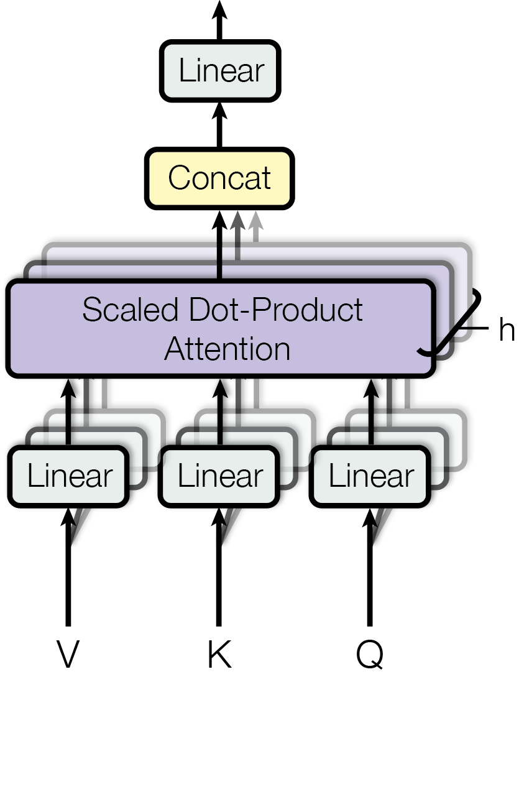
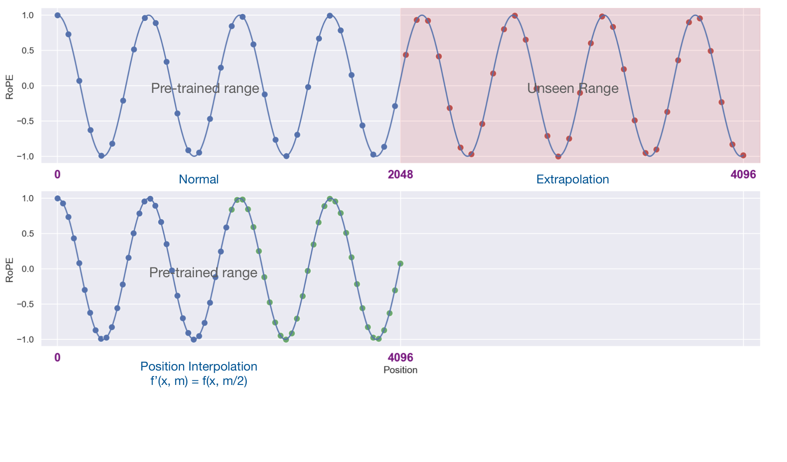
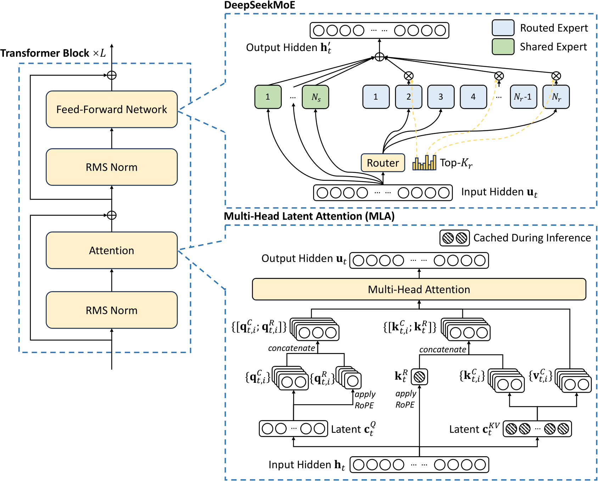
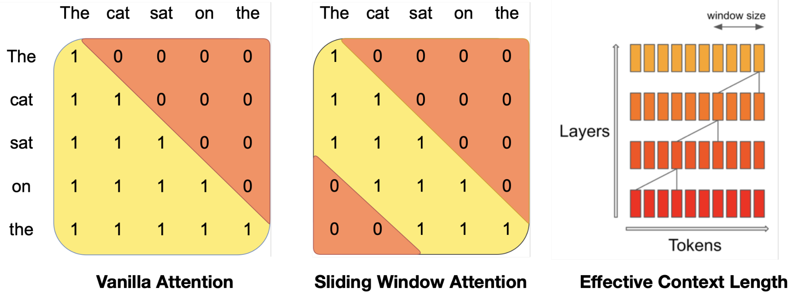
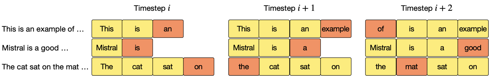
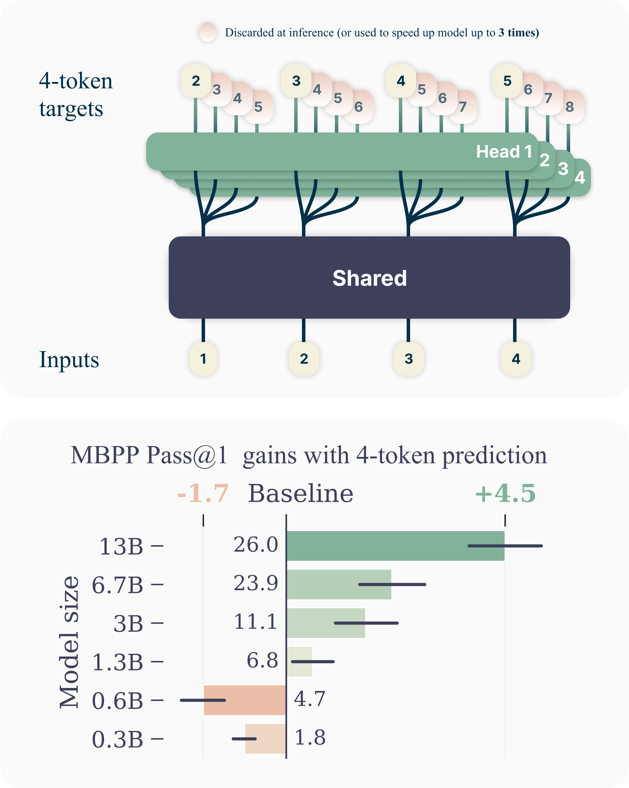

# Model Architectures I: The Transformer and Its Evolution

This chapter goes through the design choices behind the modern decoder-only LLM one at a time. For each choice it covers what the choice is, how it actually works (with a tiny worked example and a from-scratch PyTorch implementation), what problem it solved, what evidence supports it, what it costs, and who uses it. The goal is not to catalogue every variant. It is to make the reasoning visible, so that a 2025 config file like `num_key_value_heads: 8, rope_theta: 500000, hidden_act: silu, rms_norm_eps: 1e-5` reads as a series of decisions with known motivations, not as magic numbers.

The recurring theme is that many "architecture" choices are really **hardware** choices. Some changes exist because they improve loss per FLOP: pre-LN, SwiGLU, RoPE, MoE. Others exist because they cut bytes moved per generated token: MQA/GQA, MLA, sliding windows, large vocabularies. A third group exists because a run at $10^{25}$ FLOPs must not diverge on day 40: QK-norm, z-loss, no biases, softcapping. Knowing which bucket a choice belongs to tells you when it is safe to drop it.

Out of scope here: state-space models, linear attention, hybrids, diffusion LMs and multimodal architectures. They are covered in the sibling chapter [Model Architectures II: Beyond the Transformer](beyond-transformers.md). For the inference-side arithmetic (prefill vs decode, memory-bandwidth bounds) see [Inference arithmetic](../inference/arithmetic.md) and [Inference](../inference/README.md). For how these architectures get sharded see [Model Parallelism](../training/model-parallelism/README.md).

## Prerequisites

- You should know what a matrix multiply, softmax and cross-entropy loss are, and be able to read PyTorch.
- [Toolkit](../foundations/toolkit.md): creating a Python virtual environment and running Python interactively (the two setup commands below).
- [Computer architecture](../foundations/computer-architecture.md): the number formats bf16/fp16/fp8 ([Floating point](../foundations/computer-architecture.md#floating-point-ieee-754)); what HBM, tensor cores and a GPU *kernel* are ([The pieces](../foundations/computer-architecture.md#the-pieces), [The host/device split](../foundations/computer-architecture.md#the-hostdevice-split)); and "memory-bound vs compute-bound", the roofline and arithmetic intensity ([Arithmetic intensity and the roofline model](../foundations/computer-architecture.md#arithmetic-intensity-and-the-roofline-model)), which is the lens for half of the design choices below.
- [Distributed systems](../foundations/distributed-systems.md): ranks, tensor and pipeline parallelism ([Data parallel vs model parallel](../foundations/distributed-systems.md#data-parallel-vs-model-parallel)), the all-reduce/all-gather/all-to-all collectives ([Collectives](../foundations/distributed-systems.md#collectives-the-workhorse-of-distributed-training)) and MFU ([Time: one GPU vs a thousand](../foundations/distributed-systems.md#time-one-gpu-vs-a-thousand)). These come up when the chapter explains why a choice is hardware-friendly.
- Forward links (later chapters, not needed first): [Training arithmetic](../training/arithmetic.md) and [Inference arithmetic](../inference/arithmetic.md) go deeper on the FLOP and byte counts used here; [GPU execution model](../compute/accelerator/execution-model.md) derives FlashAttention; [Serving engine internals](../inference/serving-engine-internals.md) covers paged KV caches, prefix caching and speculative decoding from the engine side.

## How to read the code in this chapter

Conventions used in the code: `B` = batch, `T` = sequence length, `C` or `d` = model width (`d_model`), `H` = query heads, `KV` = key/value heads, `hd` = head dim, `F` = FFN hidden size, `V` = vocab size, `L` = number of layers, `E` = number of experts. Shapes are written in comments, e.g. `# (B, H, T, hd)`.

**Every `python` block in this chapter is runnable, and they are meant to be run in order in one Python session** (a notebook or `python -i`), because later blocks reuse functions defined by earlier ones (`attention`, `rope`, `RMSNorm`, `SwiGLU`, ...). The blocks were executed top to bottom with PyTorch 2.15.0 on CPU (Apple Silicon, Python 3.14) while writing this chapter, and the `Output:` blocks are the real, unedited output of that run. Everything runs on a laptop CPU in a few seconds; nothing needs a GPU. To reproduce:

```bash
python3 -m venv /tmp/arch-venv && /tmp/arch-venv/bin/pip install torch numpy
/tmp/arch-venv/bin/python -i      # then paste the blocks in order
```

Each block that checks a claim ends in an `assert` or prints the two quantities being compared, so if your PyTorch version behaves differently you will see it. Random tensors are seeded with `torch.manual_seed`, so outputs are reproducible on the same PyTorch version; tiny last-digit differences across versions and hardware are normal.

All numeric claims that come from arithmetic (parameter counts, KV cache sizes, FLOPs) were computed with Python while writing this chapter. Claims about quality come from the cited papers. Where an arXiv id or a detail could not be confirmed, it is marked.


## From RNNs to "Attention Is All You Need"

### The seq2seq bottleneck

The 2014 encoder-decoder RNN ([Sutskever et al., Sequence to Sequence Learning with Neural Networks, arXiv:1409.3215](https://arxiv.org/abs/1409.3215)) compressed a whole source sentence into one fixed-size hidden vector and decoded from it. Quality fell off with sentence length, because a single $d$-dimensional state must carry everything.

[Bahdanau et al., Neural Machine Translation by Jointly Learning to Align and Translate, arXiv:1409.0473](https://arxiv.org/abs/1409.0473) fixed the bottleneck with **attention**. At each decoder step, compute a softmax-weighted average of *all* encoder states, with weights from a learned compatibility score. [Luong et al., arXiv:1508.04025](https://arxiv.org/abs/1508.04025) simplified the score to a dot product. The decoder no longer depends on one vector. It can look up whatever it needs, so memory grows with input length.

The RNN was still there, though, and the RNN is the problem from a hardware point of view. $h_t = f(h_{t-1}, x_t)$ is a sequential dependency over $T$. During training you cannot compute step $t$ before step $t-1$. A GPU with $10^4$+ parallel lanes ends up running a $T$-long chain of small matmuls. Each matmul is $(B, d) \times (d, d)$, which at realistic $B$ is memory-bound, not compute-bound.

The difference is visible even on a laptop CPU. Below, the RNN does $T$ dependent $(B, d) \times (d, d)$ matmuls; a projection with the same FLOPs that has no time dependency (which is what attention's Q/K/V projections are) does one $(B \cdot T, d) \times (d, d)$ matmul:

```python
import torch, torch.nn as nn, torch.nn.functional as F
import math, time

torch.manual_seed(0)
B, T, d = 8, 512, 512
x = torch.randn(B, T, d)                     # (B, T, d)
W, U = torch.randn(d, d) / d**0.5, torch.randn(d, d) / d**0.5

def rnn(x):                                  # h_t = tanh(x_t W + h_{t-1} U): T sequential steps
    h = torch.zeros(B, d)
    for t in range(T):
        h = torch.tanh(x[:, t] @ W + h @ U)  # (B, d): step t needs step t-1
    return h

def parallel(x):                             # same matmul FLOPs, no dependency over T
    return torch.tanh(x.reshape(B * T, d) @ W + x.reshape(B * T, d) @ U)   # (B*T, d)

for f in (rnn, parallel):
    f(x); t0 = time.perf_counter()
    for _ in range(5): f(x)
    print(f"{f.__name__:9s} {(time.perf_counter() - t0) / 5 * 1e3:7.1f} ms")
```

Output:

```text
rnn          61.6 ms
parallel     13.2 ms
```

Same arithmetic, very different wall-clock time (one run on one laptop, so the exact ratio is an anecdote; on a GPU the gap is far larger because a $(8, 512)$ matmul uses a tiny fraction of the chip).

### The Transformer

[Vaswani et al., Attention Is All You Need, arXiv:1706.03762](https://arxiv.org/abs/1706.03762) removed the recurrence completely. Every position attends to every other position in one batched matmul. The original encoder-decoder Transformer:


([source](https://arxiv.org/abs/1706.03762))

The rest of this section builds the pieces from scratch: single-head attention, the causal mask, multi-head attention, and the KV cache.

### Attention from scratch

**Intuition.** Attention is a *soft dictionary lookup*. Each token emits three vectors from its hidden state, by three learned linear maps:

- a **query** $q$: "what am I looking for?"
- a **key** $k$: "what do I contain?" (what others match against)
- a **value** $v$: "what do I hand over if you pick me?"

Token $i$ compares its query with every key by dot product. A larger dot product means a better match. Softmax turns the scores into weights that are positive and sum to 1, and the output for token $i$ is the weighted average of the values. A Python dict returns the value of the one key that matches exactly; attention returns a blend of all values, weighted by how well each key matches. Because the weights come from a softmax, everything is differentiable, so the model learns what to put in $q$, $k$ and $v$.

In matrix form, with the queries, keys and values of all $T$ tokens stacked as rows:

$$
\begin{aligned}
\text{scores} &= QK^\top / \sqrt{\text{hd}} && (T \times T):\ \text{scores}_{ij} = \text{how much token } i \text{ wants token } j \\
\text{weights} &= \operatorname{softmax}(\text{scores}) && \text{each row sums to 1} \\
\text{out} &= \text{weights}\ V && (T \times \text{hd}):\ \text{row } i = \text{weighted average of value rows}
\end{aligned}
$$

**Worked example.** Three tokens, $\text{hd} = 2$, numbers small enough to do by hand. Token 0's query $[1, 0]$ matches token 0's key $[1, 0]$ and token 2's key $[1, 1]$ (dot product 1) better than token 1's key $[0, 1]$ (dot product 0):

```python
Q = torch.tensor([[1., 0.], [0., 1.], [1., 1.]])     # (T=3, hd=2)
K = torch.tensor([[1., 0.], [0., 1.], [1., 1.]])     # (3, 2)
V = torch.tensor([[10., 0.], [0., 10.], [5., 5.]])   # (3, 2)

scores = Q @ K.T / math.sqrt(2)                       # (3, 3)
weights = scores.softmax(-1)                          # (3, 3), rows sum to 1
out = weights @ V                                     # (3, 2)
torch.set_printoptions(precision=3, sci_mode=False)
print("scores\n", scores, "\nweights\n", weights, "\nout\n", out)
```

Output:

```text
scores
 tensor([[0.707, 0.000, 0.707],
        [0.000, 0.707, 0.707],
        [0.707, 0.707, 1.414]]) 
weights
 tensor([[0.401, 0.198, 0.401],
        [0.198, 0.401, 0.401],
        [0.248, 0.248, 0.503]]) 
out
 tensor([[6.017, 3.983],
        [3.983, 6.017],
        [5.000, 5.000]])
```

Row 0 of `weights` puts equal weight (0.401) on tokens 0 and 2 and less (0.198) on token 1, exactly as the dot products said, so token 0's output is pulled toward `V[0] = [10, 0]` and `V[2] = [5, 5]`. Token 2's query $[1, 1]$ matches its own key $[1, 1]$ best (score $2/\sqrt{2} = 1.414$).

**Why divide by $\sqrt{\text{hd}}$.** If the entries of $q$ and $k$ are independent with unit variance, $q \cdot k$ is a sum of $\text{hd}$ unit-variance terms, so its variance is $\text{hd}$ and its typical size is $\sqrt{\text{hd}}$. With $\text{hd} = 128$ the unscaled scores are around ±11, the softmax becomes nearly one-hot at initialization, and its gradient is nearly zero. Dividing by $\sqrt{\text{hd}}$ brings the scores back to unit variance. Vaswani et al. give this reason directly. A quick check:

```python
torch.manual_seed(0)
for hd in (16, 128):
    q, k = torch.randn(10000, hd), torch.randn(10000, hd)
    s = (q * k).sum(-1)                                          # 10000 dot products
    print(f"hd={hd:3d}  var(q.k)={s.var():7.2f}  var(q.k/sqrt(hd))={(s / hd**0.5).var():.2f}")
# what a 64-way softmax looks like at those scales:
torch.manual_seed(0)
z = torch.randn(64)
for scale in (1.0, 128**0.5):
    p = (z * scale).softmax(-1)
    print(f"logit std {scale:5.2f}: max weight {p.max():.3f}")
```

Output:

```text
hd= 16  var(q.k)=  15.80  var(q.k/sqrt(hd))=0.99
hd=128  var(q.k)= 127.28  var(q.k/sqrt(hd))=0.99
logit std  1.00: max weight 0.228
logit std 11.31: max weight 1.000
```

**The causal mask.** A language model is trained to predict token $t+1$ from tokens $0, \dots, t$. With teacher forcing, the whole sequence is fed in at once and every position predicts its successor in parallel, so token $t$ must be prevented from looking at tokens $t+1, t+2, \dots$: otherwise it could read the answer. The fix is to set $\text{scores}_{ij} = -\infty$ for $j > i$ before the softmax. $\exp(-\infty) = 0$, so those positions get exactly zero weight, and the remaining weights still sum to 1. The mask is lower-triangular:

```python
def attention(q, k, v, causal=True):
    # q, k, v: (B, H, T, hd)
    T = q.shape[-2]
    att = q @ k.transpose(-2, -1) / math.sqrt(q.shape[-1])     # (B, H, T, T)
    if causal:
        mask = torch.ones(T, T, dtype=torch.bool, device=q.device).tril()   # (T, T), True = may attend
        att = att.masked_fill(~mask, float("-inf"))
    return att.softmax(-1) @ v                                 # (B, H, T, hd)

print(torch.ones(4, 4, dtype=torch.bool).tril().int())        # row i = query i, column j = key j
torch.manual_seed(0)
q, k, v = torch.randn(3, 1, 2, 6, 16).unbind(0)                # each (B=1, H=2, T=6, hd=16)
out = attention(q, k, v)
# check 1: matches PyTorch's fused kernel
assert torch.allclose(out, F.scaled_dot_product_attention(q, k, v, is_causal=True), atol=1e-5)
# check 2: changing the "future" (tokens 4 and 5) does not change outputs 0..3
k2, v2 = k.clone(), v.clone(); k2[..., 4:, :] += 100; v2[..., 4:, :] -= 100
out2 = attention(q, k2, v2)
print("max change at t<4:", (out2[..., :4, :] - out[..., :4, :]).abs().max().item())
print("max change at t>=4:", (out2[..., 4:, :] - out[..., 4:, :]).abs().max().item())
```

Output:

```text
tensor([[1, 0, 0, 0],
        [1, 1, 0, 0],
        [1, 1, 1, 0],
        [1, 1, 1, 1]], dtype=torch.int32)
max change at t<4: 0.0
max change at t>=4: 101.763916015625
```

Three properties made this win.

1. **Parallel over T at training time.** With teacher forcing, all $T$ positions of a sequence are computed at once. The causal mask stops information leaking from the future. Under the RNN, the same computation is a $T$-step loop. The work becomes a few large GEMMs (GEMM, "general matrix multiply", is the standard library name for a dense $C = AB$: here the `QKV` projection, $QK^\top$, $AV$, output projection, MLP), which is exactly what tensor cores are built for.
2. **Constant path length.** Any two tokens interact in one layer. In an RNN, information from token 1 reaches token 1000 through 999 nonlinear steps, and the gradient takes the same path in reverse. This is a statement about optimization, not expressivity, and it is a large part of why Transformers learn long-range dependencies so much more easily.
3. **The $1/\sqrt{\text{hd}}$ scale**, which keeps the softmax trainable at init (checked above).

### Multi-head attention

**Intuition.** One attention head computes one set of weights per token, so it can only "look" in one pattern at a time: for example "attend to the previous token" or "attend to the subject of this sentence", but not both. Multi-head attention runs $H$ attentions in parallel, each in its own $\text{hd} = d / H$-dimensional subspace with its own Q/K/V projections, then concatenates the $H$ outputs and mixes them with an output projection $W_o$. Splitting $d$ into heads costs no extra FLOPs compared with one big head of width $d$: the projections are the same $d \times d$ matrices, just reshaped.



([source](https://arxiv.org/abs/1706.03762))

The only subtle part is the reshape. A `(B, T, d)` projection output is viewed as `(B, T, H, hd)` (head $h$ owns columns $h \cdot \text{hd}$ to $(h+1) \cdot \text{hd} - 1$) and then transposed to `(B, H, T, hd)` so that the head dimension behaves like a batch dimension in the matmuls:

```python
class MHA(nn.Module):
    def __init__(self, d, H):
        super().__init__()
        self.H, self.hd = H, d // H
        self.wq, self.wk, self.wv, self.wo = (nn.Linear(d, d, bias=False) for _ in range(4))
    def split(self, t):                                   # (B, T, d) -> (B, H, T, hd)
        B, T, _ = t.shape
        return t.view(B, T, self.H, self.hd).transpose(1, 2)
    def forward(self, x):                                 # x: (B, T, d)
        B, T, d = x.shape
        q, k, v = self.split(self.wq(x)), self.split(self.wk(x)), self.split(self.wv(x))
        o = attention(q, k, v)                            # (B, H, T, hd)
        o = o.transpose(1, 2).reshape(B, T, d)            # concat heads: (B, T, H*hd)
        return self.wo(o)                                 # (B, T, d)

# check: identical to torch.nn.MultiheadAttention with the same weights
torch.manual_seed(0)
d, H = 32, 4
mine = MHA(d, H)
ref = nn.MultiheadAttention(d, H, bias=False, batch_first=True)
with torch.no_grad():
    ref.in_proj_weight.copy_(torch.cat([mine.wq.weight, mine.wk.weight, mine.wv.weight]))
    ref.out_proj.weight.copy_(mine.wo.weight)
x = torch.randn(2, 5, d)                                  # (B=2, T=5, d=32)
causal = torch.ones(5, 5, dtype=torch.bool).triu(1)       # PyTorch convention: True = masked out
ref_out, _ = ref(x, x, x, attn_mask=causal, need_weights=False)
print("max |mine - torch|:", (mine(x) - ref_out).abs().max().item())
```

Output:

```text
max |mine - torch|: 1.1920928955078125e-07
```

### The KV cache

**Intuition.** At inference, a model generates one token at a time: run the network, sample token $t$, append it, repeat. Done naively, step $t$ reprocesses all $t$ previous tokens, so generating $T$ tokens costs $O(T^2)$ token-forwards. But with a causal mask, the keys and values of an old token never change once computed: token 3's $k$ and $v$ depend only on tokens 0..3, and future tokens cannot affect them. So you compute each token's $k$ and $v$ once, store them, and at each new step compute only the new token's $q, k, v$, append $k, v$ to the store, and attend from the one new query to all stored keys. That store is the **KV cache**. It turns each decode step from "recompute everything" into "one token's worth of matmuls plus a read of the cache".

```python
class CachedMHA(MHA):
    def forward(self, x, cache=None):                     # x: (B, T_new, d); cache: (k, v) or None
        B, T, d = x.shape
        q, k, v = self.split(self.wq(x)), self.split(self.wk(x)), self.split(self.wv(x))  # (B, H, T_new, hd)
        if cache is not None:
            k = torch.cat([cache[0], k], dim=2)           # (B, H, T_past + T_new, hd)
            v = torch.cat([cache[1], v], dim=2)
        # the new queries sit at the END of the sequence, so query i may see keys 0 .. T_past + i
        T_all = k.shape[2]
        mask = torch.ones(T, T_all, dtype=torch.bool).tril(diagonal=T_all - T)   # (T_new, T_all)
        att = (q @ k.transpose(-2, -1) / math.sqrt(self.hd)).masked_fill(~mask, float("-inf"))
        o = (att.softmax(-1) @ v).transpose(1, 2).reshape(B, T, d)
        return self.wo(o), (k, v)

torch.manual_seed(0)
m = CachedMHA(32, 4)
x = torch.randn(1, 8, 32)                                 # a whole 8-token sequence
full, _ = m(x)                                            # one parallel pass (training-style)
out, cache = m(x[:, :3])                                  # "prefill" the 3-token prompt
steps = [out]
for t in range(3, 8):                                     # "decode" one token at a time
    o, cache = m(x[:, t:t+1], cache)
    steps.append(o)
    print(f"step t={t}: cache k shape {tuple(cache[0].shape)}")
print("max |cached - full|:", (torch.cat(steps, 1) - full).abs().max().item())
```

Output:

```text
step t=3: cache k shape (1, 4, 4, 8)
step t=4: cache k shape (1, 4, 5, 8)
step t=5: cache k shape (1, 4, 6, 8)
step t=6: cache k shape (1, 4, 7, 8)
step t=7: cache k shape (1, 4, 8, 8)
max |cached - full|: 1.1920928955078125e-07
```

The cache grows by one row per layer per head per token, and decoding produces the same numbers as the parallel pass. The split shown here, one parallel pass over the prompt (**prefill**) followed by one-token steps (**decode**), is how every serving engine works ([Serving engine internals](../inference/serving-engine-internals.md)).

**The cost** is the $(T, T)$ score matrix. For each layer and head, $QK^\top$ and $AV$ each cost $2 \cdot T^2 \cdot \text{hd}$ FLOPs, and a naive implementation stores $T^2$ scores per head. Summed over heads ($H \cdot \text{hd} = d$), the causal attention cost averaged over the tokens of a length-$T$ sequence is about $2 \cdot L \cdot T \cdot d$ forward FLOPs per token. Compare that with $2N$ for the weight matmuls. For Llama-3-8B ($L=32$, $d=4096$, $N \approx 8.03\text{B}$):

```python
L, d, N = 32, 4096, 8.03e9
for T in (2048, 8192, 32768, 131072):
    attn = 2 * L * T * d          # causal: QK^T + AV = 4*T*d per layer at position T, averaged over positions -> 2*T*d
    print(f"T={T:6d}  attention {attn / 1e9:5.2f} GFLOP/token   2N {2 * N / 1e9:.1f}   ratio {attn / (2 * N):5.0%}")
```

Output:

```text
T=  2048  attention  0.54 GFLOP/token   2N 16.1   ratio    3%
T=  8192  attention  2.15 GFLOP/token   2N 16.1   ratio   13%
T= 32768  attention  8.59 GFLOP/token   2N 16.1   ratio   53%
T=131072  attention 34.36 GFLOP/token   2N 16.1   ratio  214%
```

| $T$ | attention fwd FLOPs/token | $2N$ | attention / $2N$ |
|---|---|---|---|
| 2K | 0.54 GFLOP | 16.1 GFLOP | 3% |
| 8K | 2.15 GFLOP | 16.1 GFLOP | 13% |
| 32K | 8.6 GFLOP | 16.1 GFLOP | 53% |
| 128K | 34.4 GFLOP | 16.1 GFLOP | 214% |

At pretraining lengths (4K-8K), attention FLOPs are a rounding error next to the MLP. That explains why "quadratic attention" did not stop scaling, and why long-context extension happens as a short final training phase. The $T^2$ *memory* problem was solved separately by FlashAttention ([Dao et al., arXiv:2205.14135](https://arxiv.org/abs/2205.14135)). FlashAttention is a single fused GPU kernel for the whole of $\operatorname{softmax}(QK^\top)V$. It walks over K and V in tiles small enough to fit in the GPU's on-chip SRAM, keeps a running max and running sum so it can compute the softmax one tile at a time ("online softmax"), and so never writes the $(T, T)$ matrix to HBM, the GPU's large but comparatively slow main memory ([The pieces](../foundations/computer-architecture.md#the-pieces); [why avoiding HBM traffic matters](../foundations/computer-architecture.md#worked-example-2-an-elementwise-op)). That makes memory $O(T)$ while FLOPs stay $O(T^2)$, and the result is exact, not an approximation. It is derived step by step in [GPU execution model: FlashAttention](../compute/accelerator/execution-model.md#flashattention); for this chapter, "FlashAttention-friendly" just means "expressible as plain $\operatorname{softmax}(QK^\top + \text{mask})V$ so the fused kernel can be used". The FLOPs problem is what sliding windows, sparse attention and the sub-quadratic alternatives in the [sibling chapter](beyond-transformers.md) attack.

**At inference time** the picture flips. Decoding generates one token at a time, so parallelism over $T$ is gone. Each new token must read the keys and values of all previous tokens from the KV cache. That cached state is the main reason so many later attention variants exist. Training is compute-bound, and decoding is memory-bandwidth-bound on weights plus KV cache (the roofline argument is in [Worked example 3: LLM decode](../foundations/computer-architecture.md#worked-example-3-llm-decode)). The rest of this chapter keeps coming back to that asymmetry.


## Encoder-only, encoder-decoder, decoder-only

The original Transformer was an encoder-decoder for translation. Within two years the field split into three families. By 2023 essentially all frontier LLMs were decoder-only. The reasons are worth spelling out, because they are mostly about efficiency and not about expressivity.

The three families differ mainly in their **attention mask**, the boolean matrix that says which token may look at which:

```python
T, P = 6, 3                                                   # sequence length, prefix length
bidirectional = torch.ones(T, T, dtype=torch.bool)            # encoder (BERT): everyone sees everyone
causal = torch.ones(T, T, dtype=torch.bool).tril()            # decoder (GPT): only the past
prefix_lm = causal.clone(); prefix_lm[:P, :P] = True          # prefix LM: bidirectional over first P tokens
for name, m in [("bidirectional", bidirectional), ("causal", causal), ("prefix-LM (P=3)", prefix_lm)]:
    print(name); print(m.int())
```

Output:

```text
bidirectional
tensor([[1, 1, 1, 1, 1, 1],
        [1, 1, 1, 1, 1, 1],
        [1, 1, 1, 1, 1, 1],
        [1, 1, 1, 1, 1, 1],
        [1, 1, 1, 1, 1, 1],
        [1, 1, 1, 1, 1, 1]], dtype=torch.int32)
causal
tensor([[1, 0, 0, 0, 0, 0],
        [1, 1, 0, 0, 0, 0],
        [1, 1, 1, 0, 0, 0],
        [1, 1, 1, 1, 0, 0],
        [1, 1, 1, 1, 1, 0],
        [1, 1, 1, 1, 1, 1]], dtype=torch.int32)
prefix-LM (P=3)
tensor([[1, 1, 1, 0, 0, 0],
        [1, 1, 1, 0, 0, 0],
        [1, 1, 1, 0, 0, 0],
        [1, 1, 1, 1, 0, 0],
        [1, 1, 1, 1, 1, 0],
        [1, 1, 1, 1, 1, 1]], dtype=torch.int32)
```

### Encoder-only: BERT

[Devlin et al., BERT, arXiv:1810.04805](https://arxiv.org/abs/1810.04805) uses a bidirectional encoder (no causal mask) trained with **masked language modeling** (MLM): replace 15% of tokens with a `[MASK]` symbol (or a random/unchanged token) and predict the originals from both sides. Bidirectional context is ideal for representation tasks like classification, named-entity recognition (NER: tagging which words are people, places, organizations) and retrieval embeddings. The model is still widely used in that role (ModernBERT, the E5/GTE embedding families).

```python
torch.manual_seed(0)
tokens = torch.randint(5, 100, (1, 20))                       # (B, T) a fake sentence
MASK_ID = 4
is_masked = torch.rand(tokens.shape) < 0.15                    # choose ~15% of positions
inputs = tokens.masked_fill(is_masked, MASK_ID)
labels = tokens.masked_fill(~is_masked, -100)                  # -100 = ignored by F.cross_entropy
print("inputs:", inputs.tolist()[0]); print("labels:", labels.tolist()[0])
print(f"positions that give a loss: {is_masked.sum().item()} of {tokens.numel()}")
```

Output:

```text
inputs: [39, 9, 43, 5, 73, 69, 67, 4, 52, 28, 56, 6, 46, 69, 78, 4, 6, 73, 99, 68]
labels: [-100, -100, -100, -100, -100, -100, -100, 33, -100, -100, -100, -100, -100, -100, -100, 96, -100, -100, -100, -100]
positions that give a loss: 2 of 20
```

Why it lost as a generative pretraining recipe:

- **Only ~15% of positions give a loss signal**, while a causal LM gets a loss at 100% of positions for the same forward/backward FLOPs. ELECTRA ([arXiv:2003.10555](https://arxiv.org/abs/2003.10555)) was motivated exactly by this sample inefficiency.
- **It does not generate.** Iterative unmasking is possible but awkward, and nothing like a KV cache exists, because every token attends to every other token, including ones that have not been produced yet.

### Encoder-decoder: T5

[Raffel et al., T5, arXiv:1910.10683](https://arxiv.org/abs/1910.10683) cast every task as text-to-text. A bidirectional encoder reads the input, and a causal decoder with **cross-attention** (queries from the decoder, keys and values from the encoder's output) produces the output. Pretraining used span corruption. In the T5 paper's own architecture comparison (Section 3.2, Table 2), the encoder-decoder with a denoising objective beat a decoder-only LM of comparable size and compute on their downstream fine-tuning suite.

Cross-attention is the same `attention` function with $q$ from one sequence and $k, v$ from another, and no causal mask (the whole input is known):

```python
torch.manual_seed(0)
enc_out = torch.randn(1, 1, 7, 16)                       # (B, H, T_src=7, hd): encoder output, computed once
dec_q = torch.randn(1, 1, 4, 16)                         # (B, H, T_tgt=4, hd): decoder queries
print(attention(dec_q, enc_out, enc_out, causal=False).shape)   # (B, H, T_tgt, hd): one output per target token
```

Output:

```text
torch.Size([1, 1, 4, 16])
```

Since T5's comparison favored the encoder-decoder, why did that not hold up for LLMs? Three reasons:

1. **The evaluation changed.** T5 evaluated after fine-tuning on each task. From GPT-3 onward ([Brown et al., arXiv:2005.14165](https://arxiv.org/abs/2005.14165)) the target became zero/few-shot prompting. [Wang et al., What Language Model Architecture and Pretraining Objective Work Best for Zero-Shot Generalization?, arXiv:2204.05832](https://arxiv.org/abs/2204.05832) trained models of about 5B parameters on 170B tokens across architectures and objectives. Their finding: **a causal decoder-only model trained with a plain LM objective gave the best zero-shot generalization after purely self-supervised pretraining**, while encoder-decoder + MLM was best *after* multitask fine-tuning. The target moved, and the ranking moved with it.
2. **The parameter split is awkward.** An encoder-decoder with the same total parameters spends about half of them on the encoder, and the encoder only processes the input. For open-ended continuation, where the "input" is just the earlier part of the same text, the split is arbitrary. You must decide where the input ends, and both stacks have to be sized.
3. **Inference.** In a decoder-only model, every past token's K/V never changes once computed, so the KV cache is append-only. For a multi-turn chat, the whole conversation is one prefix, and that prefix can be cached and even shared across requests (prefix caching). In an encoder-decoder, appending a user turn changes the *encoder's* bidirectional representations of everything already there, so the encoder has to rerun. The serving stack of 2023-2025, built around paged KV caches, prefix sharing and speculative decoding, assumes an append-only causal state. Briefly: a **paged KV cache** (PagedAttention, popularized by the vLLM serving engine) stores each sequence's cache in fixed-size blocks allocated on demand, like virtual-memory pages, instead of one contiguous buffer sized for the maximum length; **prefix caching** reuses the cached K/V of a shared prompt prefix (a system prompt, earlier chat turns) across requests instead of recomputing it; **speculative decoding** lets a cheap "draft" propose several tokens that the big model then checks in one forward pass, keeping the ones it agrees with. All three are covered in depth in [Serving engine internals](../inference/serving-engine-internals.md#pagedattention).

Point 3 is easy to check directly: append a token and see whether the representations of the old tokens move.

```python
torch.manual_seed(0)
q, k, v = torch.randn(3, 1, 1, 6, 16).unbind(0)                  # 6 tokens
q7, k7, v7 = (torch.cat([t, torch.randn(1, 1, 1, 16)], 2) for t in (q, k, v))   # same 6 tokens + 1 new
for causal in (True, False):
    old, new = attention(q, k, v, causal), attention(q7, k7, v7, causal)[..., :6, :]
    print(f"causal={causal!s:5}: max change in the 6 old outputs after appending = {(old - new).abs().max():.3f}")
```

Output:

```text
causal=True : max change in the 6 old outputs after appending = 0.000
causal=False: max change in the 6 old outputs after appending = 0.615
```

With the causal mask the old outputs are unchanged (so their cached K/V stay valid). Without it, every old output changes, so nothing can be cached across turns.

### Decoder-only: GPT

The GPT line (GPT-1 2018, GPT-2 2019, GPT-3 [arXiv:2005.14165](https://arxiv.org/abs/2005.14165); GPT-1 and GPT-2 were released as OpenAI reports, not on arXiv) uses one stack, a causal mask, and next-token prediction on raw text. Why it won:

- **Training efficiency:** loss at every token, one homogeneous stack, and nothing to tune about how to split the parameters. A uniform stack of identical blocks also pipelines and shards trivially.
- **A single objective covers everything.** Translation, question answering (QA), code and dialogue are all continuation. In-context learning (GPT-3) falls out without a task-specific head.
- **KV cache friendly**, as checked above. Generation cost per token is $O(T)$ reads of cached K/V, not a recompute.
- **It scales predictably.** Scaling laws ([Kaplan et al., arXiv:2001.08361](https://arxiv.org/abs/2001.08361); [Hoffmann et al., Chinchilla, arXiv:2203.15556](https://arxiv.org/abs/2203.15556)) were fit on decoder-only LMs, so their compute planning carries over directly.

The "loss at every token" point is just a shift by one: the targets are the inputs moved left.

```python
tokens = torch.tensor([[11, 12, 13, 14, 15]])           # (B=1, T=5)
inp, tgt = tokens[:, :-1], tokens[:, 1:]                 # position t predicts token t+1
for t in range(inp.shape[1]):
    print(f"position {t}: sees {inp[0, :t+1].tolist()}  -> target {tgt[0, t].item()}")
# loss = F.cross_entropy(logits.view(-1, V), tgt.reshape(-1)): 4 loss terms from one 5-token sequence
```

Output:

```text
position 0: sees [11]  -> target 12
position 1: sees [11, 12]  -> target 13
position 2: sees [11, 12, 13]  -> target 14
position 3: sees [11, 12, 13, 14]  -> target 15
```

A middle ground is the **prefix LM**, which has bidirectional attention over a prefix and causal attention after it (mask printed above; T5 explored it; UL2, [arXiv:2205.05131](https://arxiv.org/abs/2205.05131), mixed objectives). It survives mostly in multimodal models, which attend bidirectionally over image tokens. For text LLMs the operational simplicity of a pure causal mask won.


## Normalization

A **normalization layer** rescales each token's hidden vector to a standard size before it enters a sublayer. Without it, activations in a deep network drift in scale layer after layer, and the optimizer has to chase a moving target. Where the normalization sits, and what exactly it computes, turned out to matter a lot for whether large models train at all.

### Post-LN vs pre-LN

**The two placements.** Each Transformer block has two sublayers (attention, then MLP), each wrapped in a **residual connection**: $x + F(x)$, so the sublayer only has to learn a correction to its input. The question is where the LayerNorm goes.

- **Post-LN** (original Transformer): $x = \operatorname{LN}(x + F(x))$. The norm is applied *after* adding the residual, so the running sum itself is renormalized at every sublayer.
- **Pre-LN** (GPT-2 onward): $x = x + F(\operatorname{LN}(x))$, with one final LN before the output head. The norm only touches the *input* of the sublayer. The running sum, called the **residual stream**, is never normalized inside the stack.

GPT-2 moved to pre-LN and nearly every LLM since then is pre-norm.

```python
class PreLNBlock(nn.Module):
    def __init__(self, d, attn, mlp, norm=nn.LayerNorm):
        super().__init__()
        self.n1, self.n2, self.attn, self.mlp = norm(d), norm(d), attn, mlp
    def forward(self, x):              # x: (B, T, d)
        x = x + self.attn(self.n1(x))  # residual stream is never normalized
        x = x + self.mlp(self.n2(x))
        return x

class PostLNBlock(nn.Module):
    def __init__(self, d, attn, mlp, norm=nn.LayerNorm):
        super().__init__()
        self.n1, self.n2, self.attn, self.mlp = norm(d), norm(d), attn, mlp
    def forward(self, x):              # x: (B, T, d)
        x = self.n1(x + self.attn(x))  # the sum is renormalized after every sublayer
        x = self.n2(x + self.mlp(x))
        return x
```

**Why it matters: the identity path.** In pre-LN, unrolling the stack gives $x_L = x_0 + F_1(\cdot) + F_2(\cdot) + \dots + F_L(\cdot)$. The gradient of the loss with respect to $x_0$ contains a term that flows straight down the sum with no layer in the way. In post-LN, every one of the $2L$ LayerNorms sits on that path, and each rescales the gradient.

**Problem solved:** [Xiong et al., On Layer Normalization in the Transformer Architecture, arXiv:2002.04745](https://arxiv.org/abs/2002.04745) showed through mean-field analysis that in post-LN, the expected gradient of the parameters near the output is large at init and does not shrink with depth, whereas in pre-LN it scales like $1/\sqrt{L}$. That is why post-LN needs a learning-rate warmup to avoid diverging: the first large-LR updates to the top layers are too big. In pre-LN, gradients are well-behaved at init. They report training pre-LN *without* warmup at reduced wall-clock cost on BERT and translation.

The scaling is reproducible in a toy stack of MLP sublayers (no attention, random init, a random linear loss on the output). The last layer's weight-gradient norm is flat in depth for post-LN and shrinks with depth for pre-LN, and the pre-LN residual stream grows with depth:

```python
def toy_stack(kind, L, d=64):
    torch.manual_seed(0)
    subs = [nn.Sequential(nn.Linear(d, 4 * d), nn.GELU(), nn.Linear(4 * d, d)) for _ in range(L)]
    norms = [nn.LayerNorm(d) for _ in range(L)]
    x = torch.randn(32, d); h = x                                   # (N, d)
    for f, n in zip(subs, norms):
        h = h + f(n(h)) if kind == "pre" else n(h + f(h))
    out = nn.LayerNorm(d)(h) if kind == "pre" else h                # pre-LN has a final norm
    (out * torch.randn_like(out)).sum().backward()                  # a random linear "loss"
    return subs[-1][2].weight.grad.norm().item(), h.norm(dim=-1).mean().item()

for L in (6, 24, 96):
    (gp, _), (gq, r) = toy_stack("post", L), toy_stack("pre", L)
    print(f"L={L:3d}  last-layer grad norm: post-LN {gp:6.1f}  pre-LN {gq:6.1f}   pre-LN residual norm {r:5.1f}")
```

Output:

```text
L=  6  last-layer grad norm: post-LN  247.2  pre-LN  227.2   pre-LN residual norm   8.9
L= 24  last-layer grad norm: post-LN  251.6  pre-LN  180.6   pre-LN residual norm  11.4
L= 96  last-layer grad norm: post-LN  241.5  pre-LN  114.0   pre-LN residual norm  17.4
```

This is a toy (no attention, one seed), so read it as an illustration of the mechanism, not a measurement of real models.

**The cost:** in pre-LN, the residual stream's norm grows with depth (each block adds to it and nothing rescales it; the last column above). A late block's contribution $F_l$ is then small relative to $x$, so deep pre-LN models use their last layers less effectively. [Liu et al., Understanding the Difficulty of Training Transformers (Admin), arXiv:2004.08249](https://arxiv.org/abs/2004.08249) argue that post-LN, when it trains, can reach better quality, and that its instability comes from heavy dependence on the residual branch, not from gradient vanishing alone. DeepNet ([arXiv:2203.00555](https://arxiv.org/abs/2203.00555)) trained 1000-layer post-LN models by scaling up the residual. In practice the LLM world chose pre-LN: losing a little quality is far cheaper than losing a run.

### LayerNorm and RMSNorm

**LayerNorm**, per token: subtract the mean of the $d$ features, divide by their standard deviation, then apply a learned per-feature gain $\gamma$ and bias $\beta$:

$$
\operatorname{LayerNorm}(x) = \gamma \cdot \frac{x - \operatorname{mean}(x)}{\sqrt{\operatorname{var}(x) + \epsilon}} + \beta
$$

$$
\operatorname{RMSNorm}(x) = \gamma \cdot \frac{x}{\sqrt{\operatorname{mean}(x^2) + \epsilon}}
$$

[Zhang & Sennrich, Root Mean Square Layer Normalization, arXiv:1910.07467](https://arxiv.org/abs/1910.07467) drops LayerNorm's mean-centering and bias. RMSNorm only fixes the **scale** of the vector (its root-mean-square becomes 1), not its offset.

**Worked example** with $x = [1, 2, 3, 6]$ and $\gamma = 1$, $\beta = 0$: the mean is 3 and the variance is $(4 + 1 + 0 + 9)/4 = 3.5$, so LayerNorm gives $(x - 3)/1.871 = [-1.069, -0.535, 0, 1.604]$. The mean square is $(1 + 4 + 9 + 36)/4 = 12.5$, so RMSNorm gives $x/3.536 = [0.283, 0.566, 0.849, 1.697]$.

```python
class RMSNorm(nn.Module):
    def __init__(self, d, eps=1e-6):
        super().__init__()
        self.eps, self.weight = eps, nn.Parameter(torch.ones(d))
    def forward(self, x):                                # x: (B, T, d)
        xf = x.float()                                   # norm stats in fp32
        xf = xf * torch.rsqrt(xf.pow(2).mean(-1, keepdim=True) + self.eps)
        return self.weight * xf.type_as(x)

x = torch.tensor([[1., 2., 3., 6.]])
print("LayerNorm:", F.layer_norm(x, (4,), eps=0.0))
print("RMSNorm:  ", RMSNorm(4, eps=0.0)(x).detach())
# checks: (1) matches torch's built-in; (2) equals LayerNorm when the input has zero mean;
# (3) scale-invariant: RMSNorm(c * x) == RMSNorm(x)
torch.manual_seed(0)
z = torch.randn(3, 5, 64)
n = RMSNorm(64)
assert torch.allclose(n(z), F.rms_norm(z, (64,), eps=1e-6), atol=1e-6)
zc = z - z.mean(-1, keepdim=True)
assert torch.allclose(n(zc), F.layer_norm(zc, (64,), eps=1e-6), atol=1e-5)
assert torch.allclose(n(7.3 * z), n(z), atol=1e-5)
print("checks passed")
```

Output:

```text
LayerNorm: tensor([[-1.069, -0.535,  0.000,  1.604]])
RMSNorm:   tensor([[0.283, 0.566, 0.849, 1.697]])
checks passed
```

**Why:** the paper claims that LayerNorm's benefit comes from re-scaling invariance (check 3), not re-centering, and reports 7%-64% running-time reductions across their models (that is the paper's range, measured on 2019 hardware and implementations). On a modern GPU with a fused kernel, normalization is a small, memory-bound share of step time either way. The real reasons it stuck are simplicity: one reduction instead of two, no bias, fewer parameters to shard. LLaMA ([arXiv:2302.13971](https://arxiv.org/abs/2302.13971)) made pre-RMSNorm the open-model default.

Note the `x.float()`: computing the statistic in bf16 is a classic source of loss spikes. bf16 has only 8 bits of mantissa (7 stored plus the implicit leading 1; see [Floating point](../foundations/computer-architecture.md#floating-point-ieee-754)), so a sum of thousands of squares loses precision. A quick look at the size of the error:

```python
torch.manual_seed(0)
h = (torch.randn(4096) * 3).bfloat16()                            # one token's hidden vector
ms_fp32 = h.float().pow(2).mean()
acc = torch.zeros((), dtype=torch.bfloat16)                       # naive bf16 running sum
for v in h.pow(2): acc = acc + v
print(f"mean(x^2): fp32 {ms_fp32:.4f}   bf16 sequential sum {acc.float() / 4096:.4f}")
```

Output:

```text
mean(x^2): fp32 8.8803   bf16 sequential sum 4.1875
```

(Real kernels accumulate in fp32 or use tree reductions, so the error is far smaller than this sequential worst case. The point is that the accumulator dtype matters.)

**Removing biases** happened alongside. PaLM ([arXiv:2204.02311](https://arxiv.org/abs/2204.02311), Section 2) reports that removing biases from dense layers and LayerNorms improved training stability at scale. Llama, Mistral, DeepSeek and Gemma have no linear biases. The well-known exception is Qwen2/2.5, which keeps a bias on Q/K/V. Qwen3 removed it and added QK-norm (Qwen3 technical report, [arXiv:2505.09388](https://arxiv.org/abs/2505.09388)).

### QK-norm

**Problem solved:** **attention logit growth.** If $\Vert q \Vert$ and $\Vert k \Vert$ grow during training, the logits $q \cdot k/\sqrt{\text{hd}}$ grow quadratically, the softmax collapses to one-hot, and training diverges. [Dehghani et al., Scaling Vision Transformers to 22B, arXiv:2302.05442](https://arxiv.org/abs/2302.05442) hit this at 22B and fixed it by normalizing Q and K. [Wortsman et al., Small-scale proxies for large-scale Transformer training instabilities, arXiv:2309.14322](https://arxiv.org/abs/2309.14322) reproduced logit-growth divergence in small models at high learning rates and showed QK-layernorm mitigates it, widening the range of learning rates that train stably. The idea goes back to [Henry et al., Query-Key Normalization for Transformers, arXiv:2010.04245](https://arxiv.org/abs/2010.04245).

**How it works.** Apply an RMSNorm to each head's query and key vector (over the $\text{hd}$ features) right after the projection. After normalization, each vector has norm $\sqrt{\text{hd}}$ (times the learned gain), so by Cauchy-Schwarz the logit is bounded: $\vert q \cdot k \vert/\sqrt{\text{hd}} \le \sqrt{\text{hd}} \cdot \max \vert \gamma_q \vert \cdot \max \vert \gamma_k \vert$. With unit gains and $\text{hd} = 128$, no logit can exceed $\sqrt{128} = 11.3$, however large the projection weights grow. The model can still sharpen attention, but only by growing the gains, which is a slow, explicit path instead of an accident of weight growth.

```python
class QKNormAttention(nn.Module):
    def __init__(self, d, H, qk_norm=True):
        super().__init__()
        self.H, self.hd = H, d // H
        self.wq, self.wk, self.wv, self.wo = (nn.Linear(d, d, bias=False) for _ in range(4))
        self.q_norm = RMSNorm(self.hd) if qk_norm else nn.Identity()   # over hd, shared across heads
        self.k_norm = RMSNorm(self.hd) if qk_norm else nn.Identity()
    def forward(self, x, return_logits=False):                         # x: (B, T, d)
        B, T, d = x.shape
        q = self.q_norm(self.wq(x).view(B, T, self.H, self.hd)).transpose(1, 2)   # (B, H, T, hd)
        k = self.k_norm(self.wk(x).view(B, T, self.H, self.hd)).transpose(1, 2)   # (B, H, T, hd)
        v = self.wv(x).view(B, T, self.H, self.hd).transpose(1, 2)
        # (RoPE would be applied to q and k here, after the norm)
        logits = q @ k.transpose(-2, -1) / math.sqrt(self.hd)                     # (B, H, T, T)
        if return_logits: return logits
        return self.wo(attention(q, k, v).transpose(1, 2).reshape(B, T, d))

# simulate weight growth: scale W_q and W_k by g and watch the logits and attention entropy
torch.manual_seed(0)
x = torch.randn(1, 64, 256)                                           # (B, T, d)
for qk in (False, True):
    m = QKNormAttention(256, 4, qk_norm=qk)
    for g in (1, 4, 16):
        with torch.no_grad():
            m.wq.weight.mul_(g / (m.wq.weight.norm() / 16)); m.wk.weight.mul_(g / (m.wk.weight.norm() / 16))
            lg = m(x, return_logits=True)
        p = lg.softmax(-1)
        ent = -(p * p.clamp_min(1e-12).log()).sum(-1).mean()           # nats; uniform over 64 = 4.16
        print(f"qk_norm={qk!s:5}  weight scale x{g:2d}: max |logit| {lg.abs().max():8.1f}   attention entropy {ent:.2f}")
```

Output:

```text
qk_norm=False  weight scale x 1: max |logit|      4.4   attention entropy 3.68
qk_norm=False  weight scale x 4: max |logit|     69.9   attention entropy 0.22
qk_norm=False  weight scale x16: max |logit|   1119.0   attention entropy 0.02
qk_norm=True   weight scale x 1: max |logit|      3.6   attention entropy 3.69
qk_norm=True   weight scale x 4: max |logit|      3.6   attention entropy 3.69
qk_norm=True   weight scale x16: max |logit|      3.6   attention entropy 3.69
```

Without QK-norm the logits grow with the square of the weight scale and the attention entropy collapses toward 0 (one-hot). With QK-norm the logits are identical at every weight scale, because RMSNorm is scale-invariant.

**Cost:** two small norms per layer, plus a subtle constraint on ordering. Qwen3 and Gemma 3 apply the norm *before* RoPE. With unit gains the order is irrelevant, because RoPE is a rotation and preserves norms. With learned per-dimension gains it is not: the gain multiplies individual coordinates, and the rotation then mixes coordinate pairs, so $\operatorname{RoPE}(\operatorname{norm}(q))$ and $\operatorname{norm}(\operatorname{RoPE}(q))$ differ. (The check is in the RoPE section below, after `rope` is defined.) Also, with the logits bounded by the learned norm gains, the model cannot produce arbitrarily sharp attention without growing those gains. Variants differ in what is normalized: Qwen3 normalizes per head over $\text{hd}$, while OLMo 2's QK-norm is applied to the full projected $q$ and $k$ vectors before splitting into heads (per the HF `modeling_olmo2.py` implementation, as of transformers 4.5x; verify against the version you use).

**Who uses it:** OLMo 2 ([arXiv:2501.00656](https://arxiv.org/abs/2501.00656)), Gemma 3 ([arXiv:2503.19786](https://arxiv.org/abs/2503.19786), which uses QK-norm *instead of* Gemma 2's softcapping), Qwen3, and many 2025 models.

### Logit softcapping and z-loss

**Softcapping:** Gemma 2 ([arXiv:2408.00118](https://arxiv.org/abs/2408.00118)) bounds logits with $\text{cap} \cdot \tanh(\text{logits} / \text{cap})$, using 50 for attention and 30 for the final LM logits. $\tanh$ is nearly the identity for small inputs and saturates at ±1, so small logits pass through almost unchanged and large ones are squashed smoothly toward $\pm\text{cap}$. It works, but it changes the softmax inside the attention kernel, so FlashAttention initially did not support it. Gemma 3 moved to QK-norm.

**z-loss:** the softmax cross-entropy is unchanged if you add the same constant to every logit, so nothing in the loss stops all logits from drifting upward together until they overflow bf16. z-loss adds a penalty $10^{-4} \cdot (\log Z)^2$, where $Z = \sum \exp(\text{logit})$ is the softmax normalizer, which pins $\log Z$ near 0. It is used by PaLM and ST-MoE (for router logits: the scores a mixture-of-experts layer's small linear "router" uses to choose which expert sub-network each token goes to; see [Mixture of Experts](#mixture-of-experts) below).

```python
def softcap(x, cap): return cap * torch.tanh(x / cap)
print("softcap(x, 50):", softcap(torch.tensor([1., 10., 50., 100., 1000.]), 50.0))

def z_loss(logits, coef=1e-4):                       # logits: (N, V)
    return coef * torch.logsumexp(logits, -1).pow(2).mean()

torch.manual_seed(0)
logits, tgt = torch.randn(8, 100), torch.randint(0, 100, (8,))
for shift in (0.0, 30.0):
    lg = logits + shift                               # same distribution, drifted logits
    print(f"shift {shift:4.0f}: CE {F.cross_entropy(lg, tgt):.4f}   z-loss {z_loss(lg):.4f}")
```

Output:

```text
softcap(x, 50): tensor([ 1.000,  9.869, 38.080, 48.201, 50.000])
shift    0: CE 5.3635   z-loss 0.0027
shift   30: CE 5.3635   z-loss 0.1241
```

The cross-entropy cannot tell the two cases apart; z-loss can, and its gradient pulls the shift back toward zero.

### Sandwich and "peri-LN"

Pre-LN normalizes the *input* of each sublayer but leaves the *output* unbounded, and that is how the residual grows. The fix is to also normalize the output before adding it back:

```python
class PeriLNBlock(nn.Module):
    def __init__(self, d, attn, mlp):
        super().__init__()
        self.attn, self.mlp = attn, mlp
        self.pre_attn_norm, self.post_attn_norm, self.pre_mlp_norm, self.post_mlp_norm = (RMSNorm(d) for _ in range(4))
    def forward(self, x):                                                     # x: (B, T, d)
        x = x + self.post_attn_norm(self.attn(self.pre_attn_norm(x)))         # each update has RMS ~ 1
        x = x + self.post_mlp_norm(self.mlp(self.pre_mlp_norm(x)))
        return x

# simulate weights growing during training: multiply every sublayer weight by g
def update_rms(block_cls, g, d=64, n_blocks=24):
    torch.manual_seed(0)
    blocks = []
    for _ in range(n_blocks):
        attn, mlp = MHA(d, 4), nn.Sequential(nn.Linear(d, 4 * d), nn.GELU(), nn.Linear(4 * d, d))
        with torch.no_grad():
            for w in list(attn.parameters()) + list(mlp.parameters()): w.mul_(g)
        blocks.append(PeriLNBlock(d, attn, mlp) if block_cls == "peri" else PreLNBlock(d, attn, mlp, norm=RMSNorm))
    h = torch.randn(2, 16, d)                                                 # (B, T, d)
    with torch.no_grad():
        rms = []
        for b in blocks:
            h_new = b(h); rms.append((h_new - h).pow(2).mean().sqrt().item()); h = h_new
    return sum(rms) / len(rms), h.pow(2).mean().sqrt().item()

for kind in ("pre", "peri"):
    for g in (1, 4):
        u, r = update_rms(kind, g)
        print(f"{kind:4s}-LN  weight scale x{g}: mean per-block update RMS {u:7.2f}   residual RMS after 24 blocks {r:7.1f}")
```

Output:

```text
pre -LN  weight scale x1: mean per-block update RMS    0.30   residual RMS after 24 blocks     1.8
pre -LN  weight scale x4: mean per-block update RMS    6.24   residual RMS after 24 blocks    28.4
peri-LN  weight scale x1: mean per-block update RMS    1.41   residual RMS after 24 blocks     6.6
peri-LN  weight scale x4: mean per-block update RMS    1.40   residual RMS after 24 blocks     6.7
```

With pre-LN, the size of each block's update is set by the sublayer weights: when the weights grow 4x (as they can during training), the updates grow by about 20x here (each sublayer has two weight matrices in series, which alone gives $4^2 = 16\times$; GELU is not linear) and the residual stream grows with them. With the output norm, every update has RMS about $\sqrt{2}$ (two sublayers, each normalized to RMS 1, at unit gain), whatever the weights do. (At init this makes peri-LN's updates *larger* than pre-LN's in this toy, because unit-gain output norms force RMS 1; real models learn those gains.) That is the control over activation-variance growth these papers are after.

This appeared as "sandwich LN" in CogView ([arXiv:2105.13290](https://arxiv.org/abs/2105.13290)), which used it to tame fp16 overflow. NormFormer ([arXiv:2110.09456](https://arxiv.org/abs/2110.09456)) added extra norms too. Gemma 2 and Gemma 3 use pre- *and* post-sublayer RMSNorm. OLMo 2 normalizes *only* the sublayer outputs ($x = x + \operatorname{Norm}(F(x))$, in the style of Swin-v2) and reports better stability. Kim et al., "Peri-LN: Revisiting Normalization Layer in the Transformer Architecture" ([arXiv:2502.02732](https://arxiv.org/abs/2502.02732)) give this placement a name and argue it controls activation variance growth better than pure pre-LN. **Cost:** one extra norm per sublayer, which is negligible in FLOPs, plus one extra kernel launch or fusion boundary.


## Positional information

Attention without a mask is **permutation-equivariant**: shuffle the input tokens and the outputs are shuffled the same way, with nothing else changing. "dog bites man" and "man bites dog" would produce the same set of vectors. Each output is a weighted average over a *set* of keys and values, and a set has no order.

```python
torch.manual_seed(0)
m = MHA(16, 2)
x = torch.randn(1, 5, 16)                       # (B, T, d)
perm = torch.tensor([3, 0, 4, 1, 2])
with torch.no_grad():
    for causal in (False, True):
        mm = lambda x: m.wo(attention(m.split(m.wq(x)), m.split(m.wk(x)), m.split(m.wv(x)), causal).transpose(1, 2).reshape(1, 5, 16))
        err = (mm(x)[:, perm] - mm(x[:, perm])).abs().max().item()
        print(f"causal={causal!s:5}: max |f(x)[perm] - f(x[perm])| = {err:.2e}")
```

Output:

```text
causal=False: max |f(x)[perm] - f(x[perm])| = 7.45e-08
causal=True : max |f(x)[perm] - f(x[perm])| = 5.86e-01
```

So the model needs some notion of order. A causal mask does leak position (the second line: it breaks the symmetry; see NoPE below), but every production model since 2017 has added explicit positional information.

### Sinusoidal and learned absolute

Vaswani et al. added a fixed vector to each token embedding: $\text{PE}_{\text{pos}, 2i} = \sin(\text{pos} \cdot \omega_i)$, $\text{PE}_{\text{pos}, 2i+1} = \cos(\text{pos} \cdot \omega_i)$, with $\omega_i = 1/10000^{2i/d}$. Each pair of dimensions is a clock hand turning at its own speed $\omega_i$, from one radian per token (fast) down to $1/10000$ radian per token (slow). Their motivation was that $\text{PE}_{\text{pos}+k}$ is a linear function of $\text{PE}_{\text{pos}}$: each $(\sin, \cos)$ pair is rotated by the angle $k \cdot \omega_i$, whatever $\text{pos}$ is, so relative offsets are in principle learnable by a linear layer. GPT-1/2/3 and BERT used **learned** absolute embeddings, a $(T_{\max}, d)$ table indexed by position. Vaswani et al. report that the two performed nearly identically.

```python
def sinusoidal_pe(T, d):
    pos = torch.arange(T).float()[:, None]                         # (T, 1)
    omega = 10000 ** (-torch.arange(0, d, 2).float() / d)          # (d/2,)
    pe = torch.zeros(T, d)
    pe[:, 0::2], pe[:, 1::2] = torch.sin(pos * omega), torch.cos(pos * omega)
    return pe                                                      # (T, d), added to token embeddings

pe, k = sinusoidal_pe(100, 16), 7
# the shift-by-k map: for each pair (sin a, cos a) -> (sin(a+b), cos(a+b)) with b = k*omega_i
omega = 10000 ** (-torch.arange(0, 16, 2).float() / 16)
M = torch.zeros(16, 16)
for i, b in enumerate(k * omega):
    c, s = math.cos(b), math.sin(b)
    M[2*i:2*i+2, 2*i:2*i+2] = torch.tensor([[c, -s], [s, c]])      # row vector convention: pe @ M
print("max |PE[pos+7] - PE[pos] @ M_7| over all pos:", (pe[:-k] @ M - pe[k:]).abs().max().item())
learned = nn.Embedding(1024, 16)                                   # GPT-2 style: (T_max, d); position 1024 has no row
```

Output:

```text
max |PE[pos+7] - PE[pos] @ M_7| over all pos: 1.6689300537109375e-06
```

One fixed matrix $M_7$ shifts every position by 7, as claimed.

**The problem with both:** they are additive in the residual stream, so position information mixes with content in every projection. Learned tables also cannot represent any position beyond $T_{\max}$, and sinusoids extrapolate poorly in practice.

### Relative: Shaw and T5 bias

Instead of telling each token *where it is*, tell each attention score *how far apart* the two tokens are. [Shaw et al., Self-Attention with Relative Position Representations, arXiv:1803.02155](https://arxiv.org/abs/1803.02155) add learned embeddings for clipped relative distances $j - i$ into the attention computation. Transformer-XL ([arXiv:1901.02860](https://arxiv.org/abs/1901.02860)) refined this. **T5** simplified it to a learned **scalar bias per head** added to the logits, $\text{score}_{ij} = q_i \cdot k_j/\sqrt{\text{hd}} + b_{h, \operatorname{bucket}(i - j)}$. Distances are **bucketed**: small distances get their own bucket, and larger ones share logarithmically wider buckets (32 buckets, up to distance 128 in T5's config), shared across layers. This is T5's bucketing function for the causal (decoder) case, adapted from the HF `modeling_t5.py` implementation:

```python
def t5_bucket(rel, num_buckets=32, max_distance=128):
    # rel = key_pos - query_pos (<= 0 for the past). Causal/unidirectional version.
    n = (-rel).clamp(min=0)                                          # distance back in time
    max_exact = num_buckets // 2                                     # distances 0..15 get their own bucket
    large = max_exact + (torch.log(n.float().clamp(min=1) / max_exact) / math.log(max_distance / max_exact)
                         * (num_buckets - max_exact)).long()
    return torch.where(n < max_exact, n, large.clamp(max=num_buckets - 1))

dist = torch.tensor([0, 1, 2, 8, 15, 16, 20, 32, 64, 100, 127, 128, 500, 10000])
print("distance:", dist.tolist()); print("bucket:  ", t5_bucket(-dist).tolist())
H, T = 4, 6
bias_table = nn.Embedding(32, H)                                     # learned: one scalar per (bucket, head)
rel = torch.arange(T)[None, :] - torch.arange(T)[:, None]            # (T, T): j - i
bias = bias_table(t5_bucket(rel)).permute(2, 0, 1)                   # (H, T, T), added to the logits
print(bias.shape)
```

Output:

```text
distance: [0, 1, 2, 8, 15, 16, 20, 32, 64, 100, 127, 128, 500, 10000]
bucket:   [0, 1, 2, 8, 15, 16, 17, 21, 26, 30, 31, 31, 31, 31]
torch.Size([4, 6, 6])
```

It is cheap and relative, but the bias is a full $(H, T, T)$ additive term. That fits awkwardly into fused attention kernels, and distances beyond the last bucket all look alike (500 and 10000 above land in the same bucket 31).

### ALiBi

[Press et al., Train Short, Test Long: Attention with Linear Biases, arXiv:2108.12409](https://arxiv.org/abs/2108.12409) adds no learned parameters, only a fixed linear penalty $-m_h \cdot (i - j)$ on the logits, with head-specific slopes $m_h = 2^{-8h/H}$ for $h = 1, \dots, H$. The intuition is "the further back, the less you count", with a different strength per head: head 1 (slope 1/2 for $H = 8$) is a sharply local head, and head 8 (slope 1/256) can see far back. Because the penalty depends only on $i - j$ and keeps growing with distance, an unseen long distance just means "even more penalty", which is why it extrapolates.

```python
def alibi_bias(H, T):
    slopes = 2.0 ** (-8.0 * torch.arange(1, H + 1) / H)          # (H,)
    dist = torch.arange(T)[None, :] - torch.arange(T)[:, None]    # (T, T): j - i
    return slopes[:, None, None] * dist.clamp(max=0)[None]        # (H, T, T), <= 0
# att = q @ k.T / sqrt(hd) + alibi_bias(H, T), then the causal mask

H = 8
print("slopes:", (2.0 ** (-8.0 * torch.arange(1, H + 1) / H)).tolist())
print("head 1 bias, T=5:\n", alibi_bias(H, 5)[0])
# with equal content scores (all q.k = 0), how much weight does the last query put on the first token?
for h in (0, 7):
    w = (alibi_bias(H, 1000)[h, -1]).softmax(-1)                  # last query over 1000 keys
    print(f"head {h+1}: weight on the most recent token {w[-1]:.3f}, on tokens >100 back {w[:-100].sum():.3f}")
```

Output:

```text
slopes: [0.5, 0.25, 0.125, 0.0625, 0.03125, 0.015625, 0.0078125, 0.00390625]
head 1 bias, T=5:
 tensor([[ 0.000,  0.000,  0.000,  0.000,  0.000],
        [-0.500,  0.000,  0.000,  0.000,  0.000],
        [-1.000, -0.500,  0.000,  0.000,  0.000],
        [-1.500, -1.000, -0.500,  0.000,  0.000],
        [-2.000, -1.500, -1.000, -0.500,  0.000]])
head 1: weight on the most recent token 0.393, on tokens >100 back 0.000
head 8: weight on the most recent token 0.004, on tokens >100 back 0.670
```

**Evidence:** in the paper's abstract, a 1.3B model trained at length 1024 with ALiBi extrapolates to 2048 and matches the perplexity of a sinusoidal model trained at 2048, while training 11% faster and using 11% less memory. **Tradeoff:** the strong recency bias that makes it extrapolate also discourages using distant tokens (head 1 above puts essentially no weight beyond 100 tokens back). Later long-context work found it weaker than RoPE-with-scaling at actually *retrieving* far-away information. **Users:** BLOOM, MPT. It largely disappeared after 2023.

### RoPE

[Su et al., RoFormer: Enhanced Transformer with Rotary Position Embedding, arXiv:2104.09864](https://arxiv.org/abs/2104.09864) is the modern default. The idea in one sentence: **instead of adding a position vector, rotate the query and key vectors by an angle proportional to their position**, so that the dot product between a query and a key depends on how far apart they are and not on where they are. The derivation is short; here it is step by step.

**Step 1: one pair of dimensions.** Take a 2D query $q$ and key $k$. Let $R(a)$ be the $2 \times 2$ rotation by angle $a$:

$$
R(a) = \begin{pmatrix} \cos a & -\sin a \\ \sin a & \cos a \end{pmatrix}
$$

Rotate the query at position $m$ by $m\theta$ and the key at position $n$ by $n\theta$, for some fixed frequency $\theta$. Two facts about rotations: $R(a)^\top = R(-a)$ (rotating back undoes it) and $R(a) R(b) = R(a + b)$ (rotations add). So the score is

$$
(R(m\theta) q) \cdot (R(n\theta) k) = q^\top R(m\theta)^\top R(n\theta) k = q^\top R(-m\theta) R(n\theta) k = q^\top R((n - m)\theta) k
$$

The absolute positions $m$ and $n$ have disappeared; only the offset $n - m$ is left. Worked example with $q = k = [1, 0]$ and $\theta = 0.5$: the score is $\cos((n - m) \cdot 0.5)$, so query 3 with key 1 and query 10 with key 8 both score $\cos(-1) = 0.540$, while query 3 with key 3 scores $\cos(0) = 1$.

```python
def R(a):                                                    # 2x2 rotation by angle a
    return torch.tensor([[math.cos(a), -math.sin(a)], [math.sin(a), math.cos(a)]])
q2, k2, theta = torch.tensor([1., 0.]), torch.tensor([1., 0.]), 0.5
for m, n in [(3, 1), (10, 8), (3, 3), (100, 98)]:
    print(f"query pos {m:3d}, key pos {n:3d}: score {(R(m * theta) @ q2) @ (R(n * theta) @ k2):.3f}")
```

Output:

```text
query pos   3, key pos   1: score 0.540
query pos  10, key pos   8: score 0.540
query pos   3, key pos   3: score 1.000
query pos 100, key pos  98: score 0.540
```

**Step 2: why one frequency is not enough.** A single rotation is periodic: with $\theta = 0.5$, offsets $0$ and $2\pi/0.5 \approx 12.6$ give the same angle, so the model could not tell "same token" from "13 tokens back". And a single slow frequency could not tell neighbours apart. RoPE therefore splits the $\text{hd}$-dimensional vector into $\text{hd}/2$ pairs and gives pair $j$ its own frequency $\theta_j = \text{base}^{-2j/\text{hd}}$, with $\text{base} = 10000$ originally. Pair 0 turns 1 radian per token (wavelength $2\pi \approx 6$ tokens: fine local detail); the last pair turns about $1/\text{base}$ radian per token (wavelength tens of thousands of tokens: coarse global position). Together they are a multi-scale clock, the same idea as the sinusoidal embedding, but applied as a rotation of $q$ and $k$ instead of an addition to $x$.

**Step 3: the full vector.** Stack the pairs into a block-diagonal $\text{hd} \times \text{hd}$ rotation $R_m = \operatorname{diag}(R(m\theta_0), R(m\theta_1), \dots, R(m\theta_{\text{hd}/2-1}))$. Each block satisfies Step 1, so the whole thing does too: $(R_m q) \cdot (R_n k) = q^\top R_{n-m} k$.

**Step 4: complex-number form (the paper's notation).** Treat each pair as a complex number $q_j = q_{2j} + i \cdot q_{2j+1}$. Rotating by angle $a$ is multiplication by $e^{ia}$:

$$
\begin{aligned}
q_j(m) &= q_j \cdot e^{i m \theta_j} \\
k_j(n) &= k_j \cdot e^{i n \theta_j}
\end{aligned}
$$

The real dot product of two 2D vectors is $\operatorname{Re}(a \cdot \overline{b})$, so the attention logit is

$$
\begin{aligned}
\langle q(m), k(n) \rangle &= \sum_j \operatorname{Re}\left( q_j e^{i m \theta_j} \cdot \overline{k_j e^{i n \theta_j}} \right) \\
&= \sum_j \operatorname{Re}\left( q_j \overline{k_j} \cdot e^{i (m - n) \theta_j} \right)
\end{aligned}
$$

This depends on $m$ and $n$ **only through $m - n$**. RoPE is therefore an *absolute* encoding (each token is rotated by its own position, with no $T \times T$ bias tensor) that produces *relative* attention. Rotations preserve norm, so content magnitudes are untouched. The frequencies span from $\theta_0 = 1$ rad/token (fast, local) down to about $\text{base}^{-1}$ rad/token (slow, global).

**Step 5: implementation.** Nobody builds the $\text{hd} \times \text{hd}$ matrix: a block-diagonal rotation is two element-wise multiply-adds, $(x_1, x_2) \mapsto (x_1 \cos - x_2 \sin,\ x_1 \sin + x_2 \cos)$, with precomputed `cos` and `sin` tables of shape `(T, hd/2)`.

```python
def rope(x, pos, base=10000.0):
    # x: (B, H, T, hd), pos: (T,)  -- interleaved-pair convention: pairs are (0,1), (2,3), ...
    hd = x.shape[-1]
    inv_freq = base ** (-torch.arange(0, hd, 2, device=x.device).float() / hd)  # (hd/2,): theta_j
    ang = pos[:, None].float() * inv_freq[None]                                 # (T, hd/2): m * theta_j
    cos, sin = ang.cos(), ang.sin()
    x1, x2 = x[..., 0::2], x[..., 1::2]                                         # (B, H, T, hd/2)
    return torch.stack([x1 * cos - x2 * sin, x1 * sin + x2 * cos], -1).flatten(-2)

def rope_rotate_half(x, pos, base=10000.0):
    # HF Llama convention: pairs are (j, j + hd/2)
    hd = x.shape[-1]
    inv_freq = base ** (-torch.arange(0, hd, 2).float() / hd)
    ang = pos[:, None].float() * inv_freq[None]
    cos, sin = torch.cat([ang.cos()] * 2, -1), torch.cat([ang.sin()] * 2, -1)  # (T, hd)
    x1, x2 = x[..., : hd // 2], x[..., hd // 2 :]
    return x * cos + torch.cat([-x2, x1], -1) * sin

torch.manual_seed(0)
hd = 64
q, k = torch.randn(1, 1, 1, hd), torch.randn(1, 1, 1, hd)
s = lambda m, n: (rope(q, torch.tensor([m])) * rope(k, torch.tensor([n]))).sum().item()

# check 1: the elementwise version equals the explicit block-diagonal rotation matrix of Step 3
m = 7
Rm = torch.block_diag(*[R(m * th) for th in (10000 ** (-torch.arange(0, hd, 2).float() / hd)).tolist()])
print("elementwise vs matrix:", (rope(q, torch.tensor([m]))[0, 0, 0] - Rm @ q[0, 0, 0]).abs().max().item())
# check 2: the logit depends only on m - n
print("s(5,2), s(105,102), s(1005,1002):", round(s(5, 2), 4), round(s(105, 102), 4), round(s(1005, 1002), 4))
print("s(5,2) vs s(6,2) (different offset):", round(s(5, 2), 4), round(s(6, 2), 4))
# check 3: norms are preserved
print("norm before/after:", q.norm().item(), rope(q, torch.tensor([1234])).norm().item())
# check 4: rotate-half is the same math on permuted dimensions
perm = torch.cat([torch.arange(0, hd, 2), torch.arange(1, hd, 2)])   # interleaved -> half-split layout
print("interleaved vs rotate-half (after permuting):",
      (rope(q, torch.tensor([9]))[..., perm] - rope_rotate_half(q[..., perm], torch.tensor([9]))).abs().max().item())
```

Output:

```text
elementwise vs matrix: 1.7881393432617188e-07
s(5,2), s(105,102), s(1005,1002): -8.2811 -8.2811 -8.2811
s(5,2) vs s(6,2) (different offset): -8.2811 -7.5359
norm before/after: 8.370453834533691 8.370453834533691
interleaved vs rotate-half (after permuting): 0.0
```

(The relative-position check holds up to float32 rounding, which grows with the angle $m\theta$: at position 1000, $m\theta_0 = 1000$ radians.)

The two conventions compute the same thing on a different ordering of the $\text{hd}$ coordinates, so a checkpoint trained with one needs its $W_q$/$W_k$ rows permuted to run under the other. That is a common porting bug: the model loads, runs, and produces fluent garbage.

**What the frequencies look like.** Wavelength $2\pi/\theta_j$ in tokens, for $\text{hd} = 128$:

```python
hd = 128
for base in (1e4, 5e5):
    inv = base ** (-torch.arange(0, hd, 2).float() / hd)
    lam = 2 * math.pi / inv
    print(f"base {base:8.0f}: wavelength of pair 0, 16, 32, 48, 63 =", [f"{w:.0f}" for w in lam[[0, 16, 32, 48, 63]].tolist()])
```

Output:

```text
base    10000: wavelength of pair 0, 16, 32, 48, 63 = ['6', '63', '628', '6283', '54410']
base   500000: wavelength of pair 0, 16, 32, 48, 63 = ['6', '167', '4443', '118143', '2559196']
```

With $\text{base} = 10000$, the slowest pair completes one turn only every ~54K tokens, so within a 4K training context it never gets past a small fraction of a turn. That fact is the root of the context-extension problem below, and raising the base to 500000 (Llama 3) pushes the slowest wavelength to millions of tokens.

**RoPE and the KV cache.** Each key is rotated by its own position once, when it is computed, and then cached already rotated. A new query at position $t$ is rotated by $t$. Nothing in the cache ever has to be re-rotated:

```python
torch.manual_seed(0)
q, k = torch.randn(1, 2, 10, 32), torch.randn(1, 2, 10, 32)          # (B, H, T, hd)
pos = torch.arange(10)
full = rope(q, pos) @ rope(k, pos).transpose(-2, -1)                  # all scores at once
cache = torch.cat([rope(k[:, :, t:t+1], pos[t:t+1]) for t in range(10)], 2)   # keys rotated one at a time
last = rope(q[:, :, 9:], pos[9:]) @ cache.transpose(-2, -1)           # decode step for query 9
print("decode-step scores vs full:", (last - full[:, :, 9:]).abs().max().item())
```

Output:

```text
decode-step scores vs full: 1.9073486328125e-06
```

**QK-norm ordering, revisited.** As promised in the QK-norm section: with unit gains, normalize-then-rotate equals rotate-then-normalize; with a learned per-dimension gain it does not.

```python
torch.manual_seed(0)
x = torch.randn(1, 1, 4, 32)
n = RMSNorm(32)
for label in ("unit gain", "learned gain"):
    if label == "learned gain":
        with torch.no_grad(): n.weight.copy_(torch.rand(32) * 2)
    diff = (rope(n(x), torch.arange(4)) - n(rope(x, torch.arange(4)))).abs().max().item()
    print(f"{label:12s}: max |RoPE(norm(q)) - norm(RoPE(q))| = {diff:.2e}")
```

Output:

```text
unit gain   : max |RoPE(norm(q)) - norm(RoPE(q))| = 3.58e-07
learned gain: max |RoPE(norm(q)) - norm(RoPE(q))| = 1.23e+00
```

**Why it won:** it is relative, has no parameters, is applied element-wise to Q and K *before* the attention kernel (so FlashAttention needs no changes), and composes with the KV cache, because each cached key is rotated once at its own position. The RoFormer paper also argues for a long-term decay of the logit bound with distance. **Users:** GPT-NeoX, PaLM, all Llamas, Mistral, Qwen, DeepSeek, Gemma.

**Cost:** two element-wise multiply-adds on Q and K. The real cost shows up in two places. First, RoPE does not extrapolate: at positions beyond training, the slow dimensions see rotation angles they never saw. Second, it interacts badly with KV compression, which is where MLA's "decoupled RoPE" comes from (see below).

### Extending RoPE: PI, NTK-aware, YaRN, and raising the base

**The problem, concretely.** Take $\text{hd} = 128$, $\text{base} = 10000$ and a training length $L_{\text{train}} = 4096$. The slowest pair turns $\theta_{63} = 10000^{-126/128} \approx 1.15 \times 10^{-4}$ rad per token, so during training its angle only ever ranged over $[0, 4096 \cdot 1.15 \times 10^{-4}] = [0, 0.47]$ rad, about 27 degrees. At position 32768 it would reach 3.78 rad, an angle that dimension has never produced during training, and the attention scores of every head that relies on it become unpredictable. The fast pairs are fine: pair 0 completed hundreds of full turns during training, so it has seen every angle. **The out-of-distribution (OOD) problem is confined to pairs whose wavelength is longer than the training context.**

When $m - n$ exceeds the training length $L_{\text{train}}$, the low-frequency pairs reach angles never seen in training and quality collapses. All the fixes remap angles back into the trained range. They differ in *which* pairs they remap, and by how much. Write $s = L_{\text{new}} / L_{\text{train}}$ for the extension factor.

Extrapolation vs interpolation:



([source](https://arxiv.org/abs/2306.15595))

- **Position Interpolation (PI)**, [Chen et al., arXiv:2306.15595](https://arxiv.org/abs/2306.15595): use $\text{pos} \cdot L_{\text{train}} / L_{\text{new}}$, compressing every frequency uniformly by $s$. Every angle at $L_{\text{new}}$ is now an angle seen at $L_{\text{train}}$. The abstract reports extending LLaMA to 32768 with about 1000 fine-tuning steps. The downside is that it also squashes the high-frequency dimensions that encode local order: adjacent tokens now differ by $1/s$ rad in the fastest pair instead of 1 rad, so nearby tokens become harder to tell apart.
- **NTK-aware scaling** (NTK = neural tangent kernel; the name comes from the author's argument via NTK theory that networks struggle to learn high-frequency features, so the fast pairs should not be squashed; a 2023 Reddit/GitHub post by "bloc97", no paper): instead of scaling positions, raise the base, $\text{base}' = \text{base} \cdot s^{\text{hd}/(\text{hd}-2)}$. The exponent is chosen so the slowest pair is slowed by exactly $s$ ($\text{base}'^{-(\text{hd}-2)/\text{hd}} = \text{base}^{-(\text{hd}-2)/\text{hd}} / s$), while the fastest pair ($\theta_0 = 1$ for any base) is not changed at all. Pairs in between are interpolated by a factor that shrinks smoothly from $s$ to 1. It works reasonably even without fine-tuning. Its weakness: the middle pairs are slowed by less than $s$, so those whose wavelength is longer than $L_{\text{train}}$ still reach (somewhat) unseen angles.
- **YaRN**, [Peng et al., arXiv:2309.00071](https://arxiv.org/abs/2309.00071): "NTK-by-parts". For each pair compute $r = L_{\text{train}} / \lambda_j$, the number of full turns it made during training. Pairs with $r > \beta$ (many turns, $\beta = 32$ for LLaMA in the paper) are left alone, because they have seen every angle. Pairs with $r < \alpha$ ($\alpha = 1$, less than one full turn) are interpolated as in PI. A linear ramp covers the band in between. It also adds an attention temperature, scaling logits by about $(0.1 \ln s + 1)^2$ overall (the paper writes it as $\sqrt{1/t} = 0.1 \ln s + 1$ applied to both $q$ and $k$), to compensate for the attention distribution getting flatter (higher entropy) when there are more tokens to attend over. The abstract claims about 10x fewer tokens and 2.5x fewer steps than prior methods. Users: Qwen2.5/Qwen3 (32K native to 128K via YaRN), DeepSeek-V3 (4K to 128K in two YaRN stages, per the V3 report).
- **Llama 3.1** uses its own frequency-dependent rescaling, in the same spirit as NTK-by-parts but with thresholds in wavelength: wavelengths shorter than `L_train / high_freq_factor` are kept, wavelengths longer than `L_train / low_freq_factor` are divided by `factor`, with a smooth blend between. The released config uses `factor = 8`, `low_freq_factor = 1`, `high_freq_factor = 4`, `original_max_position_embeddings = 8192`. It is documented in the released code and config rather than in a separate paper.
- **Large base from the start:** Llama 3 trains with `rope_theta = 500000` and Qwen2.5/Mixtral use `1e6`, so the slowest frequencies cover much longer wavelengths before any extension. Gemma 3 uses base 10K for local layers and 1M for global layers.

All four are functions that map the original `inv_freq` vector to a new one, so they drop into `rope` unchanged. The implementations below follow the descriptions above (YaRN in the paper's formulation; the HF implementation computes the ramp boundaries in dimension-index space with rounding, so its boundaries can differ by one pair):

```python
def scaled_inv_freq(hd, base, s, kind, L_train=4096, alpha=1.0, beta=32.0, low=1.0, high=4.0):
    i = torch.arange(0, hd, 2).float() / hd
    inv = base ** (-i)                                                 # (hd/2,): original theta_j
    lam = 2 * math.pi / inv                                            # wavelengths in tokens
    if kind == "none": return inv
    if kind == "pi":   return inv / s                                  # uniform compression
    if kind == "ntk":  return (base * s ** (hd / (hd - 2))) ** (-i)    # raise the base
    if kind == "yarn":
        r = L_train / lam                                              # full turns during training
        gamma = ((r - alpha) / (beta - alpha)).clamp(0, 1)             # 0 -> interpolate, 1 -> keep
        return (1 - gamma) * inv / s + gamma * inv
    if kind == "llama3.1":
        smooth = ((L_train / lam - low) / (high - low)).clamp(0, 1)    # 0 for long wavelengths, 1 for short
        return (1 - smooth) * inv / s + smooth * inv

hd, base, L_train, s = 128, 10000.0, 4096, 8
L_new = L_train * s
orig = scaled_inv_freq(hd, base, s, "none")
seen_all = (2 * math.pi / orig) <= L_train                             # pair made >= 1 full turn in training
print(f"{'method':9s} {'OOD pairs':>9s} {'fastest rad/token':>18s} {'slowest pair slowed by':>23s}")
for kind in ("none", "pi", "ntk", "yarn", "llama3.1"):
    new = scaled_inv_freq(hd, base, s, kind, L_train)
    ood = (~seen_all & (L_new * new > L_train * orig * (1 + 1e-4))).sum().item()   # angle beyond trained range
    print(f"{kind:9s} {ood:9d} {new[0].item():18.3f} {(orig[-1] / new[-1]).item():23.2f}")
print("YaRN logit temperature factor (0.1 ln s + 1)^2 =", round((0.1 * math.log(s) + 1) ** 2, 3))
```

Output:

```text
method    OOD pairs  fastest rad/token  slowest pair slowed by
none             18              1.000                    1.00
pi                0              0.125                    8.00
ntk              17              1.000                    8.00
yarn              0              1.000                    8.00
llama3.1          0              1.000                    8.00
YaRN logit temperature factor (0.1 ln s + 1)^2 = 1.459
```

Read the table as follows. "OOD pairs" counts the pairs that have not completed a full turn during training *and* would reach an angle at $L_{\text{new}}$ beyond anything seen in training. Unscaled RoPE has many. PI has none but slows even the fastest pair by $8\times$, destroying local resolution. NTK-aware keeps local resolution but leaves 17 of the 18 long-wavelength pairs out of distribution; the overshoot is mild (at most 1.75x the trained angle range in this setup, computed separately, versus 8x unscaled), which is why it works tolerably without fine-tuning. YaRN and the Llama 3.1 rule have no OOD pairs *and* keep the fast pairs untouched, which is why the "by-parts" idea won. (The Llama 3.1 rule is evaluated here at the same $L_{\text{train}} = 4096$, $s = 8$ for comparison, not at its released 8192 setting.)

### NoPE and interleaved NoPE

A causal decoder can infer position without any positional encoding. Here is the simplest mechanism: suppose a head attends uniformly (all scores equal) and the first token (e.g. the beginning-of-sequence token) carries a feature that no other token has. Under a causal mask, query $t$ averages over $t + 1$ tokens, so its output carries $1/(t + 1)$ of that feature, a value that decreases strictly with position. A later layer can read the position off it.

```python
T, hd = 8, 4
v = torch.zeros(1, 1, T, hd); v[..., 0, 0] = 1.0              # only the first token has feature 0 set
qk = torch.zeros(1, 1, T, hd)                                 # all scores equal -> uniform attention
out = attention(qk, qk, v, causal=True)                       # (1, 1, T, hd)
print("feature 0 at each position:", [round(x, 3) for x in out[0, 0, :, 0].tolist()])
print("1/(t+1):                   ", [round(1 / (t + 1), 3) for t in range(T)])
```

Output:

```text
feature 0 at each position: [1.0, 0.5, 0.333, 0.25, 0.2, 0.167, 0.143, 0.125]
1/(t+1):                    [1.0, 0.5, 0.333, 0.25, 0.2, 0.167, 0.143, 0.125]
```

[Haviv et al., Transformer Language Models without Positional Encodings Still Learn Positional Information, arXiv:2203.16634](https://arxiv.org/abs/2203.16634) showed that NoPE causal LMs come close to models with positional encodings. [Kazemnejad et al., The Impact of Positional Encoding on Length Generalization in Transformers, arXiv:2305.19466](https://arxiv.org/abs/2305.19466) found that NoPE length-generalized better than RoPE/ALiBi on their (small, synthetic) tasks. Pure NoPE has not been adopted at scale. The hybrid has: **some layers without RoPE**. Llama 4 interleaves NoPE layers with RoPE layers ("iRoPE", per Meta's blog, with no paper), and SmolLM3 drops RoPE on every fourth layer (per Hugging Face's blog). The intuition is that RoPE layers handle local order, and NoPE layers do position-agnostic retrieval over very long ranges without the out-of-distribution angle problem. This is still a 2025 design choice, not a settled result. In code it is just a per-layer flag:

```python
L = 12
use_rope = [(l + 1) % 4 != 0 for l in range(L)]               # SmolLM3-style: every 4th layer is NoPE
print("".join("R" if r else "N" for r in use_rope))
# inside layer l:  q, k = (rope(q, pos), rope(k, pos)) if use_rope[l] else (q, k)
```

Output:

```text
RRRNRRRNRRRN
```


## Activations and the MLP

Each Transformer block's second sublayer is a position-wise **MLP** (also called the FFN, feed-forward network): the same two-layer network applied to every token independently, expanding $d$ to a hidden width $F$ and projecting back. Attention moves information *between* tokens; the MLP transforms each token's vector on its own, and is where most of the "knowledge" parameters live. The MLP holds about two thirds of a dense model's parameters and FLOPs (for Llama-3-8B, 176M of the 218M parameters per layer), so its design matters more than anything about attention, FLOP for FLOP.

### ReLU to GELU

The original FFN was $W_2 \cdot \operatorname{ReLU}(W_1 x)$ with $F = 4d$. BERT and GPT-2 switched to GELU ([Hendrycks & Gimpel, arXiv:1606.08415](https://arxiv.org/abs/1606.08415)), $x \cdot \Phi(x)$, where $\Phi$ is the standard normal CDF: the input is scaled by "the probability that a standard normal is below it". It is a smooth ReLU that lets a small negative signal and gradient through instead of cutting it to exactly zero. The gain is modest and empirical. (Squared ReLU from Primer, [arXiv:2109.08668](https://arxiv.org/abs/2109.08668), is a sparse-friendly alternative that comes back now and then.)

```python
xs = torch.tensor([-3., -1., -0.5, 0., 0.5, 1., 3.])
Phi = 0.5 * (1 + torch.erf(xs / math.sqrt(2)))                       # standard normal CDF
print("x       ", xs.tolist())
print("ReLU    ", F.relu(xs).tolist())
print("GELU    ", [round(v, 3) for v in F.gelu(xs).tolist()])
print("SiLU    ", [round(v, 3) for v in F.silu(xs).tolist()])
assert torch.allclose(F.gelu(xs), xs * Phi, atol=1e-6)               # GELU(x) = x * Phi(x)

class ReluFFN(nn.Module):                                            # the original FFN, F = 4d
    def __init__(self, d, F_):
        super().__init__(); self.w1, self.w2 = nn.Linear(d, F_, bias=False), nn.Linear(F_, d, bias=False)
    def forward(self, x): return self.w2(F.relu(self.w1(x)))         # (B, T, d) -> (B, T, F) -> (B, T, d)
```

Output:

```text
x        [-3.0, -1.0, -0.5, 0.0, 0.5, 1.0, 3.0]
ReLU     [0.0, 0.0, 0.0, 0.0, 0.5, 1.0, 3.0]
GELU     [-0.004, -0.159, -0.154, 0.0, 0.346, 0.841, 2.996]
SiLU     [-0.142, -0.269, -0.189, 0.0, 0.311, 0.731, 2.858]
```

### Gated linear units: SwiGLU

[Shazeer, GLU Variants Improve Transformer, arXiv:2002.05202](https://arxiv.org/abs/2002.05202), building on [Dauphin et al., arXiv:1612.08083](https://arxiv.org/abs/1612.08083), replaces the first projection with a **gated** product: two parallel projections of the input, one passed through an activation (the *gate*), multiplied element-wise with the other (the *up* projection), then projected down.

$$
\operatorname{SwiGLU}(x) = W_{\text{down}} \left( \operatorname{SiLU}(W_{\text{gate}} x) \odot (W_{\text{up}} x) \right)
$$

**Intuition.** In a plain FFN, each hidden unit computes $\operatorname{act}(w \cdot x)$: whether it fires and how strongly are the same number. In a GLU, hidden unit $i$ outputs $\text{gate}_i(x) \cdot \text{up}_i(x)$: one projection decides *whether* the unit is on (SiLU is near 0 for negative inputs and near the identity for positive ones), and an independent projection decides *what value* it carries. That makes each unit a multiplicative interaction between two features of the input, which a single ReLU cannot express.

**Worked example** for one hidden unit: if $W_{\text{gate}} x = -4$ (gate $\operatorname{SiLU}(-4) = -0.072$, nearly off) the unit contributes almost nothing whatever $W_{\text{up}} x$ is; if $W_{\text{gate}} x = 3$ ($\operatorname{SiLU}(3) = 2.858$, on) and $W_{\text{up}} x = -2$, the unit outputs $-5.72$.

```python
class SwiGLU(nn.Module):
    def __init__(self, d, F):
        super().__init__()
        self.w_gate = nn.Linear(d, F, bias=False)
        self.w_up   = nn.Linear(d, F, bias=False)
        self.w_down = nn.Linear(F, d, bias=False)
    def forward(self, x):                                       # (B, T, d)
        return self.w_down(F.silu(self.w_gate(x)) * self.w_up(x))  # (B, T, F) -> (B, T, d)

print("SiLU(-4):", round(F.silu(torch.tensor(-4.)).item(), 3), "  SiLU(3) * -2:", round((F.silu(torch.tensor(3.)) * -2).item(), 2))
# the 2/3 rule: three d x F' matrices with F' = 8d/3 have the same params (and FLOPs) as two d x 4d matrices
d = 768
glu, relu = SwiGLU(d, 8 * d // 3), ReluFFN(d, 4 * d)
print("SwiGLU params:", sum(p.numel() for p in glu.parameters()), " ReLU FFN params:", sum(p.numel() for p in relu.parameters()))
print(glu(torch.randn(2, 5, d)).shape)
```

Output:

```text
SiLU(-4): -0.072   SiLU(3) * -2: -5.72
SwiGLU params: 4718592  ReLU FFN params: 4718592
torch.Size([2, 5, 768])
```

$\operatorname{SiLU}(x) = x \cdot \operatorname{sigmoid}(x)$ (Swish, [arXiv:1710.05941](https://arxiv.org/abs/1710.05941)). GEGLU uses GELU in place of SiLU (Gemma uses GeGLU).

**The 2/3 adjustment.** A GLU has *three* $d \times F$ matrices instead of two. To match a standard $F = 4d$ FFN in parameters and FLOPs, set $3 \cdot d \cdot F' = 2 \cdot d \cdot 4d$, so $F' = 8d/3 \approx 2.67d$ (checked above at $d = 768$, where $F' = 2048$ exactly). Llama then rounds up to a hardware-friendly multiple, and Llama 3 adds an `ffn_dim_multiplier`. This is the sizing rule from Meta's reference `model.py`, reproduced:

```python
def llama_ffn_dim(d, multiple_of, ffn_dim_multiplier=None):
    hidden = int(2 * (4 * d) / 3)                       # the 2/3 rule
    if ffn_dim_multiplier is not None:
        hidden = int(ffn_dim_multiplier * hidden)
    return multiple_of * ((hidden + multiple_of - 1) // multiple_of)   # round up

for name, args, released in [("Llama-2-7B", (4096, 256), 11008), ("Llama-3-8B", (4096, 1024, 1.3), 14336),
                             ("Llama-3-70B", (8192, 4096, 1.3), 28672), ("Llama-3.1-405B", (16384, 4096, 1.2), 53248)]:
    F_ = llama_ffn_dim(*args)
    print(f"{name:15s} F = {F_:6d} (released {released}) = {F_ / args[0]:.2f} d")
    assert F_ == released
```

Output:

```text
Llama-2-7B      F =  11008 (released 11008) = 2.69 d
Llama-3-8B      F =  14336 (released 14336) = 3.50 d
Llama-3-70B     F =  28672 (released 28672) = 3.50 d
Llama-3.1-405B  F =  53248 (released 53248) = 3.25 d
```

So modern models are *not* parameter-matched to a $4d$ ReLU FFN. They spend more on the MLP.

**Evidence:** Shazeer's Table 1 reports held-out log-perplexity on C4 (a large cleaned web-text corpus, the T5 pretraining set) at matched parameters and compute, with GEGLU and SwiGLU lowest (GEGLU 1.942 and SwiGLU 1.944 vs ReLU 1.997 after 65,536 steps; 1.633 / 1.636 vs 1.677 after 524,288 steps), and gains on GLUE/SuperGLUE fine-tuning (suites of English language-understanding tasks such as entailment and sentiment). The paper famously offers no explanation ("we attribute their success ... to divine benevolence"). **Cost:** with the 2/3 adjustment, none in FLOPs. The extra kernel (or a fused gate-up GEMM of width $2F$ followed by an element-wise op) is cheap. **Users:** PaLM, all Llamas, Mistral, Qwen, DeepSeek (SwiGLU), Gemma (GeGLU). See also [SwiGLU-based MLP sizing](../training/performance/README.md#swiglu-based-mlp) for the tile-friendly dimension choices.


## Attention variants

### MHA to MQA to GQA: the KV cache arithmetic

**The three schemes.** In **MHA** (multi-head attention) every query head has its own K and V head. In **MQA** (multi-query attention) all $H$ query heads share a single K/V head. **GQA** (grouped-query attention) sits in between: the $H$ query heads are split into $\text{KV}$ groups of $H/\text{KV}$ heads, and each group shares one K/V head. MHA is GQA with $\text{KV} = H$; MQA is GQA with $\text{KV} = 1$. Only the K/V projections (and therefore the KV cache) shrink; the number of query heads, and the attention FLOPs, stay the same.

The KV cache per token is

$$
\text{bytes/token} = 2\ (\text{K and V}) \cdot L \cdot \text{KV} \cdot \text{hd} \cdot \text{bytes per elem}
$$

For Llama-3-70B ($L=80$, $\text{hd}=128$, bf16) the choice of $\text{KV}$ dominates:

```python
L, hd, bpe = 80, 128, 2                                     # Llama-3-70B, bf16
for name, KV in [("MHA", 64), ("GQA-8", 8), ("MQA", 1)]:
    per_tok = 2 * L * KV * hd * bpe
    print(f"{name:6s} KV={KV:2d}: {per_tok / 2**10:6.0f} KiB/token   128K context: {per_tok * 131072 / 2**30:5.0f} GiB")
print(f"bf16 weights of a 70.55B model: {70.55e9 * 2 / 1e9:.0f} GB;  MHA cache at 128K: {2 * L * 64 * hd * bpe * 131072 / 1e9:.0f} GB")
```

Output:

```text
MHA    KV=64:   2560 KiB/token   128K context:   320 GiB
GQA-8  KV= 8:    320 KiB/token   128K context:    40 GiB
MQA    KV= 1:     40 KiB/token   128K context:     5 GiB
bf16 weights of a 70.55B model: 141 GB;  MHA cache at 128K: 344 GB
```

| scheme | KV heads | KV cache / token | at 128K context (1 sequence) |
|---|---|---|---|
| MHA | 64 | 2560 KiB | 320 GiB |
| GQA (actual) | 8 | 320 KiB | 40 GiB |
| MQA | 1 | 40 KiB | 5 GiB |

The four variants side by side:


([source](https://arxiv.org/abs/2405.04434))

During decode, each step reads all weights once for the whole batch and reads each sequence's full KV cache. With MHA at 128K context, a single sequence's cache (344 GB) is about 2.4x the bf16 weights (141 GB). The cache sets both the maximum batch size and the per-token latency.

**MQA**, [Shazeer, Fast Transformer Decoding: One Write-Head is All You Need, arXiv:1911.02150](https://arxiv.org/abs/1911.02150): all query heads share a single K/V head, which cuts the cache by a factor of $H$ and leaves quality only slightly worse in the paper's experiments. Used by PaLM and Falcon. In practice the quality loss and some training instability were noticeable at large scale, and under tensor parallelism a single KV head must be replicated across every TP rank. (Tensor parallelism, TP, splits each layer's weight matrices, here its attention heads, across the GPUs of a node; each GPU's process is a "rank". See [Data parallel vs model parallel](../foundations/distributed-systems.md#data-parallel-vs-model-parallel).)

**GQA**, [Ainslie et al., GQA, arXiv:2305.13245](https://arxiv.org/abs/2305.13245): $\text{KV}$ groups, each shared by $H/\text{KV}$ query heads. The paper also shows you can "uptrain" an MHA checkpoint into GQA with about 5% of the original pretraining compute by mean-pooling heads, and reports GQA-8 close to MHA quality at speed close to MQA on T5-XXL. $\text{KV} = 8$ became the de facto choice because it divides cleanly over 8-way tensor parallelism: each GPU in a node holds exactly one KV head.

**Implementation.** The only new operation is "expand each K/V head to the $H/\text{KV}$ query heads of its group". With `repeat_interleave`, K/V head 0 serves query heads $0, \dots, H/\text{KV} - 1$, head 1 the next group, and so on:

```python
class GQA(nn.Module):
    def __init__(self, d, H, KV, hd):
        super().__init__()
        self.H, self.KV, self.hd = H, KV, hd
        self.wq = nn.Linear(d, H * hd, bias=False)
        self.wkv = nn.Linear(d, 2 * KV * hd, bias=False)
        self.wo = nn.Linear(H * hd, d, bias=False)
    def forward(self, x, pos=None):                                     # x: (B, T, d)
        B, T, _ = x.shape
        q = self.wq(x).view(B, T, self.H, self.hd).transpose(1, 2)     # (B, H, T, hd)
        k, v = self.wkv(x).view(B, T, 2, self.KV, self.hd).permute(2, 0, 3, 1, 4)  # each (B, KV, T, hd)
        if pos is not None:
            q, k = rope(q, pos), rope(k, pos)
        o = F.scaled_dot_product_attention(q, k, v, is_causal=True, enable_gqa=True)  # (B, H, T, hd)
        return self.wo(o.transpose(1, 2).reshape(B, T, self.H * self.hd))

def gqa_explicit(q, k, v):                       # q: (B, H, T, hd); k, v: (B, KV, T, hd)
    rep = q.shape[1] // k.shape[1]               # H / KV query heads per K/V head
    k, v = k.repeat_interleave(rep, dim=1), v.repeat_interleave(rep, dim=1)   # (B, H, T, hd), copies
    return attention(q, k, v)

torch.manual_seed(0)
d, H, hd = 64, 8, 8
x = torch.randn(2, 10, d)
# check 1: GQA with KV = H is exactly MHA (same weights)
mha, g = MHA(d, H), GQA(d, H, H, hd)
with torch.no_grad():
    g.wq.weight.copy_(mha.wq.weight); g.wo.weight.copy_(mha.wo.weight)
    g.wkv.weight.copy_(torch.cat([mha.wk.weight, mha.wv.weight]))      # rows: K heads then V heads
print("GQA(KV=H) vs MHA:", (g(x) - mha(x)).abs().max().item())
# check 2: the fused enable_gqa path equals explicit repeat_interleave, for KV = 2 (GQA) and KV = 1 (MQA)
for KV in (2, 1):
    q, k, v = torch.randn(2, H, 10, hd), torch.randn(2, KV, 10, hd), torch.randn(2, KV, 10, hd)
    fused = F.scaled_dot_product_attention(q, k, v, is_causal=True, enable_gqa=True)
    print(f"KV={KV}: fused vs explicit:", (fused - gqa_explicit(q, k, v)).abs().max().item(),
          f"  KV cache per layer per token: {2 * KV * hd} values (MHA: {2 * H * hd})")
# GQA uptraining init (Ainslie et al.): mean-pool the MHA K/V heads within each group
KV = 2
Wk = mha.wk.weight.view(H, hd, d)                                       # (H, hd, d): one block per head
Wk_gqa = Wk.view(KV, H // KV, hd, d).mean(1).reshape(KV * hd, d)        # (KV*hd, d)
print("mean-pooled K projection:", tuple(mha.wk.weight.shape), "->", tuple(Wk_gqa.shape))
```

Output:

```text
GQA(KV=H) vs MHA: 1.1920928955078125e-07
KV=2: fused vs explicit: 3.5762786865234375e-07   KV cache per layer per token: 32 values (MHA: 128)
KV=1: fused vs explicit: 2.384185791015625e-07   KV cache per layer per token: 16 values (MHA: 128)
mean-pooled K projection: (64, 64) -> (16, 64)
```

(`enable_gqa` needs PyTorch 2.5 or later. Otherwise use `repeat_interleave` as in `gqa_explicit`, which materializes the copies.)

**Arithmetic intensity view** (FLOPs per byte moved from memory; see [the roofline model](../foundations/computer-architecture.md#arithmetic-intensity-and-the-roofline-model)): in decode, a GQA kernel loads each K/V head once and uses it for $H/\text{KV}$ query heads, so FLOPs per byte rise by a factor of $H/\text{KV}$. That matters because decode attention is purely bandwidth-bound.

### MLA: Multi-head Latent Attention (DeepSeek-V2/V3)

[DeepSeek-V2, arXiv:2405.04434](https://arxiv.org/abs/2405.04434) takes a different route. Rather than share K/V heads, it caches a **low-rank latent** and reconstructs per-head K/V from it.

**Intuition.** GQA shrinks the cache by throwing away K/V heads. MLA keeps all $H$ K/V heads but notices that they do not need to be stored separately: compress each token's hidden state into one small vector $c_{\text{kv}}$ (512 numbers in DeepSeek-V3), cache only that, and *derive* each head's key and value from it with learned "up-projection" matrices $W_{UK}$, $W_{UV}$. It is a learned low-rank factorization of the K/V projections, $W_K = W_{UK} W_{DKV}$, with the bottleneck placed exactly where the cache is.

MLA and DeepSeekMoE in one block:



([source](https://arxiv.org/abs/2405.04434))

$$
\begin{aligned}
c_{\text{kv}} &= W_{DKV}\, x && (B, T, d_c),\ d_c = 512 \quad \leftarrow \text{this is cached} \\
k_C &= W_{UK}\, c_{\text{kv}}, \quad v = W_{UV}\, c_{\text{kv}} && (B, T, H, 128)\ \text{per-head "content" keys/values} \\
k_R &= \operatorname{RoPE}(W_{KR}\, x) && (B, T, 64)\ \text{shared across heads} \quad \leftarrow \text{also cached} \\
q &= [q_C ; \operatorname{RoPE}(q_R)] && (B, T, H, 128 + 64),\ q \text{ itself also low-rank } (d_q = 1536)
\end{aligned}
$$

**The absorption trick:** for the content part, $q_C \cdot k_C = q_C^\top W_{UK} c_{\text{kv}} = (W_{UK}^\top q_C) \cdot c_{\text{kv}}$. You can fold $W_{UK}$ into the query side, and $W_{UV}$ into the output projection. Attention then runs directly against the 512-d latent and never materializes per-head K/V during decode. It behaves like MQA with a single 576-d (512 + 64) "head" that all 128 query heads share.

**Why the RoPE has to be decoupled:** absorption needs $W_{UK}$ to commute with everything between it and $q$. RoPE inserts a position-dependent rotation $R_n$ between them ($q^\top R_m^\top R_n W_{UK} c$), so $W_{UK}$ can no longer be pre-multiplied into a fixed matrix. DeepSeek's fix is to carry position in a *separate*, small, RoPE'd key (64-d, shared across heads), concatenated with the un-rotated content key.

Below is a small but complete MLA layer (toy sizes; DeepSeek additionally applies RMSNorm to the latents $c_q$ and $c_{\text{kv}}$, omitted here). It computes attention two ways, the naive way (up-project to per-head K/V, then ordinary attention) and the absorbed way (attention against the cached latent), and checks they agree:

```python
class MLA(nn.Module):
    def __init__(self, d=64, H=4, d_c=16, d_q=24, d_nope=8, d_rope=4, d_v=8):
        super().__init__()
        self.H, self.d_c, self.d_nope, self.d_rope, self.d_v = H, d_c, d_nope, d_rope, d_v
        self.w_dq = nn.Linear(d, d_q, bias=False)                     # query down-projection
        self.w_uq = nn.Linear(d_q, H * d_nope, bias=False)            # query up (content part)
        self.w_qr = nn.Linear(d_q, H * d_rope, bias=False)            # query RoPE part (per head)
        self.w_dkv = nn.Linear(d, d_c, bias=False)                    # KV down-projection -> cached latent
        self.w_kr = nn.Linear(d, d_rope, bias=False)                  # shared RoPE key -> cached
        self.w_uk = nn.Parameter(torch.randn(H, d_nope, d_c) / d_c**0.5)   # per-head key up-projection
        self.w_uv = nn.Parameter(torch.randn(H, d_v, d_c) / d_c**0.5)      # per-head value up-projection
        self.wo = nn.Linear(H * d_v, d, bias=False)

    def project(self, x, pos):                                        # x: (B, T, d)
        B, T, _ = x.shape
        c_q = self.w_dq(x)                                            # (B, T, d_q)
        q_c = self.w_uq(c_q).view(B, T, self.H, self.d_nope).transpose(1, 2)              # (B, H, T, d_nope)
        q_r = rope(self.w_qr(c_q).view(B, T, self.H, self.d_rope).transpose(1, 2), pos)   # (B, H, T, d_rope)
        c_kv = self.w_dkv(x)                                          # (B, T, d_c)       CACHED
        k_r = rope(self.w_kr(x)[:, None], pos)                        # (B, 1, T, d_rope) CACHED, shared by heads
        return q_c, q_r, c_kv, k_r

    def naive(self, x, pos):
        q_c, q_r, c_kv, k_r = self.project(x, pos)
        k_c = torch.einsum("hnc,btc->bhtn", self.w_uk, c_kv)          # (B, H, T, d_nope): materialized
        v = torch.einsum("hvc,btc->bhtv", self.w_uv, c_kv)            # (B, H, T, d_v):    materialized
        q = torch.cat([q_c, q_r], -1)                                 # (B, H, T, d_nope + d_rope)
        k = torch.cat([k_c, k_r.expand(-1, self.H, -1, -1)], -1)      # (B, H, T, d_nope + d_rope)
        o = attention(q, k, v)                                        # (B, H, T, d_v)
        return self.wo(o.transpose(1, 2).flatten(2))

    def absorbed(self, x, pos):
        q_c, q_r, c_kv, k_r = self.project(x, pos)
        q_lat = torch.einsum("bhtn,hnc->bhtc", q_c, self.w_uk)        # (B, H, T, d_c): W_UK^T q_C
        scores = (q_lat @ c_kv[:, None].transpose(-2, -1)             # content part, against the latent
                  + q_r @ k_r.transpose(-2, -1))                      # RoPE part, against the shared key
        scores = scores / math.sqrt(self.d_nope + self.d_rope)        # (B, H, T, T)
        T = x.shape[1]
        scores = scores.masked_fill(~torch.ones(T, T, dtype=torch.bool).tril(), float("-inf"))
        o_lat = scores.softmax(-1) @ c_kv[:, None]                    # (B, H, T, d_c): average of latents
        o = torch.einsum("bhtc,hvc->bhtv", o_lat, self.w_uv)          # (B, H, T, d_v): W_UV applied after
        return self.wo(o.transpose(1, 2).flatten(2))

torch.manual_seed(0)
mla = MLA()
x, pos = torch.randn(2, 12, 64), torch.arange(12)
print("naive vs absorbed:", (mla.naive(x, pos) - mla.absorbed(x, pos)).abs().max().item())
print(f"cached values per token per layer: MLA {mla.d_c + mla.d_rope}  vs  MHA with the same heads "
      f"{mla.H * (mla.d_nope + mla.d_rope) + mla.H * mla.d_v}")

# why RoPE on k_C would break absorption: the matrix to fold into the query becomes R_(n-m) W_UK,
# which depends on the key position n, so it cannot be precomputed once per query
W = mla.w_uk[0]                                                       # (d_nope, d_c), head 0
def rot(n): return rope(torch.eye(mla.d_nope)[None, None], torch.full((mla.d_nope,), n))[0, 0]   # rows = R_n e_i
print("||R_2 W_UK - R_5 W_UK|| =", (rot(2) @ W - rot(5) @ W).norm().item(), "(nonzero: depends on position)")
```

Output:

```text
naive vs absorbed: 1.7881393432617188e-07
cached values per token per layer: MLA 20  vs  MHA with the same heads 80
||R_2 W_UK - R_5 W_UK|| = 2.1824963092803955 (nonzero: depends on position)
```

In the absorbed path, per-head $k_C$ and $v$ never exist; the cache holds $d_c + d_{\text{rope}}$ numbers per token. The trade: each query head now does its dot products in $d_c$ (512) dimensions instead of $d_{\text{nope}}$ (128), so decode attention does more FLOPs per byte read, which is exactly the right trade for a bandwidth-bound phase.

**Arithmetic** for DeepSeek-V3 (61 layers, $d_c = 512$, $d_R = 64$, bf16):

```python
L, H = 61, 128
mla_b = (512 + 64) * L * 2
mha_b = L * H * (192 + 128) * 2                  # K has 128 nope + 64 rope dims, V has 128
gqa_b = 2 * 80 * 8 * 128 * 2                     # Llama-3-70B GQA-8
print(f"MLA {mla_b / 1024:.1f} KiB/token   MHA-equiv {mha_b / 1024:.0f} KiB/token   Llama-3-70B {gqa_b / 1024:.0f} KiB/token"
      f"   GQA-8/MLA = {gqa_b / mla_b:.1f}x")
```

Output:

```text
MLA 68.6 KiB/token   MHA-equiv 4880 KiB/token   Llama-3-70B 320 KiB/token   GQA-8/MLA = 4.7x
```

So a 671B-parameter model has a KV cache per token about 4.7x *smaller* than Llama-3-70B's. **Evidence:** the V2 abstract reports a 93.3% KV cache reduction and 5.76x maximum generation throughput relative to DeepSeek 67B (a dense MHA model, so this mixes the MoE effect, mixture-of-experts layers covered [below](#mixture-of-experts), with the MLA effect). The V2 paper's appendix ablation reports MLA beating MHA quality at their scale, which is notable because GQA/MQA lose quality relative to MHA (they did not publish many seeds or scales, so treat it as one data point). **Cost:** more complex kernels (FlashMLA, DeepSeek's open-source MLA decode kernel, and similar). Prefill is more expensive, because without absorption it materializes the full per-head K/V. MLA does not shard naturally over TP by heads, since the latent is shared. And there are two extra projection matmuls. **Users:** DeepSeek-V2/V3/R1, Kimi K2 (uses the DeepSeek-V3 architecture, per its release), and others that build on DeepSeek-V3.

### Sliding-window and local attention

**Intuition.** Restrict each token to the last $W$ tokens (itself included): query $i$ may attend to keys $j$ with $i - W < j \le i$. The mask is a diagonal band of width $W$ instead of a full lower triangle, so the per-token cost and the per-layer cache stop growing with $T$.

```python
def sliding_window_mask(T, W, device=None):
    i = torch.arange(T, device=device)
    return (i[None, :] <= i[:, None]) & (i[:, None] - i[None, :] < W)   # (T, T) bool, True = attend

print(sliding_window_mask(7, 3).int())
# check 1: the vectorized mask equals the definition written as an explicit loop
T, W = 50, 7
loop = torch.zeros(T, T, dtype=torch.bool)
for i in range(T):
    for j in range(max(0, i - W + 1), i + 1):
        loop[i, j] = True
assert torch.equal(sliding_window_mask(T, W), loop)

def masked_attention(q, k, v, mask):              # q, k, v: (B, H, T, hd); mask: (T, T) True = attend
    att = (q @ k.transpose(-2, -1) / math.sqrt(q.shape[-1])).masked_fill(~mask, float("-inf"))
    return att.softmax(-1) @ v

# check 2: masked attention equals, for every query, plain attention over just its window
torch.manual_seed(0)
q, k, v = torch.randn(3, 1, 2, T, 16).unbind(0)
out = masked_attention(q, k, v, sliding_window_mask(T, W))
ref = torch.stack([attention(q[:, :, i:i+1], k[:, :, max(0, i-W+1):i+1], v[:, :, max(0, i-W+1):i+1], causal=False)[:, :, 0]
                   for i in range(T)], 2)
print("mask vs explicit per-query window:", (out - ref).abs().max().item())
```

Output:

```text
tensor([[1, 0, 0, 0, 0, 0, 0],
        [1, 1, 0, 0, 0, 0, 0],
        [1, 1, 1, 0, 0, 0, 0],
        [0, 1, 1, 1, 0, 0, 0],
        [0, 0, 1, 1, 1, 0, 0],
        [0, 0, 0, 1, 1, 1, 0],
        [0, 0, 0, 0, 1, 1, 1]], dtype=torch.int32)
mask vs explicit per-query window: 2.980232238769531e-07
```

**Receptive field grows with depth.** In one layer, token $i$ sees $W - 1$ tokens back. In layer 2 it sees layer-1 outputs at positions down to $i - (W - 1)$, each of which already summarized $W - 1$ tokens further back, and so on: after $L$ layers token $i$ can be influenced by tokens down to $i - L \cdot (W - 1)$, a receptive field of $L \cdot (W - 1) + 1$ tokens (Mistral's paper rounds this to $W \times L$). The check below stacks $L$ sliding-window layers and finds, by backpropagation, the earliest input position that influences the last output:

```python
def earliest_influence(L, W, T=64, d=16):
    torch.manual_seed(0)
    layers = [MHA(d, 2) for _ in range(L)]
    mask = sliding_window_mask(T, W)
    x = torch.randn(1, T, d, requires_grad=True); h = x
    for m in layers:
        qh, kh, vh = m.split(m.wq(h)), m.split(m.wk(h)), m.split(m.wv(h))
        h = h + m.wo(masked_attention(qh, kh, vh, mask).transpose(1, 2).reshape(1, T, d))   # residual
    h[0, -1].sum().backward()                                      # gradient of the LAST token's output
    touched = (x.grad[0].abs().sum(-1) > 0).nonzero().flatten()
    return T - 1 - touched.min().item()                            # how far back the influence reaches

for L, W in [(1, 4), (2, 4), (3, 4), (3, 8)]:
    print(f"L={L} W={W}: influence reaches {earliest_influence(L, W):2d} tokens back   (L*(W-1) = {L * (W - 1)})")
```

Output:

```text
L=1 W=4: influence reaches  3 tokens back   (L*(W-1) = 3)
L=2 W=4: influence reaches  6 tokens back   (L*(W-1) = 6)
L=3 W=4: influence reaches  9 tokens back   (L*(W-1) = 9)
L=3 W=8: influence reaches 21 tokens back   (L*(W-1) = 21)
```

Sliding-window attention - stacking layers grows the receptive field to roughly $n_{\text{layers}} \cdot W$:



([source](https://arxiv.org/abs/2310.06825))

**The rolling-buffer KV cache.** With a window, a decoding token never needs keys older than $W$ positions, so the cache can be a fixed array of $W$ slots: position $t$ is written to slot $t \bmod W$, overwriting the token from $W$ steps ago, which has just fallen out of the window. The slots end up out of order (the newest key may sit in slot 0 while the oldest is in slot 3), and that does not matter. Softmax attention over a set of keys gives the same result in any order, and position is already baked into each key by RoPE before it was cached.

The rolling-buffer KV cache this enables:



([source](https://arxiv.org/abs/2310.06825))

```python
torch.manual_seed(0)
T, W, hd = 20, 4, 16
q, k, v = torch.randn(3, 1, 1, T, hd).unbind(0)                 # (B, H, T, hd)
pos = torch.arange(T)
qr, kr = rope(q, pos), rope(k, pos)
ref = masked_attention(qr, kr, v, sliding_window_mask(T, W))    # full-sequence SWA

k_buf, v_buf = torch.zeros(1, 1, W, hd), torch.zeros(1, 1, W, hd)   # fixed-size cache: W slots
filled = torch.zeros(W, dtype=torch.bool)
outs = []
for t in range(T):
    slot = t % W
    k_buf[:, :, slot], v_buf[:, :, slot] = kr[:, :, t], v[:, :, t]   # overwrite the oldest entry
    filled[slot] = True
    att = (qr[:, :, t:t+1] @ k_buf.transpose(-2, -1) / math.sqrt(hd)).masked_fill(~filled, float("-inf"))
    outs.append(att.softmax(-1) @ v_buf)                        # (1, 1, 1, hd)
    if t in (3, 4, 9):
        print(f"t={t}: slots hold positions {[s + W * ((t - s) // W) for s in range(W)]}")
print("rolling buffer vs full SWA:", (torch.cat(outs, 2) - ref).abs().max().item(), f"  cache size: {W} slots for {T} tokens")
```

Output:

```text
t=3: slots hold positions [0, 1, 2, 3]
t=4: slots hold positions [4, 1, 2, 3]
t=9: slots hold positions [8, 9, 6, 7]
rolling buffer vs full SWA: 1.7881393432617188e-07   cache size: 4 slots for 20 tokens
```

FLOPs per token and KV cache per layer become $O(W)$ instead of $O(T)$. Stacking $L$ layers still gives a receptive field of about $L \cdot W$ tokens (Mistral: 32 x 4096, about 131K in theory). In practice, information does not propagate perfectly across hops. Local attention goes back to the Sparse Transformer ([Child et al., arXiv:1904.10509](https://arxiv.org/abs/1904.10509)) and Longformer ([arXiv:2004.05150](https://arxiv.org/abs/2004.05150)). GPT-3 alternated dense and locally banded sparse attention layers (GPT-3 paper, Section 2.1).

- **Mistral 7B** ([arXiv:2310.06825](https://arxiv.org/abs/2310.06825)): SWA with $W = 4096$ in every layer and a rolling-buffer KV cache of size $W$. The paper reports a 2x speedup at 16K sequence length with $W = 4096$ over a vanilla attention baseline, along with the cache reduction. (Later Mistral releases dropped SWA. Mixtral's paper describes full 32K attention.)
- **Gemma 2:** alternates local ($W = 4096$) and global layers 1:1.
- **Gemma 3:** 5 local layers ($W = 1024$) per global layer. For Gemma 3 27B (62 layers, 16 KV heads, $\text{hd} = 128$), bf16 KV cache at 128K context is about **62 GiB** if every layer were global versus about **10.4 GiB** with the 5:1 pattern, where only the 10 global layers store full context (my computation, below). The Gemma 3 report includes ablations showing small perplexity changes from the local:global ratio and window size.
- **gpt-oss** alternates banded (128-token window) and dense layers, per its model card ([arXiv:2508.10925](https://arxiv.org/abs/2508.10925)).

```python
L, KV, hd, bpe, T, W = 62, 16, 128, 2, 131072, 1024              # Gemma 3 27B, bf16, 128K context
per_tok_layer = 2 * KV * hd * bpe
n_global = sum(1 for l in range(L) if (l + 1) % 6 == 0)           # 5 local : 1 global
all_global = L * per_tok_layer * T
mixed = n_global * per_tok_layer * T + (L - n_global) * per_tok_layer * W
print(f"global layers: {n_global}   all-global: {all_global / 2**30:.1f} GiB   5:1 local/global: {mixed / 2**30:.1f} GiB")
```

Output:

```text
global layers: 10   all-global: 62.0 GiB   5:1 local/global: 10.4 GiB
```

**Tradeoff:** pure SWA degrades on long-range retrieval. Interleaving keeps a few global layers for retrieval and makes the rest cheap. Since only the global layers' KV cache grows with $T$, the "KV heads x global layers" product is the number that matters.

### Attention sinks

[Xiao et al., Efficient Streaming Language Models with Attention Sinks, arXiv:2309.17453](https://arxiv.org/abs/2309.17453) observed that trained LMs put large attention mass on the first few tokens regardless of their content. Softmax must sum to 1, so a head with "nothing to attend to" needs a dump. If you drop those tokens from a sliding window cache, perplexity explodes. Keeping about 4 "sink" tokens plus a rolling window lets the model stream stably (the paper reports up to 4M tokens, and a 22.2x speedup over sliding-window-with-recompute).

**The StreamingLLM cache policy** is just a different eviction rule: always keep the first $S$ positions, plus the most recent $W - S$. The paper assigns RoPE positions by slot *within the cache* (0, 1, 2, ...) rather than by original text position, so positions never exceed what the model saw in training:

```python
def streaming_keep(t, S=4, W=8):
    # which original positions are in the cache when token t arrives (t >= 0)
    recent = list(range(max(S, t - (W - S) + 1), t + 1))
    return list(range(min(S, t + 1))) + recent

for t in (5, 9, 100):
    kept = streaming_keep(t)
    print(f"t={t:3d}: cached positions {kept}   RoPE positions used {list(range(len(kept)))}")
```

Output:

```text
t=  5: cached positions [0, 1, 2, 3, 4, 5]   RoPE positions used [0, 1, 2, 3, 4, 5]
t=  9: cached positions [0, 1, 2, 3, 6, 7, 8, 9]   RoPE positions used [0, 1, 2, 3, 4, 5, 6, 7]
t=100: cached positions [0, 1, 2, 3, 97, 98, 99, 100]   RoPE positions used [0, 1, 2, 3, 4, 5, 6, 7]
```

**Architectural sinks.** Instead of relying on the model to learn a dump token, give each head an explicit "attend to nothing" option: a learnable per-head logit $s_h$ added to the softmax denominator, so the weights over real tokens are $\exp(x_i) / (\exp(s_h) + \sum_j \exp(x_j))$ and may sum to less than 1 (gpt-oss, per its model card). With $s_h = 0$ this is the "off-by-one" softmax $\exp(x_i) / (1 + \sum_j \exp(x_j))$ from Evan Miller's blog post. A head whose scores are all low can now output nearly zero instead of being forced to average something:

```python
def sink_attention(q, k, v, sink_logit):          # q, k, v: (B, H, T, hd); sink_logit: (H,)
    B, H, T, _ = q.shape
    att = (q @ k.transpose(-2, -1) / math.sqrt(q.shape[-1]))
    att = att.masked_fill(~torch.ones(T, T, dtype=torch.bool).tril(), float("-inf"))     # (B, H, T, T)
    sink = sink_logit.view(1, H, 1, 1).expand(B, H, T, 1)
    p = torch.cat([att, sink], -1).softmax(-1)[..., :-1]          # drop the sink column: rows sum to < 1
    return p @ v, p

torch.manual_seed(0)
q, k, v = torch.randn(3, 1, 2, 6, 8).unbind(0)
_, p = sink_attention(q, k, v, torch.zeros(2))
xs = (q @ k.transpose(-2, -1) / math.sqrt(8))[0, 0, 5]                # last row of head 0, all keys visible
print("row sums with sink:", [round(s, 3) for s in p[0, 0].sum(-1).tolist()])
print("off-by-one softmax check:", torch.allclose(p[0, 0, 5], xs.exp() / (1 + xs.exp().sum())))
o, p = sink_attention(q * 0 - 3, k.abs(), v, torch.tensor([4., 4.]))   # every score negative, strong sink
print(f"all-low scores + sink logit 4: total attention {p.sum(-1).max():.3f}, max |output| {o.abs().max():.3f}")
```

Output:

```text
row sums with sink: [0.169, 0.672, 0.892, 0.843, 0.854, 0.806]
off-by-one softmax check: True
all-low scores + sink logit 4: total attention 0.001, max |output| 0.002
```

**Why it matters for systems:** sinks are also linked to massive activations and outlier features that make INT8/FP8 quantization harder. (Quantization stores weights and/or activations in 8 or fewer bits plus a shared higher-precision scale factor per tensor or block; one huge outlier forces a large scale, which leaves too few levels for all the ordinary values. The formats are in [Floating point](../foundations/computer-architecture.md#floating-point-ieee-754); the methods are in [Inference arithmetic: Quantization internals](../inference/arithmetic.md#quantization-internals).) Giving heads an explicit no-op option is partly a quantization-friendliness choice. (Observing learned sinks in a real pretrained model would need downloading one; not done here.)

### Differential attention (briefly)

[Ye et al., Differential Transformer, arXiv:2410.05258](https://arxiv.org/abs/2410.05258) computes two softmax maps from split Q/K and subtracts them, $(\operatorname{softmax}(Q_1 K_1^\top) - \lambda \cdot \operatorname{softmax}(Q_2 K_2^\top)) V$, with a learnable $\lambda$. The aim is to cancel common-mode "attention noise", the way a differential amplifier cancels noise common to both inputs: attention mass that both maps put on irrelevant tokens subtracts out. The paper reports better scaling and long-context retrieval than a matched Transformer. It needs two attention passes (or a custom kernel) and has not been adopted by a major open model as of this writing. Treat it as promising but unreplicated at frontier scale.

```python
def diff_attention(q1, k1, q2, k2, v, lam):       # each (B, H, T, hd_half); v: (B, H, T, hd)
    T = q1.shape[-2]
    causal = torch.ones(T, T, dtype=torch.bool).tril()
    a1 = (q1 @ k1.transpose(-2, -1) / math.sqrt(q1.shape[-1])).masked_fill(~causal, float("-inf")).softmax(-1)
    a2 = (q2 @ k2.transpose(-2, -1) / math.sqrt(q2.shape[-1])).masked_fill(~causal, float("-inf")).softmax(-1)
    return (a1 - lam * a2) @ v                     # (B, H, T, hd); the paper adds per-head GroupNorm after this

torch.manual_seed(0)
q1, k1, q2, k2 = torch.randn(4, 1, 2, 6, 8).unbind(0); v = torch.randn(1, 2, 6, 16)
print("lam=0 equals ordinary attention:", torch.allclose(diff_attention(q1, k1, q2, k2, v, 0.0), attention(q1, k1, v), atol=1e-6))
print("lam=0.8, maps identical -> output scaled by 0.2:",
      torch.allclose(diff_attention(q1, k1, q1, k1, v, 0.8), 0.2 * attention(q1, k1, v), atol=1e-6))
```

Output:

```text
lam=0 equals ordinary attention: True
lam=0.8, maps identical -> output scaled by 0.2: True
```


## Mixture of Experts

### What and why

**Intuition.** A dense MLP applies all of its weights to every token. A **Mixture of Experts** (MoE) layer replaces it with $E$ separate MLPs (the **experts**) and a tiny linear **router** that scores each token against each expert and sends the token to only the $k$ best-scoring ones ($k$ is 1, 2 or 8, while $E$ is 8 to 256). The token's output is the router-weighted sum of those $k$ experts' outputs. Different tokens go to different experts, so the layer as a whole has $E$ experts' worth of parameters, but each token only pays for $k$ of them.

```python
class TopKMoE(nn.Module):
    def __init__(self, d, F, E, k):
        super().__init__()
        self.k = k
        self.router = nn.Linear(d, E, bias=False)
        self.experts = nn.ModuleList(SwiGLU(d, F) for _ in range(E))
    def forward(self, x):                                   # x: (B, T, d)
        xf = x.reshape(-1, x.shape[-1])                     # (N, d), N = B*T
        probs = self.router(xf).softmax(-1)                 # (N, E)
        w, idx = probs.topk(self.k, dim=-1)                 # (N, k)
        w = w / w.sum(-1, keepdim=True)                     # renormalize over chosen experts
        out = torch.zeros_like(xf)
        for e, expert in enumerate(self.experts):           # Note: loop for clarity; real code = grouped GEMM (see Routing below)
            tok, slot = (idx == e).nonzero(as_tuple=True)   # which tokens chose expert e, and in which of their k slots
            if tok.numel():
                out.index_add_(0, tok, w[tok, slot, None] * expert(xf[tok]))
        return out.view_as(x), probs, idx
```

**Worked example:** 4 tokens, 4 experts, top-2. Each token's two largest router probabilities pick its experts, and those two probabilities, renormalized to sum to 1, are the mixing weights:

```python
torch.manual_seed(0)
moe = TopKMoE(d=8, F=16, E=4, k=2)
x = torch.randn(1, 4, 8)                                    # (B=1, T=4, d=8)
y, probs, idx = moe(x)
w = probs.gather(-1, idx); w = w / w.sum(-1, keepdim=True)
for t in range(4):
    print(f"token {t}: router probs {[round(p, 2) for p in probs[t].tolist()]} -> experts {idx[t].tolist()} weights {[round(v, 2) for v in w[t].tolist()]}")
# check: equals the per-token definition  y_t = sum_i w_ti * expert_{idx_ti}(x_t)
ref = torch.stack([sum(w[t, i] * moe.experts[idx[t, i]](x[0, t]) for i in range(2)) for t in range(4)])
print("grouped dispatch vs per-token loop:", (y[0] - ref).abs().max().item())
print("tokens per expert:", torch.bincount(idx.flatten(), minlength=4).tolist())
```

Output:

```text
token 0: router probs [0.25, 0.38, 0.12, 0.24] -> experts [1, 0] weights [0.6, 0.4]
token 1: router probs [0.28, 0.26, 0.24, 0.22] -> experts [0, 1] weights [0.51, 0.49]
token 2: router probs [0.2, 0.23, 0.2, 0.37] -> experts [3, 1] weights [0.61, 0.39]
token 3: router probs [0.22, 0.14, 0.42, 0.22] -> experts [2, 0] weights [0.65, 0.35]
grouped dispatch vs per-token loop: 2.9802322387695312e-08
tokens per expert: [3, 3, 1, 1]
```

**The point is that it decouples parameters from FLOPs.** Per token, compute scales with $k \cdot F$ while capacity scales with $E \cdot F$. Mixtral 8x7B has **46.7B** total and **12.9B** active parameters, counted from the config ($E = 8$, $k = 2$, $F = 14336$):

```python
V, d, L, H, KV, hd, F_, E, k = 32000, 4096, 32, 32, 8, 128, 14336, 8, 2    # Mixtral-8x7B config
attn = d * H * hd + 2 * d * KV * hd + H * hd * d
expert = 3 * d * F_
common = L * (attn + 2 * d + E * d) + d + 2 * V * d       # attention, norms, router, final norm, embed + head
print(f"total {(common + L * E * expert) / 1e9:.1f}B   active {(common + L * k * expert) / 1e9:.1f}B")
```

Output:

```text
total 46.7B   active 12.9B
```

DeepSeek-V3 has **671B** total and **37B** active (counted in the parameter-counting section below). For a fixed training FLOP budget, an MoE reaches lower loss than a dense model. Switch Transformer reports up to 7x pre-training speedup over T5-Base at matched FLOPs.

### Lineage

- [Shazeer et al., Outrageously Large Neural Networks: The Sparsely-Gated MoE Layer, arXiv:1701.06538](https://arxiv.org/abs/1701.06538): noisy top-k gating between LSTM layers, plus the first load-balancing losses.
- [GShard, Lepikhin et al., arXiv:2006.16668](https://arxiv.org/abs/2006.16668): MoE in every other Transformer layer, top-2, expert capacity, and the sharding compiler. This is where **expert parallelism** begins: different GPUs hold different experts, and each token's hidden vector is sent to the GPUs that hold its chosen experts and back with an all-to-all collective ([Collectives](../foundations/distributed-systems.md#collectives-the-workhorse-of-distributed-training)).
- [Switch Transformer, Fedus et al., arXiv:2101.03961](https://arxiv.org/abs/2101.03961): **top-1** routing (simpler, less communication), a capacity factor, bf16 stability tricks (router in fp32), and the standard auxiliary loss.
- [ST-MoE, Zoph et al., arXiv:2202.08906](https://arxiv.org/abs/2202.08906): the **router z-loss** for stability, plus fine-tuning recipes.
- [Mixtral of Experts, arXiv:2401.04088](https://arxiv.org/abs/2401.04088): 8 experts, top-2, every layer. The abstract reports it matches or beats Llama 2 70B and GPT-3.5 on most of the benchmarks shown. It made MoE mainstream in open models.
- [DeepSeekMoE, Dai et al., arXiv:2401.06066](https://arxiv.org/abs/2401.06066): **fine-grained experts** (split each expert into $m$ smaller ones and route to $m \cdot k$ of them, so the space of combinations grows combinatorially while FLOPs stay the same) and **shared experts** (always on, so routed experts do not each re-learn common knowledge). DeepSeek-V3 uses 1 shared + 256 routed experts with $F = 2048$, routes to 8, and uses dense MLPs in the first 3 layers.
- Qwen3-235B-A22B (128 experts, top-8, **no** shared expert, per the Qwen3 report), Llama 4 (with a shared expert, per Meta's release), and gpt-oss follow the fine-grained trend.

The combinatorics, and what a shared expert looks like in code:

```python
# DeepSeekMoE's example: 16 experts top-2, vs splitting each into 4 -> 64 experts top-8 (same FLOPs per token)
print(f"16 choose 2 = {math.comb(16, 2)}    64 choose 8 = {math.comb(64, 8):,}")

class SharedPlusRoutedMoE(nn.Module):
    def __init__(self, d, F, E, k, n_shared=1):
        super().__init__()
        self.shared = nn.ModuleList(SwiGLU(d, F) for _ in range(n_shared))    # every token, no router
        self.routed = TopKMoE(d, F, E, k)
    def forward(self, x):                                                     # (B, T, d)
        y, probs, idx = self.routed(x)
        return y + sum(s(x) for s in self.shared), probs, idx

print(SharedPlusRoutedMoE(8, 16, E=8, k=2)(torch.randn(1, 3, 8))[0].shape)
```

Output:

```text
16 choose 2 = 120    64 choose 8 = 4,426,165,368
torch.Size([1, 3, 8])
```

DeepSeek-V3: fine-grained routed experts plus a shared expert:


([source](https://arxiv.org/abs/2412.19437))

### Routing

- **Token choice, top-k (standard):** each token picks its $k$ best experts. Load is uneven, so experts can overflow. Under a **capacity factor** $C$, each expert takes at most $C \cdot N k / E$ tokens and the overflow is dropped (it passes through the residual, i.e. the MoE layer contributes nothing for that token). Fixed capacity exists because static-shape hardware and all-to-all buffers want every expert's input to be the same size. Dropless implementations (MegaBlocks, [arXiv:2211.15841](https://arxiv.org/abs/2211.15841)) use variable-size grouped GEMMs instead (one kernel launch that performs many independent matmuls of different sizes, here one per expert; built in [Writing kernels: Grouped GEMM for MoE](../compute/accelerator/writing-kernels.md#grouped-gemm-for-moe)).
- **Expert choice**, [Zhou et al., arXiv:2202.09368](https://arxiv.org/abs/2202.09368): flip the direction, so each expert picks its top-$c$ tokens. Load is perfectly balanced by construction, and tokens get a variable number of experts (possibly zero). The catch is that this is **non-causal**, because an expert's choice depends on other tokens in the batch, including future ones. That is a problem for autoregressive decoding, so it is mostly used in encoders or training-only settings.
- **Gating function:** softmax over all experts then top-k and renormalize (as in `TopKMoE`), or softmax over only the selected top-k logits (Mixtral's code). These two give **identical** weights: renormalizing a softmax over a subset equals a softmax restricted to that subset, because the shared normalizer cancels (checked below). They differ only in which probabilities an auxiliary loss sees. DeepSeek-V3 instead uses **sigmoid** affinities normalized over the selected experts (and, in the released config, multiplies by a constant `routed_scaling_factor = 2.5`).

```python
torch.manual_seed(0)
N, E, k = 12, 4, 2
logits = torch.randn(N, E) + torch.tensor([2.0, 0, 0, 0])        # expert 0 is popular
# capacity factor: each expert takes at most C * N*k/E tokens, in token order; the rest are dropped
C = 1.0
cap = int(C * N * k / E)
idx = logits.topk(k, -1).indices                                  # (N, k) token choice
load, dropped = torch.zeros(E, dtype=torch.long), 0
for t in range(N):
    for e in idx[t].tolist():
        if load[e] < cap: load[e] += 1
        else: dropped += 1
print(f"capacity {cap}/expert: wanted {torch.bincount(idx.flatten(), minlength=E).tolist()}  kept {load.tolist()}  dropped {dropped} of {N * k} slots")
# expert choice: each expert takes its top-c tokens -> perfect balance, variable experts per token
c = N * k // E
chosen = logits.softmax(-1).T.topk(c, dim=-1).indices             # (E, c): token ids per expert
per_token = torch.bincount(chosen.flatten(), minlength=N)
print(f"expert choice: tokens per expert {[c] * E}, experts per token {per_token.tolist()}")
# softmax-then-topk-renormalize == softmax over the top-k logits (Mixtral)
p = logits.softmax(-1); top = p.topk(k, -1)
a = top.values / top.values.sum(-1, keepdim=True)
b = logits.gather(-1, top.indices).softmax(-1)
print("renormalized softmax == softmax over top-k:", torch.allclose(a, b, atol=1e-6))
```

Output:

```text
capacity 6/expert: wanted [12, 5, 3, 4]  kept [6, 5, 3, 4]  dropped 6 of 24 slots
expert choice: tokens per expert [6, 6, 6, 6], experts per token [2, 2, 3, 2, 2, 2, 1, 2, 3, 2, 2, 1]
renormalized softmax == softmax over top-k: True
```

### Load balancing: aux loss vs aux-loss-free

Without balancing, the router collapses onto a few experts (rich-get-richer: a popular expert gets more gradient, gets better, and becomes more popular). The Switch auxiliary loss multiplies, for each expert, the fraction of tokens actually routed to it ($f_e$, not differentiable) by the mean router probability for it ($P_e$, differentiable), and sums. It is minimized when routing is uniform, and its gradient lowers the router probability of overloaded experts:

```python
def switch_aux_loss(probs, idx, E):
    # probs: (N, E) router softmax; idx: (N, k) chosen experts
    f = torch.zeros(E, device=probs.device).scatter_add_(0, idx.flatten(), torch.ones(idx.numel(), device=probs.device))
    f = f / idx.numel()                    # fraction of routed slots per expert
    P = probs.mean(0)                      # mean router prob per expert
    return E * (f * P).sum()               # = 1 when perfectly uniform; scaled by alpha ~1e-2

E, N = 8, 4096
uniform = torch.full((N, E), 1 / E); idx_u = torch.arange(N)[:, None] % E
collapsed = torch.zeros(N, E); collapsed[:, 0] = 1; idx_c = torch.zeros(N, 1, dtype=torch.long)
print(f"aux loss: uniform routing {switch_aux_loss(uniform, idx_u, E):.2f}   all tokens to expert 0 {switch_aux_loss(collapsed, idx_c, E):.2f}")
```

Output:

```text
aux loss: uniform routing 1.00   all tokens to expert 0 8.00
```

The tension is that the aux loss's gradient competes with the LM loss. Set it too high and routing becomes uniform but useless. Set it too low and you get collapse. **DeepSeek-V3's aux-loss-free balancing** ([Wang et al., Auxiliary-Loss-Free Load Balancing Strategy for Mixture-of-Experts, arXiv:2408.15664](https://arxiv.org/abs/2408.15664)) adds a per-expert bias $b_e$ to the affinities **only for the top-k selection**, not for the gating weights. After each step it nudges $b_e$ down for overloaded experts and up for underloaded ones. No gradient is involved, so the LM loss is untouched; the bias is a controller, like a thermostat:

```python
def aux_free_select(scores, bias, k):          # scores: (N, E) sigmoid affinities, bias: (E,)
    idx = (scores + bias).topk(k, dim=-1).indices       # bias affects WHO is chosen...
    w = scores.gather(-1, idx); w = w / w.sum(-1, keepdim=True)   # ...not HOW MUCH they count
    return idx, w

def update_bias(bias, idx, E, gamma=1e-3):
    load = torch.bincount(idx.flatten(), minlength=E).float()
    bias += gamma * torch.sign(load.mean() - load)       # push underloaded up, overloaded down

# simulation: a fixed router that strongly prefers some experts; fresh tokens every step
torch.manual_seed(0)
E, k, N = 16, 2, 4096
pref = torch.linspace(1.5, -1.5, E)                      # expert 0 most preferred
bias = torch.zeros(E)
for step in range(301):
    scores = torch.sigmoid(torch.randn(N, E) + pref)     # (N, E)
    idx, w = aux_free_select(scores, bias, k)
    if step in (0, 50, 100, 300):
        load = torch.bincount(idx.flatten(), minlength=E).float()
        print(f"step {step:3d}: max/mean load {load.max() / load.mean():.2f}   min/mean {load.min() / load.mean():.2f}")
    update_bias(bias, idx, E, gamma=0.01)                # gamma raised from 1e-3 so the toy converges in 300 steps
```

Output:

```text
step   0: max/mean load 3.72   min/mean 0.01
step  50: max/mean load 1.12   min/mean 0.86
step 100: max/mean load 1.11   min/mean 0.90
step 300: max/mean load 1.17   min/mean 0.85
```

V3 still keeps a very small sequence-wise auxiliary loss as a safeguard, plus node-limited routing (each token goes to at most 4 nodes) to bound all-to-all traffic. The 2408.15664 paper reports better perplexity *and* better balance than aux-loss baselines at 1B-3B scale.

### What MoE costs

- **Memory:** you store all $E$ experts. Mixtral is 93 GB in bf16 to run a 12.9B-active model. DeepSeek-V3 is about 671 GB in FP8. The serving footprint is set by **total** parameters, and compute by **active** ones.
- **Decode is memory-bound, and MoE makes it worse at small batch.** At batch 1, each token reads $k$ experts' weights per layer. With a large batch, the union of experts touched approaches all $E$, so the bytes read per step approach the full model while FLOPs per token stay at the active count. Arithmetic intensity per expert is about $B \cdot k / E$ tokens per weight load. DeepSeek-V3 has $k/E = 8/256$, so you need a batch of about 32x larger than a dense model needs to reach the same intensity on expert weights. This is why MoE serving relies on large-scale **expert parallelism** (EP) with big global batches (DeepSeek's deployment description in the V3 report uses EP across many GPUs for decode).
- **Communication:** two all-to-alls per MoE layer (dispatch and combine) in both forward and backward. These are latency-sensitive and topology-sensitive (see [Model Parallelism](../training/model-parallelism/README.md#expert-parallelism) and [Collectives internals](../network/collectives-internals.md)).
- **Training instability:** router logits drift. The fixes are a router in fp32, z-loss, and sometimes dense layers early in the stack (DeepSeek-V3's first 3 layers).
- **Fine-tuning and quantization:** routing can shift under fine-tuning, and rarely activated experts get few gradient updates and poorly calibrated quantization statistics.

The decode bullet, in numbers. With uniform random routing, a batch of $B$ tokens touches on average $E \cdot (1 - (1 - k/E)^B)$ distinct experts per layer, and each touched expert's weights are loaded once for the tokens that hit it:

```python
E, k = 256, 8                                                     # DeepSeek-V3 routed experts
for B in (1, 8, 32, 128, 512):
    touched = E * (1 - (1 - k / E) ** B)
    print(f"batch {B:4d}: experts touched/layer {touched:6.1f} of {E}   tokens per loaded expert {B * k / touched:5.1f}")
```

Output:

```text
batch    1: experts touched/layer    8.0 of 256   tokens per loaded expert   1.0
batch    8: experts touched/layer   57.4 of 256   tokens per loaded expert   1.1
batch   32: experts touched/layer  163.3 of 256   tokens per loaded expert   1.6
batch  128: experts touched/layer  251.6 of 256   tokens per loaded expert   4.1
batch  512: experts touched/layer  256.0 of 256   tokens per loaded expert  16.0
```

At batch 1 each loaded expert serves one token (intensity like batch-1 dense decode); by batch 128 almost all 256 experts are loaded but each still serves only ~4 tokens. Dense decode at batch 128 would serve 128 tokens per weight load.


## Embeddings, heads, vocab and tokenizers

The model never sees text. A **tokenizer** maps text to a sequence of integer ids from a fixed vocabulary of size $V$; the **embedding** is a $(V, d)$ table whose row $i$ is the input vector for token $i$; and the **LM head** is a $(d, V)$ matrix that maps the final hidden state to one logit per vocabulary entry.

### Tokenizers

- **BPE** (byte-pair encoding), [Sennrich et al., arXiv:1508.07909](https://arxiv.org/abs/1508.07909): start from single characters (or bytes) and repeatedly merge the most frequent adjacent pair into a new token, until the vocabulary reaches the target size. Common words end up as one token, rare words as several pieces.
- **Byte-level BPE** (GPT-2): the base alphabet is the 256 bytes, so any input is encodable. There is no `<unk>` (the "unknown" token older word-level vocabularies substituted for any word they could not encode), and that is why every modern LLM tokenizer is byte-level or has byte fallback.
- **SentencePiece**, [Kudo & Richardson, arXiv:1808.06226](https://arxiv.org/abs/1808.06226): a library that treats whitespace as a symbol and works on raw text without pre-tokenization. It provides BPE or the **Unigram LM** tokenizer ([Kudo, arXiv:1804.10959](https://arxiv.org/abs/1804.10959)). Llama 1/2 (32K BPE) and Gemma (256K) use SentencePiece. Llama 3 moved to a tiktoken-based 128K BPE (tiktoken is OpenAI's fast BPE tokenizer library, used in [Tokenization pipelines](../foundations/storage-and-data.md#tokenization-pipelines)).
- Tokenizer-free byte models (ByT5, [arXiv:2105.13626](https://arxiv.org/abs/2105.13626); Byte Latent Transformer, [arXiv:2412.09871](https://arxiv.org/abs/2412.09871)) remove the vocabulary entirely and pay for it with longer sequences.

A complete byte-level BPE trainer fits in a few lines (no pre-tokenization, no special tokens; real tokenizers split on whitespace/regex first so merges never cross words):

```python
from collections import Counter

def train_bpe(text, n_merges):
    ids = list(text.encode("utf-8"))                       # base alphabet: 256 byte values
    merges, vocab = {}, {i: bytes([i]) for i in range(256)}
    for new_id in range(256, 256 + n_merges):
        pairs = Counter(zip(ids, ids[1:]))
        if not pairs: break
        pair = max(pairs, key=pairs.get)                   # most frequent adjacent pair
        merges[pair], vocab[new_id] = new_id, vocab[pair[0]] + vocab[pair[1]]
        out, i = [], 0
        while i < len(ids):                                # replace every occurrence of the pair
            if i < len(ids) - 1 and (ids[i], ids[i + 1]) == pair: out.append(new_id); i += 2
            else: out.append(ids[i]); i += 1
        ids = out
    return merges, vocab, ids

text = "the cat sat on the mat. the cat ate the rat. héllo"
merges, vocab, ids = train_bpe(text, 8)
print("merges:", [vocab[i].decode("utf-8", "replace") for i in merges.values()])
print(f"{len(text.encode('utf-8'))} bytes -> {len(ids)} tokens:", [vocab[i].decode("utf-8", "replace") for i in ids][:14], "...")
print("'é' is two bytes:", list("é".encode("utf-8")))
```

Output:

```text
merges: ['at', 'e ', 'th', 'the ', 'at ', 'the c', 'the cat ', 'at.']
51 bytes -> 23 tokens: ['the cat ', 's', 'at ', 'o', 'n', ' ', 'the ', 'm', 'at.', ' ', 'the cat ', 'at', 'e ', 'the '] ...
'é' is two bytes: [195, 169]
```

### What vocab size costs

Embedding parameters are $V \cdot d$, the LM head is another $V \cdot d$ unless tied, and the logits cost $2 \cdot V \cdot d$ FLOPs per token (forward):

```python
d = 4096
for name, V in [("Llama 2", 32000), ("Llama 3", 128256), ("Gemma", 256000)]:
    print(f"V={V:7,d} ({name}): params per matrix {V * d / 1e6:6,.0f} M   head fwd {2 * V * d / 1e9:.2f} GFLOP/token")
print(f"Llama-3-8B embed + head: {2 * 128256 * 4096 / 1e9:.2f}B of 8.03B ({2 * 128256 * 4096 / 8.03e9:.0%})")
print(f"logits for 16K tokens x 128K vocab in fp32: {16384 * 131072 * 4 / 2**30:.0f} GiB")
```

Output:

```text
V= 32,000 (Llama 2): params per matrix    131 M   head fwd 0.26 GFLOP/token
V=128,256 (Llama 3): params per matrix    525 M   head fwd 1.05 GFLOP/token
V=256,000 (Gemma): params per matrix  1,049 M   head fwd 2.10 GFLOP/token
Llama-3-8B embed + head: 1.05B of 8.03B (13%)
logits for 16K tokens x 128K vocab in fp32: 8 GiB
```

| $V$ | params per matrix at $d=4096$ | head fwd FLOPs/token |
|---|---|---|
| 32,000 (Llama 2) | 131 M | 0.26 GFLOP |
| 128,256 (Llama 3) | 525 M | 1.05 GFLOP |
| 256,000 (Gemma) | 1,049 M | 2.10 GFLOP |

For Llama-3-8B, embeddings plus head are **1.05B of the 8.03B parameters (13%)**, and the head's 1.05 GFLOP is about 7% of the 16 GFLOP forward. Going from 32K to 128K added 0.79B parameters, which is why "Llama 3 8B" is not "Llama 2 7B" plus GQA.

**What you get back:** a bigger vocab means **fewer tokens per document**. Meta reported that the 128K tokenizer improves compression over Llama 2's (the Llama 3 paper, [arXiv:2407.21783](https://arxiv.org/abs/2407.21783), Section 3.2, gives 3.17 to 3.94 characters per token on an English sample). Fewer tokens per document means less compute per document, a shorter KV cache per document, and effectively longer context. Multilingual coverage improves a lot (Gemma's 256K and Qwen's 152K are partly about non-English scripts). [Tao et al., Scaling Laws with Vocabulary, arXiv:2407.13623](https://arxiv.org/abs/2407.13623) argue that compute-optimal vocab size grows with model size and that most models' vocabularies were too small.

**The systems costs:** the $(B \cdot T, V)$ logits tensor is huge. At $B \cdot T = 16\text{K}$ tokens and $V = 128\text{K}$ in fp32, it is 8 GiB *before* the softmax backward, so fused/chunked cross-entropy kernels are needed. The embedding gather and the head's all-gather under tensor parallelism get large. The softmax over $V$ in decode is a small but non-zero latency cost. For small models the embedding can dominate: Gemma-3-1B or Qwen3-0.6B spend a large fraction of parameters on embeddings.

**Chunked cross-entropy** is the simplest fix: compute logits and loss for a slice of tokens at a time, so only a `(chunk, V)` logits tensor exists at once (in training you also need to recompute each chunk in backward, via activation checkpointing, which discards intermediate results in the forward pass and recomputes them during backward, or a fused kernel, to keep the saving):

```python
def chunked_ce(h, W_head, targets, chunk=256):     # h: (N, d), W_head: (V, d), targets: (N,)
    total = 0.0
    for i in range(0, h.shape[0], chunk):
        logits = h[i:i + chunk] @ W_head.T          # (chunk, V): the only logits alive at once
        total = total + F.cross_entropy(logits, targets[i:i + chunk], reduction="sum")
    return total / h.shape[0]

torch.manual_seed(0)
h, W_head, tgt = torch.randn(1000, 64), torch.randn(5000, 64) / 8, torch.randint(0, 5000, (1000,))
print("chunked:", chunked_ce(h, W_head, tgt).item(), "  full:", F.cross_entropy(h @ W_head.T, tgt).item())
```

Output:

```text
chunked: 9.034066200256348   full: 9.034065246582031
```

### Tied embeddings

Share the input embedding with the output projection, $\text{logits} = x E^\top$ ([Press & Wolf, arXiv:1608.05859](https://arxiv.org/abs/1608.05859); [Inan et al., arXiv:1611.01462](https://arxiv.org/abs/1611.01462)). The intuition: row $i$ of the embedding is "the vector that means token $i$", and the head's row $i$ scores "how much does the final hidden state look like token $i$". Using the same vector for both is a reasonable prior, and it halves the vocabulary parameters.

```python
class TinyLM(nn.Module):
    def __init__(self, V, d, tied):
        super().__init__()
        self.tok_emb = nn.Embedding(V, d)
        self.lm_head = nn.Linear(d, V, bias=False)
        if tied:
            self.lm_head.weight = self.tok_emb.weight      # tied: (V, d), one copy of the parameters
    def forward(self, tokens):                             # (B, T)
        return self.lm_head(self.tok_emb(tokens))          # (B, T, V); a real model has blocks in between

for tied in (False, True):
    m = TinyLM(1000, 64, tied)
    print(f"tied={tied!s:5}: {sum(p.numel() for p in m.parameters()):,} params")   # .parameters() dedupes shared tensors
def grad_rows(t): return (t.grad.abs().sum(-1) > 0).sum().item()
batch, tgt = torch.tensor([[1, 2, 3]]), torch.tensor([2, 3, 4])
m = TinyLM(1000, 64, tied=False)
F.cross_entropy(m(batch).view(-1, 1000), tgt).backward()
print(f"untied: embedding rows with gradient {grad_rows(m.tok_emb.weight)} of 1000, head rows {grad_rows(m.lm_head.weight)} of 1000")
m = TinyLM(1000, 64, tied=True)
F.cross_entropy(m(batch).view(-1, 1000), tgt).backward()
print(f"tied:   same tensor: {m.lm_head.weight is m.tok_emb.weight}, rows with gradient {grad_rows(m.tok_emb.weight)} (both uses accumulate into it)")
```

Output:

```text
tied=False: 128,000 params
tied=True : 64,000 params
untied: embedding rows with gradient 3 of 1000, head rows 1000 of 1000
tied:   same tensor: True, rows with gradient 1000 (both uses accumulate into it)
```

**When it pays off:** it saves $V \cdot d$ parameters. That is significant when $V \cdot d$ is a large share of the model (GPT-2, Gemma at every size, Llama 3.2 1B/3B, Qwen at 0.5B-4B), and negligible at 70B+. **Why large models untie:** the input embedding (a lookup, sparse gradient, as the last line shows) and the output head (a dense classifier, gradient on every row) want different geometry. Separate matrices cost little at scale. Also, embedding and head usually live on different pipeline stages, so tying forces a cross-stage gradient all-reduce. Llama 2/3 (8B+), Mistral, Qwen 7B+ and DeepSeek are untied. Gemma ties at all sizes and multiplies embeddings by $\sqrt{d}$.


## Multi-token prediction

Next-token prediction supervises one step ahead. **Multi-token prediction (MTP)** adds heads that predict $t+2, t+3, \dots$ from the same trunk.

Meta's multi-token prediction - n independent heads on a shared trunk:



([source](https://arxiv.org/abs/2404.19737))

- **Meta MTP**, [Gloeckle et al., Better & Faster Large Language Models via Multi-token Prediction, arXiv:2404.19737](https://arxiv.org/abs/2404.19737): $n$ independent output heads on a shared trunk. The abstract reports that a 13B model solves 12% more HumanEval and 17% more MBPP problems (two Python code-generation benchmarks, scored by executing the generated code against unit tests) than a next-token baseline, that the gains grow with model size (it *hurts* small models), and that inference is up to 3x faster with self-speculative decoding using the extra heads. The memory trick is to compute each head's forward/backward sequentially so that only one $(B \cdot T, V)$ logits tensor is alive at a time.
- **DeepSeek-V3 MTP:** **sequential** modules instead of parallel heads. Module $k$ combines the trunk's (or previous module's) hidden state at $t$ with the *embedding* of token $t+k$ (via RMSNorm, concatenation and a linear projection), runs one Transformer block, and predicts $t+k+1$ through the **shared** output head and embedding. The causal chain is preserved at each depth. V3 uses depth 1 (predicts one extra token), and the MTP loss is weighted 0.3 then 0.1 over training.

**The only tricky part is the label alignment.** Head $i$ at position $t$ predicts token $t + i$, so its targets are the token sequence shifted by $i$, and the last $i$ positions have no target:

```python
tokens = torch.tensor([[10, 11, 12, 13, 14, 15]])                # (B=1, T=6)
for i in (1, 2, 3):                                               # head i predicts t+i
    T_valid = tokens.shape[1] - i
    pairs = [(t, tokens[0, t + i].item()) for t in range(T_valid)]
    print(f"head {i}: (position, target) = {pairs}")

def meta_mtp_loss(h, heads, tokens):                               # h: (B, T, d) trunk output
    losses = []
    for i, head in enumerate(heads, start=1):
        logits = head(h[:, :-i])                                   # (B, T-i, V)
        losses.append(F.cross_entropy(logits.flatten(0, 1), tokens[:, i:].flatten()))
    return sum(losses) / len(losses)                               # real code: backward one head at a time

torch.manual_seed(0)
heads = nn.ModuleList(nn.Linear(16, 100) for _ in range(3))
print("loss:", meta_mtp_loss(torch.randn(1, 6, 16), heads, torch.randint(0, 100, (1, 6))).item())
```

Output:

```text
head 1: (position, target) = [(0, 11), (1, 12), (2, 13), (3, 14), (4, 15)]
head 2: (position, target) = [(0, 12), (1, 13), (2, 14), (3, 15)]
head 3: (position, target) = [(0, 13), (1, 14), (2, 15)]
loss: 4.795988082885742
```

The DeepSeek-V3-style module, with a check that it is causal (its prediction at position $t$ uses only tokens up to $t + 1$, which it is given as input):

```python
class MTPModule(nn.Module):                       # DeepSeek-V3 style, depth 1
    def __init__(self, d, block, emb, head):
        super().__init__()
        self.n_h, self.n_e = RMSNorm(d), RMSNorm(d)
        self.proj = nn.Linear(2 * d, d, bias=False)
        self.block, self.emb, self.head = block, emb, head   # emb/head shared with main model
    def forward(self, h, next_tokens):            # h: (B, T, d) trunk output; next_tokens: (B, T) = tokens t+1
        z = self.proj(torch.cat([self.n_h(h), self.n_e(self.emb(next_tokens))], -1))  # (B, T, d)
        return self.head(self.block(z))           # (B, T, V): logits for tokens t+2

torch.manual_seed(0)
V, d, T = 100, 32, 10
emb, head = nn.Embedding(V, d), nn.Linear(d, V, bias=False)
trunk = PreLNBlock(d, MHA(d, 4), SwiGLU(d, 64), norm=RMSNorm)
mtp = MTPModule(d, PreLNBlock(d, MHA(d, 4), SwiGLU(d, 64), norm=RMSNorm), emb, head)

def mtp_logits(tokens):                           # (B, T)
    h = trunk(emb(tokens))                        # (B, T, d)
    return mtp(h[:, :-1], tokens[:, 1:])          # (B, T-1, V): position t predicts token t+2

tokens = torch.randint(0, V, (1, T))
logits = mtp_logits(tokens)
loss = F.cross_entropy(logits[:, :-1].flatten(0, 1), tokens[:, 2:].flatten())   # targets shifted by 2
print("MTP loss:", round(loss.item(), 3), "(about ln V =", round(math.log(V), 3), "at init)")
t = 4                                             # change token t+2 = 6; predictions at positions <= t must not move
tokens2 = tokens.clone(); tokens2[0, t + 2] = (tokens[0, t + 2] + 1) % V
diff = (mtp_logits(tokens2) - logits).abs().amax(-1)[0]
print("max logit change per position:", [round(x, 3) for x in diff.tolist()])
```

Output:

```text
MTP loss: 4.623 (about ln V = 4.605 at init)
max logit change per position: [0.0, 0.0, 0.0, 0.0, 0.0, 0.959, 1.14, 0.09, 0.157]
```

Positions 0..4 are unchanged; position 5 changes because token 6 is its input `next_tokens` (that is allowed: it is the token *before* the one being predicted), and later positions see token 6 through the causal attention.

**Why:** a denser training signal (and, per Gloeckle et al., a bias toward learning "planning" features), plus a **free draft model for speculative decoding**: at inference, the MTP module guesses token $t+2$ while the main model produces $t+1$, and the next forward pass verifies the guess. V3's report says the second-token acceptance rate is 85%-90% across generation topics, giving about 1.8x decoding TPS (tokens per second; Section 5.4.3). The arithmetic: each step emits 1 token plus, with probability $p$, the accepted draft:

```python
for p in (0.85, 0.90):
    print(f"acceptance {p:.2f}: {1 + p:.2f} tokens per forward pass (upper bound on speedup, before draft overhead)")
```

Output:

```text
acceptance 0.85: 1.85 tokens per forward pass (upper bound on speedup, before draft overhead)
acceptance 0.90: 1.90 tokens per forward pass (upper bound on speedup, before draft overhead)
```

The approach is in the same family as Medusa ([arXiv:2401.10774](https://arxiv.org/abs/2401.10774)) and EAGLE ([arXiv:2401.15077](https://arxiv.org/abs/2401.15077)), which train draft heads *after* pretraining, and blockwise parallel decoding ([Stern et al., arXiv:1811.03115](https://arxiv.org/abs/1811.03115)). **Cost:** the extra block plus extra logits in training (V3's MTP module adds about 14B parameters on top of the 671B main model). The modules can be discarded at inference if you do not speculate.


## Depth vs width, and counting parameters

### The parameter-count formula for a Llama-style model

Per layer, with $H$ query heads, $\text{KV}$ KV heads, head dim $\text{hd}$, FFN size $F$, no biases:

$$
\begin{aligned}
\text{attn} &= d \cdot (H \cdot \text{hd}) + 2 \cdot d \cdot (\text{KV} \cdot \text{hd}) + (H \cdot \text{hd}) \cdot d && W_q;\ W_k, W_v;\ W_o \\
\text{mlp} &= 3 \cdot d \cdot F && \text{gate, up, down} \\
\text{norms} &= 2 \cdot d && \text{two RMSNorm weights} \\
N &= L \cdot (\text{attn} + \text{mlp} + \text{norms}) + \underbrace{d}_{\text{final norm}} + \underbrace{V \cdot d}_{\text{embed}} + \underbrace{V \cdot d}_{\text{head, if untied}}
\end{aligned}
$$

With $H \cdot \text{hd} = d$ and $\text{KV} \cdot \text{hd} = d \cdot \text{KV}/H$, this simplifies to $\text{attn} = 2d^2(1 + \text{KV}/H)$. For MHA with $F = 4d$ and a 2-matrix MLP, it reduces to the classic $12 \cdot d^2$ per layer.

```python
def llama_params(V, d, L, H, KV, F, hd=None, tied=False):
    hd = hd or d // H
    attn = d * H * hd + 2 * d * KV * hd + H * hd * d
    mlp = 3 * d * F
    return L * (attn + mlp + 2 * d) + d + V * d * (1 if tied else 2)

# Llama-3-8B config: vocab 128256, hidden 4096, 32 layers, 32 heads, 8 kv heads, ffn 14336, untied
n = llama_params(128256, 4096, 32, 32, 8, 14336)
print(f"Llama-3-8B: {n:,}")
assert n == 8_030_261_248
for name, cfg in [("Llama-3-70B", (128256, 8192, 80, 64, 8, 28672)), ("Llama-3.1-405B", (128256, 16384, 126, 128, 8, 53248)),
                  ("Mistral-7B", (32000, 4096, 32, 32, 8, 14336)), ("Llama-2-7B", (32000, 4096, 32, 32, 32, 11008))]:
    print(f"{name:15s} {llama_params(*cfg) / 1e9:7.2f}B")
V, d, L, H, KV, F_ = 128256, 4096, 32, 32, 8, 14336
print(f"Llama-3-8B per layer: attention {(d*d*2 + 2*d*KV*128) / 1e6:.1f}M, MLP {3*d*F_ / 1e6:.1f}M")
```

Output:

```text
Llama-3-8B: 8,030,261,248
Llama-3-70B       70.55B
Llama-3.1-405B   405.85B
Mistral-7B         7.24B
Llama-2-7B         6.74B
Llama-3-8B per layer: attention 41.9M, MLP 176.2M
```

The count is **8,030,261,248**, which matches the commonly reported 8.03B for Llama-3-8B. The breakdown: per layer 41.9M attention + 176.2M MLP, so 6.98B in the 32 layers, plus 1.05B in embedding and head. The same function gives **70.55B** for Llama-3-70B, **405.85B** for Llama-3.1-405B, **7.24B** for Mistral-7B and **6.74B** for Llama-2-7B, all matching the published totals. Qwen2.5-7B comes out at 7.62B once you add its QKV biases, and Qwen3-8B at 8.19B once you add its QK-norm weights (computed while writing the earlier version of this chapter; not re-run above).

The same bookkeeping for DeepSeek-V3, with MLA's projections and the MoE layers spelled out (config values from the released `config.json`: `q_lora_rank = 1536`, `kv_lora_rank = 512`, `qk_nope_head_dim = 128`, `qk_rope_head_dim = 64`, `v_head_dim = 128`, 3 dense layers, 256 routed + 1 shared expert, top-8):

```python
V, d, L, n_dense, H = 129280, 7168, 61, 3, 128
q_lora, kv_lora, nope, rope_d, vd = 1536, 512, 128, 64, 128
F_dense, F_exp, E, k, n_shared = 18432, 2048, 256, 8, 1
attn = (d * q_lora + q_lora                      # W_DQ + q latent norm
        + q_lora * H * (nope + rope_d)           # W_UQ and W_QR
        + d * (kv_lora + rope_d) + kv_lora       # W_DKV, W_KR + kv latent norm
        + kv_lora * H * (nope + vd)              # W_UK and W_UV
        + H * vd * d)                            # W_O
expert = 3 * d * F_exp
dense_layer = attn + 3 * d * F_dense + 2 * d
moe_common = attn + 2 * d + E * d + E            # attention, norms, router weight + bias
total = n_dense * dense_layer + (L - n_dense) * (moe_common + (E + n_shared) * expert) + d + 2 * V * d
active = n_dense * dense_layer + (L - n_dense) * (moe_common + (k + n_shared) * expert) + d + 2 * V * d
print(f"DeepSeek-V3 main model: total {total / 1e9:.1f}B   active {active / 1e9:.1f}B   (attention per layer {attn / 1e6:.0f}M)")
```

Output:

```text
DeepSeek-V3 main model: total 671.0B   active 37.6B   (attention per layer 187M)
```

This is the main model only; the MTP module is extra.

Two observations follow from the formula:

1. **GQA shifts parameters to the MLP.** With $\text{KV}/H = 1/4$, attention is $2.5d^2$ against the MLP's $3dF = 10.5d^2$ (Llama 3). About 80% of non-embedding parameters are in the MLP.
2. **Training FLOPs $\approx 6N$ per token plus attention**, where $N$ should exclude the embedding (a lookup) but include the head. For Llama-3-8B that is about 6 x 7.5B = 45 GFLOP/token at short context. The attention term from the first section adds 13% at 8K.

### Depth vs width

- [Kaplan et al., arXiv:2001.08361](https://arxiv.org/abs/2001.08361) (Section 3.1, Figure 5) found loss depends **weakly** on shape at fixed non-embedding $N$. Aspect ratios $d/L$ spanning a wide range (roughly 20 to 200) changed loss by only a few percent. Total parameters dominate.
- [Levine et al., Limits to Depth Efficiencies of Self-Attention, arXiv:2006.12467](https://arxiv.org/abs/2006.12467) give a theory-driven optimal depth that grows roughly logarithmically with width, so very deep and thin is wasteful at large $N$.
- [Tay et al., Scale Efficiently, arXiv:2109.10686](https://arxiv.org/abs/2109.10686) found that shape matters more for *downstream* tasks than for upstream perplexity, and favored "deep-narrow" (DeepNarrow) for T5.
- At small scale, MobileLLM ([arXiv:2402.14905](https://arxiv.org/abs/2402.14905)) argues that deep-and-thin beats wide-and-shallow for sub-1B models. SmolLM and Qwen3-0.6B (28 layers at $d = 1024$) follow this.

In practice, frontier dense models cluster around $d/L \approx 100\text{--}130$:

```python
shapes = {"GPT-3": (12288, 96), "Llama-3-8B": (4096, 32), "Mistral-7B": (4096, 32), "Llama-3-70B": (8192, 80),
          "Llama-3.1-405B": (16384, 126), "DeepSeek-V3": (7168, 61), "Qwen3-8B": (4096, 36), "Gemma-3-27B": (5376, 62),
          "Qwen3-0.6B": (1024, 28)}
print("  ".join(f"{k} {d / L:.0f}" for k, (d, L) in shapes.items()))
```

Output:

```text
GPT-3 128  Llama-3-8B 128  Mistral-7B 128  Llama-3-70B 102  Llama-3.1-405B 130  DeepSeek-V3 118  Qwen3-8B 114  Gemma-3-27B 87  Qwen3-0.6B 37
```

Qwen3-0.6B (37) is the deep-and-thin small-model exception discussed above. **The deciding factors are hardware:**

- **Width gives bigger GEMMs**, and so higher MFU ([model FLOPs utilization](../foundations/distributed-systems.md#time-one-gpu-vs-a-thousand), achieved FLOPs over peak) and better tensor-core utilization. It also allows more TP shards: $d$ and $H$ must divide by the TP degree, $\text{KV}$ should be a multiple of TP (or replicated), and $\text{hd} = 128$ is the sweet spot for FlashAttention kernels.
- **Depth gives sequential latency.** Each layer is a serial step in decode, and each layer adds a kernel launch and, under TP, two all-reduces. More layers mean more sync points per token. Depth is also what pipeline parallelism shards, so $L$ is chosen to divide the PP degree (Llama-3.1-405B's 126 = 16 x 8 - 2 layers: the Llama 3 paper describes removing one layer from the first and last pipeline stages to balance the embedding and head, Section 3.3.2).
- **Head dim** is fixed at 128 for most models (Gemma 2 9B uses 256). Splitting $d$ into more heads is free in FLOPs, but small $\text{hd}$ hurts kernel efficiency.

See [the model sizing section](../training/performance/README.md#final-recommendations-for-model-sizing) for the divisibility rules.


## Comparison of real configs

Values come from published papers and released `config.json` files, which I am confident about. "?" marks cells I could not confirm. `hd` = head dim. FFN for MoE models is per expert. Context is the released maximum (native/extended where they differ).

| Model | L | d_model | H | KV | hd | FFN | vocab | context | norm | pos-emb | attention | MLP / MoE | tied |
|---|---|---|---|---|---|---|---|---|---|---|---|---|---|
| GPT-2 small (124M) | 12 | 768 | 12 | 12 | 64 | 3072 | 50257 | 1024 | pre-LN (LayerNorm) | learned | MHA | GELU, dense | yes |
| GPT-2 XL (1.5B) | 48 | 1600 | 25 | 25 | 64 | 6400 | 50257 | 1024 | pre-LN | learned | MHA | GELU, dense | yes |
| GPT-3 175B | 96 | 12288 | 96 | 96 | 128 | 49152 | 50257 | 2048 | pre-LN | learned | MHA, alternating dense / locally banded sparse | GELU, dense | ? |
| Llama-2-70B | 80 | 8192 | 64 | 8 | 128 | 28672 | 32000 | 4096 | pre-RMSNorm | RoPE θ=1e4 | GQA | SwiGLU | no |
| Llama-3-8B | 32 | 4096 | 32 | 8 | 128 | 14336 | 128256 | 8K (3.1: 128K) | pre-RMSNorm | RoPE θ=5e5 | GQA | SwiGLU | no |
| Llama-3-70B | 80 | 8192 | 64 | 8 | 128 | 28672 | 128256 | 8K (3.1: 128K) | pre-RMSNorm | RoPE θ=5e5 | GQA | SwiGLU | no |
| Llama-3.1-405B | 126 | 16384 | 128 | 8 | 128 | 53248 | 128256 | 128K | pre-RMSNorm | RoPE θ=5e5 + 3.1 scaling | GQA | SwiGLU | no |
| Mistral-7B v0.1 | 32 | 4096 | 32 | 8 | 128 | 14336 | 32000 | 8K? (window 4096) | pre-RMSNorm | RoPE θ=1e4 | GQA + SWA 4096 | SwiGLU | no |
| Mixtral-8x7B | 32 | 4096 | 32 | 8 | 128 | 14336 | 32000 | 32K | pre-RMSNorm | RoPE θ=1e6 | GQA | 8 experts, top-2 | no |
| Qwen2.5-7B | 28 | 3584 | 28 | 4 | 128 | 18944 | 152064 | 32K (128K YaRN) | pre-RMSNorm | RoPE θ=1e6 | GQA, QKV bias | SwiGLU | no |
| Qwen2.5-72B | 80 | 8192 | 64 | 8 | 128 | 29568 | 152064 | 32K (128K YaRN) | pre-RMSNorm | RoPE θ=1e6 | GQA, QKV bias | SwiGLU | no |
| Qwen3-8B | 36 | 4096 | 32 | 8 | 128 | 12288 | 151936 | 32K (128K YaRN) | pre-RMSNorm + QK-norm | RoPE θ=1e6 | GQA, no bias | SwiGLU | no |
| Qwen3-235B-A22B | 94 | 4096 | 64 | 4 | 128 | 1536 | 151936 | 32K (128K YaRN) | pre-RMSNorm + QK-norm | RoPE θ=1e6 | GQA | 128 experts, top-8, no shared | no |
| DeepSeek-V3 (671B / 37B act.) | 61 | 7168 | 128 | MLA (latent 512 + 64 RoPE) | q/k 128+64, v 128 | 18432 dense (first 3 layers); 2048 per expert | 129280 | 128K (YaRN from 4K) | pre-RMSNorm | decoupled RoPE | MLA | 1 shared + 256 routed, top-8, sigmoid, aux-loss-free; MTP depth 1 | no |
| Gemma 2 9B | 42 | 3584 | 16 | 8 | 256 | 14336 | 256000 | 8K | pre+post RMSNorm | RoPE θ=1e4 | GQA, local 4096 / global 1:1, softcap 50/30 | GeGLU | yes |
| Gemma 2 27B | 46 | 4608 | 32 | 16 | 128 | 36864 | 256000 | 8K | pre+post RMSNorm | RoPE θ=1e4 | GQA, local 4096 / global 1:1, softcap 50/30 | GeGLU | yes |
| Gemma 3 27B | 62 | 5376 | 32 | 16 | 128 | 21504 | 262K | 128K | pre+post RMSNorm + QK-norm | RoPE (local 1e4, global 1e6) | GQA, 5 local (1024) : 1 global | GeGLU | yes |

Notes on the table:

- **GPT-3 tied:** the GPT-3 paper does not say whether embeddings are tied. GPT-2's released code ties them.
- **Mistral-7B context:** the v0.1 paper describes $W = 4096$, and the config lists `max_position_embeddings = 32768`. The trained sequence length is ambiguous across sources, hence "?". v0.2 and later removed SWA and use 32K context.
- **DeepSeek-V3 128 heads** applies to the query side. The KV cache holds one shared 576-d latent per layer, which is what "KV" means for MLA.
- **Gemma 3 vocab:** the paper says 262K entries. The config lists 262,208 (so 262,144 plus special tokens; treat the exact digits as unverified).
- Parameter counts I checked against my formula (embedding included): GPT-2 small 124.4M, GPT-2 XL 1.558B, GPT-3 174.6B (the paper's "175B"), Mixtral 46.7B total / 12.9B active, DeepSeek-V3 671.0B / 37.6B (main model, excluding the MTP module).


## Reasoning summary: how the modern default emerged

The 2023-2025 dense default, established by LLaMA and refined by Llama 3, Mistral, Qwen and Gemma:

> decoder-only, pre-RMSNorm (increasingly + QK-norm), RoPE with a large base (+ YaRN-style extension), SwiGLU with $F \approx 2.7\text{--}3.5d$, GQA with 8 KV heads, $\text{hd} = 128$, no biases, BPE with 100K-260K vocab, untied embeddings at 7B+ (tied for small models), bf16 training with fp32 norm/softmax statistics.

At frontier scale, add fine-grained MoE with shared experts, MLA or interleaved local/global attention, and multi-token prediction.

Sorting each choice by *why it exists* tells you which ones transfer to a new setting.

| Choice | Primarily about | What it buys | When it might not pay off |
|---|---|---|---|
| Decoder-only | training efficiency + inference | loss on every token, append-only KV cache, one homogeneous stack | encoder tasks (retrieval, classification) still favor bidirectional |
| Pre-LN | **stability** | identity residual path, no warmup dependence | very deep models underuse late layers; post-norm variants recover some quality |
| RMSNorm | simplicity / small efficiency | one fewer reduction, no bias | essentially never worse |
| No biases | **stability** (PaLM) + simplicity | fewer params to shard, fewer spike sources | Qwen2/2.5 kept a QKV bias (the claimed benefit for length extrapolation is from Jianlin Su's blog, unverified); Qwen3 dropped it |
| QK-norm, softcap, z-loss | **stability** at high LR and large scale | bounded attention/output logits | unneeded at small scale and LR; costs little |
| Post-sublayer (sandwich/peri) norm | **stability** | bounded residual updates | mild extra cost; evidence still accumulating |
| RoPE | **quality** + kernel compatibility | relative positions, no $T \times T$ bias, FlashAttention-friendly | needs scaling (PI/NTK/YaRN) for long context; complicates KV compression |
| Large RoPE base / YaRN | **long context** | cheap context extension | slightly worse local resolution if overdone |
| SwiGLU | **quality** per FLOP (Shazeer 2020) | better perplexity at matched params | none significant |
| $F \approx 3.5d$ (Llama 3) | quality vs hardware balance | MLP GEMMs are the most efficient FLOPs you have | |
| GQA / MQA | **inference memory bandwidth** | 4-8x smaller KV cache, bigger batches, TP-friendly $\text{KV} = 8$ | small quality loss vs MHA (GQA paper) |
| MLA | **inference memory bandwidth** | about 5x smaller cache than GQA-8 at comparable or better quality (DeepSeek's ablation) | kernel complexity, more expensive prefill, decoupled RoPE |
| Sliding window / local:global | **long-context compute + memory** | KV cache $O(W)$ for most layers | long-range retrieval relies on the few global layers |
| MoE | **training FLOPs per quality** | parameters decoupled from FLOPs | serving memory, all-to-all, small-batch decode inefficiency |
| Large vocab | quality (multilingual) + **sequence compression** | fewer tokens per document means less compute and KV | embedding/head params and logits memory, especially in small models |
| Tied embeddings | **parameter budget** at small scale | saves $V \cdot d$ | untie at scale; pipeline-stage coupling |
| MTP | quality (large models) + **decode speed** | denser signal, built-in speculative draft | extra training compute; hurts small models (Gloeckle et al.) |
| $d$ multiple of 128, $\text{hd} = 128$, $\text{KV} = 8$ | **hardware** | kernel tiles, TP=8 divisibility | |

Three patterns stand out.

1. **Quality changes are few and old.** Most of the measured per-FLOP quality gain over the 2017 Transformer comes from pre-norm (by making training possible at all), GLU MLPs, RoPE, and MoE. All of them are constant-factor compute savings, and MoE's is the largest (Switch reports up to 7x pre-training speedup at matched FLOPs). Data and compute did most of the rest.
2. **Most post-2022 changes are about decode.** MQA, GQA, MLA, SWA, local:global, large vocab and MTP each reduce bytes moved per generated token, or make more tokens per weight read possible. This follows from training being compute-bound while decode is bandwidth-bound and drives the cost of a deployed model.
3. **Stability changes are bought insurance.** QK-norm, z-loss, no biases, fp32 norms and post-sublayer norms rarely improve the loss of a run that would have trained anyway. They widen the stable learning-rate range (Wortsman et al.) and reduce the chance of losing a multi-million-dollar run. When you scale a recipe up, keep them. When you prototype small, they barely matter. Do not read their absence from a small ablation as evidence that they are unnecessary.

A practical corollary: when a new paper proposes an architecture change, ask which bucket it is in before believing a small-scale result. Quality claims need multiple scales and seeds. Efficiency claims need a measured roofline on real hardware (KV bytes, achieved TFLOPs). Stability claims need learning-rate sweeps, not one run.


## You can now read

- [Model Architectures II: Beyond the Transformer](beyond-transformers.md): what replaces or augments the attention you just implemented.
- [Inference arithmetic](../inference/arithmetic.md) and [Serving engine internals](../inference/serving-engine-internals.md): the KV cache, GQA/MLA and MoE from the serving side.
- [Training arithmetic](../training/arithmetic.md): FLOPs and memory for the parameter counts above.
- [Model parallelism derivations](../training/model-parallelism/derivations.md): why $\text{KV} = 8$, $\text{hd} = 128$ and layer counts are chosen to divide TP/PP degrees.
- [RL infrastructure](../platform/rl-infrastructure.md): where fast decode (and therefore everything in the attention-variants section) dominates RL rollout cost.


## Further reading

Core papers, in rough chapter order:

- Vaswani et al., Attention Is All You Need, [arXiv:1706.03762](https://arxiv.org/abs/1706.03762)
- Bahdanau et al., Neural Machine Translation by Jointly Learning to Align and Translate, [arXiv:1409.0473](https://arxiv.org/abs/1409.0473)
- Wang et al., What Language Model Architecture and Pretraining Objective Work Best for Zero-Shot Generalization?, [arXiv:2204.05832](https://arxiv.org/abs/2204.05832)
- Xiong et al., On Layer Normalization in the Transformer Architecture, [arXiv:2002.04745](https://arxiv.org/abs/2002.04745)
- Wortsman et al., Small-scale proxies for large-scale Transformer training instabilities, [arXiv:2309.14322](https://arxiv.org/abs/2309.14322)
- Su et al., RoFormer, [arXiv:2104.09864](https://arxiv.org/abs/2104.09864); Peng et al., YaRN, [arXiv:2309.00071](https://arxiv.org/abs/2309.00071)
- Shazeer, GLU Variants Improve Transformer, [arXiv:2002.05202](https://arxiv.org/abs/2002.05202)
- Ainslie et al., GQA, [arXiv:2305.13245](https://arxiv.org/abs/2305.13245)
- DeepSeek-V2, [arXiv:2405.04434](https://arxiv.org/abs/2405.04434) (MLA); DeepSeek-V3, [arXiv:2412.19437](https://arxiv.org/abs/2412.19437) (MoE, aux-loss-free balancing, MTP, FP8)
- Fedus et al., Switch Transformer, [arXiv:2101.03961](https://arxiv.org/abs/2101.03961); Dai et al., DeepSeekMoE, [arXiv:2401.06066](https://arxiv.org/abs/2401.06066)
- Gloeckle et al., Multi-token Prediction, [arXiv:2404.19737](https://arxiv.org/abs/2404.19737)
- Xiao et al., Efficient Streaming Language Models with Attention Sinks, [arXiv:2309.17453](https://arxiv.org/abs/2309.17453); Jiang et al., Mistral 7B, [arXiv:2310.06825](https://arxiv.org/abs/2310.06825) (sliding window, rolling buffer)
- Wang et al., Auxiliary-Loss-Free Load Balancing, [arXiv:2408.15664](https://arxiv.org/abs/2408.15664)
- Llama 3 Herd of Models, [arXiv:2407.21783](https://arxiv.org/abs/2407.21783); Gemma 2, [arXiv:2408.00118](https://arxiv.org/abs/2408.00118); Gemma 3, [arXiv:2503.19786](https://arxiv.org/abs/2503.19786); Qwen2.5, [arXiv:2412.15115](https://arxiv.org/abs/2412.15115); Qwen3, [arXiv:2505.09388](https://arxiv.org/abs/2505.09388); OLMo 2, [arXiv:2501.00656](https://arxiv.org/abs/2501.00656)

Readable code references:

- Andrej Karpathy's [nanoGPT](https://github.com/karpathy/nanoGPT) (GPT-2 in about 300 lines) and [llm.c](https://github.com/karpathy/llm.c)
- Meta's reference [llama-models](https://github.com/meta-llama/llama-models) `model.py` (RoPE scaling, GQA, the FFN-size rule)
- Hugging Face `transformers` `modeling_llama.py`, `modeling_mixtral.py`, `modeling_deepseek_v3.py`, `modeling_gemma3.py`: these are the source of truth for the config values above

In this book:

- [Model Architectures II: Beyond the Transformer](beyond-transformers.md): SSMs, linear attention, hybrids, diffusion, multimodal
- [Inference](../inference/README.md): prefill/decode arithmetic and serving engines
- [Model Parallelism](../training/model-parallelism/README.md) and [its derivations](../training/model-parallelism/derivations.md): TP/PP/EP and how architecture divisibility constrains them
- [Training instabilities](../training/instabilities/): what the stability choices above are guarding against
- [Software Tune Up](../training/performance/README.md): model sizing for hardware efficiency
