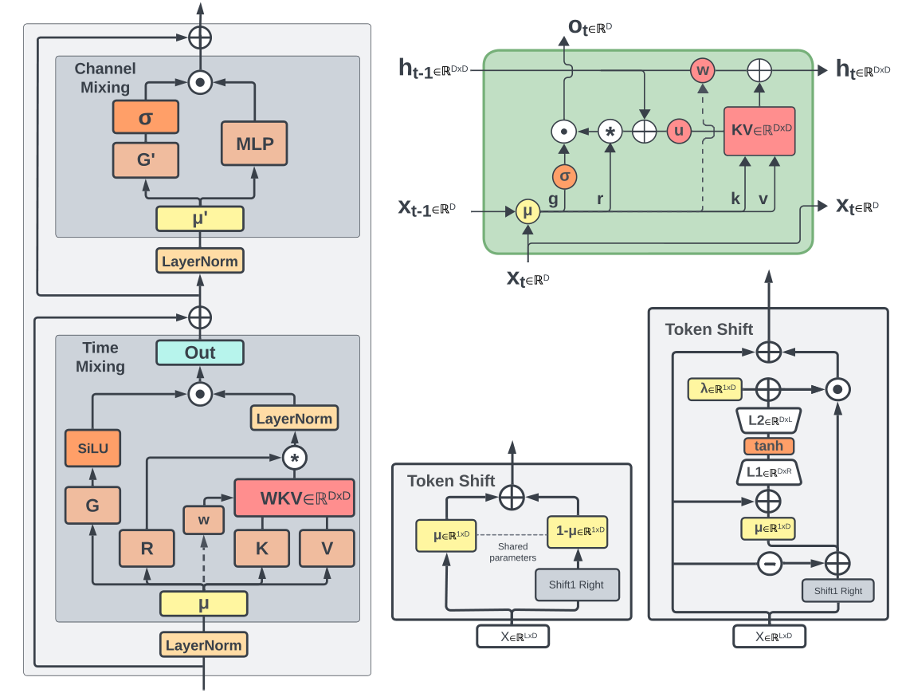
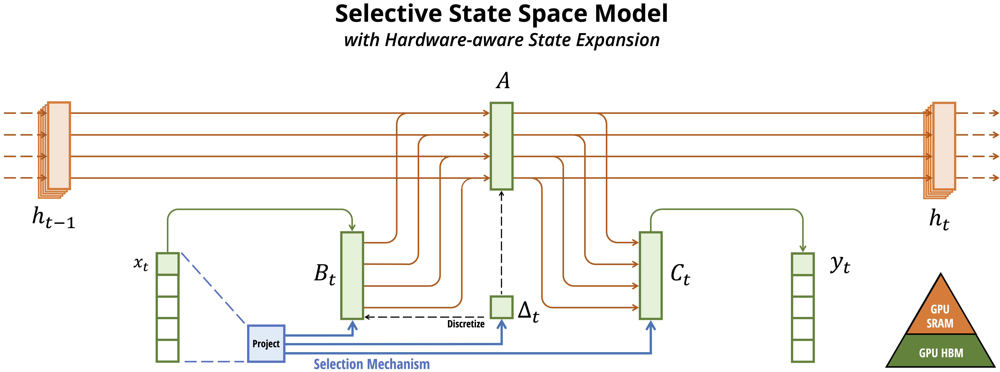
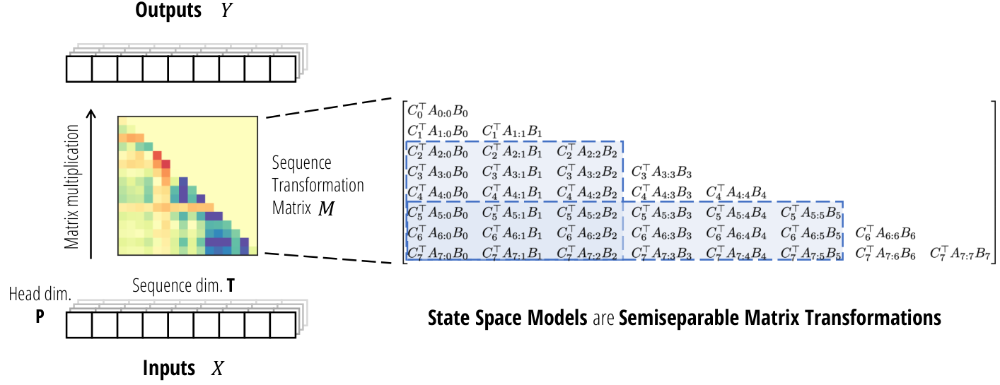
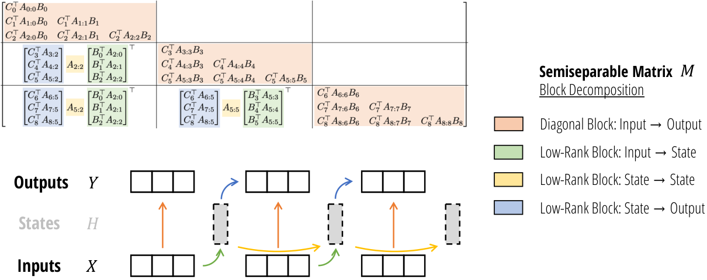
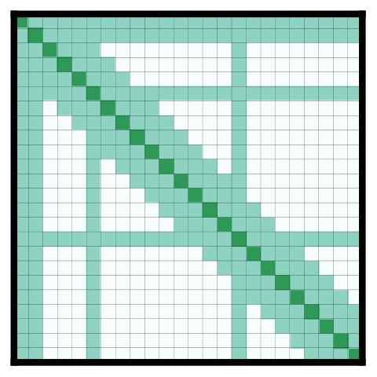
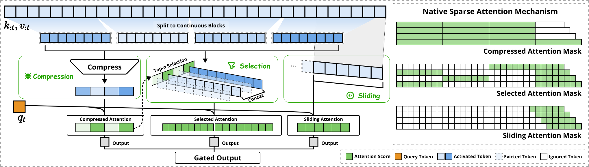
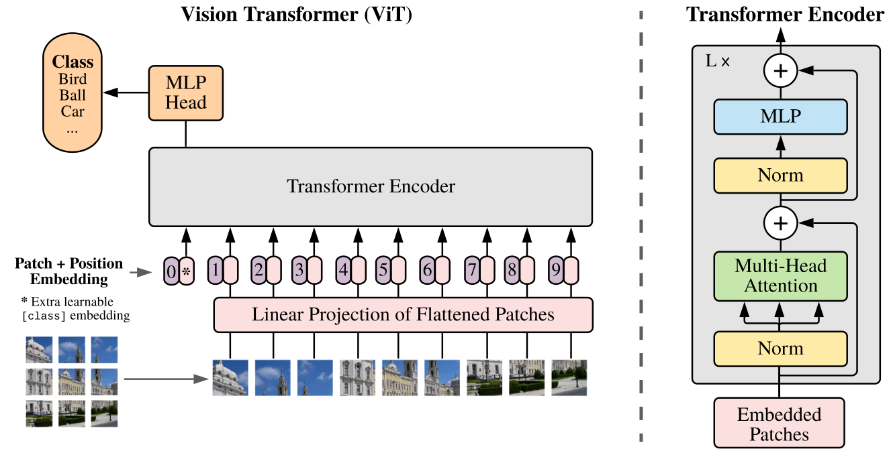

# Model Architectures II: Beyond the Standard Transformer

The decoder-only transformer, with its modern additions (pre-norm/RMSNorm, RoPE, GQA, MLA, MoE), is covered in the sibling chapter [Model Architectures](architectures.md). This chapter covers what sits next to it: sub-quadratic sequence mixers (linear attention, RetNet, RWKV, GLA, DeltaNet, state space models), hybrids that mix them with attention, sparse attention, the encoders that still matter (ViT, CLIP/SigLIP, Whisper), multimodal wiring, diffusion models, and what reasoning models change at the systems level.

The aim is to explain how each mechanism works, why it exists, and what it costs to train and serve: state size per token, what can run in parallel during training, how inference scales with sequence length, and where each one is weak. The goal is not a full list of papers. Every mechanism gets three things: the intuition in words, a tiny worked example where one helps, and a minimal PyTorch implementation with a correctness check you can run on a laptop (for example: the recurrent, parallel and chunked forms of a layer give the same numbers).

## Prerequisites

- [Model Architectures](architectures.md): attention, the KV cache, prefill vs decode, FlashAttention, GQA/MLA, RoPE, MoE. This chapter assumes you know what a KV cache is and why decode is memory-bandwidth bound.
- [Computer architecture](../foundations/computer-architecture.md): HBM vs on-chip SRAM, and tensor cores vs the general-purpose FP32 lanes NVIDIA calls "CUDA cores" ([The pieces](../foundations/computer-architecture.md#the-pieces)), which is why "runs as matmuls on tensor cores" vs "runs as elementwise work on CUDA cores" is a 10x+ difference; the roofline ([Arithmetic intensity and the roofline model](../foundations/computer-architecture.md#arithmetic-intensity-and-the-roofline-model)); bf16/fp8 ([Floating point](../foundations/computer-architecture.md#floating-point-ieee-754)).
- [Distributed systems](../foundations/distributed-systems.md): tensor parallelism, ranks, collectives (all-reduce, all-gather, all-to-all) and MFU, model FLOPs utilization ([Data parallel vs model parallel](../foundations/distributed-systems.md#data-parallel-vs-model-parallel), [Collectives](../foundations/distributed-systems.md#collectives-the-workhorse-of-distributed-training), [Time: one GPU vs a thousand](../foundations/distributed-systems.md#time-one-gpu-vs-a-thousand)).
- Forward links (later chapters, not needed first): [Inference arithmetic](../inference/arithmetic.md) for the full decode cost model, [Training arithmetic](../training/arithmetic.md) for the `2N` FLOPs-per-token rule (stated where it is used below), [GPU execution model](../compute/accelerator/execution-model.md) and [Writing kernels](../compute/accelerator/writing-kernels.md) for how the kernels named here are built, [Serving engine internals](../inference/serving-engine-internals.md) for how engines manage caches.

Conventions:

- `T` = sequence length, `d` = model width, `L` = number of layers, `N` = parameter count, `n` = SSM state dimension, `H` = heads, `dk`/`dv` = per-head key/value dims.
- Byte counts assume bf16 (2 bytes) unless stated. `GiB` = 2^30 bytes.
- Paper citations give arXiv ids. Ids I could not check while writing are marked "(id unverified)". Claims are attributed to the paper that made them. Where I am unsure of a detail (exact layer counts, ratios, release dates), I say so.
- Anything about kernel or serving-engine support describes roughly late 2025. This area moves monthly, so check the current release notes before you rely on it.

All the PyTorch snippets in this chapter were run with torch 2.15.0 on CPU (Apple Silicon, fp32 unless noted), and the outputs shown under them are pasted from those runs. They are naive reference code meant to be read, not fast kernels. Snippets marked "continues from" reuse functions from an earlier block; paste them into the same file. Small numerical differences (1e-7 to 1e-5) between forms are fp32 rounding, and your exact digits may differ slightly with a different torch build or CPU.

Two words used throughout:

- **Sequence mixer**: the part of a layer that moves information between positions (attention is one; the MLP is not, it works on each position separately).
- **State**: whatever a layer must keep in memory between decode steps. For attention that is the KV cache, which grows with every token. For everything in the first half of this chapter it is a fixed-size tensor.


## Why look beyond attention

Softmax attention has two separate scaling problems. Most arguments for alternatives mix them up, so take them one at a time.

### Problem 1: training and prefill compute is O(T^2)

For causal attention, the forward QK^T and AV matmuls cost about `4 * t * d` FLOPs per layer for the token at position `t` (each of the two matmuls is `2 * t * d`: a length-`d` dot product against `t` keys, then a weighted sum of `t` values). Averaged over a sequence, that is `2 * T * d` per token per layer. The dense (weight) FLOPs are about `2N` per token. So:

```
attention FLOPs / dense FLOPs  ~=  (2 * T * d * L) / (2 * N)  =  T * d * L / N
```

| model shape | T = 8k | T = 128k | T = 1M |
|---|---|---|---|
| Llama-3-8B-like (d=4096, L=32, N=8e9) | 0.13 | 2.1 | 17.2 |
| Llama-3-70B-like (d=8192, L=80, N=70e9) | 0.08 | 1.2 | 9.8 |

At 8k, attention is a rounding error compared to the MLPs. At 128k it is already 1-2x the whole dense compute. At 1M it is 10-17x. Pretraining usually runs at 4k-8k and extends context later, which is why the O(T^2) term rarely shows up in pretraining budgets. It does show up in long-context extension, in long prefill at inference, and in RL on long generations.

FlashAttention ([introduced in the previous chapter](architectures.md#the-kv-cache)) does not change this. It makes attention IO-efficient: the T x T matrix is never materialized, so memory is O(T). The FLOPs are still O(T^2).

### Problem 2: decode memory grows as O(T) per sequence

At decode time, every new token reads the whole KV cache. Per token, the cache holds `2 (K and V) * L * n_kv_heads * head_dim * bytes`:

| model (GQA, 8 KV heads, head_dim 128) | KV / token | at 128k | at 1M |
|---|---|---|---|
| Llama-3-8B (L=32) | 128 KiB | 16 GiB | 128 GiB |
| Llama-3-70B (L=80) | 320 KiB | 40 GiB | 320 GiB |
| Llama-3-405B (L=126) | 504 KiB | 63 GiB | 504 GiB |

Both tables come from this arithmetic:

```python
# Reproduce the two tables: attention/dense FLOP ratio and KV bytes per sequence
for name, d, L, N in [("8B-like", 4096, 32, 8e9), ("70B-like", 8192, 80, 70e9)]:
    print(name, "attn/dense FLOPs:", "  ".join(f"T={T//1024}k: {T*d*L/N:.2f}" for T in (8192, 131072, 1048576)))
KiB, GiB = 2**10, 2**30
for name, L in [("Llama-3-8B", 32), ("Llama-3-70B", 80), ("Llama-3-405B", 126)]:
    per_tok = 2 * L * 8 * 128 * 2                                   # K and V, 8 KV heads, head_dim 128, bf16
    print(f"{name}: {per_tok/KiB:.0f} KiB/token, {per_tok*131072/GiB:.0f} GiB @128k, {per_tok*2**20/GiB:.0f} GiB @1M")
```

Output:

```
8B-like attn/dense FLOPs: T=8k: 0.13  T=128k: 2.15  T=1024k: 17.18
70B-like attn/dense FLOPs: T=8k: 0.08  T=128k: 1.23  T=1024k: 9.82
Llama-3-8B: 128 KiB/token, 16 GiB @128k, 128 GiB @1M
Llama-3-70B: 320 KiB/token, 40 GiB @128k, 320 GiB @1M
Llama-3-405B: 504 KiB/token, 63 GiB @128k, 504 GiB @1M
```

These numbers are per sequence. At 128k, one 70B request needs about as much KV memory as the bf16 weights of a 20B model. Decode is memory-bandwidth bound, so the time per token grows linearly with how much KV has to be read. Batch size, which is where serving gets its throughput, is capped by `(HBM - weights) / (KV per sequence)`, where HBM is the GPU's memory capacity (80 GB on an H100).

GQA, MQA, MLA, and KV quantization (storing K and V in 8 or fewer bits with a scale factor) shrink the constant (see [architectures.md](architectures.md)). They do not change the O(T) growth. Every architecture in the first half of this chapter tries, one way or another, to replace that growing cache with a fixed-size state. Fixed state means O(1) memory per token and O(T) total compute. The open question in this whole area is what you give up for that. The short answer is exact recall.


## Linear attention and the RNN view

### Linear attention (Katharopoulos et al.)

"Transformers are RNNs: Fast Autoregressive Transformers with Linear Attention", Katharopoulos et al., arXiv 2006.16236.

**Intuition.** Softmax attention keeps every past (key, value) pair and, for each query, compares the query to all of them. Linear attention instead keeps a running *summary* of all pairs, a single `dk x dv` matrix, and the query reads from the summary. Think of the matrix as an **associative memory**: writing a pair adds the outer product `k v^T` to the matrix, and reading with a query `q` computes `q^T S`, which returns the values whose keys point in the direction of `q`. If the keys are orthogonal, each value comes back exactly; if they overlap, values bleed into each other.

Softmax attention for query `t` is

```
o_t = sum_{s<=t} exp(q_t . k_s) v_s / sum_{s<=t} exp(q_t . k_s)
```

Replace the exponential kernel `exp(q . k)` with any kernel that factorizes, `sim(q, k) = phi(q) . phi(k)`, and use associativity (`(q^T k) v^T = q^T (k v^T)`: you can sum the `k v^T` products before the query ever arrives):

```
o_t = phi(q_t)^T [ sum_{s<=t} phi(k_s) v_s^T ]  /  phi(q_t)^T [ sum_{s<=t} phi(k_s) ]
    = phi(q_t)^T S_t / phi(q_t)^T z_t

S_t = S_{t-1} + phi(k_t) v_t^T        # (dk, dv) matrix-valued state
z_t = z_{t-1} + phi(k_t)              # (dk,)   normalizer
```

That is an RNN whose hidden state is a `dk x dv` matrix. The paper used `phi(x) = elu(x) + 1`, which keeps the similarities positive so the normalizer can't be zero or negative.

**Worked example.** A 2-dimensional memory with no feature map and no normalizer, so you can follow the numbers by hand. Store 5 under key `e1 = [1, 0]` and 7 under `e2 = [0, 1]`; then try to "update" `e1` to 9; then write a third key, which in two dimensions cannot be orthogonal to the first two:

```python
import torch
# A 2x1 matrix memory, no feature map, no normalizer: S = sum_s k_s v_s^T, read = S^T q
S = torch.zeros(2, 1)                                   # (Dk, Dv)
def write(S, k, v): return S + torch.tensor(k)[:, None] * torch.tensor(v)[None, :]
def read(S, q):     return [round(x, 3) for x in (torch.tensor(q) @ S).tolist()]

S = write(S, [1., 0.], [5.])                            # store 5 under key e1
S = write(S, [0., 1.], [7.])                            # store 7 under key e2
print("after 2 writes, S =", S.flatten().tolist(), " read(e1) =", read(S, [1., 0.]), " read(e2) =", read(S, [0., 1.]))
S = write(S, [1., 0.], [9.])                            # "update" e1 to 9
print("after re-writing e1=9:               read(e1) =", read(S, [1., 0.]), " <- 5+9, nothing was forgotten")
S = write(S, [0.6, 0.8], [1.])                          # a 3rd key in a 2-dim space can't be orthogonal
print("after a non-orthogonal key:          read(e1) =", read(S, [1., 0.]), " read(e2) =", read(S, [0., 1.]))
```

Output:

```
after 2 writes, S = [5.0, 7.0]  read(e1) = [5.0]  read(e2) = [7.0]
after re-writing e1=9:               read(e1) = [14.0]  <- 5+9, nothing was forgotten
after a non-orthogonal key:          read(e1) = [14.6]  read(e2) = [7.8]
```

Two failure modes are visible already: an update *adds* to the old value instead of replacing it (14, not 9), and a non-orthogonal key corrupts what the other keys return. Both come back below as the reasons plain linear attention lost.

The full layer, in its two equivalent forms. The parallel form builds the T x T matrix of `phi(q) . phi(k)` scores, masks the future and multiplies by V, exactly like attention minus the softmax. The recurrent form walks the sequence and updates `S` and `z`:

```python
import torch, torch.nn.functional as F
torch.manual_seed(0)

def phi(x): return F.elu(x) + 1                         # positive feature map

def linear_attn_parallel(q, k, v):
    # q, k: (B, T, D)  v: (B, T, Dv)   -- training form: O(T^2 D), matmul-friendly
    q, k = phi(q), phi(k)
    scores = q @ k.transpose(1, 2)                      # (B, T, T)
    scores = scores * torch.tril(torch.ones_like(scores))  # causal mask, no softmax
    return (scores @ v) / scores.sum(-1, keepdim=True)  # (B, T, Dv)

def linear_attn_recurrent(q, k, v):
    # inference form: O(T D Dv) total, O(D Dv) state, O(1) per token
    B, T, D = q.shape
    q, k = phi(q), phi(k)
    S = q.new_zeros(B, D, v.shape[-1])                  # (B, D, Dv)  the entire "KV cache"
    z = q.new_zeros(B, D)                               # (B, D)      running sum of keys
    out = []
    for t in range(T):
        S = S + k[:, t, :, None] * v[:, t, None, :]     # (B, D, Dv)  += phi(k_t) v_t^T
        z = z + k[:, t]
        num = (q[:, t, :, None] * S).sum(1)             # (B, Dv)     phi(q_t)^T S_t
        den = (q[:, t] * z).sum(-1, keepdim=True)       # (B, 1)      phi(q_t)^T z_t
        out.append(num / den)
    return torch.stack(out, 1)                          # (B, T, Dv)

q, k, v = torch.randn(2, 16, 8), torch.randn(2, 16, 8), torch.randn(2, 16, 8)
o_par, o_rec = linear_attn_parallel(q, k, v), linear_attn_recurrent(q, k, v)
print("max |parallel - recurrent| =", (o_par - o_rec).abs().max().item())

# softmax attention is NOT expressible this way: its state would have to grow with t
sm = torch.softmax((q @ k.transpose(1, 2)).masked_fill(~torch.tril(torch.ones(16, 16, dtype=torch.bool)), -1e9), -1) @ v
print("max |softmax - linear|      =", (sm - o_par).abs().max().item(), "(different model, as expected)")
```

Output:

```
max |parallel - recurrent| = 2.384185791015625e-07
max |softmax - linear|      = 2.241513252258301 (different model, as expected)
```

The second line is a reminder that linear attention is a different model from softmax attention, not an approximation of it.

Systems consequences:

- **Inference:** the state is `H * dk * dv` per layer no matter what `T` is. With 32 heads of 128 x 128 that is 1 MiB per layer in bf16. A GQA-8 layer with head_dim 128 stores 4 KiB of KV per token, so the recurrent state equals about 256 tokens of KV. Past a few thousand tokens of context, the state is much smaller than a KV cache would be.
- **Training:** there are three equivalent ways to compute it. The *parallel* form is quadratic but uses tensor cores. The *recurrent* form is linear but sequential and runs at memory-bandwidth speed. The *chunkwise* form is the one used in practice; it gets its own section next. With tensor cores the chunkwise form beats FlashAttention in wall-clock somewhere around 2k-8k tokens, depending on the kernel and head dims. That crossover is a rough figure, not a measurement.

**Why plain linear attention lost.** Perplexity lagged softmax attention noticeably at equal size. Two reasons explain most of it, and the toy above shows both:

1. **No forgetting.** `S_t` is a running sum. Nothing is ever removed, so old associations pile up and interfere with new ones.
2. **Low-rank, low-capacity memory.** A `dk x dv` matrix can store about `dk` orthogonal key-value pairs exactly. Beyond that, retrieval `S^T q` returns a blend of values. Softmax's sharp, high-dynamic-range weighting is what lets attention pick one token out of 100k. A positive feature map with no normalization trick cannot do that.

Everything below (RetNet, GLA, Mamba-2, DeltaNet) fixes (1) with decay or gating, (2) with a better write rule, or both. A related line of work approximates the softmax kernel with random features: Performer / FAVOR+, Choromanski et al., arXiv 2009.14794. It is no longer competitive for LMs and is mentioned here only for history.

### Chunkwise-parallel training (the algorithm all of these use)

**The problem.** The recurrent form does `T` small sequential steps, each a matrix-vector product: on a GPU that is bandwidth-bound and leaves tensor cores idle. The parallel form is one big matmul but costs O(T^2) and materializes a T x T matrix. Neither is what you want for training at 8k-128k tokens.

**The idea.** Split the sequence into chunks of `C` tokens (64-256 in real kernels). Inside a chunk, use the parallel form: a `C x C` masked matmul, cheap because `C` is small, and fast because it is a matmul. Between chunks, carry the state `S` exactly as the recurrent form would, but only once per chunk. Each output is "what this chunk contributes" (intra-chunk, quadratic) plus "what all earlier chunks contributed" (inter-chunk, read from the carried state). The number of sequential steps drops from `T` to `T / C`, and nearly all FLOPs become matmuls.

Most layers in this family share one recurrence with a per-step decay `a_t`: `S_t = a_t S_{t-1} + k_t v_t^T`. With `a_t = 1` it is linear attention (without the normalizer), with constant `a_t = gamma` it is RetNet, and with data-dependent `a_t` it is Mamba-2. The decay between positions `s` and `t` is `prod_{r=s+1..t} a_r`, which is cheapest to compute in log space as a difference of cumulative sums. Here are all three algorithms for that recurrence, checked against each other:

```python
import torch
torch.manual_seed(0)
# One recurrence, three algorithms.   S_t = a_t S_{t-1} + k_t v_t^T,   o_t = S_t^T q_t
# a_t = 1 -> plain linear attention (no normalizer); a_t = gamma -> RetNet; a_t data-dependent -> Mamba-2/SSD

def recurrent(q, k, v, log_a):
    # q, k: (B, T, D)  v: (B, T, Dv)  log_a: (B, T) log of per-step decay, <= 0
    B, T, D = q.shape
    S = q.new_zeros(B, D, v.shape[-1])                                  # (B, D, Dv)
    out = []
    for t in range(T):
        S = log_a[:, t, None, None].exp() * S + k[:, t, :, None] * v[:, t, None, :]
        out.append(torch.einsum('bd,bde->be', q[:, t], S))             # (B, Dv)
    return torch.stack(out, 1)                                          # (B, T, Dv)

def decay_mask(log_a):
    # (B, T) -> (B, T, T) with M[t, s] = prod_{r=s+1..t} a_r for s <= t, else 0
    cum = log_a.cumsum(-1)                                              # (B, T)
    seg = cum[:, :, None] - cum[:, None, :]                             # (B, T, T) log decay from s to t
    T = log_a.shape[-1]
    causal = torch.tril(torch.ones(T, T, dtype=torch.bool))
    return seg.masked_fill(~causal, float('-inf')).exp()                # mask BEFORE exp (else inf*0 = nan)

def parallel(q, k, v, log_a):
    return ((q @ k.transpose(1, 2)) * decay_mask(log_a)) @ v           # (B, T, T) @ (B, T, Dv)

def chunked(q, k, v, log_a, C=4):
    B, T, D = q.shape
    S = q.new_zeros(B, D, v.shape[-1])                                  # (B, D, Dv) state carried across chunks
    out = []
    for i in range(0, T, C):
        qc, kc, vc, la = q[:, i:i+C], k[:, i:i+C], v[:, i:i+C], log_a[:, i:i+C]
        cum = la.cumsum(-1)                                             # (B, C) decay from chunk start to t
        intra = ((qc @ kc.transpose(1, 2)) * decay_mask(la)) @ vc      # (B, C, Dv) quadratic, inside chunk
        inter = cum.exp()[..., None] * (qc @ S)                         # (B, C, Dv) contribution of the past
        out.append(intra + inter)
        w = (cum[:, -1:] - cum).exp()                                   # (B, C) decay from s to chunk end
        S = cum[:, -1, None, None].exp() * S + (kc * w[..., None]).transpose(1, 2) @ vc   # (B, D, Dv)
    return torch.cat(out, 1)

B, T, D, Dv = 2, 16, 8, 8
q, k, v = torch.randn(B, T, D), torch.randn(B, T, D), torch.randn(B, T, Dv)
for name, log_a in [("a=1 (linear attn)", torch.zeros(B, T)),
                    ("a=0.9 (RetNet)   ", torch.full((B, T), 0.9).log()),
                    ("a_t data-dep     ", torch.nn.functional.logsigmoid(torch.randn(B, T)))]:
    r, p, c = recurrent(q, k, v, log_a), parallel(q, k, v, log_a), chunked(q, k, v, log_a)
    print(f"{name}: |rec-par| = {(r-p).abs().max():.1e}   |rec-chunk| = {(r-c).abs().max():.1e}")
```

Output:

```
a=1 (linear attn): |rec-par| = 5.7e-06   |rec-chunk| = 7.6e-06
a=0.9 (RetNet)   : |rec-par| = 3.8e-06   |rec-chunk| = 5.7e-06
a_t data-dep     : |rec-par| = 3.8e-06   |rec-chunk| = 1.2e-06
```

Two implementation details in that code are the same ones real kernels have to get right: the decay mask is computed as `exp(cum_t - cum_s)` *after* masking the upper triangle to `-inf` (computing `exp` first overflows on the upper triangle and `inf * 0 = nan`), and the state update weights each key by the decay from its position to the chunk end.

Why the cost works out, per head per layer with `D = Dv = 128` and `C = 64`:

```python
# FLOPs per head per layer for the three forms (D = Dv = 128), counted as 2*m*n*k per matmul
D = Dv = 128
for T in (2048, 8192, 131072):
    par = 2 * T * T * (D + Dv)                      # Q K^T and (masked) @ V, full T x T (causal mask wastes half)
    rec = T * 4 * D * Dv                            # per step: k v^T outer product + S^T q
    for C in (64,):
        chk = (T // C) * (2 * C * C * (D + Dv) + 2 * C * D * Dv * 2)  # intra-chunk quadratic + inter read + state update
    print(f"T={T:>6}: parallel {par/1e9:8.1f} GF | chunked(C=64) {chk/1e9:6.2f} GF, {T//C:>4} serial steps | "
          f"recurrent {rec/1e9:5.2f} GF, {T:>6} serial steps")
```

Output:

```
T=  2048: parallel      2.1 GF | chunked(C=64)   0.20 GF,   32 serial steps | recurrent  0.13 GF,   2048 serial steps
T=  8192: parallel     34.4 GF | chunked(C=64)   0.81 GF,  128 serial steps | recurrent  0.54 GF,   8192 serial steps
T=131072: parallel   8796.1 GF | chunked(C=64)  12.88 GF, 2048 serial steps | recurrent  8.59 GF, 131072 serial steps
```

The chunked form does about 1.5x the FLOPs of the recurrence but in `T / C` sequential steps of dense matmuls; the parallel form's FLOPs explode quadratically. On a GPU, FLOPs that run on tensor cores are roughly an order of magnitude cheaper than the same count of elementwise or matrix-vector work, which is why chunkwise wins in wall-clock even though it is not the FLOP minimum.

### RetNet

"Retentive Network: A Successor to Transformer for Large Language Models", Sun et al., arXiv 2307.08621.

**Intuition.** Fix linear attention's "no forgetting" problem in the simplest way possible: multiply the memory by a constant `gamma < 1` before every write, so old entries fade exponentially. Different heads get different `gamma`s, so some heads remember the last ~20 tokens and others the last few thousand, like a bank of low-pass filters at different time scales.

RetNet is linear attention with no feature map and a fixed per-head exponential decay `gamma`, plus xPos-style rotation on q and k (xPos, from Sun et al.'s "A Length-Extrapolatable Transformer", is RoPE with an extra per-dimension exponential decay folded into the rotation; [RoPE](architectures.md#rope) was covered in the previous chapter):

```
S_t = gamma * S_{t-1} + k_t^T v_t           # per head, gamma in (0,1) fixed per head
o_t = q_t S_t
parallel form:  O = (Q K^T  ⊙  D) V,  D[t,s] = gamma^(t-s) if t>=s else 0
```

The paper presents the same three modes as above (parallel, recurrent, chunkwise) and uses a multi-scale design where different heads get different gammas (`gamma_h = 1 - 2^(-5-h)`). Its group norm on head outputs takes over the job the softmax denominator used to do. A minimal multi-scale retention layer, using the `chunked` function from the previous block (xPos omitted):

```python
# continues from the chunkwise block above (uses recurrent, parallel, chunked)
import torch, math
torch.manual_seed(0)
H = 8
gamma = 1 - 2.0 ** (-5 - torch.arange(H, dtype=torch.float))     # RetNet's multi-scale decays, one per head
for h in (0, 3, 7):
    print(f"head {h}: gamma = {gamma[h]:.5f}  half-life = {math.log(0.5)/math.log(gamma[h]):6.1f} tokens"
          f"  weight on a token 2048 back = {gamma[h]**2048:.1e}")

def retention(x, Wq, Wk, Wv, Wg, Wo, C=4):
    # x: (B, T, d)  -> multi-scale retention, xPos rotation omitted for brevity
    B, T, d = x.shape
    dh = d // H
    q, k, v = [(x @ W).view(B, T, H, dh).transpose(1, 2).reshape(B * H, T, dh) for W in (Wq, Wk, Wv)]   # each (B*H, T, dh)
    log_a = gamma.log().repeat(B)[:, None].expand(B * H, T)        # (B*H, T) constant per head
    o = chunked(q / dh ** 0.5, k, v, log_a, C)                      # (B*H, T, dh)
    o = o.view(B, H, T, dh).transpose(1, 2)                         # (B, T, H, dh)
    o = torch.nn.functional.group_norm(o.reshape(B * T, H, dh), H).view(B, T, d)  # per-head norm replaces softmax denominator
    return (torch.nn.functional.silu(x @ Wg) * o) @ Wo               # swish output gate, (B, T, d)

d = 64
Ws = [torch.randn(d, d) / d ** 0.5 for _ in range(5)]
x = torch.randn(2, 16, d)
y_chunk = retention(x, *Ws, C=4)
y_full  = retention(x, *Ws, C=16)                                   # one chunk == the parallel form
print("retention out", tuple(y_chunk.shape), " |C=4 - C=16| =", f"{(y_chunk - y_full).abs().max():.1e}")
```

Output:

```
head 0: gamma = 0.96875  half-life =   21.8 tokens  weight on a token 2048 back = 5.8e-29
head 3: gamma = 0.99609  half-life =  177.1 tokens  weight on a token 2048 back = 3.3e-04
head 7: gamma = 0.99976  half-life = 2838.8 tokens  weight on a token 2048 back = 6.1e-01
retention out (2, 16, 64)  |C=4 - C=16| = 4.2e-07
```

The half-lives show what "multi-scale" means concretely: head 0 has effectively forgotten anything more than ~100 tokens back, while head 7 still weights a token 2048 positions back at 0.6. Running the layer with one chunk of 16 (that is, the parallel form) and with chunks of 4 gives the same output.

The claims were O(1) inference, parity with transformers at a few billion parameters, and better throughput and latency. Later independent comparisons, including the GLA and Mamba-2 papers' baselines, generally put RetNet behind data-dependent gating at equal compute. That does not mean the paper's own numbers were wrong. The weakness is that a *fixed* decay is a fixed-horizon memory: the model cannot choose to keep a particular token longer.

### RWKV

"RWKV: Reinventing RNNs for the Transformer Era", Peng et al., arXiv 2305.13048. Later versions: "Eagle and Finch" (RWKV-5/6), arXiv 2404.05892. RWKV-7 "Goose", arXiv 2503.14456.

The RWKV (Eagle/Finch) block - time-mixing and channel-mixing:



([source](https://arxiv.org/abs/2404.05892))

**Intuition.** RWKV-4's "time-mixing" is softmax attention where the attention score of a past token is not `q . k` but `k_i` (how important the token says it is) minus a penalty `w` per step of distance. Because the penalty is linear in distance, the exponentially decayed weighted average can be maintained with two running sums per channel (numerator and denominator), so the state is just two vectors. The current token gets a separate learned bonus `u` so it isn't drowned out. A sigmoid "receptance" `r` then gates how much of that average to let through. "Channel-mixing" is the block's MLP.

RWKV is a community project (it is a Linux Foundation project, as far as I know) that has gone through several distinct architectures under one name:

- **RWKV-4:** vector-valued state with a per-channel time decay `w` and a "bonus" `u` for the current token. The WKV operator is an exponentially decayed softmax-like average:

  ```
  wkv_t = ( sum_{i<t} exp(-(t-1-i) w + k_i) v_i + exp(u + k_t) v_t )
        / ( sum_{i<t} exp(-(t-1-i) w + k_i)     + exp(u + k_t)     )
  ```

  It also uses "token shift" (mixing `x_t` with `x_{t-1}` before projections), which acts like a width-2 causal conv. The state is O(d) per layer, which is tiny.
- **RWKV-5 (Eagle):** matrix-valued multi-head state (`dk x dv` per head), similar to linear attention with decay.
- **RWKV-6 (Finch):** data-dependent decay. `w_t` is a function of the input, which places it in the same family as GLA and Mamba (the GLA code below is the right mental model).
- **RWKV-7 (Goose):** a generalized delta rule with vector-valued in-context learning rates (see DeltaNet below). The paper argues this lets it represent things that diagonal-decay models provably cannot, such as certain state-tracking tasks. Treat that as the authors' claim.

RWKV-4 time-mixing, the paper's formula next to the two-accumulator recurrence that computes it:

```python
import torch
torch.manual_seed(0)

def token_shift(x, mu):
    # x: (B, T, d) -> mu * x_t + (1 - mu) * x_{t-1}; a learned width-2 causal "conv" per channel
    x_prev = torch.nn.functional.pad(x, (0, 0, 1, -1))                 # (B, T, d) shifted right by one
    return mu * x + (1 - mu) * x_prev

def wkv_direct(w, u, k, v):
    # w, u: (d,)  k, v: (B, T, d). The formula from the paper, O(T^2) - reference only.
    B, T, d = k.shape
    out = []
    for t in range(T):
        i = torch.arange(t)
        wt = (-(t - 1 - i)[:, None] * w + k[:, :t]).exp()            # (B, t, d) decayed weights for the past
        cur = (u + k[:, t]).exp()                                     # (B, d) bonus weight for the current token
        out.append(((wt * v[:, :t]).sum(1) + cur * v[:, t]) / (wt.sum(1) + cur))
    return torch.stack(out, 1)                                        # (B, T, d)

def wkv_recurrent(w, u, k, v):
    # The same thing with two (B, d) running sums: the entire RWKV-4 state per layer
    B, T, d = k.shape
    a = k.new_zeros(B, d); b = k.new_zeros(B, d)                      # numerator / denominator accumulators
    out = []
    for t in range(T):
        cur = (u + k[:, t]).exp()
        out.append((a + cur * v[:, t]) / (b + cur))
        a = (-w).exp() * a + k[:, t].exp() * v[:, t]                  # decay, then add this token
        b = (-w).exp() * b + k[:, t].exp()
    return torch.stack(out, 1)
# (real kernels also carry a running max exponent so exp(k) cannot overflow; omitted here)

B, T, d = 2, 12, 16
x = torch.randn(B, T, d)
mu_k, mu_v, mu_r = (torch.rand(d) for _ in range(3))
Wk, Wv, Wr, Wo = (torch.randn(d, d) / d ** 0.5 for _ in range(4))
k, v, r = token_shift(x, mu_k) @ Wk, token_shift(x, mu_v) @ Wv, token_shift(x, mu_r) @ Wr
w, u = torch.rand(d), torch.randn(d)                                  # w > 0: per-channel decay rate
y_dir, y_rec = wkv_direct(w, u, k, v), wkv_recurrent(w, u, k, v)
print("|direct - recurrent| =", f"{(y_dir - y_rec).abs().max():.1e}")
out = (torch.sigmoid(r) * y_rec) @ Wo                                 # receptance gate, (B, T, d)
print("time-mixing out", tuple(out.shape), "| state per layer per sequence:", 2 * d + d, "numbers (a, b, x_{t-1})")
```

Output:

```
|direct - recurrent| = 3.6e-07
time-mixing out (2, 12, 16) | state per layer per sequence: 48 numbers (a, b, x_{t-1})
```

The per-layer decode state is the two accumulators plus the previous token's input for the token shift: `3d` numbers, about 15 KiB per layer at `d = 2560` in bf16.

Who uses it: RWKV's own releases, plus a fair amount of interest from edge and on-device deployments, because the state really is constant and small. I'm not aware of a frontier lab shipping a pure RWKV model.

### Gated linear attention (GLA)

"Gated Linear Attention Transformers with Hardware-Efficient Training", Yang, Wang, Shen, Panda, Kim, arXiv 2312.06635.

**Intuition.** RetNet's forgetting is fixed; GLA lets the *input* decide how much to forget, and separately for each row of the memory (each key dimension). A token that starts a new topic can produce gates near 0 and clear part of the memory; filler tokens produce gates near 1 and leave it alone.

```
S_t = diag(alpha_t) S_{t-1} + k_t^T v_t     # alpha_t = sigmoid(W x_t)^(1/tau), per key-dim, data-dependent
o_t = q_t S_t
```

The paper's real contribution is as much systems as modeling. The decay between positions `s` and `t` along key dimension `i` is `exp(cum_t[i] - cum_s[i])`, where `cum` is the cumulative sum of `log alpha`. That factors as `exp(cum_t[i]) * exp(-cum_s[i])`, so you can fold the first factor into `q_t` and the second into `k_s`, and the gated intra-chunk scores become a plain `q~ @ k~^T` matmul. This is the chunkwise algorithm (FlashLinearAttention):

```python
import torch, torch.nn.functional as F
torch.manual_seed(0)
# GLA: S_t = diag(alpha_t) S_{t-1} + k_t v_t^T, o_t = S_t^T q_t;  alpha_t in (0,1)^D, data-dependent, per key dim

def gla_recurrent(q, k, v, log_alpha):
    # q, k, log_alpha: (B, T, D)  v: (B, T, Dv)
    B, T, D = q.shape
    S = q.new_zeros(B, D, v.shape[-1])                                  # (B, D, Dv)
    out = []
    for t in range(T):
        S = log_alpha[:, t, :, None].exp() * S + k[:, t, :, None] * v[:, t, None, :]   # row i decays by alpha_t[i]
        out.append(torch.einsum('bd,bde->be', q[:, t], S))
    return torch.stack(out, 1)

def gla_chunked(q, k, v, log_alpha, C=4):
    # Factor the decay into q and k: prod_{r=s+1..t} alpha_r = exp(cum_t - cum_s) = exp(cum_t) * exp(-cum_s)
    B, T, D = q.shape
    S = q.new_zeros(B, D, v.shape[-1])
    causal = torch.tril(torch.ones(C, C, dtype=torch.bool))
    out = []
    for i in range(0, T, C):
        qc, kc, vc = q[:, i:i+C], k[:, i:i+C], v[:, i:i+C]
        cum = log_alpha[:, i:i+C].cumsum(1)                             # (B, C, D)
        q_ = qc * cum.exp()                                             # (B, C, D)  decay from chunk start to t
        k_ = kc * (-cum).exp()                                          # (B, C, D)  undo decay up to s
        A = (q_ @ k_.transpose(1, 2)).masked_fill(~causal, 0)           # (B, C, C)  a plain matmul -> tensor cores
        out.append(A @ vc + q_ @ S)                                     # intra-chunk + carried state
        k_end = kc * (cum[:, -1:] - cum).exp()                          # (B, C, D)  decay from s to chunk end
        S = cum[:, -1, :, None].exp() * S + k_end.transpose(1, 2) @ vc  # (B, D, Dv)
    return torch.cat(out, 1)

B, T, D, Dv = 2, 32, 8, 8
q, k, v = torch.randn(B, T, D), torch.randn(B, T, D), torch.randn(B, T, Dv)
log_alpha = F.logsigmoid(torch.randn(B, T, D) + 2) / 16                # sigmoid(.)^(1/tau), tau = 16 as in the paper
ref = gla_recurrent(q, k, v, log_alpha)
for C in (4, 8, 32):
    print(f"C={C:>2}: |recurrent - chunked| = {(ref - gla_chunked(q, k, v, log_alpha, C)).abs().max():.1e}")

# Why chunks must stay small: exp(-cum) grows without bound inside a chunk
strong = F.logsigmoid(torch.randn(B, 512, D) - 3)                      # fast forgetting, alpha ~ 0.05
print("max exp(-cum) over 512 steps:", (-strong.cumsum(1)).exp().max().item())
```

Output:

```
C= 4: |recurrent - chunked| = 7.6e-06
C= 8: |recurrent - chunked| = 8.6e-06
C=32: |recurrent - chunked| = 9.5e-06
max exp(-cum) over 512 steps: inf
```

The last line is why the paper uses a secondary level of chunking (and log-space computation for the sub-blocks): `exp(-cum)` grows without bound as the chunk gets longer, and with fast-forgetting gates it overflows fp32 within a few hundred steps, let alone bf16. Keeping chunks short bounds it. GLA reported training throughput competitive with FlashAttention-2 at 2k context and faster beyond that. Kernels live in the `flash-linear-attention` (fla-org) Triton library (Triton is a Python-embedded language from OpenAI for writing GPU kernels at the level of tiles rather than individual threads; it is taught in [Writing kernels: Triton from zero](../compute/accelerator/writing-kernels.md#triton-from-zero)), which has become the reference implementation for most of this family.

### DeltaNet and Gated DeltaNet

- "Linear Transformers Are Secretly Fast Weight Programmers", Schlag, Irie, Schmidhuber, arXiv 2102.11174 (delta rule in linear attention).
- "Parallelizing Linear Transformers with the Delta Rule over Sequence Length", Yang, Wang, Zhang, Shen, Kim, arXiv 2406.06484.
- "Gated Delta Networks: Improving Mamba2 with Delta Rule", Yang, Kautz, Hatamizadeh, arXiv 2412.06464.

**Intuition: the memory is a regression model trained online.** Treat the state `S` as the weights of a linear map that should send each key to its value, `S k ≈ v`. Each new token is one training example `(k_t, v_t)`. Additive linear attention "trains" by adding `v k^T` no matter what the map already predicts. The delta rule instead asks the memory what it currently returns for `k_t`, computes the error `v_t - S k_t`, and corrects the memory by that error, scaled by a learning rate `beta_t`. That is exactly one step of stochastic gradient descent on the squared error `0.5 ||S k_t - v_t||^2`. If the memory already returns the right value, nothing is written; if it returns an old value for this key, the old value is replaced instead of added to.

```
v_old = S_{t-1} k_t                              # what memory currently returns for k_t
S_t   = S_{t-1} + beta_t (v_t - v_old) k_t^T     # replace, don't add
      = S_{t-1} (I - beta_t k_t k_t^T) + beta_t v_t k_t^T

Gated DeltaNet:
S_t   = alpha_t S_{t-1} (I - beta_t k_t k_t^T) + beta_t v_t k_t^T     # alpha_t: Mamba-2 style scalar decay
```

With `beta = 1` and unit-norm `k`, it overwrites exactly: after the update `S_t k_t = S_{t-1} k_t + (v_t - S_{t-1} k_t)(k_t . k_t) = v_t`. Three checks in one block: the 2-d toy from before (now the update to 9 replaces 5), the equivalence with an autograd SGD step, and exact retrieval of the latest write in a sequence that has twice as many keys as dimensions:

```python
import torch, torch.nn.functional as F
torch.manual_seed(0)
# Convention here: S is (Dv, D), read = S k. Delta rule: S_t = S_{t-1} + beta_t (v_t - S_{t-1} k_t) k_t^T

def delta_rule_recurrent(q, k, v, beta):
    # q, k: (B, T, D) L2-normalized   v: (B, T, Dv)   beta: (B, T) in (0, 1]
    B, T, D = q.shape
    S = q.new_zeros(B, v.shape[-1], D)                                  # (B, Dv, D)
    out = []
    for t in range(T):
        kt, vt, bt = k[:, t], v[:, t], beta[:, t, None]
        v_old = (S @ kt[..., None]).squeeze(-1)                         # (B, Dv) what memory returns for k_t now
        S = S + (bt * (vt - v_old))[..., None] * kt[:, None, :]         # rank-1 correction toward v_t
        out.append((S @ q[:, t, :, None]).squeeze(-1))                  # (B, Dv)
    return torch.stack(out, 1)                                          # (B, T, Dv)

# 1) The 2-d toy from before, with the delta rule instead of +=
S = torch.zeros(1, 2)                                                   # (Dv, D)
def write(S, k, v, beta=1.0):
    k, v = torch.tensor(k), torch.tensor(v)
    return S + beta * (v - S @ k)[:, None] * k[None, :]
for key, val in [([1., 0.], [5.]), ([0., 1.], [7.]), ([1., 0.], [9.])]:
    S = write(S, key, val)
print("delta rule after e1=5, e2=7, e1=9:  read(e1) =", (S @ torch.tensor([1., 0.])).tolist(),
      " read(e2) =", (S @ torch.tensor([0., 1.])).tolist())

# 2) It is exactly one SGD step on the regression loss 0.5 * ||S k - v||^2 with learning rate beta
S0 = torch.randn(4, 6, requires_grad=True); k = F.normalize(torch.randn(6), dim=0); v = torch.randn(4); beta = 0.3
(0.5 * (S0 @ k - v).pow(2).sum()).backward()
sgd = S0 - beta * S0.grad
delta = S0 + beta * (v - S0 @ k)[:, None] * k[None, :]
print("|SGD step - delta update| =", f"{(sgd - delta).abs().max():.1e}")

# 3) Query with the key just written (q_t = k_t), beta = 1: the latest write is always retrieved exactly
B, T, D = 2, 16, 8
k = F.normalize(torch.randn(B, T, D), dim=-1); v = torch.randn(B, T, D)
o_delta = delta_rule_recurrent(k, k, v, torch.ones(B, T))
S_add = torch.cumsum(v[..., :, None] * k[..., None, :], 1)              # (B, T, Dv, D) additive: S_t = sum v k^T
o_add = (S_add @ k[..., None]).squeeze(-1)
print(f"T=16 keys in D=8: delta max |o_t - v_t| = {(o_delta - v).abs().max():.1e}   additive = {(o_add - v).abs().max():.2f}")
```

Output:

```
delta rule after e1=5, e2=7, e1=9:  read(e1) = [9.0]  read(e2) = [7.0]
|SGD step - delta update| = 0.0e+00
T=16 keys in D=8: delta max |o_t - v_t| = 7.7e-07   additive = 4.81
```

That last toy compares one rule against another on the same inputs. It shows the mechanism, not a quality gap between trained models.

**Training it in parallel.** The transition `(I - beta k k^T)` is a dense matrix, not a diagonal, so the GLA trick (folding cumulative gates into q and k) does not apply. Yang et al. (2406.06484) use the WY representation for products of Householder-like matrices. A practical way to see it: inside a chunk, define the "pseudo-value" actually written at step `t`, `u_t = beta_t (v_t - S_{t-1} k_t)`. Then the state within the chunk is just `S_t = S_0 + sum_{i<=t} u_i k_i^T`, an ordinary linear-attention sum. The catch is that each `u_t` depends on earlier `u_i` through `S_{t-1} k_t`. Writing that dependency out gives a lower-triangular linear system `(I + A) U = diag(beta) (V - K S_0^T)` with `A[t, i] = beta_t (k_t . k_i)` for `i < t`. Solving one small `C x C` triangular system per chunk produces all the `u`s at once; after that, outputs and the state update are matmuls, exactly as in the linear-attention chunked form. Gated DeltaNet adds the cumulative gate `g_t = prod a` into `A`, the right-hand side and the readout. Here it is, checked against the step-by-step recurrence, plus a demonstration of what the gate adds:

```python
import torch, torch.nn.functional as F
torch.manual_seed(0)
# Gated DeltaNet: S_t = a_t S_{t-1} (I - b_t k_t k_t^T) + b_t v_t k_t^T,  o_t = S_t q_t.  a_t = 1 gives DeltaNet.

def gdn_recurrent(q, k, v, beta, log_a):
    # q, k: (B, T, D)  v: (B, T, Dv)  beta, log_a: (B, T)
    B, T, D = q.shape
    S = q.new_zeros(B, v.shape[-1], D)                                  # (B, Dv, D)
    out = []
    for t in range(T):
        kt, bt = k[:, t], beta[:, t, None]
        S = log_a[:, t, None, None].exp() * S                           # forget (scalar gate)
        S = S + (bt * (v[:, t] - (S @ kt[..., None]).squeeze(-1)))[..., None] * kt[:, None, :]   # delta write
        out.append((S @ q[:, t, :, None]).squeeze(-1))
    return torch.stack(out, 1)

def gdn_chunked(q, k, v, beta, log_a, C=8):
    # Inside a chunk write S_t = g_t S0 + sum_{i<=t} (g_t/g_i) u_i k_i^T, with g_t = prod a and the
    # "pseudo-values" u_t = b_t (v_t - a_t S_{t-1} k_t). All u's of a chunk solve ONE triangular system:
    #   (I + A) U = diag(b) (V - diag(g) K S0^T),   A[t, i] = b_t (g_t/g_i) k_t.k_i for i < t
    B, T, D = q.shape
    S = q.new_zeros(B, v.shape[-1], D)
    I = torch.eye(C)
    tril = torch.tril(torch.ones(C, C, dtype=torch.bool))
    out = []
    for s in range(0, T, C):
        qc, kc, vc, bc = q[:, s:s+C], k[:, s:s+C], v[:, s:s+C], beta[:, s:s+C, None]
        g = log_a[:, s:s+C].cumsum(1)                                    # (B, C) log g_t
        decay = (g[:, :, None] - g[:, None, :]).masked_fill(~tril, float('-inf')).exp()   # (B, C, C) g_t/g_i, i<=t
        A = (bc * (kc @ kc.transpose(1, 2)) * decay).tril(-1)          # (B, C, C) strictly lower
        rhs = bc * (vc - g.exp()[..., None] * (kc @ S.transpose(1, 2)))  # (B, C, Dv)
        U = torch.linalg.solve_triangular(I + A, rhs, upper=False)      # (B, C, Dv)  the WY/UT step
        out.append(g.exp()[..., None] * (qc @ S.transpose(1, 2))       # carried state, decayed
                   + ((qc @ kc.transpose(1, 2)) * decay) @ U)           # intra-chunk, all matmuls
        w = (g[:, -1:] - g).exp()                                        # (B, C) g_C / g_i
        S = g[:, -1, None, None].exp() * S + (U * w[..., None]).transpose(1, 2) @ kc   # (B, Dv, D)
    return torch.cat(out, 1)

B, T, D, Dv = 2, 32, 8, 8
q, k = F.normalize(torch.randn(B, T, D), dim=-1), F.normalize(torch.randn(B, T, D), dim=-1)
v, beta = torch.randn(B, T, Dv), torch.sigmoid(torch.randn(B, T))
for name, log_a in [("DeltaNet (a=1)", torch.zeros(B, T)), ("Gated DeltaNet", F.logsigmoid(torch.randn(B, T) + 3))]:
    ref = gdn_recurrent(q, k, v, beta, log_a)
    errs = [f"C={C}: {(ref - gdn_chunked(q, k, v, beta, log_a, C)).abs().max():.1e}" for C in (4, 8, 32)]
    print(f"{name}: |recurrent - chunked|", "  ".join(errs))

# What the gate buys: wipe the memory in one step when the context changes
k1 = F.normalize(torch.randn(D), dim=0)
r = torch.randn(D); k2 = F.normalize(r - (r @ k1) * k1, dim=0)        # orthogonal to k1
ks, vs = torch.stack([k1, k2])[None], torch.randn(1, 2, Dv)            # write v1 under k1, then v2 under k2
qs = torch.stack([k1, k1])[None]                                         # read k1 at both steps
for a2 in (1.0, 1e-4):
    log_a = torch.tensor([[0.0, float(torch.tensor(a2).log())]])
    o = gdn_recurrent(qs, ks, vs, torch.ones(1, 2), log_a)
    print(f"a_2={a2:g}: |read(k1) at t=2| = {o[0, 1].norm():.3f}   (|v1| = {vs[0, 0].norm():.3f})")
```

Output:

```
DeltaNet (a=1): |recurrent - chunked| C=4: 3.6e-07  C=8: 3.6e-07  C=32: 4.8e-07
Gated DeltaNet: |recurrent - chunked| C=4: 2.4e-07  C=8: 2.4e-07  C=32: 2.4e-07
a_2=1: |read(k1) at t=2| = 2.784   (|v1| = 2.784)
a_2=0.0001: |read(k1) at t=2| = 0.000   (|v1| = 2.784)
```

The two last lines show the division of labor. The delta rule is precise: it can rewrite the value of one key without touching orthogonal keys. But it cannot clear the memory quickly, because it only edits the directions it is given. The scalar gate `alpha_t` can wipe everything in one step when the context changes. Gated DeltaNet combines Mamba-2's fast forgetting with the delta rule's precise overwriting. The paper reports it beating Mamba-2 and DeltaNet on LM and recall-heavy benchmarks at 1.3B scale.

Who uses it: Qwen3-Next uses Gated DeltaNet layers in a hybrid (see below). Kimi Linear (Moonshot, late 2025) uses a refined variant called Kimi Delta Attention, with a per-channel gate instead of a scalar one. Its paper is "Kimi Linear: An Expressive, Efficient Attention Architecture", arXiv 2510.26692 (id unverified).

### The unifying view

Most of this family can be written as one recurrence on a matrix state, which differs only in the transition:

| model | state update `S_t = ...` | transition type |
|---|---|---|
| linear attention | `S + v k^T` | identity |
| RetNet | `gamma S + v k^T` | constant scalar |
| Mamba-2 (SSD) | `a_t S + v k^T` (with B as k, C as q) | data-dependent scalar |
| GLA / RWKV-6 | `S diag(alpha_t) + v k^T` | data-dependent diagonal |
| DeltaNet | `S (I - b k k^T) + b v k^T` | identity minus rank-1 |
| Gated DeltaNet / RWKV-7 | `a_t S (I - b k k^T) + b v k^T` (RWKV-7 generalizes this) | scalar/diag times (I - rank-1) |

(Here `S` is `dv x dk`, the convention of the DeltaNet code; the GLA and chunked code above store the transpose, `dk x dv`, which is why their decay multiplies rows instead of columns.) Readout is always `o_t = S_t q_t`. Richer transitions buy more expressivity and better recall, at the price of more complicated chunkwise kernels. A scalar transition is the easiest to make fast: it is the `chunked` function above, unchanged. A diagonal needs the q/k folding trick and sub-chunking. Identity-minus-rank-1 needs a triangular solve per chunk. For a fuller version of this table, see the Gated DeltaNet paper and Songlin Yang's write-ups.


## State space models

### S4: structured state spaces

- "HiPPO: Recurrent Memory with Optimal Polynomial Projections", Gu, Dao, Ermon, Rudra, Ré, arXiv 2008.07669.
- "Efficiently Modeling Long Sequences with Structured State Spaces" (S4), Gu, Goel, Ré, arXiv 2111.00396.
- "On the Parameterization and Initialization of Diagonal State Space Models" (S4D), Gu et al., arXiv 2206.11893.

**Intuition.** S4 comes from signal processing, not attention. Picture each channel of the input as a continuous signal `u(t)` fed into a small linear system (a set of coupled "springs") whose state `h(t)` evolves over time. The matrix `A` decides how the state decays and mixes, `B` how the input pushes on it, and `C` how the output reads it. Because everything is linear and fixed, the system is completely described by its *impulse response*: how the output reacts to a single spike of input. The output for any input is then the input convolved with that impulse response. That is the trick S4 exploits: train as a convolution (parallel), run as a recurrence (constant state).

It starts from a continuous-time linear system, applied independently to each of the `d` channels:

```
h'(t) = A h(t) + B u(t)          # h in R^n (state), u scalar input, A (n x n), B (n x 1)
y(t)  = C h(t) + D u(t)          # C (1 x n)
```

**HiPPO.** A specific choice of `A` (HiPPO-LegS) makes `h(t)` the coefficients of the optimal projection of the input history onto Legendre polynomials. In other words, the state is a provably good compression of the past. That initialization was the key to S4 working on very long sequences at all. The matrix is lower-triangular with `A[n, k] = -sqrt(2n+1) sqrt(2k+1)` below the diagonal and `-(n+1)` on it (printed in the code below).

**Discretization.** A computer sees samples `u_0, u_1, ...` spaced `Delta` apart, so the continuous system has to be turned into a recurrence. **Zero-order hold** (ZOH) assumes the input is held constant between samples, which lets you solve the ODE over one step exactly:

```
A_bar = exp(Delta A)
B_bar = (Delta A)^(-1) (exp(Delta A) - I) Delta B
h_t   = A_bar h_{t-1} + B_bar u_t
y_t   = C h_t + D u_t
```

`Delta` is a learned step size. It acts as a time scale: a small `Delta` means the state changes slowly and remembers a long history, a large one means it tracks the recent input.

**Worked example.** One state, `A = -1`, `B = 1`, constant input `u = 1`, starting from `h = 0`. The exact solution is `h(t) = 1 - exp(-t)`. With `Delta = 0.1`, ZOH gives `A_bar = exp(-0.1) = 0.9048` and `B_bar = 1 - exp(-0.1) = 0.0952`. Ten steps of the recurrence land on the exact value at `t = 1`, because for piecewise-constant input ZOH *is* exact. Forward Euler (`A_bar = 1 + Delta A`) drifts. The code below checks that, prints HiPPO-LegS, and then checks the main claim: a diagonal (S4D-style) SSM gives the same output computed as an FFT convolution and as a recurrence.

**Convolution view.** `A_bar`, `B_bar`, and `C` do not depend on the input (the system is linear time-invariant, LTI). So you can unroll the recurrence into one long convolution:

```
K = (C B_bar, C A_bar B_bar, C A_bar^2 B_bar, ..., C A_bar^(T-1) B_bar)    # length-T kernel per channel
y = K * u                                                              # causal conv, via FFT
```

```python
import torch, math
torch.manual_seed(0)
torch.set_default_dtype(torch.float64)

# 1) Worked example: scalar system h' = -h + u, constant input u = 1, h(0) = 0. Exact: h(t) = 1 - exp(-t).
A, Bc, dt = -1.0, 1.0, 0.1
A_zoh = math.exp(dt * A); B_zoh = (math.exp(dt * A) - 1) / A * Bc     # ZOH: input held constant over each step
A_eul = 1 + dt * A;       B_eul = dt * Bc                             # forward Euler, for comparison
h_z = h_e = 0.0
for _ in range(10):                                                   # integrate to t = 1.0
    h_z, h_e = A_zoh * h_z + B_zoh, A_eul * h_e + B_eul
print(f"t=1: exact {1 - math.exp(-1):.6f}   ZOH {h_z:.6f}   Euler {h_e:.6f}")

# 2) HiPPO-LegS matrix (the S4 init), 4x4
N = 4
n = torch.arange(N, dtype=torch.float64)
hippo = -torch.where(n[:, None] > n[None, :], (2 * n[:, None] + 1).sqrt() * (2 * n[None, :] + 1).sqrt(),
                     torch.where(n[:, None] == n[None, :], n[:, None] + 1, torch.zeros(())))
print("HiPPO-LegS A =\n", hippo + 0.0)

# 3) Diagonal S4 (S4D-style) layer: recurrence vs FFT convolution
def s4d_kernel(A, B, C, log_dt, T):
    # A, B, C: (d, n) per-channel diagonal SSM   log_dt: (d,)   -> K: (d, T)
    dt = log_dt.exp()[:, None]                                        # (d, 1)
    dA = (dt * A).exp()                                               # (d, n)  ZOH
    dB = (dA - 1) / A * B                                             # (d, n)  ZOH (diagonal, so elementwise)
    powers = dA[..., None] ** torch.arange(T)                         # (d, n, T)  A_bar^j
    return torch.einsum('dn,dnt->dt', C * dB, powers)                 # K_j = C A_bar^j B_bar

def s4d_conv(u, K):
    # u: (b, d, T) -> causal conv via FFT, O(T log T); zero-pad to 2T so the circular conv isn't wrapping
    T = u.shape[-1]
    return torch.fft.irfft(torch.fft.rfft(u, 2 * T) * torch.fft.rfft(K, 2 * T), 2 * T)[..., :T]

def s4d_recurrent(u, A, B, C, log_dt):
    dt = log_dt.exp()[:, None]
    dA = (dt * A).exp(); dB = (dA - 1) / A * B
    h = u.new_zeros(u.shape[0], *A.shape)                             # (b, d, n) the state
    ys = []
    for t in range(u.shape[-1]):
        h = dA * h + dB * u[:, :, t, None]
        ys.append((C * h).sum(-1))                                    # (b, d)
    return torch.stack(ys, -1)                                        # (b, d, T)

d, nst, T = 4, 8, 64
A = -(torch.arange(nst) + 1.0).repeat(d, 1)                           # (d, n) S4D-Real-style init: -(n+1)
B, C = torch.ones(d, nst), torch.randn(d, nst)
log_dt = torch.empty(d).uniform_(math.log(1e-3), math.log(1e-1))      # dt in [1e-3, 0.1], as in S4
u = torch.randn(2, d, T)
y_conv = s4d_conv(u, s4d_kernel(A, B, C, log_dt, T))
y_rec  = s4d_recurrent(u, A, B, C, log_dt)
print(f"|FFT conv - recurrence| = {(y_conv - y_rec).abs().max():.1e}")
```

Output:

```
t=1: exact 0.632121   ZOH 0.632121   Euler 0.651322
HiPPO-LegS A =
 tensor([[-1.0000,  0.0000,  0.0000,  0.0000],
        [-1.7321, -2.0000,  0.0000,  0.0000],
        [-2.2361, -3.8730, -3.0000,  0.0000],
        [-2.6458, -4.5826, -5.9161, -4.0000]])
|FFT conv - recurrence| = 1.9e-16
```

(The check runs in fp64 so the agreement is visible to 1e-16; in fp32 it is about 1e-6. The FFT length is `2T` because an FFT computes a *circular* convolution, and zero-padding stops the end of the sequence from wrapping into the start.)

Training uses the convolution: FFT in `O(T log T)`, fully parallel, and the state is never materialized. Inference uses the recurrence: O(n) state per channel and O(1) per token. Most of S4's complexity, the normal-plus-low-rank (NPLR) parameterization and Cauchy kernels, exists to compute `K` efficiently for the (non-diagonal) HiPPO matrix without forming `A_bar^j`. S4D later showed that a diagonal `A` with a suitable init works about as well, which made the whole thing much simpler: with diagonal `A`, `A_bar^j` is just elementwise powers, as in `s4d_kernel` above.

**Evidence.** S4 was the first model to solve Path-X (length 16k) in the Long Range Arena (LRA) benchmark, a suite of synthetic long-sequence classification tasks; Path-X asks whether two marked points in a 128 x 128 image, fed in as a flat sequence of 16,384 pixels, are connected by a path, and it was strong on audio and other continuous signals. On language it was clearly behind transformers.

**The weakness that matters:** LTI means the same kernel `K` is applied to every input. The model cannot decide, based on content, to remember this token and ignore that one. Content-based selection is exactly what language needs, and it is also exactly what the convolution trick forbids. H3 (Fu et al., "Hungry Hungry Hippos", arXiv 2212.14052) and Hyena (Poli et al., arXiv 2302.10866) added multiplicative gating around long convolutions to recover some of this. They narrowed the gap but did not close it.

### Mamba: selective state spaces

"Mamba: Linear-Time Sequence Modeling with Selective State Spaces", Gu and Dao, arXiv 2312.00752.

The selective SSM, with the hardware-aware scan keeping the expanded state in SRAM:



([source](https://github.com/state-spaces/mamba))

**Intuition.** Keep S4's diagonal linear recurrence but let each token choose its own step size `Delta_t` and its own input/output projections `B_t`, `C_t`. Recall that `Delta` is a time scale. A token that produces a large `Delta_t` says "jump ahead in time": the old state decays away (`exp(Delta_t A)` is near 0) and the state is overwritten by this token. A token with a tiny `Delta_t` says "no time passed": the state is untouched and the token is effectively skipped. That is a learned, content-dependent forget/write gate, the thing LTI models could not do. The price is that the kernel `K` is no longer the same at every position, so the convolution trick is gone.

The change is to make `Delta`, `B`, and `C` functions of the input:

```
Delta_t = softplus(W_Delta x_t + b)     # (d,)   per-channel step size
B_t     = W_B x_t                       # (n,)   shared across channels
C_t     = W_C x_t                       # (n,)
A       = -exp(A_log)                   # (d, n) diagonal, input-independent, negative real

h_t = exp(Delta_t A) ⊙ h_{t-1} + (Delta_t B_t) x_t      # per channel: (n,) state
y_t = C_t . h_t + D x_t
```

**The parallel scan.** The recurrence is still linear in `h`: `h_t = a_t h_{t-1} + b_t` with `a_t = exp(Delta_t A)` and `b_t = Delta_t B_t x_t`. Each step is an affine map `h -> a h + b`, and composing two affine maps gives another affine map: applying `(a1, b1)` then `(a2, b2)` is `(a2 a1, a2 b1 + b2)`. Composition is associative, so the `T` maps can be combined in a tree instead of a chain, the same way you can sum `T` numbers in `log2 T` rounds. Worked example with `a = 0.5` everywhere and `b = [1, 1, 1, 1]`: sequentially `h = 1, 1.5, 1.75, 1.875`. Round 1 combines each element with its left neighbor (`(0.25, 1.5)` at positions 2-4); round 2 combines with the element 2 to the left; after `log2 4 = 2` rounds each position holds `h_t` directly. The implementation below is the simple Hillis-Steele scan (O(T log T) work); the Blelloch scan does O(T) work in two sweeps, which is what you want on a GPU.

```python
import torch, torch.nn.functional as F, math
torch.manual_seed(0)

def selective_scan(x, delta, A, B, C, D):
    # x:     (b, T, d)   input (after in_proj + causal conv + SiLU)
    # delta: (b, T, d)   softplus'd, input-dependent step
    # A:     (d, n)      negative real, diagonal per channel
    # B, C:  (b, T, n)   input-dependent
    # D:     (d,)        skip connection
    b, T, d = x.shape
    dA  = torch.exp(delta[..., None] * A)                      # (b, T, d, n)  ZOH on A
    dBx = delta[..., None] * B[:, :, None, :] * x[..., None]   # (b, T, d, n)  Euler on B (as in the ref impl)
    h = x.new_zeros(b, d, A.shape[1])                          # (b, d, n)  the entire recurrent state
    ys = []
    for t in range(T):
        h = dA[:, t] * h + dBx[:, t]                           # (b, d, n)
        ys.append((h * C[:, t, None, :]).sum(-1))              # (b, d)
    return torch.stack(ys, 1) + x * D                          # (b, T, d)

def parallel_scan(a, bx):
    # Solves h_t = a_t * h_{t-1} + bx_t (h_0 = 0) for all t in log2(T) rounds (Hillis-Steele).
    # Each element is the affine map h -> a h + bx; composing two maps is associative:
    #   (a1, b1) then (a2, b2) = (a2 * a1, a2 * b1 + b2)
    # a, bx: (b, T, ...) -> h: (b, T, ...)
    a, bx = a.clone(), bx.clone()
    T, off = a.shape[1], 1
    while off < T:
        a_prev = torch.cat([torch.ones_like(a[:, :off]), a[:, :-off]], 1)        # identity map for t < off
        b_prev = torch.cat([torch.zeros_like(bx[:, :off]), bx[:, :-off]], 1)
        bx = a * b_prev + bx                                    # compose with the map `off` steps back
        a = a * a_prev
        off *= 2
    return bx                                                   # with h_0 = 0, h_t is the accumulated offset

def selective_scan_parallel(x, delta, A, B, C, D):
    dA  = torch.exp(delta[..., None] * A)                      # (b, T, d, n)
    dBx = delta[..., None] * B[:, :, None, :] * x[..., None]   # (b, T, d, n)
    h = parallel_scan(dA, dBx)                                  # (b, T, d, n) all states at once
    return torch.einsum('btdn,btn->btd', h, C) + x * D

b, T, d, n = 2, 64, 16, 4
x = torch.randn(b, T, d)
delta = F.softplus(torch.randn(b, T, d) - 1)
A = -torch.exp(torch.randn(d, n))                               # A = -exp(A_log)
B, C, D = torch.randn(b, T, n), torch.randn(b, T, n), torch.randn(d)
y_seq, y_par = selective_scan(x, delta, A, B, C, D), selective_scan_parallel(x, delta, A, B, C, D)
print(f"|sequential - parallel scan| = {(y_seq - y_par).abs().max():.1e}   rounds: {math.ceil(math.log2(T))} vs {T} steps")

# Selectivity: delta decides how much of the old state survives one step, exp(delta * A)
for dl in (0.01, 1.0, 10.0):
    print(f"delta={dl:>5}: fraction of state kept per step (A=-1) = {math.exp(-dl):.3f}")
```

Output:

```
|sequential - parallel scan| = 1.9e-06   rounds: 6 vs 64 steps
delta= 0.01: fraction of state kept per step (A=-1) = 0.990
delta=  1.0: fraction of state kept per step (A=-1) = 0.368
delta= 10.0: fraction of state kept per step (A=-1) = 0.000
```

The last three lines are the selectivity mechanism in numbers: with `A = -1`, a token with `Delta = 0.01` keeps 99% of the state, one with `Delta = 10` wipes it.

Note that this naive version materializes `(b, T, d, n)` tensors. That is exactly the expansion by `n` that makes a naive implementation memory-bound and slow.

**Hardware-aware scan.** The Mamba kernel never writes `(b, T, d, n)` to HBM. It loads `Delta`, `A`, `B`, `C`, and `x` (all O(b T d) or O(b T n)) into SRAM (the GPU's small on-chip shared memory and registers, far faster to reach than HBM but only a few hundred KiB per SM; see [The pieces](../foundations/computer-architecture.md#the-pieces)), does the discretization and the scan there, and writes only `y` (O(b T d)) back. For backward it recomputes the intermediate states instead of storing them, the same trick FlashAttention uses. Within a block it uses a parallel (Blelloch-style) associative scan, so the recurrence `h_t = a_t h_{t-1} + b_t` gets O(log T) depth. The kernel is still elementwise work, not matmul, so it runs on CUDA cores rather than tensor cores. That ceiling is what Mamba-2 removes.

**Block structure.** A Mamba block is `in_proj (d -> 2 * E d)`, then one branch goes through a causal depthwise conv1d (width 4), SiLU, and the SSM, gated by `SiLU(z)` from the other branch, then `out_proj`. With expansion `E = 2`, Mamba-1 models stack these blocks with no separate MLP, so the block does both mixing and channel MLP work. A minimal block, with a causality check (editing token 20 must not change outputs before it):

```python
# continues from the block above (uses selective_scan)
import torch, torch.nn as nn, torch.nn.functional as F
torch.manual_seed(0)

class MambaBlock(nn.Module):
    def __init__(self, d, n=16, E=2, conv=4):
        super().__init__()
        di, self.n = E * d, n
        self.dt_rank = -(-d // 16)                                      # ceil(d/16), as in the reference code
        self.in_proj = nn.Linear(d, 2 * di, bias=False)                 # -> x branch and gate z
        self.conv = nn.Conv1d(di, di, conv, groups=di, padding=conv - 1)  # causal depthwise conv
        self.x_proj = nn.Linear(di, self.dt_rank + 2 * n, bias=False)   # -> (dt_low_rank, B, C) from x
        self.dt_proj = nn.Linear(self.dt_rank, di)                      # low-rank delta projection
        self.A_log = nn.Parameter(torch.log(torch.arange(1, n + 1).float()).repeat(di, 1))   # (di, n) A = -[1..n]
        self.D = nn.Parameter(torch.ones(di))
        self.out_proj = nn.Linear(di, d, bias=False)

    def forward(self, u):                                               # u: (b, T, d)
        T = u.shape[1]
        x, z = self.in_proj(u).chunk(2, -1)                             # (b, T, di) each
        x = F.silu(self.conv(x.transpose(1, 2))[..., :T].transpose(1, 2))   # trim right pad -> causal
        dt, B, C = self.x_proj(x).split([self.dt_rank, self.n, self.n], -1)
        delta = F.softplus(self.dt_proj(dt))                            # (b, T, di)
        y = selective_scan(x, delta, -self.A_log.exp(), B, C, self.D)   # (b, T, di)
        return self.out_proj(y * F.silu(z))                             # gated, (b, T, d)

blk = MambaBlock(d=64)
u = torch.randn(2, 32, 64)
y = blk(u)
# causality check: changing a future token must not change earlier outputs
u2 = u.clone(); u2[:, 20] += 1.0
print("out", tuple(y.shape), "| max change at t<20 after editing t=20:", f"{(blk(u2) - y)[:, :20].abs().max():.1e}")
print("params:", sum(p.numel() for p in blk.parameters()), " vs ~ 3 * E * d^2 =", 3 * 2 * 64 * 64)
```

Output:

```
out (2, 32, 64) | max change at t<20 after editing t=20: 0.0e+00
params: 32640  vs ~ 3 * E * d^2 = 24576
```

The `3 E d^2` is the in/out projections, which dominate at real widths; at this toy width (`d = 64`) the `x_proj`, `A` and conv parameters are a visible share.

**State size, concretely.** Mamba-2.8B has `d = 2560`, `E = 2`, `n = 16`, and 64 layers. Per layer the state is `5120 * 16` SSM elements plus `5120 * 3` conv-cache elements. Across 64 layers that is about 25 MB in fp32, constant in `T`. A 2.7B-class MHA transformer (32 layers, d=2560) uses 320 KiB of KV per token, so Mamba's entire state equals **about 76 tokens** of KV cache.

**Evidence (as reported in the paper):** Mamba-3B matched or beat transformers twice its size on standard zero-shot evaluations. It solved selective copying (reproduce a few marked tokens scattered among filler tokens) and induction-head synthetic tasks (after seeing `... A B ... A`, predict `B`: the basic copy-from-context pattern), and extrapolated on induction heads to 1M tokens. It also reported about 5x higher generation throughput than a similarly sized transformer.

### Mamba-2 and state space duality (SSD)

"Transformers are SSMs: Generalized Models and Efficient Algorithms Through Structured State Space Duality", Dao and Gu, arXiv 2405.21060.

An SSM written as one (semiseparable) matrix acting on the sequence:



([source](https://arxiv.org/abs/2405.21060))

The chunked SSD algorithm - attention-like matmuls within chunks, a recurrence across them:



([source](https://arxiv.org/abs/2405.21060))

**Intuition.** Any linear recurrence can be unrolled into one big lower-triangular matrix `M` with `y = M x`: entry `M[t, s]` says how much input `s` contributes to output `t`. For Mamba, `M[t, s] = C_t . B_s` times the decay accumulated between `s` and `t`. That is exactly masked attention with `C` as queries, `B` as keys, `x` as values, and a decay mask instead of a softmax. Mamba-2 makes the decay a *single scalar per head* per step, which is what makes the attention-style computation cheap, and then uses the chunkwise algorithm from earlier.

Mamba-2 restricts `A` to a **scalar times identity per head** (`a_t` is one number per head per step) and shares `B_t` and `C_t` across a group of channels, the same way GQA shares K and V. With that restriction, the whole sequence map unrolls into a matrix:

```
y = M x,   M[t, s] = C_t^T B_s * prod_{r=s+1..t} a_r    for t >= s, else 0
          = (L ⊙ C B^T)[t, s]                                  L = 1-semiseparable decay mask
```

("1-semiseparable" means every rectangular block taken from on or below the diagonal has rank at most 1. A cumulative-product decay mask has that property, and it is what lets the matrix be applied in linear time.)

That is masked linear attention: `C` plays the role of Q, `B` of K, `x` of V, and the mask `L` holds cumulative decays instead of 1s. This is the "duality". The same layer can be computed as a linear-time recurrence (the SSM view) or as a quadratic masked matmul (the attention view). First, the duality for Mamba-1's selective scan, continuing from the `selective_scan` block:

```python
# continues from the selective_scan block (Mamba-1 per-channel A)
def ssd_quadratic(x, delta, A, B, C, D):
    # Same math as selective_scan above, attention-style. O(T^2) memory -- reference only.
    dA_log = delta[..., None] * A                                # (b, T, d, n)
    cum = dA_log.cumsum(1)                                       # (b, T, d, n)
    seg = cum[:, :, None] - cum[:, None, :]                      # (b, T, T, d, n)  log-decay s->t
    causal = torch.tril(torch.ones(x.shape[1], x.shape[1], dtype=torch.bool))
    Lmask = torch.exp(seg.masked_fill(~causal[None, :, :, None, None], float('-inf')))
    dBx = delta[..., None] * B[:, :, None, :] * x[..., None]     # (b, T, d, n)
    return torch.einsum('btn,btsdn,bsdn->btd', C, Lmask, dBx) + x * D   # (b, T, d)

b, T, d, n = 2, 32, 16, 4
x = torch.randn(b, T, d); delta = F.softplus(torch.randn(b, T, d) - 1)
A = -torch.exp(torch.randn(d, n)); B, C, D = torch.randn(b, T, n), torch.randn(b, T, n), torch.randn(d)
print(f"max |ssd_quadratic - selective_scan| = {(ssd_quadratic(x, delta, A, B, C, D) - selective_scan(x, delta, A, B, C, D)).abs().max():.1e}")
```

Output:

```
max |ssd_quadratic - selective_scan| = 9.5e-06
```

(This check keeps Mamba-1's per-channel `A` for simplicity. Mamba-2's scalar `A` is a special case of it.) Note the mask-before-exp: computing `exp` on the upper triangle and then masking overflows to `inf * 0 = nan`. Real kernels make this mistake too.

**The SSD algorithm** is the chunkwise algorithm from the linear attention section. Split T into chunks of size Q (for example 64-256). Within a chunk, use the quadratic form (matmuls on tensor cores). Across chunks, pass the `(headdim x n)` state with a short recurrence. Because everything is now matmul, Mamba-2 can afford a much larger state (`n = 64-256` instead of 16). The paper reports the SSD kernel being 2-8x faster than Mamba-1's scan, and faster than FlashAttention-2 beyond about 2k tokens. Here is the four-step structure of the paper's minimal reference (intra-chunk output, per-chunk states, inter-chunk recurrence, state-to-output), with Mamba-2 shapes (`H` heads of width `P`, state `N`, one scalar `A` per head):

```python
import torch, torch.nn.functional as F
torch.manual_seed(0)
# Mamba-2 / SSD. Per head h: state (P, N);  h_t = a_t h_{t-1} + x_t B_t^T;  y_t = h_t C_t
# a_t = exp(dt_t * A_h) is ONE scalar per head per step. B, C are shared by all heads (ngroups = 1).

def ssd_recurrent(X, logA, B, C):
    # X: (b, T, H, P) (already multiplied by dt)  logA: (b, T, H) = dt * A_h  B, C: (b, T, N)
    b, T, H, P = X.shape
    h = X.new_zeros(b, H, P, B.shape[-1])                               # (b, H, P, N)
    ys = []
    for t in range(T):
        h = logA[:, t, :, None, None].exp() * h + X[:, t, :, :, None] * B[:, t, None, None, :]
        ys.append(h @ C[:, t, None, :, None])                           # (b, H, P, 1)
    return torch.stack(ys, 1).squeeze(-1)                               # (b, T, H, P)

def segsum(x):
    # x: (..., Q) -> (..., Q, Q) with out[t, s] = sum_{r=s+1..t} x_r for s <= t, -inf above the diagonal
    Q = x.shape[-1]
    cs = x.cumsum(-1)
    out = cs[..., :, None] - cs[..., None, :]
    return out.masked_fill(~torch.tril(torch.ones(Q, Q, dtype=torch.bool)), float('-inf'))

def ssd_chunked(X, logA, B, C, Q=8):
    b, T, H, P = X.shape
    c = T // Q
    X, B, C = X.view(b, c, Q, H, P), B.view(b, c, Q, -1), C.view(b, c, Q, -1)
    logA = logA.view(b, c, Q, H).permute(0, 3, 1, 2)                    # (b, H, c, Q)
    A_cs = logA.cumsum(-1)                                              # (b, H, c, Q)
    # 1) inside each chunk: masked attention with C as queries, B as keys, X as values  -> tensor-core matmuls
    L = segsum(logA).exp()                                              # (b, H, c, Q, Q)
    Y_diag = torch.einsum('bcln,bcsn,bhcls,bcshp->bclhp', C, B, L, X)
    # 2) each chunk's contribution to the state at its end
    decay_to_end = (A_cs[..., -1:] - A_cs).exp()                        # (b, H, c, Q)
    chunk_states = torch.einsum('bcsn,bhcs,bcshp->bchpn', B, decay_to_end, X)   # (b, c, H, P, N)
    # 3) short sequential recurrence over chunks (T/Q steps): state entering each chunk
    S = X.new_zeros(b, H, P, B.shape[-1]); starts = []
    for i in range(c):
        starts.append(S)
        S = A_cs[:, :, i, -1, None, None].exp() * S + chunk_states[:, i]
    starts = torch.stack(starts, 1)                                     # (b, c, H, P, N)
    # 4) read the incoming state, decayed to each position
    Y_off = torch.einsum('bcln,bchpn,bhcl->bclhp', C, starts, A_cs.exp())
    return (Y_diag + Y_off).reshape(b, T, H, P)

b, T, H, P, N = 2, 32, 4, 8, 16
x  = torch.randn(b, T, H, P)
dt = F.softplus(torch.randn(b, T, H))                                   # (b, T, H) one step size per head
A  = -torch.exp(torch.randn(H))                                         # (H,)  scalar A per head
B, C = torch.randn(b, T, N), torch.randn(b, T, N)
X, logA = x * dt[..., None], dt * A
ref = ssd_recurrent(X, logA, B, C)
print(f"|recurrent - chunked(Q=8)| = {(ref - ssd_chunked(X, logA, B, C, 8)).abs().max():.1e}")
print(f"|recurrent - quadratic (Q=T)| = {(ref - ssd_chunked(X, logA, B, C, T)).abs().max():.1e}")
```

Output:

```
|recurrent - chunked(Q=8)| = 5.7e-06
|recurrent - quadratic (Q=T)| = 2.2e-05
```

Step 1 and step 4 are batched matmuls over all chunks at once; step 3 is the only sequential part and has `T / Q` steps over a `(H, P, N)` state.

At `n = 128`, a Mamba-2 2.7B-shaped model (64 layers, d_inner 5120) has about 84 MB of state in bf16, equal to **about 256 tokens** of a comparable MHA model's KV cache. That is still constant in T.

**Systems details that matter:**

- **Tensor parallelism:** Mamba-2 computes `x, z, B, C, Delta` from one parallel input projection at the start of the block, instead of Mamba-1's sequential `x -> (B, C, Delta)` dependency. That makes Megatron-style TP need one all-reduce per block, as an MLP does. (Megatron-LM is NVIDIA's training library; "Megatron-style" TP splits the first projection of a block by columns and the last by rows across GPUs, so the only communication is one all-reduce of the block output. [Tensor parallelism](../foundations/distributed-systems.md#data-parallel-vs-model-parallel) was introduced in the distributed-systems chapter; the per-layer derivation is in [Parallelism From First Principles](../training/model-parallelism/derivations.md).) It also adds a norm before `out_proj` for stability.
- **Sequence/context parallelism** (splitting one long sequence across GPUs, explained under [Ring attention and context parallelism](#ring-attention-and-context-parallelism) below): you pass the state between devices (a "state passing" step) instead of ring-exchanging KV blocks. The communication is O(state), not O(T). It is step 3 of the code above, with chunks living on different devices.
- **Decode:** O(1) per token, state updated in place. For serving, that means one fixed-size slot per sequence. Prefix caching only works if the state was snapshotted at exactly the prefix boundary, and speculative decoding (both defined in [the previous chapter](architectures.md#encoder-decoder-t5)) needs state checkpointing so it can roll back rejected tokens.

### Where SSMs and linear RNNs are weak: recall and copying

This is the most important caveat in the chapter.

- "Zoology: Measuring and Improving Recall in Efficient Language Models", Arora et al., arXiv 2312.04927. Introduces multi-query associative recall (MQAR). The authors report that most of the perplexity gap between gated-convolution models and attention comes from recall of previously seen tokens, and that the gap tracks state size.
- "Simple linear attention language models balance the recall-throughput tradeoff" (Based), Arora et al., arXiv 2402.18668. Makes the recall vs. state-size tradeoff explicit: a fixed-state model can only recall as much as its state can hold.
- "Repeat After Me: Transformers are Better than State Space Models at Copying", Jelassi, Brandfonbrener, Kakade, Malach, arXiv 2402.01032. Proves that a two-layer transformer can copy strings exponentially long in its size, while a fixed-state model cannot copy strings longer than its state allows. Experiments show that Mamba and similar models need far more training to copy, and fail to generalize on copy and phone-book lookup.
- "An Empirical Study of Mamba-based Language Models", Waleffe et al. (NVIDIA), arXiv 2406.07887. 8B Mamba, Mamba-2, and transformer models trained on the same data, up to 3.5T tokens. Pure Mamba-2 matched or beat the transformer on many standard tasks, but lagged on 5-shot MMLU (a multiple-choice exam benchmark covering 57 subjects; "5-shot" means five solved examples are put in the prompt first) and on phone-book-style retrieval (the prompt lists many name/number pairs, then asks for one name's number) and long-context in-context learning. A hybrid of about 43% Mamba-2, 7% attention, and 50% MLP layers beat the transformer on average across their 12 standard tasks, by about +2.65 points as I recall the abstract. They projected up to 8x faster generation at long context.

The intuition: attention keeps every token, so its memory grows with T and it can look anything up. A fixed-state model must decide at write time what to keep, so it cannot answer a question about a detail it chose to drop. That is a fundamental information limit, not an optimization issue. You can see it without training anything: store `N` random (key, value) pairs in a 64 x 64 matrix memory, then query every key.

```python
import torch, torch.nn.functional as F
torch.manual_seed(0)
# Associative recall with a fixed-size memory: store N (key, value) pairs, then query every key.
# Softmax attention keeps all N pairs; the matrix memories have a D x D state no matter what N is.
D = 64
def recall(N, rule):
    k = F.normalize(torch.randn(N, D), dim=-1); v = torch.randn(N, D)    # random keys, D-dim values
    if rule == "softmax attention":
        out = torch.softmax(k @ k.T * 50, -1) @ v                         # sharp softmax over all stored keys
    else:
        S = torch.zeros(D, D)                                             # (Dv, Dk): the whole memory
        for i in range(N):
            err = v[i] - S @ k[i] if rule == "delta rule" else v[i]
            S = S + err[:, None] * k[i][None, :]
        out = k @ S.T                                                     # read every key
    cos = F.cosine_similarity(out, v, dim=-1)                            # 1.0 = perfect recall
    return cos.mean().item(), cos[-8:].mean().item()                     # all pairs, and the 8 most recent
print(f"{'N pairs':>8} | {'additive':>9} {'delta':>6} {'softmax':>8} | last 8 written: {'additive':>8} {'delta':>6}")
for N in (16, 64, 128, 512):
    (a, a8), (dl, d8), (sm, _) = (recall(N, r) for r in ("additive", "delta rule", "softmax attention"))
    print(f"{N:>8} | {a:>9.2f} {dl:>6.2f} {sm:>8.2f} | {'':>15} {a8:>8.2f} {d8:>6.2f}")
```

Output:

```
 N pairs |  additive  delta  softmax | last 8 written: additive  delta
      16 |      0.91   0.93     1.00 |                     0.91   0.96
      64 |      0.70   0.67     1.00 |                     0.67   0.95
     128 |      0.58   0.44     1.00 |                     0.51   0.94
     512 |      0.33   0.13     1.00 |                     0.30   0.94
```

Softmax attention stays at 1.00 because its "state" is all `N` pairs. Both matrix memories degrade once `N` approaches and passes `D = 64`. The delta rule's advantage is not total capacity (on all pairs it is actually worse here, because each `beta = 1` write overwrites the directions earlier keys shared); it is that the *most recent* writes stay retrievable (0.94) while the additive memory's recent writes are buried (0.30). That is the right mental model for trained models too: the delta rule and larger states push the limit out but don't remove it. This is why the field has largely converged on **hybrids**.

Other recurrent designs in the same space, for completeness:

- Griffin / Hawk (De et al., arXiv 2402.19427): RG-LRU recurrence mixed with local attention. Shipped as RecurrentGemma.
- xLSTM (Beck et al., arXiv 2405.04517): sLSTM and mLSTM. mLSTM is a matrix-state, linear-attention-like cell.


## Hybrids: a few attention layers plus many linear ones

The reasoning: put most layers in an O(1)-state mixer for cheap long-context decode, and keep a few full-attention layers to provide exact retrieval. KV memory then scales with the number of *attention* layers. A model with 1 attention layer in 8 carries 1/8 the KV cache of a pure transformer of the same shape. For a 70B-shaped model at 1M context, that is 40 GiB instead of 320 GiB, plus a small constant for the recurrent states.

**Intuition for the layout.** The linear layers do the bulk of the "reading": local syntax, running summaries, gating. The attention layers act as an exact lookup table the rest of the stack can consult a few times per forward pass. A layout is just a string saying which layer is which, and everything about cost follows from counting letters in it. Here are layouts in the style of the published hybrids and what they cost per sequence (shapes are approximate and illustrative, not exact model configs; see the per-model notes below):

```python
# m = linear/SSM mixer, A = attention, f = MLP-only layer.
# Hybrid layer layouts and what they cost per sequence. Shapes are approximate/illustrative (see text).
GiB = 2 ** 30

def layout(n_layers, every, offset):
    # attention at layers where (i % every) == offset, linear/SSM mixer elsewhere
    return "".join("A" if i % every == offset else "m" for i in range(n_layers))

def cost(lay, T, kv_heads, head_dim, state_per_linear_layer, bytes_=2):
    n_attn = lay.count("A")
    kv = 2 * n_attn * kv_heads * head_dim * bytes_ * T                  # grows with T
    state = lay.count("m") * state_per_linear_layer * bytes_            # constant in T
    return n_attn, kv / GiB, state / GiB

models = {
    # name: (layout, kv_heads, head_dim, recurrent numbers per linear layer)
    "pure transformer, 32L":        ("A" * 32,              8, 128, 0),
    "Jamba-like 1:7, 32L":          (layout(32, 8, 4),      8, 128, 8192 * 16 + 8192 * 3),   # Mamba-1, d_inner 8192, n=16
    "Nemotron-H-8B-like, 52L":      ("".join("A" if i in (6, 18, 30, 42) else "f" if i % 2 else "m" for i in range(52)),
                                     8, 128, 8192 * 128),                                      # Mamba-2 n=128; f = MLP layer
    "Qwen3-Next-like 3:1, 48L":     (layout(48, 4, 3),      2, 256, 32 * 128 * 128),         # GDN: 32 heads of 128x128
}
for name, (lay, kvh, hd, st) in models.items():
    print(f"{name:26s} {lay}")
print()
print(f"{'':26s} {'#attn':>5} {'KV@32k':>8} {'KV@256k':>8} {'KV@1M':>8} {'state':>8}   (GiB per sequence, bf16)")
for name, (lay, kvh, hd, st) in models.items():
    row = [cost(lay, T, kvh, hd, st) for T in (32768, 262144, 1048576)]
    print(f"{name:26s} {row[0][0]:>5} {row[0][1]:>8.2f} {row[1][1]:>8.2f} {row[2][1]:>8.2f} {row[0][2]:>8.3f}")
```

Output:

```
pure transformer, 32L      AAAAAAAAAAAAAAAAAAAAAAAAAAAAAAAA
Jamba-like 1:7, 32L        mmmmAmmmmmmmAmmmmmmmAmmmmmmmAmmm
Nemotron-H-8B-like, 52L    mfmfmfAfmfmfmfmfmfAfmfmfmfmfmfAfmfmfmfmfmfAfmfmfmfmf
Qwen3-Next-like 3:1, 48L   mmmAmmmAmmmAmmmAmmmAmmmAmmmAmmmAmmmAmmmAmmmAmmmA

                           #attn   KV@32k  KV@256k    KV@1M    state   (GiB per sequence, bf16)
pure transformer, 32L         32     4.00    32.00   128.00    0.000
Jamba-like 1:7, 32L            4     0.50     4.00    16.00    0.008
Nemotron-H-8B-like, 52L        4     0.50     4.00    16.00    0.043
Qwen3-Next-like 3:1, 48L      12     0.75     6.00    24.00    0.035
```

The KV column scales with the count of `A`s; the recurrent state is 8-45 MiB and does not grow. A real serving engine therefore has two kinds of cache per request: paged KV ([defined in the previous chapter](architectures.md#encoder-decoder-t5)) for the attention layers and one fixed-size slot per linear layer. A toy 3:1 hybrid makes that concrete, and checks that token-by-token decode with both cache types reproduces the full-sequence forward:

```python
import torch, torch.nn as nn, torch.nn.functional as F
torch.manual_seed(0)
d = 32

class Attn(nn.Module):                                   # softmax attention; cache = all past K, V
    def __init__(s): super().__init__(); s.qkv = nn.Linear(d, 3 * d)
    def forward(s, x):                                   # x: (B, T, d) full sequence (training/prefill)
        q, k, v = s.qkv(x).chunk(3, -1)
        return F.scaled_dot_product_attention(q, k, v, is_causal=True)
    def step(s, x, cache):                               # x: (B, d) one token
        q, k, v = s.qkv(x).chunk(3, -1)
        K = torch.cat([cache["K"], k[:, None]], 1) if cache else k[:, None]   # (B, t, d)  grows
        V = torch.cat([cache["V"], v[:, None]], 1) if cache else v[:, None]
        o = torch.softmax(q[:, None] @ K.transpose(1, 2) / d ** 0.5, -1) @ V  # (B, 1, d)
        return o[:, 0], {"K": K, "V": V}

class Linear(nn.Module):                                 # gated linear attention, scalar decay; cache = (d, d) state
    def __init__(s): super().__init__(); s.qkv = nn.Linear(d, 3 * d); s.g = nn.Linear(d, 1)
    def forward(s, x):
        q, k, v = s.qkv(x).chunk(3, -1); la = F.logsigmoid(s.g(x))[..., 0]      # (B, T)
        cum = la.cumsum(1); T = x.shape[1]
        M = (cum[:, :, None] - cum[:, None, :]).masked_fill(~torch.tril(torch.ones(T, T, dtype=torch.bool)), -float('inf')).exp()
        return ((q @ k.transpose(1, 2)) * M) @ v
    def step(s, x, cache):
        q, k, v = s.qkv(x).chunk(3, -1); a = torch.sigmoid(s.g(x))[..., None]   # (B, 1, 1)
        S = (a * cache["S"] if cache else 0) + k[:, :, None] * v[:, None, :]    # (B, d, d)  fixed size
        return (q[:, :, None] * S).sum(1), {"S": S}

layout = "mmmA" * 2                                      # 3:1 hybrid, 8 layers
layers = nn.ModuleList(Attn() if c == "A" else Linear() for c in layout)

x = torch.randn(1, 20, d)
h = x
norm = lambda z: F.layer_norm(z, (d,))                    # pre-norm keeps the toy stack finite
for l in layers: h = h + l(norm(h))                      # full-sequence forward
caches = [None] * len(layers); outs = []
for t in range(x.shape[1]):                              # token-by-token decode
    ht = x[:, t]
    for i, l in enumerate(layers):
        o, caches[i] = l.step(norm(ht), caches[i]); ht = ht + o
    outs.append(ht)
print(f"|full forward - step-by-step decode| = {(h - torch.stack(outs, 1)).abs().max():.1e}")
for c, cache in zip(layout[:4], caches[:4]):
    print(c, {k: tuple(v.shape) for k, v in cache.items()})
```

Output:

```
|full forward - step-by-step decode| = 1.3e-05
m {'S': (1, 32, 32)}
m {'S': (1, 32, 32)}
m {'S': (1, 32, 32)}
A {'K': (1, 20, 32), 'V': (1, 20, 32)}
```

After 20 tokens the attention layer's cache holds 20 entries and will keep growing; each linear layer holds one 32 x 32 matrix forever.

### Jamba (AI21)

"Jamba: A Hybrid Transformer-Mamba Language Model", Lieber et al., arXiv 2403.19887.

- A 1:7 ratio of attention to Mamba (Mamba-1) layers, with MoE replacing the MLP in every other layer (16 experts, top-2). 52B total parameters, 12B active.
- The paper's own table puts KV cache at 256k context at about 4 GB for Jamba, versus 32 GB for Mixtral and 128 GB for Llama-2-70B. Check: 4 attention layers x 8 KV heads x head_dim 128 x 2 x 2 bytes = 16 KiB/token, and x 262,144 tokens = 4 GiB. That matches (the "Jamba-like" row in the table above is the same arithmetic).
- Reported findings: no positional encoding was needed in attention layers, because the Mamba layers supply position implicitly. Adding RMSNorm inside Mamba layers helped stability at scale. Pure Mamba struggled with in-context format following, which the attention layers fixed.
- Follow-up: Jamba-1.5 (arXiv 2408.12570, id unverified) at 398B total / 94B active.

### Zamba (Zyphra)

"Zamba: A Compact 7B SSM Hybrid Model", Glorioso et al., arXiv 2405.16712.

Mamba backbone plus a **single shared** attention+MLP block, applied every 6 Mamba blocks. The same weights are reused at each application, and the original embedding is concatenated in. The point is parameter efficiency: you get repeated access to attention without paying for its parameters several times. You still pay KV cache for every place the shared block is applied, because each application sees different inputs and so produces different K and V. Zamba2 refined this with two alternating shared blocks and LoRA per application (LoRA, low-rank adaptation, adds a small trainable low-rank product `B A` to a frozen weight matrix, so each application of the shared block gets its own cheap specialization). I'm less sure of the exact Zamba2 details.

### Samba (Microsoft)

"Samba: Simple Hybrid State Space Models for Efficient Unlimited Context Language Modeling", Ren et al., arXiv 2406.07522.

Layer-wise interleaving of Mamba, MLP, **sliding-window attention** (window 2048), and MLP. There is no global attention, so total state is bounded: Mamba state plus a 2048-token window. The 3.8B model was trained at 4k context. The paper reports perplexity extrapolation far beyond the training length and perfect passkey retrieval to 256k after short fine-tuning (passkey retrieval hides one random number in a long stretch of filler text and asks the model to repeat it). Passkey retrieval is a weak test of recall, and bounded state still limits arbitrary lookups.

### NVIDIA Nemotron-H

"Nemotron-H: A Family of Accurate and Efficient Hybrid Mamba-Transformer Models", NVIDIA, arXiv 2504.03624.

- Mostly Mamba-2 layers with roughly 8% self-attention layers, spread evenly through the depth, plus MLPs. The figure I remember is that the 8B has 4 attention layers out of 52 and the 56B has 10 out of 118. I have not verified those layer counts, and the exact positions in the layout string above are my illustration, not the published pattern.
- The paper reports accuracy on par with or better than similarly sized open transformers (Qwen-2.5, Llama-3.1), and up to about 3x faster inference at long sequence lengths.
- Notable systems work: the 56B was trained in FP8, and a 47B version was derived by compression/distillation (MiniPuzzle). The Nemotron-Nano-2 models (late 2025) use the same hybrid backbone. That is my understanding, unverified.

### MiniMax-01 (lightning attention)

"MiniMax-01: Scaling Foundation Models with Lightning Attention", MiniMax, arXiv 2501.08313.

- Lightning attention is a linear-attention variant with an IO-aware intra/inter-block kernel (the chunkwise algorithm above, with intra-chunk and inter-chunk parts as separate kernels). The prior paper is "Lightning Attention-2", arXiv 2401.04658 (id unverified).
- Hybrid ratio: one softmax-attention layer after every seven lightning-attention layers (7:1). 456B total / 45.9B active MoE. Training context up to 1M and inference extrapolation to 4M, as claimed.
- MiniMax-M1 (arXiv 2506.13585, id unverified) is the reasoning model on the same backbone. It argued that the hybrid makes long-generation RL much cheaper, reporting about 25% of DeepSeek-R1's FLOPs at 100k generation length. That figure is their claim.
- My understanding is that MiniMax's later M2 model went back to full attention, and that MiniMax published commentary on why: efficient-attention variants were harder to evaluate and less robust on complex retrieval and agentic tasks. I'm not confident of the exact reasoning or wording, so treat it as a data point that a strong team found the tradeoff unfavorable at that time.

### Qwen3-Next and Kimi Linear (3:1 linear:full)

- **Qwen3-Next** (Alibaba Qwen, September 2025; described in a blog and model card, no arXiv paper I know of): 80B total / about 3B active, high-sparsity MoE. It mixes Gated DeltaNet layers with gated full-attention layers at roughly 3:1 (three Gated DeltaNet layers per attention layer). The attention layers add an output gate. Qwen positioned it as a preview of the Qwen3.5 architecture direction. Details are from the release materials; I have not verified them against a paper. The shapes in the layout table above (48 layers, 2 KV heads of 256, 32 Gated DeltaNet heads of 128 x 128) are my recollection of the model card, unverified.
- **Kimi Linear** (Moonshot, October/November 2025, arXiv 2510.26692, id unverified): Kimi Delta Attention (a finer-grained gated delta rule) interleaved with MLA at 3:1. The authors report it beating full attention at equal training compute while cutting KV cache by up to about 75% and speeding up decode at 1M context. Those are the authors' claims.

### Choosing the attention ratio

What the published hybrids tell us:

| model | linear/SSM : attention | attention type |
|---|---|---|
| Jamba | 7 : 1 | full (no PE) |
| MiniMax-01 | 7 : 1 | full softmax |
| Nemotron-H | about 6 : 1 among mixers (4 of 52 layers attention, about 8%; rest Mamba-2 and MLP) | full |
| NVIDIA 8B study (2406.07887) | about 6 : 1 among mixers (43% Mamba-2, 7% attn, rest MLP) | full |
| Qwen3-Next | 3 : 1 | full, gated |
| Kimi Linear | 3 : 1 | MLA |
| Samba | 1 : 1 | sliding window only |
| (attention-only analogue) Gemma 3 | 5 local : 1 global | SWA 1024 + full |

Reasoning about the ratio:

1. **Retrieval needs only a few attention layers, but they must exist.** The NVIDIA study and Jamba both found that a small fraction of attention layers recovers most of the in-context-learning and retrieval gap. Going from 0 to 1 attention layer in 8 matters much more than going from 1 in 8 to 1 in 4.
2. **KV cost is linear in the attention fraction.** Going from 1:7 to 1:3 doubles KV. The 3:1 models are betting that more retrieval capacity is worth 2x the KV, at a total that is still 4x below a pure transformer. The 6:1 and 7:1 models are betting on throughput.
3. **Placement:** spread attention layers evenly through the depth rather than at the start. Several papers report the first layer working badly as attention, but I'd treat that as weakly established.
4. **The FLOPs at moderate T barely change.** At 4k-32k, the MLP/MoE FLOPs dominate either way. The win is in decode memory and long-prefill compute, not short-context training throughput. If your workload is mostly 4k-context chat, a hybrid saves you little. If it is 128k+ documents, long reasoning traces, or agents with long histories, it saves you a lot.
5. **Evaluation trap:** standard short benchmarks (MMLU, and HellaSwag, a pick-the-sensible-sentence-ending benchmark) don't stress recall. Hybrids and pure linear models look fine on them. Test needle-in-a-haystack variants (a fact, the "needle", is planted somewhere in a long context and the model is asked for it) with multiple keys (RULER, a long-context benchmark built from such multi-needle and multi-hop retrieval tasks, is the standard example), phone-book lookup, and long-context QA before concluding that a design is "equivalent".

The same reasoning applies inside pure-attention models. Gemma 2 interleaves sliding-window (4096) and global attention 1:1, and Gemma 3 uses 5:1 with a 1024 window. For KV purposes, a sliding-window layer is a bounded-state layer: it costs `window * per-layer-KV`, constant in T.


## Long-context alternatives inside attention

These approaches keep softmax attention but restrict which (query, key) pairs get computed. A **sparsity pattern** is just a boolean mask over the T x T score matrix: `True` means "compute this pair".

### Fixed sparse patterns: Longformer, BigBird

- "Generating Long Sequences with Sparse Transformers", Child et al., arXiv 1904.10509: strided and fixed factorized patterns, O(T sqrt(T)).
- "Longformer: The Long-Document Transformer", Beltagy, Peters, Cohan, arXiv 2004.05150: sliding window (for example w=512), plus dilated windows in some heads, plus a few task-specific **global** tokens (such as [CLS] or question tokens) that attend to and are attended by everything. O(T w).
- "Big Bird: Transformers for Longer Sequences", Zaheer et al., arXiv 2007.14062: window, global, and **random** blocks. The paper proves that this sparse pattern keeps attention a universal approximator of sequence functions and Turing complete, with the global tokens carrying much of that weight.

Longformer's global + sliding-window pattern:



([source](https://arxiv.org/abs/2004.05150))

**Intuition.** Each pattern is a bet about where the useful information is. A sliding window bets that most of it is nearby. Strided patterns add "summary" columns every `k` positions, so information can hop long distances in two steps (local, then stride). Global tokens act as a hub every position can write to and read from. Random links make the attention graph an expander, so any two positions are connected in a few layers. The patterns as masks, on a 16-token sequence (rows 8-15 shown, `#` = computed):

```python
import torch, torch.nn.functional as F
torch.manual_seed(0)
T = 16
i, j = torch.arange(T)[:, None], torch.arange(T)[None, :]
causal = j <= i
masks = {
    "sliding window w=4":       causal & (i - j < 4),
    "strided (Sparse Transf.)": causal & ((i - j < 4) | ((j % 4) == 3)),        # local + every 4th "summary" column
    "Longformer (win+global)":  ((i - j).abs() < 3) | (i == 0) | (j == 0),       # bidirectional, token 0 is global
    "BigBird (win+glob+rand)":  ((i - j).abs() < 2) | (i == 0) | (j == 0) | (torch.rand(T, T) < 0.1),
}
for name, m in masks.items():
    print(f"{name}: density {m.float().mean():.2f}")
    print("\n".join("  " + "".join("#" if x else "." for x in row) for row in m[8:].tolist()))   # rows 8..15

# Sliding-window attention two ways: masked full attention (training) vs rolling KV buffer of size w (decode)
w, d = 4, 8
q, k, v = torch.randn(1, T, d), torch.randn(1, T, d), torch.randn(1, T, d)
full = F.scaled_dot_product_attention(q, k, v, attn_mask=masks["sliding window w=4"])
Kbuf, Vbuf, outs = torch.zeros(1, w, d), torch.zeros(1, w, d), []
for t in range(T):
    Kbuf[:, t % w], Vbuf[:, t % w] = k[:, t], v[:, t]                          # overwrite the oldest slot
    n = min(t + 1, w)                                                           # slots filled so far
    outs.append(F.scaled_dot_product_attention(q[:, t:t+1], Kbuf[:, :n], Vbuf[:, :n]))
print(f"|masked SWA - rolling buffer| = {(full - torch.cat(outs, 1)).abs().max():.1e}   (KV memory: {w} slots, not {T})")
```

Output:

```
sliding window w=4: density 0.23
  .....####.......
  ......####......
  .......####.....
  ........####....
  .........####...
  ..........####..
  ...........####.
  ............####
strided (Sparse Transf.): density 0.29
  ...#.####.......
  ...#..####......
  ...#...####.....
  ...#...#####....
  ...#...#.####...
  ...#...#..####..
  ...#...#...####.
  ...#...#...#####
Longformer (win+global): density 0.39
  #.....#####.....
  #......#####....
  #.......#####...
  #........#####..
  #.........#####.
  #..........#####
  #...........####
  #............###
BigBird (win+glob+rand): density 0.37
  ##.....###......
  #.....######....
  #.##....####..#.
  #..#......###...
  #..........###..
  #..........####.
  #............###
  #....#.#......##
|masked SWA - rolling buffer| = 2.4e-07   (KV memory: 4 slots, not 16)
```

The last line is the property that made sliding windows survive: in decode, a window of `w` needs only a rolling buffer of `w` KV slots, overwritten oldest-first. (Slot order does not matter to attention itself; with RoPE, positions are baked into K before caching.)

These were the encoder era's (2020-2021) answer to 4k-16k documents. They were largely displaced by two developments:

1. FlashAttention made dense attention to 16k-32k cheap enough. Block-sparse patterns with irregular memory access often lost to a dense, fused kernel at those lengths.
2. Fixed patterns can't adapt to content. Which tokens matter depends on the query.

The piece that survived is **sliding-window attention (SWA)**: Mistral 7B (window 4096), and Gemma 2/3 interleaving local and global layers. SWA is the only sparse pattern that also bounds KV memory, because tokens outside the window can be evicted. A related finding from "Efficient Streaming Language Models with Attention Sinks" (StreamingLLM, Xiao et al., arXiv 2309.17453): keeping the first few tokens as "sinks" next to the window prevents the collapse you otherwise get when the earliest tokens are evicted.

### Learned/dynamic sparsity: DeepSeek NSA and DSA

"Native Sparse Attention: Hardware-Aligned and Natively Trainable Sparse Attention", Yuan et al. (DeepSeek), arXiv 2502.11089.

NSA's three branches - compressed, selected and sliding - combined by learned gates:



([source](https://arxiv.org/abs/2502.11089))

**Intuition.** Read a long document the way a person skims: first look at a coarse summary of every section (compressed branch), use it to decide which few sections deserve a close read and read those word by word (selected branch), and always keep the last few sentences in mind (sliding branch). The model learns how much to trust each of the three views.

Each query attends through three branches whose outputs are mixed by learned gates:

1. **Compressed:** keys and values are compressed block by block (a small MLP over each block of, say, 32 tokens) into coarse tokens. Attending to these gives a cheap global summary.
2. **Selected:** the compressed attention scores rank blocks. The top-n blocks (for example 16 blocks of 64 tokens) are loaded at full resolution and attended exactly.
3. **Sliding window:** local context, kept as its own branch so that local patterns don't take over the learned selection.

A minimal decode step for one KV head shared by a GQA group. It simplifies the paper in labeled ways: mean-pool plus a linear map instead of the compression MLP, non-overlapping compression blocks equal in size to the selection blocks (the paper uses overlapping compression blocks of 32 with stride 16, and selection blocks of 64), and the first and most recent blocks are always selected, as in the paper. A "needle" key that matches the query is planted in tokens 100-103 to see whether selection finds it:

```python
import torch, torch.nn.functional as F
torch.manual_seed(0)

def attend(q, K, V):                                       # q: (G, d)  K, V: (S, d) -> (G, d), plus probs (G, S)
    p = torch.softmax(q @ K.T / K.shape[-1] ** 0.5, -1)
    return p @ V, p

def nsa_decode(q, K, V, Wc_k, Wc_v, Wg, blk=8, top_n=4, win=16):
    # One decode step for ONE KV head shared by a GQA group of G query heads.
    # q: (G, d)   K, V: (T, d) the full cache (NSA keeps all of it)
    T, d = K.shape
    nb = T // blk
    # 1) compressed branch: each block of `blk` keys -> one coarse token (mean-pool + linear stands in for the MLP)
    Kc = K[:nb * blk].view(nb, blk, d).mean(1) @ Wc_k          # (nb, d)
    Vc = V[:nb * blk].view(nb, blk, d).mean(1) @ Wc_v
    o_cmp, p_cmp = attend(q, Kc, Vc)                          # p_cmp: (G, nb) cheap scores over all blocks
    # 2) selected branch: reuse the compressed scores, summed over the group, to pick blocks
    score = p_cmp.sum(0)                                      # (nb,) one ranking per GQA group -> one KV load per block
    score[0] = score[-1] = float('inf')                       # always keep the first block and the latest block
    sel = score.topk(min(top_n, nb)).indices.sort().values    # (n,)
    idx = (sel[:, None] * blk + torch.arange(blk)).flatten()  # (n * blk,) token positions at full resolution
    o_sel, _ = attend(q, K[idx], V[idx])
    # 3) sliding-window branch: the last `win` tokens
    o_win, _ = attend(q, K[-win:], V[-win:])
    g = torch.sigmoid(q @ Wg)                                 # (G, 3) learned per-branch gates
    out = g[:, :1] * o_cmp + g[:, 1:2] * o_sel + g[:, 2:] * o_win
    return out, sel, nb + len(idx) + win, o_sel

G, d, T = 4, 32, 256
K, V = torch.randn(T, d), torch.randn(T, d)
q = torch.randn(G, d)
K[100:104] = 3 * q.mean(0)                                    # plant a "needle" in block 12 (tokens 96..103) that matches the query
Wc_k = Wc_v = torch.eye(d); Wg = torch.randn(d, 3) / d ** 0.5
out, sel, read, _ = nsa_decode(q, K, V, Wc_k, Wc_v, Wg)
print("selected blocks:", sel.tolist(), f"| keys attended {read} of {T} ({read / T:.0%})")

# Correctness: with top_n = number of blocks, the selected branch must equal full attention
full, _ = attend(q, K, V)
_, _, _, o_sel_all = nsa_decode(q, K, V, Wc_k, Wc_v, Wg, top_n=T // 8)
print(f"|selected branch (all blocks) - full attention| = {(o_sel_all - full).abs().max():.1e}")
```

Output:

```
selected blocks: [0, 5, 12, 31] | keys attended 80 of 256 (31%)
|selected branch (all blocks) - full attention| = 0.0e+00
```

Block 12 (tokens 96-103) was picked from the compressed scores alone, and the step attended 80 of 256 keys. Block 5 was picked because it happened to score high among random keys, which is the kind of noise a learned compression MLP is meant to reduce.

The systems design is what makes it work. Selection is shared across all query heads in a GQA group (`p_cmp.sum(0)` above), so the kernel loads one contiguous KV block per group and reuses it for every head. That keeps tensor-core utilization high, which a per-head token-level top-k would not. The model is trained with sparsity from the start ("natively trainable"), rather than having sparsity applied to a dense model after the fact. Reported results (their claims, at 64k on A100): NSA matches or beats full attention on their benchmarks, with speedups of up to about 9x forward, 6x backward, and 11.6x decode.

**DeepSeek Sparse Attention (DSA)** in DeepSeek-V3.2-Exp (September 2025; tech report, no arXiv id I'm confident of): a small, cheap "lightning indexer" scores every previous token for each query, and the main MLA attention then attends only to the top-k tokens (k=2048, as I recall). The dense model was converted with continued training. The selection step is O(T^2), but with a very small constant. The main attention becomes O(T k). Mechanically it is the "selected" branch above at token granularity, with a separate small scorer replacing the compressed branch.

**A key systems point about sparse attention:** NSA, DSA, and MoBA ("MoBA: Mixture of Block Attention for Long-Context LLMs", Lu et al., arXiv 2502.13189) cut **compute and HBM reads** per decode step. They do **not** cut KV **storage**, because every token stays cached in case it gets selected later (the code above takes the full `K, V` as input). Linear and hybrid models cut both. Choose based on whether you are compute/bandwidth-bound or capacity-bound.

### Ring attention and context parallelism

When the problem is that one device can't hold the sequence (not that attention is too expensive), shard the sequence. "Ring Attention with Blockwise Transformers for Near-Infinite Context", Liu, Zaharia, Abbeel, arXiv 2310.01889, rotates KV blocks around a ring of devices and overlaps communication with blockwise attention. DeepSpeed-Ulysses instead all-to-alls from sequence sharding to head sharding. Both are exact attention, so they change the memory distribution, not the FLOPs. Causal masking leaves ring attention load-imbalanced, which striped and zigzag orderings fix. Details are in [Model Parallelism](../training/model-parallelism/README.md) and [collectives internals](../network/collectives-internals.md). For SSM and linear layers, the analogue is passing O(state) across devices, which is much cheaper:

```python
# Bytes each device receives per layer, forward pass, sequence sharded over P devices
T, P, kv_heads, hd, b = 1_048_576, 8, 8, 128, 2
ring = (P - 1) * (T // P) * 2 * kv_heads * hd * b                 # every other device's K and V block passes by once
H, dk, dv = 32, 128, 128
state = H * dk * dv * b                                           # linear/SSM layer: hand one state to the next device
print(f"ring attention: {ring/2**30:.2f} GiB/layer/device   state passing: {state/2**20:.0f} MiB/layer   ratio {ring/state:,.0f}x")
print(f"Jamba KV check @256k: {4 * 8 * 128 * 2 * 2 * 262144 / 2**30:.0f} GiB")
```

Output:

```
ring attention: 3.50 GiB/layer/device   state passing: 1 MiB/layer   ratio 3,584x
Jamba KV check @256k: 4 GiB
```

(Ring attention overlaps that traffic with compute, so the number to compare is per-step bandwidth against per-step FLOPs, not the total. The point stands: a linear layer's sequence-parallel traffic does not depend on T.)


## Encoder models that still matter

### ViT

"An Image is Worth 16x16 Words: Transformers for Image Recognition at Scale", Dosovitskiy et al., arXiv 2010.11929.

ViT - patchify, linearly embed, add positions, run a standard encoder:



([source](https://arxiv.org/abs/2010.11929))

**Intuition.** A transformer needs a sequence of vectors. ViT makes one from an image by cutting it into a grid of P x P tiles and treating each tile's pixels, flattened, as one "word". A linear layer turns each 768-number tile (16 x 16 x 3) into a d-dim token; a learned position embedding says where the tile came from; a learned `[CLS]` token is prepended to collect a global summary. From there it is a standard bidirectional (unmasked) encoder.

Split the image into non-overlapping P x P patches, flatten each patch, apply a linear projection, add a position embedding, and run a bidirectional transformer encoder. The unfold-and-linear version below is the definition; a `Conv2d` with kernel size and stride both equal to P is the same computation, and is what real code uses:

```python
import torch, torch.nn as nn
torch.manual_seed(0)
B, Cin, H, W, p, d = 2, 3, 224, 224, 16, 768

img = torch.randn(B, Cin, H, W)                                         # (B, C, H, W)
patches = img.unfold(2, p, p).unfold(3, p, p)                           # (B, 3, 14, 14, 16, 16)
patches = patches.permute(0, 2, 3, 1, 4, 5).reshape(B, (H // p) * (W // p), Cin * p * p)   # (B, 196, 768)
proj = nn.Linear(Cin * p * p, d)
tok_linear = proj(patches)                                              # (B, 196, d)

conv = nn.Conv2d(Cin, d, kernel_size=p, stride=p)                       # what real ViT code uses
conv.weight.data = proj.weight.data.view(d, Cin, p, p); conv.bias.data = proj.bias.data
tok_conv = conv(img).flatten(2).transpose(1, 2)                         # (B, d, 14, 14) -> (B, 196, d)
print(f"tokens {tuple(tok_linear.shape)} | |unfold+Linear - Conv2d| = {(tok_linear - tok_conv).abs().max():.1e}")

cls = nn.Parameter(torch.zeros(1, 1, d)); pos = nn.Parameter(torch.randn(1, 197, d) * 0.02)
x = torch.cat([cls.expand(B, -1, -1), tok_conv], 1) + pos               # (B, 197, d) ready for the encoder
enc = nn.TransformerEncoder(nn.TransformerEncoderLayer(d, 12, 4 * d, batch_first=True, norm_first=True), 1, enable_nested_tensor=False)
print("after 1 encoder layer:", tuple(enc(x).shape), "-> classify from x[:, 0] (CLS) or mean-pool")

for res, ps in [(224, 16), (224, 14), (336, 14), (384, 14), (518, 14), (1024, 16)]:
    T = (res // ps) ** 2
    print(f"{res}px P={ps}: {T:5d} tokens, attention-matrix entries per head {T*T/1e6:7.2f}M")
```

Output:

```
tokens (2, 196, 768) | |unfold+Linear - Conv2d| = 0.0e+00
after 1 encoder layer: (2, 197, 768) -> classify from x[:, 0] (CLS) or mean-pool
224px P=16:   196 tokens, attention-matrix entries per head    0.04M
224px P=14:   256 tokens, attention-matrix entries per head    0.07M
336px P=14:   576 tokens, attention-matrix entries per head    0.33M
384px P=14:   729 tokens, attention-matrix entries per head    0.53M
518px P=14:  1369 tokens, attention-matrix entries per head    1.87M
1024px P=16:  4096 tokens, attention-matrix entries per head   16.78M
```

Token count is `(H/P) * (W/P)`. It grows quadratically with resolution and inverse-quadratically with patch size:

| config | tokens | note |
|---|---|---|
| 224px, P=16 (ViT-B/16) | 196 (+1 CLS) | about 34 GFLOP fwd at 86M params (2 * N * T; the paper's 17.6 "GFLOPs" counts multiply-adds) |
| 224px, P=14 (ViT-L/14) | 256 | CLIP ViT-L/14 |
| 336px, P=14 | 576 | LLaVA-1.5's vision tower |
| 384px, P=14 | 729 | SigLIP so400m/14@384 |
| 518px, P=14 | 1369 | DINOv2 at its native high res |
| 1024px, P=16 | 4096 | SAM-style high-res encoders, where O(T^2) attention starts to matter (SAM uses windowed attention) |

ViTs need lots of data or strong augmentation to beat CNNs, because they lack locality and translation priors. At scale (JFT, LAION, WebLI: image and image-text datasets of hundreds of millions to billions of examples) that stops mattering. Doubling the resolution multiplies T by 4 and attention FLOPs by 16, which is why VLMs tile images or merge tokens instead of feeding high-res images to a single ViT pass.

### CLIP and SigLIP: contrastive image-text training

- "Learning Transferable Visual Models From Natural Language Supervision" (CLIP), Radford et al., arXiv 2103.00020.
- "Sigmoid Loss for Language Image Pre-Training" (SigLIP), Zhai et al., arXiv 2303.15343. SigLIP 2: arXiv 2502.14786.

A two-tower setup: an image encoder and a text encoder, each projecting into a shared embedding space. They are trained so that matched pairs score high and mismatched pairs score low.

**Intuition.** Take a batch of B (image, caption) pairs and compute the B x B matrix of cosine similarities. The diagonal holds the true pairs. **CLIP** treats each row as a B-way classification problem ("which of these B captions belongs to this image?") and each column likewise, and applies softmax cross-entropy both ways. Every pair competes with every other pair in its row, so the loss depends on the whole batch at once. **SigLIP** treats each of the B^2 cells as its own yes/no question ("do this image and this caption match?") with a sigmoid, so cells don't interact and can be computed in any order or in pieces.

**Worked example**, B = 3: images 0 and 1 match their captions exactly, image 2 is halfway between captions 1 and 2. CLIP's softmax for image 2 splits 50/50 between the two captions, so its row loss is `log 2 = 0.69`; the averaged loss is small but nonzero. A model at random initialization should start at a CLIP loss of `log B`, which is a useful first sanity check for a contrastive run. The last check is the systems property of SigLIP: summing the loss over (image shard, text shard) blocks, which is what rotating text embeddings around devices does, gives the same loss with B/n x B/n peak memory per block:

```python
import torch, torch.nn.functional as F, math
torch.manual_seed(0)

def clip_loss(img, txt, logit_scale):
    # img, txt: (B, E) L2-normalized embeddings of matched pairs
    logits = logit_scale * img @ txt.T                     # (B, B), diagonal = positives
    labels = torch.arange(img.shape[0])
    return (F.cross_entropy(logits, labels) + F.cross_entropy(logits.T, labels)) / 2   # image->text and text->image

def siglip_loss(img, txt, t, b):
    # each (i, j) is an independent binary problem: +1 on the diagonal, -1 elsewhere
    logits = t * img @ txt.T + b                           # (B, B)
    labels = 2 * torch.eye(img.shape[0]) - 1               # (B, B) in {+1, -1}
    return -F.logsigmoid(labels * logits).sum() / img.shape[0]

# Worked example, B = 3: image 0 looks like text 0, etc.; image 2 is ambiguous between texts 1 and 2
img = F.normalize(torch.tensor([[1., 0, 0], [0, 1, 0], [0, .7, .7]]), dim=-1)
txt = F.normalize(torch.tensor([[1., 0, 0], [0, 1, 0], [0, 0, 1]]), dim=-1)
print("cosine sims:\n", (img @ txt.T).numpy().round(2))
print("CLIP softmax over texts for each image (scale 10):\n", torch.softmax(10 * img @ txt.T, -1).numpy().round(3))
print(f"CLIP loss {clip_loss(img, txt, 10.):.3f}   SigLIP loss {siglip_loss(img, txt, 10., -10.):.3f}")

# Sanity checks a training run should hit
B, E = 256, 64
r_img, r_txt = F.normalize(torch.randn(B, E), dim=-1), F.normalize(torch.randn(B, E), dim=-1)
print(f"random embeddings: CLIP loss {clip_loss(r_img, r_txt, 1.):.3f} vs log(B) = {math.log(B):.3f}")

# SigLIP has no batch-wide normalizer, so it can be summed block by block, e.g. one text shard per device
img, txt = F.normalize(torch.randn(B, E), dim=-1), F.normalize(torch.randn(B, E), dim=-1)
t, b, n_dev = 10.0, -10.0, 4
full = siglip_loss(img, txt, t, b)
s = B // n_dev
chunked = 0.0
for dev in range(n_dev):                                    # in the paper, text shards rotate around devices
    for sh in range(n_dev):
        logits = t * img[dev*s:(dev+1)*s] @ txt[sh*s:(sh+1)*s].T + b                     # (s, s) local block only
        labels = (2 * torch.eye(s) - 1) if dev == sh else -torch.ones(s, s)
        chunked = chunked - F.logsigmoid(labels * logits).sum()
print(f"SigLIP full {full:.4f}  chunked {chunked / B:.4f}  (peak logits memory {s*s} vs {B*B} entries)")
```

Output:

```
cosine sims:
 [[1.   0.   0.  ]
 [0.   1.   0.  ]
 [0.   0.71 0.71]]
CLIP softmax over texts for each image (scale 10):
 [[1.  0.  0. ]
 [0.  1.  0. ]
 [0.  0.5 0.5]]
CLIP loss 0.125   SigLIP loss 1.473
random embeddings: CLIP loss 5.556 vs log(B) = 5.545
SigLIP full 9.9687  chunked 9.9687  (peak logits memory 4096 vs 65536 entries)
```

Why the loss matters for systems: CLIP's softmax normalizes over the **global** batch (32k in the paper), so every rank needs every other rank's embeddings (an all-gather), and the B x B logit matrix is spread across devices. Large batches matter for quality, because they supply more negatives. SigLIP's pairwise sigmoid has no global normalizer. The paper computes it in chunks by rotating text embeddings around devices, so memory is O(local B^2) instead of O(global B^2), and it reports better results at small batch sizes. The learnable bias `b` (initialized strongly negative, -10 in the paper) offsets the massive class imbalance of about B^2 negatives to B positives: at init every cell predicts "no match", which is right for all but B of them.

Where they are used: CLIP and SigLIP vision towers are the default image encoders in open VLMs (LLaVA used CLIP ViT-L/14; PaliGemma, Idefics, and many others use SigLIP). CLIP text encoders conditioned early latent diffusion models. Contrastive embeddings also power retrieval and zero-shot classification.

Text encoders (BERT-style, bidirectional, MLM-trained) are also still widely used for embeddings, rerankers, and classifiers, because they are cheap: a single forward pass with no decode loop. ModernBERT (Warner et al., arXiv 2412.13663) brought RoPE, GeGLU, alternating local/global attention, and unpadding (concatenating a batch's sequences without pad tokens so no compute is spent on padding) to that class.


## Multimodal LLMs

The design question is how to get non-text signals into a language model, and how many tokens that costs.

### Adapter designs

**Intuition.** There are three places a vision encoder's output can enter a language model: (1) as extra tokens in the input sequence, after a small projector maps them into the LM's embedding space (LLaVA); (2) through new cross-attention layers that let text states look at image features without the image occupying sequence positions (Flamingo); or (3) through a small module with a fixed number of learned queries that summarizes any number of image features into K tokens, which are then fed in as in (1) (Q-Former, Perceiver resampler). Option (1) is the simplest and gives the LM full access; (2) and (3) cap the cost per image. All four building blocks, with shape checks:

```python
import torch, torch.nn as nn, torch.nn.functional as F
torch.manual_seed(0)
B, Nv, dv, d = 1, 576, 1024, 512            # 576 CLIP-L/14@336 patch features of width 1024; toy LM width 512
vis = torch.randn(B, Nv, dv)                 # (B, Nv, dv) output of a frozen ViT

# 1) LLaVA-1.5: 2-layer MLP projector, image tokens spliced into the text sequence
proj = nn.Sequential(nn.Linear(dv, d), nn.GELU(), nn.Linear(d, d))
text_emb = torch.randn(B, 20, d)             # (B, 20, d) embeddings of "<prompt> <image> <question>"
img_pos = 5                                  # where the <image> placeholder token was
seq = torch.cat([text_emb[:, :img_pos], proj(vis), text_emb[:, img_pos + 1:]], 1)
print("LLaVA: LM input", tuple(seq.shape), "-> every image token pays prefill and KV like a text token")

# 2) Token reduction before projection: pixel shuffle (InternVL) / 2x2 merge (Qwen2-VL)
g = int(Nv ** 0.5)                                                       # 24 x 24 grid
x = vis.view(B, g // 2, 2, g // 2, 2, dv).permute(0, 1, 3, 2, 4, 5)       # (B, 12, 12, 2, 2, dv)
merged = x.reshape(B, (g // 2) ** 2, 4 * dv)                              # (B, 144, 4*dv): 2x2 neighbours stacked in channels
print("2x2 merge:", tuple(vis.shape), "->", tuple(merged.shape), " (4x fewer tokens, 4x wider)")

# 3) Perceiver resampler / Q-Former idea: K learned queries cross-attend to all patches -> fixed K tokens
class Resampler(nn.Module):
    def __init__(s, K=64):
        super().__init__(); s.lat = nn.Parameter(torch.randn(K, d) * 0.02)
        s.kv = nn.Linear(dv, 2 * d); s.attn = nn.MultiheadAttention(d, 8, batch_first=True)
    def forward(s, v):                                                   # v: (B, any N, dv)
        k, val = s.kv(v).chunk(2, -1)
        return s.attn(s.lat.expand(v.shape[0], -1, -1), k, val)[0]         # (B, K, d)
rs = Resampler()
print("resampler:", tuple(rs(vis).shape), "from 576 patches;", tuple(rs(torch.randn(1, 2880, dv)).shape), "from 2880")

# 4) Flamingo gated cross-attention: tanh(alpha) with alpha = 0 at init -> the frozen LM is unchanged
class GatedXAttn(nn.Module):
    def __init__(s):
        super().__init__(); s.attn = nn.MultiheadAttention(d, 8, batch_first=True)
        s.alpha = nn.Parameter(torch.zeros(1))
    def forward(s, h, v):                                                # h: (B, T, d) text states, v: (B, K, d)
        return h + torch.tanh(s.alpha) * s.attn(h, v, v)[0]
xa, h = GatedXAttn(), torch.randn(B, 20, d)
print(f"gated xattn at init: |out - h| = {(xa(h, rs(vis)) - h).abs().max():.1e}  (exact identity)")
```

Output:

```
LLaVA: LM input (1, 595, 512) -> every image token pays prefill and KV like a text token
2x2 merge: (1, 576, 1024) -> (1, 144, 4096)  (4x fewer tokens, 4x wider)
resampler: (1, 64, 512) from 576 patches; (1, 64, 512) from 2880
gated xattn at init: |out - h| = 0.0e+00  (exact identity)
```

**LLaVA (projection into the token stream).** "Visual Instruction Tuning", Liu et al., arXiv 2304.08485, and LLaVA-1.5, arXiv 2310.03744. The ViT patch features (CLIP ViT-L/14, 576 tokens at 336px) go through a linear layer (v1) or a 2-layer MLP (1.5) into the LM's embedding space and are **inserted as tokens** into the sequence. Training typically happens in two stages: first the projector only, on caption data, then projector plus LM on instruction data. It is simple, and the LM attends to image tokens with its normal attention. The cost is that every image token pays full price: it enters prefill, every layer's KV cache, and every later decode step. In the code, one `<image>` placeholder became 576 positions (20 text tokens -> 595).

**Flamingo (gated cross-attention).** "Flamingo: a Visual Language Model for Few-Shot Learning", Alayrac et al., arXiv 2204.14198. The LM stays frozen. New `GATED XATTN-DENSE` layers are interleaved between LM blocks: text queries cross-attend to vision features, and the output is scaled by `tanh(alpha)` with `alpha` initialized to 0, so at init the model is exactly the original LM (the `|out - h| = 0` check above). A **Perceiver resampler** compresses a variable number of vision features to a fixed 64 latent tokens per image (576 or 2880 inputs, 64 outputs either way). Image tokens never occupy the LM's self-attention context. The cost per image is a fixed-size cross-attention KV, and text length isn't consumed. In exchange you get extra parameters, an extra layer type, and weaker fine-grained interaction. Llama 3.2 Vision used cross-attention adapter layers in this spirit.

**Q-Former (BLIP-2).** "BLIP-2: Bootstrapping Language-Image Pre-training with Frozen Image Encoders and Large Language Models", Li et al., arXiv 2301.12597. A small transformer (about 188M params) with **32 learned query tokens** that cross-attend to frozen ViT features. It is trained in two stages: representation learning with contrastive, matching, and captioning losses, then generative alignment to a frozen LM. The output is 32 tokens per image, fed as soft prompts (continuous vectors placed in the LM's input sequence where token embeddings would go). That is very cheap in tokens, but the fixed bottleneck loses detail (OCR, charts). Open models have mostly moved back to LLaVA-style projection with token-reduction tricks.

**Native-resolution projection.** Qwen2-VL ("Qwen2-VL: Enhancing Vision-Language Model's Perception of the World at Any Resolution", arXiv 2409.12191) uses dynamic resolution: 14px patches, merged 2x2 by an MLP, so one LM token covers 28 x 28 px. It also uses M-RoPE, which factors position into temporal, height, and width components. InternVL uses "pixel shuffle" to cut tokens 4x: 448px / 14 = 32 x 32 = 1024 patches, down to 256 tokens per tile. Both are the 2x2 merge in the code: stack each 2 x 2 neighborhood into the channel dimension (4x fewer, 4x wider tokens), then project.

### Early fusion: Chameleon

"Chameleon: Mixed-Modal Early-Fusion Foundation Models", Chameleon Team (Meta), arXiv 2405.09818.

Images are turned into **discrete tokens** by a VQ tokenizer: 1024 tokens per 512 x 512 image, codebook size 8192. They are interleaved with text tokens in one vocabulary, and one transformer is trained from scratch on mixed sequences with ordinary next-token prediction. The model can then *generate* images as well as read them, with no separate encoder at inference.

The core of a VQ tokenizer is a nearest-neighbor lookup: an encoder produces a grid of vectors, and each is replaced by the index of the closest entry in a learned codebook. A sketch (shapes only, untrained codebook):

```python
import torch
codebook = torch.randn(8192, 256)                       # (K, e) learned code vectors
feats = torch.randn(1, 32, 32, 256)                     # (B, 32, 32, e) encoder output for a 512px image (f=16: 16x downsampling per side)
ids = torch.cdist(feats.view(-1, 256), codebook).argmin(-1).view(1, 32 * 32)   # (B, 1024) integer tokens
print(ids.shape, ids.min().item() >= 0, ids.max().item() < 8192)  # -> torch.Size([1, 1024]) True True
```

The costs: VQ tokenization loses information (fine text in images is a known weakness), and the paper reports substantial training-stability problems at scale. Logit drift across modalities was fixed with QK-norm, revised norm placement, and z-loss. Related: Transfusion (Zhou et al., arXiv 2408.11039) keeps images continuous and trains one transformer with a next-token loss on text and a diffusion loss on image patches.

### Image token arithmetic

Per image token, an LLaVA-style model pays roughly what a text token pays:

- **Prefill compute:** about `2N` FLOPs per token. For a 7B LM, a 576-token image costs 2 * 7e9 * 576 = 8.1 TFLOPs, the same as a 576-token prompt.
- **KV memory:** Llama-2-7B (MHA, 32 layers, d=4096) stores 512 KiB per token, so one 576-token image is **288 MiB of KV per sequence**. With GQA-8 it is 4x less.
- **Tiling multiplies this.** LLaVA-NeXT "AnyRes" at 672 x 672 uses 4 tiles plus a downscaled global view, 5 x 576 = 2880 tokens. Qwen2-VL on a 1080p frame is about 2.6k tokens.
- **Video multiplies again.** 60 s at 1 fps x 256 tokens/frame = 15,360 tokens, before any audio.

```python
print(2 * 7e9 * 576 / 1e12, "TFLOP prefill for one 576-token image on a 7B LM")       # 8.064
print(2 * 32 * 4096 * 2 * 576 / 2**20, "MiB KV (Llama-2-7B MHA)")                      # 288.0
print((1920 // 28) * (1080 // 28), "tokens for a 1080p frame at 28px per token")        # 2584
```

This is why token-reduction methods (pixel shuffle, pooling, resamplers, dropping tokens from static video frames) and long-context architectures matter so much for multimodal workloads: vision tokens are high-volume and low in information per token. It also means the ViT encoder itself is usually a small share of compute next to the LM prefill over its output tokens. It is not negligible at high resolution, though, and the encoder can be a latency bottleneck if it runs in a separate, unbatched stage.

### Audio: Whisper

"Robust Speech Recognition via Large-Scale Weak Supervision", Radford et al., arXiv 2212.04356.

Whisper is a classic **encoder-decoder** transformer. The input is a 30 s window converted to a log-mel spectrogram (80 bins, 128 for large-v3) at a 10 ms hop, giving 3000 frames. A log-mel spectrogram is the audio cut into short overlapping windows ("frames"; the hop is the time between frame starts), each turned into the log energy in a set of frequency bands ("bins") spaced on the mel scale, which approximates human pitch perception; the result is a 2-D (bins x frames) array. Two conv layers follow, the second with stride 2, giving **1500 encoder positions**, which the encoder processes bidirectionally. The decoder autoregressively generates text tokens (with special task, language, and timestamp tokens) and cross-attends to the encoder output. Large is 1.55B parameters. Trained on 680k hours of weakly supervised data.

```python
import torch, torch.nn as nn
# Whisper front end: 30 s audio -> 80-bin log-mel at 10 ms hop -> 2 convs (2nd has stride 2) -> 1500 positions
mel = torch.randn(1, 80, 3000)                                          # (B, n_mels, frames)
conv1 = nn.Conv1d(80, 512, 3, padding=1); conv2 = nn.Conv1d(512, 512, 3, stride=2, padding=1)
x = nn.functional.gelu(conv2(nn.functional.gelu(conv1(mel))))          # (B, 512, 1500); d=512 is the "base" width
print("mel", tuple(mel.shape), "-> encoder input", tuple(x.transpose(1, 2).shape))
# decoder per-step cost: cross-attention K/V over 1500 positions is computed ONCE per 30 s window
L, d = 32, 1280                                                         # large: 32 decoder layers, width 1280
print(f"large-v3 cross-attn KV per window: {2 * L * 1500 * d * 2 / 2**20:.0f} MiB (bf16), reused for every output token")
```

Output:

```
mel (1, 80, 3000) -> encoder input (1, 1500, 512)
large-v3 cross-attn KV per window: 234 MiB (bf16), reused for every output token
```

Systems profile:

- The encoder runs once per 30 s chunk, which is compute-bound and batches well.
- The decoder has a self-attention KV cache that grows with the output, plus a **cross-attention KV computed once** from the encoder output and reused at every step.
- Since output text is short relative to the 1500 encoder positions, the encoder dominates for short transcripts. Distil-Whisper and "turbo" variants shrink the decoder, because decode is where latency goes for long outputs.
- Long audio means chunking with overlap and stitching. Streaming needs extra machinery, because the encoder expects whole 30 s windows.

Audio in LLMs follows the vision patterns. Understanding models (such as Qwen-Audio) usually use an audio encoder (often Whisper's) plus a projector. Generation and full-duplex speech models use discrete audio codec tokens, with several codebooks per frame modeled jointly. Moshi (Défossez et al., arXiv 2410.00037) is an example. The token-count arithmetic works the same way: frames/s x codebooks.


## Diffusion models

### DDPM objective

"Denoising Diffusion Probabilistic Models", Ho, Jain, Abbeel, arXiv 2006.11239.

**Intuition.** Destroying data is easy: add a little Gaussian noise, many times, until only noise is left. If a network learns to undo one small noising step, you can start from pure noise and undo the steps one at a time until you have data. Two facts make training cheap. First, because sums of Gaussians are Gaussian, you can jump straight from clean `x_0` to noise level `t` in one formula instead of simulating `t` steps. Second, undoing a step only requires knowing *which noise was added*, so the network is trained as a plain regression: given the noisy `x_t` and `t`, predict the noise `eps`.

Forward process (fixed, no parameters): `x_t = sqrt(abar_t) x_0 + sqrt(1 - abar_t) eps`, with `eps ~ N(0, I)`, `abar_t = prod_{s<=t} (1 - beta_s)`. With the original linear schedule (`beta` from 1e-4 to 0.02 over 1000 steps), `abar_1000 = 4e-5`, which is almost pure noise. The network learns to predict the noise.

The full loop on a 1-D toy (data = two bumps at -2 and +2 with std 0.3), small enough to train on a laptop CPU in seconds. It checks the closed-form jump against 1000 actual noising steps, trains with the DDPM loss, then runs the 1000-step ancestral sampler (each step: subtract the predicted noise, rescale, add a little fresh noise) and compares the samples with the data:

```python
import torch, torch.nn as nn, torch.nn.functional as F, time
torch.manual_seed(0)

# Schedule (Ho et al.): linear beta from 1e-4 to 0.02 over 1000 steps
Tn = 1000
betas = torch.linspace(1e-4, 0.02, Tn)
alphas_bar = torch.cumprod(1 - betas, 0)
print(f"abar at t=1: {alphas_bar[0]:.4f}  t=250: {alphas_bar[249]:.3f}  t=500: {alphas_bar[499]:.3f}  t=1000: {alphas_bar[-1]:.1e}")

# Closed form vs. actually applying 1000 noising steps one by one: same marginal
x0 = torch.full((200000,), 2.0)
x = x0.clone()
for b in betas: x = (1 - b).sqrt() * x + b.sqrt() * torch.randn_like(x)
print(f"stepwise x_T: mean {x.mean():.3f} std {x.std():.3f} | closed form: mean {alphas_bar[-1].sqrt()*2:.3f} std {(1-alphas_bar[-1]).sqrt():.3f}")

def data(n):                                            # 1-D toy: two modes at -2 and +2, std 0.3
    return (torch.randint(0, 2, (n, 1)) * 4.0 - 2.0) + 0.3 * torch.randn(n, 1)

class Net(nn.Module):                                   # eps_theta(x_t, t); t enters as a scalar feature
    def __init__(s): super().__init__(); s.f = nn.Sequential(nn.Linear(2, 128), nn.SiLU(), nn.Linear(128, 128), nn.SiLU(), nn.Linear(128, 1))
    def forward(s, x, t): return s.f(torch.cat([x, t[:, None].float() / Tn], -1))

def ddpm_loss(model, x0):
    # x0: (B, 1)
    B = x0.shape[0]
    t = torch.randint(0, Tn, (B,))                      # (B,) random timestep per sample
    a = alphas_bar[t].view(B, 1)
    eps = torch.randn_like(x0)
    xt = a.sqrt() * x0 + (1 - a).sqrt() * eps           # jump straight to step t
    return F.mse_loss(model(xt, t), eps)                # simplified (unweighted) ELBO

model = Net(); opt = torch.optim.Adam(model.parameters(), 2e-3)
t0 = time.time()
for step in range(3000):
    loss = ddpm_loss(model, data(1024)); opt.zero_grad(); loss.backward(); opt.step()
print(f"trained 3000 steps in {time.time()-t0:.0f}s, final loss {loss.item():.3f}")

@torch.no_grad()
def sample(n):
    x = torch.randn(n, 1)                               # x_T ~ N(0, I)
    for t in reversed(range(Tn)):                       # ancestral sampling: 1000 network calls
        eps = model(x, torch.full((n,), t))
        a, ab = 1 - betas[t], alphas_bar[t]
        x = (x - betas[t] / (1 - ab).sqrt() * eps) / a.sqrt()
        if t > 0: x = x + betas[t].sqrt() * torch.randn_like(x)
    return x
s = sample(4000)
for m in (-2, 2):
    sel = s[(s - m).abs() < 1]
    print(f"mode {m:+d}: {len(sel)/len(s):.1%} of samples, std {sel.std():.3f} (data: 50%, 0.300)")
```

Output:

```
abar at t=1: 0.9999  t=250: 0.524  t=500: 0.079  t=1000: 4.0e-05
stepwise x_T: mean 0.011 std 1.000 | closed form: mean 0.013 std 1.000
trained 3000 steps in 9s, final loss 0.243
mode -2: 54.1% of samples, std 0.265 (data: 50%, 0.300)
mode +2: 45.8% of samples, std 0.288 (data: 50%, 0.300)
```

The sampler recovers both modes and their width approximately (54/46 instead of 50/50 on one seed and 3000 steps; treat the split as seed-sensitive). The training loss doesn't go to zero and shouldn't: at large `t`, `x_t` carries almost no information about which noise was added, so the irreducible error is close to 1 there.

Sampling runs the learned reverse process from `x_T ~ N(0, I)`, one network evaluation per step. That was 1000 steps originally. DDIM (Song et al., arXiv 2010.02502) brought it to about 50 deterministic steps without retraining.

**Classifier-free guidance** (CFG; Ho and Salimans, arXiv 2207.12598) runs the model with and without the condition and extrapolates: `eps = eps_uncond + w (eps_cond - eps_uncond)`. The model learns both by randomly replacing the condition with a "null" embedding during training. That **doubles** the cost of every step, unless the two evaluations are batched together (same FLOPs, better utilization) or distilled away:

```python
import torch
torch.manual_seed(0)
def model(x, t, cond):                                   # stand-in denoiser: any eps_theta(x_t, t, c)
    return 0.1 * x + cond.mean(-1, keepdim=True)
x, t = torch.randn(2, 4), torch.tensor([500, 500])
cond, null = torch.randn(2, 8), torch.zeros(2, 8)        # null = the "empty prompt" embedding used in training dropout
w = 4.0
# two calls...
eps = model(x, t, null) + w * (model(x, t, cond) - model(x, t, null))
# ...or one call on a doubled batch: same FLOPs, better GPU utilization at small batch
e_u, e_c = model(torch.cat([x, x]), torch.cat([t, t]), torch.cat([null, cond])).chunk(2)
print(f"|two calls - batched| = {(eps - (e_u + w * (e_c - e_u))).abs().max():.1e}")
```

Output:

```
|two calls - batched| = 0.0e+00
```

### Latent diffusion: VAE + U-Net

"High-Resolution Image Synthesis with Latent Diffusion Models", Rombach et al., arXiv 2112.10752.

**Intuition.** Most of the bits in a 512 x 512 image are imperceptible high-frequency detail, and a diffusion model spends compute on every pixel. So split the job: a VAE (autoencoder) learns to compress images 8x per side into a small latent grid and decompress them again, keeping what matters perceptually, and the diffusion model works only on the latent grid. The VAE is trained once and frozen.

Diffusing in pixel space at 512 x 512 x 3 is expensive. LDM first trains a VAE that downsamples by f=8: a 512 x 512 x 3 image becomes a 64 x 64 x 4 latent, 48x fewer values. Diffusion runs in that latent space. The shapes, and what the compression buys a token-based denoiser:

```python
import torch, torch.nn as nn
torch.manual_seed(0)
# The shape of an f=8 VAE encoder (SD-style): 3 stride-2 stages, then a 4-channel latent (mean, logvar)
enc = nn.Sequential(nn.Conv2d(3, 64, 3, 1, 1), nn.SiLU(),
                    nn.Conv2d(64, 128, 3, 2, 1), nn.SiLU(),              # /2
                    nn.Conv2d(128, 256, 3, 2, 1), nn.SiLU(),             # /4
                    nn.Conv2d(256, 256, 3, 2, 1), nn.SiLU(),             # /8
                    nn.Conv2d(256, 2 * 4, 3, 1, 1))                      # mean and log-variance, 4 channels each
img = torch.randn(1, 3, 512, 512)                                         # (B, 3, H, W)
mean, logvar = enc(img).chunk(2, 1)                                       # (B, 4, H/8, W/8)
z = mean + (0.5 * logvar).exp() * torch.randn_like(mean)                 # reparameterized sample
print("image", tuple(img.shape), "-> latent", tuple(z.shape), f"= {img.numel() / z.numel():.0f}x fewer values")
# SD 1.x multiplies latents by 0.18215 so they have roughly unit variance before diffusion

for res in (256, 512, 1024):
    pix_tok = (res // 2) ** 2                       # a DiT on pixels with patch 2 (for comparison)
    lat_tok = (res // 8 // 2) ** 2                  # DiT on f=8 latents with patch 2
    print(f"{res}px: pixel-space p=2 tokens {pix_tok:>7}, latent p=2 tokens {lat_tok:>5}, "
          f"attention cost ratio {(pix_tok / lat_tok) ** 2:,.0f}x")
```

Output:

```
image (1, 3, 512, 512) -> latent (1, 4, 64, 64) = 48x fewer values
256px: pixel-space p=2 tokens   16384, latent p=2 tokens   256, attention cost ratio 4,096x
512px: pixel-space p=2 tokens   65536, latent p=2 tokens  1024, attention cost ratio 4,096x
1024px: pixel-space p=2 tokens  262144, latent p=2 tokens  4096, attention cost ratio 4,096x
```

(The encoder above is untrained and only shows the shape path; the real SD VAE has ResNet blocks and attention at each stage.) The denoiser is a **U-Net**: a conv ResNet encoder/decoder with skip connections, with self-attention and text cross-attention blocks at lower resolutions. Text conditioning comes from a frozen text encoder (CLIP for Stable Diffusion 1.x) through cross-attention. SD 1.x's U-Net is about 860M parameters. The VAE decoder runs once at the end, and at high resolutions its cost and memory are significant, so tiled VAE decoding is common.

### DiT: transformer backbone

"Scalable Diffusion Models with Transformers", Peebles and Xie, arXiv 2212.09748.

**Intuition.** Replace the U-Net with a plain ViT over latent patches, so diffusion inherits the transformer's scaling behavior and tooling. The one new piece is how the noise level `t` (and class or text) gets in. Instead of adding it as a token, DiT uses it to *modulate* every block: a small MLP maps the conditioning vector to a per-channel scale and shift applied right after each LayerNorm (adaptive LayerNorm, adaLN), plus a per-channel gate on each residual branch. Initializing that MLP to output zeros (adaLN-Zero) makes every gate 0, so each block starts as the identity function, which the paper found trains best.

DiT replaces the U-Net with a ViT over **patchified latents**. A 256px image becomes a 32 x 32 x 4 latent, which at patch size 2 is 256 tokens. Timestep and class conditioning go in through **adaLN-Zero**: per-block scale, shift, and gate regressed from the conditioning embedding, with gates initialized to 0 so each block starts as the identity:

```python
import torch, torch.nn as nn, torch.nn.functional as F
torch.manual_seed(0)

class DiTBlock(nn.Module):
    def __init__(s, d, heads=4):
        super().__init__()
        s.n1, s.n2 = nn.LayerNorm(d, elementwise_affine=False), nn.LayerNorm(d, elementwise_affine=False)
        s.attn = nn.MultiheadAttention(d, heads, batch_first=True)
        s.mlp = nn.Sequential(nn.Linear(d, 4 * d), nn.GELU(approximate="tanh"), nn.Linear(4 * d, d))
        s.ada = nn.Sequential(nn.SiLU(), nn.Linear(d, 6 * d))            # c -> (shift, scale, gate) x {attn, mlp}
        nn.init.zeros_(s.ada[1].weight); nn.init.zeros_(s.ada[1].bias)  # the "-Zero": gates start at 0
    def forward(s, x, c):                                                # x: (B, N, d) tokens, c: (B, d) t+class embedding
        sh1, sc1, g1, sh2, sc2, g2 = s.ada(c)[:, None].chunk(6, -1)     # each (B, 1, d)
        h = s.n1(x) * (1 + sc1) + sh1                                    # adaptive LayerNorm: modulation from c
        x = x + g1 * s.attn(h, h, h)[0]                                  # bidirectional attention, no mask
        h = s.n2(x) * (1 + sc2) + sh2
        return x + g2 * s.mlp(h)

def patchify(z, p):                                                      # (B, C, H, W) -> (B, (H/p)(W/p), C p p)
    B, C, H, W = z.shape
    return z.view(B, C, H // p, p, W // p, p).permute(0, 2, 4, 1, 3, 5).reshape(B, (H // p) * (W // p), C * p * p)
def unpatchify(x, C, H, W, p):
    B = x.shape[0]
    return x.view(B, H // p, W // p, C, p, p).permute(0, 3, 1, 4, 2, 5).reshape(B, C, H, W)

def t_embed(t, d):                                                       # sinusoidal timestep embedding, (B,) -> (B, d)
    f = torch.exp(-torch.arange(d // 2) * torch.log(torch.tensor(10000.)) / (d // 2))
    a = t[:, None].float() * f
    return torch.cat([a.cos(), a.sin()], -1)

z = torch.randn(2, 4, 32, 32)                                            # 256px image -> f=8 latent
tok = patchify(z, 2)                                                     # (2, 256, 16)
print("latent", tuple(z.shape), "-> tokens", tuple(tok.shape), f"| unpatchify roundtrip err {(unpatchify(tok, 4, 32, 32, 2) - z).abs().max():.1e}")

d = 64
blk = DiTBlock(d); x = nn.Linear(16, d)(tok)
c = t_embed(torch.tensor([10, 900]), d)
print(f"adaLN-Zero at init: |block(x) - x| = {(blk(x, c) - x).abs().max():.1e}  (every block starts as identity)")
nn.init.normal_(blk.ada[1].weight, std=0.02)                             # pretend training moved the modulation
y = blk(x[:1].expand(2, -1, -1), c)                                     # same tokens, t = 10 vs t = 900
print(f"after perturbing: |block(x, t=10) - block(x, t=900)| = {(y[0] - y[1]).abs().max():.2f} -> t now steers every block")
```

Output:

```
latent (2, 4, 32, 32) -> tokens (2, 256, 16) | unpatchify roundtrip err 0.0e+00
adaLN-Zero at init: |block(x) - x| = 0.0e+00  (every block starts as identity)
after perturbing: |block(x, t=10) - block(x, t=900)| = 0.11 -> t now steers every block
```

The paper's key finding is that sample quality (FID, Fréchet Inception Distance: the distance between feature statistics of generated and real images under a pretrained Inception classifier; lower is better) tracks forward GFLOPs, whether those come from model size or from more tokens (smaller patches). That gives diffusion the same scaling story transformers have for LMs. DiT-XL/2 is about 119 GFLOPs per forward at 256px (the paper's table says 118.6).

DiT descendants now dominate:

- SD3 ("Scaling Rectified Flow Transformers for High-Resolution Image Synthesis", Esser et al., arXiv 2403.03206) introduced MM-DiT, with separate weights for text and image tokens and joint attention over the concatenated sequence.
- FLUX.1 (Black Forest Labs, no paper; about 12B params, a rectified-flow MM-DiT-style transformer, according to the public reference code).
- Video models (Sora's technical report describes "spacetime patches" with a diffusion transformer; open models like HunyuanVideo and Wan are DiT-style).

Token count at 1024px: the VAE (f=8) gives 128 x 128 latents, and at patch 2 that is **4096 image tokens**. With full bidirectional attention, a 4x4 increase in pixel area is a 16x increase in attention FLOPs, hence the windowed and sequence-parallel tricks for video.

### Flow matching / rectified flow

- "Flow Matching for Generative Modeling", Lipman et al., arXiv 2210.02747.
- "Flow Straight and Fast: Learning to Generate and Transfer Data with Rectified Flow", Liu, Gong, Liu, arXiv 2209.03003.

**Intuition.** Pick a random data point and a random noise sample and draw the straight line between them: `x_t = (1 - t) x_0 + t * noise`. Along that line the velocity is constant, `noise - x_0`. Train a network to predict that velocity from `(x_t, t)`, averaged over all such pairs. To generate, start at noise (t = 1) and follow the predicted velocity backward to t = 0 with an ODE solver. The training target is simpler than DDPM's (no schedule of betas, no variance bookkeeping), and if the learned paths are nearly straight, a few large steps suffice.

Define a straight-line interpolation between data and noise, and regress the velocity. Same 1-D toy as DDPM, sampled with different numbers of Euler steps:

```python
import torch, torch.nn as nn, torch.nn.functional as F
torch.manual_seed(0)
def data(n): return (torch.randint(0, 2, (n, 1)) * 4.0 - 2.0) + 0.3 * torch.randn(n, 1)

class Net(nn.Module):                                   # v_theta(x_t, t), t in [0, 1]
    def __init__(s): super().__init__(); s.f = nn.Sequential(nn.Linear(2, 128), nn.SiLU(), nn.Linear(128, 128), nn.SiLU(), nn.Linear(128, 1))
    def forward(s, x, t): return s.f(torch.cat([x, t[:, None]], -1))

def flow_matching_loss(model, x0):
    # x0: (B, 1) data; t ~ U(0,1) (SD3 samples t from a logit-normal instead)
    B = x0.shape[0]
    t = torch.rand(B, 1)
    noise = torch.randn_like(x0)
    xt = (1 - t) * x0 + t * noise                       # straight line: t=0 data, t=1 noise
    return F.mse_loss(model(xt, t.flatten()), noise - x0)   # target velocity dx/dt along that line

model = Net(); opt = torch.optim.Adam(model.parameters(), 2e-3)
for step in range(3000):
    loss = flow_matching_loss(model, data(1024)); opt.zero_grad(); loss.backward(); opt.step()
print(f"final loss {loss.item():.3f}")

@torch.no_grad()
def sample(n, steps):
    x = torch.randn(n, 1)                               # start at t = 1 (noise)
    ts = torch.linspace(1, 0, steps + 1)
    for t, t_next in zip(ts[:-1], ts[1:]):              # Euler: x <- x + (t_next - t) * v(x, t)
        x = x + (t_next - t) * model(x, torch.full((n,), float(t)))
    return x
for steps in (1, 4, 16, 64):
    s = sample(4000, steps)
    near = ((s.abs() - 2).abs() < 1).float().mean()
    sel = s[(s - 2).abs() < 1]
    std = f"{sel.std():.3f}" if len(sel) > 1 else "  n/a"
    print(f"{steps:>2} Euler steps: {near:6.1%} within 1 of a mode, +2 mode std {std} (data 0.300), mean |x| {s.abs().mean():.2f}")
```

Output:

```
final loss 2.595
 1 Euler steps:   0.0% within 1 of a mode, +2 mode std   n/a (data 0.300), mean |x| 0.13
 4 Euler steps:  95.1% within 1 of a mode, +2 mode std 0.245 (data 0.300), mean |x| 1.81
16 Euler steps:  99.3% within 1 of a mode, +2 mode std 0.290 (data 0.300), mean |x| 1.99
64 Euler steps:  99.8% within 1 of a mode, +2 mode std 0.293 (data 0.300), mean |x| 2.03
```

The 1-step row is the key lesson. Individual training lines are straight, but lines from different (data, noise) pairs cross, and the network learns their *average* direction. From pure noise at t = 1 the average points toward the mean of the data (0 here), so a single Euler step lands between the modes. With 4 steps it is already 95% on the modes, with 16-64 essentially right. The high final loss (2.6) is the same irreducible-target effect as in DDPM: `noise - x0` is not predictable from `x_t` alone. "Rectified flow" re-pairs noise and data through the trained model ("reflow") so that lines stop crossing, which is what makes few-step sampling work.

Sampling integrates the ODE `dx/dt = v(x, t)` from t=1 to t=0 with Euler or a higher-order solver. Straighter paths need fewer steps. SD3 and FLUX use this formulation. Step distillation goes further:

- consistency models (Song et al., arXiv 2303.01469)
- progressive distillation (Salimans and Ho, arXiv 2202.00512)
- adversarial distillation (SDXL-Turbo)

These get to 1-8 steps at some quality cost.

### Compute profile and serving implications

Diffusion inference is shaped nothing like LLM decode:

| | LLM decode | diffusion sampling |
|---|---|---|
| work per output | 1 forward over 1 new token | S steps x (1 or 2 for CFG) forwards over **all** tokens |
| attention | causal, cached | bidirectional, recomputed every step |
| cache | KV cache, grows with T | none across steps (latents only); text-encoder output computed once |
| bound at batch 1 | memory bandwidth (weights read per token) | **compute** (thousands of tokens per weight read) |
| latency lever | batch, speculative decoding, KV tricks | fewer steps (distillation), smaller/faster model, FP8, parallelism across devices |

The arithmetic for a FLUX-like model (about 12B params, d=3072, 57 blocks, 4096 image + 512 text tokens; shape figures approximate):

```
dense per step   = 2 * 12e9 * 4608               = 110.6 TFLOP
attention/step   = 4 * 4608^2 * 3072 * 57         =  14.9 TFLOP
per step                                          ~ 125  TFLOP
28 steps (guidance-distilled, no CFG doubling)    ~ 3.5  PFLOP per 1024px image
H100 dense bf16 peak 989 TFLOP/s                  -> 3.6 s at 100% MFU, ~8.9 s at 40%
```

```python
# FLUX-like image vs 7B LLM decode, and reasoning-length KV
N, d, L, Ti = 12e9, 3072, 57, 4096 + 512
dense = 2 * N * Ti; attn = 4 * Ti**2 * d * L
per_img = 28 * (dense + attn)
print(f"dense/step {dense/1e12:.1f} TF, attn/step {attn/1e12:.1f} TF, 28 steps {per_img/1e15:.2f} PF, "
      f"H100 @100% {per_img/989e12:.1f}s @40% {per_img/(0.4*989e12):.1f}s")
print(f"7B decode @batch 1: {14e9/3.35e12*1e3:.1f} ms/token (bandwidth-bound)")
kv70 = 2 * 80 * 8 * 128 * 2
print(f"70B GQA after 64k generated tokens: {kv70*65536/2**30:.1f} GiB; 1:7 hybrid (10 of 80 layers attn): {kv70*65536/8/2**30:.1f} GiB")
```

Output:

```
dense/step 110.6 TF, attn/step 14.9 TF, 28 steps 3.51 PF, H100 @100% 3.6s @40% 8.9s
7B decode @batch 1: 4.2 ms/token (bandwidth-bound)
70B GQA after 64k generated tokens: 20.0 GiB; 1:7 hybrid (10 of 80 layers attn): 2.5 GiB
```

Compare a 7B LLM decoding at batch 1: about 14 GB of weights read per token at 3.35 TB/s gives about 4.2 ms/token, bandwidth-bound and with tensor cores mostly idle. For diffusion, by contrast:

- **Batching gives little throughput** once a single image saturates the GPU. Batching is about utilization at small resolutions, not the order-of-magnitude win it is for LLM decode.
- **Latency scales linearly with steps.** Step distillation is the biggest single lever. The next tier: caching and reusing intermediate features across adjacent steps (DeepCache and TeaCache-style methods), and CFG distillation.
- **No KV cache means memory is weights plus activations.** Memory per request is roughly constant, which makes capacity planning easy. Video is the exception: tens of thousands of tokens, so activations and attention dominate and you need sequence parallelism (Ulysses or ring over the token dimension; xDiT is one implementation).
- **The pipeline has several models:** text encoder(s), possibly a large T5-XXL, run once; the denoiser, run S times; the VAE decoder, run once. Offloading the text encoder or keeping it resident is a real memory decision.
- FP8 or INT8 quantization of the denoiser helps directly, because the workload is compute-bound. Weight-only quantization (the LLM decode trick) helps much less here, because the bottleneck isn't reading weights.


## Reasoning and test-time-compute models

Reasoning models (OpenAI o1/o3, DeepSeek-R1 ("DeepSeek-R1: Incentivizing Reasoning Capability in LLMs via Reinforcement Learning", arXiv 2501.12948), Qwen3 thinking modes, and so on) are, as far as anything public shows, **the same transformer architectures**: dense or MoE decoders, often with MLA, GQA, or SWA. What changes is the workload.

- **Decode-dominated.** Outputs of 5k-100k tokens per query, versus a few hundred for chat. Per-request cost shifts from prefill to decode, and decode is bandwidth-bound. The KV cache now grows *during generation*, so a request that arrives small becomes large, which makes admission control (deciding whether a new request's KV cache will fit before accepting it) and preemption (evicting a running request's cache when memory runs out, to swap or recompute it later) harder; see [Serving engine internals](../inference/serving-engine-internals.md#admission-control-by-kv-budget). Prefix caching helps less, because the expensive part is the unique output.
- **This is where sub-quadratic and hybrid architectures pay off most.** Decoding 64k tokens with a 70B-shaped GQA model ends at 20 GiB of KV per sequence. A 1:7 hybrid ends at about 2.5 GiB plus constant state (last line of the arithmetic block above). MiniMax-M1 made this exact argument for using a lightning-attention hybrid in an RL-trained reasoner.
- **RL training loops.** GRPO ("DeepSeekMath", arXiv 2402.03300) and its relatives drop the critic, but each update still needs G rollouts (for example 8-64) per prompt. Rollout generation is commonly reported as the majority of wall-clock in these pipelines (I'd treat "majority" as typical, not universal). The systems consequences, covered in depth in [RL infrastructure](../platform/rl-infrastructure.md):
  - an inference engine (a server process that batches many requests and manages their KV caches on the GPU; vLLM and SGLang are the main open-source ones, covered in [Serving engine internals](../inference/serving-engine-internals.md)) runs inside the training loop, either colocated with the trainer or on separate GPUs, with weight sync after each update;
  - long-tail generation lengths create stragglers, which leads to partial rollouts, asynchronous or off-policy updates, and length caps;
  - small numerical mismatches between the inference engine's kernels and the trainer's kernels show up as an off-policy error that needs correcting (importance weighting). For hybrids and linear models this is sharper: the trainer runs the chunkwise kernel and the engine runs the recurrent one, and as the checks in this chapter show, those agree only to fp32 rounding (worse in bf16).
- **Test-time scaling knobs** (best-of-N, self-consistency (sample several answers and take the majority vote), longer thinking budgets) multiply decode tokens linearly. Price them with the decode arithmetic, not the prefill arithmetic.

There is no architectural change needed. The pressure is to make decode cheaper, which pushes toward MLA/GQA, KV quantization, speculative decoding, sparse attention, and hybrids.


## Comparison table

T = sequence length. "State per token" means the memory that must be kept per generated or seen token at inference. For fixed-state models it is the total state, which does not grow.

| family | training parallelism | inference state | compute in T (train / per decode step) | strengths | weaknesses | examples |
|---|---|---|---|---|---|---|
| Softmax attention (dense) | fully parallel (matmul, FlashAttention) | O(T) KV: `2 L h_kv d_h` x 2 bytes/token (bf16) | O(T^2) / O(T) | exact recall, best in-context learning, mature kernels and serving | KV memory and bandwidth at long T | Llama, Qwen, DeepSeek, GPT |
| Sliding-window attention | parallel | O(window) | O(T w) / O(w) | bounded KV, simple | no retrieval beyond the window unless mixed with global layers | Mistral 7B, Gemma 2/3 (interleaved) |
| Sparse attention (NSA/DSA/MoBA) | parallel, custom kernels | O(T) KV (all kept) | about O(T k) + cheap selector / O(k) | cuts compute and bandwidth, keeps full-context access | doesn't cut KV storage; kernels complex; selection may miss | DeepSeek-V3.2-Exp (DSA) |
| Linear attention (vanilla) | chunkwise parallel | O(H dk dv) constant | O(T) / O(1) | tiny state, fast decode | weak recall, no forgetting; quality gap | research |
| RetNet | chunkwise parallel | constant | O(T) / O(1) | simple, three equivalent forms | fixed decay, behind gated variants | research |
| GLA / RWKV-6 | chunkwise (flash-linear-attention kernels) | constant (matrix) | O(T) / O(1) | data-dependent forgetting, good throughput | recall limited by state | RWKV-6, research |
| DeltaNet / Gated DeltaNet / RWKV-7 | chunkwise (WY repr.) | constant (matrix) | O(T) / O(1) | best recall among fixed-state, state tracking | more complex kernels; still bounded memory | Qwen3-Next (hybrid), Kimi Linear (hybrid), RWKV-7 |
| S4 / LTI SSM | FFT convolution | O(d n) constant | O(T log T) / O(1) | long continuous signals, stable | no content selection; weak on language | audio/time series, LRA |
| Mamba (selective SSM) | parallel scan (CUDA cores) | O(d n) + conv cache, constant | O(T) / O(1) | content-aware gating, fast decode | recall/copying; scan doesn't use tensor cores | Mamba, Falcon Mamba, Jamba (inside) |
| Mamba-2 (SSD) | chunkwise matmul (tensor cores) | O(d n), larger n, constant | O(T) / O(1) | fast training, TP-friendly, larger state | recall/copying still bounded | Nemotron-H (inside), Codestral Mamba, IBM Granite 4.0 hybrids (unverified) |
| Hybrid (linear/SSM + some attention) | parallel (mixed kernels) | O(T) KV x attention fraction + constant | O(T^2 · frac) / O(T · frac) | most of the attention quality at a fraction of the KV | two cache types complicate serving; ratio is a new hyperparameter | Jamba, Zamba, Samba, Nemotron-H, MiniMax-01, Qwen3-Next, Kimi Linear |
| Encoder (ViT/BERT, bidirectional) | parallel | none (single forward pass) | O(T^2) | cheap, one-shot embeddings | no generation | SigLIP, CLIP, DINOv2, ModernBERT |
| Encoder-decoder (Whisper) | parallel (teacher forcing) | self-attn KV (output) + fixed cross-attn KV | O(T_in^2 + T_out^2 + T_in T_out) | efficient conditional generation | two components to serve | Whisper, T5 |
| Diffusion (U-Net / DiT) | parallel, random timestep per sample | none across steps | S x O(T^2) per sample | high-quality continuous generation | many steps; compute-bound latency | SD1.x/XL (U-Net), SD3, FLUX, video DiTs |


## Practical guidance

**Default to a dense or MoE transformer with GQA or MLA** if contexts are mostly under about 32k and you need the strongest quality per parameter with the least engineering risk. Every inference engine, quantization tool, speculative decoder, and fine-tuning recipe assumes this architecture.

**Consider a hybrid** when:

- the workload has long contexts (128k+), long generations (reasoning, agents), or high concurrency at moderate context, so that KV capacity limits batch size;
- you control the serving stack, or the engines you use support the model (see below).

Start from a published ratio (1:3 to 1:7 attention) rather than inventing one. Evaluate on multi-key retrieval and long-context QA, not only short benchmarks.

**Pure SSM or linear models** make sense:

- on-device or streaming, where constant memory is a hard requirement;
- for very long continuous signals (audio, genomics, time series), where exact token recall matters less;
- as research baselines.

Expect a recall gap.

**Sparse attention (NSA/DSA style)** is the option when you want full-context access and compute savings, can afford the KV storage, and can write or adopt custom kernels.

**Sliding-window interleaving** is the cheapest change to a transformer for bounded KV, and is supported nearly everywhere.

**For vision-language:** a LLaVA-style projector on a SigLIP-class encoder, with dynamic resolution and token merging, is the well-trodden path. Budget image tokens explicitly. They are usually the dominant prefill cost.

**For image/video generation:** a DiT/MM-DiT with flow matching. Plan serving around step count and compute (FP8, distillation, sequence parallelism for video), not KV.

### Infrastructure (as of about late 2025; check current releases)

This list is mostly product names. The ones not introduced yet: **CUDA** is NVIDIA's C++-based language for GPU kernels, and **Triton** a Python-embedded one (both taught in [Writing kernels](../compute/accelerator/writing-kernels.md)); **ROCm** is AMD's equivalent of the CUDA software stack, and a **TPU** is Google's ML accelerator, programmed through **JAX**; **TensorRT** / **TensorRT-LLM** are NVIDIA's inference compiler and LLM serving library; **llama.cpp** is a C++ inference engine for CPUs and consumer GPUs, and **GGUF** its model file format; **chunked prefill** means splitting a long prompt's prefill into pieces that are interleaved with other requests' decode steps; **`torch.compile`** is PyTorch's compiler that fuses operations into fewer kernels.

- **Kernels:**
  - `mamba_ssm` and `causal-conv1d` (CUDA, from the Mamba authors) for Mamba-1/2;
  - `flash-linear-attention` (fla-org; Triton) for GLA, DeltaNet, Gated DeltaNet, RWKV-6/7, RetNet, Mamba-2, and many others. This is the de facto reference;
  - the Triton SSD kernels in the Mamba repo;
  - FlashAttention and FlashInfer for the attention layers of hybrids.

  Kernel support on non-NVIDIA hardware for these mixers is much thinner than for attention. I'm not confident about the current ROCm or TPU status. On TPU, JAX implementations of scan and chunkwise forms exist.
- **Serving engines:** vLLM and SGLang support Mamba, Mamba-2, and hybrid models, including Jamba, Nemotron-H, Falcon-H1, and Qwen3-Next, the last with day-0 support announced. As I understand it, vLLM's V1 engine (its re-architected engine core) added a hybrid KV-cache manager that allocates attention KV pages and fixed-size recurrent state slots together. The rough edges: prefix caching, speculative decoding, and chunked prefill interactions with recurrent state were all incomplete or recently added at various points. TensorRT-LLM has Mamba and hybrid support. llama.cpp supports Mamba, RWKV, and some hybrids, with a GGUF ecosystem behind them. Verify per model.
- **Training:** Megatron-LM/Megatron-Core supports Mamba hybrids (used for Nemotron-H). Hugging Face `transformers` has modeling code for most of the above, but its pure-PyTorch fallback paths are very slow. Make sure the fused kernels are actually installed and being used. Benchmark tokens/s before and after.
- **Diffusion serving:** `diffusers` is the default library. xDiT and similar tools provide sequence/patch parallelism for DiTs. ComfyUI dominates hobbyist pipelines. Compiled and quantized deployments use TensorRT or torch.compile with FP8.

## You can now read

- [Serving engine internals](../inference/serving-engine-internals.md) and [Serving hands-on](../inference/serving-hands-on.md): how an engine manages paged KV next to fixed-size recurrent state slots for hybrid models.
- [Model parallelism derivations](../training/model-parallelism/derivations.md): context parallelism for attention vs state passing for linear layers.
- [Profiling and optimization](../training/profiling-and-optimization.md): how to check that the fused chunkwise kernels are actually being used instead of the slow reference paths shown here.
- [RL infrastructure](../platform/rl-infrastructure.md): why decode-heavy reasoning rollouts make the KV arithmetic in this chapter the dominant cost.
- The papers below: every recurrence in this chapter now has a runnable reference to compare against.


## Further reading

Sequence mixers and SSMs:

- Katharopoulos et al., "Transformers are RNNs", arXiv 2006.16236
- Sun et al., "Retentive Network", arXiv 2307.08621
- Peng et al., "RWKV", arXiv 2305.13048; "Eagle and Finch", arXiv 2404.05892; "RWKV-7 Goose", arXiv 2503.14456
- Yang et al., "Gated Linear Attention Transformers with Hardware-Efficient Training", arXiv 2312.06635
- Yang et al., "Parallelizing Linear Transformers with the Delta Rule over Sequence Length", arXiv 2406.06484
- Yang, Kautz, Hatamizadeh, "Gated Delta Networks", arXiv 2412.06464
- Gu et al., "HiPPO", arXiv 2008.07669; "S4", arXiv 2111.00396; "S4D", arXiv 2206.11893
- Gu and Dao, "Mamba", arXiv 2312.00752; Dao and Gu, "Transformers are SSMs" (Mamba-2), arXiv 2405.21060
- De et al., "Griffin", arXiv 2402.19427; Beck et al., "xLSTM", arXiv 2405.04517
- Songlin Yang's blog posts on DeltaNet, and Tri Dao and Albert Gu's blog series on Mamba-2 / SSD, for clearer derivations of the chunkwise algorithms than the papers give

Recall limitations:

- Arora et al., "Zoology", arXiv 2312.04927; "Based", arXiv 2402.18668
- Jelassi et al., "Repeat After Me", arXiv 2402.01032
- Waleffe et al., "An Empirical Study of Mamba-based Language Models", arXiv 2406.07887

Hybrids:

- Jamba, arXiv 2403.19887; Zamba, arXiv 2405.16712; Samba, arXiv 2406.07522
- Nemotron-H, arXiv 2504.03624; MiniMax-01, arXiv 2501.08313; Kimi Linear, arXiv 2510.26692 (id unverified); Qwen3-Next release blog and model card

Sparse and long-context attention:

- Child et al., arXiv 1904.10509; Longformer, arXiv 2004.05150; BigBird, arXiv 2007.14062
- StreamingLLM, arXiv 2309.17453; Ring Attention, arXiv 2310.01889
- NSA, arXiv 2502.11089; MoBA, arXiv 2502.13189; DeepSeek-V3.2-Exp technical report (DSA)

Vision, multimodal, audio:

- ViT, arXiv 2010.11929; CLIP, arXiv 2103.00020; SigLIP, arXiv 2303.15343; SigLIP 2, arXiv 2502.14786
- LLaVA, arXiv 2304.08485; LLaVA-1.5, arXiv 2310.03744; Flamingo, arXiv 2204.14198; BLIP-2, arXiv 2301.12597
- Qwen2-VL, arXiv 2409.12191; Chameleon, arXiv 2405.09818; Transfusion, arXiv 2408.11039
- Whisper, arXiv 2212.04356; Moshi, arXiv 2410.00037

Diffusion:

- DDPM, arXiv 2006.11239; DDIM, arXiv 2010.02502; Classifier-free guidance, arXiv 2207.12598
- LDM, arXiv 2112.10752; DiT, arXiv 2212.09748; SD3, arXiv 2403.03206
- Flow Matching, arXiv 2210.02747; Rectified Flow, arXiv 2209.03003
- Consistency Models, arXiv 2303.01469; Progressive Distillation, arXiv 2202.00512

Reasoning and RL:

- DeepSeekMath (GRPO), arXiv 2402.03300; DeepSeek-R1, arXiv 2501.12948; MiniMax-M1, arXiv 2506.13585 (id unverified)

Sibling chapters: [Model Architectures](architectures.md) (transformer, norms, RoPE, GQA/MLA, MoE), [Model Parallelism](../training/model-parallelism/README.md) (context/sequence parallelism), [Inference](../inference/README.md) (KV cache, batching, serving).
