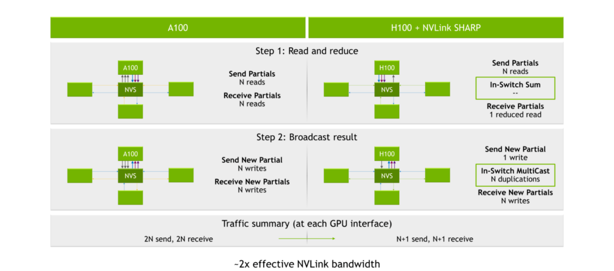

# Interconnects: Reference

Reference material split out of [Interconnect Hardware: NVLink, InfiniBand, RoCE, EFA and More](interconnects.md) so the main chapter reads faster. The sections stand alone: read them when you need them. Earlier chapters link straight to the section they use.

## Other essential network technologies

### SHARP

NVIDIA's [Scalable Hierarchical Aggregation and Reduction Protocol (SHARP)](https://networking-docs.nvidia.com/sharpum/300) does data reductions and aggregations inside the network itself. This is called *in-network computing*. It helps whenever you run many MPI, NCCL or other collectives that support SHARP, and their latency improves a lot.

Why it matters: for `all-reduce`, a ring needs every rank to send its data around twice (about $2N$ sends, a reduce-scatter pass and an all-gather pass), while with in-switch reduction each rank sends once to the switch and receives the result once, about $N+1$ sends ($N$ is the number of communicating ranks). For large $N$ that almost doubles the effective all-reduce throughput. NVIDIA explains it in the [all-reduce operation compatibility](https://web.archive.org/web/20231208180425/https://developer.nvidia.com/blog/upgrading-multi-gpu-interconnectivity-with-the-third-generation-nvidia-nvswitch/) section of its NVSwitch post (scroll down to it). The exact byte counts per GPU, ring vs NVLS, are derived in [NVLS (NVLink SHARP)](collectives-internals.md#nvls-nvlink-sharp).

That figure, comparing per-GPU traffic for an all-reduce on A100 (no in-switch reduction) and on H100 with NVLink SHARP. NVS is the NVSwitch:



([source](https://web.archive.org/web/20231208180425/https://developer.nvidia.com/blog/upgrading-multi-gpu-interconnectivity-with-the-third-generation-nvidia-nvswitch/))

```
ring all-reduce: every byte crosses each        NVLS / SHARP: each GPU sends its buffer to the
GPU's link ~2x (reduce-scatter + all-gather)    switch once; the switch's ALUs add them and
                                                multicast the sum back once
 GPU0 -> GPU1 -> GPU2 -> ... -> GPU7 -> GPU0      GPU0..GPU7 ==> [NVSwitch: sum] ==> GPU0..GPU7
```

There are two separate SHARPs that share a name but not a mechanism:

- **NVLink SHARP (NVLS)** lives in the NVSwitch (NVLink 4 and later). It speeds up all-reduce among the GPUs of one NVLink domain: an 8-GPU node, or a whole NVL72 rack.
- **InfiniBand SHARP** lives in the Quantum InfiniBand switches. It speeds up collectives that cross the scale-out network. NCCL reaches it through its CollNet algorithms ([CollNet and IB SHARP](collectives-internals.md#collnet-and-ib-sharp)).

Recent NCCL versions use NVLink SHARP automatically when it is available, as `NCCL_ALGO=NVLS`. In practice, at the moment, intra-node `all-reduce` bandwidth improves by about 30% and inter-node `all-reduce` by about 25%. Both of those figures are NVLink SHARP: the slide further down puts the 30% at NVLink 4 inside a node and the 25% across an NVL72 domain, so even the "inter-node" case stays within a scale-up fabric.

The SHARP hardware, part of NVSwitch (NVLink 4 and later) and of InfiniBand switches, includes arithmetic logic units (ALUs) that do the math themselves instead of using GPUs. It reportedly supports FP64, FP32, FP16 and BF16.

A case study from Stas Bekman: he discovered SHARP by accident when an H100 intra-node NVLink 4 [torch-dist-bench.py](benchmarks/torch-dist-bench.py) run reported 480GBps for a 4GiB payload, when the theoretical spec was only 450GBps. The cause was NCCL turning on the then-new `NVLS` algorithm, which engaged NVLink SHARP. How can a benchmark clock faster than the physical medium allows? Because `busbw` is computed as if a ring had run: the formula assumes each byte crossed each link ~2x, the $2(n-1)/n$ factor. With in-switch reduction only about half those bytes actually cross, so the formula credits the wire with traffic it never carried. Conceptually the correction factor should change from "2N" to "N+1". There is a detailed discussion [in the nccl-tests tracker](https://github.com/NVIDIA/nccl-tests/issues/153#issuecomment-1628415956). The bottom line: `busbw` may or may not be the real bandwidth depending on which algorithm NCCL chose. Only when NCCL uses the `Ring` algorithm does `busbw` describe the wire.

To benefit from SHARP:

- The collective has to engage enough GPUs that NCCL actually selects `NVLS`. The switch-over is above 4 GPUs on H200 and above 5 on B200 (measurements below), so measure yours rather than assuming either number.
- The env var `NCCL_NVLS_ENABLE` must be unset or set to `1`.

#### How many GPUs does NVLS need?

Measured on an 8x H200 node at an 8GiB payload with `nccl-tests`, running each GPU count twice, once as-is and once with `NCCL_NVLS_ENABLE=0` to force the ring, so that the last column isolates what SHARP actually contributes:

| GPUs | algo NCCL picks | busbw     | busbw, NVLS off | gain from SHARP |
| ---: | :-------------- | --------: | --------------: | --------------: |
|    4 | Ring            | 363.3GBps |       363.3GBps |           1.00x |
|    5 | NVLS            | 414.2GBps |       364.4GBps |           1.14x |
|    6 | NVLS            | 435.6GBps |       365.1GBps |           1.19x |
|    7 | NVLS            | 460.0GBps |       365.7GBps |           1.26x |
|    8 | NVLS            | 473.1GBps |       365.6GBps |           1.29x |

So the benefit isn't a cliff at 8 GPUs but a ramp that starts above 4. At 4 GPUs NCCL doesn't even select `NVLS`, and the ring number is identical either way, exactly 1.00x. From 5 GPUs up it selects `NVLS`, and the gain grows with each accelerator added. A 5- or 7-GPU collective is an odd thing to run, but it means a partial-node job gets a partial benefit rather than none.

The same sweep on an 8x B200 `p6-b200.48xlarge` node (`nccl=2.27.7`, 8GiB, measured 2026-08-09) shows the ramp is not portable across generations. NCCL stays on `Ring` at 5 GPUs and only switches to `NVLS` from 6 up, confirmed with `NCCL_DEBUG=INFO NCCL_DEBUG_SUBSYS=INIT,TUNING`:

| GPUs | algo NCCL picks | busbw     | busbw, NVLS off | gain from SHARP |
| ---: | :-------------- | --------: | --------------: | --------------: |
|    4 | Ring            | 673.2GBps |       673.8GBps |           1.00x |
|    5 | Ring            | 677.8GBps |       677.8GBps |           1.00x |
|    6 | NVLS            | 778.2GBps |       677.8GBps |           1.15x |
|    7 | NVLS            | 811.2GBps |       680.5GBps |           1.19x |
|    8 | NVLS            | 838.0GBps |       682.2GBps |           1.23x |

At full node the gain is still real, 1.23x here against H200's 1.29x, but a 5-GPU job on this B200 node gets none of it. The chooser on this box is AWS's `NCCL_TUNER_PLUGIN=ofi`. A tuner plugin is a library NCCL loads to choose the algorithm and protocol in place of its built-in tuner ([the tuning model](collectives-internals.md#the-tuning-model) explains what the built-in one does). Its log line reads `base Tuner is chosen for platform: p6-b200.48xlarge`, so don't carry the H200 threshold over to a different instance type.

NVIDIA's own documentation draws a 4-GPU line, though it takes one step to see why. NVLink SHARP is implemented with *multicast*: the switch reduces and then fans the result back out to every participant, which is why NCCL's setup log for `NVLS` literally reads `Created Multicast group`. So a statement about multicast is a statement about SHARP. The [GB200 NVL Partition User Guide](https://docs.nvidia.com/multi-node-nvlink-systems/partition-guide-v1-0.pdf) says that "partitions that have less than or equal to four GPUs will not benefit from multicast and can accomplish all traffic through unicast". That matches the H200 boundary above and sits one GPU below the B200 one. For more on why multicast is needed for NVLink SHARP, see [this NCCL issue comment](https://github.com/NVIDIA/nccl/issues/807#issuecomment-1480585042).

Two traps here:

- The multicast group is created regardless of whether NVLS is used. `NCCL_DEBUG=INFO NCCL_DEBUG_SUBSYS=NVLS` reports `NVLS Created Multicast group` at 4 GPUs just as at 8, along with the same 16 nvls channels. What changes above the threshold is that NCCL starts *using* the `NVLS` algorithm. So "is a multicast group set up?" and "is SHARP doing anything for you?" are separate questions.
- Don't confuse the GPU count with `multicastGroupsLimit`, which the same guide says "must be 0 or a multiple of 4". That is the number of multicast *teams* reserved to a partition out of the 1,024 the system provides. It is a fabric-manager resource allocation, unrelated to how many GPUs your collective engages.

On NVL36, NVL72 and other domains bigger than NVL8, the granularity is likely 4 GPUs rather than 8, since a compute tray holds 2 GB200 modules and each module is 1 Grace CPU + 2 Blackwell GPUs. The partition guide points the same way: its partition sizing examples step in fours (72, 68 and 64 GPUs), alongside the "less than or equal to four GPUs" statement quoted above.

**This still needs validating on real NVL hardware.** The two HGX sweeps above already disagree with each other (H200 switches at 5, B200 at 6). The guide's statements concern fabric-level partitioning, not which algorithm NCCL selects inside a partition, so the NVL case could land on either threshold or on neither. Treat the 4-GPU granularity as the likely case from the docs, not an established one, until someone runs the sweep on an NVL36 or NVL72 system.

Part of what makes this murky is that GB200 GPU counting is confusing: 1x GB200 = 2x B200 + 1x CPU. So when the NVIDIA doc talks about 4x GB200, that is 8x B200, and reading "4x" as a minimum partition size is an easy way to arrive at a granularity of 8 GPUs, when a tray holds only 4.

#### What NVLS buys at full node

The left side of the following slide shows a ~30% speed-up of `all-reduce` bandwidth from NVLink 4 without SHARP (370GBps) to NVLink 4 with SHARP (480GBps). Stas matched these results with a payload of about 8GiB. For `all-reduce` on NVL72 (right side) it shows a 25% improvement (`850/680`).


[source](https://www.nvidia.com/en-us/on-demand/session/gtc25-s72583/)

How to read the slide: both panels are bar charts of nccl-tests all-reduce `busbw` in GB/s at large messages. The left panel is 8 GPUs in one node: PCIe Gen6 96, NVLink 3 (A100) 232, NVLink 4 (H100) 370, NVLink 4 SHARP 480, NVLink 5 (B200) 700, NVLink 5 SHARP 850. The right panel is 32 GPUs: 2x200Gb RDMA 48, DGX A100 with 8x200Gb 192, DGX H100 with 8x400Gb 370, the same with SHARP 480, GB200 NVL72 680, and NVL72 with SHARP 850. Note that the 32-GPU DGX H100 number equals the 8-GPU one, the effect [Inter-node speed depends on intra-node speed](#inter-node-speed-depends-on-intra-node-speed) explains.

To see it on your own node, run the same benchmark twice. `NCCL_NVLS_ENABLE=0` forces the ring path (untested here; needs an NVSwitch node with NVLink 4 or later):

```bash
# SHARP (default)
torchrun --nproc_per_node=8 --rdzv_endpoint localhost:6000 --rdzv_backend c10d torch-dist-bench.py
# ring
NCCL_NVLS_ENABLE=0 torchrun --nproc_per_node=8 --rdzv_endpoint localhost:6000 --rdzv_backend c10d torch-dist-bench.py
```

How to read the commands: `torchrun` launches 8 processes, one per GPU. `--rdzv_endpoint` and `--rdzv_backend` tell them where to meet ([how PyTorch distributed bootstraps](../foundations/networking.md#how-pytorch-distributed-bootstraps)). A `NAME=value` prefix sets an environment variable for that one command.

On 8x H200 with `nccl=2.27.7` this gives 482.26GBps against 367.61GBps at a 16GiB payload, a 1.31x gain, matching the 480/370 on the slide. Add `NCCL_DEBUG=INFO NCCL_DEBUG_SUBSYS=INIT,GRAPH,TUNING` to confirm which path was taken and to find where the switch happens. It reports `Algo RING proto LL` up to a 1MiB payload and `Algo NVLS proto SIMPLE` from 2MiB up, and `Algo RING proto SIMPLE` throughout when NVLS is disabled. `NCCL_DEBUG_FILE=/tmp/nccl.%h.%p.log` keeps that output out of the benchmark's own (`%h` is the host name and `%p` the process id). The `proto` part of those lines is NCCL's protocol, `LL`, `LL128` or `Simple`, which trade latency against bandwidth. They are explained in [Protocols: Simple, LL, LL128](collectives-internals.md#protocols-simple-ll-ll128).

The GPU count is only one of the two conditions. The other is the collective itself: `NVLS` implements `all-reduce` and nothing else. Measured on the same node at a 16GiB payload, all with 8 GPUs engaged:

| collective                       | algo | busbw     | % of 450GBps |
| :------------------------------- | :--- | --------: | -----------: |
| all-reduce, `NCCL_NVLS_ENABLE=1` | NVLS | 480.0GBps |         107% |
| all-reduce, `NCCL_NVLS_ENABLE=0` | Ring | 367.2GBps |          82% |
| all-gather                       | Ring | 361.4GBps |          80% |
| reduce-scatter                   | Ring | 362.9GBps |          81% |

The second row, the same collective at the same width with SHARP switched off, is the one that makes the other two readable. `all-gather` and `reduce-scatter` are not slow collectives. They are simply running the ring path that `all-reduce` also falls back to. All three land at 80-82% of the unidirectional spec, the ordinary NVLink efficiency you would expect from [Unidirectional vs Bidirectional (Duplex)](interconnects.md#unidirectional-vs-bidirectional-duplex). So `~80%` is the normal case and 107% is the exception, reachable only by an `all-reduce` wide enough that NCCL selects `NVLS`.

To reproduce these numbers, use `nccl-tests` ([nccl-tests: single node, then two, then all](../compute/gpu-software-stack.md#nccl-tests-single-node-then-two-then-all) builds it). `-b`/`-e` are the smallest and largest payload (equal here, so a single size), `-g` is the number of GPUs per process, and `-z 1` makes each collective call blocking:

```bash
NCCL_NVLS_ENABLE=1 ./build/all_reduce_perf     -b 16G -e 16G -g 8 -z 1  # 480.0 - NVLS
NCCL_NVLS_ENABLE=0 ./build/all_reduce_perf     -b 16G -e 16G -g 8 -z 1  # 367.2 - Ring, SHARP off
./build/all_gather_perf                        -b 16G -e 16G -g 8 -z 1  # 361.4 - Ring, wrong collective
./build/reduce_scatter_perf                    -b 16G -e 16G -g 8 -z 1  # 362.9 - Ring, wrong collective
```

`busbw` uses a different correction factor per collective, $2(n-1)/n$ for `all-reduce` against $(n-1)/n$ for `all-gather` and `reduce-scatter`. `nccl-tests` applies the right one for each, so the last column really is comparable across rows as a fraction of the wire.

## Important nuances

### Real network throughput

Advertised and actual network throughput are never the same. In the best case you can expect about 80-90% of the advertised spec.

Throughput also depends on the size of the payload sent in each communication: the bigger the payload, the higher the throughput.

Here is a demonstration using [nccl-tests](measuring-and-debugging.md#nccl-tests) on a single A100 node. `-f 2` doubles the payload at each step from `-b` to `-e`, and `-n 50` times 50 iterations per size:

```bash
$ ./build/all_reduce_perf -b 32k -e 16G -f 2 -g 8 -n 50
[...]
           size    time   algbw   busbw
            (B)    (us)  (GB/s)  (GB/s)
         32_768   43.83    0.75    1.31
         65_536   46.80    1.40    2.45
        131_072   51.76    2.53    4.43
        262_144   61.38    4.27    7.47
        524_288   80.40    6.52   11.41
       1048_576   101.9   10.29   18.00
       2097_152   101.4   20.68   36.18
      4_194_304   101.5   41.33   72.33
      8_388_608   133.5   62.82  109.93
     16_777_216   276.6   60.66  106.16
     33_554_432   424.0   79.14  138.49
     67_108_864   684.6   98.02  171.54
    134_217_728  1327.6  101.10  176.92
    268_435_456  2420.6  110.90  194.07
    536_870_912  4218.4  127.27  222.72
  1_073_741_824  8203.9  130.88  229.04
  2_147_483_648   16240  132.23  231.41
  4_294_967_296   32136  133.65  233.88
  8_589_934_592   64074  134.06  234.61
 17_179_869_184  127997  134.22  234.89
```

(The output was trimmed to these columns, and the sizes were reformatted to be more readable.)

How to read it: each row is one payload size, from 32KiB to 16GiB. `time` is the per-call time in microseconds. `algbw` is payload / time. `busbw` is `algbw` times $2(n-1)/n$ = 1.75 for 8 GPUs, which is the column to compare with the link speed ([algbw vs busbw](collectives-internals.md#algbw-vs-busbw); nccl-tests' own explanation is [here](https://github.com/NVIDIA/nccl-tests/blob/master/doc/PERFORMANCE.md#bus-bandwidth)).

For payloads smaller than 8MiB the throughput is very low, and it starts to saturate around 512MiB. Notice that the time column barely moves from 1MiB to 4MiB (~101μs): in that range the call costs the same regardless of size, i.e. it is latency-bound. That is why reducing a single 4GB payload is much faster than reducing 1000x 4MB payloads. This A100 node runs NVLink advertised at 300GBps unidirectional, so at 16GiB we get about 78% of the theoretical speed. The benchmark crashed for anything larger, and the last few rows show that not much more can be squeezed out anyway.

Here is the same sweep on an 8x H200 node (`torch=2.14.1+cu130`, `nccl=2.30.7`), using this repo's [torch-dist-bench.py](benchmarks/torch-dist-bench.py). `busbw` and `algbw` are the same two columns as above, and this table also reports per-call latency. `python -m torch.distributed.run` is the module behind the `torchrun` command, and `-u` unbuffers Python's output:

```bash
$ python -u -m torch.distributed.run --nproc_per_node=8 torch-dist-bench.py

The average bandwidth and the per-call latency of all_reduce over 8 ranks (at least 5 warmups / 20 trials, up to 10 queued calls per trial):

| payload |   busbw    |   algbw    |              latency              | calls |
|         |            |            |   median  |    p99    |    mean   |       |
| ------: | ---------: | ---------: | --------: | --------: | --------: | ----: |
|      8B |            |            |    15.3us |    15.8us |    15.3us |   927 |
|     16B |            |            |    15.3us |    15.8us |    15.3us |   981 |
|     32B |            |            |    15.8us |    16.5us |    15.8us |   972 |
|     64B |            |            |    17.4us |    18.4us |    17.4us |   963 |
|    128B |            |            |    17.8us |    18.4us |    17.8us |   972 |
|    256B |            |            |    17.9us |    18.5us |    17.9us |   963 |
|    512B |            |            |    18.0us |    18.7us |    18.1us |   972 |
|    1KiB |            |            |    18.3us |    19.2us |    18.3us |   981 |
|    2KiB |            |            |    18.6us |    19.4us |    18.6us |   954 |
|    4KiB |            |            |    18.8us |    19.5us |    18.8us |   972 |
|    8KiB |            |            |    19.0us |    19.8us |    19.0us |   963 |
|   16KiB |            |            |    19.4us |    20.1us |    19.4us |   990 |
|   32KiB |   3.22GBps |   1.84GBps |    20.7us |    21.4us |    20.7us |   981 |
|   64KiB |   6.35GBps |   3.63GBps |    20.9us |    21.5us |    20.9us |   612 |
|  128KiB |  12.60GBps |   7.20GBps |    21.0us |    21.4us |    21.0us |   324 |
|  256KiB |  24.71GBps |  14.12GBps |    21.4us |    21.8us |    21.4us |   180 |
|  512KiB |  48.63GBps |  27.79GBps |    22.8us |    24.1us |    22.7us |   171 |
|    1MiB |  76.78GBps |  43.88GBps |    27.7us |    28.5us |    27.6us |   180 |
|    2MiB |  97.64GBps |  55.80GBps |    41.8us |    42.8us |    41.6us |   180 |
|    4MiB | 145.65GBps |  83.23GBps |    54.6us |    55.7us |    54.4us |   171 |
|    8MiB | 198.06GBps | 113.18GBps |    78.4us |    80.0us |    78.3us |   180 |
|   16MiB | 256.83GBps | 146.76GBps |   119.3us |   123.4us |   119.1us |   180 |
|   32MiB | 302.04GBps | 172.60GBps |   200.3us |   205.7us |   200.5us |   180 |
|   64MiB | 369.60GBps | 211.20GBps |   323.7us |   330.7us |   323.9us |   180 |
|  128MiB | 415.67GBps | 237.53GBps |   576.1us |   586.5us |   575.7us |   140 |
|  256MiB | 442.53GBps | 252.88GBps |  1075.5us |  1091.5us |  1076.7us |    60 |
|  512MiB | 457.46GBps | 261.41GBps |  2078.8us |  2098.3us |  2079.0us |    20 |
|    1GiB | 467.17GBps | 266.95GBps |  4040.6us |  4055.3us |  4041.2us |    20 |
|    2GiB | 471.88GBps | 269.65GBps |  8000.6us |  8046.7us |  8006.1us |    20 |
|    4GiB | 474.03GBps | 270.88GBps | 15904.3us | 15980.2us | 15905.9us |    20 |
|    8GiB | 478.22GBps | 273.27GBps | 31654.0us | 31716.5us | 31639.4us |    20 |
|   16GiB | 482.19GBps | 275.54GBps | 62526.9us | 62614.5us | 62533.6us |    20 |
```

How to read it: below 32KiB the bandwidth columns are blank, because the time is pure latency and a bandwidth figure would be meaningless. `median`, `p99` (99th percentile) and `mean` latency are per call. When p99 sits close to the median, the measurement is stable. `calls` is how many calls were timed at that size.

The curve has the same shape as the A100 one: low until a few MiB, most of the way there by 512MiB. The saturated end is instructive. Comparing the 16GiB rows with each node's unidirectional spec:

| node                             | busbw @16GiB | uni-dir. spec | % of spec |
| :------------------------------- | -----------: | ------------: | --------: |
| A100, [NVLink 3](interconnects.md#nvlink)        |   234.89GBps |           300 |       78% |
| H200, [NVLink 4](interconnects.md#nvlink), ring  |   367.61GBps |           450 |       82% |
| H200, [NVLink 4](interconnects.md#nvlink), SHARP |   482.19GBps |           450 |      107% |

The ~80% rule of thumb from [Unidirectional vs Bidirectional (Duplex)](interconnects.md#unidirectional-vs-bidirectional-duplex) holds: the H200 node lands at 82% when NCCL uses a ring, which is what the middle row measures with `NCCL_NVLS_ENABLE=0`. What takes the top row past the wire spec is [SHARP](#sharp): at large payloads NCCL reduces inside the NVSwitch, fewer bytes cross the links than a ring would need, and `busbw`'s ring-based formula stops describing the wire. The A100 node has no such path, which is why its number obeys the rule without any flag.

#### Many small payloads vs one big one

[all_reduce_latency_comp.py](benchmarks/all_reduce_latency_comp.py) demonstrates the payload effect directly. It all-reduces 4GB once, then the same 4GB as 1000 calls of 4MB each. On an 8x H200 node:

```bash
$ python -u -m torch.distributed.run --nproc_per_node=8 all_reduce_latency_comp.py

----------- 1x 4.0GB ----------------
 busbw: 3722.778 Gbps

----------- 1000x 0.004GB ----------------
 busbw: 1146.127 Gbps
```

How to read it: the script reports `busbw` in Gbps, so divide by 8 for GBps: 465GBps vs 143GBps, consistent with the 4GiB and 4MiB rows of the sweep above. Sending the same payload as 1000 smaller chunks is about 3x slower here.

This benchmark does 3 warmup iterations before timing anything, and it has to. NCCL sets up its channels and buffers on the first collective of a given size, and on NVLink 4 and later it also registers the NVLS multicast group. Without the warmup, all of that would be charged to the `1x` measurement, since it runs first. Without warmup the same 4GB payload measured 561Gbps instead of 3722Gbps on this node. That is not only 6x low, it is enough to reverse the comparison and make 1000 small chunks look faster than one big one. Any benchmark you write needs warmup.

So when you calculate how long it takes to `all_reduce` a given payload, use the `busbw` measured at that payload size on your own hardware and environment.

Working out the payload can be tricky, because it depends on the framework's implementation. Some implementations reduce each weight's gradient on its own, which gives very small payloads and a very slow network. Others bucket multiple gradients together before reducing, which increases the payload and minimizes the impact of latency. (PyTorch DDP's `bucket_cap_mb` is that knob; see [bucketing and overlap](../training/model-parallelism/derivations.md#bucketing-and-overlap).)

#### Pairwise copies: p2pBandwidthLatencyTest

`p2pBandwidthLatencyTest`, a CUDA sample program, runs a low-level peer-to-peer benchmark between every pair of GPUs ([p2pBandwidthLatencyTest](measuring-and-debugging.md#p2pbandwidthlatencytest) shows where to get it). In its matrix, each row is the GPU doing the writing and each column the GPU written to. The diagonal is a GPU copying within its own memory, which measures HBM rather than NVLink, so ignore it.

On A100:

```bash
./p2pBandwidthLatencyTest
[...]
Unidirectional P2P=Enabled Bandwidth (P2P Writes) Matrix (GB/s)
   D\D     0      1      2      3      4      5      6      7
     0 1581.48 274.55 275.92 272.02 275.35 275.28 273.62 273.20
     1 274.70 1581.48 275.33 272.83 275.38 273.70 273.45 273.70
     2 274.81 276.90 1594.39 272.66 275.39 275.79 273.97 273.94
     3 273.25 274.87 272.12 1545.50 274.38 274.37 274.22 274.38
     4 274.24 275.15 273.44 271.57 1584.69 275.76 275.04 273.49
     5 274.37 275.77 273.53 270.84 274.59 1583.08 276.04 273.74
     6 275.61 274.86 275.47 273.19 272.58 275.69 1586.29 274.76
     7 275.26 275.46 275.49 273.61 275.50 273.28 272.24 1591.14
[...]
```

In the unidirectional section we get 274GBps of the advertised 300GBps (~91%).

On H100s (NVLink 4) the efficiency was noticeably worse:

```
Unidirectional P2P=Enabled Bandwidth (P2P Writes) Matrix (GB/s)
   D\D     0      1      2      3      4      5      6      7
     0 2494.51 364.13 375.99 378.03 376.77 376.71 374.85 375.66
     1 375.18 2533.95 376.08 374.98 376.21 375.96 375.76 375.12
     2 363.43 393.28 2532.67 376.35 377.14 376.47 375.76 375.48
     3 369.90 375.92 393.63 2525.38 376.58 375.88 376.13 377.01
     4 376.20 376.28 375.20 393.52 2526.02 375.82 375.05 376.10
     5 376.26 376.60 375.54 375.52 376.81 2521.18 376.37 376.60
     6 374.31 376.19 376.80 376.32 376.83 376.44 2529.85 376.39
     7 376.17 376.49 376.53 374.95 376.30 376.82 375.71 2519.78
```

376GBps of 450GBps is 84%. (A few cells just off the diagonal read ~393GBps. They are real but not something to plan around.)

On GB200 (NVLink 5), within a single NVL4 tray of 4 GPUs:

```
Unidirectional P2P=Enabled Bandwidth (P2P Writes) Matrix (GB/s)
   D\D     0      1      2      3
     0 5714.94 746.74 746.56 748.08
     1 743.89 5820.72 747.18 746.83
     2 746.16 750.28 5814.63 746.71
     3 744.82 749.00 747.16 5816.66
```

746GBps of 900GBps (83%), very similar to NVLink 4's efficiency.

The bottom line for this kind of setup:

1. With huge payloads you can use about 80% of the advertised bandwidth.
2. If each communication's payload is smallish, you can get far, far less.

[NVIDIA/nvbandwidth](https://github.com/NVIDIA/nvbandwidth) is meant to be a more detailed and correct replacement for `p2pBandwidthLatencyTest`, but Stas found the two give very similar results. `nvbandwidth` is the tool used for the H200 and GB300 copy measurements earlier in this chapter.

#### Published bandwidth curves

The following plot shows how actual all-reduce bandwidth changes with message size and the number of participating nodes, from 4 to 512 nodes:


([source](https://arxiv.org/abs/2411.13055))

How to read it: x is the message size (512B to 16GiB, log scale), y the achieved `busbw` in GB/s, one curve per node count. Every curve has the same S-shape as the single-node tables above. More nodes push the curve to the right, so you need bigger messages to reach the plateau, because each extra hop adds latency. At 16GiB all curves converge at ~340-360GB/s whatever the node count.

Here is a similar plot using the NVLSTree algorithm, which reaches even better performance on H100s, from 4 to 1024 nodes (32 to 8192 GPUs; the plateau is ~370-380GB/s):


[source](https://www.nvidia.com/en-us/on-demand/session/gtc24-s62129/)

And a similar plot comparing message sizes across several networks:


([source](https://ieeexplore.ieee.org/document/5238655))

That last plot is from 2011 and the previous two are from 2024. Comparing them, you can appreciate how much faster networks have become and how much bigger the messages being sent are.

Here are 2025 plots of actually achievable bandwidth with modern hardware, for the all-reduce and all-to-all collectives:


[source](https://www.nvidia.com/en-us/on-demand/session/gtc25-s72583/)

The all-reduce slide is the one read under [What NVLS buys at full node](#what-nvls-buys-at-full-node). The all-to-all slide has the same layout, with nccl-tests `alltoall` bus bandwidth. Inside a node it tracks the fabric: PCIe Gen5 12 and Gen6 24 (2x4 GPUs), NVLink 3 210, NVLink 4 320, NVLink 5 640. Across 32 GPUs on RDMA it collapses to 6-48GB/s (2x200Gb up to DGX H100's 8x400Gb), while GB200 NVL72, where all 32 GPUs are still on NVLink, keeps 640. Unlike all-reduce, an all-to-all can't keep most of its bytes on NVLink: every GPU sends a slice to every other GPU, so most of the data has to cross the network. That is why mixture-of-experts dispatch, which is an all-to-all ([which collective to measure latency with](#which-collective-to-measure-latency-with)), pushes towards large NVLink domains.

#### Symmetric memory

Normally NCCL passes each payload through its own internal staging buffers, because it knows nothing about where the peers keep their data. If instead every rank's buffer sits at the same offset of a registered NCCL *symmetric memory window*, each GPU knows where its peers' buffers are. NCCL (2.27+) can then switch to its symmetric kernels: each GPU loads the data it needs straight from the other GPUs' buffers over NVLink and stores its results straight into them. This requires every rank to be reachable over direct NVLink. [Buffer registration and symmetric memory](collectives-internals.md#buffer-registration-and-symmetric-memory) explains why skipping the staging copy helps.

In PyTorch you allocate the buffers from a `torch.cuda.MemPool` created with the backend's `mem_allocator`, and register the pool with `ProcessGroupNCCL.register_mem_pool(pool, symm=True)`. See [NCCL Symmetric Kernels](https://docs.pytorch.org/docs/stable/symmetric_memory.html#nccl-symmetric-kernels) in the PyTorch documentation. Version requirements:

- `torch>=2.9` is the first release whose `register_mem_pool` takes `symm`. `torch==2.7` and `2.8` can register a pool too, but only as a local, non-symmetric buffer.
- torch 2.9.1 (NCCL 2.27.7), 2.10.0 and 2.11.0 (both NCCL 2.28.9) hang in `broadcast` on that path.
- torch 2.12.0 with NCCL 2.29.7 is the oldest cu130 (built for CUDA 13.0) release that completes it, and the benchmark refuses `--sym-mem` below torch 2.12 and NCCL 2.29.

To measure it, add `--sym-mem` to [torch-dist-bench.py](benchmarks/torch-dist-bench.py), or `-R 2` (register the buffers as symmetric) to `nccl-tests` if you call NCCL directly. Use it only if the workload you're benchmarking for also all-reduces symmetric memory buffers, registering them itself as above or through a framework that does. Otherwise that workload gets the regular bandwidth, and the symmetric memory numbers won't reflect what it actually gets.

To check that the symmetric kernels are used, add `NCCL_DEBUG=INFO NCCL_DEBUG_SUBSYS=TUNING`. Each call that used one is logged as `AllReduce [Symmetric]: ... -> Kernel ...`.

Here is the `all-reduce` `busbw` with and without it on an 8x B200 node and an 8x H200 node (both `torch=2.14.0+cu130`, `nccl=2.30.7`, each the mean of 2 sweeps).

**8x B200**:

| payload | regular    | symmetric memory | speed up |
| ------: | ---------: | ---------------: | -------: |
|   32KiB |   2.09GBps |         5.31GBps |     154% |
|   64KiB |   3.88GBps |         8.64GBps |     122% |
|  128KiB |   7.86GBps |        16.52GBps |     110% |
|  256KiB |  15.20GBps |        33.53GBps |     121% |
|  512KiB |  28.33GBps |        61.56GBps |     117% |
|    1MiB |  56.98GBps |       104.34GBps |      83% |
|    2MiB | 101.81GBps |       184.07GBps |      81% |
|    4MiB | 128.25GBps |       301.25GBps |     135% |
|    8MiB | 195.46GBps |       426.89GBps |     118% |
|   16MiB | 290.77GBps |       568.35GBps |      95% |
|   32MiB | 361.21GBps |       679.39GBps |      88% |
|   64MiB | 418.92GBps |       738.62GBps |      76% |
|  128MiB | 589.35GBps |       776.80GBps |      32% |
|  256MiB | 655.48GBps |       794.80GBps |      21% |
|  512MiB | 700.30GBps |       806.40GBps |      15% |
|    1GiB | 722.44GBps |       809.47GBps |      12% |
|    2GiB | 737.76GBps |       807.06GBps |       9% |
|    4GiB | 747.53GBps |       816.49GBps |       9% |
|    8GiB | 832.30GBps |       819.30GBps |      -2% |
|   16GiB | 838.96GBps |       820.04GBps |      -2% |

**8x H200**:

| payload | regular    | symmetric memory | speed up |
| ------: | ---------: | ---------------: | -------: |
|   32KiB |   3.15GBps |         7.34GBps |     133% |
|   64KiB |   6.16GBps |        14.36GBps |     133% |
|  128KiB |  12.46GBps |        27.91GBps |     124% |
|  256KiB |  24.68GBps |        48.50GBps |      97% |
|  512KiB |  48.15GBps |        87.84GBps |      82% |
|    1MiB |  74.57GBps |       145.04GBps |      95% |
|    2MiB |  96.26GBps |       210.12GBps |     118% |
|    4MiB | 145.14GBps |       297.81GBps |     105% |
|    8MiB | 196.56GBps |       370.67GBps |      89% |
|   16MiB | 255.90GBps |       408.19GBps |      60% |
|   32MiB | 301.25GBps |       448.22GBps |      49% |
|   64MiB | 368.86GBps |       460.66GBps |      25% |
|  128MiB | 414.54GBps |       469.36GBps |      13% |
|  256MiB | 441.87GBps |       475.13GBps |       8% |
|  512MiB | 456.23GBps |       477.34GBps |       5% |
|    1GiB | 465.91GBps |       479.98GBps |       3% |
|    2GiB | 471.06GBps |       480.64GBps |       2% |
|    4GiB | 474.13GBps |       483.06GBps |       2% |
|    8GiB | 478.24GBps |       483.94GBps |       1% |
|   16GiB | 482.25GBps |       484.08GBps |     0.4% |

How to read the tables: `speed up` is symmetric / regular - 1, so 154% means 2.54x as fast.

The gains differ from one GPU to the next. On B200, symmetric memory is faster at every payload up to 4GiB: by 76-154% up to 64MiB, and still by 9-12% from 1GiB to 4GiB. At 8GiB and above the regular path pulls ahead by 2%, right where it jumps from 748GBps to 832GBps, most likely because NCCL switches it to a different algorithm there. On H200 the gain is about as large at small payloads, 82-133% up to 4MiB, but it fades sooner, to 25% at 64MiB and 3% by 1GiB, where the regular path already reaches ~470GBps, and it never turns into a loss. So measure on your hardware, at the payload sizes your workload actually uses, rather than assuming a gain carries over from another GPU.

These gains assume the all-reduces are queued while the GPU is busy, which is how the benchmark measures by default, and how a training loop whose host runs ahead of the GPU issues them. If your program instead waits on each all-reduce, PyTorch's 20-30μs of host overhead per call lands on top of the faster kernel and eats most of the small-payload gain. With the benchmark's `--with-host-overhead` timing, symmetric memory makes a 32KiB all-reduce 37% faster on B200 rather than 154%, and 16% faster on H200 rather than 133%.

### Inter-node speed depends on intra-node speed

The specs make inter-node networking look hopeless. On a P6-B200 node (AWS), each accelerator has 900GBps of [NVLink 5](interconnects.md#nvlink) but only 50GBps of [EFA v4](interconnects.md#efa) inter-node bandwidth, so the links really are about 18x apart. (The spec for an IB NDR400 node of this type is also 50GBps per accelerator.) It is natural to conclude that an `all-reduce` becomes ~18x slower the moment it crosses a node boundary. It doesn't, and this is probably the single most confusing thing about inter-node networking, so it is worth working through carefully.

The following table collects `busbw` measurements for `all_reduce` with [torch-dist-bench.py](benchmarks/torch-dist-bench.py) on 1x and 4x P6-B200 nodes: 8x B200 per node, NVLink 5 inside, 8x 50GBps EFA v4 out, on `torch=2.14.0+cu130, cuda=13.0, nccl=2.30.7`, each column the mean of 2 sweeps. The `slowdown` column is the price of leaving the node. The last column is the algorithm the 4-node run used at that payload, read from `NCCL_DEBUG=INFO NCCL_DEBUG_SUBSYS=TUNING`:

| payload | 1 node     | 4 nodes    | slowdown | 4-node algorithm |
| ------: | ---------: | ---------: | -------: | :--------------- |
|   32KiB |   2.17GBps |   0.64GBps |     3.4x | Tree LL          |
|   64KiB |   3.95GBps |   1.26GBps |     3.1x | Tree LL          |
|  128KiB |   8.07GBps |   2.33GBps |     3.5x | Tree LL          |
|  256KiB |  15.57GBps |   3.97GBps |     3.9x | Tree LL          |
|  512KiB |  29.07GBps |   6.97GBps |     4.2x | Tree LL128       |
|    1MiB |  58.54GBps |  12.56GBps |     4.7x | Tree LL128       |
|    2MiB | 104.27GBps |  20.82GBps |     5.0x | Tree LL128       |
|    4MiB | 127.85GBps |  31.56GBps |     4.1x | Tree LL128       |
|    8MiB | 195.60GBps |  49.73GBps |     3.9x | Tree LL128       |
|   16MiB | 294.36GBps |  72.03GBps |     4.1x | Tree LL128       |
|   32MiB | 362.00GBps | 142.50GBps |     2.5x | Ring LL128       |
|   64MiB | 419.98GBps | 198.07GBps |     2.1x | Ring LL128       |
|  128MiB | 591.14GBps | 260.25GBps |     2.3x | NVLSTree Simple  |
|  256MiB | 658.63GBps | 282.60GBps |     2.3x | NVLSTree Simple  |
|  512MiB | 703.38GBps | 310.96GBps |     2.3x | Ring Simple      |
|    1GiB | 721.37GBps | 366.15GBps |     2.0x | Ring Simple      |
|    2GiB | 739.47GBps | 371.24GBps |     2.0x | Ring Simple      |
|    4GiB | 749.12GBps | 374.66GBps |     2.0x | Ring Simple      |
|    8GiB | 832.48GBps | 376.05GBps |     2.2x | Ring Simple      |
|   16GiB | 838.97GBps | 376.60GBps |     2.2x | Ring Simple      |

The same nodes on `torch=2.9.1+cu130, nccl=2.27.7` agree within 0.5% from 1GiB up and pick the same algorithm at every payload. Yet the middle of the 4-node column moved both ways with the NCCL version: on 2.27.7 it was 53% higher at 16MiB and 16% higher at 64MiB, but 10% lower at 32MiB. Each version reproduced its own numbers within 2% across sweeps, so this is the library, not noise. Re-measure after an NCCL upgrade rather than carrying mid-size numbers over.

**At large payloads, leaving the node costs about 2x, not 18x.**

The reason is that an inter-node NCCL collective doesn't stop using NVLink. It leans on NVLink for nearly all of the data movement, and it keeps every NIC in the node busy at the same time. A ring, for example, visits all 8 accelerators of a node over NVLink before hopping to the next node, so only 1 hop in 8 crosses the slow links. And NCCL runs several rings at once, each leaving the node through a different accelerator's NIC. A hierarchical algorithm gets there differently: it reduces within each node first, sends only the reduced shard out over the network, and then broadcasts the result back inside each node ([hierarchical all-reduce](collectives-internals.md#hierarchical-all-reduce) simulates it).

```
one ring over 2 nodes x 4 GPUs (NCCL runs several such rings at once, each crossing at a different GPU)

  node A: GPU0 -> GPU1 -> GPU2 -> GPU3 --NIC3==>  node B: GPU4 -> GPU5 -> GPU6 -> GPU7 --NIC7==> back to GPU0
          \_____________ NVLink ____________/              \_____________ NVLink ____________/
  2 of 8 hops cross the network; with 8 GPUs per node it is 1 hop in 8 per node
```

#### Three models of the 4-node all-reduce

Here is the arithmetic for a 4GiB `all-reduce` over 32 ranks (4 nodes x 8 accelerators). Write $P$ for the payload, $g$ for the accelerators per node, $k$ for the number of nodes and $n = g k$ for the total ranks: here $P$ = 4GiB, $g$ = 8, $k$ = 4 and $n$ = 32.

The table reports [`busbw`](interconnects.md#glossary-and-concepts), which is payload over elapsed time scaled by the `all-reduce` correction factor $2(n-1)/n$. Undoing that scaling recovers the elapsed time:

$$
t = \frac{P}{\text{busbw} / (2(n-1)/n)}
$$

For 4 nodes this is $4\ \text{GiB} / (374.66\ \text{GBps} / 1.9375)$ = 22.21ms, against $4\ \text{GiB} / (749.12\ \text{GBps} / 1.75)$ = 10.03ms on a single node, where $n$ = 8 makes the factor $2(8-1)/8$ = 1.75.

Mind the bases when you do this yourself. The benchmark prints `1GiB = 2**30 Bytes` but `1GBps = 10**9 Bytes per second`, so 4GiB is 4.29e9 bytes, not 4e9. Dividing GiB by GBps as if they shared a base understates every time in this section by about 7%. The script below keeps them apart.

```python
# internode_models.py - three models for a 4 GiB all-reduce on 4 x 8 B200 (EFA v4, 50 GBps/accel)
GiB, GB = 2**30, 1e9             # the benchmark prints GiB payloads but decimal GBps rates
P, g, k = 4 * GiB, 8, 4
n = g * k
nic = 50 * GB                    # 400 Gbps per accelerator

def elapsed(busbw_GBps, ranks, payload=P):  # undo busbw's factor: t = P * 2(n-1)/n / busbw
    return payload * 2 * (ranks - 1) / ranks / (busbw_GBps * GB)

t4, t1 = elapsed(374.66, n), elapsed(749.12, g)
print(f"measured: 4 nodes {t4*1e3:.2f} ms, 1 node {t1*1e3:.2f} ms")

m1 = P / nic
print(f"model 1, whole payload through one NIC:  {m1*1e3:6.1f} ms ({m1/t4:.1f}x measured)")

ring_bytes = 2 * (n - 1) / n * P
print(f"model 2, flat ring, bytes per link:      {ring_bytes/GiB:.2f} GiB")
print(f"   ... over one NIC:                     {ring_bytes/nic*1e3:6.1f} ms ({ring_bytes/nic/t4:.1f}x measured)")
print(f"   ... over all {g} NICs ({g*50} GBps):        {ring_bytes/(g*nic)*1e3:6.1f} ms ({ring_bytes/(g*nic)/t4:.0%} of measured)")

rs = (g - 1) / g * P             # intra-node reduce-scatter, per accelerator
x = 2 * (k - 1) / k * P / g      # inter-node all-reduce of the P/g shard, per accelerator
ag = (g - 1) / g * P             # intra-node all-gather
print(f"model 3, hierarchical: NVLink {(rs+ag)/GiB:.2f} GiB, EFA {x/GiB:.2f} GiB per accel "
      f"-> {x/(rs+ag+x):.1%} leaves the node")
t_x = x / nic
print(f"   EFA phase at wire rate {t_x*1e3:.1f} ms (-> {t_x/t4:.0%} of wire rate if it were all of t);"
      f" serialized with the 1-node time: {(t_x+t1)*1e3:.1f} ms")

# busbw -> per-accelerator NIC rate: ring busbw/g, hierarchical busbw*(k-1)/(n-1)
print(f"\nring conversion busbw/g = 1/{g}; hierarchical (k-1)/(n-1) = {(k-1)/(n-1):.3f}")
for payload, bw in [("32MiB", 142.50), ("64MiB", 198.07), ("512MiB", 310.96), ("1GiB", 366.15),
                    ("2GiB", 371.24), ("4GiB", 374.66), ("8GiB", 376.05), ("16GiB", 376.60)]:
    per = bw / g
    print(f"{payload:>6}: busbw {bw:6.2f} -> {per:5.2f} GBps per accel = {per/50:5.1%} of 50 GBps"
          f"   (hierarchical formula would say {bw*(k-1)/(n-1)/50:5.1%})")

# the long way round for 16 GiB: elapsed, then bytes per NIC
t16 = elapsed(376.60, n, 16 * GiB)
per_nic = 2 * (n - 1) / n * 16 * GiB / g
print(f"\n16GiB: elapsed {t16*1e3:.1f} ms, {per_nic/GiB:.3f} GiB per NIC -> {per_nic/t16/GB:.2f} GBps")
print(f"16GiB busbw vs one NIC: {376.60/50:.1f}x")
```

```
measured: 4 nodes 22.21 ms, 1 node 10.03 ms
model 1, whole payload through one NIC:    85.9 ms (3.9x measured)
model 2, flat ring, bytes per link:      7.75 GiB
   ... over one NIC:                      166.4 ms (7.5x measured)
   ... over all 8 NICs (400 GBps):          20.8 ms (94% of measured)
model 3, hierarchical: NVLink 7.00 GiB, EFA 0.75 GiB per accel -> 9.7% leaves the node
   EFA phase at wire rate 16.1 ms (-> 73% of wire rate if it were all of t); serialized with the 1-node time: 26.1 ms

ring conversion busbw/g = 1/8; hierarchical (k-1)/(n-1) = 0.097
 32MiB: busbw 142.50 -> 17.81 GBps per accel = 35.6% of 50 GBps   (hierarchical formula would say 27.6%)
 64MiB: busbw 198.07 -> 24.76 GBps per accel = 49.5% of 50 GBps   (hierarchical formula would say 38.3%)
512MiB: busbw 310.96 -> 38.87 GBps per accel = 77.7% of 50 GBps   (hierarchical formula would say 60.2%)
  1GiB: busbw 366.15 -> 45.77 GBps per accel = 91.5% of 50 GBps   (hierarchical formula would say 70.9%)
  2GiB: busbw 371.24 -> 46.41 GBps per accel = 92.8% of 50 GBps   (hierarchical formula would say 71.9%)
  4GiB: busbw 374.66 -> 46.83 GBps per accel = 93.7% of 50 GBps   (hierarchical formula would say 72.5%)
  8GiB: busbw 376.05 -> 47.01 GBps per accel = 94.0% of 50 GBps   (hierarchical formula would say 72.8%)
 16GiB: busbw 376.60 -> 47.08 GBps per accel = 94.2% of 50 GBps   (hierarchical formula would say 72.9%)

16GiB: elapsed 88.4 ms, 3.875 GiB per NIC -> 47.08 GBps
16GiB busbw vs one NIC: 7.5x
```

How to read the output, top block (the three models):

1. **The naive inter-node model**: the whole payload has to cross one accelerator's NIC, $P / 50\ \text{GBps}$ = $4\ \text{GiB} / 50\ \text{GBps}$ = 85.9ms. That is 3.9x more than measured, and it is the arithmetic to avoid. (It is also the model [Multiple node training](interconnects.md#multiple-node-training) used, to make its point.)

2. **A flat ring across all $n$ ranks.** Each link carries $2(n-1)/n \cdot P$ = $2(32-1)/32 \cdot 4\ \text{GiB}$ = 7.75GiB, and a ring laid over $k$ nodes crosses a node boundary $k$ = 4 times, so each node has one boundary link's worth to push out. What that costs depends on how many NICs carry it. Over a single accelerator's NIC it would be $7.75\ \text{GiB} / 50\ \text{GBps}$ = 166.4ms, 7.5x more than measured. But NCCL opens multiple channels, so different rings cross the boundary at different accelerators and all the node's NICs are in flight, as in model 3 below. Over the node's $g \cdot 50\ \text{GBps}$ = 400GBps that is $7.75\ \text{GiB} / 400\ \text{GBps}$ = 20.8ms, 94% of the 22.21ms measured.

3. **The hierarchical model**: reduce inside each node, exchange the shard between nodes, broadcast back inside. Each phase moves its own collective's correction factor times the payload it operates on:

   - intra-node reduce-scatter: $(g-1)/g \cdot P$ = $(8-1)/8 \cdot 4\ \text{GiB}$ = 3.5GiB per accelerator over NVLink
   - inter-node all-reduce of the resulting $P/g$ = 0.5GiB shard across the $k$ nodes: $2(k-1)/k \cdot P/g$ = $2(4-1)/4 \cdot 0.5\ \text{GiB}$ = 0.75GiB per accelerator over EFA
   - intra-node all-gather: $(g-1)/g \cdot P$ = $(8-1)/8 \cdot 4\ \text{GiB}$ = 3.5GiB per accelerator over NVLink

   Per accelerator that is $2(g-1)/g \cdot P$ = 7GiB over NVLink against $2(k-1)/k \cdot P/g$ = 0.75GiB over EFA, so only $0.75/(7+0.75)$ = 9.7% of the traffic leaves the node. And because each accelerator drives its own NIC, all $g$ NICs are in flight at once, giving the node $g \cdot 50\ \text{GBps}$ = 400GBps of inter-node bandwidth rather than one link's 50GBps.

   At wire rate that shard would cross in $0.75\ \text{GiB} / 50\ \text{GBps}$ = 16.1ms, against 22.21ms measured, so the exchange would effectively run at ~73% of wire rate, with NIC efficiency and any non-overlapping intra-node time both folded into that figure. The two can't simply add up: $16.1 + 10.03$ = 26.1ms would exceed the measured time, so the intra-node phases would have to overlap the exchange substantially rather than queue behind it. So this model brackets the measurement: 16.1ms fully overlapped, 26.1ms fully serialized, and 22.21ms in between.

Models 2 and 3 both fit the measurement, model 2 with the NICs at 94% of wire rate and model 3 at 73%. So the arithmetic alone doesn't tell you which one ran, only that the naive model 1 is badly wrong. Which one it was depends on the algorithm NCCL selected, and that is directly readable. `NCCL_DEBUG=INFO NCCL_DEBUG_SUBSYS=INIT,TUNING` reports it, and forcing `NCCL_ALGO=allreduce:<algo>` and comparing with the default confirms it. On these nodes the 4GiB selection is `Ring`. Forcing `NCCL_ALGO=allreduce:ring` reproduced the default within 0.1% (375.22 against 375.42GBps), while `NCCL_ALGO=allreduce:nvlstree`, a hierarchical algorithm, ran 18% slower at 308.15GBps. So model 2 is what ran, with each NIC sustaining 94% of its line rate.

The selection is made per payload, as the algorithm column of the table shows: `Tree` up to 16MiB, `Ring` at 32-64MiB, `NVLSTree` at 128-256MiB and `Ring` again from 512MiB up. On this cluster the chooser is AWS's `NCCL_TUNER_PLUGIN=ofi` rather than NCCL's own tuner, and its log line, `base Tuner is chosen for platform: p6-b200.48xlarge`, shows it keying off the instance type. A different instance gets a different tuner table, so the only way to know what your own runs pick is to read it.

Either way, two effects rescue the inter-node case:

- The node's whole NIC bandwidth is used, not a single link's.
- Only a fraction of the traffic crosses the slow links at all: 1 hop in 8 for this ring, 9.7% of the bytes for the hierarchical model.

That is why the naive single-NIC arithmetic is wrong by 3.9x whichever algorithm runs. It is also why a fast intra-node fabric matters even for workloads whose bottleneck you would call inter-node: degrade NVLink and the inter-node numbers degrade with it.

Two warnings come with this:

- **It is a large-payload effect.** The `slowdown` column grows at small payloads, 3-5x below 32MiB against 2x from 1GiB up, because latency rather than bandwidth dominates there and every node hop adds some. The absolute numbers are tiny too: at 32KiB the 4 nodes move 0.64GBps, under 0.2% of what they move at 16GiB. This is the strongest possible argument for bucketing gradients into large reductions rather than reducing each tensor separately.
- **Don't read the 4-node `busbw` as a NIC speed.** 376.60GBps at 16GiB is 7.5x what one NIC can do. Undoing the correction factor gives 88.4ms for that reduction, during which the ring pushes $2(n-1)/n \cdot 16\ \text{GiB}$ = 31GiB out of each node across its 8 NICs. That is 3.875GiB each, i.e. 47.08GBps, or 94% of each NIC's 50GBps (the last lines of the output). `busbw` is derived from the payload and elapsed time with a per-collective correction factor, so once NCCL spreads a collective over several NICs it no longer maps onto any single link. This is the same caveat as in [SHARP](#sharp).

#### So what should you expect?

If `busbw` isn't a wire speed, what number can you hold up against the NIC's spec? Undo both scalings at once. The elapsed time is $P \cdot (2(n-1)/n) / \text{busbw}$, and the bytes each accelerator's NIC moves during it depend on the algorithm.

- In a ring that leaves the node once per channel, spread across all $g$ accelerators, each NIC moves $2(n-1)/n \cdot P/g$. Dividing bytes by time cancels the payload entirely, units and all, and leaves a payload-free conversion:

$$
\text{per-accelerator rate} = \text{busbw} / g
$$

- In the hierarchical model each NIC moves $2(k-1)/k \cdot P/g$ instead, which gives $\text{busbw} \cdot (k-1)/(n-1)$.

For the 4GiB 4-node row, which ran `Ring`, that is $374.66\ \text{GBps} / 8$ = 46.83GBps per accelerator, or 94% of the 50GBps of inter-node bandwidth each accelerator has on this node type. That is even higher than the single-node column's own $749.12\ \text{GBps} / 900\ \text{GBps}$ = 83% against NVLink 5. Expressed per accelerator, the inter-node result stops looking anomalous.

It is per accelerator, not per NIC, because the two only coincide when the node puts one interface on each accelerator, as P6-B200 does with its 8 EFA devices for 8 accelerators. P6-B300 puts 16 devices on 8 accelerators, so there the same conversion has to be compared with two interfaces' worth of bandwidth.

This is the one place in this section where the `GiB` vs `GBps` base trap doesn't bite, and it is worth seeing why. $P$ appears in both the byte count and the elapsed time, so it cancels whatever unit it was quoted in, and the result comes out in `busbw`'s own decimal `GBps`, the same base the interface spec uses (400Gbps is 50GBps decimal). Going the long way round does need the conversion, and agrees: the script reaches 47.08GBps for 16GiB by converting 3.875GiB to 4.16e9 bytes and dividing by 88.4ms, while $376.60\ \text{GBps} / 8$ = 47.08GBps.

$1/g$ = 1/8 is also the share of a ring's hops that cross a node boundary, just as $(k-1)/(n-1)$ = $3/31$ is the 9.7% of the hierarchical model's bytes that leave the node. That is the tidiest statement of this whole section: **`busbw` overstates the wire by exactly the reciprocal of the fraction of traffic that crosses it.**

Two things to keep in mind about the resulting number. It is comparable to a spec figure, whereas `busbw` is not comparable to anything. And it is a floor rather than a wire measurement, because it charges the whole elapsed time to the NICs, including the ring's fill and drain and any time they wait on NVLink. The true wire rate is somewhat higher.

It also only reaches its plateau at large payloads. The same 4-node measurements converted, sorted by payload ascending (only the `Ring` rows, since the `Tree` and `NVLSTree` rows would each need their own derivation):

| payload | algorithm | 4-node<br>`busbw`<br>GBps | per-accel.<br>GBps | % of spec |
| ------: | :-------- | ------------------------: | -----------------: | --------: |
|   32MiB | Ring      |                    142.50 |              17.81 |     35.6% |
|   64MiB | Ring      |                    198.07 |              24.76 |     49.5% |
|  512MiB | Ring      |                    310.96 |              38.87 |     77.7% |
|    1GiB | Ring      |                    366.15 |              45.77 |     91.5% |
|    2GiB | Ring      |                    371.24 |              46.41 |     92.8% |
|    4GiB | Ring      |                    374.66 |              46.83 |     93.7% |
|    8GiB | Ring      |                    376.05 |              47.01 |     94.0% |
|   16GiB | Ring      |                    376.60 |              47.08 |     94.2% |

`% of spec` is against the 50GBps of inter-node bandwidth per accelerator on this node type. (The 16GiB row reads 47.08 here and 47.07 in the original measurement notes. That is rounding of 47.075.) Below about 1GiB it falls off a cliff, and at 32MiB a perfectly healthy fabric reports 35.6%. Remember that before reading anything into a small-payload number.

Now the caveat that matters most: these percentages describe *this* system, and they may or may not carry over to another one. The conversion itself depends only on topology and algorithm ($g$ accelerators per node, $k$ nodes, $n$ ranks; no link speeds appear in it), so that part transfers anywhere. The *value* it produces does not, because it depends on how the intra-node and inter-node fabrics are balanced against each other, and that balance is a property of the node type. B300 shows how far it can shift without even changing accelerator generation. It keeps [NVLink 5](interconnects.md#nvlink) at the same 900GBps per accelerator as B200, while its inter-node side is twice as fast, 800Gbps per accelerator against B200's 400Gbps. Whatever the algorithm, the inter-node time shrinks in proportion while the NVLink time doesn't move at all. So a larger share of the elapsed time is intra-node work, a figure that charges all of that time to the NICs has to be read differently, and the tuner may well pick a different algorithm to begin with. What it actually comes out as is unknown, since this benchmark has not been run on a B300 cluster. Derive the number from that system's own measurements instead of carrying 94% across.

The conversion depends on the algorithm: $\text{busbw} / g$ for model 2's ring and $\text{busbw} \cdot (k-1)/(n-1)$ for model 3's hierarchical exchange. NCCL picks the algorithm per payload size, so capture `NCCL_DEBUG=INFO NCCL_DEBUG_SUBSYS=INIT,TUNING` alongside the numbers. Applying the wrong formula is not a small error: the hierarchical formula would have put the 16GiB row above at 73% instead of 94% (the last column of the script output).

For how to get these numbers out of a provider in the first place, see [Getting compute](../platform/getting-compute.md), which covers asking for the actual performance numbers before you sign.

#### Measuring the inter-node fabric on its own

A collective can't give you the wire speed. An `all-reduce` across nodes always leans on the intra-node fabric, which is the whole point of this section. To measure the wire itself, use a point-to-point RDMA benchmark.

[`ib_write_bw`](https://manpages.debian.org/testing/perftest/ib_write_bw.1.en.html) from [perftest](https://github.com/linux-rdma/perftest) runs between two hosts using one adapter (`-d`) and one queue pair (`-q`, default 1). No second local accelerator and no collective are involved: the isolation comes from how the tool is built, not from anything you configure. Add `--use_cuda=<gpu>` for the GPUDirect RDMA path out of accelerator memory instead of host memory, and `-a` to sweep payload sizes for comparison with the [`busbw` table](#inter-node-speed-depends-on-intra-node-speed). [perftest: measuring one link](../compute/gpu-software-stack.md#perftest-measuring-one-link) shows a basic server/client run.

Despite the name, it is not InfiniBand-only. It is written over `uverbs`, the userspace RDMA API, so it works on any adapter the RDMA stack enumerates. A few conditions:

- On InfiniBand, a Subnet Manager must be running first.
- On EFA, pass `-c SRD`, since the default [RC](interconnects.md#glossary-and-concepts) connection type doesn't exist there. Omit it and the run dies at setup with `Unable to create QP` / `Couldn't create IB resources`, because there is no RC transport to fall back to.
- Both sides need identical options and identical `perftest` versions.
- The result is a synthetic operation stream, not application traffic.

RDMA-write-over-[SRD](interconnects.md#glossary-and-concepts) support was contributed to `perftest` by AWS ([PR 206](https://github.com/linux-rdma/perftest/pull/206)). Confirmed on a live instance on 2026-08-07 on an 8x H200 `p5en.48xlarge` node:

```bash
ib_write_bw -d rdmap110s0 -c SRD -x 0 --report_gbits -D 10              # on the server node
ib_write_bw -d rdmap110s0 -c SRD -x 0 --report_gbits -D 10 <server-ip>  # on the client node
```

`-d` names the adapter (an EFA device from `/sys/class/infiniband/`), `-x 0` selects GID index 0, `--report_gbits` reports in Gbps, and `-D 10` runs for 10 seconds. Between two nodes it sustained **193.72Gbps on one adapter, or 96.9% of that adapter's 200Gbps line rate**.

Fabrics with their own userspace stack instead of verbs ([Slingshot](interconnects.md#hpe-slingshot-interconnect), [Omni-Path](interconnects.md#omni-path) via OPX, [GPUDirect-TCPX](interconnects.md#gpudirect-tcpx)) need their own tools. The nearest equivalent there is `fi_rma_bw` from [libfabric](https://ofiwg.github.io/libfabric/)'s fabtests, an [RMA](interconnects.md#glossary-and-concepts) read and write bandwidth test, the same shape of measurement as `ib_write_bw`. libfabric's own documentation warns that its tests are "designed to test functionality and not performance", with the benchmarks as the stated exception, and that even those are "not guaranteed to provide the best latency or bandwidth performance numbers a given provider or system may achieve". So treat the figure as a floor rather than the fabric's capability.

It is tempting to keep all the accelerators and take the intra-node fabric away with [`NCCL_P2P_DISABLE=1`](https://docs.nvidia.com/deeplearning/nccl/user-guide/docs/env.html) instead. But that only pushes intra-node traffic down to host memory: the documented fallback order is P2P, then SHM, then network, so `NCCL_SHM_DISABLE=1` is needed as well before NCCL puts same-node ranks on a NIC. On EFA even that isn't enough, because [the libfabric provider uses the instance's shared memory for intra-node communication](https://docs.aws.amazon.com/AWSEC2/latest/UserGuide/efa-start.html): NCCL asks for the network and libfabric serves the transfer from host memory instead. [`FI_EFA_ENABLE_SHM_TRANSFER=0`](https://ofiwg.github.io/libfabric/main/man/fi_efa.7.html) overrides that.

### Latency

Latency is how long it takes to send or receive a message. For small messages, latency rather than bandwidth decides how long a transfer takes, and faster fabrics generally have lower latency as well as higher bandwidth. [Bandwidth vs latency](../foundations/computer-architecture.md#bandwidth-vs-latency) and the [alpha-beta model](collectives-internals.md#the-alpha-beta-model) separate the two properly.

Here is an old but good plot showing how latency changes with message size and network type:


([source](https://ieeexplore.ieee.org/document/5238655))

How to read it: two panels, small messages (2B-4KB) on the left and large (8KB-8MB) on the right. y is latency in microseconds, one curve per network, measured on 2011-era ConnectX-DDR hardware. On the left, native IB sits at ~1.7μs and RoCE at ~3μs for tiny messages, and Ethernet through the same card (VPI-Eth, no RDMA) at 12-15μs. Each curve is flat while latency dominates and turns upward once message size takes over, which on the right becomes nearly linear in size. The slide's own note: RoCE's small overhead over IB there came from running at a slower clock (a 10Gbps Ethernet link vs a 32Gbps IB link).

Typically, the more "hops" a message travels, the bigger the latency:

- 2 accelerators on the same node connected directly (e.g. NVLink) have the lowest latency.
- If their path goes through a PCIe switch, latency is higher.
- 2 accelerators on 2 different nodes that share a single switch have higher latency still, because there is a switch to traverse.
- The further apart they are, the more switches the message passes through, and the bigger the latency.

#### Which collective to measure latency with

The latency of a small all-reduce is the most flattering of all collectives, so on its own it says little about the latency of other traffic:

- **It gets the only tree.** NCCL implements its tree algorithm for all-reduce only; the other collectives use rings. A NCCL maintainer models the tree's latency as $2(G-1)\,l + 2\log_2(N)\,L$, which grows with the log of the node count, and the ring's as $N(G-1)\,l + N L$, which grows linearly ([NCCL #1049](https://github.com/NVIDIA/nccl/issues/1049); $N$ nodes, $G$ accelerators per node, $L$ network latency, $l$ NVLink latency). [Double binary tree](collectives-internals.md#double-binary-tree) derives where the log comes from.
- **The other collectives lack an equivalent.** NCCL 2.23 added the PAT (Parallel Aggregated Trees) algorithm for all-gather and reduce-scatter, but only for one GPU per node, and a maintainer says it is "not yet as low-latency as the Tree allreduce" ([NCCL #1473](https://github.com/NVIDIA/nccl/issues/1473), [NVIDIA blog](https://developer.nvidia.com/blog/new-scaling-algorithm-and-initialization-with-nvidia-collective-communications-library-2-23/)).
- **The switch may do the work.** With [NVLS](#sharp) (NVLink SHARP) or InfiniBand [SHARP](#sharp), a small all-reduce is reduced inside the switch, so its latency describes the switch's reduction, not the path ordinary traffic takes.

The two latency models, evaluated with assumed hop latencies to show the shape:

```python
# latency_models.py - NCCL maintainer's small-message latency models (NCCL issue #1049)
# tree all-reduce: 2(G-1) l + 2 log2(N) L      ring: N(G-1) l + N L
# N nodes, G accelerators per node, l = NVLink hop latency, L = network hop latency.
# ASSUMED values, for the shape only: l = 1 us, L = 5 us.
from math import log2
G, l, L = 8, 1.0, 5.0
print(f"{'nodes':>6} {'tree us':>8} {'ring us':>8}")
for N in (2, 4, 16, 64, 256, 1024):
    tree = 2 * (G - 1) * l + 2 * log2(N) * L
    ring = N * (G - 1) * l + N * L
    print(f"{N:>6} {tree:>8.0f} {ring:>8.0f}")
```

```
 nodes  tree us  ring us
     2       24       24
     4       34       48
    16       54      192
    64       74      768
   256       94     3072
  1024      114    12288
```

How to read it: the absolute numbers are only as good as the assumed $l$ and $L$, which are not measurements. The shape is the point. At 1024 nodes a small ring all-reduce costs ~100x what the tree does. An all-gather, which has no tree, pays the ring column.

No single collective stands for latency. Here is what each one's small-payload latency tells you, and the workload where it is on the critical path:

| Collective                    | What its small-payload latency shows                                                                                            | Workload where it's the critical path                                                                       |
| :---------------------------- | :------------------------------------------------------------------------------------------------------------------------------ | :---------------------------------------------------------------------------------------------------------- |
| point-to-point send/recv      | How much latency the NIC and switches add, without any collective algorithm in the way                                          | Pipeline parallelism, KV-cache transfer                                                                     |
| all-to-all                    | Every accelerator sends to every other at once, which exposes oversubscription and incast (many senders converging on one port) | MoE expert-parallel dispatch and combine, the most latency-sensitive inter-node pattern in inference decode |
| all-reduce                    | The best case, using the tree or in-switch reduction                                                                            | Tensor-parallel inference within a node, where it really is the workload                                    |
| all-gather and reduce-scatter | Ring latency, growing linearly with the rank count                                                                              | FSDP/ZeRO training at scale with small buckets                                                              |

[`torch-dist-bench.py`](benchmarks/torch-dist-bench.py) times the per-call latency of all of them, e.g. with `--collectives all`. [Other collectives](measuring-and-debugging.md#other-collectives) and [Latency](measuring-and-debugging.md#latency) in the measuring chapter cover that mode in detail.

### Proprietary network hardware and NCCL

Vendors of proprietary network hardware, like AWS with EFA, don't disclose their internals, so public libraries like [NCCL](https://github.com/NVIDIA/nccl) can't support that hardware out of the box. The vendors have to supply their own versions of the collective libraries for their users.

Originally they did this by telling users to set `LD_LIBRARY_PATH` and/or `LD_PRELOAD` so that the dynamic loader picks up their custom `libnccl.so` instead of the one bundled with PyTorch or another framework. Since NCCL v2.12 there is a proper mechanism instead, the [NCCL Net Plugin](https://github.com/NVIDIA/nccl/tree/master/plugins/net).

When NCCL initializes, it looks for a `libnccl-net.so` library, loads it dynamically, and looks for known symbols inside it. That is where proprietary hardware vendors now put their custom transport. The library must still be findable via `LD_LIBRARY_PATH` or the `/etc/ld.so.conf` configuration (`NCCL_NET_PLUGIN` can name it explicitly). [Network plugins](../compute/gpu-software-stack.md#network-plugins) covers installing them.

On EFA that plugin is [aws-ofi-nccl](https://github.com/aws/aws-ofi-nccl). NCCL has no transport for that NIC, so it can't run over EFA without the plugin. Without it, NCCL silently falls back to TCP sockets, a very common cause of "training on AWS is mysteriously slow".

To check what a process actually loaded (untested here; Linux):

```bash
NCCL_DEBUG=INFO python train.py 2>&1 | grep -E 'NET/Plugin|Using network'   # e.g. "Using network AWS Libfabric" or "Using network Socket"
ldd $(python -c "import torch, os; print(os.path.join(os.path.dirname(torch.__file__), 'lib', 'libtorch_cuda.so'))") | grep nccl
```

How to read it: the first line shows which network transport NCCL chose. `Socket` on a machine with EFA or InfiniBand means the plugin or verbs path wasn't found. The second shows which `libnccl.so` the PyTorch build links against, if it links one dynamically; pip wheels usually ship NCCL as a separate `nvidia-nccl` package.

For more on dynamic library loading (`ldd`, `LD_LIBRARY_PATH`, `LD_PRELOAD`, `ld.so.conf`), see [this section of The Art of Debugging](https://github.com/stas00/the-art-of-debugging/tree/master/compiled-programs#shared-libraries-ldsoconf-nm-unresolved-symbols-ldd-ld_library_path-ld_preload).

### Other collective libraries

The collectives measured in this chapter go through NCCL. Three libraries replace part of that path:

- [MSCCL++](https://github.com/microsoft/mscclpp) implements the NCCL collective API in `libmscclpp_nccl.so`, which takes the place of `libnccl.so`. The application keeps its NCCL calls, and the collective runs an MSCCL++ schedule on the GPU. On AMD the same library takes the place of `librccl.so`, AMD's collective library RCCL.
- [UCCL-collective](https://github.com/uccl-project/uccl), also called UCCL-Tran, is a [NCCL Net Plugin](#proprietary-network-hardware-and-nccl). NCCL still chooses the algorithm. The plugin replaces the transport: it sprays packets over many paths, runs congestion control itself, and retransmits lost packets. Point `NCCL_NET_PLUGIN` at the path the package prints:

  ```bash
  NCCL_NET_PLUGIN=$(python -c "import uccl; print(uccl.nccl_plugin_path())")
  ```

  On AMD, `uccl.rccl_plugin_path()` prints the path of the RCCL build of the same plugin.
- [DeepEP](https://github.com/deepseek-ai/DeepEP) is DeepSeek's library for [expert-parallel](../training/model-parallelism/derivations.md#expert-parallelism) dispatch and combine. A call moves the hidden states of the tokens a rank holds, and only toward the experts those tokens were routed to. The API is DeepEP's own, separate from NCCL's all-to-all.

When to use which library:

**Short collectives, link idle.** On an 8x H200 node an 8B all-reduce takes 15μs, and every payload through 512KiB stays in the same 15-23μs band (the [sweep above](#real-network-throughput)), so a faster NIC changes nothing. NCCL serves that size with its ring, forwarding around the ranks. For a short all-reduce MSCCL++ uses an all-pairs schedule, sending to every other rank directly, which NCCL doesn't offer. The swap is worth it for a step that issues many such short collectives: the same measurement prices an 80-layer decode at 2.4ms per token of all-reduces. Once the payload fills the wire, the schedule stops mattering.

**Large collectives, congested fabric.** A large collective is limited by the path once the payload fills the wire. NCCL's transport uses one or a few routes and lets the NIC recover a lost packet. UCCL-collective is the swap when that path is what leaves bandwidth unused: many equal routes, or a NIC whose own congestion control is weak. On p5, p5en and p6, UCCL's README says the stock [aws-ofi-nccl](#proprietary-network-hardware-and-nccl) plugin already performs well, and UCCL's own EFA path only covers `p4d.24xlarge`, so those instances keep aws-ofi-nccl. Upstream reports up to 2.5x on all-reduce across six HGX H100 nodes with 8x400Gbps RoCE, and up to 3.7x on two AWS `g4dn.8xlarge`. Those figures are the project's own and were not measured here.

**Small all-to-all.** MoE dispatch sends each token's hidden state to a few experts, in many small writes that have to overlap the expert compute. NCCL's all-to-all moves an equal slab from every rank, and the CPU starts each call. DeepEP is the library for those writes when they cross nodes. Within one node, time the all-to-all first with the collectives benchmark (`torch-dist-bench.py --collectives all`): at small payloads it takes 17.4μs on an 8x B200, against 24.5μs for an all-reduce.

### Node Proximity

If you get 2 random nodes from a cloud, they may not be on the same subnet, and every transmission pays extra latency.

You want all nodes of a single training job on the same subnet/spine, so they are all one hop from each other ([top-of-rack, leaf-spine, fat-tree](../foundations/networking.md#top-of-rack-leaf-spine-fat-tree) explains the hops). If you plan to grow from a small cluster to a large one, make sure your provider can expand the cluster while keeping all the nodes close together.

Cloud-specific ways to get node proximity:

- Azure: [availability set](https://learn.microsoft.com/en-us/azure/virtual-machines/availability-set-overview?source=recommendations)
- AWS: [cluster placement groups](https://docs.aws.amazon.com/AWSEC2/latest/UserGuide/placement-groups.html)
- GCP: [compact placement policies](https://docs.cloud.google.com/compute/docs/instances/use-compact-placement-policies)

Depending on the package you have or the type of machines you rent, you may or may not be able to use these.

### Shared internode network

On a shared HPC environment, or even on your own cluster shared with colleagues, expect network bandwidth to be unreliable and to fluctuate at different times of day.

Unfortunately this makes it extremely hard to tune your training setup's performance. Every test run gives different TFLOPS, so how do you optimize? That is at least the situation on SLURM-based clusters. With Kubernetes, cluster namespaces can reportedly be used to separate network traffic.

A case study from Stas Bekman: the BigScience team had this problem at the JeanZay HPC during preliminary experiments before training BLOOM-176B. The HPC had many users, so speed optimization was practically impossible: running the exact same setup again and again gave different throughput. Luckily, just before the BLOOM-176B launch, the team got exclusive access to the then-new A100 partition, and as the only users they were able to optimize throughput greatly.

Parts of this chapter are adapted from Stas Bekman's [Machine Learning Engineering Open Book](https://github.com/stas00/ml-engineering) (CC BY-SA 4.0).
