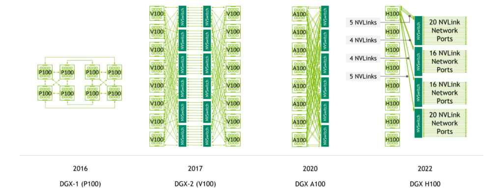

# Interconnect Hardware: NVLink, InfiniBand, RoCE, EFA and More

## Prerequisites

This chapter is the hardware catalogue for the links that carry collective traffic. The general networking ideas behind it are taught earlier. It only adds the products, their numbers and how they behave when measured.

- [Toolkit](../foundations/toolkit.md): reading shell commands and their output, `git clone` + `make` (how `nvbandwidth` and `nccl-tests` get built).
- [Computer architecture](../foundations/computer-architecture.md): [units and the classic mistakes](../foundations/computer-architecture.md#units-and-the-classic-mistakes), [bandwidth vs latency](../foundations/computer-architecture.md#bandwidth-vs-latency), [NUMA](../foundations/computer-architecture.md#numa), and [buses and interconnects](../foundations/computer-architecture.md#buses-and-interconnects) (PCIe, DMA, GPUDirect, a first look at NVLink and NVSwitch).
- [Linux and the OS](../foundations/linux-and-os.md): [environment variables](../foundations/linux-and-os.md#environment-variables-and-path). Every `NCCL_*` setting below is one.
- [Concurrency](../foundations/concurrency.md): [overlapping copy and compute](../foundations/concurrency.md#overlapping-copy-and-compute-pinned-memory-and-non_blocking). Copy engines and comms/compute overlap both build on it.
- [Networking](../foundations/networking.md), which this chapter leans on most:
  - [Units: reading spec sheets without getting fooled](../foundations/networking.md#units-reading-spec-sheets-without-getting-fooled): bits vs bytes, per direction vs both directions, aggregate vs per link.
  - [Data center networking](../foundations/networking.md#data-center-networking): leaf-spine, fat-tree, oversubscription and ECMP.
  - [HPC networking: RDMA, InfiniBand, RoCE, EFA](../foundations/networking.md#hpc-networking-rdma-infiniband-roce-efa): what RDMA removes, HCAs, the subnet manager, verbs and queue pairs, PFC/ECN, GPUDirect RDMA, and EFA's SRD and libfabric.
  - [Inside the node](../foundations/networking.md#inside-the-node-a-network-inside-the-box): PCIe generations, NVLink/NVSwitch, `nvidia-smi topo -m` and NCCL's P2P/SHM/NET transports.
  - [Collective communication: an intuitive introduction](../foundations/networking.md#collective-communication-an-intuitive-introduction): what all-reduce, all-gather and reduce-scatter compute, with one ring all-reduce done by hand.
- [Distributed systems](../foundations/distributed-systems.md): [collectives](../foundations/distributed-systems.md#collectives-the-workhorse-of-distributed-training) and [data parallel vs model parallel](../foundations/distributed-systems.md#data-parallel-vs-model-parallel), which gives one-paragraph versions of DDP, ZeRO/FSDP, tensor and pipeline parallelism.
- [Accelerators](../compute/accelerators.md): the chips themselves (H100, B200, MI300X, Gaudi, Trainium, TPU, Ascend), their TFLOPS and HBM.
- [GPU execution model](../compute/accelerator/execution-model.md): SMs and kernels. The `_sm` vs `_ce` copy distinction below assumes them.
- [The GPU node software stack](../compute/gpu-software-stack.md): the software for this hardware. That covers [Fabric Manager](../compute/gpu-software-stack.md#fabric-manager-required-on-nvswitch-systems), [NVLink and topology checks](../compute/gpu-software-stack.md#nvlink-and-topology-checks), [perftest](../compute/gpu-software-stack.md#perftest-measuring-one-link), [NCCL network plugins](../compute/gpu-software-stack.md#network-plugins), [the NCCL environment variables an operator sets](../compute/gpu-software-stack.md#the-environment-variables-an-operator-sets) and [nccl-tests](../compute/gpu-software-stack.md#nccl-tests-single-node-then-two-then-all).

Forward links, for later chapters this one points into but does not depend on:

- [Collective communication internals](collectives-internals.md) derives *why* a collective costs what it costs: the alpha-beta model, ring/tree/hierarchical algorithms, `algbw` vs `busbw`, NVLS and IB SHARP byte counts, NCCL protocols. This chapter quotes those results and links to them rather than re-deriving them.
- [Measuring and debugging the network](measuring-and-debugging.md) explains how to run and read `nccl-tests`, `torch-dist-bench.py`, `nvbandwidth` and `p2pBandwidthLatencyTest`, all of which produced numbers quoted here.
- [Training arithmetic](../training/arithmetic.md) and [model parallelism derivations](../training/model-parallelism/derivations.md) cover FLOPs, MFU and memory per parameter, and the exact traffic each parallelism generates.

## Introduction

It is not enough to buy or rent expensive accelerators. To train and serve models fast you also need storage IO ([storage and data](../foundations/storage-and-data.md)), CPUs ([computer architecture](../foundations/computer-architecture.md)) and the network to be fast enough to "feed the accelerator furnace". If any of them can't keep up, the accelerators sit underutilized: money is lost, training takes longer, inference throughput drops. Any of these can be the bottleneck, but during training (assuming your DataLoader keeps up) it is most often the network.

If your model fits on a single accelerator, you have little to worry about. Most models today don't. LLMs and VLMs need several accelerators to load, multiple compute nodes to train, and sometimes multiple nodes even for inference.

Most compute nodes contain 8 accelerators. Some contain 4, others 16 or more, and a few recent designs put one super-accelerator in a node. While a model spans several accelerators but stays inside one node, the only network you care about is the fast [intra-node](#intra-node-networking) one. Once it needs several nodes, fast [inter-node](#inter-node-networking) networking becomes the key. That is the usual situation in training, because extra replicas on more nodes speed it up.

The two halves have names you will hear constantly:

- **Scale-up** networking (intra-node): the fabric among the accelerators of one node or one NVLink domain. Examples are NVLink/NVSwitch, AMD Infinity Fabric, Google ICI, AWS NeuronLink and Huawei UB Link. It is short-range, very fast, and usually proprietary.
- **Scale-out** networking (inter-node): NICs and switches joining nodes into a cluster. Examples are InfiniBand, RoCE Ethernet, AWS EFA, HPE Slingshot and Omni-Path. It is longer-range and slower per accelerator, and it reaches thousands of nodes.

This chapter covers both kinds of hardware and gives their theoretical bandwidths and the measured ones. It then works through the part that surprises most people: how the two fabrics interact during a collective.

### How to read the tables in this chapter

Spec tables go stale fast, so every table here follows the same conventions.

- **Unidirectional GBps** (gigabytes per second, one direction) is the unit for intra-node tables and for per-node inter-node totals. Where a vendor publishes only a bidirectional figure, it is halved. Where a vendor doesn't say which it is, the rule is to assume the bigger, duplex number and halve it. The [directionality trap](#reading-a-spec-sheet-the-directionality-trap) below explains why.
- **Gbps** (gigabits per second) is used for individual NIC, port and lane rates, because that is how they are sold. 1GBps = 8Gbps.
- Each table is split into **Generally available** (you can buy or rent it) and **Announced, availability not confirmed** (roadmap, sampling, or a spec with no product, or a vendor page that names the product but gives no availability). A row moves up once availability is confirmed.
- Dates such as "as of 2026-07-28" record when the row was checked against the vendor page. Treat any number older than a year as a pointer, not a fact.

Many derived columns below are plain arithmetic: lane rate times lanes times links, NICs times rate divided by 8, and so on. Here they are recomputed in one script, so you can see where each number comes from and check a new spec sheet the same way:

```python
# spec_tables.py - recompute the derived columns of this chapter's spec tables from their inputs
# NVLink: per-direction GBps = lane rate (GBps) x lanes per link x links
nvlink = {"NVLink 1": (2.50, 8, 4), "NVLink 2": (3.125, 8, 6), "NVLink 3": (6.25, 4, 12),
          "NVLink 4": (12.50, 2, 18), "NVLink 5": (25.00, 2, 18)}
for name, (lane, lanes, links) in nvlink.items():
    uni = lane * lanes * links
    print(f"{name}: {lane} x {lanes} x {links} = {uni:6.1f} GBps uni-dir, {2*uni:6.1f} duplex")

# nvidia-smi nvlink -s reports the raw signalling rate per link; the sum overshoots the spec
for gpu, per_link, spec in [("B200", 53.125, 900), ("H100", 26.5625, 450)]:
    raw = 18 * per_link
    print(f"{gpu}: 18 x {per_link} = {raw} GBps raw, spec {spec} -> ratio {spec/raw:.4f}")

# AMD Infinity Fabric: all-to-all = per-peer link x 7 peers on an 8-GPU board
for gpu, link in [("MI355X/MI350X", 76.5), ("MI325X/MI300X", 64), ("MI250X", 50)]:
    print(f"{gpu}: {link} x 7 = {link*7} GBps all-to-all, peer-to-peer only {link}")

# Trainium2: 4 intra-node neighbours at 128 GBps + 2 inter-node neighbours at 64 GBps
print("Trainium2 all-to-all:", 128 * 4 + 64 * 2, "GBps; intra-instance only:", 128 * 4)

# InfiniBand: generation names a lane rate; a full-width port is 4 lanes
ib = {"EDR": 25, "HDR": 50, "NDR": 100, "XDR": 200, "GDR": 400, "LDR": 800}
for links in (1, 4, 8, 12):
    print(f"{links:2}x lanes: " + "  ".join(f"{g}={r*links}" for g, r in ib.items()))

# node table: total uni-dir GBps = interfaces x rate(Gbps) / 8
nodes = [("DGX B300 XDR", 8, 800), ("EFA v4 P6-B300", 16, 400), ("Gaudi3", 24, 200),
         ("DGX H100 NDR", 8, 400), ("EFA v2 P5", 32, 100), ("EFA v1 P4d", 4, 100)]
for name, nics, rate in nodes:
    print(f"{name:15}: {nics:2} x {rate:3} Gbps / 8 = {nics*rate/8:5.0f} GBps per node")
```

```
NVLink 1: 2.5 x 8 x 4 =   80.0 GBps uni-dir,  160.0 duplex
NVLink 2: 3.125 x 8 x 6 =  150.0 GBps uni-dir,  300.0 duplex
NVLink 3: 6.25 x 4 x 12 =  300.0 GBps uni-dir,  600.0 duplex
NVLink 4: 12.5 x 2 x 18 =  450.0 GBps uni-dir,  900.0 duplex
NVLink 5: 25.0 x 2 x 18 =  900.0 GBps uni-dir, 1800.0 duplex
B200: 18 x 53.125 = 956.25 GBps raw, spec 900 -> ratio 0.9412
H100: 18 x 26.5625 = 478.125 GBps raw, spec 450 -> ratio 0.9412
MI355X/MI350X: 76.5 x 7 = 535.5 GBps all-to-all, peer-to-peer only 76.5
MI325X/MI300X: 64 x 7 = 448 GBps all-to-all, peer-to-peer only 64
MI250X: 50 x 7 = 350 GBps all-to-all, peer-to-peer only 50
Trainium2 all-to-all: 640 GBps; intra-instance only: 512
 1x lanes: EDR=25  HDR=50  NDR=100  XDR=200  GDR=400  LDR=800
 4x lanes: EDR=100  HDR=200  NDR=400  XDR=800  GDR=1600  LDR=3200
 8x lanes: EDR=200  HDR=400  NDR=800  XDR=1600  GDR=3200  LDR=6400
12x lanes: EDR=300  HDR=600  NDR=1200  XDR=2400  GDR=4800  LDR=9600
DGX B300 XDR   :  8 x 800 Gbps / 8 =   800 GBps per node
EFA v4 P6-B300 : 16 x 400 Gbps / 8 =   800 GBps per node
Gaudi3         : 24 x 200 Gbps / 8 =   600 GBps per node
DGX H100 NDR   :  8 x 400 Gbps / 8 =   400 GBps per node
EFA v2 P5      : 32 x 100 Gbps / 8 =   400 GBps per node
EFA v1 P4d     :  4 x 100 Gbps / 8 =    50 GBps per node
```

How to read it: each line is one table row rebuilt from its inputs. If a number in a table below disagrees with this arithmetic, the table is wrong. The script is pure Python and was run with `python3`. Each section below explains its own inputs.

## Glossary and concepts

You can skip this list and come back to it when a term shows up. Terms already taught in [Networking](../foundations/networking.md) (RDMA, HCA, verbs, PFC/ECN, SRD, libfabric) are repeated in one line each so this list stands on its own.

- **ALU**: Arithmetic Logic Unit. The adders and multipliers inside a switch that let [SHARP](interconnects-reference.md#sharp) reduce data in the network.
- **C2C**: chip-to-chip, as in [NVLink-C2C](#nvlink-c2c).
- **CPO**: co-packaged optics. The optical engine sits inside the switch package instead of in a pluggable transceiver. See [Co-packaged silicon photonics](#co-packaged-silicon-photonics).
- **DMA**: Direct Memory Access. A hardware engine copies memory without a CPU core moving each byte.
- **EDR, HDR, NDR, XDR, GDR, LDR**: InfiniBand per-lane data-rate generations. See [InfiniBand](#infiniband).
- **EFA**: Elastic Fabric Adapter, AWS's inter-node network. See [EFA](#efa).
- **GA**: Generally Available. The product can actually be bought or rented, as opposed to announced, sampling, or only specified.
- **GDR**: an InfiniBand per-lane data-rate generation, a roadmap target at 400Gbps per lane, as in the `InfiniBand GDR example` row of the [inter-node table](#inter-node-networking). Beware: NCCL uses the same three letters for **GPUDirect RDMA**, the direct path between a NIC and accelerator memory, as in `NCCL_NET_GDR_LEVEL`. The two are unrelated. The clash comes from two ecosystems coining names independently, the IBTA for the link generation and NVIDIA for the data path.
- **HCA**: Host Channel Adapter, the InfiniBand name for a NIC.
- **HPC**: High-Performance Computing, the supercomputing world that ML clusters borrowed most of their networking from.
- **IB**: InfiniBand.
- **IBTA**: InfiniBand Trade Association, the body that standardizes InfiniBand.
- **ICI**: Inter-Chip Interconnect, Google's scale-up fabric between TPU chips.
- **MFU**: Model FLOPs Utilization, achieved FLOPS divided by peak FLOPS. For example `mfu=0.5` at half precision on an A100 means getting 156TFLOPS, since peak half-precision is 312TFLOPS and $156/312=0.5$. [Training arithmetic](../training/arithmetic.md#mfu-and-hfu-properly) treats it properly.
- **NCCL**: NVIDIA Collective Communications Library, the library PyTorch uses for collectives on NVIDIA GPUs. AMD's equivalent is RCCL.
- **NIC**: Network Interface Card.
- **NVL72**: an NVLink domain of 72 accelerators. NVL8 and NVL36 are 8 and 36.
- **NVLS**: NVLink [SHARP](interconnects-reference.md#sharp), the NCCL algorithm that does the reduction inside the NVSwitch.
- **NVLSTree**: the NCCL algorithm that combines `NVLS` inside each node with a tree across nodes. Multi-node only.
- **OPA**: Omni-Path Architecture. **OPX**: Omni-Path Express, its current software stack. See [Omni-Path](#omni-path).
- **OSFP**: Octal Small Form Factor Pluggable, an 8-lane transceiver cage, the socket a pluggable optical or copper module plugs into.
- **P2P**: peer-to-peer, traffic between exactly two accelerators as opposed to all-to-all.
- **QSFP-DD**: Quad Small Form Factor Pluggable Double Density, another transceiver cage (8 lanes in a QSFP-sized footprint).
- **RC**: Reliable Connection, the default connection type in verbs-based tools. It is connection-oriented, with reliable in-order delivery.
- **RDMA**: Remote Direct Memory Access. See [RDMA networking](#rdma-networking).
- **RMA**: Remote Memory Access, libfabric's name for one-sided read/write operations. It is the same class of operation as an RDMA write.
- **RoCE**: RDMA over Converged Ethernet.
- **SerDes**: serializer/deserializer, one electrical lane of a port. Several SerDes lanes make up one port.
- **SHARP**: Scalable Hierarchical Aggregation and Reduction Protocol, in-network reduction. See [SHARP](interconnects-reference.md#sharp).
- **SRD**: Scalable Reliable Datagram, AWS EFA's transport. It delivers reliably but does not preserve message order, unlike [RC](#glossary-and-concepts).
- **SuperNIC**: NVIDIA's name for its recent high-rate network adapters.
- **TCPX, TCPXO**: Google Cloud's GPUDirect transports for A3 machine types. See [GPUDirect-TCPX](#gpudirect-tcpx).
- **UEC**: Ultra Ethernet Consortium, the body behind the Ultra Ethernet standard that AI NICs target.
- **VPC**: Virtual Private Cloud, the general-purpose cloud network, as opposed to the accelerator fabric.
- **xGMI**: Socket to Socket Global Memory Interface, AMD's name for Infinity Fabric links between packages.
- **XGS**: the cross-datacenter variant of Spectrum-X.

Speed-related:

- **Adaptive routing**: an improvement over static routing that allows packets to arrive out of order. Each switch load-balances packets across its outputs, which spreads the network load better. Static routing pins a flow to one path, so two big flows can collide on one link ([ECMP](../foundations/networking.md#ecmp) shows the effect).
- **algbw**: algorithm bandwidth, the payload size divided by the elapsed time.
- **busbw**: bus bandwidth, `algbw` scaled by a per-collective correction factor so that it reflects the hardware bottleneck rather than the number of ranks. For all-reduce the factor is $2(n-1)/n$. [algbw vs busbw](collectives-internals.md#algbw-vs-busbw) derives it. Read every `busbw` in this chapter as "comparable to a per-direction link speed, for a ring".
- **Bidirectional, duplex**: transmission in both directions A <-> B at once, typically 2x the one-direction (unidirectional) rate.
- **Bisection width**: the minimum number of links you must cut to divide the network into two parts, not necessarily equal. The bandwidth of those links is the **bisection bandwidth**, often used as a measure of real network capacity and sometimes called the worst-case network capacity. Here is a [good answer](https://networkengineering.stackexchange.com/a/29662/93656) explaining it and related concepts. You rarely need more than the definition, since your provider has almost certainly fixed the topology already.
- **GBps, GB/s**: gigabytes per second (1GBps = 8Gbps) through a channel.
- **Gbps, Gb/s**: gigabits per second (1Gbps = 1/8GBps) through a channel.
- **GT/s**: gigatransfers per second, the number of data-transferring operations per second. PCIe lane rates are quoted this way.
- **Unidirectional**: transmission in one direction, A -> B.

Pay close attention in every section below to the fact that 1GBps = 8Gbps.

### Unidirectional vs Bidirectional (Duplex)

Most benchmarking and bandwidth-measurement tools report unidirectional bandwidth. So be careful when comparing a measurement with a spec, because the spec is usually duplex, typically ~2x the unidirectional number.

The rule of thumb: if you measure about 40% of the advertised speed, check whether the advertisement was duplex. If it was, halve it, and your measurement becomes about 80%, which is what a healthy system delivers.

A case study from Stas Bekman: for a while he couldn't understand why the nccl-tests `all_reduce` benchmark on an A100 node with an advertised 600GBps intra-node speed gave only 235GBps (40%). Horace He pointed out that the right comparison is the unidirectional 300GBps, against which the measurement is 78%, close to the ~80% expected.

That ~80% expectation holds on newer hardware too. On a node of 8x H200 (NVLink 4, NVSwitch-connected), a pairwise copy measures 396.40GBps unidirectional against the 450GBps spec (88%), and 783.73GBps duplex against 900GBps (87%). On this fabric running both directions at once costs almost nothing. The measurement uses `nvbandwidth`, whose build and use are covered in [nvbandwidth](measuring-and-debugging.md#nvbandwidth):

```bash
./nvbandwidth -i 10 -t device_to_device_memcpy_write_ce                # 396.40 GB/s per pair
./nvbandwidth -i 10 -t device_to_device_bidirectional_memcpy_write_ce  # 783.73 GB/s per pair, total
```

How to read the commands: `nvbandwidth` is NVIDIA's copy-bandwidth benchmark. `-t` picks the testcase and `-i` the number of timed iterations. The `_ce` suffix means the copy runs on the GPU's copy engines, the [DMA engines](../foundations/concurrency.md#overlapping-copy-and-compute-pinned-memory-and-non_blocking) that move data without using the SMs. The `_sm` testcases do the same copy with a kernel instead. The bidirectional testcase prints `Write1`, `Write2` and a combined `total` matrix. Read the `total` rather than doubling one direction.

A pairwise copy is the right instrument for this comparison because it moves bytes and nothing else. A *collective* on the same hardware can report *more* than the unidirectional spec. That is a different effect entirely, explained in [SHARP](interconnects-reference.md#sharp).

Here every measured-vs-spec ratio quoted in this chapter is recomputed in one place. Notice how consistently healthy hardware lands at 80-90%:

```python
# efficiency.py - measured / spec for every pairwise-copy measurement quoted in this chapter
rows = [
    ("A100 NVLink 3, nccl-tests all-reduce busbw (case study)", 235, 600),   # vs the duplex number
    ("A100 NVLink 3, same, vs the unidirectional spec",         235, 300),
    ("H200 NVLink 4, nvbandwidth uni-dir copy",                 396.40, 450),
    ("H200 NVLink 4, nvbandwidth duplex copy (total)",          783.73, 900),
    ("H200 PCIe 5 x16, host->device",                           55.43, 63),
    ("H200 PCIe 5 x16, device->host",                           55.06, 63),
    ("GB300 NVLink-C2C, avg of H2D 359 and D2H 377",            (359 + 377) / 2, 450),
    ("GB300 NVLink-C2C, bidirectional (avg of 175, 171) x 2",   (175 + 171) / 2 * 2, 900),
    ("A100 p2pBandwidthLatencyTest",                            274, 300),
    ("H100 p2pBandwidthLatencyTest",                            376, 450),
    ("GB200 p2pBandwidthLatencyTest",                           746, 900),
]
for name, measured, spec in rows:
    print(f"{name:58} {measured:7.2f} / {spec:4} = {measured/spec:4.0%}")
```

```
A100 NVLink 3, nccl-tests all-reduce busbw (case study)     235.00 /  600 =  39%
A100 NVLink 3, same, vs the unidirectional spec             235.00 /  300 =  78%
H200 NVLink 4, nvbandwidth uni-dir copy                     396.40 /  450 =  88%
H200 NVLink 4, nvbandwidth duplex copy (total)              783.73 /  900 =  87%
H200 PCIe 5 x16, host->device                                55.43 /   63 =  88%
H200 PCIe 5 x16, device->host                                55.06 /   63 =  87%
GB300 NVLink-C2C, avg of H2D 359 and D2H 377                368.00 /  450 =  82%
GB300 NVLink-C2C, bidirectional (avg of 175, 171) x 2       346.00 /  900 =  38%
A100 p2pBandwidthLatencyTest                                274.00 /  300 =  91%
H100 p2pBandwidthLatencyTest                                376.00 /  450 =  84%
GB200 p2pBandwidthLatencyTest                               746.00 /  900 =  83%
```

How to read it: the first two lines are the same measurement against the wrong and the right denominator. The one outlier at 38% is a real hardware limit, explained in [NVLink-C2C](#nvlink-c2c), not a units mistake. Each of these measurements is discussed in its own section below.

### Reading a spec sheet: the directionality trap

When you read a spec online and it doesn't state the direction explicitly, go and find out. Stas had to dig through many documents to fill in some of the tables below, because some vendors omit this crucial detail, and he even edited a few Wikipedia pages to add it. Vendors prefer the bigger number, so they almost always quote duplex, typically 2x the unidirectional figure. When in doubt, assume duplex and halve it. That is the convention used in every table here, and each place it was applied is called out.

## Cluster networks

Each node of a cluster sits on three separate networks, and each runs at a very different speed:

1. [Frontend](#frontend-networking)
2. [Backend](#backend-networking)
3. [Out-of-band](#out-of-band-networking)

```
                 Internet / storage / scheduler
                            |
        frontend (1 NIC, 100-400Gbps, TCP/IP)
                            |
   +--------------------- node -----------------------+
   |  GPU0 .. GPU7  == NVLink/NVSwitch (intra-node) == |   backend, scale-up
   |    |       |                                      |
   |  NIC0 .. NIC7  -- InfiniBand / RoCE / EFA ------- |-- backend, scale-out (other nodes)
   |  BMC  -- 1Gbps Ethernet -------------------------- |-- out-of-band (management)
   +--------------------------------------------------+
```

How to read the sketch: a node is one box with three separate cable paths leaving it. Only the backend carries collectives. A schematic, not a real wiring diagram.

### Frontend networking

The frontend network carries the Internet connection (downloading Python packages, offloading to cloud storage), distributed network storage (checkpoints and datasets) and orchestration traffic (SLURM and Kubernetes). As of 2026-08 a typical node has a single 100-400Gbps frontend connection.

Not every cluster has external Internet access. Many HPC environments only allow it from special CPU-only nodes.

### Backend networking

The backend network connects GPUs to each other, which is what lets training and inference scale beyond one accelerator (all-reduce, all-gather and the other collectives). It is the most important network in an AI cluster. It is usually [InfiniBand](#infiniband) or [RoCEv2 Ethernet](#rdma-networking), and it splits into [intra-node](#intra-node-networking) and [inter-node](#inter-node-networking) networking. GPUs on the same node can normally talk to each other faster than to GPUs on other nodes.

Typical top [unidirectional](#unidirectional-vs-bidirectional-duplex) speeds as of 2026-08:

- intra-node: ~900GBps per accelerator (NVLink 5, as on B200/B300)
- inter-node: 100GBps per accelerator, or 800GBps per node (8x ConnectX-8, as on DGX B300 XDR)

So the links are about an order of magnitude apart per accelerator. That ratio has held for several generations, because both sides keep doubling together. The gap you actually *measure* with a collective is much smaller, for reasons explained in [Inter-node speed depends on intra-node speed](interconnects-reference.md#inter-node-speed-depends-on-intra-node-speed).

Each accelerator has at least one backend connection, and sometimes several, especially when lower-bandwidth NICs are used.

Not every provider matches the industry-standard speeds. On some, the inter-node network can be up to 10x slower. Always check what you get. [Getting compute](../platform/getting-compute.md) covers how to ask.

### Out-Of-Band networking

The Out-Of-Band (OOB) network bootstraps the backend network, monitors node health, re-images nodes remotely, and so on. It talks to the node's BMC (baseboard management controller, the small always-on computer that can power-cycle the node). It is typically a single slow 1Gbps Ethernet connection.

## RDMA networking

Remote Direct Memory Access is DMA across nodes. It moves data between machines without going through the local processor, the OS kernel and the caches, all of which TCP/IP uses. [What RDMA removes](../foundations/networking.md#what-rdma-removes) walks through the two data paths side by side. The three main implementations are:

1. InfiniBand
2. RDMA over Converged Ethernet (RoCE), the InfiniBand transport carried over Ethernet. RoCEv2 wraps it in UDP/IP so it can be routed.
3. iWARP, RDMA over TCP. It is rare in ML clusters.

Here is a [good overview article](https://www.fs.com/blog/a-quick-look-at-the-differences-rdma-vs-tcpip-2945.html) comparing RDMA with TCP/IP. The operational side of RoCE (PFC, ECN, DCQCN and why packet loss hurts RDMA so much) is in [RoCE and lossless Ethernet](../foundations/networking.md#roce-and-lossless-ethernet), and the node-side setup is in [RoCE in one page](../compute/gpu-software-stack.md#roce-in-one-page).

## Intra-node networking

This is also called **scale-up** networking. Several platforms provide it:

1. Generic: [PCIe](#pcie)
2. NVIDIA: [NVLink](#nvlink) and [NVSwitch](#nvswitch), plus [NVLink-C2C](#nvlink-c2c) between CPU and GPU
3. AMD: [Infinity Fabric](#infinity-fabric--xgmi)
4. Intel: [Gaudi2](#gaudi2), [Gaudi3](#gaudi3)
5. AWS: [NeuronLink](#neuronlink-v3) (Trainium)
6. Google: ICI (TPU)
7. Huawei: [UB Link](#ub-link-unifiedbus) (Ascend)
8. The open-standard attempt: [UALink](#ultra-accelerator-link-ualink)

Two numbers describe a scale-up fabric, and they are not the same thing:

- **all-to-all bandwidth**: what one accelerator can push when it talks to *all* its peers at once. It is the sum over all its links.
- **peer-to-peer bandwidth**: what one accelerator can push to *one* other accelerator.

With a switch in the middle (NVSwitch) they are equal, because one pair can use every link. With point-to-point wiring (AMD, Trainium, TPU), each pair has its own link, so peer-to-peer is only a fraction of all-to-all.

```
switched (NVSwitch): every GPU has all its links    point-to-point (Infinity Fabric): one
into the switch, so GPU0->GPU1 can use all of them  dedicated link per pair, GPU0->GPU1 uses 1/7

  GPU0 ===\                /=== GPU4                  GPU0 ---- GPU1
  GPU1 ====[  NVSwitch(es) ]==== GPU5                  |  \    /  |
  GPU2 ====[               ]==== GPU6                  |    \/    |   ... every pair
  GPU3 ===/                \=== GPU7                  |    /\    |       has its own link
                                                      GPU2 ---- GPU3
```

### All-to-all bandwidth

Intra-node unidirectional theoretical all-to-all peak bandwidth, sorted by bandwidth:

**Generally available:**

| Interconnect     | Accelerator  | GBps   | Notes |
| :--------------- | :----------- | -----: | :---- |
| NVIDIA NVLink 5  | B200, B*     |  900.0 | 1     |
| AWS NeuronLink 3 | Trainium2    |  640.0 | 2     |
| Intel            | Gaudi3       |  600.0 |       |
| Google ICI       | TPU7x        |  600.0 | 4     |
| AMD XGMI         | MI355X       |  535.5 |       |
| AMD XGMI         | MI350X       |  535.5 |       |
| NVIDIA NVLink 4  | H100, H*     |  450.0 | 1     |
| AMD XGMI         | MI325X       |  448.0 |       |
| AMD XGMI         | MI300X       |  448.0 |       |
| AMD XGMI         | MI250X       |  350.0 |       |
| NVIDIA NVLink 3  | A100         |  300.0 | 1     |
| Intel            | Gaudi2       |  300.0 |       |
| PCIe 5           |              |   63.0 |       |
| PCIe 4           |              |   31.0 |       |

**Announced, availability not confirmed:**

| Interconnect     | Accelerator  | GBps   | Notes |
| :--------------- | :----------- | -----: | :---- |
| Huawei UB Link   | Ascend 950DT |  840.0 | 5     |
| NVIDIA NVLink 6  | Rubin        | 1500.0 | 1     |
| PCIe 6           |              |  121.0 | 3     |

Notes:

1. NVSwitch runs at the NVLink speed of its generation. See [NVSwitch](#nvswitch).
2. AWS publishes `NeuronLink-v3 ... 1.28 TB/sec bandwidth per chip` for Trainium2 without saying which direction, so it is halved here per the [directionality convention](#reading-a-spec-sheet-the-directionality-trap). AWS publishes neither a per-link rate nor a link count, so Trainium2 can't be placed in the [peer-to-peer table](#peer-to-peer-bandwidth). [NeuronLink v3](#neuronlink-v3) reconstructs the 640 from the torus topology.
3. PCIe 6 is under `Announced, availability not confirmed` because no shipping accelerator attaches at Gen6 as of 2026-07-31. Current parts are Gen5 x16: NVIDIA H200 SXM lists `PCIe Gen5`, and AMD MI350X/MI355X list `PCIe 5.0 x16`. So 63GBps is still the ceiling for accelerator-to-accelerator PCIe traffic. Gen6 already ships on the NIC side. NVIDIA markets ConnectX-8 as bringing "PCIe Gen6 connectivity in a single device", which is what lets one adapter feed 800Gbps.
4. Google publishes a "Bidirectional inter-chip interconnect (ICI) bandwidth per chip (GBps)" of 1200 for TPU7x, halved here. The peer-to-peer figure is the per-axis one, "bi-directional bandwidth of 200 GBps per axis", i.e. 100 unidirectional. Six neighbours in the 3D torus at 200 each is exactly the 1200 total, so the two figures corroborate each other. Google documents TPU7x fully but doesn't state an availability stage. See [TPU7x](https://docs.cloud.google.com/tpu/docs/tpu7x).
5. Huawei publishes a per-cabinet total interconnect bandwidth of up to 64 x 1.68TBps bidirectional for the Atlas 950 SuperPoD. That is 1.68TBps bidirectional per accelerator, halved here. Only the Chinese pages carry it; the English ones state no per-NPU figure. Peer-to-peer is unknown, so there is no row in the [peer-to-peer table](#peer-to-peer-bandwidth). The row sits under "announced" because Huawei publishes no availability for the Ascend 950DT anywhere reachable. Its own English site serves a plain downloader only a navigation shell, in which `950DT` doesn't appear at all. China-only distribution is *not* the reason. Once availability is confirmed, the row belongs with the available hardware, annotated as China-only. See [UB Link](#ub-link-unifiedbus).

### Peer-to-peer bandwidth

Some vendors' all-to-all and peer-to-peer (GPU-to-GPU) bandwidths are the same and some aren't. For example, AMD MI300X/MI325X have 64GBps peer-to-peer but 448GBps in total on an 8-accelerator board, since $64 \times 7=448$. Likewise MI350X/MI355X have 76.5GBps peer-to-peer and 535.5GBps all-to-all, since $76.5 \times 7=535.5$.

Intra-node unidirectional theoretical peer-to-peer peak bandwidth, sorted by bandwidth:

**Generally available:**

| Interconnect    | Accelerator | GBps   |
| :-------------- | :---------- | -----: |
| NVIDIA NVLink 5 | B200, B*    |  900.0 |
| Intel           | Gaudi3      |  600.0 |
| NVIDIA NVLink 4 | H100, H*    |  450.0 |
| NVIDIA NVLink 3 | A100        |  300.0 |
| Intel           | Gaudi2      |  300.0 |
| Google ICI      | TPU7x       |  100.0 |
| AMD XGMI        | MI355X      |   76.5 |
| AMD XGMI        | MI350X      |   76.5 |
| AMD XGMI        | MI325X      |   64.0 |
| AMD XGMI        | MI300X      |   64.0 |
| PCIe 5          |             |   63.0 |
| AMD XGMI        | MI250X      |   50.0 |
| PCIe 4          |             |   31.0 |

**Announced, availability not confirmed:**

| Interconnect    | Accelerator | GBps   |
| :-------------- | :---------- | -----: |
| NVIDIA NVLink 6 | Rubin       | 1500.0 |
| PCIe 6          |             |  121.0 |

PCIe has the same number in both tables, but for the opposite reason to NVLink:

- NVLink matches because NVSwitch lets a single pair light up every link, so you get the whole fabric either way.
- PCIe matches because an accelerator has just one x16 host link, which is the ceiling whether it talks to one peer or seven.

Unlike NVLink or Infinity Fabric, where every pair has the same fabric path, the PCIe number also depends on where the two devices sit. Under the same switch, across the root complex, and across CPU sockets are three different paths, and `nvidia-smi topo -m` tells you which one a pair uses (see [NVLink](#nvlink) below). So treat the PCIe rows as the best case for a well-placed pair, not as a figure that holds for any two devices in the node.

The PCIe rows assume an x16 attachment, which is what current accelerators use. NVIDIA H200 SXM lists `PCIe Gen5` at 128GBps duplex, AMD MI350X/MI355X list `PCIe 5.0 x16`, and A100 is Gen4 x16. If a part is attached at x8, halve the figure. And as of 2026-07-31 no shipping accelerator attaches at Gen6, so 63GBps is the real ceiling for accelerator-to-accelerator PCIe traffic today. The PCIe 6 row is there for the platforms that will. Gen6 *is* already shipping elsewhere in the node: ConnectX-8's Gen6 host link is what lets one adapter feed 800Gbps (100GBps), since Gen5 x16 tops out at 63GBps.

When peer-to-peer bandwidth is much lower than all-to-all, an application that doesn't use all the accelerators of the node gets much less bandwidth. If those accelerators have to communicate with each other, performance suffers.

To check this, [torch-dist-bench.py](benchmarks/torch-dist-bench.py) was run on an 8x AMD MI300X node with a 4GiB payload. The `busbw` measurements were:

- 2 GPUs: 47.671GBps
- 8 GPUs: 312.912GBps

So 2 GPUs were 6.5x slower than 8. The script and how to run it are covered in [torch-dist-bench](measuring-and-debugging.md#torch-dist-bench).

The practical rule on point-to-point fabrics: if you deploy TP=2, TP=4, or ZeRO-DP/FSDP over 2 or 4 GPUs, in training or inference, the network will become a bottleneck. TP=1, TP=8, ZeRO-DP/FSDP over all 8 GPUs, or DP over 1-GPU replicas have no such problem. (TP is tensor parallelism and ZeRO-DP/FSDP is sharded data parallelism. [Data parallel vs model parallel](../foundations/distributed-systems.md#data-parallel-vs-model-parallel) has the short versions, and [model parallelism derivations](../training/model-parallelism/derivations.md) has the traffic each one generates.)

The following sections go through each technology in detail.

### PCIe

[PCIe](https://en.wikipedia.org/wiki/PCI_Express) is the high-speed serial expansion bus found even in the cheapest desktop. [Buses and interconnects](../foundations/computer-architecture.md#buses-and-interconnects) introduces it, and [PCIe in Networking](../foundations/networking.md#pcie) derives the per-generation numbers from lane rate and encoding. The largest slot, x16, has 16 lanes, and smaller slots have fewer (x1 is one lane).

**Generally available:**

| Interconnect | Lane/<br>Direction<br>(GBps) | Lanes | Uni-dir.<br>(GBps) | Duplex<br>(GBps) |
| :----------- | ---------------------------: | ----: | -----------------: | ---------------: |
| PCIe 4       |                         ~2.0 |    16 |                 31 |               62 |
| PCIe 5       |                         ~4.0 |    16 |                 63 |              126 |
| PCIe 6       |                         ~7.5 |    16 |                121 |              242 |

**Announced, availability not confirmed:**

| Interconnect | Lane/<br>Direction<br>(GBps) | Lanes | Uni-dir.<br>(GBps) | Duplex<br>(GBps) |
| :----------- | ---------------------------: | ----: | -----------------: | ---------------: |
| PCIe 7       |                        ~15.0 |    16 |                242 |              484 |
| PCIe 8       |                        ~30.0 |    16 |                484 |              968 |

(The PCIe 6 row here is the spec. It sits under "generally available" because Gen6 products exist, NICs included. It sits under "announced" in the accelerator tables above because no accelerator attaches at Gen6 yet. The PCIe 6 figure of 121 also includes the FLIT-mode framing overhead that [the networking chapter's](../foundations/networking.md#pcie) back-of-envelope 128 ignores.)

A released specification is not shipping silicon. As of 2026-07-30 [PCI-SIG](https://pcisig.com/specifications) lists `PCI Express Base Specification Revision 7.0` as released, while PCIe 8.0 exists only as a members-only draft, targeted for 2028. Even a finished spec takes years to reach products: PCIe 6.0 hardware didn't launch until August 2025, about three years after its spec was done. Read the last rows as where the standard is heading, not as something you can buy.

Compared with the latest generation of any other intra-node technology below, PCIe is usually an order of magnitude behind.

The table above is spec. What a PCIe link actually delivers is a separate question that nobody seems to publish, so here is a measurement. On a node of 8x H200, where each accelerator has its own PCIe 5 x16 link, `nvbandwidth` reports 55.43GBps host-to-device and 55.06GBps device-to-host. That is 88% and 87% of the 63GBps row. The eight links came out within 0.10GBps of each other, and `nvbandwidth` reported a coefficient of variation of 0.00.

To reproduce, first confirm the generation and width, since the 63GBps figure only applies to PCIe 5 at x16:

```bash
nvidia-smi --query-gpu=index,pcie.link.gen.current,pcie.link.width.current --format=csv
```

You want every row to read `5, 16`. A lower generation or width means the link trained down (the [Linux `lspci` check](../foundations/networking.md#pcie) shows the same from the OS side). Note that some GPUs drop the link generation at idle to save power, so query under load. Then run:

```bash
./nvbandwidth -i 10 -t host_to_device_memcpy_ce
./nvbandwidth -i 10 -t device_to_host_memcpy_ce
```

A caveat: `host_to_device_memcpy_ce` measures whatever the host-to-device path happens to be on that platform, so read it against the fabric the machine actually uses. On an x86 host with PCIe-attached SXM accelerators that path is PCIe, which is what the 88% above refers to. On a Grace-Blackwell system the very same testcase measures [NVLink-C2C](#nvlink-c2c) instead and reports several hundred GBps. Same command, different fabric, an order of magnitude apart.

### NVLink

[NVLink](https://en.wikipedia.org/wiki/NVLink) is a wire-based, serial, multi-lane, short-range communications link developed by NVIDIA. NVIDIA's [What Is NVLink](https://blogs.nvidia.com/blog/what-is-nvidia-nvlink/) blog post gives more background. The Wikipedia page is hard to follow, and as of 2026-08 some of its numbers look wrong and NVIDIA doesn't appear to maintain it, so this section lays the generations out from first principles.

An NVLink *link* is a bundle of *lanes*. Per-GPU bandwidth is lane rate times lanes per link times links per GPU, which is what `spec_tables.py` [above](#how-to-read-the-tables-in-this-chapter) recomputes. Effective payload rate of intra-node GPU-to-GPU hardware:

**Generally available:**

| Interconnect | Lane/<br>Direction<br>(GBps) | Lanes | Links | Uni-dir.<br>(GBps) | Duplex<br>(GBps) | GPU               |
| :----------- | ---------------------------: | ----: | ----: | -----------------: | ---------------: | :---------------- |
| NVLink 1     |                         2.50 |     8 |     4 |                 80 |              160 | P100              |
| NVLink 2     |                        3.125 |     8 |     6 |                150 |              300 | V100              |
| NVLink 3     |                         6.25 |     4 |    12 |                300 |              600 | A100              |
| NVLink 4     |                        12.50 |     2 |    18 |                450 |              900 | H100, H200, GH200 |
| NVLink 5     |                        25.00 |     2 |    18 |                900 |             1800 | B200, B\*, GB\*   |

**Announced, availability not confirmed:**

| Interconnect | Lane/<br>Direction<br>(GBps) | Lanes | Links | Uni-dir.<br>(GBps) | Duplex<br>(GBps) | GPU               |
| :----------- | ---------------------------: | ----: | ----: | -----------------: | ---------------: | :---------------- |
| NVLink 6     |                            ? |     2 |    36 |               1500 |             3000 | Rubin             |

NVLink 6's per-lane rate is `?` because NVIDIA publishes only the per-GPU aggregate (`3 TB/s` duplex, i.e. `1500` GBps unidirectional). The figures are for the standard Rubin GPU. Rubin CPX and Rubin Ultra are separate parts with their own NVLink.

There is a good overview of the evolution of NVLink 1 to 4 [here](https://www.naddod.com/blog/unveiling-the-evolution-of-nvlink).

How NVLink compares with the PCIe of the same platform:

- NVIDIA Rubin nodes come with PCIe 6 and NVLink 6, so NVLink is ~12x faster than PCIe.
- NVIDIA Blackwell nodes come with PCIe 6 and NVLink 5, so NVLink is ~7x faster than PCIe.
- NVIDIA Hopper nodes typically come with PCIe 5 and NVLink 4, so NVLink is ~7x faster than PCIe.

`nvidia-smi nvlink -s` reports the raw per-link signalling rate, and the sum overshoots the advertised aggregate. A B200 lists 18 links at 53.125GBps = 956.25GBps against the advertised 900GBps. An H100 lists 18 links at 26.5625GBps = 478.125GBps against 450GBps. Both give a ratio of 0.9412, which is the encoding overhead, so multiply the sum by ~0.94 to get back to the spec figure (`spec_tables.py` prints both).

#### Reading `nvidia-smi topo -m`

How the cards are interconnected can have a huge impact on total training time. On a node, run:

```bash
nvidia-smi topo -m
```

and it tells you how the GPUs are connected. On a machine with two GPUs connected by NVLink you will most likely see something like:

```
        GPU0    GPU1    CPU Affinity    NUMA Affinity
GPU0     X      NV2     0-23            N/A
GPU1    NV2      X      0-23            N/A
```

On a different machine without NVLink you may see:

```
        GPU0    GPU1    CPU Affinity    NUMA Affinity
GPU0     X      PHB     0-11            N/A
GPU1    PHB      X      0-11            N/A
```

The report includes this legend:

```
  X    = Self
  SYS  = Connection traversing PCIe as well as the SMP interconnect between NUMA nodes (e.g., QPI/UPI)
  NODE = Connection traversing PCIe as well as the interconnect between PCIe Host Bridges within a NUMA node
  PHB  = Connection traversing PCIe as well as a PCIe Host Bridge (typically the CPU)
  PXB  = Connection traversing multiple PCIe bridges (without traversing the PCIe Host Bridge)
  PIX  = Connection traversing at most a single PCIe bridge
  NV#  = Connection traversing a bonded set of # NVLinks
```

How to read it: the matrix is symmetric, one cell per pair. `NV2` in the first report says the two GPUs are connected by 2 NVLinks. `PHB` in the second shows a typical consumer-level PCIe-plus-host-bridge setup, where traffic goes through the CPU. From fastest to slowest the cells rank `NV#`, then `PIX`, `PXB`, `PHB`, `NODE`, `SYS`. `CPU Affinity` and `NUMA Affinity` say which CPU cores and memory node are local to each GPU ([NUMA](../foundations/computer-architecture.md#numa) explains why that matters).

Check what connectivity your setup has. Some links make communication between cards faster (NVLink) and others slower (PHB). How much it matters depends on the parallelism you use. If GPUs sync rarely, as in DDP, a slower link matters less. If they exchange messages constantly, as in ZeRO-DP, fast connectivity becomes critical for training speed.

When a matrix is big, a small script that ranks the pairs is easier to read than the raw table. This one takes `nvidia-smi topo -m` output on stdin and falls back to a built-in sample (a made-up 4-GPU box with two NVLink pairs on two sockets) when nothing is piped in:

```python
# topo_parse.py - classify every GPU pair in `nvidia-smi topo -m` output (pasted or piped in)
import sys
RANK = {"NV": 0, "PIX": 1, "PXB": 2, "PHB": 3, "NODE": 4, "SYS": 5}   # best -> worst
sample = """\
      GPU0  GPU1  GPU2  GPU3  CPU Affinity  NUMA Affinity
GPU0   X    NV12  PHB   SYS    0-23         0
GPU1  NV12   X    SYS   PHB    0-23         0
GPU2  PHB   SYS    X    NV4    24-47        1
GPU3  SYS   PHB   NV4    X     24-47        1
"""
text = (sys.stdin.read() if not sys.stdin.isatty() else "") or sample
lines = [ln.split() for ln in text.splitlines() if ln.strip()]
gpus = [c for c in lines[0] if c.startswith("GPU")]
pairs = {}
for row in lines[1:]:
    if not row[0].startswith("GPU"):
        continue
    for j, cell in enumerate(row[1:1 + len(gpus)]):
        a, b = row[0], gpus[j]
        if a < b:
            pairs[(a, b)] = cell
for (a, b), cell in sorted(pairs.items(), key=lambda kv: RANK["NV" if kv[1].startswith("NV") else kv[1]]):
    kind = f"NVLink x{cell[2:]}" if cell.startswith("NV") else cell
    print(f"{a}-{b}: {kind}")
worst = max(pairs.values(), key=lambda c: RANK["NV" if c.startswith("NV") else c])
print("slowest pair type:", worst, "- a collective over all GPUs runs at that pair's speed")
```

```
$ python3 topo_parse.py < /dev/null
GPU0-GPU1: NVLink x12
GPU2-GPU3: NVLink x4
GPU0-GPU2: PHB
GPU1-GPU3: PHB
GPU0-GPU3: SYS
GPU1-GPU2: SYS
slowest pair type: SYS - a collective over all GPUs runs at that pair's speed
```

How to read it: on that made-up box, a 2-GPU job on GPU0+GPU1 gets 12 NVLinks, but a 4-GPU job runs its ring through `SYS` pairs, i.e. across the CPU sockets. On a real node, `nvidia-smi topo -m | python3 topo_parse.py` (untested on a real node here; the parser expects the GPU rows to come first, which they do). Pairs involving NICs are skipped.

Now the topology of the A100 and H100 nodes.

A100 topology:

```bash
$ nvidia-smi topo -m
      GPU0  GPU1  GPU2  GPU3  GPU4  GPU5  GPU6  GPU7  CPU Affinity  NUMA Affinity
GPU0   X    NV12  NV12  NV12  NV12  NV12  NV12  NV12   0-23         0
GPU1  NV12   X    NV12  NV12  NV12  NV12  NV12  NV12   0-23         0
GPU2  NV12  NV12   X    NV12  NV12  NV12  NV12  NV12   0-23         0
GPU3  NV12  NV12  NV12   X    NV12  NV12  NV12  NV12   0-23         0
GPU4  NV12  NV12  NV12  NV12   X    NV12  NV12  NV12  24-47         1
GPU5  NV12  NV12  NV12  NV12  NV12   X    NV12  NV12  24-47         1
GPU6  NV12  NV12  NV12  NV12  NV12  NV12   X    NV12  24-47         1
GPU7  NV12  NV12  NV12  NV12  NV12  NV12  NV12   X    24-47         1
```

There are 12 NVLinks per pair and 2 NUMA groups (2 CPUs with 24 cores each). Every pair shows all 12 links because the links go into NVSwitches, not to the peer directly.

H100 topology:

```bash
$ nvidia-smi topo -m
      GPU0  GPU1  GPU2  GPU3  GPU4  GPU5  GPU6  GPU7  CPU Affinity  NUMA Affinity
GPU0   X    NV18  NV18  NV18  NV18  NV18  NV18  NV18   0-51         0
GPU1  NV18   X    NV18  NV18  NV18  NV18  NV18  NV18   0-51         0
GPU2  NV18  NV18   X    NV18  NV18  NV18  NV18  NV18   0-51         0
GPU3  NV18  NV18  NV18   X    NV18  NV18  NV18  NV18   0-51         0
GPU4  NV18  NV18  NV18  NV18   X    NV18  NV18  NV18  52-103        1
GPU5  NV18  NV18  NV18  NV18  NV18   X    NV18  NV18  52-103        1
GPU6  NV18  NV18  NV18  NV18  NV18  NV18   X    NV18  52-103        1
GPU7  NV18  NV18  NV18  NV18  NV18  NV18  NV18   X    52-103        1
```

There are 18 NVLinks and 2 NUMA groups (2 CPUs with 52 cores each). Other A100 and H100 nodes may report differently, most often in the number of CPU cores.

### NVLink-C2C

NVLink-C2C is the high-bandwidth connection between a CPU and a GPU in the same module: Grace and Hopper on GH200, Grace and Blackwell on GB200 and later, and Vera and Rubin. It replaces PCIe as the host link, so host-device copies, CPU-offloaded optimizer states and similar traffic run over it.

As of 2026-08 there is no official public spec of its speed. A figure of 450GBps unidirectional for GB200 appears [in SemiAnalysis's GB200 analysis](https://newsletter.semianalysis.com/p/gb200-hardware-architecture-and-component#%C2%A7the-4-rack-scale-form-factors-of-blackwell), half the 900GBps unidirectional of NVLink 5. If you find an official figure, it replaces this one.

**Generally available:**

| Architecture    | Uni-dir.<br>(GBps) | NVLink<br>(GBps) | NVLink<br>gen |
| :-------------- | -----------------: | ---------------: | ------------: |
| Grace/Hopper    |                450 |              900 |             4 |
| Grace/Blackwell |                450 |              900 |             5 |

**Announced, availability not confirmed:**

| Architecture    | Uni-dir.<br>(GBps) | NVLink<br>(GBps) | NVLink<br>gen |
| :-------------- | -----------------: | ---------------: | ------------: |
| Vera/Rubin      |                900 |             1800 |             6 |

The NVLink column is carried over from the original source for comparison, and it is not on a consistent basis. It equals the duplex NVLink 4 figure on the Grace/Hopper row, the unidirectional NVLink 5 figure on the Grace/Blackwell row, and neither NVLink 6 figure (1500/3000) on the Vera/Rubin row. Use the [NVLink table](#nvlink) for the GPU-to-GPU side and this table only for the C2C column.

These are the speeds of the C2C link on its own. Integrated into a system, where other components can be the bottleneck, it can deliver much less. On a DGX Station (half a GB300 module), Stas benchmarked ~82% unidirectional and ~38% duplex efficiency against the theoretical bandwidth using `nvbandwidth`:

```bash
$ ./nvbandwidth
[...]
Running host_to_device_memcpy_ce.
memcpy CE CPU(row) -> GPU(column) bandwidth (GB/s)
           0
 0    359.05

SUM host_to_device_memcpy_ce 359.05

Running device_to_host_memcpy_ce.
memcpy CE CPU(row) <- GPU(column) bandwidth (GB/s)
           0
 0    377.15

SUM device_to_host_memcpy_ce 377.15

Running host_to_device_bidirectional_memcpy_ce.
memcpy CE CPU(row) <-> GPU(column) bandwidth (GB/s)
           0
 0    175.38

SUM host_to_device_bidirectional_memcpy_ce 175.38

Running device_to_host_bidirectional_memcpy_ce.
memcpy CE CPU(row) <-> GPU(column) bandwidth (GB/s)
           0
 0    171.76
 [...]
```

How to read it: one CPU (row 0) and one GPU (column 0), so each matrix is a single number. The two one-way tests are close to each other but not equal. In the bidirectional tests, each line is *one* direction while the other runs at the same time. The math, averaging the two directions because they differ:

```
(359+377)/2 / 450 = 0.82
(175+171)/2*2 / 900 = 0.38
```

End to end, the system doesn't deliver the duplex C2C spec: run both directions at once and each gets about half the unidirectional speed. The wire is duplex. The limit is Grace's LPDDR5X (the low-power DRAM that serves as Grace's CPU memory): in the bidirectional test both directions share that memory bandwidth. This is probably not a problem for most current ML applications, which normally move data in one direction (H2D or D2H) at a time. If your workload needs real duplex, beware.

### NVSwitch

[NVSwitch](https://www.nvidia.com/en-us/data-center/nvlink/) connects more than 8 GPUs at [NVLink](#nvlink) speed. NVIDIA advertises connecting up to 256 GPUs in future generations of the switch.

Connecting more than 8 GPUs at NVLink speed allows all-to-all GPU communication much faster than any inter-node hardware can provide. With compute speeds ever increasing, the network is the likely bottleneck that leaves super-expensive GPUs underutilized. For example, in Tensor Parallelism (Megatron) nobody uses a TP degree above 8, because TP is only efficient at NVLink speed ([Why TP stays inside NVLink](../training/model-parallelism/derivations.md#why-tp-stays-inside-nvlink) has the arithmetic). ZeRO-DP (DeepSpeed/FSDP) would also run much faster if the whole cluster used NVLink and no slow inter-node links were involved.

NVSwitch is used for intra-node connectivity. Gen 1 came with V100, gen 2 with A100, gen 3 with H100 and gen 4 with B200. Each runs at the speed of the NVLink version of the same generation. NVSwitch systems need NVIDIA's Fabric Manager service running before the GPUs can use the fabric ([Fabric Manager](../compute/gpu-software-stack.md#fabric-manager-required-on-nvswitch-systems)).

The [NVIDIA DGX H100](https://web.archive.org/web/20231208180425/https://developer.nvidia.com/blog/upgrading-multi-gpu-interconnectivity-with-the-third-generation-nvidia-nvswitch/) connects eight H100 GPUs through four third-generation NVSwitch chips. Each H100 has 900GBps of bidirectional NVLink 4 bandwidth, which NVIDIA still lists on a live page in its [NVLink specifications](https://www.nvidia.com/en-us/data-center/nvlink/) table under `Fourth Generation`. NVIDIA separately specifies 3.6TBps of system bisection bandwidth and 450GBps of reduction bandwidth. These numbers have different scopes:

- 900GBps is the interface bandwidth available to one GPU.
- 3.6TBps is the aggregate traffic across a balanced partition of the eight-GPU fabric (the [bisection bandwidth](#glossary-and-concepts)).
- The number of NVSwitch chips does *not* multiply one GPU's bandwidth.

NVIDIA DGX A100 has 6 switches of 12 NVLinks each, for a total of 72.

NVIDIA's diagram of how the in-node topology evolved, from the point-to-point hybrid cube-mesh of DGX-1 to switched DGX A100 and DGX H100. In DGX H100 each GPU spreads its 18 NVLinks over the four NVSwitch chips as 5, 4, 4 and 5 links.



([source](https://web.archive.org/web/20231208180425/https://developer.nvidia.com/blog/upgrading-multi-gpu-interconnectivity-with-the-third-generation-nvidia-nvswitch/))

A [DGX H100 SuperPOD](https://docs.nvidia.com/dgx-superpod/reference-architecture-scalable-infrastructure-h100/latest/index.html) scalable unit contains 32 DGX H100 systems (256 GPUs), but each DGX remains its own in-node NVSwitch domain. The systems scale out over a separate Quantum-2 NDR400 InfiniBand compute fabric. So cross-node bandwidth has to be worked out from the ConnectX-7/InfiniBand topology, not by halving or summing the internal NVLinks. See [InfiniBand](#infiniband).

NVSwitch gen 3 and later also include [SHARP](interconnects-reference.md#sharp), in-network reduction, which can speed up `all-reduce` both within and across nodes. Recent NCCL versions use it through `NCCL_ALGO=NVLS`, which improves intra-node `all-reduce` bandwidth by up to 30% and inter-node `all-reduce` by about 25%. [SHARP](interconnects-reference.md#sharp) below measures exactly when you get it.

More recently [GB200 NVL72](https://www.nvidia.com/en-us/data-center/gb200-nvl72/) uses NVSwitch to put 72 Blackwell GPUs into a single NVLink domain, all connected at NVLink 5's 900GBps unidirectional. Instead of an 8-GPU node you effectively have a 72-GPU node, even though the GPUs don't all sit on the same board.

On a rack-scale NVLink system like this, `nvidia-smi topo -m` becomes unusually informative: it reports `NV#` connections to accelerators in other chassis, because they are inside the same scale-up domain. On a conventional node the same tool tells you nothing about inter-node connectivity, since it only knows about NVIDIA's own fabrics.

### Infinity Fabric / xGMI

On AMD MI\* accelerators, intra-node communication goes over AMD Infinity Fabric, also known as xGMI (Socket to Socket Global Memory Interface). It is AMD's answer to [NVLink](#nvlink), but it is point-to-point: each GPU has a dedicated link to each of its 7 peers, with no switch.

The all-to-all bandwidth:

**Generally available:**

| Interconnect | Link/<br>Direction<br>P2P (GBps) | Links | Uni-dir.<br>all-to-all<br>(GBps) | Duplex<br>all-to-all<br>(GBps) |
| :----------- | -------------------------------: | ----: | -------------------------------: | -----------------------------: |
| MI355X       |                             76.5 |     7 |                            535.5 |                           1071 |
| MI350X       |                             76.5 |     7 |                            535.5 |                           1071 |
| MI325X       |                               64 |     7 |                              448 |                            896 |
| MI300X       |                               64 |     7 |                              448 |                            896 |
| MI250X       |                               50 |     7 |                              350 |                            700 |

**Announced, availability not confirmed:**

| Interconnect | Link/<br>Direction<br>P2P (GBps) | Links | Uni-dir.<br>all-to-all<br>(GBps) | Duplex<br>all-to-all<br>(GBps) |
| :----------- | -------------------------------: | ----: | -------------------------------: | -----------------------------: |
| MI455X       |                               ?? |    ?? |                             1800 |                           3600 |

The peer-to-peer bandwidth is that of a single link in one direction, the 2nd column. Unless the whole 8-GPU node is in one process group, communication is 7x slower. See [Peer-to-peer bandwidth](#peer-to-peer-bandwidth) for the measurement.

Most other intra-node solutions have equal all-to-all and peer-to-peer bandwidth. Compared with them, Infinity Fabric looks dramatically slower, unless the workload either doesn't use intra-node communication or engages the whole node in a single job.


How to read the diagram: eight MI300X OAM modules on one baseboard, each wired directly to every other by a "fully-meshed 128 GB/s bidirectional" Infinity Fabric link (the blue lines), plus a PCIe Gen5 x16 link from each to the baseboard connectors for the host and NICs (grey lines). There is no switch in the middle of the mesh, which explains the whole peer-to-peer table. The diagram itself labels the 128GB/s as bidirectional, which confirms the halving to 64GBps per direction used in the tables.

Platform specs:

- [MI250X](https://www.amd.com/en/products/accelerators/instinct/mi200/mi250x.html)
- [MI300X](https://www.amd.com/en/products/accelerators/instinct/mi300/platform.html)
- [MI325X](https://www.amd.com/en/products/accelerators/instinct/mi300/mi325x.html)
- [MI350X](https://www.amd.com/en/products/accelerators/instinct/mi350/mi350x.html)
- [MI355X](https://www.amd.com/en/products/accelerators/instinct/mi350/mi355x.html)

Two notes on the sourcing:

- AMD publishes a single `Peak Infinity Fabric Link Bandwidth` per link without saying whether it is unidirectional or bidirectional: 153GBps for MI350X/MI355X and 128GBps for MI300X/MI325X. Vendors quote the larger number, so these are read as duplex and halved for the per-direction column. AMD also lists an 8th, scale-out link per GPU (128GBps peak), which is *not* part of the intra-node all-to-all figures.
- The MI455X row is `??` where AMD publishes nothing. For MI3\* AMD gives both `Infinity Fabric Links` and `Peak Infinity Fabric Link Bandwidth`, which is what lets the per-link and all-to-all columns be filled and the 7x peer-to-peer penalty be shown. For MI455X it publishes only `Scale-up Bandwidth per GPU: 3.6 TB/s`, with no link count and no per-link rate. So the all-to-all columns carry that figure halved per the convention, and the peer-to-peer columns can't be filled at all. Whether MI4\* still divides its bandwidth per peer the way MI3\* does, or switches to a fabric where a single pair can use all of it, is exactly what those two `??` would answer. AMD also never calls it "all-to-all" or "any-to-any", so treat 1800 as the accelerator's total scale-up bandwidth rather than a confirmed all-to-all figure.

### Gaudi2

According to the [Gaudi2 spec](https://habana.ai/wp-content/uploads/2023/10/HLS-Gaudi2_Datasheet_10_23.pdf), Gaudi2 nodes use the same 100GbE RoCE v2 RDMA hardware for both inter- and intra-node connectivity: 24x 100Gbps ports per card. There is no separate NVLink-like fabric, so Ethernet ports are the scale-up network.

- intra-node: 8 cards x (7 peers x 3 NICs). 21 of each card's 24 ports go to the other 7 cards, 3 per peer, giving 300Gbps card to card.
- inter-node: 8 cards x (1 x 3 NICs). The remaining 3 ports per card go out of the node, for a total of 2.4Tbps (300GBps). See [Gaudi2 (inter-node)](#gaudi2-inter-node).

How this squares with the 300GBps rows for Gaudi2 in the [all-to-all](#all-to-all-bandwidth) and [peer-to-peer](#peer-to-peer-bandwidth) tables (those rows are carried over from the original source unchanged): $24 \times 100\ \text{Gbps} / 8 = 300$ GBps is the card's *total* port bandwidth, including the 3 ports that leave the node. Counting only the 21 intra-node ports gives $21 \times 100 / 8 = 262.5$ GBps all-to-all, and one peer's 3 ports give $3 \times 100 / 8 = 37.5$ GBps peer-to-peer. So by the datasheet's own port counts Gaudi is a point-to-point fabric like AMD's, and the 300 in the peer-to-peer table is an upper bound, not a per-pair figure. This is arithmetic on the published port counts, not a measurement. Check against Intel's datasheet for your exact board.

### Gaudi3

According to the [Gaudi3 spec](https://www.intel.com/content/www/us/en/content-details/817486/intel-gaudi-3-ai-accelerator-white-paper.html), Gaudi3 nodes have the same layout as Gaudi2 but twice as fast, using 200GbE RoCE v2 RDMA for both inter- and intra-node connectivity (24x 200Gbps per card).

- intra-node: 8 cards x (7 x 3 NICs), 600Gbps card to card
- inter-node: 8 cards x (1 x 3 NICs), for a total of 4.8Tbps (600GBps). See [Gaudi3 (inter-node)](#gaudi3-inter-node).

The same arithmetic as for Gaudi2 applies to the 600GBps rows in the tables above: 600GBps is all 24 ports, $21 \times 200 / 8 = 525$ GBps is the intra-node all-to-all, and $3 \times 200 / 8 = 75$ GBps is peer-to-peer.

### NeuronLink v3

NeuronLink v3 ([spec](https://awsdocs-neuron.readthedocs-hosted.com/en/latest/about-neuron/arch/neuron-hardware/trn2-arch.html)) is AWS Trainium2's intra-node equivalent of NVLink. Like AMD MI\* it is a point-to-point architecture, so a chip can't use other Trainium2 chips' NeuronLink v3 bandwidth unless they are in the same process group. It is based on PCIe 5.0, so 32Gbps per lane unidirectional. NeuronLink v3 is also used between nodes, alongside [EFA](#efa) v3.

Chips per node and intra-node speeds:

- Trainium2: 16 chips, connected at 128GBps peer-to-peer unidirectional (32 PCIe lanes), and each Trainium2 connects to 3 other chips.
- Trainium2 Ultra: 64 chips. The 16-chip groups are the same as non-Ultra, plus the 4 groups are connected to each other at 64GBps.

Like TPU, it is wired as a 3D torus (each chip connects to its neighbours along three axes, wrapping around at the edges), with different axes running at different speeds. So the total all-to-all bandwidth per chip is 640GBps unidirectional:

$$
128\ \text{GBps} \times 4\ \text{intra-node neighbours} + 64\ \text{GBps} \times 2\ \text{inter-node neighbours} = 640\ \text{GBps}
$$

The AWS spec's 1024GBps/chip intra-instance bandwidth is bidirectional, so only 512GBps/chip unidirectional. It comes from $128\ \text{GBps} \times 4$ intra-node neighbours, and only if all 4 neighbour chips are engaged (`spec_tables.py` prints both numbers).

The text above says each chip connects to 3 others while the arithmetic uses 4 intra-node neighbours. Both are from the original source and AWS's doc, and they don't agree. The 640 matches AWS's published 1.28TBps/2, so the 4-neighbour count is the one the totals are built on.

### Ultra Accelerator Link (UALink)

[The UALink initiative](https://ualinkconsortium.org/) is an attempt to create an open standard to compete with [NVLink](#nvlink), reportedly based on AMD's [Infinity Fabric](#infinity-fabric--xgmi). The consortium published the `UALink 200G 1.0` specification in April 2025 and four more in April 2026, covering in-network compute, chiplets, manageability and 200G performance. As of 2026-08 there is no hardware to speak of: the consortium lists specifications and members, but no products.

### UB Link (UnifiedBus)

UB Link is Huawei's scale-up interconnect. It plays the same role for [Ascend](../compute/accelerators.md) accelerators that [NVLink](#nvlink) plays for NVIDIA and [Infinity Fabric](#infinity-fabric--xgmi) for AMD. It is worth knowing about even if you can't buy it, because it is the third serious scale-up fabric and the one the [UALink](#ultra-accelerator-link-ualink) effort is implicitly racing.

Huawei's English pages quote it only at rack level, but the Chinese pages publish the per-accelerator figure. For the Atlas 950 SuperPoD they list a per-cabinet total interconnect bandwidth of up to 64 x 1.68TBps bidirectional. So each NPU gets **1.68TBps duplex, i.e. 840GBps unidirectional**, which puts UB Link between NVLink 5 (900GBps) and NVLink 4 (450GBps).

Three published figures corroborate each other, which is why the number is trustworthy despite the sourcing difficulty. The SuperPoD holds up to 1024 Ascend 950DT accelerators across 16 compute cabinets, which is 64 per cabinet, exactly as the bandwidth line states. And 1024 x 1.68TBps is 1.72PBps, exactly the "total bandwidth up to 1.72PBps" the same page claims.

Architecturally it is a switched fabric, not point-to-point. The SuperPoD is listed as 16 compute cabinets plus 4 LingQu interconnect cabinets, all 44OU. (OU is the Open Rack unit of 48mm, the Open Compute Project's slightly taller counterpart of the standard 1.75-inch rack unit `U`.) So **four cabinets are dedicated purely to interconnect**. LingQu is Huawei's name for the UnifiedBus fabric, and those four cabinets are what make a 1024-accelerator scale-up domain possible. Huawei also claims link-level resilience, namely LingQu link flash-break self-recovery with transport-layer retransmission, and 2+2 optical path protection across cabinets.

A caveat on sourcing: use Huawei's Chinese pages, not the English ones. Both are JavaScript applications, but the Chinese product pages inline the full specification table while the English equivalents inline almost nothing. The English Atlas 950 page never states a per-NPU UB Link figure at all. Everything quoted above is from [the Chinese Ascend site](https://www.hiascend.com/hardware/cluster?tag=950), translated here. Treat any second-hand UB Link number with suspicion until you can trace it to Huawei.

## Inter-node networking

This is also called **scale-out** networking.

Inter-node hardware used to be about an order of magnitude slower than intra-node hardware, so this world quotes Gbps instead of GBps (1GBps = 8Gbps). The links themselves are still about an order of magnitude apart, but the practical gap for collectives is much smaller, because an inter-node collective does most of its work over the [intra-node](#intra-node-networking) links. See [Inter-node speed depends on intra-node speed](interconnects-reference.md#inter-node-speed-depends-on-intra-node-speed).

The players:

- the well-established [InfiniBand](#infiniband), today from NVIDIA alone
- NVIDIA's [Spectrum-X](#spectrum-x-ethernet) RoCE Ethernet, plus RoCE from other Ethernet vendors
- newcomers, mainly cloud providers who can't compete on the slim margin of renting out someone else's hardware and so build their own: [AWS EFA](#efa) and [GCP GPUDirect-TCPX](#gpudirect-tcpx)
- accelerator vendors that build Ethernet into the chip: [Intel Gaudi](#gaudi2-inter-node)
- HPC fabrics with recently updated products: [HPE Slingshot](#hpe-slingshot-interconnect) and Cornelis Networks' [Omni-Path](#omni-path)

### Inter-node bandwidth per node

As of 2026-07-28, here is an inter-node unidirectional theoretical peak bandwidth comparison for current platform configurations and interconnect generations. An *interface* here is a fabric-facing NIC or adapter port. It is not a SerDes lane (one electrical lane, several of which make up a port) and not a switch port. Total bandwidth is `interfaces * rate / 8`, which `spec_tables.py` [recomputes](#how-to-read-the-tables-in-this-chapter). The rows are sorted by total unidirectional bandwidth descending, then rate per interface descending, then platform name ascending.

**Generally available:**

| Platform/<br>example<br>node | NICs<br>per<br>node | Rate/<br>interface<br>(Gbps) | Total<br>Uni-dir.<br>(GBps) | Notes   |
| :--------------------------- | ------------------: | ---------------------------: | --------------------------: | :------ |
| NVIDIA DGX B300 XDR          |                   8 |                          800 |                         800 | 1,19    |
| AWS EFA v4 (P6-B300)         |                  16 |                          400 |                         800 | 2,20,31 |
| Intel Gaudi3                 |                  24 |                          200 |                         600 | 3,21    |
| NVIDIA DGX H100 NDR          |                   8 |                          400 |                         400 | 4,22    |
| Omni-Path CN5000 example     |                   8 |                          400 |                         400 | 17,18   |
| AWS EFA v4 (P6-B200)         |                   8 |                          400 |                         400 | 2,30,31 |
| AWS EFA v3 (P5en/Trn2)       |                  16 |                          200 |                         400 | 2,23,31 |
| AWS EFA v2 (P5/P5e)          |                  32 |                          100 |                         400 | 2,23,31 |
| Intel Gaudi2                 |                  24 |                          100 |                         300 | 5,21    |
| InfiniBand XDR example       |                   2 |                          800 |                         200 | 9,11    |
| GCP A3 Mega TCPXO            |                   8 |                          200 |                         200 | 6,24,29 |
| GCP A3 High TCPX             |                   4 |                          200 |                         100 | 6,25,29 |
| HPE Slingshot example        |                   4 |                          200 |                         100 | 7,26    |
| Omni-Path CN100 example      |                   8 |                          100 |                         100 | 8,27    |
| InfiniBand NDR example       |                   1 |                          400 |                          50 | 10,12   |
| AWS EFA v1 (P4d)             |                   4 |                          100 |                          50 | 2,28,31 |

**Announced, availability not confirmed:**

| Platform/<br>example<br>node | NICs<br>per<br>node | Rate/<br>interface<br>(Gbps) | Total<br>Uni-dir.<br>(GBps) | Notes   |
| :--------------------------- | ------------------: | ---------------------------: | --------------------------: | :------ |
| Omni-Path CN6000 example     |                   8 |                          800 |                         800 | 13,14   |
| InfiniBand GDR example       |                   2 |                         1600 |                         400 | 15,16   |

Notes:

1. [NVIDIA DGX B300 specifications](https://www.nvidia.com/en-us/data-center/dgx-b300/)
2. [AWS EC2 accelerated-computing network specifications](https://docs.aws.amazon.com/ec2/latest/instancetypes/ac.html)
3. [Intel Gaudi3 white paper](https://www.intel.com/content/www/us/en/content-details/817486/intel-gaudi-3-ai-accelerator-white-paper.html)
4. [NVIDIA DGX H100/H200 user guide](https://docs.nvidia.com/dgx/dgxh100-user-guide/introduction-to-dgxh100.html)
5. [Intel Gaudi2 data sheet](https://habana.ai/wp-content/uploads/2023/10/HLS-Gaudi2_Datasheet_10_23.pdf)
6. [Google Cloud GPUDirect-TCPX/TCPXO](https://docs.cloud.google.com/kubernetes-engine/docs/how-to/gpu-bandwidth-gpudirect-tcpx)
7. [HPE Slingshot 11 QuickSpecs](https://www.hpe.com/us/en/collaterals/collateral.a50002546enw.html)
8. [Cornelis CN-100HFA specifications](https://www.cornelis.com/product/cornelis-omni-path-accelerated-host-fabric-adapter-cn-100hfa)
9. [InfiniBand Trade Association XDR specification release](https://infinibandta.org/ibta-unveils-xdr-infiniband-specification-to-enable-the-next-generation-of-ai-and-scientific-computing/)
10. [NVIDIA NDR cabling guide](https://docs.nvidia.com/dgx-superpod/design-guide-cabling-data-centers/latest/ndr-overview.html)
11. 2 ports of 4 XDR lanes each (4x200Gbps = 800Gbps per port). A node with this layout is illustrative, not a documented product.
12. 1 port of 4 NDR lanes (4x100Gbps = 400Gbps).
13. Cornelis [CN6000 product page](https://www.cornelis.com/products/cn6000?product_range=supernics) and [AMD MI400 reference architecture](https://www.cornelis.com/stories/cornelis-announces-new-reference-architecture-for-ai-inference-training-and-hpc-built-for-amd-6th-gen-epycsupsup-and-amd-instinctsupsup-mi400-series)
14. 800Gbps product sampling in 2026, GA target Q4-2026. The eight-adapter node is illustrative.
15. [InfiniBand Trade Association roadmap](https://infinibandta.org/infiniband-roadmap/)
16. GDR is on the InfiniBand Trade Association roadmap and no GDR product has shipped. The 2-port node is illustrative.
17. [Cornelis CN5000 launch](https://www.cornelis.com/stories/cornelis-launches-cn5000-industry-leading-ai-and-hpc-scale-out-network)
18. The 400Gbps family began shipping in June 2025 and has been broadly available since Q3 2025. The eight-adapter node is illustrative. The original roadmap target was Q2-2025.
19. Eight single-port ConnectX-8 adapters.
20. Sixteen fabric-facing EFA interfaces.
21. Integrated RoCEv2 interfaces.
22. Eight single-port ConnectX-7 adapters.
23. Common 3.2Tbps configuration.
24. Eight accelerator-fabric interfaces.
25. Four accelerator-fabric interfaces.
26. Illustrative four-interface node.
27. Illustrative eight-adapter node.
28. Four fabric-facing EFA interfaces.
29. Google publishes a higher headline number for these machine types: 1800Gbps max network bandwidth for A3 Mega and 1000Gbps for A3 High. Those totals include the VPC/frontend NIC. The figures above count only the accelerator fabric, so $8 \times 200=1600$ Gbps and $4 \times 200=800$ Gbps respectively. The ~200Gbps difference in each case is the general-purpose network interface, which doesn't carry collectives.
30. Eight fabric-facing EFA interfaces at 400Gbps each, device-reported via `/sys/class/infiniband/rdmap*/ports/1/rate`, for the 3.2Tbps AWS publishes per P6-B200 instance.
31. The `v1`-`v4` EFA generation labels are AWS's own, taken from the [supported instance types](https://docs.aws.amazon.com/AWSEC2/latest/UserGuide/efa.html#efa-instance-types) tables, which group instances under `Nitro v3 (EFA v1)` through `Nitro v6 (EFA v4)` headings. The generation follows the Nitro version, not the accelerator. See [EFA](#efa).

These are common, popular node setups. Custom nodes may differ, more often with fewer NICs and rarely with more. And yes, AWS EFA v2 puts 32 NICs on each node. That must be a lot of wires.

Note how the once order-of-magnitude difference between inter- and [intra-node bandwidth](#intra-node-networking) is starting to disappear. This table used to be in Gbps and was recently rescaled to GBps so it can sit next to the intra-node tables.

### Network adapters

The tables in this chapter mostly count node-level bandwidth, but what you buy is adapters. NVIDIA calls its recent ones SuperNICs, and AMD's AI NIC line is Pensando. The table gives per-adapter throughput, which is not the same as a per-port rate: most of these adapters have more than one port, and vendors rarely say how many. Sorted by throughput descending:

**Generally available:**

| Adapter              | Vendor | Protocol                 | Throughput<br>per adapter<br>(Gbps) | Notes |
| :------------------- | :----- | :----------------------- | ----------------------------------: | :---- |
| ConnectX-8 SuperNIC  | NVIDIA | InfiniBand XDR, Ethernet |                                 800 | 1,4   |
| ConnectX-7 HCA       | NVIDIA | InfiniBand NDR, Ethernet |                                 400 | 1,4   |

**Announced, availability not confirmed:**

| Adapter              | Vendor   | Protocol                          | Throughput<br>per adapter<br>(Gbps) | Notes |
| :------------------- | :------- | :-------------------------------- | ----------------------------------: | :---- |
| ConnectX-9 SuperNIC  | NVIDIA   | Ethernet                          |                                1600 | 1,7   |
| CN6000 SuperNIC      | Cornelis | Omni-Path, RoCEv2, Ultra Ethernet |                                 800 | 8,9   |
| Pensando Vulcano     | AMD      | Ultra Ethernet                    |                                 800 | 2,5,6 |
| Pensando Pollara 400 | AMD      | Ethernet                          |                                 400 | 2,3,7 |

Notes:

1. [NVIDIA InfiniBand adapters](https://www.nvidia.com/en-us/networking/infiniband-adapters/). NVIDIA states "up to 1.6 terabits per second (Tb/s) throughput" for ConnectX-9, "up to 800 gigabits per second (Gb/s) of data throughput" for ConnectX-8 and "400Gb/s throughput" for ConnectX-7. Port counts and PCIe generations aren't published there, so per-port rates can't be derived from this source.
2. [AMD Pensando networking](https://www.amd.com/en/products/network-interface-cards/pensando.html): "up to 800 Gbps of Ethernet connectivity" for Vulcano and "up to 400 Gbps Ethernet speeds" for Pollara 400.
3. Pollara 400 has a partner platform catalog, which implies it ships, but AMD doesn't state availability on that page.
4. The InfiniBand generation pairing isn't on NVIDIA's adapter page. It comes from the platform rows in the [node table above](#inter-node-bandwidth-per-node), where DGX B300 XDR uses eight ConnectX-8 at 800Gbps and DGX H100 NDR uses eight ConnectX-7 at 400Gbps.
5. Pre-release as of 2026-07-30. AMD's Vulcano numbers come from "AMD Engineering silicon modeling and AMD synthetic benchmark simulation" and "may vary when actual product(s) are released in market".
6. AMD advertises "up to 2.4 Tbps of scale-out bandwidth per GPU" for Vulcano. That is three 800Gbps NICs attached to one GPU, a platform configuration, not a single faster NIC. It is the same trap as the node-aggregate columns elsewhere in this chapter.
7. These two are under `Announced, availability not confirmed` because the vendor page names the product but states no availability, not because the vendor says it is unreleased. NVIDIA lists ConnectX-9 in its adapter portfolio without a ship date. AMD gives Pollara 400 a partner platform catalog, which implies it ships, but says so nowhere. Neither is claimed here as available or unavailable.
8. [Cornelis CN6000 SuperNIC adapters](https://www.cornelis.com/product/cornelis-cn6000-omni-path-adapters): Bandwidth `800G`; Performance `1.6Tbps bidirectional (800Gbps Tx and 800Gbps Rx)`; Dual QSFP-DD (`x4` @ 112 Gbps/lane); PCIe 6.0 x16. The throughput column is unidirectional, the same convention as CN5000 and ConnectX.
9. Pre-GA. See notes 13-14 of the [node table](#inter-node-bandwidth-per-node) (product sampling in 2026, GA target Q4-2026).

To see which adapters a Linux node actually has and what rate each port negotiated, without vendor tools (untested here; any RDMA-capable node):

```bash
ls /sys/class/infiniband/                         # one directory per RDMA device: mlx5_0, rdmap16s27, ...
grep . /sys/class/infiniband/*/ports/*/rate       # e.g. .../mlx5_0/ports/1/rate:400 Gb/sec (4X NDR)
grep . /sys/class/infiniband/*/ports/*/link_layer # InfiniBand, or Ethernet for RoCE
```

How to read it: each line is `path:value`. The rate is per port and per direction. `link_layer` tells you whether the same ConnectX card is running InfiniBand or Ethernet (RoCE). On AWS this directory also lists non-EFA adapters, which is why [EFA](#efa) counts devices differently.

### InfiniBand

[InfiniBand](https://en.wikipedia.org/wiki/InfiniBand) (IB) has been around for a few decades, so many configurations exist. Saying "we have InfiniBand" is not enough information. What you need to know is the signalling rate and the number of IB links. The protocol itself (HCA, subnet manager, LIDs, verbs, credit-based lossless flow control) is taught in [InfiniBand](../foundations/networking.md#infiniband) in the networking chapter. Operating it (ports, `ibstat`, the subnet manager) is in [InfiniBand for operators](../compute/gpu-software-stack.md#infiniband-for-operators-ports-the-subnet-manager-lids).

InfiniBand is a complete network protocol that implements RDMA, bypassing TCP/IP. The cards themselves are listed under [Network adapters](#network-adapters): ConnectX-7 for NDR, ConnectX-8 for XDR.

HDR and EDR are marked generally available below because plenty of clusters still run them. But NVIDIA no longer lists a switch platform for either: its InfiniBand page names only Quantum-2 and Quantum-X800. So treat HDR/EDR as hardware you may inherit rather than hardware you would specify. As of 2026-07-28, XDR is the latest standardized InfiniBand generation.

InfiniBand generation names describe a *lane* rate. A full-width port combines four lanes. The names say nothing about how many adapters or ports a node has. Sorted by 4x port rate descending:

**Generally available:**

| Generation | Rate/<br>lane<br>(Gbps) | Lanes/<br>port | 4x port<br>rate<br>(Gbps) | Ref. |
| :--------- | ----------------------: | -------------: | ------------------------: | :--- |
| XDR        |                     200 |              4 |                       800 | 1    |
| NDR        |                     100 |              4 |                       400 | 2    |
| HDR        |                      50 |              4 |                       200 | 3    |
| EDR        |                      25 |              4 |                       100 | 3    |

**Announced, availability not confirmed:**

| Generation | Rate/<br>lane<br>(Gbps) | Lanes/<br>port | 4x port<br>rate<br>(Gbps) | Ref. |
| :--------- | ----------------------: | -------------: | ------------------------: | :--- |
| LDR        |                     800 |              4 |                      3200 | 3    |
| GDR        |                     400 |              4 |                      1600 | 3    |

Sources:

1. [InfiniBand Trade Association XDR specification release](https://infinibandta.org/ibta-unveils-xdr-infiniband-specification-to-enable-the-next-generation-of-ai-and-scientific-computing/)
2. [NVIDIA NDR cabling guide](https://docs.nvidia.com/dgx-superpod/design-guide-cabling-data-centers/latest/ndr-overview.html)
3. [InfiniBand Trade Association roadmap](https://infinibandta.org/infiniband-roadmap/)

Only 4x ports are in the product table, because four lanes is the full-width port used by the modern high-end products compared here. The 1x value is already the rate-per-lane column. The older 8x and 12x arithmetic is kept separately below, so that lane totals aren't compared with port or node totals as if they had the same scope.

GDR and LDR are roadmap targets, not standardized generations, and the table doesn't imply an availability date. The June 2021 IBTA roadmap targeted GDR for 2025 and LDR some years later. That schedule is kept for context; it was a target, not confirmation of standardization or product availability.

The theoretical width arithmetic, sorted by number of links (lanes) ascending. These values are lane-rate multiplication only, not a claim that a corresponding product or node configuration exists:

| Links | EDR | HDR |  NDR |  XDR |  GDR |  LDR | Ref. |
| ----: | --: | --: | ---: | ---: | ---: | ---: | :--- |
|     1 |  25 |  50 |  100 |  200 |  400 |  800 | 1    |
|     4 | 100 | 200 |  400 |  800 | 1600 | 3200 | 1    |
|     8 | 200 | 400 |  800 | 1600 | 3200 | 6400 | 1, 2 |
|    12 | 300 | 600 | 1200 | 2400 | 4800 | 9600 | 1, 2 |

Sources:

1. [InfiniBand Trade Association roadmap](https://infinibandta.org/infiniband-roadmap/)
2. [InfiniBand Trade Association historical 8X and 12X roadmap](https://infinibandta.org/infiniband-trade-association-ibta-announces-updated-infiniband-roadmap-projecting-data-speeds-of-104gb-s-per-4x-port-in-2011/)

An earlier version of this table had LDR 8x as 4800Gbps. The correct lane-rate arithmetic is $8 \times 800 = 6400$ Gbps, as `spec_tables.py` prints.

Latency in microseconds, by generation from oldest to newest:

| EDR | HDR | NDR | XDR | GDR | LDR |
| --: | --: | --: | --: | --: | --: |
| 0.5 | 0.6 | ??  | ??  | ??  | ??  |

`??` means no latency data was published for NDR and later.

Examples of NVIDIA systems with the fastest IB:

- One configuration of NVIDIA DGX H100 has 8x NVIDIA ConnectX-7 (CX7) Ethernet/InfiniBand ports of 400Gbps each, for a total of 3.2Tbps (0.4TBps) unidirectional to other DGX servers.
- In a DGX H100 SuperPOD, the ConnectX-7s across all 32 DGX servers and the associated InfiniBand switches provide 12.8TBps of unidirectional bandwidth (25.6TBps counting both directions), for use within the pod or for scaling out to multiple SuperPODs. That is 0.4TBps (3.2Tbps) unidirectional per node, matching the per-node figure above.
- NVIDIA DGX GB200 NVL72 compute trays provide four single-port ConnectX-7 interfaces at up to 400Gbps each, one 400Gbps connection per GPU ([networking documentation](https://docs.nvidia.com/dgx/dgxgb200-user-guide/networking.html)). Quantum-2 carries NDR at 400Gbps per port. An 800G OSFP cable can split into two 400Gbps ports, so it isn't a single 800Gbps NDR endpoint.
- NVIDIA DGX B300 systems provide eight ConnectX-8 interfaces at up to 800Gbps each. In the documented SuperPOD design, the compute fabric uses Quantum-X800 XDR, while the storage fabric uses Quantum-2 NDR.

InfiniBand used to have multiple manufacturers, but at the moment there is just NVIDIA, which bought Mellanox. That makes it a single-vendor interconnect, a lock-in consideration when weighing it against RoCE Ethernet. Intel is often still counted as a second vendor because it bought QLogic's InfiniBand business, but that lineage became [Omni-Path](#omni-path), a separate fabric rather than InfiniBand, and Intel later sold it to Cornelis Networks. See also the [InfiniBand Trade Association](https://infinibandta.org/).

Practical links:

- [InfiniBand Utilities](https://networking-docs.nvidia.com/mlnxofedswum/24.10-5.1.6.1lts/infiniband-fabric-utilities). The link is versioned and may go stale. These are the tools used when debugging an IB setup, and [Measuring and debugging the network](measuring-and-debugging.md) uses them.

### Switch platforms

These are the switches the [adapters](#network-adapters) plug into. Both fabrics are here so they can be compared directly, the InfiniBand pair first, then Ethernet.

#### NVIDIA Quantum-2 InfiniBand

The [NVIDIA Quantum-2 InfiniBand Platform](https://www.nvidia.com/en-us/networking/quantum2/) is the switch side of NDR, pairing with the ConnectX-7 adapters in [Network adapters](#network-adapters). It supports 400Gbps per port, provides RDMA, includes in-network computing with [SHARP](interconnects-reference.md#sharp), and supports PCIe 5. The switches provide 64 ports at 400Gbps or 128 ports at 200Gbps.

#### NVIDIA Quantum-X800 InfiniBand

The [NVIDIA Quantum-X800 InfiniBand Platform](https://www.nvidia.com/en-us/networking/products/infiniband/quantum-x800/) is the switch side of XDR, pairing with ConnectX-8. It supports 800Gbps per port and includes in-network computing with [SHARP](interconnects-reference.md#sharp) v4. As of 2026-07-28, Quantum-X800 is used by Blackwell Ultra systems such as DGX B300 and GB300 NVL72. It is not specific to Rubin.

#### Spectrum-X Ethernet

[Spectrum-X](https://www.nvidia.com/en-us/networking/spectrumx/) is NVIDIA's Ethernet answer to its own InfiniBand line, for shops that want RoCE rather than IB. NVIDIA describes it as "the tight coupling of the NVIDIA Spectrum-X Ethernet switch and the NVIDIA Spectrum-X Ethernet SuperNIC" and claims "1.6x over off-the-shelf (OTS) Ethernet". The improvement comes from the switch and NIC cooperating on adaptive routing and congestion control, the two things that plain RoCE gets wrong ([RoCE and lossless Ethernet](../foundations/networking.md#roce-and-lossless-ethernet), [flow collisions and ECMP](collectives-internals-reference.md#flow-collisions-and-ecmp)).

Switch throughput is fabric capacity, the sum over all ports. It is *not* per-node injection bandwidth, and the two should never be added together or compared. Height is in rack units (`U`, 1.75 inches of rack height each). Sorted by total throughput descending, then by height ascending:

**Generally available:**

| Switch    | Generation | Ports                                   | Total<br>throughput<br>(Tbps) | Height |
| :-------- | :--------- | :-------------------------------------- | ----------------------------: | :----- |
| SN5600    | Spectrum-4 | 64x OSFP 800GbE                         |                          51.2 | 2U     |
| SN5600D   | Spectrum-4 | 64x OSFP 800GbE                         |                          51.2 | 2U     |
| SN5610    | Spectrum-4 | 64x OSFP 800GbE                         |                          51.2 | 2U     |
| SN5400    | Spectrum-4 | 64x QSFP-DD 400GbE                      |                          25.6 | 2U     |

**Announced, availability not confirmed:**

| Switch    | Generation | Ports                                   | Total<br>throughput<br>(Tbps) | Height |
| :-------- | :--------- | :-------------------------------------- | ----------------------------: | :----- |
| SN6800-LD | Spectrum-6 | 512x MMC-12 co-packaged optics          |                         409.6 | 5U     |
| SN6200-LD | Spectrum-6 | 32x OSFP 2x800GbE + 256x 200G backplane |                         102.4 | 1U     |
| SN6600-LD | Spectrum-6 | 64x OSFP 2x800Gbps (128 ports)          |                         102.4 | 2U     |
| SN6810-LD | Spectrum-6 | 128x MMC-12 co-packaged optics          |                         102.4 | 2U     |
| SN6600    | Spectrum-6 | 64x OSFP 2x800Gbps (128 ports)          |                         102.4 | 3U     |

Source: [NVIDIA Ethernet switching](https://www.nvidia.com/en-us/networking/ethernet-switching/), as of 2026-07-30. NVIDIA doesn't state per-model availability there. The Spectrum-6 SN6000 systems, the newer co-packaged-optics generation, are therefore under "announced". The Spectrum-4 SN5000 line has been shipping since the Spectrum-X launch. A sanity check of the throughput column: $64 \times 800\ \text{Gbps} = 51.2$ Tbps, and $64 \times 400 = 25.6$ Tbps.

Two more pieces worth knowing:

- **Spectrum-XGS** is the cross-datacenter variant, "built for scaling across multiple disparate data centers - located in different buildings or separated by hundreds of kilometers", claiming "1.9x higher NCCL performance in cross-data center environments". What training across sites changes is the subject of [decentralized training](../training/decentralized-training.md).
- **Multiplane scaling** splits "each GPU's SuperNIC across two or more independent network planes" to reach "up to 128K GPUs in two tiers - 64x more than single-plane networks". So a single GPU's inter-node bandwidth may be spread over several fabrics rather than one.

#### Co-packaged silicon photonics

This is the direction both fabrics are heading: putting the optical engine inside the switch package instead of using pluggable transceivers. NVIDIA frames it as "New Co-Packaged Silicon Photonic Networking Switches to Scale to Millions of GPUs, Multi-Site AI Factories". For the Ethernet side it claims "5x better network power efficiency" and "5x longer sustained AI application runtime" against pluggable optics. It is already in shipping part numbers: the Spectrum-6 `SN6800-LD` and `SN6810-LD` above use `MMC-12` co-packaged optics rather than OSFP cages.

NVIDIA doesn't attach a Quantum product name to the InfiniBand version on its [InfiniBand page](https://www.nvidia.com/en-us/networking/products/infiniband/), only the generic photonics framing, so there is no generation to put in a table yet. Power is why this matters: at 800Gbps and beyond, the transceivers become a serious fraction of a switch's power budget, and that is a datacenter-level constraint, not a benchmark one.

### Reaching beyond the rack

Not everything is a NIC or a top-of-rack switch. Three categories are worth knowing exist, none of which you would size with the [node](#inter-node-bandwidth-per-node) and [adapter](#network-adapters) tables:

- **MetroX**: InfiniBand long-haul, reaching "up to 40 kilometers". It is the InfiniBand answer to [Spectrum-XGS](#spectrum-x-ethernet) for splitting one training job across buildings or sites.
- **InfiniBand routers**: these join separate InfiniBand subnets, which is how very large fabrics are partitioned.
- **InfiniBand-to-Ethernet gateways**: these reach Ethernet-attached storage and services from an InfiniBand compute fabric.

If a job has to span sites, this layer decides whether that is possible at all, and the latency it adds dwarfs anything discussed in the intra-node sections. Light in fibre covers about 5μs per kilometre one way, so 40km is ~200μs before any switch, against a few μs inside a cluster.

### RoCE

RoCE has no single product to describe. It is RDMA run on Ethernet switches from any vendor, with NICs that speak RoCEv2: NVIDIA ConnectX (the same cards as InfiniBand, in Ethernet mode), the [Spectrum-X](#spectrum-x-ethernet) SuperNIC, AMD Pensando, Cornelis CN6000, and Intel Gaudi's integrated ports. Several rows of the [node table](#inter-node-bandwidth-per-node) are RoCE: Gaudi2/3, and GCP's Blackwell instances, which replaced TCPX with RoCE. Because the protocol and its tuning (PFC, ECN, DCQCN) are the same whoever makes the switch, they are covered once, in [RoCE and lossless Ethernet](../foundations/networking.md#roce-and-lossless-ethernet) and [RoCEv2](collectives-internals-reference.md#rocev2).

The trade-off against InfiniBand in one sentence: IB is lossless by design, has one vendor and works predictably out of the box. RoCE has many vendors and uses Ethernet operations skills, but is only as good as its congestion configuration.

### EFA

[Elastic Fabric Adapter (EFA)](https://aws.amazon.com/hpc/efa/) is AWS's inter-node networking technology. Its transport (SRD), the libfabric layer and the aws-ofi-nccl plugin are introduced in [EFA (AWS)](../foundations/networking.md#efa-aws). The generations:

- EFA v1: 0.4Tbps (effective 340Gbps in all_reduce tests), P4 instances.
- EFA v2: 3.2Tbps, since Q3-2023, P5 instances. 32x 100GbE (4x28G) NICs!
- EFA v3: 3.2Tbps, since Q1-2025, P5en instances (16x 200GbE (4x56G) NICs!) and Trn2 instances. Same theoretical speed as v2, but it should deliver much better actual speed at real-world message sizes.
- EFA v4: 3.2Tbps on P6-B200 instances. 8x 400Gbps NICs, i.e. 400Gbps per accelerator.
- EFA v4: 6.4Tbps on P6-B300 instances, since Q4-2025. 16x 400Gbps NICs, i.e. 800Gbps per accelerator. The 2x over B200 comes from doubling the NIC count at the same per-NIC rate, which AWS attributes to PCIe Gen6. So don't assume "EFA v4" implies 6.4Tbps.

The generation labels are AWS's own. Its [supported instance types](https://docs.aws.amazon.com/AWSEC2/latest/UserGuide/efa.html#efa-instance-types) page groups every EFA-capable instance under a `Nitro v3 (EFA v1)` through `Nitro v6 (EFA v4)` heading. The per-instance bandwidth figures come from the separate [network specifications](https://docs.aws.amazon.com/ec2/latest/instancetypes/ac.html) page, so those two pages are the pair you need.

The EFA generation tracks the Nitro generation (AWS's custom virtualization hardware), not the accelerator, and it says nothing about per-accelerator bandwidth. `p6e-gb200.36xlarge` sits under `Nitro v5 (EFA v3)` while `p6-b200.48xlarge` and `p6-b300.48xlarge` are under `Nitro v6 (EFA v4)`. Yet the GB200 instance is the faster of the two per accelerator: AWS lists 3200Gbps for its 4 B200s, i.e. 800Gbps (100GBps) each, against the same 3200Gbps spread across 8 on P6-B200, i.e. 400Gbps (50GBps) each. So a higher `v` implies neither newer silicon nor more bandwidth per accelerator.

To count the EFA devices on a node:

```bash
fi_info -p efa -t FI_EP_RDM | grep -c provider
```

Divide the result by two. `libfabric` reports two providers per EFA device:

- one with fabric `efa-direct`, matching the NIC's raw capabilities: 8KiB max send, no ordering, and no matching (no tag matching, the MPI-style pairing of each receive with its send)
- one with fabric `efa`, offering the fuller interface that MPI or NIXL (NVIDIA's Inference Xfer Library, used to move KV-cache between inference servers) would use

So `16` means 8 NICs.

Don't count `/sys/class/infiniband/*` instead, because it also lists non-EFA adapters. A P6-B200 node shows 10 entries: the 8 EFA devices (`rdmap*`, each reporting `rate=400 Gb/sec`) plus 2 unrelated 100Gbps adapters. It *is* the place to read the per-NIC rate: `cat /sys/class/infiniband/rdmap*/ports/1/rate`. `nvidia-smi topo -m` is the wrong tool for this, since it is an intra-node tool and knows nothing about the inter-node fabric.

### Gaudi2 (inter-node)

According to the [Gaudi2 spec](https://habana.ai/wp-content/uploads/2023/10/HLS-Gaudi2_Datasheet_10_23.pdf), Gaudi2 nodes provide $3 \times 8=24$ NICs of 100GbE RoCE v2 RDMA, for a total of 2.4Tbps of inter-node connectivity with other Gaudi2 nodes. These are the 3 scale-out ports per card from [Gaudi2](#gaudi2). They are integrated into the accelerator, so there is no separate NIC to buy.

### Gaudi3 (inter-node)

According to the [Gaudi3 spec](https://www.intel.com/content/www/us/en/content-details/817486/intel-gaudi-3-ai-accelerator-white-paper.html), Gaudi3 nodes provide $3 \times 8=24$ NICs of 200GbE RoCE v2 RDMA, for a total of 4.8Tbps of inter-node connectivity with other Gaudi3 nodes.

### HPE Slingshot interconnect

The [HPE Slingshot interconnect](https://www.hpe.com/ca/en/compute/hpc/slingshot-interconnect.html) is mostly found in HPC centres. As of 2026-08 it provides 200Gbps per link. Some HPCs use 4 such links to build 800Gbps interconnects, and more links give more total bandwidth. Slingshot has its own userspace stack rather than verbs, which matters when [measuring it](interconnects-reference.md#measuring-the-inter-node-fabric-on-its-own).

### GPUDirect-TCPX

GPUDirect-TCPX is an RDMA-over-TCP software solution developed by Google for A3 instances. GPUDirect-TCPXO is a hardware-accelerated extension of TCPX, available only on A3 Mega. The documentation is scarce, but here is some on [TCPX](https://docs.cloud.google.com/compute/docs/gpus/gpudirect) and [TCPXO](https://docs.cloud.google.com/cluster-toolkit/docs/machine-learning/a3-mega-enable-gpudirect-tcpxo).

The technology didn't catch on and is being phased out. GCP is replacing it with RoCE starting with its Blackwell instances.

### Omni-Path

[Omni-Path Architecture](https://en.wikipedia.org/wiki/Omni-Path) (OPA) was originally Intel's. The technology was sold to Cornelis Networks, and its current software stack is called Omni-Path Express (OPX). Omni-Path provides [RDMA](#rdma-networking).

A case study from Stas Bekman: he used this technology at the JeanZay HPC in France in 2022. It ran at only 135Gbps, and when the vendor tried to fix it a year later it was still the same speed. Because it was so slow, BLOOM-176B had to be trained with [Megatron-DeepSpeed](https://github.com/bigscience-workshop/Megatron-DeepSpeed) instead of the much easier-to-use DeepSpeed ZeRO. ZeRO moves far more bytes between nodes, as [Large model training](#large-model-training) explains below. Hopefully the issue has since been resolved.

The [Cornelis Omni-Path Accelerated Host Fabric Adapter CN-100HFA](https://www.cornelis.com/product/cornelis-omni-path-accelerated-host-fabric-adapter-cn-100hfa) 100Gbps NICs have been around for many years. Until 2025 this was the only Omni-Path generation that shipped, since Intel cancelled the planned 200Gbps `OPA 200` series in July 2019. At 100Gbps per NIC you were unlikely to see Omni-Path offered for ML workloads unless someone installed many NICs per node.

[CN5000](https://www.cornelis.com/product/cornelis-cn5000-omni-path-adapters) 400Gbps NICs began shipping in June 2025 and have been broadly available since Q3-2025 (note 18 of the [node table](#inter-node-bandwidth-per-node)). One MI300X setup uses 8 of these for 3200Gbps of total unidirectional inter-node bandwidth.

Cornelis's marketing pages sometimes say "400Gbps bidirectional", but the [product-family docs](http://docs.cornelis.com/en/cn5000-product-family-descriptions/fabric-hardware-components/cn5000-supernic.html) state "400 Gbps (4 x 100 Gbps) bandwidth **in each direction**". So this chapter treats 400Gbps as unidirectional, the same way it treats ConnectX-7 NDR and EFA 400G.

[CN6000](https://www.cornelis.com/product/cornelis-cn6000-omni-path-adapters) is the next generation: an 800Gbps SuperNIC on PCIe 6.0 that runs Omni-Path, RoCEv2 and Ultra Ethernet concurrently. Each of its dual QSFP-DD ports is independently configurable, so one card can speak Omni-Path on one port and RoCE/UEC on the other. Cornelis targets GA in Q4-2026, so until then it sits in the announced half of the [node](#inter-node-bandwidth-per-node) and [adapter](#network-adapters) tables. Cornelis also writes "800 Gbps of bidirectional bandwidth" in marketing copy. The adapter page's own Performance line is `1.6Tbps bidirectional (800Gbps Tx and 800Gbps Rx)`, so this chapter treats 800Gbps as unidirectional, the same call as for CN5000.

> **Moved to the reference part:** [Other essential network technologies](interconnects-reference.md#other-essential-network-technologies). Read it when you need it.

## Why inter-node speed matters

This is one of the most important parts of the chapter. It builds the case for inter-node speed step by step, and on the way it introduces several training concepts that the rest of the book uses: DDP, overlap, exposed communication and the FLOP count per step. The full treatments are in [training arithmetic](../training/arithmetic.md) and [model parallelism derivations](../training/model-parallelism/derivations.md). This is the minimum needed to see why the network matters.

All the numbers in the subsections below come from one script, so you can change the inputs and re-run:

```python
# ddp_math.py - the back-of-envelope numbers of "Why inter-node speed matters"
# 1. moving every parameter of an 80B model once, in fp32
gb = 80 * 4                      # GB
for gbps in (200, 1600):
    print(f"80B params x 4B = {gb} GB = {gb*8} Gb; at {gbps} Gbps: {gb*8/gbps:.1f} s")

# 2. DDP on a 2B model: fp32 grads, all-reduce sends them ~twice
grads = 2 * 4                    # GB
for n in (2, 8, 64):
    print(f"all-reduce factor 2(n-1)/n at n={n}: {2*(n-1)/n:.4f}")
traffic = 2 * grads              # 16 GB, the simple "twice" approximation
for name, GBps in (("A100 NVLink 3", 300), ("H100 NVLink 4", 450)):
    print(f"{traffic} GB over {name} @ {GBps} GBps: {traffic/GBps:.3f} s")

# 3. compute per iteration, Stas's BLOOM formula: model_B * 4 * 2 * seqlen * gbs / (gpus * 1e3)
model_B, seqlen, gbs, gpus = 2, 2048, 16, 8
tflop = model_B * 4 * 2 * seqlen * gbs / (gpus * 1e3)
achieved = 312 * 0.5             # A100 bf16 peak at 50% MFU
print(f"TFLOP per GPU per iteration: {tflop}; at {achieved} TFLOPS: {tflop/achieved:.2f} s")

# 4. the same 16 GB over the inter-node link (naive: one NIC carries everything)
for gbps in (200, 400):
    t = traffic * 8 / gbps
    print(f"{traffic} GB over {gbps} Gbps: {t:.2f} s -> comm-bound: {t > tflop/achieved}")
print("ratio 200Gbps inter-node vs A100 NVLink:", round((traffic*8/200) / (traffic/300)), "x")
```

```
80B params x 4B = 320 GB = 2560 Gb; at 200 Gbps: 12.8 s
80B params x 4B = 320 GB = 2560 Gb; at 1600 Gbps: 1.6 s
all-reduce factor 2(n-1)/n at n=2: 1.0000
all-reduce factor 2(n-1)/n at n=8: 1.7500
all-reduce factor 2(n-1)/n at n=64: 1.9688
16 GB over A100 NVLink 3 @ 300 GBps: 0.053 s
16 GB over H100 NVLink 4 @ 450 GBps: 0.036 s
TFLOP per GPU per iteration: 65.536; at 156.0 TFLOPS: 0.42 s
16 GB over 200 Gbps: 0.64 s -> comm-bound: True
16 GB over 400 Gbps: 0.32 s -> comm-bound: False
ratio 200Gbps inter-node vs A100 NVLink: 12 x
```

How to read it: each block of lines is one subsection below, in order. The last two lines are the punchline: the same gradient traffic that takes 0.053s on NVLink takes 0.64s on a single 200Gbps link, longer than the 0.42s of compute it was supposed to hide behind. (The final `ratio` line prints 12, the "12x slower" quoted below.)

### The basics

First, a feel for what all those Gbps and GBps mean in practice.

Take an 80B-parameter model, and say you need to send every parameter or gradient over the network once in float32 (fp32), 4 bytes per parameter. That is 320GB ($80 \times 4$) of data, or 2560Gb ($320 \times 8$). On a 200Gbps network it takes 12.8 seconds ($2560/200$). On a 1600Gbps network it takes only 1.6 seconds.

### 1-GPU training

Start with a much smaller model, say 2B parameters. Training it in mixed half precision needs at least [18 bytes per parameter](../training/arithmetic.md#static-per-parameter) for weights, optimizer states and gradients (half-precision weights take only 2 of those bytes; the fp32 master weights and Adam states take most of the rest). That is 36GB ($18 \times 2$) of memory before activations. Activation memory comes on top. Saved hidden states, activation checkpoints and logits scale linearly with batch size and sequence length. Standard dense attention *compute* scales quadratically with sequence length, while temporary attention *memory* scales quadratically only when the kernel materializes the full attention matrix ([activation memory](../training/arithmetic.md#activation-memory)). On an 80GB A100 we can definitely train this model on a single GPU.

Assume for now that the DataLoader is fast enough to be negligible compared with compute. Then the GPU spends almost all its time computing, and MFU is close to the best this GPU can do:

```
[DL][  compute  ][DL][  compute  ][DL][  compute  ]
---------------------------------------------------> time
|<--iteration-->||<--iteration-->||<--iteration-->|
```

How to read the timeline: time flows left to right, and `[DL]` is the DataLoader handing over the next batch. Nothing waits on anything else. The GPU just does matmuls very fast, which gives the highest return on investment.

### Single node training

That was fantastic thanks to the near-perfect MFU, but training on a single GPU takes a long time, and in an AI race you want to finish sooner. So: can you train the model on 8 GPUs instead? Yes, with one caveat. At the end of each iteration the gradients must be synced between the 8 processes (one per GPU), so that each process benefits from what the other 7 learned during that iteration.

You could use fewer than 8 GPUs, but most NVIDIA GPU nodes have 8, so you might as well get the best return on investment. On NVLink 4 and later there is a performance reason too: an `all-reduce` over 4 or fewer accelerators loses [SHARP](interconnects-reference.md#sharp) entirely, and 5 to 7 accelerators get only part of its benefit.

In an ideal world, training on 1 GPU for 8 units of time would cost the same as training on 8 GPUs for 1 unit: the same money spent, finishing 8x sooner. Because of data synchronization, it doesn't work out exactly like that.

The model still has 2B parameters, and if the gradients are in fp32, each iteration has to send 8GB ($2\text{B} \times 4$ bytes) of data. Syncing gradients uses the [`all_reduce` collective](https://docs.pytorch.org/tutorials/intermediate/dist_tuto.html#collective-communication), which transmits the data about twice: each GPU sends its gradients, the sum is computed, and the sum is sent back to every GPU so that each training process benefits from what its peers learned in the last iteration.

Here is the all-reduce collective visualized:


([source](https://docs.pytorch.org/tutorials/intermediate/dist_tuto.html#collective-communication))

How to read the figure: each rank starts with its own tensor (left), and after `all_reduce` every rank holds the elementwise sum of all of them (right). [The collectives introduction](../foundations/networking.md#collective-communication-an-intuitive-introduction) walks one through by hand.

So we send 8GB twice per iteration, i.e. 16GB of data.

To be exact, the 2x communication volume of all-reduce is really $2(n-1)/n$, where $n$ is the number of participating GPUs. For $n=2$ the coefficient is just 1, since $2(2-1)/2=1$, and for $n=8$ it is 1.75, since $2(8-1)/8=1.75$. By $n=64$ it is already very close to 2 (`ddp_math.py` prints 1.9688). [Ring all-reduce](collectives-internals.md#ring-all-reduce) derives where it comes from.

There is also network latency, which gets multiplied several times by how the data is gathered from all participating GPUs. But with a payload this large, latency contributes a very small overhead and can be ignored here. ([The alpha-beta model](collectives-internals.md#the-alpha-beta-model) puts both terms into one formula.)

How long does it take to send 16GB?

- A100 @ 300GBps: $16/300$ = 0.053 seconds
- H100 @ 450GBps: $16/450$ = 0.036 seconds

which is incredibly fast. The timeline now looks like this:

```
[DL][  compute ][comms][DL][  compute ][comms][DL][  compute ][comms]|
-----------------------------------------------------------------------> time
|<---- iteration ---->||<---- iteration ---->||<---- iteration ----->|
```

This whole synchronization scheme is called DDP ([DistributedDataParallel](https://docs.pytorch.org/docs/stable/generated/torch.nn.parallel.DistributedDataParallel.html)) in PyTorch.

#### Comms and compute overlap

Even with very fast comms, the network still creates a bottleneck: the GPUs idle briefly while the gradients are exchanged. To fix this, frameworks overlap communication with compute. So far we treated the gradient sync as one single transmission. In reality a model is made of many layers, and each layer can send the gradients it has computed while the next layer is still computing its own. At the level of layers, the `backward` pass looks like this:

```
[   compute   ][   compute   ][   compute   ]
               [comms]        [comms]        [comms]
---------------------------------------------> time
<- layer -1 ->|<- layer -2 ->|<- layer -3 ->|
```

How to read it: the top row is the GPU computing gradients, the bottom row the network sending them. Once the last layer (-1) has its gradients, they are all-reduced while the second-to-last layer runs its `backward`, and so on, until the first layer finishes and finally sends its gradients out. (DDP actually groups gradients into *buckets* rather than sending per layer. [Bucketing and overlap](../training/model-parallelism/derivations.md#bucketing-and-overlap) shows the details.)

With overlap, the iteration timeline becomes very similar to the single-GPU one:

```
[DL][  compute  ][DL][  compute  ][DL][  compute  ]
[  comms ]       [  comms]        [  comms]
---------------------------------------------------> time
|<--iteration-->||<--iteration-->||<--iteration-->|
```

This works as long as comms are faster than DL+compute. If they aren't, the GPU idles:

```
[DL][  compute  ][idle][DL][  compute  ][idle][DL][  compute  ][idle]
[         comms       ][         comms       ][         comms       ]
----------------------------------------------------------------------> time
|<---  iteration  --->||<---  iteration  --->||<---  iteration  --->|
```

When comms take longer than compute, the part of comms that doesn't overlap is called **exposed communication**. Compute is blocked, waiting for data it needs before it can continue. [Exposed communication in multi-GPU traces](../training/profiling-and-optimization.md#exposed-communication-in-multi-gpu-traces) shows how to find it in a profiler trace.

#### Calculating TFLOPS

Calculating TFLOPS answers the question "how long will the compute take?".

The nomenclature is confusing, because the final `s` sometimes means "per second" and sometimes is just a plural. For example, the TFLOPS in the [A100 spec](https://www.nvidia.com/en-us/data-center/a100/#specifications) means tera floating-point operations per second. So, precisely:

- **TFLOPS**: tera floating-point operations per second (also written TFLOP/s or TFLOPs/s). A *rate*.
- **TFLOP**: tera floating-point operations (also written TFLOPs, with a lower-case `s`, which adds to the confusion). An *amount*.

See the [Wikipedia page](https://en.wikipedia.org/wiki/FLOPS) for more.

For GPT-family decoder transformers, the math from the [BLOOM-176B docs](https://github.com/bigscience-workshop/bigscience/tree/master/math#calculate-tflops) gives the achieved TFLOPS per GPU:

$$
\text{tflops} = \frac{\text{model\_size\_in\_B} \cdot 4 \cdot 2 \cdot \text{seqlen} \cdot \text{global\_batch\_size}}{\text{time\_in\_sec\_per\_iteration} \cdot \text{total\_gpus} \cdot 10^3}
$$

This formula assumes [activation recomputation](../training/arithmetic.md#what-recomputation-adds), which saves GPU memory at the cost of a smallish compute overhead. (Activation recomputation and gradient checkpointing are two names for the same technique.) Without it, replace `4` with `3`: the model then does 1x compute in `forward` and 2x in `backward`, since gradients are computed twice, once for inputs and once for weights. With recomputation, `forward` runs twice, adding one more pass, hence `4`. The `2` is the 2 FLOPs (a multiply and an add) per parameter per token. [Where `6N` comes from](../training/arithmetic.md#where-6n-comes-from) derives the same count as $6N$ FLOPs per token without recomputation, which is this formula's $3 \cdot 2$.

Remove the time component to get the total TFLOP per GPU per iteration:

$$
\text{tflop} = \frac{\text{model\_size\_in\_B} \cdot 4 \cdot 2 \cdot \text{seqlen} \cdot \text{global\_batch\_size}}{\text{total\_gpus} \cdot 10^3}
$$

With:

- `seqlen=2048` (sequence length)
- `global_batch_size=16`

and, as already defined:

- `total_gpus=8`
- `model_size_in_B=2`

this gives:

$$
\text{tflop} = \frac{2 \cdot 4 \cdot 2 \cdot 2048 \cdot 16}{8 \cdot 10^3} = 65.536\ \text{TFLOP}
$$

In mixed half-precision training, where most operations run in half precision, we can roughly say an A100 does [312TFLOPS](https://www.nvidia.com/en-us/data-center/a100/#specifications) peak. A well-optimized framework on well-tuned hardware usually achieves at least 50% MFU, i.e. computes at about half of peak.

For H100 it's about 3x that, [989TFLOPS](https://www.nvidia.com/en-us/data-center/h100) (scroll to the end of the page). The page also shows misleading 2x numbers that assume sparsity, so mentally divide those by 2.

Continuing: the setup achieves about 156TFLOPS in mixed half-precision training, so one iteration (2x `forward` and 2x `backward` compute) takes 0.42 seconds on an A100, ignoring the DataLoader, which we hope is close to instant.

We said a typical A100 node has 300GBps of intra-node NVLink, so sending 16GB of gradients takes $16/300$ = 0.053 seconds. Compute takes 0.42 seconds, so here the network isn't a bottleneck: $0.42 > 0.053$, and the compute is slower than the communication.

You can now do thought experiments. For example, halving the batch size or the sequence length halves the compute time. That is a very rough statement, since GPUs are fastest when the matrices they multiply are huge, and in reality halving a dimension does not halve compute time. But it is good enough for this simplified reasoning.

At this point it should be clear that as long as you stay inside a single node, you don't need to worry about your GPUs idling.

But what if you want to speed up training further and throw, say, 4x 8-GPU nodes at it? (And with a much bigger model you have no choice but to use multiple nodes.) Suddenly, the comms can become a much bigger bottleneck.

### Multiple node training

Continuing with the 2B-parameter model, we now use 32 GPUs across 4 nodes to speed up training even more.

Each group of 8 GPUs is still connected with super-fast NVLink, but the inter-node connections are usually an order of magnitude slower. Say you have a 200Gbps connection. Repeating the math from the previous section for reducing 16GB of gradients: 16GB is 128Gb, so at 200Gbps it takes 0.64 seconds. If compute still takes 0.42 seconds, comms now take longer than compute, since $0.64 > 0.42$.

Both cases together:

| nodes | comms (s) | compute (s) | comms is a bottleneck |
|-------|-----------|-------------|-----------------------|
|     1 |     0.053 |        0.42 | no                    |
|     4 |      0.64 |        0.42 | yes                   |

On this 200Gbps inter-node setup, comms are 12x slower than the same work over intra-node NVLink. Even though the much faster NVLink is still there, we don't really benefit from it, because the whole ensemble communicates at the speed of the slowest link, and that is the inter-node one.

If you could get a 400Gbps inter-node link, the speed would double: comms would finish in 0.32 seconds, faster than the 0.42 seconds of compute.

You will never get the full advertised speed at the application level. If 400Gbps is advertised, expect about 320Gbps (about 80%) in the best case, and take that into account too. And the smaller each collective's payload, the lower the actual throughput, as [Real network throughput](interconnects-reference.md#real-network-throughput) measures.

Remember this was all for a 2B-parameter model, which is tiny by today's standards. Do the same math for a 20B and a 200B model and you will see that efficient scaling needs much, much faster inter-node connectivity.

This arithmetic assumes the whole payload crosses the inter-node wire at one accelerator's NIC rate, which is far more pessimistic than what a real cluster does. For example, on 4x 8x B200 nodes (`p6-b200.48xlarge`, NCCL 2.30.7, EFA), a 4GiB `all-reduce` across 32 ranks selects `Ring` (measured 2026-10-03). Forcing `NCCL_ALGO=allreduce:ring` reproduced the default to within 0.1%, 375.22 against 375.42GBps `busbw`. `NCCL_ALGO=allreduce:nvlstree` was available but 18% slower, at 308.15GBps. Yet that ring doesn't run at one NIC's rate. NCCL runs several rings at once, each leaving the node through a different accelerator's NIC, so all 8 NICs carry traffic and the reduction finishes about 4x sooner than the arithmetic above predicts. The algorithm is chosen per platform and per payload size, on that cluster by AWS's `NCCL_TUNER_PLUGIN=ofi` plugin rather than NCCL's own tuner, so check yours with `NCCL_DEBUG=INFO NCCL_DEBUG_SUBSYS=INIT,TUNING`. [Inter-node speed depends on intra-node speed](interconnects-reference.md#inter-node-speed-depends-on-intra-node-speed) works through it properly. The conclusion of this section still stands: per step, inter-node comms can exceed compute, and a faster fabric is what fixes it.

### Large model training

When we train large models we don't use plain DDP, because the model simply doesn't fit on a single GPU, so other techniques are used ([model parallelism derivations](../training/model-parallelism/derivations.md)). The one thing to understand right away is that all of these scaling techniques communicate much more than DDP, because they exchange more than gradients. Network traffic can easily grow 3x or more compared with the DDP overhead explored so far. For example, ZeRO-3/FSDP all-gathers the parameters in both `forward` and `backward` on top of reducing the gradients ([why ZeRO-3 is 1.5x DDP](../training/model-parallelism/derivations.md#communication-volume-why-zero-3-is-15x-ddp)), and tensor parallelism all-reduces activations inside every layer.

Even approximate math like the above can be hard for these, because actual compute time depends on the efficiency of the chosen framework, how well it was tuned, how fast the DataLoader feeds batches, and much more. There is no standard MFU to plug in. You discover your MFU when you configure and run the first few steps of the large-model training, and then you use [profiling and optimization](../training/profiling-and-optimization.md) to improve it.

As these sections show, once you understand a specific scaling technique and its network costs, you can do back-of-the-envelope calculations and know in advance which inter-node network speed to require from your acquisition manager. You also need to understand the particular model architecture and calculate how many TFLOP a single iteration takes ([training arithmetic](../training/arithmetic.md)).

> **Moved to the reference part:** [Important nuances](interconnects-reference.md#important-nuances). Read it when you need it.

## Parallelism network collectives

Which collectives each parallelism issues, how many bytes each moves, and which ones must stay inside the NVLink domain is worked out in [model parallelism derivations](../training/model-parallelism/derivations.md). See in particular [why TP stays inside NVLink](../training/model-parallelism/derivations.md#why-tp-stays-inside-nvlink), [ZeRO-3's communication volume](../training/model-parallelism/derivations.md#communication-volume-why-zero-3-is-15x-ddp), [pipeline P2P volume](../training/model-parallelism/derivations.md#p2p-volume), [expert-parallel dispatch/combine](../training/model-parallelism/derivations.md#dispatch--combine-volume) and [composing parallelisms](../training/model-parallelism/derivations.md#composing-parallelisms-device-mesh-ordering). Combine those volumes with the bandwidths in this chapter, and the cost models in [collective communication internals](collectives-internals.md), to predict communication time per step.

## You can now read

- [Collective communication internals and cost models](collectives-internals.md): why each collective costs what it costs on the hardware above, how NCCL picks ring, tree, NVLS and CollNet, and the full derivation of `busbw`.
- [Measuring and debugging the network](measuring-and-debugging.md): running `nccl-tests`, `torch-dist-bench.py`, `nvbandwidth` and `p2pBandwidthLatencyTest` yourself, and what to do when the numbers come out below this chapter's ~80%.
- [Model parallelism derivations](../training/model-parallelism/derivations.md): the traffic each parallelism generates, to combine with the bandwidths here.
- [Getting compute](../platform/getting-compute.md): which interconnect to ask a provider for, and how to verify you got it.
- [Training across datacenters and the internet](../training/decentralized-training.md): what changes when the inter-node link is a WAN.

Parts of this chapter are adapted from Stas Bekman's [Machine Learning Engineering Open Book](https://github.com/stas00/ml-engineering) (CC BY-SA 4.0).

## Further reading

Vendor specifications (each table above also cites its own sources):

- NVIDIA, [NVLink and NVSwitch](https://www.nvidia.com/en-us/data-center/nvlink/), [InfiniBand adapters](https://www.nvidia.com/en-us/networking/infiniband-adapters/), [Quantum-2](https://www.nvidia.com/en-us/networking/quantum2/), [Quantum-X800](https://www.nvidia.com/en-us/networking/products/infiniband/quantum-x800/), [Spectrum-X](https://www.nvidia.com/en-us/networking/spectrumx/), [Ethernet switching](https://www.nvidia.com/en-us/networking/ethernet-switching/).
- NVIDIA, [GB200 NVL Partition User Guide](https://docs.nvidia.com/multi-node-nvlink-systems/partition-guide-v1-0.pdf) (multicast and NVLS partition sizes).
- NVIDIA, [SHARP documentation](https://networking-docs.nvidia.com/sharpum/300).
- AMD, [Instinct MI300 platform](https://www.amd.com/en/products/accelerators/instinct/mi300/platform.html), [Pensando networking](https://www.amd.com/en/products/network-interface-cards/pensando.html).
- AWS, [EFA](https://aws.amazon.com/hpc/efa/), [EFA supported instance types](https://docs.aws.amazon.com/AWSEC2/latest/UserGuide/efa.html#efa-instance-types), [accelerated-computing network specifications](https://docs.aws.amazon.com/ec2/latest/instancetypes/ac.html), [Trainium2 architecture](https://awsdocs-neuron.readthedocs-hosted.com/en/latest/about-neuron/arch/neuron-hardware/trn2-arch.html).
- Google Cloud, [TPU7x](https://docs.cloud.google.com/tpu/docs/tpu7x), [GPUDirect-TCPX/TCPXO](https://docs.cloud.google.com/kubernetes-engine/docs/how-to/gpu-bandwidth-gpudirect-tcpx).
- Intel, [Gaudi3 white paper](https://www.intel.com/content/www/us/en/content-details/817486/intel-gaudi-3-ai-accelerator-white-paper.html), [Gaudi2 data sheet](https://habana.ai/wp-content/uploads/2023/10/HLS-Gaudi2_Datasheet_10_23.pdf).
- Cornelis Networks, [CN5000](https://www.cornelis.com/product/cornelis-cn5000-omni-path-adapters) and [CN6000](https://www.cornelis.com/product/cornelis-cn6000-omni-path-adapters).
- [InfiniBand Trade Association roadmap](https://infinibandta.org/infiniband-roadmap/), [PCI-SIG specifications](https://pcisig.com/specifications), [UALink Consortium](https://ualinkconsortium.org/), [Huawei Ascend cluster hardware (Chinese)](https://www.hiascend.com/hardware/cluster?tag=950).

Measurements and analysis:

- [nccl-tests PERFORMANCE.md](https://github.com/NVIDIA/nccl-tests/blob/master/doc/PERFORMANCE.md), the `algbw`/`busbw` definitions, and [nccl-tests issue #153](https://github.com/NVIDIA/nccl-tests/issues/153#issuecomment-1628415956) on `busbw` under NVLS.
- NCCL issues [#1049](https://github.com/NVIDIA/nccl/issues/1049) (ring and tree latency models), [#1473](https://github.com/NVIDIA/nccl/issues/1473) (PAT latency) and [#807](https://github.com/NVIDIA/nccl/issues/807#issuecomment-1480585042) (why NVLS needs multicast).
- The all-reduce scaling study behind the [4-to-512-node plot](https://arxiv.org/abs/2411.13055), and NVIDIA's GTC talks [S62129 (2024)](https://www.nvidia.com/en-us/on-demand/session/gtc24-s62129/) and [S72583 (2025)](https://www.nvidia.com/en-us/on-demand/session/gtc25-s72583/).
- The [CCGrid 2011 low-level network measurements](https://ieeexplore.ieee.org/document/5238655) behind the latency and bandwidth plots.
- [SemiAnalysis on GB200 hardware architecture](https://newsletter.semianalysis.com/p/gb200-hardware-architecture-and-component).
- [The evolution of NVLink](https://www.naddod.com/blog/unveiling-the-evolution-of-nvlink); [RDMA vs TCP/IP](https://www.fs.com/blog/a-quick-look-at-the-differences-rdma-vs-tcpip-2945.html); [bisection bandwidth explained](https://networkengineering.stackexchange.com/a/29662/93656).

Tools and libraries:

- [NVIDIA/nvbandwidth](https://github.com/NVIDIA/nvbandwidth), [linux-rdma/perftest](https://github.com/linux-rdma/perftest), [libfabric](https://ofiwg.github.io/libfabric/).
- [NCCL net plugins](https://github.com/NVIDIA/nccl/tree/master/plugins/net), [aws-ofi-nccl](https://github.com/aws/aws-ofi-nccl), [MSCCL++](https://github.com/microsoft/mscclpp), [UCCL](https://github.com/uccl-project/uccl), [DeepEP](https://github.com/deepseek-ai/DeepEP).
- In this repo: [torch-dist-bench.py](benchmarks/torch-dist-bench.py), [all_reduce_latency_comp.py](benchmarks/all_reduce_latency_comp.py).
