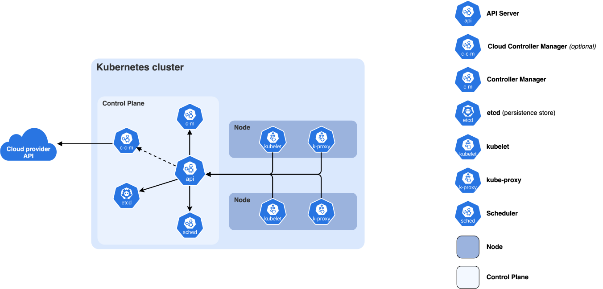

# Orchestration Internals for ML Workloads

## Prerequisites

This chapter assumes no systems background beyond what these foundation chapters cover. Read them first:

- [Computer architecture](../foundations/computer-architecture.md): explains PCIe, NUMA, HBM and NVLink, which come up in every placement decision below.
- [Linux and the OS](../foundations/linux-and-os.md): explains processes, signals, cgroups, tmpfs and the OOM killer, which the scheduler and container sections rely on.
- [Concurrency](../foundations/concurrency.md): explains threads, background workers and blocking versus asynchronous work, which you need for async checkpointing and launcher monitor loops.
- [Networking](../foundations/networking.md): explains NICs, switches, fat trees, InfiniBand/RoCE and RDMA, which you need for the topology and pod-networking sections.
- [Distributed systems](../foundations/distributed-systems.md): explains failure detection, heartbeats, rendezvous and MTBF reasoning, which the launcher and fault-tolerance sections build on.

This chapter covers what happens inside the scheduler, the launcher and the health-check loop when you run a multi-node ML job, and why those internals decide how much of your GPU time turns into training steps or served tokens. The day-to-day SLURM commands are covered in [SLURM for users](slurm/users.md) and [SLURM administration](slurm/admin.md), and the recovery recipes (job arrays, signals, kill switches) are in [Fault Tolerance](../training/fault-tolerance/README.md). None of that is repeated here.

A warning about how current this is: the Kubernetes side of this chapter describes projects that ship a new minor release every few weeks, such as Kueue, JobSet, LeaderWorkerSet, KAI Scheduler, Slinky, the NVIDIA DRA driver and the GPU Operator. Where a claim depends on a specific version it is marked as such. Check the upstream docs before you build on any API field named here.


## What an ML scheduler has to solve

A web-service scheduler packs many small, independent, restartable units onto machines. A distributed training job is the opposite: a single process group of N ranks (a rank is one worker process, usually one per GPU, and the process group is the set of ranks that communicate with each other) that is useless until all N are running, that runs at the speed of its slowest rank, and whose collectives (communication operations in which every rank takes part, such as summing gradients across all GPUs) slow down sharply when ranks are split across the wrong switches. This leads to five requirements, and each one conflicts with at least one of the others.

| Requirement | What it means | What it conflicts with |
|---|---|---|
| Gang scheduling | All N workers start together or none start | Utilization: you have to hold idle nodes while you collect a gang |
| Topology-aware placement | Ranks go on the same leaf switch, rail group, or NVLink domain | Utilization: fragmentation, since strict placement leaves holes |
| Fairness | Every team or user gets its entitled share over time | Utilization and throughput for large jobs |
| Preemption | High-priority work can evict low-priority work | Lost work for the job that gets evicted (checkpoint cost) |
| Backfill | Small jobs fill the holes in front of a reserved large job | Accuracy of runtime estimates, and the large job's start time if those estimates are wrong |

### Why gang scheduling cannot be skipped

Take a cluster of 96 free nodes and two queued jobs that each need 64 nodes. A scheduler that places pods one at a time, as the default Kubernetes scheduler does, can give 48 nodes to each job. Both jobs then sit at `torch.distributed` rendezvous until they time out, and 96 nodes do nothing. A gang scheduler sees that only one of the two jobs fits, admits that one, and leaves the other queued. The cost is that 32 nodes stay idle unless something smaller can be backfilled into them.

### Why topology matters

An NVLink domain is a set of GPUs connected by NVLink, NVIDIA's direct GPU-to-GPU link, which is much faster than going through the network. An all-reduce is the collective that sums a tensor across all ranks and gives every rank the result. Inside an NVLink domain, an all-reduce runs at NVLink bandwidth. Across nodes it runs at NIC (network interface card) bandwidth, which is roughly an order of magnitude lower per GPU (see [networking](../network/README.md)). In a typical cluster each node plugs into a leaf switch, and leaf switches are connected to each other through higher-level spine switches. Across spine switches you also share the fabric with other jobs and are exposed to oversubscription (the spine has less total bandwidth than all the leaves below it, so not every node can use full bandwidth at the same time). Placement matters most for:

- tensor and expert parallelism (splitting individual layers, or MoE experts, across GPUs, which makes those GPUs exchange data on every layer), which should stay inside the NVLink domain
- pipeline stages and data-parallel groups, which should stay under as few leaf or spine switches as possible
- on rail-optimized fabrics (networks where each GPU in a node has its own NIC and the same-numbered NICs of all nodes share a switch), where GPU `i` on every node connects to leaf `i`, keeping the job within one scalable unit so that same-rail traffic stays one hop

The cost of placement is fragmentation: free GPUs scattered in pieces that are too small or in the wrong place for the jobs waiting in the queue. A GB200 NVL72 rack has 18 compute trays (a tray is one server board) with 4 GPUs each. If you place a 16-tray job (64 GPUs) inside one rack, 2 trays (8 GPUs) are left over, and only jobs that need 2 trays or fewer can use them. That is `2/18 = 11%` of the rack stranded unless backfill finds small jobs to fill it.

### Fairness and utilization pull in opposite directions

Strict fair share leaves nodes idle when the team that is entitled to them has nothing queued. Pure utilization lets one team with a deep queue take the whole cluster. Production schedulers resolve this with quotas that can be borrowed, so idle capacity can be used by anyone, combined with reclaim through preemption (stopping a running job to give its resources to another) when the owner comes back. Borrowing is only safe if a borrowed job can be preempted cheaply, and for training that means "can be preempted with a recent checkpoint" (a checkpoint is a saved copy of model and optimizer state that training can resume from). So the checkpoint interval (see [below](#optimal-checkpoint-interval-youngdaly)) is a scheduling parameter as well as a training parameter.


## How SLURM implements each of these

### Node selection: `select/cons_tres`

`SelectType=select/cons_tres` is the plugin that decides which nodes and which resources within a node (CPU cores, memory, and GRES, Slurm's name for generic resources such as GPUs) a job gets. It is the current consumable-resources plugin, and the older `select/cons_res` has been removed in recent releases. I'm fairly but not fully sure that the removal happened in 23.11, so check your version's release notes.

Here is how it works internally, simplified:

1. The scheduler builds a bitmap (one bit per node, set if the node is eligible) of candidate nodes from the job's constraints: partition, features, `--exclude`, reservations, and node state.
2. For each node it computes how many of the job's tasks fit, given the free cores, memory and GRES. GPU GRES is tracked per device file, and with `AutoDetect=nvml` in `gres.conf` each GPU also gets a list of the cores it is close to. On a multi-socket server, each CPU socket with its directly attached memory and PCIe devices forms a NUMA node (non-uniform memory access), and accessing devices attached to the other socket is slower.
3. It then selects nodes. Without a topology plugin it walks the nodes in order and does best-fit. With a topology plugin, the topology plugin's selection routine decides which subset of nodes to evaluate (see the next sections).
4. Within each node it allocates specific cores and GPUs. `--gres-flags=enforce-binding` makes it a hard requirement that the job's CPUs are the ones close to its GPUs. Without the flag, closeness is only a preference.

In practice, for full-node training jobs, `cons_tres` has little to decide. Most ML partitions use `OverSubscribe=EXCLUSIVE` or jobs request `--exclusive`, so the interesting decisions are which nodes the job gets (topology) and when it gets them (priority plus backfill).

### Topology: `topology/tree`

`TopologyPlugin=topology/tree` reads a switch hierarchy from `topology.conf`:

```
# topology.conf -- leaf switches with their nodes, spine with its leaves
SwitchName=leaf01 Nodes=gpu[001-032]
SwitchName=leaf02 Nodes=gpu[033-064]
SwitchName=leaf03 Nodes=gpu[065-096]
SwitchName=spine01 Switches=leaf[01-03]
```

Given a job of N nodes, the tree plugin looks for the lowest switch in the hierarchy whose subtree has N eligible nodes. It then picks leaves under that switch so that the allocation touches as few leaves as possible, preferring leaves that are already partly used, which is a best-fit approach to limit fragmentation. Users can make this stricter:

```bash
# require at most 1 leaf switch, wait up to 2h for that, then accept any placement
sbatch --nodes=32 --switches=1@2:00:00 train.slurm
```

The limit on the wait (`@time`) matters. Without it a 32-node job on a busy cluster might never find a completely empty leaf. `max_switch_wait` in `SchedulerParameters` sets the upper bound that a user can request.

There are two limitations for ML. First, the tree has no concept of NVLink domains. Second, on rail-optimized fabrics a node connects to many leaves (one per rail), which a strict tree can't represent. Sites usually model a scalable unit as one "switch" for this reason.

### Topology: `topology/block`

`topology/block` was added in 23.11 and redesigned in 24.05, according to SchedMD's SLUG'24 material. It models flat groups of nodes with fast connectivity between them. The motivating case is the NVL72 rack, where 18 nodes share one NVLink domain:

```
# topology.conf for block topology
BlockName=nvl72_r01 Nodes=gb[001-018]
BlockName=nvl72_r02 Nodes=gb[019-036]
BlockName=nvl72_r03 Nodes=gb[037-054]
BlockSizes=18,36,54
```

Blocks are ranges of nodes that don't overlap. `BlockSizes` lists the aggregation levels the scheduler is allowed to treat as one unit: a single block, two neighbouring blocks, and so on. Jobs can ask for allocations to be split into segments that each stay within a block, using the `--segment` option. For example, a 64-node job with `--segment=16` asks for 4 segments of 16 nodes, each inside one NVLink domain. I'm uncertain about the exact semantics and the version in which `--segment` appeared. Read `man sbatch` for your release, and NVIDIA's Mission Control docs, which say NVLink-aware scheduling on GB200/GB300 needs `topology/block`.

Since roughly 25.05, Slurm can also configure several topologies per cluster (`topology.yaml`, with different partitions using different plugins). I'm uncertain about this too, so check the `topology.yaml` man page for your version before you rely on it.

### Priority: `priority/multifactor`

The order in which jobs are considered is set by `PriorityType=priority/multifactor`:

```
priority = site_factor
         + PriorityWeightAge       * age_factor        # 0..1, saturates at PriorityMaxAge
         + PriorityWeightAssoc     * assoc_factor
         + PriorityWeightFairshare * fairshare_factor  # 0..1
         + PriorityWeightJobSize   * jobsize_factor    # 0..1
         + PriorityWeightPartition * partition_factor
         + PriorityWeightQOS       * qos_factor
         + sum(PriorityWeightTRES[i] * tres_factor[i])
         - nice
```

Every factor is normalized to [0, 1], so the weights are what actually set the policy. If `PriorityWeightFairshare=10000` and `PriorityWeightAge=1000`, a full week of queue time is worth only a tenth of the fair-share range.

The fair-share factor in its classic form is `F = 2^(-U/S)`, where `U` is the association's normalized usage, decayed with `PriorityDecayHalfLife` (default 7 days), and `S` is its normalized share. Here is a worked example for a team entitled to 25% of the cluster:

| Recent usage U | U/S | F = 2^(-U/S) |
|---|---|---|
| 12.5% | 0.5 | 0.707 |
| 25% (exactly its share) | 1.0 | 0.5 |
| 50% (double its share) | 2.0 | 0.25 |

The default algorithm has been Fair Tree since 19.05. Fair Tree ranks associations by walking the account hierarchy, and it does not apply the formula above at every level, but the intuition is the same: using more than your share lowers your rank, and the effect decays with the half-life. If you use the cluster heavily in one week, your jobs are deprioritized for about the next week. Before you blame the scheduler, look at the factor breakdown with `sprio -l` and the usage with `sshare -l`.

`PriorityWeightJobSize` with `PriorityFavorSmall=NO` favours large jobs. Without it, large jobs can starve, because small jobs keep getting scheduled and the large job never finds N free nodes at once. Backfill (next section) is the other half of the fix.

### Backfill: `sched/backfill`

The main scheduler is event-driven and strict: it walks jobs in priority order and stops at the first one that doesn't fit in a partition. That keeps priority order but leaves holes. `SchedulerType=sched/backfill` runs every `bf_interval` seconds (default 30) and does the following:

1. Builds a timeline of node availability up to `bf_window` minutes ahead (default 1440, i.e. one day), at `bf_resolution` granularity (default 60 s), using the **time limits** of the running jobs.
2. Walks the pending jobs in priority order. For each job it finds the earliest time the job could start and records a reservation for it in the timeline.
3. Starts a lower-priority job now if it fits in the gaps without delaying any reservation made before it.

There are three consequences for ML clusters:

- **Time limits are the scheduler's input.** A 2-hour eval job submitted with a 7-day time limit can't backfill in front of a reserved 512-node training job, because the scheduler assumes it will run for 7 days. Accurate `--time` values give you a better queue position.
- **`bf_window` must cover your longest time limit.** If jobs can run for 7 days but `bf_window=1440`, then the reservation for a large job whose nodes free up on day 3 lies outside the window. Backfill can then place jobs that end up delaying it. SchedMD's guidance is to set `bf_window` to at least the largest partition time limit. The cost is CPU time in `slurmctld` (Slurm's central controller daemon; `slurmd` is the per-node daemon), which you can reduce by raising `bf_resolution`.
- **Large clusters cap the backfill depth.** `bf_max_job_test`, `bf_max_job_user` and `bf_continue` limit how many jobs each backfill cycle looks at. With 50k pending array tasks, the job you care about may never be evaluated. `sdiag` shows backfill cycle times and depth.

### Preemption

There are two preemption types. `PreemptType=preempt/qos` makes preemption follow QoS relationships (`sacctmgr modify qos high set preempt=low`). `preempt/partition_prio` makes it follow partition `PriorityTier`. `PreemptMode` sets what happens to the victim:

| PreemptMode | Effect on the victim | Fits training? |
|---|---|---|
| `CANCEL` | Killed after `GraceTime` | Only with a requeue chain (job array or dependency) |
| `REQUEUE` | Killed after `GraceTime`, put back in the queue with the same job ID | Yes, if the job resumes from a checkpoint |
| `SUSPEND` | SIGSTOP; the processes stay in GPU memory | Rarely: GPU memory isn't freed and NCCL timeouts fire on resume |
| `GANG` | Time-slicing between jobs | Not for GPU jobs |

`GraceTime` is how long the victim has between SIGTERM and SIGKILL. A signal is an asynchronous notification the OS delivers to a process: SIGTERM asks it to exit and can be caught, SIGKILL kills it and can't be caught, and SIGSTOP freezes it. Set it to at least your emergency-checkpoint time. The [preemption section of Fault Tolerance](../training/fault-tolerance/README.md#dealing-with-forced-job-preemption) has the signal-handling side. There are a few more preemption knobs (`PreemptExemptTime`, which protects a job just after it starts, and `preempt_youngest_first` in `PreemptParameters`). Their exact names have changed between releases, so check `slurm.conf(5)`.


## Kubernetes for ML

The [Kubernetes chapter](kubernetes/README.md) gives the practical case against k8s for interactive training. This section explains why that case exists and which add-ons close each gap.

The pieces of a Kubernetes cluster (control plane and nodes) that everything below plugs into:



([source](https://kubernetes.io/docs/concepts/overview/components/))

### Exposing GPUs: device plugins

The original mechanism is the [device plugin API](https://kubernetes.io/docs/concepts/extend-kubernetes/compute-storage-net/device-plugins/). In Kubernetes, a node is a machine and a pod is a group of containers that is scheduled onto one node as a unit. The kubelet is the agent on each node that starts and monitors pods. A device plugin is a gRPC (a remote procedure call protocol) service on each node that registers with the kubelet and implements three calls:

- `ListAndWatch`, which streams a list of device IDs and their health
- `Allocate`, which, given a list of device IDs, returns the env vars, mounts and device nodes to inject into the container
- `GetPreferredAllocation` (optional), which lets the plugin choose which N devices to hand out, for example NVLink-connected ones

The scheduler only sees an integer extended resource such as `nvidia.com/gpu: 8`. It has no idea which GPU, NUMA node, NVLink island or NIC a pod gets. The kubelet sees which devices sit on which PCIe bus (the motherboard bus that connects GPUs and NICs to the CPU) and NUMA node, but the scheduler doesn't. Topology inside the node is handled later by the kubelet's Topology Manager (`--topology-manager-policy=single-numa-node` and similar), which can only reject a pod after the scheduler has placed it. The device plugin model also can't express "a GPU plus the NIC on the same PCIe switch", sharing a device between pods, or devices that span nodes.

### Exposing GPUs: Dynamic Resource Allocation (DRA)

DRA reached GA in Kubernetes v1.34, with the `resource.k8s.io/v1` API on by default. It was alpha with structured parameters in v1.30 and beta in v1.32 ([KEP-4381](https://www.kubernetes.dev/resources/keps/4381/)). Here is how it works:

- A DRA driver on each node publishes **ResourceSlices**: lists of devices with typed attributes such as product name, memory, PCIe root and NVLink clique.
- Admins define **DeviceClasses**, for example "any H100".
- Workloads create **ResourceClaims**, or **ResourceClaimTemplates** for a per-pod claim, that select devices with CEL (Common Expression Language, a small filter-expression language) expressions. Claims can also add constraints such as `matchAttribute`, which puts all devices in the claim on the same PCIe root.
- The **scheduler itself** allocates specific devices to claims while it places the pod. Allocation is part of the scheduling decision, not something the kubelet does afterwards.

```yaml
apiVersion: resource.k8s.io/v1
kind: ResourceClaimTemplate
metadata:
  name: eight-gpus
spec:
  spec:
    devices:
      requests:
      - name: gpus
        exactly:
          deviceClassName: gpu.nvidia.com
          count: 8
```

For ML clusters the important part is [NVIDIA's DRA driver for GPUs](https://github.com/NVIDIA/k8s-dra-driver-gpu), and specifically its **ComputeDomain** abstraction for multi-node NVLink (GB200 NVL72 and later). A ComputeDomain is a claim that spans pods on several nodes. It sets up the IMEX (Internode Memory Exchange) channels that cross-node NVLink memory sharing needs, which a per-node device plugin can't do. I'm moderately confident of this description; the driver has been moving fast. The core of DRA is GA, but parts of the ecosystem (autoscaler support, admin access, partitionable devices) were still beta or alpha at the time of writing.

### NVIDIA GPU Operator components

The [GPU Operator](https://docs.nvidia.com/datacenter/cloud-native/gpu-operator/latest/index.html) is a set of DaemonSets (a DaemonSet runs one copy of a pod on every matching node) that turn a plain node into a GPU node:

| Component | Role |
|---|---|
| Node Feature Discovery (NFD) | Labels nodes with PCI vendor IDs so the rest of the stack knows where to run |
| Driver container | Builds and loads the kernel driver (the OS-level code that talks to the GPU hardware) from a container (optional; many sites install drivers on the host) |
| NVIDIA Container Toolkit | Configures containerd/CRI-O so that containers see the GPUs (CDI or the runtime hook) |
| Device plugin | Advertises `nvidia.com/gpu` (or the DRA driver, on newer setups) |
| GPU Feature Discovery (GFD) | Labels nodes with GPU model, memory, MIG capability and driver/CUDA version, e.g. `nvidia.com/gpu.product` |
| DCGM / DCGM exporter | Health and telemetry, with Prometheus metrics (see [Observability](#observability)) |
| MIG manager | Applies MIG (Multi-Instance GPU, which splits one GPU into isolated smaller GPUs) partition layouts from a node label |
| Validator | Runs CUDA sample workloads to gate the node as ready |

RDMA is handled by the separate [NVIDIA Network Operator](https://docs.nvidia.com/networking/display/kubernetes2410/index.html). It deploys the MOFED/DOCA driver (NVIDIA's Mellanox NIC driver stack), Multus, the SR-IOV and RDMA shared device plugins, and the IPAM pieces covered [below](#rdma-networking-for-pods).

A common failure mode: a driver container upgrade or validator failure takes `nvidia.com/gpu` capacity to 0 on a node, and running pods keep running while new pods stay `Pending`. Alert on allocatable GPU count per node, not just on node `Ready`.

### Why the default kube-scheduler fails at gang scheduling

`kube-scheduler` takes **one pod at a time** from its queue and runs filter and score plugins over the nodes, then binds the pod (records the chosen node, after which the kubelet starts it). It has no concept that 64 pods belong together. A Job or StatefulSet of 64 pods produces 64 independent decisions, and you get the 48+48 deadlock from [earlier](#why-gang-scheduling-cannot-be-skipped). Pod anti-affinity and topology spread constraints don't help, because they constrain where each pod goes, not whether the set should start at all.

The fixes come in three layers:

1. **A coscheduling plugin inside kube-scheduler** ([scheduler-plugins](https://github.com/kubernetes-sigs/scheduler-plugins) `Coscheduling` with a `PodGroup` CRD and `minMember`). Pods wait at the `Permit` stage (a hook between choosing a node and binding the pod) until `minMember` of them have been assigned. This works, but it holds partial reservations while it waits.
2. **A replacement batch scheduler** that schedules whole groups: Volcano or KAI.
3. **Admission control in front of the default scheduler**: Kueue. It doesn't place pods. It only decides when a whole job may be unsuspended, based on quota. A CRD (Custom Resource Definition) adds a new object type to the Kubernetes API, and many of the projects below are CRDs plus a controller that acts on them.

Upstream Kubernetes has been working on native gang scheduling: a `Workload` API plus gang-scheduling support in kube-scheduler (KEP-4671), targeted at alpha around v1.35. I haven't verified its current status; treat it as experimental.

### Kueue vs Volcano vs KAI

| | [Kueue](https://kueue.sigs.k8s.io/) | [Volcano](https://volcano.sh/) | [KAI Scheduler](https://github.com/NVIDIA/KAI-Scheduler) |
|---|---|---|---|
| What it is | Job queueing and quota admission controller | Full batch scheduler that replaces kube-scheduler for its pods | Full batch scheduler (Run:ai's engine, open-sourced April 2025, Apache 2.0) |
| Places pods? | No: the default scheduler (or another one) does | Yes | Yes |
| Gang semantics | All-or-nothing **admission** (quota for the whole job); `waitForPodsReady` evicts or requeues jobs whose pods don't all become ready | `PodGroup` with `minMember`; `gang` plugin | `PodGroup`s, including hierarchical ones (for disaggregated inference) |
| Quota model | `ClusterQueue`/`LocalQueue`, `ResourceFlavor`s, cohorts with borrowing and lending limits | Queues with `proportion` / DRF plugins, `reclaim` action | Hierarchical queues with quotas, over-quota weights, fair share |
| Topology | Topology Aware Scheduling (TAS): `podset-required-topology` / `podset-preferred-topology` against node-label levels | Network-topology-aware scheduling via `HyperNode` CRDs (newer releases; not verified) | TAS from v0.10 (Oct 2025), including hierarchical; NVLink clique placement |
| Preemption | Within a ClusterQueue and across a cohort to reclaim lent quota | `preempt` and `reclaim` actions | Priority and reclaim, plus consolidation to reduce fragmentation |
| Ecosystem fit | Kubernetes SIG project; integrates with Job, JobSet, LWS, RayJob, Kubeflow trainer, plain pods | CNCF project; long history in HPC and AI shops; its own `vcjob` CRD plus integrations | NVIDIA stack (DRA ComputeDomains, Dynamo/Grove); GPU sharing (fractions) |

How to choose:

- **Kueue** if you want to keep kube-scheduler and add multi-tenant quota and job-level admission. Kueue suspends a Job (`spec.suspend: true`) until it fits, then injects node selectors for the chosen `ResourceFlavor` (and TAS domain) and unsuspends it. Pod placement within those selectors is still done pod by pod, so TAS works by narrowing the node set to a domain that Kueue has already confirmed has capacity, and by gating pods with a scheduling gate until it has computed the assignment.
- **Volcano or KAI** if you need the scheduler itself to reason about groups: bin-packing GPUs to limit fragmentation, consolidation, hierarchical gangs, or GPU sharing. The cost is running a second scheduler, and the pods it owns don't benefit from default-scheduler features until the replacement implements them.

Combinations exist, such as Kueue for quota on top of KAI or Volcano for placement. Check the compatibility matrix for your versions. I haven't validated any particular combination.

Here is what Kueue TAS looks like on a training job: all pods inside one rack-level domain, or wait.

```yaml
apiVersion: jobset.x-k8s.io/v1alpha2
kind: JobSet
metadata:
  name: llm-pretrain
  labels:
    kueue.x-k8s.io/queue-name: training
spec:
  replicatedJobs:
  - name: workers
    replicas: 1
    template:
      spec:
        parallelism: 32
        completions: 32
        completionMode: Indexed
        template:
          metadata:
            annotations:
              # the topology level is a node-label key defined in a Kueue Topology object
              kueue.x-k8s.io/podset-required-topology: "example.com/topology-block"
          spec:
            containers:
            - name: trainer
              image: my-trainer:2026.11
              resources:
                limits:
                  nvidia.com/gpu: 8
```

### JobSet and LeaderWorkerSet

A plain `Job` describes a set of identical pods and has no stable network identity. Multi-node training needs stable DNS (the system that maps hostnames to IP addresses) names for rendezvous (the step where all workers find each other before training starts), one failure policy for the whole group, and sometimes several pod roles (for example trainer plus parameter server or data loader). Two SIG-apps/SIG-scheduling-sponsored CRDs provide these:

**[JobSet](https://jobset.sigs.k8s.io/)** is aimed at training. It holds a list of `replicatedJobs`, each an Indexed Job template. It creates a headless Service (a Kubernetes DNS entry per pod with no load balancer) so that pods get names like `<jobset>-<replicatedJob>-<jobIndex>-<podIndex>.<jobset>`, which can be used directly as `MASTER_ADDR`. Its `failurePolicy` (`maxRestarts`, plus rules matched on failure reason) recreates **all** child Jobs when any one fails. That matches what a synchronous training job needs: one dead rank means the whole job restarts from the checkpoint. JobSet also supports exclusive placement per topology domain, one child Job per domain, through the `alpha.jobset.sigs.k8s.io/exclusive-topology` annotation, and it integrates with Kueue.

**[LeaderWorkerSet (LWS)](https://lws.sigs.k8s.io/)** is aimed at multi-node **inference** replicas. Its unit is a group: 1 leader pod plus `size-1` workers, scheduled and restarted together. `replicas` scales the number of groups. It injects `LWS_LEADER_ADDRESS`, `LWS_GROUP_SIZE` and `LWS_WORKER_INDEX`, and `RestartPolicy: RecreateGroupOnPodRestart` restarts the whole group when any member fails. That's correct for TP/PP sharded serving, where a replica missing one shard can't serve. vLLM and SGLang multi-node deployments use it (vLLM through a Ray head on the leader). Rolling updates and HPA work per group.

Rule of thumb: a job that runs to completion is a JobSet; a replicated service whose replica spans nodes is an LWS.

### Topology-aware scheduling on Kubernetes

Topology has to be expressed as **node labels**, because that's the only thing the k8s scheduling layers can match on. A typical hierarchy:

```
example.com/topology-zone      = dc1-hall2
example.com/topology-block     = spine07        # or NVL72 rack / NVLink clique ID
example.com/topology-rack      = r0712
kubernetes.io/hostname         = gpu0712-03
```

Someone has to populate these labels. On clouds the provider may set them (GKE, for example, exposes `cloud.google.com/gce-topology-*` labels). I'm not certain of the exact names on every provider, so check your provider's docs. On bare metal, tools such as NVIDIA's [Topograph](https://github.com/NVIDIA/topograph) read the fabric (UFM, `ibnetdiscover`, cloud topology APIs) and write either k8s node labels or a Slurm `topology.conf`. GFD's `nvidia.com/gpu.clique` label identifies the NVLink domain on GB200-class systems. I believe that label name is correct, but haven't verified it.

Once the labels exist, Kueue TAS, KAI TAS, Volcano HyperNodes and JobSet exclusive placement can all use them. Plain `podAffinity` with `topologyKey` can also express "same rack as each other", but only as a preference, without gang semantics, and it's slow at scale. Don't use it for training.

### RDMA networking for pods

A pod by default has one veth (virtual Ethernet) interface on the cluster network, set up by a CNI (Container Network Interface) plugin,, routed through the host kernel. NCCL (NVIDIA's collective communication library, which PyTorch uses for GPU collectives) over that interface means TCP sockets, roughly 10-25% of the line rate of an IB/RoCE NIC (an order-of-magnitude estimate, not a measurement), plus CPU overhead. RDMA (remote direct memory access) lets a NIC read and write another machine's memory without involving either CPU or kernel. InfiniBand (IB) and RoCE (RDMA over Converged Ethernet) are the two common RDMA networks. There are three ways to give pods the RDMA fabric:

| Approach | How | Tradeoffs |
|---|---|---|
| `hostNetwork: true` | The pod shares the node's network namespace and sees every `mlx5_*` device and IP | Simplest, and near bare-metal NCCL. No network isolation; port collisions between pods; usually needs privileged or broad capabilities; one training pod per node in practice |
| Multus + SR-IOV | [Multus](https://github.com/k8snetworkplumbingwg/multus-cni) attaches extra interfaces; SR-IOV lets one physical NIC present itself as several virtual NICs; the SR-IOV device plugin advertises these virtual functions (VFs) (e.g. `nvidia.com/rdma_vf`) and the SR-IOV CNI moves one VF per rail into the pod | Proper isolation and multi-tenancy. Need one VF per NIC per pod, matching GPU-NIC affinity, IPAM (IP address management) per rail; more moving parts |
| RDMA shared device plugin | Exposes the host's RDMA devices to pods without SR-IOV (`rdma/hca_shared_devices_a`) | Simpler than SR-IOV; isolation is weaker than with VFs |

A Multus attachment request looks like this:

```yaml
metadata:
  annotations:
    k8s.v1.cni.cncf.io/networks: rail0,rail1,rail2,rail3,rail4,rail5,rail6,rail7
spec:
  containers:
  - name: trainer
    resources:
      limits:
        nvidia.com/gpu: 8
        nvidia.com/rdma_vf: 8      # resource name depends on your SR-IOV config
    securityContext:
      capabilities:
        add: ["IPC_LOCK"]          # RDMA needs to pin memory
```

There are four things to verify inside the pod before you trust it:

- `ibv_devices` lists every NIC you expect, and `ulimit -l` is `unlimited`. RDMA registers memory (pins pages, the OS's 4 KB units of memory, so they can't be moved or swapped while the NIC accesses them), and without `IPC_LOCK` or a memlock limit you get `ibv_reg_mr` failures, or NCCL quietly falls back to sockets.
- NCCL's init log (`NCCL_DEBUG=INFO`) shows `NET/IB` and GPUDirect RDMA (`GDRDMA`, the NIC reading GPU memory directly with no copy through host RAM), not `NET/Socket`.
- GPU-to-NIC affinity is right. With DRA you can request a GPU and NIC pair that share a PCIe root. With device plugins you rely on the Topology Manager and luck.
- `nccl-tests` across 2 pods on 2 nodes matches bare-metal bus bandwidth (the per-GPU throughput metric nccl-tests reports, comparable across GPU counts; see [network benchmarks](../network/benchmarks/)).

On clouds, EFA (AWS) and GPUDirect-TCPX/TCPXO (GCP) have their own device plugins and NCCL plugins. The same checks apply.

### Shared memory (`/dev/shm`) pitfalls

`/dev/shm` is a tmpfs (a filesystem held in RAM) that processes on the same machine use to share memory. Container runtimes default `/dev/shm` to **64 MB**. Both PyTorch DataLoader workers, which pass batches through shared memory, and NCCL, which uses shm segments for intra-node transfers when P2P isn't available, fail with errors such as `Bus error`, `unable to write to file </torch_...>`, or NCCL `Error while creating shared memory segment` once a batch or a set of NCCL buffers is larger than that. The fix on k8s is a memory-backed `emptyDir`:

```yaml
spec:
  containers:
  - name: trainer
    volumeMounts:
    - name: dshm
      mountPath: /dev/shm
  volumes:
  - name: dshm
    emptyDir:
      medium: Memory
      sizeLimit: 64Gi
```

There are three catches:

1. Pages in a memory-backed `emptyDir` **count against the container's memory limit**. If you set `memory: 256Gi` and the DataLoader puts 64 GiB in shm, the model process has only 192 GiB. With a hard limit, going over it triggers the cgroup OOM killer (cgroups are the kernel feature that enforces a container's resource limits, and the OOM killer kills processes when a memory limit is exceeded), and with `memory.oom.group=1` that kills the whole pod (see the [k8s chapter](kubernetes/README.md#overcoming-job-reset-on-cpu-oom-event)).
2. `sizeLimit` is enforced by the kubelet's eviction loop, not as a hard tmpfs size, on some versions. I'm unsure of the exact behaviour across versions. Overshooting can mean eviction rather than `ENOSPC`.
3. shm segments left behind by a crashed process stay until the pod exits. Under in-place restarts by torchrun (`--max-restarts`), leaked `/dev/shm/torch_*` files build up across restarts.

With `hostIPC: true`, the pod uses the host's `/dev/shm`. That avoids the size problem but gives up isolation between pods.


## SLURM on K8s and K8s alongside SLURM

Research teams want `sbatch`, `srun` and Unix users. Platform teams want k8s for everything else: inference, CI, data pipelines, and operators for storage and networking. Several projects try to give both.

| Project | Approach | Status (as best I can tell) |
|---|---|---|
| [Slinky](https://github.com/SlinkyProject) (SchedMD, now NVIDIA: NVIDIA announced it was acquiring SchedMD in Dec 2025 and said Slurm stays open source) | `slurm-operator`: runs slurmctld, slurmd, slurmdbd and slurmrestd as pods, managed through CRDs. `slurm-bridge`: a k8s scheduler plugin that lets **Slurm schedule k8s pods**, so both kinds of workload share one view of the nodes | Open source; actively developed. I haven't verified the exact CRD names (e.g. `NodeSet`) for the current version |
| [Soperator](https://github.com/nebius/soperator) (Nebius) | A `SlurmCluster` CRD; controller, worker and login nodes are all pods. The main idea is the "jail": a shared network filesystem mounted as `/` on every Slurm node, so installing a package on a login node makes it appear on all workers | Open source; claims to run on several clouds and on bare metal. I haven't verified how well it works outside Nebius |
| [SUNK](https://www.coreweave.com/products/sunk) (CoreWeave) | Slurm on k8s with k8s-side scheduling integration | Proprietary; CoreWeave customers only |

The tradeoffs that actually matter:

- **Who owns the node?** If the Slurm daemons run as pods on k8s nodes, k8s owns the node lifecycle: drain, cordon, upgrades, GPU Operator. Slurm's `drain` and k8s's `cordon` have to be kept consistent, or a node Slurm considers healthy gets drained underneath a job. Each project solves this differently. Read its docs on node health before you deploy.
- **Two schedulers, one set of GPUs.** Unless something like `slurm-bridge` makes one scheduler the authority, you're statically partitioning nodes between Slurm and k8s, which gives up the utilization argument for running both.
- **Container overhead on the data path.** slurmd running inside a pod still needs host-level access to GPUs, RDMA devices, cgroups and `/dev/shm`. Expect privileged pods and host networking. The performance should be close to bare metal if that access is set up properly, but I haven't seen independent benchmarks, so measure NCCL bus bandwidth and step time yourself.
- **Persistent node state.** Slurm assumes nodes keep their state (installed software, `/home`, `/tmp`). Pods are ephemeral. Soperator's jail is one answer. With Slinky you bake the state into images.

The reverse direction, running k8s workloads inside Slurm allocations, exists as research and site-specific tooling (e.g. starting a kubelet inside a job, or tools that launch Kubernetes workloads on Slurm-allocated nodes). I'm not aware of a widely used open source project for it, and I'd treat it as experimental.


## Distributed launch internals: torchrun and torch.distributed.elastic

`torchrun` is a thin CLI over `torch.distributed.elastic`. The [launchers directory](slurm/launchers/) has working SLURM recipes. This section covers what happens under the hood.

### Process model

```
node k:  torchrun (elastic agent, 1 per node)
           ├── worker local_rank 0  (your train.py)
           ├── worker local_rank 1
           └── ... nproc_per_node workers
```

The agent is not a rank. It runs the rendezvous, spawns workers, monitors them, and restarts them. Workers never talk to the rendezvous directly. They get env vars and connect to the `MASTER_ADDR:MASTER_PORT` store.

### c10d rendezvous

With `--rdzv-backend=c10d --rdzv-endpoint=host:29400`, all agents meet at a `TCPStore` (a small key-value server that PyTorch uses for coordination) hosted on `host:29400`. The store is hosted by the agent whose hostname matches the endpoint (so the endpoint should be one of the job's nodes; `SLURM_JOB_NODELIST`'s first host is the usual choice). The rendezvous is a small state machine kept as one key in the store, updated with compare-and-set (an atomic write that succeeds only if the value hasn't changed since you read it, so concurrent agents can't overwrite each other):

1. **Join.** Each agent adds itself to `participants`. Once `min_nodes` have joined, a `last_call_timeout` timer starts (default 30 s), during which more agents can still join, up to `max_nodes`.
2. **Close.** When `max_nodes` have joined, or `last_call_timeout` expires with at least `min_nodes`, the round closes. Agents arriving later go into `wait_list` for the next round.
3. **Assign ranks.** Each participant gets a **group rank** (node rank) from its position in the sorted participant list. The order isn't tied to hostnames, so don't assume `node_rank == SLURM_NODEID` under c10d.
4. **Heartbeats.** Each agent writes a keep-alive (`keep_alive_interval` default 5 s; after `keep_alive_max_attempt` default 3 missed beats, the node is considered dead).

If `min_nodes` never join within `join_timeout` (default 600 s), the rendezvous fails. That's the error you see when one node of an allocation never starts. These timeouts can be set with `--rdzv-conf join_timeout=900,last_call_timeout=60`.

### How the env vars are derived

After the rendezvous, each agent computes the following for its workers:

| Variable | Source |
|---|---|
| `GROUP_RANK` | The node's index from the rendezvous |
| `LOCAL_RANK` | 0..`nproc_per_node-1` |
| `LOCAL_WORLD_SIZE` | `nproc_per_node` |
| `RANK` | `sum(local_world_size of all nodes with lower group rank) + LOCAL_RANK`; with a uniform `nproc_per_node` this is `GROUP_RANK * nproc_per_node + LOCAL_RANK` |
| `WORLD_SIZE` | The sum of `local_world_size` across all participants in **this round** |
| `ROLE_RANK`, `ROLE_WORLD_SIZE` | The same, within a role (normally all workers share one role) |
| `MASTER_ADDR`, `MASTER_PORT` | Chosen by the group-rank-0 agent (its hostname plus a free port), published through the rendezvous store |
| `TORCHELASTIC_RESTART_COUNT` | Number of restarts so far; useful for logging and for skipping warm-up work on restart |
| `TORCHELASTIC_RUN_ID` | `--rdzv-id`; must be the same on all nodes of one job and different across jobs |

So `MASTER_ADDR` under c10d is **not** the rendezvous endpoint. It's whichever node won group rank 0. In recent versions, workers can reuse the agent's store instead of creating a second one (`TORCHELASTIC_USE_AGENT_STORE`). That detail has changed across versions and isn't something to rely on.

`WORLD_SIZE` can change between rounds when `min_nodes < max_nodes`. Code that hard-codes the global batch from `WORLD_SIZE` at launch time will silently change its effective batch size after an elastic resize.

### What happens on a worker failure

The agent's monitor loop polls the worker processes every `monitor_interval` seconds (default 0.1 s in recent versions; it used to be 5 s):

1. A worker exits non-zero, for example after an NCCL watchdog timeout (a background thread that aborts the process when a collective takes longer than the timeout), a CUDA error or an OOM. The agent marks its local group as `FAILED`.
2. If `remaining_restarts > 0`, the agent **kills all its local workers** (SIGTERM, then SIGKILL after a grace period), decrements `remaining_restarts` and **re-enters the rendezvous** as a new round.
3. The other nodes' agents notice that `num_nodes_waiting > 0` (someone is in the wait list for a new round). They stop their healthy workers and rejoin **without** decrementing their own restart count, because a membership change is not counted as a failure.
4. A new round closes, ranks are reassigned, and all workers start again from `main()`. **Your code has to load the latest checkpoint.** torchrun restarts processes; it doesn't restore state.
5. When `remaining_restarts` reaches 0 on any agent, that agent exits with the failure, and its error file (if you used `@record`) contains the traceback of the first failing worker.

Practical consequences:

- **In-place restarts only help with software or transient failures.** If the failure is a dead GPU, the restarted worker fails again on the same GPU, and you burn through `--max-restarts`. For hardware failures the node has to go away, which means a scheduler-level requeue on a new node set (SLURM job array or `--requeue`, JobSet `failurePolicy`).
- **A node that dies outright** (kernel panic, which is a fatal OS crash, or a network partition, where the node is alive but unreachable) takes down its agent, so no error is reported. The other agents only find out through missed heartbeats in the rendezvous or, more commonly, through an NCCL timeout in their own workers. With `NCCL_TIMEOUT` / `TORCH_NCCL_*` timeouts at the default of 10 minutes, that's 10 minutes of lost work per failure before recovery even begins. `TORCH_NCCL_ASYNC_ERROR_HANDLING` and `TORCH_NCCL_HEARTBEAT_TIMEOUT_SEC` control this. See [hanging and deadlocks](../debug/torch-distributed-hanging-solutions.md).
- **Scale-up.** A new node joining with `--nnodes=MIN:MAX` triggers a restart of everyone, at full restart cost. Elastic scale-up is seldom worth it for LLM training, because the restart costs as much as a failure. Most large runs use a fixed `--nnodes=N` and a scheduler-level requeue.
- PyTorch 2.14 adds experimental in-place process group reconfiguration. See [Fault Tolerance](../training/fault-tolerance/README.md#rebuilding-the-process-group-in-place).


## Fault tolerance at scale

### Failure-rate arithmetic

For a synchronous job, any single component failure is a job failure. With `N` independent components that each have a mean time between failures of `MTBF_1`, the job's MTBF is roughly `MTBF_1 / N`.

The Llama 3 paper ([arXiv:2407.21783](https://arxiv.org/abs/2407.21783), section 3.3.4) gives the best public numbers for a run at this scale:

- 16,384 H100 GPUs, over a 54-day snapshot of Llama 3 405B pre-training
- 466 job interruptions: 47 planned (firmware and kernel upgrades, config and dataset updates) and 419 unexpected
- About 78% of the unexpected interruptions were attributed to confirmed or suspected hardware issues; GPU issues were the largest category at 58.7%
- Top root causes in Table 5: faulty GPU 148, GPU HBM3 memory 72 (HBM is the high-bandwidth memory stacked next to the GPU die), software bug 54, network switch/cable 35, host maintenance 32, GPU SRAM 19, GPU system processor 17
- Effective training time above 90%; only 3 cases needed significant manual intervention

footnote: Table 5's counts sum to 419, but the percentage given for the first row (30.1%) doesn't match `148/419 = 35.3%`. I use the counts here.

Here is what that implies:

```python
hours = 54 * 24                    # 1296 h
unexpected = 419
print(unexpected / 54)             # 7.76 unexpected interruptions per day
mtbi_h = hours / unexpected        # 3.09 h between unexpected interruptions
print(mtbi_h)
# if we pretend every interruption is attributable to one of 16,384 GPUs (upper bound on per-GPU failure rate)
print(mtbi_h * 16384 / 8760)       # ~5.8 years implied MTBF per GPU "slot" (GPU + its share of host/network)
```

The same arithmetic run forwards: if each GPU together with its share of host and network has an MTBF of 50,000 hours, then

- a 16,384-GPU job has a job-level MTBF of `50000 / 16384 = 3.05 h`, which means `24 * 16384 / 50000 = 7.9` interruptions per day
- a 1,024-GPU job has a job-level MTBF of `50000 / 1024 = 48.8 h`, about one interruption every 2 days

The per-GPU number looks very reliable, and the job-level number is still a failure every few hours. At 16k GPUs, **restart cost** and **checkpoint cost** matter as much as model FLOPs utilization.

The same arithmetic applies to starting a job: if a node passes your pre-flight checks but still has a 0.5% chance of being bad, the probability that a 256-node job starts on all-good nodes is `0.995^256 = 0.28`. At 0.1% it is `0.999^256 = 0.77`, and for 2048 nodes `0.999^2048 = 0.13`. This is why health checks need to run **before** a large job starts, and why they have to find the bad node rather than just report that the job failed.

### Optimal checkpoint interval (Young/Daly)

With a blocking checkpoint cost `C` (the time training is stalled per checkpoint) and job-level MTBF `M`, Young's first-order optimum for the interval between checkpoints is:

```
tau_opt = sqrt(2 * C * M)
```

The time lost to checkpointing plus rework is about `C/tau + tau/(2M)` (on average, half an interval is redone after each failure). At the optimum the two terms are equal, so the total is about `sqrt(2C/M)`. You also pay a fixed restart cost `R/M` per unit time (rescheduling, process startup, loading the checkpoint, NCCL init, warm-up), which no checkpoint interval reduces.

Worked example using the Llama 3 rate, `M = 3.09 h = 11,135 s`:

| Blocking checkpoint cost C | tau_opt = sqrt(2CM) | Checkpoint overhead C/tau | Expected rework tau/2M | Total |
|---|---|---|---|---|
| 300 s (sync write to slow storage) | 2585 s (43 min) | 11.6% | 11.6% | 23.2% |
| 60 s (sync write to a fast parallel filesystem, i.e. shared storage striped across many servers, such as GPFS or Lustre) | 1156 s (19 min) | 5.2% | 5.2% | 10.4% |
| 5 s (async: only the device-to-host copy blocks) | 334 s (5.6 min) | 1.5% | 1.5% | 3.0% |

Add the restart cost. With `R = 10 min`, `R/M = 600/11135 = 5.4%`. So even with async checkpointing, a 16k-GPU job at this failure rate loses about `3.0 + 5.4 = 8.4%` before counting stragglers or planned maintenance. That's consistent with Llama 3's ">90% effective training time", and it shows why Meta spent effort on reducing job startup time as well as checkpoint time.

Young's formula assumes `C << M`. Daly's higher-order correction, `tau = sqrt(2CM) * [1 + (1/3)sqrt(C/2M) + (1/9)(C/2M)] - C`, gives 2389 s instead of 2585 s for `C = 300`, and 1116 s instead of 1156 s for `C = 60`. The first-order formula is good enough when C is a minute or less. The total-loss curve is flat around the optimum, so being off by a factor of 1.5 costs little. The overhead depends on `sqrt(C)`, so the way to cut it is to reduce C.

### Async and in-memory checkpointing

What is `C` for a large model? Take a 405B model with bf16 weights, fp32 master weights and two fp32 Adam moments, which is `2 + 4 + 4 + 4 = 14` bytes per parameter:

```python
B = 405e9 * 14          # 5.67e12 bytes = 5.67 TB of checkpoint
print(B / 1e12)         # 5.67 s at an aggregate 1 TB/s write bandwidth
print(B / 100e9)        # 56.7 s at 100 GB/s
print(B / 16384 / 1e6)  # 346 MB per GPU when sharded across 16,384 GPUs
print(B / 16384 / 25e9 * 1e3)  # ~14 ms device-to-host per GPU at an assumed 25 GB/s effective PCIe
```

The storage write is seconds to minutes. The per-GPU device-to-host copy (GPU memory to CPU RAM over PCIe, into pinned host memory, which is memory locked in place so the GPU can copy into it directly) is milliseconds. **Async checkpointing** makes `C` equal to the copy time. The training step continues while a background thread or process writes the host copy to storage. PyTorch's `torch.distributed.checkpoint.async_save` (DCP) does this. The constraints are:

- Host memory: `346 MB * 8 = 2.8 GB` per 8-GPU node in this example, which is fine. For small-DP-degree setups where each GPU holds tens of GB of optimizer state, pinned host buffers can become the limit.
- The next checkpoint can't start until the previous upload has finished, so `tau` has to be longer than the time to write one checkpoint to storage.
- The write is not durable until the upload finishes. A failure during the upload means you fall back to the checkpoint before it. Keep at least 2 checkpoints (see [Frequent checkpoint saving](../training/fault-tolerance/README.md#frequent-checkpoint-saving)).

**In-memory / peer checkpointing** goes a step further: each rank also stores its shard in the host RAM of a **different** node (a buddy in another failure domain). If a node dies, its replacement fetches the shard from the buddy over the network, rather than everyone reading from the parallel filesystem. The restart then loads at network speed. Gemini (SOSP'23) and several in-house systems describe this approach. Persistent checkpoints still get written to storage, less often. This only helps if your restart path can use a peer copy, and if a replacement node joins quickly, which means hot spares.

### Hot spares

A spare is only useful if it is **already healthy, imaged and inside the allocation**. If you have to wait for the scheduler to get one, it isn't hot. How many do you need? Suppose a node failure takes `T_repair` to fix (reboot, diagnose, RMA), and nodes fail independently, each at rate `1/MTBF_node`. Then the number of nodes out of service at any time is roughly Poisson-distributed (the distribution of the number of independent random events in a fixed time) with mean `N * T_repair / MTBF_node`.

Example: 2048 nodes, an 8-GPU node MTBF of `50000/8 = 6250 h`, and a 24-hour turnaround from failure to returned to service:

```python
import math
lam = 2048 * 24 / 6250       # 7.86 nodes out of service on average
p, k = 0.0, 0
while p < 0.99:              # p99 of Poisson(lam)
    p += math.exp(-lam) * lam**k / math.factorial(k); k += 1
print(lam, k - 1)            # 7.86, 15
```

So 16 spares (0.8%) cover the 99th percentile of concurrent failures, under the independence assumption. Correlated failures, such as a rack PDU (power distribution unit), a leaf switch or a bad firmware rollout, break that assumption, which is why the [5-10% advice in Fault Tolerance](../training/fault-tolerance/README.md#always-plan-to-have-more-nodes-than-needed) is reasonable for new hardware even though the Poisson calculation gives a lower number. For topology-constrained jobs, spares have to be **inside the same block**. One spare tray per NVL72 rack is a very different cost from 16 spare nodes anywhere in the cluster.

### Health checks before the job starts (DCGM diag levels)

`dcgmi diag -r N` runs increasingly long test suites. The [NVIDIA debug chapter](../compute/accelerator/nvidia/debug.md#running-diagnostics) has the commands and sample output. Durations vary by GPU and DCGM version. These are rough figures:

| Level | Runtime (approx.) | Covers | Where to run it |
|---|---|---|---|
| `-r 1` | Seconds | Software and deployment checks: driver, persistence mode, NVML, permissions | Every job prolog |
| `-r 2` | A few minutes | Plus a short PCIe/NVLink bandwidth test, memory and short stress tests | Epilog, or a prolog for large jobs; the repo author found it catches most faulty GPUs |
| `-r 3` | 10-30 min | Plus longer stress tests: targeted power and stress, memory bandwidth | After a reboot or repair, before the node rejoins the pool |
| `-r 4` | 1+ h | Plus extended memory tests and more | Suspected silent data corruption; before RMA |

A practical layout:

- **Prolog (fast, every job):** GPU count (`nvidia-smi -L | wc -l`), `-r 1`, no pending row remaps, no new Xids (error codes the NVIDIA driver writes to the kernel log) since boot, IB ports `Active` at the expected rate, required filesystems mounted. Keep it under about 30 s, because it runs on every node of every job.
- **Epilog:** `-r 2`, a check for leftover GPU processes, and checks that GPU memory is free and that `/dev/shm` has been cleaned up. A failing epilog drains the node before the next job lands on it.
- **Pre-flight for big jobs:** a 2-node NCCL all-reduce between neighbours, run in a tree across the whole allocation (pairs, then quads), plus a short GEMM benchmark per GPU compared against the fleet median. This catches the slow-but-working GPU that DCGM passes.

In Slurm these are `Prolog=`, `Epilog=` and `HealthCheckProgram=` (run every `HealthCheckInterval` seconds by slurmd; [LBNL NHC](https://github.com/mej/nhc) is the common framework). On k8s the equivalents are a GPU Operator validator, the DCGM health check, node problem detectors, and init containers in the training pod. Cloud providers increasingly run their own checks. Ask yours what they run between tenants.

### Automatic node draining

The loop that ties this together:

```
health signal (prolog fail / epilog fail / NHC / Xid / DCGM health watch / NCCL timeout attributed to host)
    -> drain the node with a machine-parseable reason:
         scontrol update nodename=gpu123 state=drain reason="xid79:2026-11-05T03:12"
         kubectl cordon gpu123 && kubectl label node gpu123 health=failed
    -> requeue the job onto the remaining nodes plus spares
    -> repair workflow: reboot -> dcgmi diag -r 3 -> pass: resume / fail: RMA
```

Some design points:

- **Drain, don't down.** A drained node lets running jobs finish. The node is just no longer scheduled.
- **The reason string is data.** Encode the failure class and a timestamp so you can count recurrences per GPU serial (see [detecting the same broken node](../compute/accelerator/nvidia/debug.md#how-to-detect-if-you-get-the-same-broken-node-again-and-again)). Undraining automatically after a reboot without a diag pass brings flaky nodes back into the pool. [undrain-good-nodes.sh](slurm/undrain-good-nodes.sh) is the narrow, safe version of this.
- **Attributing an NCCL timeout is hard.** Every rank times out, and only one node is at fault. The NCCL flight recorder (`TORCH_NCCL_TRACE_BUFFER_SIZE`, with dumps on timeout) shows which rank never entered the collective. Llama 3 used it extensively. Automate the analysis that picks the suspect, or you'll drain the wrong node or all of them.
- **Rate-limit draining.** A bug in a health check or a shared-storage hiccup can drain 30% of the cluster in a minute. Cap automatic drains per time window and page a human above that cap.


## Inference serving orchestration

Training is scheduled as one huge long-lived gang. Inference is many replicas, each possibly multi-node, whose number tracks demand. Orchestration problems that don't matter for training become the main problems here.

### Autoscale on queue depth and KV-cache use, not CPU

An LLM server's CPU is mostly idle. GPU "utilization" from NVML (NVIDIA's management library) is the fraction of time any kernel (a function launched on the GPU) ran, which reads close to 100% at batch size 1 and at batch size 256 alike, so it says nothing about headroom (see [real GPU utilization](../compute/accelerator/nvidia/debug.md#how-to-get-the-real-gpu-utilization-metrics)). The signals that do track saturation in a continuous-batching server:

| Signal | vLLM metric name (changes across versions; check `/metrics`) | Meaning |
|---|---|---|
| Waiting queue length | `vllm:num_requests_waiting` | Requests admitted but not yet scheduled; above 0 for long means you're at capacity |
| KV-cache use | `vllm:gpu_cache_usage_perc` (renamed `vllm:kv_cache_usage_perc` in newer versions, I believe) | Near 1.0 leads to preemption and recompute of sequences, and TTFT spikes |
| Running batch size | `vllm:num_requests_running` | Concurrency actually achieved |
| TTFT / TPOT histograms (time to first token, time per output token) | `vllm:time_to_first_token_seconds`, `vllm:time_per_output_token_seconds` | The SLO (service-level objective, the latency target you've committed to) itself |

Use a scaler that can read Prometheus (the standard time-series metrics system on k8s) metrics, such as [KEDA](https://keda.sh/) or the HPA with a custom metrics adapter, targeting something like "average waiting requests per replica < 2" or "KV-cache use < 0.8". The exact thresholds depend on your traffic. Load-test to find the knee of the latency curve; don't copy numbers from elsewhere. Scale-down needs a long stabilization window, because a cold start costs far more than a few minutes of an idle replica.

Routing matters as much as replica count. Round-robin load balancing ignores prefix-cache locality and each replica's KV load. The Kubernetes [Gateway API Inference Extension](https://github.com/kubernetes-sigs/gateway-api-inference-extension) (an endpoint picker that routes on queue depth, KV use and LoRA adapter residency), [llm-d](https://github.com/llm-d/llm-d) and NVIDIA Dynamo implement KV- and prefix-aware routing. All three were early-stage projects at the time of writing, so check their maturity yourself.

### Cold-start budget arithmetic

Scale-up latency is a sum of stages that run one after another. Here is an example for a 70B model in bf16 (`70e9 * 2 = 140 GB` of weights), TP=8 on one node:

| Stage | Assumption | Time |
|---|---|---|
| Node provisioning (if the cluster autoscaler has to add a node) | Cloud VM plus GPU driver and operator readiness | Minutes. Highly variable, and the main reason to keep warm capacity |
| Image pull | 10 GB image at 1 GB/s (registry or local mirror) | 10 s; avoid this with pre-pulled or lazily loaded images |
| Weight load from object storage | 1 GB/s per node | `140 / 1 = 140 s` |
| Weight load from a shared parallel filesystem | 2 GB/s per client | `140 / 2 = 70 s` |
| Weight load from local NVMe | ~25 GB/s (a 4-drive Gen4 array, assumed) | `140 / 25 = 5.6 s` |
| Engine init: CUDA graph capture (recording a sequence of kernel launches so it can be replayed cheaply), `torch.compile`, KV allocation | Depends on engine and flags | Seconds to minutes; measure it |

The arithmetic is just `bytes / min(storage bandwidth, NIC bandwidth, PCIe bandwidth)`, done per node, and you have to measure the real bandwidth. To turn it into a capacity requirement: if load can grow by `g` fraction within one cold-start time `T_cold`, keep at least `g` spare capacity warm. If traffic can rise 10% in 5 minutes and cold start is 5 minutes, you need about 10% headroom. If cold start is 30 s, you need much less. Cutting cold start lets you run at higher utilization.

The [model loading section of the inference chapter](../inference/README.md#speeding-up-model-loading-time) covers engine-side techniques: pre-sharded weights, tensorizer, and loading directly to GPU.

### Model weight distribution

Scaling out by many replicas at once multiplies the storage load: `200 replicas * 140 GB = 28 TB`. At 50 GB/s of aggregate storage egress that takes `28000 / 50 = 560 s`, no matter how fast each node is. Some options:

- **Node-local cache.** A DaemonSet or init container that pre-stages the weights for the current model version onto local NVMe (hostPath or a local PV). New replicas on a warm node load at NVMe speed.
- **Peer-to-peer fan-out.** Each node that already has the weights serves them to others, BitTorrent-style or as a tree. Total time then grows with `log(N)` rather than `N`. Container-registry P2P tools (e.g. Dragonfly, Spegel) and OCI-packaged weights (OCI is the standard container image format) make this usable on k8s. I haven't benchmarked them.
- **Image volumes / OCI artifacts.** Weights shipped as OCI artifacts and mounted with k8s image volumes (alpha in 1.31, beta later; I haven't verified the current status). This gets registry caching and P2P for free.
- **Don't bake weights into the application image.** A 140 GB layer makes every code change a 140 GB pull.

### Multi-node inference replicas

When one replica spans nodes (for example a 600B+ MoE with wide expert parallelism, or disaggregated prefill and decode pools), the replica has the same gang and topology requirements as a training job, inside a service that autoscales:

- Use **LeaderWorkerSet** (or KAI/Grove hierarchical PodGroups for disaggregated setups) so the group is scheduled, restarted and rolled together.
- Keep a replica inside one NVLink domain if TP or EP spans the nodes. Express that with TAS required topology on the group.
- Any member failing makes the replica unusable. Whole-group restart plus enough replicas for N+1 redundancy is the simple, correct approach.
- Autoscaling works in units of whole groups. A 4-node replica means you scale in 32-GPU steps, and cold start includes every member's weight load plus NCCL init across the group.


## Observability

The aim is to tell, within minutes, whether a job is **dead**, **hung**, **slow**, or **healthy but slow because of the code**, and if it's slow, which node is responsible.

### GPU signals (DCGM exporter)

The [dcgm-exporter](https://github.com/NVIDIA/dcgm-exporter) field list is configurable through a CSV. These fields are worth enabling and alerting on:

| Field | Why |
|---|---|
| `DCGM_FI_PROF_SM_ACTIVE`, `DCGM_FI_PROF_PIPE_TENSOR_ACTIVE` | Real compute use, unlike `DCGM_FI_DEV_GPU_UTIL`. A per-rank drop shows a straggler or a rank stuck in a collective |
| `DCGM_FI_DEV_XID_ERRORS` | The most recent Xid; any change should page or drain (see [Xid errors](../compute/accelerator/nvidia/debug.md#xid-errors)) |
| `DCGM_FI_DEV_ECC_DBE_VOL_TOTAL` (ECC double-bit errors: memory errors that error-correcting codes detect but can't fix), `DCGM_FI_DEV_ROW_REMAP_PENDING`, `DCGM_FI_DEV_ROW_REMAP_FAILURE` | Memory health: drain on pending remaps, RMA on a remap failure |
| `DCGM_FI_DEV_CLOCK_THROTTLE_REASONS` (`DCGM_FI_DEV_CLOCKS_EVENT_REASONS` in newer DCGM) | Thermal or power throttling: the most common cause of a "working but slow" GPU |
| `DCGM_FI_DEV_SM_CLOCK`, `DCGM_FI_DEV_POWER_USAGE`, `DCGM_FI_DEV_GPU_TEMP`, `DCGM_FI_DEV_MEMORY_TEMP` | Context for throttling; the Llama 3 paper reports a 1-2% diurnal throughput swing from temperature affecting DVFS (dynamic voltage and frequency scaling, where the GPU lowers its clock when hot or power-limited) |
| `DCGM_FI_DEV_NVLINK_CRC_FLIT_ERROR_COUNT_TOTAL` (and the replay/recovery counters) | NVLink link health |
| `DCGM_FI_PROF_NVLINK_TX_BYTES`, `DCGM_FI_PROF_PCIE_TX_BYTES`/`RX_BYTES` | Traffic patterns; a rank with clearly different traffic is suspicious |
| `DCGM_FI_DEV_FB_USED` | Memory leaks across steps; leftover allocations after a job ends |

Field names drift between DCGM versions, so check `dcgmi dmon -l` against the exporter's CSV after every upgrade.

### Network signals

For InfiniBand and RoCE, per-port counters in sysfs (the kernel's virtual filesystem of device information; `/sys/class/infiniband/<dev>/ports/<port>/counters/` and `.../hw_counters/`):

| Counter | Meaning |
|---|---|
| `port_xmit_data`, `port_rcv_data` | Throughput (in units of 4 bytes, so multiply by 4) |
| `symbol_error`, `link_error_recovery`, `link_downed` | Physical layer: bad cable or transceiver; any increase during a job is suspicious |
| `port_rcv_errors`, `port_xmit_discards` | Corrupt or dropped packets |
| `port_xmit_wait` | Time spent waiting for credits, a sign of congestion |
| RoCE `hw_counters` (ECN marks congested packets and DCQCN is the RoCE congestion-control protocol that reacts to them by sending CNP packets): `np_cnp_sent`, `rp_cnp_handled`, `out_of_sequence`, `packet_seq_err` | ECN/DCQCN activity and loss; a high out-of-sequence count means drops |

Export these with node-exporter's infiniband collector or a vendor tool (UFM, or the Network Operator's exporters), and correlate with the switch side: a port's error counters at the switch point to the cable, not the host. The [network debug chapter](../network/debug/README.md) has the debugging workflow. NCCL itself can emit per-collective timings through its profiler plugin interface and through the PyTorch flight recorder. The flight recorder is cheap enough to leave on for large runs.

### Job-level signals

Per rank, from the training loop (not only on rank 0):

- step time, split into data wait, forward/backward compute, and time blocked in collectives (CUDA events, which are GPU-side timestamps, placed around the comms, or the profiler for sampled steps)
- tokens/s and MFU, computed rather than estimated
- checkpoint save duration (the blocking part and the total), and time from job start to first step, which is your restart cost `R`
- heartbeat: a per-rank "last step completed" timestamp written to the metrics system. Alert on "no progress for k × median step time", which catches hangs that never produce an error (see the [is-job-hanging watchdog](../training/fault-tolerance/README.md#is-job-hanging-watchdog))

Per job, from the scheduler: queue wait, number of requeues, the nodes used in each attempt (so failures can be attributed), and preemptions.

### Alerting on stragglers

In synchronous training the step time is the **maximum** over ranks. One GPU running at `1/1.1` speed, for example because of thermal throttling, makes the whole job about 9% slower. At 16,384 GPUs that's like losing `0.1 * 16384 = 1638` GPUs. The Llama 3 paper notes stragglers "often appearing as functioning but slow communications". The slow rank finishes compute late, and everyone else's time shows up as waiting in the collective. Two consequences:

- **Collective wait time points at the wrong ranks.** The healthy ranks wait the longest. Look for the rank with the **least** time waiting in collectives, or the longest compute time per step.
- A practical detector: for each step, compute each rank's compute time (excluding collective wait), compare it with the median across ranks, and flag a rank that is more than X% above the median for M consecutive steps. Cross-check against that node's DCGM clocks and throttle reasons and against its NIC error counters. X and M need to be tuned per job. Start from the run-to-run noise you observe on a healthy run, not from a fixed number.

When a straggler is confirmed, it's a drain-and-requeue event just like a crash: the arithmetic above says that a 10% straggler costs more per hour at scale than a restart does, as long as the restart is fast.


## Further reading

- Llama 3 herd of models, section 3.3.4 Reliability and Operational Challenges: [arXiv:2407.21783](https://arxiv.org/abs/2407.21783)
- J. W. Young, "A first order approximation to the optimum checkpoint interval", CACM 1974; J. T. Daly, "A higher order estimate of the optimum checkpoint interval for restart dumps", FGCS 2006
- Slurm docs: [select/cons_tres](https://slurm.schedmd.com/cons_tres.html), [topology](https://slurm.schedmd.com/topology.html), [topology.conf](https://slurm.schedmd.com/topology.conf.html), [multifactor priority](https://slurm.schedmd.com/priority_multifactor.html), [Fair Tree](https://slurm.schedmd.com/fair_tree.html), [scheduling configuration and backfill](https://slurm.schedmd.com/sched_config.html), [preemption](https://slurm.schedmd.com/preempt.html), and SchedMD's SLUG'24 talks on topology/block
- Kubernetes: [device plugins](https://kubernetes.io/docs/concepts/extend-kubernetes/compute-storage-net/device-plugins/), [Dynamic Resource Allocation](https://kubernetes.io/docs/concepts/scheduling-eviction/dynamic-resource-allocation/), [KEP-4381](https://www.kubernetes.dev/resources/keps/4381/), [Topology Manager](https://kubernetes.io/docs/tasks/administer-cluster/topology-manager/)
- NVIDIA: [GPU Operator](https://docs.nvidia.com/datacenter/cloud-native/gpu-operator/latest/index.html), [DRA driver for GPUs](https://github.com/NVIDIA/k8s-dra-driver-gpu), [KAI Scheduler](https://github.com/NVIDIA/KAI-Scheduler), [Topograph](https://github.com/NVIDIA/topograph), [dcgm-exporter](https://github.com/NVIDIA/dcgm-exporter), [DCGM diagnostics](https://docs.nvidia.com/datacenter/dcgm/latest/user-guide/dcgm-diagnostics.html)
- Batch on k8s: [Kueue](https://kueue.sigs.k8s.io/) (including [Topology Aware Scheduling](https://kueue.sigs.k8s.io/docs/concepts/topology_aware_scheduling)), [Volcano](https://volcano.sh/), [JobSet](https://jobset.sigs.k8s.io/), [LeaderWorkerSet](https://lws.sigs.k8s.io/), [scheduler-plugins coscheduling](https://github.com/kubernetes-sigs/scheduler-plugins)
- Networking for pods: [Multus](https://github.com/k8snetworkplumbingwg/multus-cni), [SR-IOV network device plugin](https://github.com/k8snetworkplumbingwg/sriov-network-device-plugin), [NVIDIA Network Operator](https://docs.nvidia.com/networking/display/kubernetes2410/index.html)
- Slurm and k8s together: [Slinky](https://github.com/SlinkyProject), [Soperator](https://github.com/nebius/soperator) and its [architecture explainer](https://nebius.com/blog/posts/soperator-in-open-source-explained)
- PyTorch: [torchrun / elastic](https://pytorch.org/docs/stable/elastic/run.html), [rendezvous](https://pytorch.org/docs/stable/elastic/rendezvous.html), [Distributed Checkpoint async_save](https://pytorch.org/docs/stable/distributed.checkpoint.html), [flight recorder](https://pytorch.org/tutorials/prototype/flight_recorder_tutorial.html)
- Inference: [Gateway API Inference Extension](https://github.com/kubernetes-sigs/gateway-api-inference-extension), [llm-d](https://github.com/llm-d/llm-d), [KEDA](https://keda.sh/)
- Gemini: "Fast Failure Recovery in Distributed Training with In-Memory Checkpoints", SOSP 2023
- In this book: [SLURM for users](slurm/users.md), [SLURM administration](slurm/admin.md), [launchers](slurm/launchers/), [Kubernetes gotchas](kubernetes/README.md), [Fault Tolerance](../training/fault-tolerance/README.md), [NVIDIA GPU troubleshooting](../compute/accelerator/nvidia/debug.md), [hanging and deadlocks](../debug/torch-distributed-hanging-solutions.md), [Inference](../inference/README.md), [Networking](../network/README.md)
