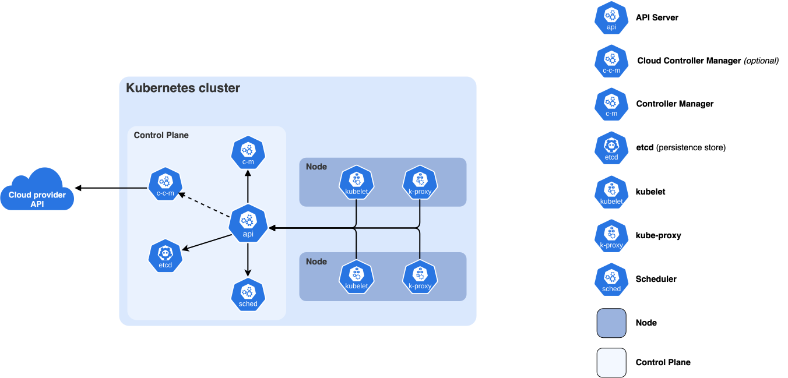

# Kubernetes From Zero

## Prerequisites

This chapter assumes you know ML well and systems not at all. Read these first, or keep them open next to this one:

- [Linux and the OS](../foundations/linux-and-os.md): processes, signals, cgroups, namespaces and the OOM killer. Kubernetes is mostly a distributed manager for those primitives.
- [Containers and virtualization](../foundations/containers-and-virtualization.md): images, registries and container runtimes. A pod is a group of containers, so you need to know what a container is.
- [Networking](../foundations/networking.md): IP addresses, ports, DNS, NAT and load balancing, which the Service and NetworkPolicy sections rely on.
- [Distributed systems](../foundations/distributed-systems.md): consensus, leases and eventual consistency, which explain why the control plane is built around etcd and watches.

What this chapter covers: how Kubernetes works inside (desired state, controllers, the API server, etcd, the scheduler, the kubelet), every core object with a complete YAML file, scheduling controls, how to extend Kubernetes with your own resource types and operators, how GPUs get into containers, how to run training and inference on GPU nodes, and how to debug a pod that won't run.

What it doesn't cover: the ML-specific scheduling internals (gang scheduling, Kueue/Volcano/KAI, DRA, topology-aware placement, RDMA for pods, failure-rate arithmetic). Those are in [Orchestration internals](internals.md) and are linked rather than repeated. The [Kubernetes gotchas chapter](kubernetes/README.md) has the practical case against Kubernetes for interactive training and the CPU-OOM job-reset fix.

How the examples were produced. Everything marked "real output" was run on a three-node [kind](https://kind.sigs.k8s.io/) cluster (Kubernetes v1.37.0, kind v0.33.0, kubectl v1.37.2) inside Docker Desktop on an Apple Silicon Mac, in November 2026. The cluster was then torn down, so sections after the StatefulSet example (DaemonSet, RBAC, NetworkPolicy, scheduling controls, the operator running against a cluster, everything GPU, and the debugging sessions) were **not run**. Their YAML follows the documented APIs, and their output blocks are labelled "sketched": they show the shape of what you'll see, not a capture. The operator's pure-Python parts were run locally.

## Why Kubernetes exists

### The problem: many machines, many programs, constant failure

Say you have 200 machines and 40 services: a model server, a tokenizer service, a queue, a metrics database, an eval runner, ten copies of each. Without a system to manage them you have to answer by hand:

- Which machine has room for the next copy? (bin packing)
- A machine died at 3am. Which programs were on it, and where do they go now? (failure recovery)
- How does the frontend find the model server's address when copies keep moving? (service discovery)
- How do you roll out version 2 without downtime, and roll back when it's broken? (deployment)
- How do you stop the eval runner from eating all the memory on a node that also runs the model server? (isolation)

Google's internal answer was Borg ("Large-scale cluster management at Google with Borg", Verma et al., EuroSys 2015). Kubernetes, open-sourced by Google in 2014 and now run by the CNCF (Cloud Native Computing Foundation), is a public redesign of the ideas in Borg and its successor Omega. The papers are worth reading because they explain the design choices: "Borg, Omega, and Kubernetes" (Burns et al., ACM Queue 2016) is the short version.

### What Kubernetes is, and what it isn't

Kubernetes (k8s, an abbreviation where 8 counts the letters between k and s) is a **database of desired state plus a set of programs that keep the real world matching it**. You write down "I want 3 copies of this container, each with 1 CPU and 2 GiB of RAM, reachable under the name `web`". Kubernetes stores that record, then other components start containers, move them when machines fail, and update the network so `web` resolves to wherever they are.

It isn't a batch job scheduler in the HPC sense. Its default scheduler places one pod at a time, has no queue, no fair-share accounting and no "start these 64 pods together or none of them". That is why ML clusters bolt on Kueue, Volcano, KAI or JobSet, and why many training shops still use SLURM (see [SLURM for users](slurm/users.md)). The trade-off:

| | SLURM | Kubernetes |
|---|---|---|
| Unit of work | A job: N tasks across nodes, started together | A pod: containers on one node, started independently |
| Queueing, fair share, backfill | Built in | Add-ons (Kueue, Volcano, KAI) |
| Long-running services, autoscaling, rolling updates | Awkward | Built in |
| Software environment | Whatever is on the node (plus modules or containers) | Always a container image |
| Extensibility | Plugins in C | Custom resources and controllers in any language |
| Who uses it in ML | Pretraining clusters, academic HPC | Inference, RL rollouts, data pipelines, eval, and increasingly training |

For the job you're preparing for, you'll meet both. RL infrastructure in particular tends to mix them: trainers on gang-scheduled GPU nodes, rollout workers and inference servers as Kubernetes services, sandboxes for code execution as short-lived pods. See [RL infrastructure](../platform/rl-infrastructure.md).

```bash
# Where Kubernetes stops and add-ons begin, as a list of API groups on a real cluster:
$ kubectl api-resources | wc -l       # real output on bare kind v1.37: 72 lines (71 resource types + header)
      72
```

## Desired state and reconciliation

### Imperative vs declarative

An imperative system takes commands: "start container X on machine 7". If machine 7 dies a minute later, nothing remembers that X should exist. A declarative system takes a description of the end state: "there should be 3 copies of X". Something then has to keep comparing that description with reality and acting on the difference, forever. That something is a **controller**, and the comparison-and-act loop is called **reconciliation**.

```bash
# imperative: does one thing once
docker run -d nginx:1.29
# declarative: records a wish; controllers keep making it true
kubectl apply -f deployment.yaml      # "replicas: 3" stays true after crashes, node failures, reboots
```

Every Kubernetes component other than the API server and etcd is a controller of this shape:

```
loop forever:
    desired = read what the user asked for         (from the API server)
    actual  = observe what exists                  (also from the API server, or from the machine)
    if actual != desired: take ONE step toward desired, write the result back
```

### A toy Kubernetes in 60 lines

The program below has every moving part in miniature: a dictionary standing in for etcd, a ReplicaSet controller that creates or deletes pod records, a scheduler that assigns unscheduled pods to nodes with free CPU, and kubelets that "run" whatever is assigned to their node. None of the components call each other; they only read and write the shared store. That is the single most important design fact about Kubernetes.

```python
"""toy_controller.py - a toy Kubernetes: an API store, a ReplicaSet controller,
a scheduler and kubelets, all reconciling against desired state. Pure stdlib."""
import itertools, random

random.seed(0)
store = {"replicasets": {}, "pods": {}}          # stands in for etcd behind the API server
nodes = {"node-a": {"cpu": 4}, "node-b": {"cpu": 4}}
running = {n: set() for n in nodes}               # what each kubelet actually runs
ids = itertools.count()

def apply(name, replicas, cpu):                   # `kubectl apply`: write desired state, nothing else
    store["replicasets"][name] = {"replicas": replicas, "cpu": cpu}

def replicaset_controller():
    # observe -> diff -> act. Never "do step 3 of a script"; always "make actual == desired".
    for rs, spec in store["replicasets"].items():
        mine = [p for p, s in store["pods"].items() if s["owner"] == rs]
        diff = spec["replicas"] - len(mine)
        for _ in range(diff):                     # too few: create pod objects (unscheduled)
            store["pods"][f"{rs}-{next(ids)}"] = {"owner": rs, "cpu": spec["cpu"], "node": None, "phase": "Pending"}
        for p in mine[:max(0, -diff)]:            # too many: delete
            del store["pods"][p]

def scheduler():
    for p, s in store["pods"].items():
        if s["node"] is None:
            used = {n: sum(store["pods"][q]["cpu"] for q in store["pods"] if store["pods"][q]["node"] == n) for n in nodes}
            fits = [n for n in nodes if nodes[n]["cpu"] - used[n] >= s["cpu"]]
            if fits:
                s["node"] = min(fits, key=lambda n: used[n])   # "least allocated" scoring

def kubelets():
    for n in nodes:
        want = {p for p, s in store["pods"].items() if s["node"] == n}
        for p in want - running[n]: running[n].add(p); store["pods"][p]["phase"] = "Running"
        for p in running[n] - want: running[n].discard(p)      # pod object deleted -> stop container

def crash_random_pod():                           # the world misbehaves
    victim = random.choice(sorted(store["pods"]))
    node = store["pods"][victim]["node"]
    running[node].discard(victim); del store["pods"][victim]   # node controller / kubelet reports it gone
    return victim

def tick(label):
    replicaset_controller(); scheduler(); kubelets()
    phases = sorted((p, s["node"], s["phase"]) for p, s in store["pods"].items())
    print(f"{label:<28}", [f"{p}@{n}:{ph[0]}" for p, n, ph in phases])

apply("web", replicas=3, cpu=1); tick("apply replicas=3")
print("crashed", crash_random_pod()); tick("after crash")
apply("web", replicas=5, cpu=1); tick("scale to 5")
apply("big", replicas=2, cpu=3); tick("apply big (cpu=3) x2")
apply("web", replicas=2, cpu=1); tick("scale web to 2")
tick("next loop, nothing changed")

assert sum(1 for s in store["pods"].values() if s["owner"] == "web") == 2
```

Real output (`python3 toy_controller.py`, CPython 3.14):

```
apply replicas=3             ['web-0@node-a:R', 'web-1@node-b:R', 'web-2@node-a:R']
crashed web-1
after crash                  ['web-0@node-a:R', 'web-2@node-a:R', 'web-3@node-b:R']
scale to 5                   ['web-0@node-a:R', 'web-2@node-a:R', 'web-3@node-b:R', 'web-4@node-b:R', 'web-5@node-a:R']
apply big (cpu=3) x2         ['big-6@None:P', 'big-7@None:P', 'web-0@node-a:R', 'web-2@node-a:R', 'web-3@node-b:R', 'web-4@node-b:R', 'web-5@node-a:R']
scale web to 2               ['big-6@node-a:R', 'big-7@node-b:R', 'web-4@node-b:R', 'web-5@node-a:R']
next loop, nothing changed   ['big-6@node-a:R', 'big-7@node-b:R', 'web-4@node-b:R', 'web-5@node-a:R']
```

Read the trace line by line:

- After the crash, nobody "handled" the crash. The ReplicaSet controller saw 2 pods where 3 were wanted and made `web-3`. Self-healing is just reconciliation running again.
- The two `big` pods sat `Pending` (no node had 3 free CPUs) until `web` scaled down, then the scheduler placed them on its next pass. No event connected "web shrank" to "schedule big"; the scheduler simply saw a new world.
- The last tick changed nothing. Running a reconciler when the world already matches is a no-op, which is why it's safe to run them constantly.

### Properties that fall out of this design

- **Level-triggered, not edge-triggered.** A controller acts on the current state ("there are 2 pods, want 3"), not on events ("a pod was deleted"). Events can be lost when a controller restarts; state can always be re-read. Real controllers use events (watches, below) only as a hint to re-check sooner.
- **Idempotent.** Applying the same YAML ten times is the same as applying it once.
- **Eventually consistent.** Right after `kubectl apply` returns, nothing has happened yet except a database write. Your pods appear seconds later. Scripts that `apply` and immediately assume the result exists are a classic bug; use `kubectl wait` or `kubectl rollout status`.
- **Decoupled.** Components never call each other, so any one can crash and restart without the others noticing, and you can add new controllers (operators, below) without changing Kubernetes.
- **Optimistic concurrency.** Every object has a `resourceVersion`. A write that carries a stale version is rejected with HTTP 409 Conflict and the writer must re-read and retry. That is how two controllers editing the same object avoid overwriting each other without locks.

```python
# What every controller does on a 409 Conflict, in miniature
def update_with_retry(read, write, mutate, tries=5):
    for _ in range(tries):
        obj = read()                       # includes metadata.resourceVersion
        mutate(obj)
        if write(obj) != 409:              # server compares resourceVersion; stale -> 409
            return obj
    raise RuntimeError("gave up after conflicts")
```

## Architecture and the life of a `kubectl apply`

### The components



([source](https://kubernetes.io/docs/concepts/overview/components/))

The **control plane** is the set of processes that store and act on cluster state. On a production cluster it runs on 3 or 5 dedicated machines for fault tolerance; on kind it's one container.

| Component | What it is | Why it exists |
|---|---|---|
| `kube-apiserver` | A stateless HTTPS REST server; the only component that talks to etcd | One place to do authentication, authorization, validation and versioning. Scales horizontally. |
| `etcd` | A small replicated key-value store using Raft consensus | Durable, consistent storage that survives a minority of control-plane machines dying. See [distributed systems](../foundations/distributed-systems.md) for Raft. |
| `kube-scheduler` | A controller that sets `spec.nodeName` on unscheduled pods | Placement is a separate concern from creation, so it can be replaced or supplemented (Volcano, KAI). |
| `kube-controller-manager` | One process running ~30 built-in controllers (Deployment, ReplicaSet, Job, Node, EndpointSlice, garbage collector...) | Packaging convenience; each controller is logically independent. |
| `cloud-controller-manager` | Controllers that talk to a cloud API (load balancers, node lifecycle) | Keeps cloud-specific code out of core. Not present on kind. |

Each **node** (a machine that runs your workloads) runs:

| Component | What it does |
|---|---|
| `kubelet` | Watches for pods assigned to its node, asks the container runtime to start them, runs probes, reports status back. The only component that actually makes containers exist. |
| Container runtime (containerd, CRI-O) | Pulls images and creates containers via the CRI (Container Runtime Interface, a gRPC API). See [containers](../foundations/containers-and-virtualization.md). |
| `kube-proxy` | Programs iptables/nftables/IPVS rules so a Service's virtual IP forwards to pod IPs. |
| CNI plugin (kindnet, Calico, Cilium) | Gives each pod an IP and routes between nodes. CNI is the Container Network Interface, a plugin spec. |

### Objects: apiVersion, kind, metadata, spec, status

Everything in Kubernetes is an **object** (also called a resource): a JSON/YAML record with the same top-level layout.

```yaml
apiVersion: apps/v1        # API group "apps", version "v1". Core objects have no group: "v1"
kind: Deployment           # the type
metadata:
  name: web                # unique per kind per namespace
  namespace: default       # a namespace is a name scope (and a unit for quotas and permissions)
  labels: {app: web}       # arbitrary key/values used by selectors
  # set by the server: uid, resourceVersion, generation, creationTimestamp, ownerReferences, ...
spec: {}                   # desired state, written by you
status: {}                 # observed state, written by controllers. Never edit by hand.
```

The `spec`/`status` split is the reconciliation idea written into the data model: you own `spec`, controllers own `status`. **Labels** plus **selectors** (queries over labels like `app=web`) are how objects refer to each other loosely: a Service doesn't list pods, it says "all pods with `app=web`", so pods can come and go.

### Step by step

What happens between you hitting enter and nginx serving traffic:

```
kubectl apply -f deploy.yaml
  |  1. kubectl reads kubeconfig (server URL, client cert/token), fetches the OpenAPI schema,
  |     GETs the object (404 -> create, 200 -> compute a patch), then POSTs or PATCHes
  v
kube-apiserver
  2. authentication   who are you? (client cert, bearer token, OIDC)
  3. authorization    may you create deployments in "default"? (RBAC)
  4. mutating admission    webhooks/plugins may change the object (inject defaults, sidecars)
  5. schema validation     fields exist and have the right types
  6. validating admission  policies may reject it (quotas, Pod Security, ValidatingAdmissionPolicy)
  7. write to etcd, assign resourceVersion, return 201 Created     <- kubectl exits here
  v
watchers get notified (all of the below happen asynchronously, each its own loop)
  8. deployment controller   sees new Deployment -> creates a ReplicaSet
  9. replicaset controller   sees ReplicaSet wanting 2 -> creates 2 Pod objects (no node yet)
 10. scheduler               sees pods with empty nodeName -> filters/scores nodes -> writes a Binding
 11. kubelet on that node    sees a pod bound to it -> pulls image, creates the pod sandbox,
                             calls CNI for an IP, starts containers, runs probes, updates status
 12. endpointslice controller sees the pod Ready -> adds its IP to the Service's endpoints
 13. kube-proxy on every node sees the endpoints -> rewrites iptables rules
```

Real output, the API calls `kubectl` makes (log prefixes trimmed, kubeconfig and feature-gate lines removed):

```bash
$ kubectl apply -f nginx-deploy.yaml -v=6
"Response" verb="GET" url="https://127.0.0.1:65409/openapi/v3?timeout=32s" status="200 OK" milliseconds=12
"Response" verb="GET" url="https://127.0.0.1:65409/openapi/v3/apis/apps/v1?hash=D9D9...&timeout=32s" status="200 OK" milliseconds=2
"Response" verb="GET" url="https://127.0.0.1:65409/apis/apps/v1/namespaces/default/deployments/web" status="404 Not Found" milliseconds=2
"Response" verb="POST" url="https://127.0.0.1:65409/apis/apps/v1/namespaces/default/deployments?fieldManager=kubectl-client-side-apply&fieldValidation=Strict" status="201 Created" milliseconds=5
deployment.apps/web created
$ kubectl rollout status deploy/web
Waiting for deployment "web" rollout to finish: 0 of 2 updated replicas are available...
Waiting for deployment "web" rollout to finish: 1 of 2 updated replicas are available...
deployment "web" successfully rolled out
```

where `nginx-deploy.yaml` was:

```yaml
apiVersion: apps/v1
kind: Deployment
metadata:
  name: web
  labels: {app: web}
spec:
  replicas: 2
  selector:
    matchLabels: {app: web}
  template:
    metadata:
      labels: {app: web}
    spec:
      containers:
        - name: nginx
          image: nginx:1.29
          ports: [{containerPort: 80}]
```

The whole write took 5 ms. Everything after that is controllers. You can watch them work in the event stream (real output, trimmed):

```bash
$ kubectl get events --sort-by=.lastTimestamp
LAST SEEN   TYPE     REASON              OBJECT                     MESSAGE
19s         Normal   ScalingReplicaSet   deployment/web             Scaled up replica set web-c5748c689 from 0 to 2
19s         Normal   SuccessfulCreate    replicaset/web-c5748c689   Created pod: web-c5748c689-7qvsz
19s         Normal   Scheduled           pod/web-c5748c689-7qvsz    Successfully assigned default/web-c5748c689-7qvsz to book-worker
19s         Normal   Scheduled           pod/web-c5748c689-csz8d    Successfully assigned default/web-c5748c689-csz8d to book-worker2
19s         Normal   Pulling             pod/web-c5748c689-csz8d    Pulling image "nginx:1.29"
10s         Normal   Pulled              pod/web-c5748c689-7qvsz    Successfully pulled image "nginx:1.29" in 8.929s (8.929s including waiting). Image size: 61310317 bytes.
10s         Normal   Created             pod/web-c5748c689-7qvsz    Container created
9s          Normal   Started             pod/web-c5748c689-7qvsz    Container started
```

Each line's REASON tells you which component acted: `ScalingReplicaSet` is the deployment controller, `SuccessfulCreate` the ReplicaSet controller, `Scheduled` the scheduler, `Pulling`/`Started` the kubelet. On this run 9 of the ~10 seconds were image pull. That's typical, and for ML images (10-20 GB with CUDA and PyTorch) it's the dominant part of cold start; see [cold-start budget arithmetic](internals.md#cold-start-budget-arithmetic).

The **server-side apply** variant (`kubectl apply --server-side`) moves the diff computation into the API server and tracks which "field manager" owns each field, so two tools editing different fields of one object don't fight. Prefer it for new automation, and it's required for very large objects like some CRDs.

```bash
kubectl apply --server-side -f nginx-deploy.yaml
kubectl get deploy web -o jsonpath='{.metadata.managedFields[*].manager}'   # who owns which fields
```

### What is in etcd

etcd holds one key per object under `/registry/<resource>/<namespace>/<name>`. You can look directly (real output; `etcd.sh` wraps `etcdctl` with the cluster's client certificates):

```bash
$ cat etcd.sh
#!/bin/bash
kubectl -n kube-system exec etcd-book-control-plane -- etcdctl --endpoints=https://127.0.0.1:2379 \
  --cacert=/etc/kubernetes/pki/etcd/ca.crt --cert=/etc/kubernetes/pki/etcd/server.crt \
  --key=/etc/kubernetes/pki/etcd/server.key "$@"

$ ./etcd.sh get /registry --prefix --keys-only | grep -E '/(deployments|replicasets|pods)/default/'
/registry/deployments/default/web
/registry/pods/default/web-c5748c689-7qvsz
/registry/pods/default/web-c5748c689-csz8d
/registry/pods/default/web-c5748c689-lmvbf
/registry/replicasets/default/web-c5748c689

$ ./etcd.sh get /registry/deployments/default/web --print-value-only | head -c 64 | xxd
00000000: 6b38 7300 0a15 0a07 6170 7073 2f76 3112  k8s.....apps/v1.
00000010: 0a44 6570 6c6f 796d 656e 7412 9514 0a98  .Deployment.....
00000020: 100a 0377 6562 1200 1a07 6465 6661 756c  ...web....defaul
00000030: 7422 002a 2463 3734 3238 3934 622d 6638  t".*$c742894b-f8
```

The value starts with the magic bytes `k8s\0` followed by protobuf: the API server stores built-in types as protobuf for speed and converts to JSON for clients. Never write to etcd directly; you'd bypass validation, admission and the watch cache. The thing you should do with etcd is back it up (`etcdctl snapshot save`), because losing it means losing the cluster's entire state.

Why etcd is the scaling limit: every write goes through Raft consensus (a majority of etcd members must persist it to disk before it's acknowledged), and the default size limit for the database is a few GB. Large clusters run into etcd write latency and object count before anything else, which is why you shouldn't, for example, create one object per training step or store model configs bigger than about 1 MiB (the per-object request limit) in ConfigMaps.

### Watches: how controllers learn about changes

Polling the whole cluster every second wouldn't scale. Instead, clients open a **watch**: a long-lived HTTP request that streams one JSON line per change. Here is a raw watch on pods with label `app=web` while scaling the Deployment from 3 to 4 replicas (real output; `kubectl proxy` handles authentication so `curl` can talk plain HTTP):

```bash
#!/bin/bash
# watch.sh
kubectl proxy --port=8011 >/dev/null 2>&1 & P=$!; sleep 1
RV=$(kubectl get pods -l app=web -o jsonpath='{.metadata.resourceVersion}')
curl -sN --max-time 8 "http://127.0.0.1:8011/api/v1/namespaces/default/pods?watch=1&labelSelector=app=web&resourceVersion=$RV" | python3 -c '
import sys, json
for line in sys.stdin:
    e = json.loads(line); o = e["object"]; st = o["status"]
    ready = [c["ready"] for c in st.get("containerStatuses", [])]
    print(e["type"], o["metadata"]["name"], "rv=" + o["metadata"]["resourceVersion"], st.get("phase"), o["spec"].get("nodeName"), "ready=%s" % ready)
' &
sleep 1; kubectl scale deploy/web --replicas=4 >/dev/null; wait %2; kill $P
```

```
ADDED web-c5748c689-7qvsz rv=672 Running book-worker ready=[True]
ADDED web-c5748c689-csz8d rv=679 Running book-worker2 ready=[True]
ADDED web-c5748c689-lmvbf rv=735 Running book-worker2 ready=[True]
ADDED web-c5748c689-rb478 rv=775 Pending None ready=[]
MODIFIED web-c5748c689-rb478 rv=779 Pending book-worker ready=[]
MODIFIED web-c5748c689-rb478 rv=783 Pending book-worker ready=[False]
MODIFIED web-c5748c689-rb478 rv=786 Pending book-worker ready=[False]
MODIFIED web-c5748c689-rb478 rv=789 Running book-worker ready=[True]
```

The stream began by replaying the three existing pods as `ADDED`, then followed the new pod through its life: created by the ReplicaSet controller with no node (rv=775), bound by the scheduler (779), container status reported by the kubelet (783, 786), running and ready (789). Each write bumped the cluster-wide `resourceVersion`.

Controllers don't use raw watches. Client libraries wrap them in an **informer**: list everything once, keep a local in-memory cache updated by the watch, re-list if the watch breaks, and push the keys of changed objects onto a **work queue**. The controller's reconcile function pops a key, reads the object from the cache and reconciles. That's the level-triggered loop from the toy, made efficient. In Python, the `kubernetes` client exposes the raw watch:

```python
# pip install kubernetes ; untested here (cluster was torn down), API per kubernetes-client/python
from kubernetes import client, config, watch
config.load_kube_config()
for ev in watch.Watch().stream(client.CoreV1Api().list_namespaced_pod, "default",
                               label_selector="app=web", timeout_seconds=30):
    pod = ev["object"]
    print(ev["type"], pod.metadata.name, pod.status.phase, pod.spec.node_name)
```

### Ownership and garbage collection

How does deleting a Deployment delete its pods? Every child carries `metadata.ownerReferences` pointing at its parent (real output):

```bash
$ kubectl get pod -l app=web -o jsonpath='{.items[0].metadata.ownerReferences}'
[{"apiVersion":"apps/v1","blockOwnerDeletion":true,"controller":true,"kind":"ReplicaSet","name":"web-c5748c689","uid":"2839f12d-15d0-4a56-bc7d-15918bb4696c"}]
```

The garbage-collector controller deletes objects whose owner no longer exists. Deployment owns ReplicaSet owns Pod, so `kubectl delete deploy web` cascades. Your own operators should set owner references on everything they create (the operator section does this with `kopf.adopt`), otherwise deleting your custom object leaks pods and GPUs.

A **finalizer** is the opposite hook: a string in `metadata.finalizers` that blocks deletion until some controller removes it, so it can clean up external state first (detach a cloud disk, delete a bucket). An object "stuck in Terminating" almost always has a finalizer whose controller is gone.

```bash
kubectl get pvc data-kv-0 -o jsonpath='{.metadata.finalizers}'   # e.g. ["kubernetes.io/pvc-protection"]
```

## A local cluster with kind

### Create it

[kind](https://kind.sigs.k8s.io/) (Kubernetes IN Docker) runs each Kubernetes "node" as a Docker container that has systemd, containerd and the kubelet inside. It's the fastest way to get a real multi-node cluster on a laptop, and it's what Kubernetes' own CI uses. Alternatives: minikube, k3d, and Docker Desktop's built-in single-node cluster.

```bash
# binaries into /tmp, no system install (Apple Silicon; use linux-amd64 etc. elsewhere)
mkdir -p /tmp/k8sbin && cd /tmp/k8sbin
curl -sLo kubectl https://dl.k8s.io/release/$(curl -sL https://dl.k8s.io/release/stable.txt)/bin/darwin/arm64/kubectl
curl -sLo kind https://kind.sigs.k8s.io/dl/v0.33.0/kind-darwin-arm64
chmod +x kubectl kind && export PATH=/tmp/k8sbin:$PATH
```

```yaml
# kind-config.yaml: one control-plane node, two workers
kind: Cluster
apiVersion: kind.x-k8s.io/v1alpha4
name: book
nodes:
  - role: control-plane
  - role: worker
  - role: worker
```

Real output (progress lines and emoji stripped), 41 s wall time on this run:

```bash
$ kind create cluster --config kind-config.yaml
Creating cluster "book" ...
 ✓ Ensuring node image (kindest/node:v1.37.0)
 ✓ Preparing nodes
 ✓ Writing configuration
 ✓ Starting control-plane
 ✓ Installing CNI
 ✓ Installing StorageClass
 ✓ Joining worker nodes
Set kubectl context to "kind-book"
```

kind wrote credentials into `~/.kube/config` (the **kubeconfig**: a file listing clusters, users and **contexts**, where a context is a cluster+user+namespace triple). `kubectl config get-contexts` and `kubectl config use-context` switch between clusters. Getting this wrong is how people delete production; put the context in your shell prompt.

### Look around

Real output:

```bash
$ kubectl get nodes -o wide
NAME                 STATUS   ROLES           AGE   VERSION   INTERNAL-IP   OS-IMAGE                       KERNEL-VERSION             CONTAINER-RUNTIME
book-control-plane   Ready    control-plane   25s   v1.37.0   172.20.0.3    Debian GNU/Linux 13 (trixie)   6.10.14-linuxkit (arm64)   containerd://2.3.4
book-worker          Ready    <none>          16s   v1.37.0   172.20.0.2    Debian GNU/Linux 13 (trixie)   6.10.14-linuxkit (arm64)   containerd://2.3.4
book-worker2         Ready    <none>          15s   v1.37.0   172.20.0.4    Debian GNU/Linux 13 (trixie)   6.10.14-linuxkit (arm64)   containerd://2.3.4

$ kubectl get pods -A          # a few seconds after creation; control plane still starting
NAMESPACE            NAME                                         READY   STATUS    RESTARTS   AGE
kube-system          coredns-559f6c778d-mgb47                     0/1     Pending   0          6s
kube-system          coredns-559f6c778d-pwdwh                     0/1     Pending   0          6s
kube-system          etcd-book-control-plane                      0/1     Running   0          13s
kube-system          kindnet-5q4wd                                1/1     Running   0          7s
kube-system          kindnet-gplrl                                1/1     Running   0          6s
kube-system          kindnet-qb4q5                                1/1     Running   0          5s
kube-system          kube-apiserver-book-control-plane            0/1     Running   0          13s
kube-system          kube-controller-manager-book-control-plane   0/1     Running   0          13s
kube-system          kube-proxy-792ql                             1/1     Running   0          7s
kube-system          kube-proxy-kbmvt                             1/1     Running   0          5s
kube-system          kube-proxy-spxk2                             1/1     Running   0          6s
kube-system          kube-scheduler-book-control-plane            0/1     Running   0          13s
local-path-storage   local-path-provisioner-75f7fc7dc5-4t78n      0/1     Pending   0          6s
```

Every architecture component from the table is visible as a pod. The control-plane components are **static pods**: the kubelet on the control-plane node starts them from YAML files in `/etc/kubernetes/manifests/` without needing the API server, which solves the chicken-and-egg problem of running the API server on Kubernetes. `kindnet` and `kube-proxy` have one pod per node because they're DaemonSets (below). CoreDNS is `Pending` because nodes aren't `Ready` until the CNI finishes, and `Ready` arrived about 10 seconds later.

```bash
docker exec book-control-plane ls /etc/kubernetes/manifests
# etcd.yaml  kube-apiserver.yaml  kube-controller-manager.yaml  kube-scheduler.yaml
```

### kubectl survival kit

```bash
kubectl get pods -o wide                      # list; -o wide adds node and IP
kubectl get pod web-x -o yaml                 # the full object incl. status
kubectl describe pod web-x                    # human summary + recent events (start here when debugging)
kubectl logs web-x [-c container] [-f] [--previous]   # --previous = the last crashed instance
kubectl exec -it web-x -- bash                # shell inside a running container
kubectl port-forward svc/web 8080:80          # localhost:8080 -> service, through the API server
kubectl explain deployment.spec.strategy      # field docs from the server's schema
kubectl get events --sort-by=.lastTimestamp   # what controllers did recently
kubectl apply -f x.yaml / kubectl delete -f x.yaml
kubectl diff -f x.yaml                        # what apply would change
kubectl get pods -l app=web -w                # -l selects by label, -w watches
kubectl top pod / node                        # needs metrics-server (not on kind by default)
```

`kubectl explain` is underused: it answers "what fields does this object have" from the live cluster's schema, so it's always the right version.

```bash
$ kubectl explain pod.spec.containers.resources --recursive | head   # (sketched; shape of real output)
KIND:       Pod
VERSION:    v1
FIELD: resources <ResourceRequirements>
...
```

## Core objects

### Pod

A **pod** is the smallest thing Kubernetes schedules: one or more containers that always run together on one node, share a network namespace (one IP, they reach each other on `localhost`) and can share volumes. One container per pod is the norm; extra containers are for helpers like log shippers or proxies ("sidecars").

You almost never create pods directly, because a bare pod isn't recreated if its node dies. Controllers (Deployment, Job, StatefulSet) create them for you. It's still worth writing one to see the fields. This one prints its own identity and its cgroup limits:

```yaml
apiVersion: v1
kind: Pod
metadata:
  name: hello
  labels: {app: hello}
spec:
  restartPolicy: Never              # Always (default) | OnFailure | Never
  containers:
    - name: main
      image: python:3.12-slim
      command: ["python", "-c"]     # overrides the image's ENTRYPOINT; args overrides CMD
      args:
        - |
          import os, socket
          print("hostname:", socket.gethostname())
          print("pod ip:", os.environ["POD_IP"], "node:", os.environ["NODE_NAME"])
          print("cpu limit (cgroup):", open("/sys/fs/cgroup/cpu.max").read().strip())
          print("mem limit (cgroup):", open("/sys/fs/cgroup/memory.max").read().strip())
      env:
        - name: POD_IP              # the "downward API": pod facts injected as env vars
          valueFrom: {fieldRef: {fieldPath: status.podIP}}
        - name: NODE_NAME
          valueFrom: {fieldRef: {fieldPath: spec.nodeName}}
      resources:
        requests: {cpu: 250m, memory: 64Mi}
        limits:   {cpu: 500m, memory: 128Mi}
```

Real output:

```bash
$ kubectl apply -f pod.yaml && kubectl wait --for=jsonpath='{.status.phase}'=Succeeded pod/hello
$ kubectl logs hello
hostname: hello
pod ip: 10.244.1.4 node: book-worker
cpu limit (cgroup): 50000 100000
mem limit (cgroup): 134217728
$ kubectl get pod hello -o jsonpath='{.status.qosClass}'
Burstable
```

Pod **phases** are `Pending` (accepted, not all containers started: waiting for scheduling or image pull), `Running`, `Succeeded`, `Failed`, `Unknown` (node unreachable). The `STATUS` column in `kubectl get pods` shows more detail than the phase, e.g. `ContainerCreating`, `CrashLoopBackOff`, `OOMKilled`.

Pod lifecycle hooks you'll need for ML:

```yaml
spec:
  terminationGracePeriodSeconds: 120   # default 30: SIGTERM, wait this long, then SIGKILL
  initContainers:                      # run to completion, in order, before main containers start
    - name: fetch-weights
      image: amazon/aws-cli:2.22.0
      command: ["aws", "s3", "sync", "s3://bucket/llama-8b", "/models/llama-8b"]
      volumeMounts: [{name: models, mountPath: /models}]
    - name: log-shipper                # a native sidecar: init container with restartPolicy Always
      image: fluent/fluent-bit:3.2     #   starts before, keeps running alongside, stops after main (GA in v1.33)
      restartPolicy: Always
  containers:
    - name: trainer
      image: my/trainer:1
      lifecycle:
        preStop:                       # runs before SIGTERM; e.g. trigger a final checkpoint
          exec: {command: ["python", "/app/save_checkpoint.py"]}
```

Your trainer must handle SIGTERM: Kubernetes sends it on every deletion, eviction, preemption and rolling update. See [Linux and the OS](../foundations/linux-and-os.md) for signals and [fault tolerance](../training/fault-tolerance/README.md) for checkpoint-on-signal recipes.

### Requests, limits and QoS

`requests` and `limits` are the most consequential fields you will write.

- **requests** are what the scheduler reserves. A node is a candidate only if the sum of requests of pods already on it plus yours fits within its **allocatable** resources (capacity minus what's reserved for the OS and kubelet). Requests don't limit anything at runtime.
- **limits** are enforced by the kernel through cgroups on the node.
  - CPU limit -> `cpu.max` quota. Above, `500m` (500 millicores = half a core) became `50000 100000`: 50 ms of CPU time per 100 ms period. Exceed it and the container is **throttled** (paused until the next period), not killed.
  - Memory limit -> `memory.max` = 134217728 = 128 MiB. Exceed it and the kernel OOM killer kills a process in the container, which shows as `OOMKilled` and exit code 137 (128 + SIGKILL's 9).

```python
# verifying the numbers above
print(500 / 1000 * 100_000)        # 50000.0 us of quota per 100000 us period
print(128 * 2**20)                 # 134217728 bytes
print(128 + 9)                     # 137: shell convention for "killed by signal 9"
```

The combination sets the pod's **QoS class**, which decides who gets evicted first when a node runs out of memory:

| QoS class | Rule | Eviction order under node memory pressure |
|---|---|---|
| `Guaranteed` | every container has CPU and memory limits, and requests == limits | Last |
| `Burstable` | at least one request or limit set, not Guaranteed | Middle (by how far over request) |
| `BestEffort` | no requests or limits at all | First |

Advice that's specific to ML workloads:

- Set memory requests equal to memory limits for trainers and inference servers. A Burstable trainer on a busy node can be evicted, or OOM-killed by the kernel when the node itself is out of memory, even though it's under its own limit.
- Think twice about CPU limits on data-loading-heavy pods. CFS throttling with many DataLoader workers can stall the GPU in bursts; a request without a limit lets the pod use idle cores. Many clusters set CPU limits anyway for fairness; measure with `cat /sys/fs/cgroup/cpu.stat` (`nr_throttled`, `throttled_usec`).
- GPUs are an **extended resource** (`nvidia.com/gpu`). They can only be whole integers, can't be overcommitted, and you set them in `limits` (requests default to the same value).
- On Kubernetes before v1.32, one OOMing process kills the whole container's process group, which kills interactive training sessions. The fix is in [the gotchas chapter](kubernetes/README.md).

```bash
# inside a pod: am I being throttled?
cat /sys/fs/cgroup/cpu.stat        # nr_periods, nr_throttled, throttled_usec
cat /sys/fs/cgroup/memory.events   # oom, oom_kill counters
```

Namespaces can enforce defaults and caps with a LimitRange (per-container defaults) and a ResourceQuota (per-namespace totals). Quotas are how a shared GPU cluster stops one team taking every GPU:

```yaml
apiVersion: v1
kind: ResourceQuota
metadata: {name: gpu-quota, namespace: team-a}
spec:
  hard:
    requests.nvidia.com/gpu: "16"   # extended resources are quota'd with the requests. prefix
    requests.memory: 2Ti
    pods: "200"
---
apiVersion: v1
kind: LimitRange
metadata: {name: defaults, namespace: team-a}
spec:
  limits:
    - type: Container
      defaultRequest: {cpu: 500m, memory: 1Gi}   # applied when a container sets nothing
      default: {memory: 1Gi}                     # default limit
```

Quotas are hard caps with no borrowing or queueing; that's what Kueue adds ([internals](internals.md#kueue-vs-volcano-vs-kai)).

### Deployment and ReplicaSet

A **ReplicaSet** keeps N identical pods alive (the toy's controller). A **Deployment** manages ReplicaSets to do rolling updates: when you change the pod template, it creates a new ReplicaSet and shifts replicas from old to new a few at a time. You use Deployments for stateless services: inference servers, API gateways, rollout workers.

```yaml
apiVersion: apps/v1
kind: Deployment
metadata: {name: web}
spec:
  replicas: 4
  revisionHistoryLimit: 10          # old ReplicaSets kept for rollback (default 10)
  strategy:
    type: RollingUpdate             # or Recreate: kill all, then start all
    rollingUpdate:
      maxSurge: 1                   # at most replicas+1 pods during the update (default 25%)
      maxUnavailable: 0             # never go below 4 Ready pods (default 25%)
  selector: {matchLabels: {app: web}}   # must match template labels; immutable after creation
  template:
    metadata: {labels: {app: web}}
    spec:
      containers:
        - name: nginx
          image: nginx:1.29
          readinessProbe: {httpGet: {path: /, port: 80}}   # rollout only proceeds when new pods are Ready
```

The pod name `web-c5748c689-7qvsz` encodes this: Deployment `web`, ReplicaSet with template hash `c5748c689`, random pod suffix. Rolling update and rollback (untested, cluster gone; output sketched):

```bash
$ kubectl set image deploy/web nginx=nginx:1.29.1      # or edit the YAML and re-apply
$ kubectl rollout status deploy/web
Waiting for deployment "web" rollout to finish: 1 out of 4 new replicas have been updated...
...
deployment "web" successfully rolled out
$ kubectl get rs -l app=web
NAME             DESIRED   CURRENT   READY   AGE
web-c5748c689    0         0         0       10m     # old ReplicaSet, scaled to 0, kept for rollback
web-7d9f8b6c4d   4         4         4       40s
$ kubectl rollout undo deploy/web                    # scale the old ReplicaSet back up
$ kubectl rollout history deploy/web
```

For GPU inference, `maxSurge` needs care: a surge pod needs a free GPU. On a full cluster `maxSurge: 1, maxUnavailable: 0` deadlocks (the new pod is `Pending` forever); `maxSurge: 0, maxUnavailable: 1` works but drops capacity during the update.

A **HorizontalPodAutoscaler** changes `replicas` based on a metric. CPU utilization is the wrong metric for LLM serving (see [autoscaling on queue depth](internals.md#autoscale-on-queue-depth-and-kv-cache-use-not-cpu)):

```yaml
apiVersion: autoscaling/v2
kind: HorizontalPodAutoscaler
metadata: {name: vllm}
spec:
  scaleTargetRef: {apiVersion: apps/v1, kind: Deployment, name: vllm}
  minReplicas: 1
  maxReplicas: 8
  metrics:
    - type: Pods                     # needs a custom metrics adapter (e.g. prometheus-adapter)
      pods:
        metric: {name: vllm_num_requests_waiting}
        target: {type: AverageValue, averageValue: "4"}
```

### Service and DNS

Pods get new IPs every time they're recreated. A **Service** is a stable virtual IP (the ClusterIP) and DNS name in front of a changing set of pods chosen by a label selector.

```yaml
apiVersion: v1
kind: Service
metadata:
  name: web
spec:
  type: ClusterIP               # default. NodePort / LoadBalancer expose it outside the cluster
  selector: {app: web}          # every Ready pod with this label is a backend
  ports:
    - port: 80                  # the Service's port
      targetPort: 80            # the container's port
```

Real output:

```bash
$ kubectl apply -f svc.yaml
$ kubectl get svc web
NAME   TYPE        CLUSTER-IP     EXTERNAL-IP   PORT(S)   AGE
web    ClusterIP   10.96.56.160   <none>        80/TCP    1s
$ kubectl get endpointslices -l kubernetes.io/service-name=web
NAME        ADDRESSTYPE   PORTS   ENDPOINTS               AGE
web-zq77h   IPv4          80      10.244.1.2,10.244.2.3   0s

$ kubectl run curl --image=curlimages/curl:8.11.1 --restart=Never --rm -i --quiet -- \
    sh -c 'nslookup web.default.svc.cluster.local | tail -3; cat /etc/resolv.conf'
Address: 10.96.56.160

search default.svc.cluster.local svc.cluster.local cluster.local
nameserver 10.96.0.10
options ndots:5

$ kubectl run curl2 --image=curlimages/curl:8.11.1 --restart=Never --rm -i --quiet -- \
    sh -c 'for i in 1 2 3; do curl -s -o /dev/null -w "%{http_code} %{remote_ip}\n" http://web; done'
200 10.96.56.160
200 10.96.56.160
200 10.96.56.160
```

How it works:

- **DNS.** CoreDNS (at 10.96.0.10) answers `<service>.<namespace>.svc.cluster.local` with the ClusterIP. The `search` line lets a pod in `default` just say `web`. `ndots:5` means any name with fewer than 5 dots is tried against every search domain first, so `api.openai.com` from a pod causes several failed lookups before the real one; write external names with a trailing dot (`api.openai.com.`) in latency-sensitive code.
- **Load balancing.** The ClusterIP isn't bound to any machine. kube-proxy on each node writes NAT rules that rewrite packets for it. Real output from the kind worker:

```bash
$ docker exec book-worker iptables-save -t nat | grep 'default/web'
-A KUBE-SERVICES -d 10.96.56.160/32 -p tcp -m comment --comment "default/web cluster IP" -m tcp --dport 80 -j KUBE-SVC-LOLE4ISW44XBNF3G
-A KUBE-SVC-LOLE4ISW44XBNF3G -m comment --comment "default/web -> 10.244.1.2:80" -m statistic --mode random --probability 0.50000000000 -j KUBE-SEP-MQ4W7Q2CV67URU6Q
-A KUBE-SVC-LOLE4ISW44XBNF3G -m comment --comment "default/web -> 10.244.2.3:80" -j KUBE-SEP-7QE66YRUUVCO6FRM
-A KUBE-SEP-MQ4W7Q2CV67URU6Q -p tcp -m comment --comment "default/web" -m tcp -j DNAT --to-destination 10.244.1.2:80
-A KUBE-SEP-7QE66YRUUVCO6FRM -p tcp -m comment --comment "default/web" -m tcp -j DNAT --to-destination 10.244.2.3:80
```

A new connection to 10.96.56.160:80 matches `KUBE-SERVICES`, jumps to the Service chain, picks the first backend with probability 0.5 (else the second), and is DNATed (destination address rewritten) to that pod's IP. With N backends the rules are probabilities 1/N, 1/(N-1), ..., 1, which gives each backend 1/N. This is per **connection**, not per request: one long-lived HTTP/2 or gRPC connection sticks to one pod, which is why LLM gateways do their own load balancing.

```python
# why 1/N, 1/(N-1), ... is uniform
N = 4; p_reach = 1.0
for i in range(N):
    p = 1 / (N - i); print(f"backend {i}: {p_reach * p:.3f}"); p_reach *= 1 - p
```

Service variants you'll use:

| Type | What you get |
|---|---|
| `ClusterIP` | Virtual IP reachable inside the cluster |
| `ClusterIP: None` ("headless") | No virtual IP; DNS returns each pod's IP. Used for StatefulSets and for torch.distributed rendezvous, where ranks need to reach a specific pod |
| `NodePort` | Also opens the same port (30000-32767) on every node |
| `LoadBalancer` | Also asks the cloud for an external load balancer |
| Ingress / Gateway API | HTTP routing (host and path rules, TLS) in front of Services; needs an ingress or gateway controller |

### ConfigMap and Secret

A **ConfigMap** holds non-secret configuration; a **Secret** holds credentials. Both can be injected as env vars or mounted as files. Mounted files update in place when the object changes (after a delay of up to a minute or so); env vars don't, because a process's environment is fixed at start.

```yaml
apiVersion: v1
kind: ConfigMap
metadata:
  name: trainer-config
data:
  LOG_LEVEL: info
  config.yaml: |
    lr: 3.0e-4
    batch_size: 256
---
apiVersion: v1
kind: Secret
metadata:
  name: hf-token
type: Opaque
stringData:                 # plain text in; the API server stores it base64-encoded in .data
  HF_TOKEN: hf_not_a_real_token
---
apiVersion: v1
kind: Pod
metadata:
  name: config-demo
spec:
  restartPolicy: Never
  containers:
    - name: main
      image: busybox:1.37
      command: ["sh", "-c", "echo LOG_LEVEL=$LOG_LEVEL; echo token starts with ${HF_TOKEN:0:3}; ls /etc/trainer; cat /etc/trainer/config.yaml"]
      envFrom:
        - configMapRef: {name: trainer-config}     # every key becomes an env var (config.yaml is skipped: not a valid name)
      env:
        - name: HF_TOKEN
          valueFrom: {secretKeyRef: {name: hf-token, key: HF_TOKEN}}
      volumeMounts:
        - {name: cfg, mountPath: /etc/trainer, readOnly: true}
  volumes:
    - name: cfg
      configMap: {name: trainer-config, items: [{key: config.yaml, path: config.yaml}]}
```

Real output:

```bash
$ kubectl logs config-demo
LOG_LEVEL=info
token starts with hf_
config.yaml
lr: 3.0e-4
batch_size: 256

$ kubectl get secret hf-token -o jsonpath='{.data.HF_TOKEN}'
aGZfbm90X2FfcmVhbF90b2tlbg==
$ kubectl get secret hf-token -o jsonpath='{.data.HF_TOKEN}' | base64 -d
hf_not_a_real_token

$ ./etcd.sh get /registry/secrets/default/hf-token --print-value-only | strings | grep hf_
{"apiVersion":"v1","kind":"Secret","metadata":{"annotations":{},"name":"hf-token","namespace":"default"},"stringData":{"HF_TOKEN":"hf_not_a_real_token"},"type":"Opaque"}
hf_not_a_real_token
```

Two lessons from that last command. First, **base64 is encoding, not encryption**: on a default cluster the token sits in etcd in plain text, and anyone with etcd access or an etcd backup has it. Production clusters turn on encryption at rest (an `EncryptionConfiguration` on the API server, ideally backed by a cloud KMS) and often pull secrets from an external store (Vault, cloud secret managers) via the External Secrets Operator or the Secrets Store CSI driver. Second, client-side `kubectl apply` stored the whole input, including `stringData`, in the `kubectl.kubernetes.io/last-applied-configuration` annotation. Anyone who can read the Secret's metadata sees it. Create secrets with `kubectl create secret` or `kubectl apply --server-side`, which don't write that annotation.

```bash
kubectl create secret generic hf-token --from-literal=HF_TOKEN="$HF_TOKEN"   # no last-applied annotation
```

### Probes

The kubelet runs three kinds of health checks per container:

| Probe | On failure | Use it for |
|---|---|---|
| `startupProbe` | Kill and restart after `failureThreshold` | Slow starts (loading 140 GB of weights). Liveness and readiness are disabled until it passes |
| `livenessProbe` | Kill and restart the container | Deadlocks: process alive but stuck. Keep it cheap and dependency-free |
| `readinessProbe` | Remove pod from Service endpoints; don't restart | "Not ready for traffic right now": warming up, overloaded, draining |

A probe is an HTTP GET (2xx/3xx = success), a TCP connect, a gRPC health check or a command in the container (exit 0 = success). This server takes 15 s to "load weights" and reports not-ready while a drain file exists:

```yaml
apiVersion: apps/v1
kind: Deployment
metadata:
  name: model-server
spec:
  replicas: 1
  selector: {matchLabels: {app: model-server}}
  template:
    metadata: {labels: {app: model-server}}
    spec:
      containers:
        - name: server
          image: python:3.12-slim
          command: ["python", "-u", "-c"]
          args:
            - |
              # pretend server: takes 15 s to "load weights"; /ready is 503 until then, or while /tmp/drain exists
              import http.server, os, time
              T0 = time.time()
              class H(http.server.BaseHTTPRequestHandler):
                  def do_GET(self):
                      if self.path == "/healthz": code = 200
                      elif self.path == "/ready":
                          code = 200 if time.time() - T0 > 15 and not os.path.exists("/tmp/drain") else 503
                      else: code = 404
                      self.send_response(code); self.end_headers()
                  def log_message(self, *a): pass
              http.server.HTTPServer(("", 8000), H).serve_forever()
          ports: [{containerPort: 8000}]
          startupProbe:                     # gates the other two; allows up to 30*2 = 60 s to start
            httpGet: {path: /healthz, port: 8000}
            periodSeconds: 2
            failureThreshold: 30
          livenessProbe:                    # failing => kubelet restarts the container
            httpGet: {path: /healthz, port: 8000}
            periodSeconds: 10
            failureThreshold: 3
          readinessProbe:                   # failing => pod removed from Service endpoints, NOT restarted
            httpGet: {path: /ready, port: 8000}
            periodSeconds: 2
            failureThreshold: 1
          resources:
            requests: {cpu: 100m, memory: 64Mi}
            limits:   {memory: 128Mi}
---
apiVersion: v1
kind: Service
metadata: {name: model-server}
spec:
  selector: {app: model-server}
  ports: [{port: 80, targetPort: 8000}]
```

Real output (trimmed to every other sample), polling every 5 s after apply; the first 15 s include the image pull:

```bash
t=0s 0/1 ContainerCreating endpoints=
t=10s 0/1 ContainerCreating endpoints=
t=15s 0/1 Running endpoints=["10.244.2.7"]
t=25s 0/1 Running endpoints=["10.244.2.7"]
```

and then, toggling readiness by hand:

```bash
$ s() { echo "$1 $(kubectl get pod -l app=model-server --no-headers | awk '{print $2, $3, "restarts="$4}') \
    endpoint_ready=$(kubectl get endpointslices -l kubernetes.io/service-name=model-server \
    -o jsonpath='{.items[0].endpoints[*].conditions.ready}')"; }
$ s now
now 1/1 Running restarts=0 endpoint_ready=true
$ kubectl exec $P -- touch /tmp/drain; sleep 4; s "after touch /tmp/drain"
after touch /tmp/drain 0/1 Running restarts=0 endpoint_ready=false
$ kubectl exec $P -- rm /tmp/drain; sleep 4; s "after rm /tmp/drain"
after rm /tmp/drain 1/1 Running restarts=0 endpoint_ready=true
```

The pod's IP is in the EndpointSlice from the moment it runs, but with `conditions.ready=false`, and kube-proxy only routes to ready endpoints. Failing readiness took the pod out of rotation with 0 restarts. Had the same check been a liveness probe, the kubelet would have killed it. The classic production outage is a liveness probe that checks a dependency (database, GPU, downstream model): the dependency hiccups, every replica fails liveness at once, and the kubelet restarts the whole fleet, each one re-loading weights for minutes.

For an inference server, budget the startup probe from the arithmetic: 16 GB of weights at 1 GB/s from network storage is 16 s, plus CUDA graph capture and warmup. Measure it once, then set `periodSeconds * failureThreshold` to 2-3x that.

### Job

A **Job** runs pods to completion and retries failures. It's the batch primitive: eval sweeps, data preprocessing, single-node training. `completionMode: Indexed` gives each pod a stable index in `JOB_COMPLETION_INDEX`, which is the natural way to shard work:

```yaml
apiVersion: batch/v1
kind: Job
metadata:
  name: shard-eval
spec:
  completions: 4             # 4 shards total
  parallelism: 2             # at most 2 pods at once
  completionMode: Indexed    # each pod gets JOB_COMPLETION_INDEX = 0..3
  backoffLimit: 2            # retries (pod failures) before the whole Job is Failed (default 6)
  ttlSecondsAfterFinished: 600
  template:
    spec:
      restartPolicy: Never
      containers:
        - name: eval
          image: python:3.12-slim
          command: ["python", "-c"]
          args:
            - |
              import os, hashlib
              i = int(os.environ["JOB_COMPLETION_INDEX"])
              score = int(hashlib.sha256(str(i).encode()).hexdigest(), 16) % 100
              print(f"shard {i}/4 score={score}")
```

Real output:

```bash
$ kubectl apply -f job.yaml && kubectl wait --for=condition=Complete job/shard-eval
$ kubectl get job shard-eval
NAME         STATUS     COMPLETIONS   DURATION   AGE
shard-eval   Complete   4/4           7s         7s
$ kubectl get pods -l job-name=shard-eval -o custom-columns=NAME:.metadata.name,INDEX:.metadata.annotations.batch\\.kubernetes\\.io/job-completion-index,STATUS:.status.phase,NODE:.spec.nodeName
NAME                 INDEX   STATUS      NODE
shard-eval-0-cl8qp   0       Succeeded   book-worker
shard-eval-1-t69x5   1       Succeeded   book-worker2
shard-eval-2-rxlvw   2       Succeeded   book-worker
shard-eval-3-kpg4n   3       Succeeded   book-worker2
$ for p in $(kubectl get pods -l job-name=shard-eval -o name); do kubectl logs $p; done | sort
shard 0/4 score=5
shard 1/4 score=15
shard 2/4 score=61
shard 3/4 score=78
```

Indexed Job pods also get a stable hostname `<job>-<index>` (here `shard-eval-0`), and with a headless Service plus `spec.template.spec.subdomain`, a DNS name `<job>-<index>.<service>`. That's enough for rank 0 to be a torch.distributed master, which the operator below uses.

For training, a **pod failure policy** (GA in v1.31) distinguishes "the code is broken, stop retrying" from "the node was preempted, retry without counting it":

```yaml
spec:
  backoffLimit: 3
  podFailurePolicy:
    rules:
      - action: FailJob                       # a bug: exit code 1 from Python -> give up now
        onExitCodes: {containerName: trainer, operator: In, values: [1]}
      - action: Ignore                        # evicted/preempted/node drained: don't count toward backoffLimit
        onPodConditions: [{type: DisruptionTarget}]
```

`podFailurePolicy` requires `restartPolicy: Never` in the pod template.

### StatefulSet

A **StatefulSet** is like a Deployment but each pod has a stable identity: a fixed name (`kv-0`, `kv-1`), a stable DNS name through a headless Service, and its own PersistentVolumeClaim that follows it across restarts. Pods start in order 0, 1, 2 and stop in reverse. Use it for databases, Redis, etcd, and for things like a parameter server or replay buffer that must keep its data and address.

```yaml
apiVersion: v1
kind: Service
metadata: {name: kv}
spec:
  clusterIP: None              # "headless": DNS returns pod IPs directly, one A record per pod
  selector: {app: kv}
  ports: [{port: 80}]
---
apiVersion: apps/v1
kind: StatefulSet
metadata: {name: kv}
spec:
  serviceName: kv              # gives pods stable names kv-0.kv, kv-1.kv, ...
  replicas: 2
  selector: {matchLabels: {app: kv}}
  template:
    metadata: {labels: {app: kv}}
    spec:
      containers:
        - name: main
          image: busybox:1.37
          command: ["sh", "-c", "echo boot at $(date +%T) >> /data/log; cat /data/log; sleep 3600"]
          volumeMounts: [{name: data, mountPath: /data}]
  volumeClaimTemplates:        # one PVC per pod, named data-kv-0, data-kv-1; survives pod deletion
    - metadata: {name: data}
      spec:
        accessModes: [ReadWriteOnce]
        storageClassName: standard
        resources: {requests: {storage: 1Gi}}
```

Real output:

```bash
$ kubectl apply -f sts.yaml && kubectl rollout status sts/kv
Waiting for 2 pods to be ready...
Waiting for 1 pods to be ready...
partitioned roll out complete: 2 new pods have been updated...
$ kubectl get pods -l app=kv -o wide
NAME READY STATUS NODE
kv-0 1/1 Running book-worker
kv-1 1/1 Running book-worker2
$ kubectl get pvc
NAME        STATUS   VOLUME                                     CAPACITY   ACCESS MODES   STORAGECLASS   AGE
data-kv-0   Bound    pvc-7bdf2ebe-5fb2-4004-8131-01e410917a70   1Gi        RWO            standard       19s
data-kv-1   Bound    pvc-da9565c0-3db3-42bb-9283-8a3da2eb34f4   1Gi        RWO            standard       5s
```

Note `data-kv-1` is 14 s younger: `kv-1` wasn't created until `kv-0` was Ready (the default `podManagementPolicy: OrderedReady`; `Parallel` turns that off). The cluster was torn down before the next step, so this part is sketched: deleting `kv-0` recreates a pod with the same name, on the same node (kind's local-path volumes are pinned to a node), with the same volume, so its log has two boot lines.

```bash
$ kubectl delete pod kv-0 && kubectl wait --for=condition=Ready pod/kv-0
$ kubectl logs kv-0                                   # sketched
boot at 10:41:02
boot at 10:41:31
$ kubectl run dns --image=busybox:1.37 --restart=Never --rm -i -- nslookup kv-0.kv.default.svc.cluster.local
Name:   kv-0.kv.default.svc.cluster.local
Address: 10.244.1.9                                   # sketched
```

Deleting the StatefulSet doesn't delete its PVCs by default (`persistentVolumeClaimRetentionPolicy` is `Retain`), so data survives a mistaken delete, and leaks disks if you forget.

### DaemonSet

A **DaemonSet** runs one pod on every node (or every node matching a selector). It's how node agents are deployed: the CNI plugin and kube-proxy you saw in `kube-system`, log collectors, the NVIDIA device plugin, DCGM exporter, node health checkers. Untested here:

```yaml
apiVersion: apps/v1
kind: DaemonSet
metadata: {name: node-checker, namespace: kube-system}
spec:
  selector: {matchLabels: {app: node-checker}}
  template:
    metadata: {labels: {app: node-checker}}
    spec:
      nodeSelector: {nvidia.com/gpu.present: "true"}   # only GPU nodes (label set by GPU feature discovery)
      tolerations: [{operator: Exists}]                # run even on tainted nodes
      hostPID: true                                    # see the node's processes
      containers:
        - name: check
          image: busybox:1.37
          command: ["sh", "-c", "while true; do grep -c . /host/proc/loadavg; sleep 60; done"]
          volumeMounts: [{name: proc, mountPath: /host/proc, readOnly: true}]
          resources: {requests: {cpu: 10m, memory: 16Mi}, limits: {memory: 32Mi}}
  volumes:
    - name: proc
      hostPath: {path: /proc}
```

`hostPath` and `hostPID` give the pod access to the node itself. They're necessary for node agents and dangerous anywhere else; Pod Security admission's `baseline` and `restricted` levels forbid them.

### PersistentVolume, PersistentVolumeClaim, StorageClass

A container's filesystem is thrown away when it restarts. For data that must outlive a pod:

- A **PersistentVolume (PV)** is a piece of storage: a cloud disk, an NFS export, a Lustre filesystem, a local disk.
- A **PersistentVolumeClaim (PVC)** is a request for storage ("10 Gi, ReadWriteOnce"), which binds to one PV. Pods mount claims, not volumes, so the pod spec doesn't change between clouds.
- A **StorageClass** names a provisioner that creates PVs on demand when a claim appears. kind ships `standard`, backed by the `local-path-provisioner` you saw in `kubectl get pods -A`, which makes a directory on the node.

```yaml
apiVersion: v1
kind: PersistentVolumeClaim
metadata: {name: checkpoints}
spec:
  accessModes: [ReadWriteMany]       # RWO: one node | ROX: many nodes read-only | RWX: many nodes read-write
  storageClassName: shared-fs        # must be a class whose driver supports RWX (NFS, Lustre, Filestore, ...)
  resources: {requests: {storage: 10Ti}}
---
apiVersion: v1
kind: Pod
metadata: {name: uses-ckpt}
spec:
  containers:
    - name: main
      image: busybox:1.37
      command: ["sleep", "3600"]
      volumeMounts: [{name: ckpt, mountPath: /ckpt}]
  volumes:
    - name: ckpt
      persistentVolumeClaim: {claimName: checkpoints}
```

```bash
kubectl get storageclass         # on kind: standard (default)  rancher.io/local-path  Delete  WaitForFirstConsumer
```

Two storage facts that bite ML users:

- **Access modes.** Most block-storage classes (cloud disks) are RWO: one node at a time. Multi-node training that writes checkpoints to a shared directory needs an RWX class backed by a network filesystem, or writes to object storage instead. See [storage](../foundations/storage-and-data.md).
- **`WaitForFirstConsumer`.** A volume isn't created until a pod using it is scheduled, so the disk lands in the right zone. With `Immediate` binding, a disk can be created in zone A and the GPU pod then can't schedule anywhere but zone A.

Other volume types you'll see: `emptyDir` (scratch space for the pod's life; `medium: Memory` makes it RAM-backed, which is how you give PyTorch a big `/dev/shm`, see [shared memory pitfalls](internals.md#shared-memory-devshm-pitfalls)), `configMap`/`secret`, and CSI ephemeral volumes.

### Namespaces, ServiceAccounts and RBAC

A **namespace** scopes names, quotas and permissions. Teams or projects get one each. A **ServiceAccount** is an identity for a pod (humans authenticate with certificates or OIDC; programs with a ServiceAccount token that Kubernetes mounts into the pod at `/var/run/secrets/kubernetes.io/serviceaccount/`). **RBAC** (role-based access control) grants verbs on resources:

- **Role** (namespaced) / **ClusterRole** (cluster-wide): a list of allowed verbs (`get`, `list`, `watch`, `create`, `update`, `patch`, `delete`) on resources.
- **RoleBinding** / **ClusterRoleBinding**: grants a role to users, groups or ServiceAccounts.

RBAC is allow-only: there's no deny rule, and with no binding you can do nothing. A ServiceAccount for a launcher that may create Jobs in its namespace but nothing else (untested):

```yaml
apiVersion: v1
kind: Namespace
metadata: {name: team-a}
---
apiVersion: v1
kind: ServiceAccount
metadata: {name: launcher, namespace: team-a}
---
apiVersion: rbac.authorization.k8s.io/v1
kind: Role
metadata: {name: job-launcher, namespace: team-a}
rules:
  - apiGroups: ["batch"]
    resources: ["jobs"]
    verbs: ["create", "get", "list", "watch", "delete"]
  - apiGroups: [""]                      # "" = core group
    resources: ["pods", "pods/log"]
    verbs: ["get", "list", "watch"]
---
apiVersion: rbac.authorization.k8s.io/v1
kind: RoleBinding
metadata: {name: launcher-can-launch, namespace: team-a}
subjects:
  - {kind: ServiceAccount, name: launcher, namespace: team-a}
roleRef:
  {apiGroup: rbac.authorization.k8s.io, kind: Role, name: job-launcher}
```

Check permissions without guessing (sketched output):

```bash
$ kubectl auth can-i create jobs -n team-a --as=system:serviceaccount:team-a:launcher
yes
$ kubectl auth can-i create pods -n team-a --as=system:serviceaccount:team-a:launcher
no
$ kubectl auth can-i --list -n team-a --as=system:serviceaccount:team-a:launcher
```

A subtle hole: "create pods" in a namespace is nearly "read every Secret in that namespace", because a pod can mount any Secret there. And whoever can create privileged pods or `hostPath` volumes effectively has root on the node. Enforce Pod Security admission per namespace with a label:

```bash
kubectl label namespace team-a pod-security.kubernetes.io/enforce=baseline
```

This connects to the [gotchas chapter](kubernetes/README.md)'s point about accountability: containers commonly run as the same UID for everyone, so audit logs from the API server (who created which pod) are the record of who did what, not Unix usernames.

### NetworkPolicy

By default every pod can reach every other pod in the cluster. A **NetworkPolicy** restricts that, per namespace, by pod labels. It's enforced by the CNI plugin, and if your CNI doesn't implement NetworkPolicy the objects are accepted and silently do nothing. Untested here. Default-deny plus explicit allows:

```yaml
apiVersion: networking.k8s.io/v1
kind: NetworkPolicy
metadata: {name: default-deny, namespace: sandboxes}
spec:
  podSelector: {}                 # all pods in the namespace
  policyTypes: [Ingress, Egress]  # nothing in, nothing out, unless another policy allows it
---
apiVersion: networking.k8s.io/v1
kind: NetworkPolicy
metadata: {name: allow-from-orchestrator, namespace: sandboxes}
spec:
  podSelector: {matchLabels: {role: sandbox}}
  policyTypes: [Ingress, Egress]
  ingress:
    - from:
        - namespaceSelector: {matchLabels: {kubernetes.io/metadata.name: rl}}
          podSelector: {matchLabels: {app: rollout-orchestrator}}
      ports: [{port: 8080, protocol: TCP}]
  egress:
    - to:                         # allow DNS only; no internet, no other pods
        - namespaceSelector: {matchLabels: {kubernetes.io/metadata.name: kube-system}}
          podSelector: {matchLabels: {k8s-app: kube-dns}}
      ports: [{port: 53, protocol: UDP}, {port: 53, protocol: TCP}]
```

This exact shape is what you want for RL code-execution sandboxes: model-generated code runs in pods that can only be reached by the orchestrator and can't reach the internet or each other. Policies are additive (a pod is allowed whatever any policy selecting it allows), and denying egress also denies DNS unless you allow it, which is the most common "my pod can't resolve anything" mistake.

```bash
# test a policy: expect a timeout from a pod outside the allowed set (sketched)
$ kubectl run probe -n default --image=curlimages/curl:8.11.1 --rm -i --restart=Never -- \
    curl -s -m 3 http://sandbox-0.sandboxes:8080 || echo blocked
blocked
```

## Scheduling controls

### How the scheduler decides: filter, then score

For each pending pod the scheduler runs a pipeline of plugins: **filter** plugins remove nodes that can't run the pod (not enough allocatable CPU/memory/GPU, taint not tolerated, node selector not matched, volume in another zone), **score** plugins rank the survivors (spread pods out, prefer nodes with the image already pulled, honor preferred affinities), and the top node wins. It then writes a Binding. One pod at a time, no look-ahead. The default resource scoring strategy is `LeastAllocated`, which spreads load; GPU clusters usually want `MostAllocated` (bin packing), so whole 8-GPU nodes stay free for big jobs.

```python
# filter-then-score, the shape of kube-scheduler (runnable; numbers illustrative)
nodes = {"gpu-1": {"gpu": 8, "used": 6, "taints": {"nvidia.com/gpu"}},
         "gpu-2": {"gpu": 8, "used": 0, "taints": {"nvidia.com/gpu"}},
         "cpu-1": {"gpu": 0, "used": 0, "taints": set()}}
pod = {"gpu": 2, "tolerates": {"nvidia.com/gpu"}}

feasible = [n for n, s in nodes.items()
            if s["gpu"] - s["used"] >= pod["gpu"] and s["taints"] <= pod["tolerates"]]
least = max(feasible, key=lambda n: nodes[n]["gpu"] - nodes[n]["used"])   # spread
most = min(feasible, key=lambda n: nodes[n]["gpu"] - nodes[n]["used"])    # bin-pack
print("feasible:", feasible, "| LeastAllocated ->", least, "| MostAllocated ->", most)
```

```
feasible: ['gpu-1', 'gpu-2'] | LeastAllocated -> gpu-2 | MostAllocated -> gpu-1
```

(That output is from running the snippet.) With LeastAllocated, the 2-GPU pod lands on the empty node and the next 8-GPU job can't schedule anywhere. That's fragmentation, and on a GPU cluster it's expensive.

### nodeSelector and node affinity

Nodes carry labels: built-in ones (`kubernetes.io/hostname`, `topology.kubernetes.io/zone`, `node.kubernetes.io/instance-type`) and ones added by tools (GPU feature discovery adds `nvidia.com/gpu.product`, `nvidia.com/gpu.memory`, `nvidia.com/gpu.count`). Untested:

```yaml
spec:
  nodeSelector:                               # hard requirement, exact match
    nvidia.com/gpu.product: NVIDIA-H100-80GB-HBM3
  affinity:
    nodeAffinity:
      requiredDuringSchedulingIgnoredDuringExecution:   # hard, with operators
        nodeSelectorTerms:
          - matchExpressions:
              - {key: nvidia.com/gpu.memory, operator: Gt, values: ["40000"]}   # MiB
      preferredDuringSchedulingIgnoredDuringExecution:  # soft, weighted 1-100
        - weight: 50
          preference:
            matchExpressions:
              - {key: topology.kubernetes.io/zone, operator: In, values: [us-east-1a]}
```

"IgnoredDuringExecution" means that if a node's labels change after placement, running pods aren't moved.

```bash
kubectl label node book-worker accelerator=fake-gpu          # add your own labels
kubectl get nodes -L nvidia.com/gpu.product,topology.kubernetes.io/zone
```

### Taints and tolerations

Affinity attracts pods to nodes; **taints** repel them. A taint on a node (`key=value:effect`) keeps off every pod that doesn't have a matching **toleration**. Effects: `NoSchedule` (don't place new pods), `PreferNoSchedule` (avoid if possible), `NoExecute` (also evict running pods that don't tolerate it).

The standard use: taint GPU nodes so CPU-only pods (log shippers, web apps, someone's notebook) don't take the CPU and memory that GPU jobs need.

```bash
kubectl taint nodes gpu-node-1 nvidia.com/gpu=present:NoSchedule
kubectl taint nodes gpu-node-1 nvidia.com/gpu=present:NoSchedule-     # trailing "-" removes it
kubectl describe node gpu-node-1 | grep Taints
```

```yaml
spec:
  tolerations:
    - {key: nvidia.com/gpu, operator: Exists, effect: NoSchedule}
    - key: node.kubernetes.io/unreachable          # default toleration Kubernetes adds: 300 s
      operator: Exists
      effect: NoExecute
      tolerationSeconds: 60                        # evict from a dead node after 60 s instead
```

A toleration lets a pod onto a tainted node; it doesn't send it there. GPU pods need both a toleration and a GPU request (or affinity). Kubernetes also taints nodes automatically when they're unhealthy (`node.kubernetes.io/not-ready`, `unreachable`, `memory-pressure`, `disk-pressure`), and node health checkers taint nodes with bad GPUs so the scheduler stops using them ([automatic node draining](internals.md#automatic-node-draining)).

```bash
kubectl cordon gpu-node-1     # mark unschedulable (adds node.kubernetes.io/unschedulable taint)
kubectl drain gpu-node-1 --ignore-daemonsets --delete-emptydir-data   # evict everything, for maintenance
kubectl uncordon gpu-node-1
```

### Pod affinity, anti-affinity and topology spread

These place pods relative to other pods:

```yaml
spec:
  affinity:
    podAntiAffinity:            # never two replicas of this server on one node
      requiredDuringSchedulingIgnoredDuringExecution:
        - labelSelector: {matchLabels: {app: vllm}}
          topologyKey: kubernetes.io/hostname
    podAffinity:                # prefer the same zone as the cache
      preferredDuringSchedulingIgnoredDuringExecution:
        - weight: 100
          podAffinityTerm:
            labelSelector: {matchLabels: {app: kv-cache}}
            topologyKey: topology.kubernetes.io/zone
  topologySpreadConstraints:    # replicas spread across zones, counts differ by at most 1
    - maxSkew: 1
      topologyKey: topology.kubernetes.io/zone
      whenUnsatisfiable: DoNotSchedule      # or ScheduleAnyway
      labelSelector: {matchLabels: {app: vllm}}
```

`topologyKey` names a node label; nodes with the same value form one domain (one node, one zone, one rack). For inference, spread replicas across zones for availability. For training, you want the opposite: all ranks in one rack or under one switch. Doing that for a whole job at once is a gang-level decision the default scheduler can't make; see [topology-aware scheduling on Kubernetes](internals.md#topology-aware-scheduling-on-kubernetes).

```bash
kubectl get pods -l app=vllm -o custom-columns=POD:.metadata.name,NODE:.spec.nodeName   # check where they landed
```

### PriorityClass and preemption

When no node fits a pod, the scheduler can **preempt**: evict lower-priority pods to make room. Priority comes from a PriorityClass:

```yaml
apiVersion: scheduling.k8s.io/v1
kind: PriorityClass
metadata: {name: prod-inference}
value: 100000
preemptionPolicy: PreemptLowerPriority
description: "Serving traffic; may evict research jobs"
---
apiVersion: scheduling.k8s.io/v1
kind: PriorityClass
metadata: {name: research-preemptible}
value: 100
preemptionPolicy: Never          # never evicts others, but can be evicted
```

```yaml
spec:
  priorityClassName: research-preemptible
```

Evicted pods get SIGTERM, then SIGKILL after their grace period (capped by the scheduler's preemption grace logic), and their Job counts the failure unless the pod failure policy ignores `DisruptionTarget`. For a distributed training job, evicting one pod kills the whole collective, so preemption must be gang-aware (preempt a whole job, not one rank from each of eight jobs). That's again Kueue/Volcano/KAI territory ([preemption in internals](internals.md#preemption)).

```bash
kubectl get priorityclass                       # system-cluster-critical, system-node-critical are built in
kubectl get events --field-selector reason=Preempted
```

### What the default scheduler cannot do

The default scheduler places one pod at a time. A 16-pod training job can end up with 12 pods running and holding GPUs while 4 wait forever, and two such jobs can deadlock each other. It has no queues, no quotas that borrow, no fair share. All of that is covered in [why the default kube-scheduler fails at gang scheduling](internals.md#why-the-default-kube-scheduler-fails-at-gang-scheduling) and [Kueue vs Volcano vs KAI](internals.md#kueue-vs-volcano-vs-kai). In practice, a Kueue setup looks like this from the user side: you add a label and Kueue holds the Job suspended until the whole thing fits.

```yaml
apiVersion: batch/v1
kind: Job
metadata:
  name: sft
  labels: {kueue.x-k8s.io/queue-name: team-a}   # Kueue admits it when quota allows, all pods at once
spec:
  suspend: true                                 # Kueue unsuspends on admission
  parallelism: 4
  completions: 4
  template: {}                                  # ... pod template as usual
```

## CRDs and operators

### CustomResourceDefinition

Kubernetes' most important feature for infrastructure engineers is that you can add your own object types. A **CustomResourceDefinition (CRD)** tells the API server about a new kind; after that, `kubectl get trainingruns` works, the objects are stored in etcd, validated against your schema, watchable and RBAC-controlled, exactly like built-ins. But nothing *happens* when you create one until a controller watches it. CRD + controller = **operator**, the pattern of encoding operational knowledge ("how to run a distributed training job", "how to run Postgres") as a reconciler.

This is how essentially every ML platform on Kubernetes is built: Kubeflow Trainer, JobSet, LeaderWorkerSet, KubeRay, Kueue, the GPU Operator and most companies' internal "submit a training run" systems are a CRD plus a controller. Learning to write one is learning how control planes are built.

```yaml
apiVersion: apiextensions.k8s.io/v1
kind: CustomResourceDefinition
metadata:
  name: trainingruns.ml.example.com        # must be <plural>.<group>
spec:
  group: ml.example.com
  scope: Namespaced
  names: {plural: trainingruns, singular: trainingrun, kind: TrainingRun, shortNames: [tr]}
  versions:
    - name: v1
      served: true
      storage: true
      subresources:
        status: {}                         # /status endpoint: spec and status written separately
      additionalPrinterColumns:            # what `kubectl get tr` shows
        - {name: Nodes, type: integer, jsonPath: .spec.nodes}
        - {name: Phase, type: string, jsonPath: .status.phase}
        - {name: Age, type: date, jsonPath: .metadata.creationTimestamp}
      schema:
        openAPIV3Schema:
          type: object
          properties:
            spec:
              type: object
              required: [image, nodes, script]
              properties:
                image: {type: string}
                script: {type: string}
                nodes: {type: integer, minimum: 1, maximum: 512}
                gpusPerNode: {type: integer, minimum: 0, maximum: 8, default: 0}
            status:
              type: object
              x-kubernetes-preserve-unknown-fields: true   # kopf also stores bookkeeping here
```

```yaml
# a TrainingRun object, once the CRD exists
apiVersion: ml.example.com/v1
kind: TrainingRun
metadata: {name: tiny-ddp}
spec:
  image: pytorch/pytorch:2.5.1-cuda12.4-cudnn9-runtime
  script: /workspace/train.py
  nodes: 2
  gpusPerNode: 0          # CPU/gloo on kind; 8 on a real GPU node
```

The schema is enforced by the API server: `nodes: 0` or a missing `image` is rejected at `kubectl apply` time with a validation error, before your controller ever sees it. Validate at the API boundary, don't make your controller defensive about garbage.

### An operator in Python with kopf

[kopf](https://kopf.readthedocs.io/) (Kubernetes Operator Pythonic Framework) handles the informer, watch, retries and bookkeeping and lets you write handlers as decorated functions. Production operators are usually Go with controller-runtime/Kubebuilder, but the structure is identical and Python is faster to read.

This operator turns a `TrainingRun` into a headless Service plus an Indexed Job that runs `torchrun` on every node, with rank 0's stable DNS name as the master address. It splits rendering (pure function, unit-tested) from API calls (thin, idempotent).

```python
"""trainingrun_operator.py - TrainingRun -> headless Service + Indexed Job running torchrun.
Run against a cluster with:  kopf run trainingrun_operator.py --verbose"""
import kopf
import kubernetes

GROUP, VERSION, PLURAL = "ml.example.com", "v1", "trainingruns"


def render(name: str, spec: dict) -> tuple[dict, dict]:
    """Pure function: desired child objects from the TrainingRun spec. No API calls -> unit-testable."""
    nodes, gpus = spec["nodes"], spec.get("gpusPerNode", 0)
    svc = {
        "apiVersion": "v1", "kind": "Service",
        "metadata": {"name": name},
        "spec": {"clusterIP": "None", "selector": {"trainingrun": name},
                 "ports": [{"name": "c10d", "port": 29500}]},
    }
    torchrun = (f"torchrun --nnodes={nodes} --nproc-per-node={max(gpus, 1)} "
                f"--node-rank=$JOB_COMPLETION_INDEX "
                f"--master-addr={name}-0.{name} --master-port=29500 "
                f"{spec['script']}")
    resources = {"limits": {"nvidia.com/gpu": gpus}} if gpus else {}
    job = {
        "apiVersion": "batch/v1", "kind": "Job",
        "metadata": {"name": name},
        "spec": {
            "completions": nodes, "parallelism": nodes,     # all ranks at once (no gang guarantee!)
            "completionMode": "Indexed", "backoffLimit": 0,
            "template": {
                "metadata": {"labels": {"trainingrun": name}},
                "spec": {
                    "subdomain": name,                      # pod DNS: <name>-<index>.<name>
                    "restartPolicy": "Never",
                    "containers": [{"name": "trainer", "image": spec["image"],
                                    "command": ["bash", "-c", torchrun],
                                    "ports": [{"containerPort": 29500}],
                                    "resources": resources}],
                },
            },
        },
    }
    return svc, job


def _create(fn, namespace, body, logger):
    try:
        fn(namespace=namespace, body=body)
        logger.info(f"created {body['kind']}/{body['metadata']['name']}")
    except kubernetes.client.ApiException as e:
        if e.status != 409:                                  # 409 = already exists: fine, we're idempotent
            raise


@kopf.on.create(GROUP, VERSION, PLURAL)
@kopf.on.resume(GROUP, VERSION, PLURAL)                      # operator restarted: re-ensure children exist
def ensure_children(spec, name, namespace, logger, **_):
    svc, job = render(name, spec)
    kopf.adopt(svc); kopf.adopt(job)                         # ownerReferences -> garbage-collected with the CR
    _create(kubernetes.client.CoreV1Api().create_namespaced_service, namespace, svc, logger)
    _create(kubernetes.client.BatchV1Api().create_namespaced_job, namespace, job, logger)


@kopf.on.update(GROUP, VERSION, PLURAL, field="spec")
def spec_changed(**_):
    # Job pod templates are immutable; a real operator would delete and recreate. We refuse instead.
    raise kopf.PermanentError("TrainingRun spec is immutable; delete and recreate it")


@kopf.timer(GROUP, VERSION, PLURAL, interval=10)            # level-triggered: observe and report, forever
def report_status(spec, name, namespace, patch, **_):
    try:
        st = kubernetes.client.BatchV1Api().read_namespaced_job_status(name, namespace).status
    except kubernetes.client.ApiException as e:
        if e.status == 404:
            raise kopf.TemporaryError("job not created yet", delay=5)
        raise
    phase = ("Succeeded" if (st.succeeded or 0) == spec["nodes"] else
             "Failed" if st.failed else "Running" if st.active else "Pending")
    patch.status["phase"] = phase
    patch.status["activeRanks"] = st.active or 0


@kopf.on.startup()
def configure(settings: kopf.OperatorSettings, **_):
    try:
        kubernetes.config.load_incluster_config()            # running as a pod with a ServiceAccount
    except kubernetes.config.ConfigException:
        kubernetes.config.load_kube_config()                 # running on your laptop


if __name__ == "__main__":
    import json
    svc, job = render("llama-sft", {"nodes": 2, "gpusPerNode": 8, "image": "my/trainer:1", "script": "train.py"})
    c = job["spec"]["template"]["spec"]["containers"][0]
    print(c["command"][2])
    print(json.dumps(c["resources"]), job["spec"]["completions"], svc["spec"]["clusterIP"])
    assert job["spec"]["completions"] == 2 and "--master-addr=llama-sft-0.llama-sft" in c["command"][2]
    assert render("cpu", {"nodes": 1, "image": "x", "script": "t.py"})[1]["spec"]["template"]["spec"]["containers"][0]["resources"] == {}
    print("ok")
```

What ran (kopf 1.45.2, kubernetes client 37.0.1, in a venv; no cluster). The render self-check:

```bash
$ python trainingrun_operator.py
torchrun --nnodes=2 --nproc-per-node=8 --node-rank=$JOB_COMPLETION_INDEX --master-addr=llama-sft-0.llama-sft --master-port=29500 train.py
{"limits": {"nvidia.com/gpu": 8}} 2 None
ok
```

and that the handlers register with kopf on import (this pokes at kopf's private registry attributes, so treat it as a one-off check, not an API):

```bash
$ python -c "import kopf, trainingrun_operator; r = kopf.get_default_registry(); \
    print(sorted(h.id for h in r._spawning.get_all_handlers() + r._changing.get_all_handlers()))"
['ensure_children', 'ensure_children', 'report_status', 'spec_changed/spec']
```

Running it against a cluster is **untested** (the cluster was gone by then). The intended session, sketched:

```bash
$ kubectl apply -f trainingrun-crd.yaml
$ kopf run trainingrun_operator.py --verbose --standalone     # --standalone: skip kopf's peering CRDs
$ kubectl apply -f tiny-ddp.yaml                               # in another terminal
$ kubectl get tr
NAME       NODES   PHASE     AGE
tiny-ddp   2       Running   20s
$ kubectl get job,svc,pods -l trainingrun=tiny-ddp
$ kubectl delete tr tiny-ddp       # Job, pods and Service go too, via ownerReferences
```

The design points, which are the same in any operator:

- **`render` is pure.** Desired state is a function of the spec. You test it without a cluster, as above.
- **Create is idempotent.** 409 Already Exists is success. The operator can crash between creating the Service and the Job; on restart, `on.resume` runs `ensure_children` again and creates only what's missing.
- **Status is written by the controller and read by humans.** The timer is level-triggered: every 10 s it reads the Job and writes the phase, rather than trying to catch every pod event.
- **Ownership.** `kopf.adopt` sets `ownerReferences` (and the namespace), so deletion cascades.
- **What this toy lacks**, and why JobSet and Kubeflow Trainer exist: gang scheduling (the Job's pods start whenever each fits), restarting all ranks when one fails (here `backoffLimit: 0` fails the whole Job, which is honest but not resilient), elastic resizing, and per-rank failure diagnostics.

### Running the operator in the cluster

In production the operator runs as a Deployment with a ServiceAccount that has exactly the permissions it uses (untested):

```yaml
apiVersion: v1
kind: ServiceAccount
metadata: {name: trainingrun-operator, namespace: ml-system}
---
apiVersion: rbac.authorization.k8s.io/v1
kind: ClusterRole
metadata: {name: trainingrun-operator}
rules:
  - apiGroups: [ml.example.com]
    resources: [trainingruns, trainingruns/status]
    verbs: [get, list, watch, patch, update]
  - apiGroups: [batch]
    resources: [jobs, jobs/status]
    verbs: [get, list, watch, create]
  - apiGroups: [""]
    resources: [services]
    verbs: [get, list, watch, create]
  - apiGroups: ["", events.k8s.io]
    resources: [events]
    verbs: [create, patch]              # kopf posts handler results as events
  - apiGroups: [apiextensions.k8s.io]
    resources: [customresourcedefinitions]
    verbs: [list, watch]                # kopf discovers resources
  - apiGroups: [""]
    resources: [namespaces]
    verbs: [list, watch]
---
apiVersion: rbac.authorization.k8s.io/v1
kind: ClusterRoleBinding
metadata: {name: trainingrun-operator}
subjects: [{kind: ServiceAccount, name: trainingrun-operator, namespace: ml-system}]
roleRef: {apiGroup: rbac.authorization.k8s.io, kind: ClusterRole, name: trainingrun-operator}
---
apiVersion: apps/v1
kind: Deployment
metadata: {name: trainingrun-operator, namespace: ml-system}
spec:
  replicas: 1                           # one active instance; kopf peering or leader election for more
  strategy: {type: Recreate}            # never two at once during an upgrade
  selector: {matchLabels: {app: trainingrun-operator}}
  template:
    metadata: {labels: {app: trainingrun-operator}}
    spec:
      serviceAccountName: trainingrun-operator
      containers:
        - name: operator
          image: my/trainingrun-operator:0.1    # FROM python:3.12-slim; pip install kopf kubernetes
          command: ["kopf", "run", "/app/trainingrun_operator.py", "--all-namespaces", "--standalone"]
          resources: {requests: {cpu: 50m, memory: 128Mi}, limits: {memory: 256Mi}}
```

If you run more than one replica, two operators would race; kopf's peering and controller-runtime's leader election (a Lease object as a lock) exist so only one acts at a time.

### The ML operators you'll actually use

| Project | CRD(s) | What it reconciles |
|---|---|---|
| [JobSet](https://jobset.sigs.k8s.io/) | `JobSet` | A group of Jobs (e.g. driver + workers) with shared DNS, restart-all-on-failure, success policies |
| [LeaderWorkerSet](https://lws.sigs.k8s.io/) | `LeaderWorkerSet` | Replicated groups of pods (1 leader + N workers) as a unit; multi-node inference |
| [Kubeflow Trainer](https://www.kubeflow.org/docs/components/trainer/) | `TrainJob`, `TrainingRuntime` (v2; v1 had `PyTorchJob` etc.) | PyTorch/DeepSpeed/JAX training jobs, built on JobSet in v2 |
| [KubeRay](https://docs.ray.io/en/latest/cluster/kubernetes/index.html) | `RayCluster`, `RayJob`, `RayService` | Ray head and worker pods; common for RL and batch inference |
| [Kueue](https://kueue.sigs.k8s.io/) | `ClusterQueue`, `LocalQueue`, `Workload` | Quotas and admission for all of the above |
| [NVIDIA GPU Operator](https://docs.nvidia.com/datacenter/cloud-native/gpu-operator/latest/) | `ClusterPolicy` | The whole GPU software stack on every GPU node |

```bash
kubectl get crds | grep -E 'jobset|leaderworkerset|kueue|ray|nvidia'   # what's installed on a cluster
```

## GPU workloads

Nothing in this section was run: there was no GPU and, by this point, no cluster. The YAML follows each project's documented API as of late 2026; image tags and release versions are placeholders you should replace with current ones.

### How a GPU gets into a container

A container can't see a GPU by default. Getting one in takes a chain of five pieces, each owned by a different project:

```
NVIDIA kernel driver on the host           (/dev/nvidia0..7, /dev/nvidiactl, libcuda.so)
  -> NVIDIA Container Toolkit              (a hook/CDI spec that mounts device nodes and driver libs into a container)
  -> containerd configured with an "nvidia" runtime, exposed as a RuntimeClass
  -> NVIDIA device plugin (DaemonSet)      (advertises nvidia.com/gpu: 8 to the kubelet; on Allocate, says which GPUs)
  -> your pod: resources.limits nvidia.com/gpu: 1   -> scheduler counts it; kubelet asks the plugin; runtime injects it
```

The [GPU software stack chapter](../compute/gpu-software-stack.md) explains the driver, CUDA and toolkit layers; [device plugins](internals.md#exposing-gpus-device-plugins) and [DRA](internals.md#exposing-gpus-dynamic-resource-allocation-dra) are covered in internals. The smoke test once a node is set up:

```yaml
apiVersion: v1
kind: Pod
metadata: {name: gpu-smoke}
spec:
  restartPolicy: Never
  runtimeClassName: nvidia              # needed if nvidia isn't containerd's default runtime
  tolerations: [{key: nvidia.com/gpu, operator: Exists, effect: NoSchedule}]
  containers:
    - name: smi
      image: nvidia/cuda:12.8.0-base-ubuntu24.04
      command: ["nvidia-smi", "-L"]
      resources:
        limits: {nvidia.com/gpu: 1}
```

```bash
$ kubectl get nodes -o custom-columns=NODE:.metadata.name,GPUS:.status.allocatable.nvidia\\.com/gpu   # sketched
NODE         GPUS
gpu-node-1   8
$ kubectl apply -f gpu-smoke.yaml && kubectl logs gpu-smoke
GPU 0: NVIDIA H100 80GB HBM3 (UUID: GPU-...)        # exactly one GPU visible
```

A gotcha with the legacy runtime configuration: CUDA base images set `NVIDIA_VISIBLE_DEVICES=all`, and on nodes where the nvidia runtime honors that env var for unprivileged containers, a pod that requests **no** GPU can see and use all eight, invisibly to the scheduler. The GPU Operator and newer toolkit configurations (CDI-based injection, or refusing the env var from unprivileged pods) close this; check yours by running the smoke test without the GPU limit and confirming `nvidia-smi` fails.

### The GPU Operator

Installing and upgrading the driver, toolkit, device plugin, GPU feature discovery, DCGM exporter and MIG manager by hand on every node is error-prone. The [NVIDIA GPU Operator](https://docs.nvidia.com/datacenter/cloud-native/gpu-operator/latest/) is an operator whose `ClusterPolicy` custom resource describes the desired GPU stack, and which runs each piece as a DaemonSet on GPU nodes (detected by Node Feature Discovery labels). Its component list is in [internals](internals.md#nvidia-gpu-operator-components). Managed clouds often preinstall the driver and device plugin, in which case you configure the operator to skip those.

```bash
# after installing per NVIDIA's docs: check every component is healthy (sketched)
$ kubectl get pods -n gpu-operator
nvidia-driver-daemonset-xxxxx                 1/1  Running
nvidia-container-toolkit-daemonset-xxxxx      1/1  Running
nvidia-device-plugin-daemonset-xxxxx          1/1  Running
gpu-feature-discovery-xxxxx                   1/1  Running
nvidia-dcgm-exporter-xxxxx                    1/1  Running
nvidia-operator-validator-xxxxx               1/1  Running
$ kubectl get clusterpolicy -o jsonpath='{.items[0].status.state}'
ready
$ kubectl get node gpu-node-1 --show-labels | tr , '\n' | grep nvidia.com/gpu
```

### A single-node training Job

Eight GPUs on one node, `torchrun` with one process per GPU. The ML-specific parts are the big RAM-backed `/dev/shm` (NCCL and DataLoader workers use shared memory; Docker's 64 MB default breaks them), requests equal to limits, a long grace period for checkpoint-on-SIGTERM, and a failure policy. Untested:

```yaml
apiVersion: batch/v1
kind: Job
metadata: {name: sft-8b}
spec:
  backoffLimit: 3
  podFailurePolicy:
    rules:
      - {action: FailJob, onExitCodes: {containerName: trainer, operator: In, values: [1]}}
      - {action: Ignore, onPodConditions: [{type: DisruptionTarget}]}
  template:
    spec:
      restartPolicy: Never
      terminationGracePeriodSeconds: 300           # time to write a checkpoint after SIGTERM
      tolerations: [{key: nvidia.com/gpu, operator: Exists, effect: NoSchedule}]
      nodeSelector: {nvidia.com/gpu.product: NVIDIA-H100-80GB-HBM3}
      containers:
        - name: trainer
          image: my-registry/trainer:2026-11-05-abc1234   # immutable tag = git SHA; never :latest
          command: ["torchrun", "--standalone", "--nproc-per-node=8", "train.py", "--config=/cfg/sft.yaml"]
          env:
            - {name: NCCL_DEBUG, value: WARN}
            - {name: HF_HOME, value: /cache/hf}
            - name: HF_TOKEN
              valueFrom: {secretKeyRef: {name: hf-token, key: HF_TOKEN}}
          resources:
            requests: {cpu: "96", memory: 1500Gi, nvidia.com/gpu: 8}
            limits:   {cpu: "96", memory: 1500Gi, nvidia.com/gpu: 8}   # Guaranteed QoS
          volumeMounts:
            - {name: dshm, mountPath: /dev/shm}
            - {name: cfg, mountPath: /cfg}
            - {name: ckpt, mountPath: /ckpt}
            - {name: cache, mountPath: /cache}
      volumes:
        - name: dshm
          emptyDir: {medium: Memory, sizeLimit: 64Gi}     # counts against the memory limit
        - name: cfg
          configMap: {name: sft-8b-config}
        - name: ckpt
          persistentVolumeClaim: {claimName: checkpoints}  # RWX shared filesystem
        - name: cache
          hostPath: {path: /mnt/nvme/hf-cache, type: DirectoryOrCreate}   # node-local cache of weights
```

Sizing the requests from the node, not from guesses (an 8x H100 node with 2 TiB RAM and 112 allocatable cores is a typical shape; check `kubectl describe node` for your real allocatable values):

```python
alloc_cpu, alloc_mem_gib = 112, 2000          # from `kubectl describe node` -> Allocatable (illustrative)
daemonsets_cpu, daemonsets_mem = 4, 32        # device plugin, DCGM exporter, CNI, log agent... (estimate)
print("cpu we can request:", alloc_cpu - daemonsets_cpu, "| mem GiB:", alloc_mem_gib - daemonsets_mem)
# request less than that, or the pod never fits: a 1-core shortfall leaves an 8-GPU node idle
```

### Multi-node training with JobSet

A multi-node job needs every rank to start together, find rank 0 and fail together. [JobSet](https://jobset.sigs.k8s.io/) (a Kubernetes SIG project; API `jobset.x-k8s.io/v1alpha2` as of late 2026) groups Jobs and gives pods predictable hostnames `<jobset>-<replicatedJob>-<jobIndex>-<podIndex>` under a headless Service named after the JobSet. Pair it with Kueue for gang admission. Untested:

```bash
kubectl apply --server-side -f https://github.com/kubernetes-sigs/jobset/releases/download/<VERSION>/manifests.yaml
```

```yaml
apiVersion: jobset.x-k8s.io/v1alpha2
kind: JobSet
metadata:
  name: pretrain-70b
  labels: {kueue.x-k8s.io/queue-name: team-a}       # gang admission through Kueue
  annotations:
    alpha.jobset.sigs.k8s.io/exclusive-topology: cloud.google.com/gke-nodepool   # one Job per domain (provider-specific key)
spec:
  failurePolicy:
    maxRestarts: 3                     # any pod fails -> recreate ALL Jobs, up to 3 times
  network:
    enableDNSHostnames: true           # pods resolvable as <pod-hostname>.<jobset-name>
  replicatedJobs:
    - name: workers
      replicas: 1                      # one Job...
      template:
        spec:
          parallelism: 16              # ...of 16 pods (16 nodes x 8 GPUs = 128 GPUs)
          completions: 16
          completionMode: Indexed
          backoffLimit: 0              # JobSet handles restarts, not the Job
          template:
            spec:
              restartPolicy: Never
              terminationGracePeriodSeconds: 300
              tolerations: [{key: nvidia.com/gpu, operator: Exists, effect: NoSchedule}]
              containers:
                - name: trainer
                  image: my-registry/trainer:abc1234
                  command: ["bash", "-c"]
                  args:
                    - >
                      torchrun --nnodes=16 --nproc-per-node=8
                      --node-rank=$JOB_COMPLETION_INDEX
                      --master-addr=pretrain-70b-workers-0-0.pretrain-70b --master-port=29500
                      train.py
                  ports: [{containerPort: 29500}]
                  resources:
                    limits: {nvidia.com/gpu: 8, memory: 1500Gi, cpu: "96"}
                    requests: {nvidia.com/gpu: 8, memory: 1500Gi, cpu: "96"}
                  volumeMounts: [{name: dshm, mountPath: /dev/shm}]
              volumes:
                - {name: dshm, emptyDir: {medium: Memory, sizeLimit: 64Gi}}
```

What's missing for a real cluster: RDMA NICs in the pod (`rdma/...` extended resources or DRA, plus NCCL env vars) and topology-aware placement; both are in [internals](internals.md#rdma-networking-for-pods). How `torchrun` uses `--master-addr` and the env vars it derives is in [distributed launch internals](internals.md#distributed-launch-internals-torchrun-and-torchdistributedelastic).

```bash
$ kubectl get jobset pretrain-70b                     # sketched
NAME           TERMINALSTATE   RESTARTS   COMPLETED   SUSPENDED   AGE
pretrain-70b                   0                      false       5m
$ kubectl get pods -l jobset.sigs.k8s.io/jobset-name=pretrain-70b -o wide | head -3
$ kubectl logs pretrain-70b-workers-0-0 -f           # rank 0
```

### Multi-node inference with LeaderWorkerSet

Inference for a model too big for one node (e.g. a 671B MoE with tensor parallelism within a node and pipeline parallelism across two) needs replicated **groups** of pods: each replica is one leader plus N-1 workers that live and die together. [LeaderWorkerSet](https://lws.sigs.k8s.io/) (API `leaderworkerset.x-k8s.io/v1`) provides exactly that, injecting `LWS_LEADER_ADDRESS`, `LWS_GROUP_SIZE` and `LWS_WORKER_INDEX` into every pod. A vLLM-on-Ray layout, untested (the vLLM flags and Ray commands are version-sensitive; check the [vLLM LWS guide](https://docs.vllm.ai/en/latest/deployment/frameworks/lws.html)):

```bash
kubectl apply --server-side -f https://github.com/kubernetes-sigs/lws/releases/download/<VERSION>/manifests.yaml
```

```yaml
apiVersion: leaderworkerset.x-k8s.io/v1
kind: LeaderWorkerSet
metadata: {name: big-moe}
spec:
  replicas: 2                              # 2 serving replicas...
  leaderWorkerTemplate:
    size: 2                                # ...of 2 pods (1 leader + 1 worker) each = 4 nodes, 32 GPUs
    restartPolicy: RecreateGroupOnPodRestart   # any pod dies -> whole group restarts (TP/PP can't survive a lost rank)
    leaderTemplate:
      metadata: {labels: {role: leader}}
      spec:
        containers:
          - name: vllm
            image: vllm/vllm-openai:<tag>
            command: ["bash", "-c"]
            args:
              - >
                ray start --head --port=6379 &&
                vllm serve deepseek-ai/DeepSeek-V3
                --tensor-parallel-size 8 --pipeline-parallel-size $(LWS_GROUP_SIZE)
                --distributed-executor-backend ray --port 8000
            ports: [{containerPort: 8000}]
            readinessProbe: {httpGet: {path: /health, port: 8000}, periodSeconds: 10}
            resources: {limits: {nvidia.com/gpu: 8}}
            volumeMounts: [{name: dshm, mountPath: /dev/shm}]
        volumes: [{name: dshm, emptyDir: {medium: Memory, sizeLimit: 32Gi}}]
    workerTemplate:
      spec:
        containers:
          - name: vllm
            image: vllm/vllm-openai:<tag>
            command: ["bash", "-c", "ray start --address=$(LWS_LEADER_ADDRESS):6379 --block"]
            resources: {limits: {nvidia.com/gpu: 8}}
            volumeMounts: [{name: dshm, mountPath: /dev/shm}]
        volumes: [{name: dshm, emptyDir: {medium: Memory, sizeLimit: 32Gi}}]
---
apiVersion: v1
kind: Service
metadata: {name: big-moe}
spec:
  selector: {leaderworkerset.sigs.k8s.io/name: big-moe, role: leader}   # traffic only to leaders
  ports: [{port: 80, targetPort: 8000}]
```

`$(VAR)` in `command`/`args` is Kubernetes' own substitution of env vars, done before the shell runs. More on multi-node replicas in [internals](internals.md#multi-node-inference-replicas) and on serving engines in [serving hands-on](../inference/serving-hands-on.md).

### A vLLM Deployment

The common case: a model that fits on one node, served as a Deployment behind a Service. Do the memory arithmetic first ([inference arithmetic](../inference/arithmetic.md) has the full version):

```python
# bf16 weights = 2 bytes/param; vLLM reserves --gpu-memory-utilization of each GPU (default 0.9)
# rough: ignores activations, CUDA graphs and fragmentation, which take a few more GB
for name, params in [("8B", 8e9), ("70B", 70e9)]:
    w = params * 2 / 1e9
    for tp in (1, 2, 4, 8):
        left = tp * 80 * 0.9 - w
        if left > 0:
            print(f"{name}: weights {w:.0f} GB, TP={tp} on 80 GB GPUs leaves {left:.0f} GB for KV cache"); break
kv_70b = 80 * 8 * 128 * 2 * 2          # Llama-3-70B: layers * kv_heads * head_dim * (K,V) * bf16 bytes
print("70B KV bytes/token:", kv_70b, "| tokens at TP=4:", int((4 * 72 - 140) * 1e9 / kv_70b))
```

```
8B: weights 16 GB, TP=1 on 80 GB GPUs leaves 56 GB for KV cache
70B: weights 140 GB, TP=2 on 80 GB GPUs leaves 4 GB for KV cache
70B KV bytes/token: 327680 | tokens at TP=4: 451660
```

(Output from running the snippet.) TP=2 technically fits 70B but leaves 4 GB of KV cache, about 12k tokens: useless for batching. Use TP=4. A Deployment for the 8B case, untested:

```yaml
apiVersion: apps/v1
kind: Deployment
metadata: {name: vllm-llama-8b}
spec:
  replicas: 2
  strategy:
    rollingUpdate: {maxSurge: 0, maxUnavailable: 1}   # no spare GPU for a surge pod
  selector: {matchLabels: {app: vllm-llama-8b}}
  template:
    metadata:
      labels: {app: vllm-llama-8b}
      annotations: {prometheus.io/scrape: "true", prometheus.io/port: "8000", prometheus.io/path: /metrics}
    spec:
      terminationGracePeriodSeconds: 60      # let in-flight requests finish
      tolerations: [{key: nvidia.com/gpu, operator: Exists, effect: NoSchedule}]
      containers:
        - name: vllm
          image: vllm/vllm-openai:<tag>      # pin a tag; vLLM flags change between releases
          command: ["vllm", "serve"]
          args:
            - meta-llama/Llama-3.1-8B-Instruct
            - --port=8000
            - --max-model-len=16384
            - --gpu-memory-utilization=0.90
          env:
            - {name: HF_HOME, value: /models}
            - name: HF_TOKEN
              valueFrom: {secretKeyRef: {name: hf-token, key: HF_TOKEN}}
          ports: [{containerPort: 8000, name: http}]
          startupProbe:                      # first start downloads 16 GB; allow 10 min
            httpGet: {path: /health, port: http}
            periodSeconds: 10
            failureThreshold: 60
          readinessProbe:
            httpGet: {path: /health, port: http}
            periodSeconds: 5
          livenessProbe:
            httpGet: {path: /health, port: http}
            periodSeconds: 15
            failureThreshold: 4              # 60 s of failure before a restart that costs minutes
          resources:
            requests: {cpu: "8", memory: 64Gi, nvidia.com/gpu: 1}
            limits:   {cpu: "8", memory: 64Gi, nvidia.com/gpu: 1}
          volumeMounts:
            - {name: models, mountPath: /models}
            - {name: dshm, mountPath: /dev/shm}
      volumes:
        - name: models
          persistentVolumeClaim: {claimName: model-cache}   # RWX or ROX, pre-populated: no download per pod
        - name: dshm
          emptyDir: {medium: Memory, sizeLimit: 8Gi}
---
apiVersion: v1
kind: Service
metadata: {name: vllm-llama-8b}
spec:
  selector: {app: vllm-llama-8b}
  ports: [{port: 80, targetPort: http}]
```

```bash
# smoke test from inside the cluster (sketched)
$ kubectl run c --image=curlimages/curl:8.11.1 --rm -i --restart=Never -- \
    curl -s http://vllm-llama-8b/v1/completions -H 'Content-Type: application/json' \
    -d '{"model":"meta-llama/Llama-3.1-8B-Instruct","prompt":"Kubernetes is","max_tokens":16}'
{"id":"cmpl-...","object":"text_completion","choices":[{"index":0,"text":" ...", ...}], ...}
```

Remember the Service balances per connection: with a client that holds one keep-alive connection, all requests go to one replica. Weight distribution and autoscaling on queue depth are in [internals](internals.md#model-weight-distribution).

## Debugging failing pods

### The loop

Almost every failure is diagnosed with the same five commands, in this order:

```bash
kubectl get pod <pod> -o wide                          # STATUS column, restarts, node
kubectl describe pod <pod>                             # conditions, container state + last state, Events at the bottom
kubectl logs <pod> [-c <container>] --previous         # output of the crashed instance (current one may be empty)
kubectl get events -n <ns> --sort-by=.lastTimestamp    # cluster-side story: scheduling, pulls, kills, evictions
kubectl exec -it <pod> -- sh                           # look from inside, if it's running
```

When the image has no shell (distroless images) or the container keeps crashing, use an **ephemeral debug container** that shares the target's process namespace, or copy the pod with a different command:

```bash
kubectl debug -it <pod> --image=busybox:1.37 --target=<container>        # ps, /proc/1/root, network as the pod sees it
kubectl debug <pod> -it --copy-to=<pod>-dbg --container=<container> -- sh   # same spec, shell instead of the entrypoint
kubectl debug node/<node> -it --image=ubuntu:24.04                        # a shell on the node; host fs at /host
```

The STATUS column, decoded:

| STATUS | Meaning | First place to look |
|---|---|---|
| `Pending` | Not scheduled, or scheduled but volumes not ready | `describe` Events: `FailedScheduling` |
| `ContainerCreating` (for a long time) | Image pulling, volume attach/mount, CNI | `describe` Events |
| `ErrImagePull` / `ImagePullBackOff` | Can't pull the image | Events: the registry's error |
| `CrashLoopBackOff` | Container exits repeatedly; kubelet waits longer each time | `logs --previous`, exit code |
| `OOMKilled` | Hit memory limit (exit 137) | `describe`: Last State |
| `Error` / `Completed` | Exited non-zero / zero | `logs` |
| `Running` but `0/1` READY | Readiness probe failing | `describe`: probe failure events |
| `Terminating` (for a long time) | Finalizer, or node unreachable | `get -o yaml`: finalizers, node status |
| `Evicted` | Node pressure (memory, disk) | `describe`: Message |

The rest of this section is sketched output (cluster was down), using messages in the format Kubernetes v1.3x prints.

### Pending: the scheduler can't place it

```bash
$ kubectl describe pod sft-8b-x7k2p | sed -n '/Events/,$p'
Events:
  Type     Reason            Age   From               Message
  ----     ------            ----  ----               -------
  Warning  FailedScheduling  12s   default-scheduler  0/3 nodes are available: 1 node(s) had untolerated taint {node-role.kubernetes.io/control-plane: }, 2 Insufficient nvidia.com/gpu. preemption: 0/3 nodes are available: 3 No preemption victims found for incoming pod.
```

Read the message as a histogram: for each node, the first filter that rejected it. Common causes and fixes:

- `Insufficient nvidia.com/gpu` / `cpu` / `memory`: you asked for more than any single node has free. Check `kubectl describe node` -> "Allocated resources". A request of 2 TiB on a node with 2 TiB *capacity* and 1.95 TiB *allocatable* never fits.
- `untolerated taint`: add the toleration.
- `didn't match Pod's node affinity/selector`: typo in a label, or no node has it (`kubectl get nodes -L <key>`).
- `pod has unbound immediate PersistentVolumeClaims`: the PVC is itself Pending; `kubectl describe pvc`.
- No `FailedScheduling` event at all, and the pod has a `schedulingGates` field or its Job is `suspend: true`: a queue (Kueue) is holding it. Look at the queue: `kubectl get workloads`.

```bash
kubectl describe node gpu-node-1 | sed -n '/Allocated resources/,/Events/p'   # requests vs allocatable per resource
```

### ImagePullBackOff

```bash
$ kubectl describe pod web-7d9f8b6c4d-abcde | grep -A2 Failed
  Warning  Failed     5s    kubelet  Failed to pull image "my-registry/trainer:abc1234": ... 401 Unauthorized
  Warning  Failed     5s    kubelet  Error: ErrImagePull
```

Causes: typo in name or tag, tag doesn't exist (often an image built for amd64 only, pulled on arm64: "no match for platform in manifest"), private registry without credentials. Credentials go in an `imagePullSecrets` entry:

```bash
kubectl create secret docker-registry regcred --docker-server=my-registry --docker-username=u --docker-password="$TOKEN"
kubectl patch serviceaccount default -p '{"imagePullSecrets":[{"name":"regcred"}]}'   # all pods using this SA
```

Big ML images also show as `ContainerCreating` for many minutes on a cold node; that's a pull in progress, not a failure. `kubectl get events` shows `Pulling` without `Pulled` yet. Fixes are pre-pulling via a DaemonSet, smaller images, or lazy-pulling snapshotters; see [containers](../foundations/containers-and-virtualization.md).

### CrashLoopBackOff

The container starts, exits, and the kubelet restarts it with an exponential back-off (10 s, 20 s, 40 s, ... capped at 5 minutes by default, reset after the container runs cleanly for 10 minutes; as of v1.37 these defaults are tunable via kubelet configuration). The status is the back-off, not the error; the error is in the logs of the previous instance and the exit code.

```bash
$ kubectl get pod trainer-0
NAME        READY   STATUS             RESTARTS      AGE
trainer-0   0/1     CrashLoopBackOff   4 (30s ago)   3m
$ kubectl logs trainer-0 --previous | tail -3
  File "/app/train.py", line 12, in <module>
    import flash_attn
ModuleNotFoundError: No module named 'flash_attn'
$ kubectl get pod trainer-0 -o jsonpath='{.status.containerStatuses[0].lastState.terminated}'
{"exitCode":1,"reason":"Error","startedAt":"...","finishedAt":"..."}
```

Decode the exit code: `1` = your program raised; `126`/`127` = command not executable / not found (wrong `command`, or the image's entrypoint isn't what you think); `137` = SIGKILL (OOM, or failed liveness probe, or grace period exceeded); `139` = SIGSEGV (a native extension crashed; on GPU nodes often a driver/CUDA mismatch); `143` = SIGTERM, i.e. it was asked to stop.

```python
import signal
for code in (137, 139, 143):
    print(code, signal.Signals(code - 128).name)   # SIGKILL, SIGSEGV, SIGTERM
```

To debug a pod that crashes too fast to exec into, keep its spec but replace the command:

```bash
kubectl debug trainer-0 -it --copy-to=trainer-dbg --container=trainer -- bash
# now run the real command by hand and watch it fail
```

### OOMKilled

```bash
$ kubectl describe pod dataproc-5f6d | sed -n '/Last State/,/Exit Code/p'
    Last State:     Terminated
      Reason:       OOMKilled
      Exit Code:    137
```

The container used more than its memory limit. In ML the usual culprits are DataLoader workers (each forks with a copy-on-write view of the parent's memory, and touching Python objects defeats the sharing, so 16 workers can be 16 copies), `/dev/shm` usage (a `medium: Memory` emptyDir counts against the limit), and tokenizing a whole dataset in memory. Measure peak usage before setting the limit:

```bash
kubectl exec dataproc-5f6d -- cat /sys/fs/cgroup/memory.peak       # bytes, high-water mark of this cgroup
kubectl exec dataproc-5f6d -- cat /sys/fs/cgroup/memory.events      # oom_kill counter
```

If the *node* ran out of memory rather than the container hitting its limit, the pod is `Evicted` (by the kubelet) or a process is OOM-killed by the kernel with no `OOMKilled` reason on your container; check `kubectl describe node` for `MemoryPressure` and the node's `dmesg` via `kubectl debug node/...`. On Kubernetes before 1.32, one OOMing process kills the whole container; see [the gotchas chapter](kubernetes/README.md).

### Running but not Ready

```bash
$ kubectl describe pod vllm-llama-8b-6c9d-x2 | grep -i unhealthy
  Warning  Unhealthy  3s (x40 over 3m)  kubelet  Startup probe failed: Get "http://10.244.2.7:8000/health": dial tcp 10.244.2.7:8000: connect: connection refused
```

`connection refused` means nothing is listening yet (still loading, or listening on `127.0.0.1` instead of `0.0.0.0`, or the wrong port). A 5xx means the app answered unhealthy. If the startup probe's budget runs out, the container is restarted and loads weights again forever; the fix is a larger `failureThreshold`, not a removed probe. Check what the probe sees from inside the pod:

```bash
kubectl exec vllm-llama-8b-6c9d-x2 -- sh -c 'curl -s -o /dev/null -w "%{http_code}\n" localhost:8000/health'
kubectl get endpointslices -l kubernetes.io/service-name=vllm-llama-8b -o yaml | grep -A3 conditions
```

A Service with no ready endpoints is the most common cause of "connection refused" from clients: `kubectl get endpointslices` shows whether the selector matches any ready pod. An empty ENDPOINTS column with running pods means the Service selector doesn't match the pod labels.

### Stuck Terminating

```bash
$ kubectl get pod trainer-3 -o jsonpath='{.metadata.deletionTimestamp} {.metadata.finalizers} {.spec.nodeName}'
2026-11-05T10:12:00Z [] gpu-node-7
$ kubectl get node gpu-node-7
gpu-node-7   NotReady   <none>   40d   v1.37.0
```

Either the node is gone and no kubelet will confirm the kill (the API server waits, because it can't know the process is dead; a StatefulSet won't create a replacement with the same name for exactly that reason), or a finalizer is blocking. Fix the node, or once you're sure the node is really dead:

```bash
kubectl delete pod trainer-3 --grace-period=0 --force        # you are asserting the process is dead; it may not be
kubectl patch <kind> <name> --type=merge -p '{"metadata":{"finalizers":null}}'   # last resort; skips cleanup
```

Force-deleting a pod on a partitioned-but-alive node can leave two copies running (two writers to one checkpoint dir, or a GPU that's still busy).

### GPU-specific failures

| Symptom | Likely cause | Check |
|---|---|---|
| Node shows `nvidia.com/gpu: 0` or nothing | Device plugin not running or can't see the driver | `kubectl -n gpu-operator logs ds/nvidia-device-plugin-daemonset` |
| Allocatable GPUs drop from 8 to 7 | A GPU marked unhealthy (Xid error) | `kubectl describe node`, DCGM exporter metrics, `dmesg` on the node for `Xid` |
| `CUDA driver version is insufficient` | Image's CUDA newer than the node driver supports | `nvidia-smi` on the node vs the image's CUDA version; see [GPU software stack](../compute/gpu-software-stack.md) |
| NCCL hangs at init across pods | Rank 0's address not resolvable, port blocked by NetworkPolicy, or no RDMA device in pod | `getent hosts <master-addr>` from rank 1, `NCCL_DEBUG=INFO` logs |
| `Bus error` in DataLoader / NCCL | `/dev/shm` too small | `df -h /dev/shm` in the pod; mount a `medium: Memory` emptyDir |

```bash
# from a debug pod on the node: driver and Xid errors (sketched)
$ kubectl debug node/gpu-node-1 -it --image=ubuntu:24.04 -- chroot /host bash -c 'nvidia-smi -q | grep -i "driver version"; dmesg | grep -i xid | tail -3'
```

## You can now read

- [Orchestration internals](internals.md): gang scheduling, Kueue/Volcano/KAI, DRA, topology, RDMA for pods, torchrun internals and fault-tolerance arithmetic, all of which assume what this chapter covered.
- [Kubernetes gotchas](kubernetes/README.md): the case against Kubernetes for interactive training and the OOM fix.
- [SLURM for users](slurm/users.md): the other orchestration world, for comparison.
- [RL infrastructure](../platform/rl-infrastructure.md): how trainers, rollout workers, inference servers and sandboxes are put together, often on Kubernetes.
- [Serving hands-on](../inference/serving-hands-on.md): running vLLM and friends, which you can now deploy.
- [GPU software stack](../compute/gpu-software-stack.md): the driver/toolkit layers under the device plugin.

## Further reading

- Kubernetes documentation, concepts: https://kubernetes.io/docs/concepts/ and the API reference: https://kubernetes.io/docs/reference/kubernetes-api/
- Verma et al., "Large-scale cluster management at Google with Borg", EuroSys 2015: https://research.google/pubs/large-scale-cluster-management-at-google-with-borg/
- Burns, Grant, Oppenheimer, Brewer, Wilkes, "Borg, Omega, and Kubernetes", ACM Queue 2016: https://queue.acm.org/detail.cfm?id=2898444
- Kubernetes API conventions (spec/status, conditions, level-triggered design): https://github.com/kubernetes/community/blob/master/contributors/devel/sig-architecture/api-conventions.md
- kind: https://kind.sigs.k8s.io/
- kopf documentation: https://kopf.readthedocs.io/ ; Kubebuilder book (Go operators): https://book.kubebuilder.io/
- Sample controller in Go, the reference informer/work-queue implementation: https://github.com/kubernetes/sample-controller
- JobSet: https://jobset.sigs.k8s.io/ ; LeaderWorkerSet: https://lws.sigs.k8s.io/ ; Kueue: https://kueue.sigs.k8s.io/
- NVIDIA GPU Operator: https://docs.nvidia.com/datacenter/cloud-native/gpu-operator/latest/ ; NVIDIA device plugin: https://github.com/NVIDIA/k8s-device-plugin
- vLLM deployment docs (Kubernetes, LWS): https://docs.vllm.ai/en/latest/deployment/k8s.html
- Debugging pods: https://kubernetes.io/docs/tasks/debug/debug-application/debug-pods/
