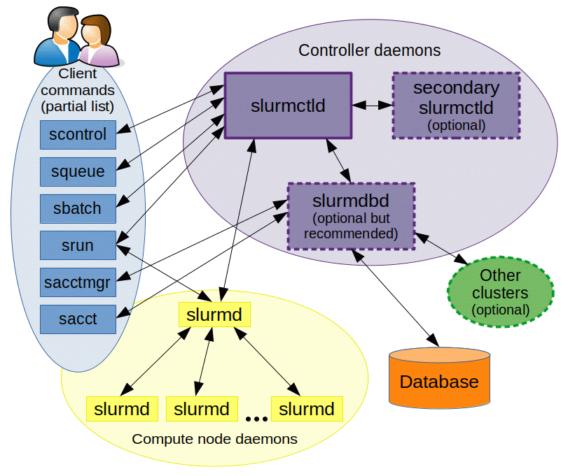
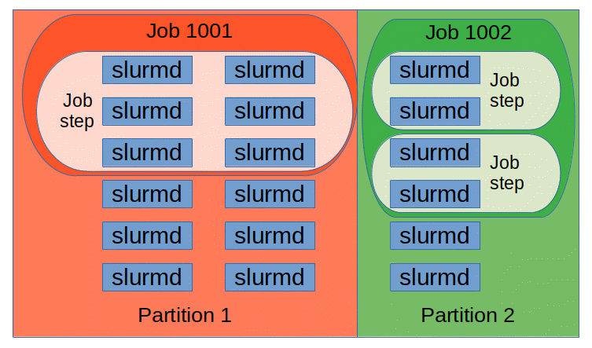

# Slurm From Zero

The other Slurm chapters in this book are cheatsheets written for someone who already uses Slurm every day. This chapter is the on-ramp they assume. It starts with what a batch scheduler is, explains how Slurm is put together and what happens between typing `sbatch` and your processes running on GPUs, and then builds up to complete multi-node PyTorch jobs that survive preemption. It ends with enough administration to understand what the people running the cluster do, and with a comparison against Kubernetes.

Conventions:

- **Nothing Slurm-related was run while writing this chapter.** Slurm daemons need Linux and a cluster, and this chapter was written on a Mac. All `sinfo`/`squeue`/`sacct`/`scontrol` output below is **sketched**: it follows the real formats (as of Slurm 23.x-25.x), but the job IDs, node names and numbers are made up. All `#SBATCH` scripts and config files are **untested** as written.
- The Python helpers (the output parser, the GPU-hours and fair-share calculator, the training script and a local `srun` emulator) **were run**, on macOS with CPython 3.14 and PyTorch 2.15 on CPU. Their output is pasted as-is.
- Slurm's spelling: the project now writes "Slurm" (it used to be "SLURM", for Simple Linux Utility for Resource Management). Both appear in this book.

## Prerequisites

- [Linux and the OS](../../foundations/linux-and-os.md): processes, users and UIDs, signals, cgroups, systemd. Slurm is a layer on top of all of these.
- [Networking](../../foundations/networking.md): hostnames, ports, InfiniBand/RoCE. Multi-node training needs ranks to find each other over the network.
- [Distributed systems](../../foundations/distributed-systems.md): controllers, heartbeats, rendezvous, failure detection.
- [Containers and virtualization](../../foundations/containers-and-virtualization.md): images and namespaces, for the containers-on-Slurm section.
- [Linux and the OS: scripting essentials](../../foundations/linux-and-os.md#scripting-essentials): every batch script here is a bash script (`set -euo pipefail`, `${VAR:-default}`, `$(...)`, `$((...))`), and [How torchrun spawns workers](../../foundations/linux-and-os.md#how-torchrun-spawns-workers).
- [Distributed systems: core vocabulary](../../foundations/distributed-systems.md#core-vocabulary): rank, local rank, world size, node rank, `MASTER_ADDR`/`MASTER_PORT`, launcher. The Slurm environment variables below map onto exactly these.
- [GPU software stack](../../compute/gpu-software-stack.md): driver/toolkit compatibility (for containers) and [NCCL's environment variables](../../compute/gpu-software-stack.md#the-environment-variables-an-operator-sets).
- [Collectives internals: timeouts and hangs](../../network/collectives-internals.md#timeouts-and-hangs): why one dead rank makes every other rank hang in an all-reduce.
- Forward links (later chapters, not needed first): [Kubernetes from zero](../kubernetes-from-zero.md) and [Orchestration internals](../internals.md), referenced for comparisons and for how the scheduler works inside.

After this chapter, the deeper material is:

- [SLURM for Users](users.md) - a long list of recipes (reusing allocations, rejoining nodes, finding faulty nodes, crontab emulation).
- [SLURM Administration](admin.md) - admin recipes (pdsh, draining, undraining, auto-reboot).
- [SLURM Performance](performance.md) - `--cpus-per-task` inheritance and hyper-threads.
- [Launchers](launchers/README.md) - ready-made `torchrun`, `accelerate`, Lightning and `srun` launcher scripts.
- [Orchestration internals](../internals.md) - how `select/cons_tres`, topology plugins, multifactor priority, backfill and preemption work inside.


## Why a batch scheduler exists

### The problem: many people, few GPUs, long jobs

A **cluster** is a set of computers (called **nodes**) connected by a fast network, with shared storage, that a group of people use together. An AI cluster typically has a few **login nodes** (where you SSH in, edit code and submit work) and tens to thousands of **compute nodes** (each with, say, 8 GPUs) where the work actually runs.

Without any software in charge, people would SSH into compute nodes and start jobs by hand. That breaks immediately:

- Two people start jobs on the same GPU and both run out of memory.
- A 64-node job needs 64 nodes free *at the same time*; nobody can coordinate that by hand.
- One person leaves 32 nodes idle overnight "reserved" with an open terminal.
- Nobody knows who used how much, so nobody can be held to a budget.

A **batch scheduler** (also called a workload manager or resource manager) is the program that owns the compute nodes. You don't run jobs on nodes; you describe what you need ("4 nodes with 8 GPUs each for 12 hours") and hand the scheduler a script. The scheduler puts the request in a **queue**, decides when and where it runs, starts it, enforces its limits, kills it when its time is up, and records what it used. "Batch" means the work runs unattended, not in your terminal.

```
you (login node)            scheduler                    compute nodes
----------------            ---------                    -------------
sbatch train.sh  ------->   queue: [yours, bob's, ...]
                            "4 nodes free at 14:05?"
                            reserve gpu[001-004]  ------> start train.sh on gpu001
                                                          (srun fans out to all 4)
squeue           <-------   "RUNNING, 3:12 elapsed"
                            time limit hit  ------------> SIGTERM, then SIGKILL
sacct            <-------   accounting DB: 128 GPU-hours, COMPLETED
```

### Why HPC and AI clusters use one

The key properties a training cluster needs, and that a batch scheduler provides, are:

| Need | What the scheduler does |
|---|---|
| Exclusive hardware | A GPU is given to exactly one job; cgroups stop other processes from even seeing it |
| Gang allocation | A multi-node job gets all its nodes at once or not at all (see [why gang scheduling matters](../internals.md#why-gang-scheduling-cannot-be-skipped)) |
| Fair sharing | Teams get priority in proportion to their entitled share, adjusted by how much they used recently |
| High utilization | Small jobs are "backfilled" into gaps while a big job waits for enough nodes |
| Time limits | Every job declares a maximum runtime, so the scheduler can plan and nobody holds nodes forever |
| Accounting | Every job's resource use is recorded per user and account |

Slurm is the dominant open-source batch scheduler: it runs a majority of the TOP500 (the twice-yearly list of the world's fastest supercomputers) and most academic and many industrial GPU clusters. Alternatives you may hear of are PBS/Torque, LSF (IBM) and HTCondor, plus Kubernetes-based stacks (covered at the [end](#slurm-vs-kubernetes)). SchedMD, the company that develops Slurm, was acquired by NVIDIA (announced December 2025), with Slurm staying open source.

You can see the scheduler's view of a cluster with one command. This is the first thing to run on any new cluster:

```console
$ sinfo
PARTITION AVAIL  TIMELIMIT  NODES  STATE NODELIST
debug        up    2:00:00      2   idle gpu[063-064]
gpu*         up 2-00:00:00      2  drain gpu[007,031]
gpu*         up 2-00:00:00     44  alloc gpu[001-006,008-030,032-046]
gpu*         up 2-00:00:00     14   idle gpu[047-060]
cpu          up 7-00:00:00     16    mix cpu[01-16]
```

(Sketched.) Reading it: the `gpu` partition (the `*` marks the default) has 44 nodes busy, 14 free and 2 taken out of service ("drained"); jobs there can run at most 2 days. The [next sections](#core-concepts) define every one of these words.


## Slurm architecture



([source](https://slurm.schedmd.com/quickstart.html))

### The daemons

A **daemon** is a long-running background process, usually started by systemd. Slurm is three daemons plus a set of command-line tools:

| Daemon | Runs on | Port (default) | Job |
|---|---|---|---|
| `slurmctld` | 1 controller node (+ optional backup) | 6817 | The brain. Holds the state of every node and job in memory, runs the scheduling loop, decides which job goes where |
| `slurmd` | Every compute node | 6818 | The hands. Reports node health and resources, launches and kills processes when the controller says so |
| `slurmdbd` | 1 node (often the controller) | 6819 | Accounting. Writes job records, users, accounts and QoS to a MySQL/MariaDB database |
| `slurmrestd` | Optional | configurable | A REST API over the same RPCs, for dashboards and automation |

There is also **`slurmstepd`**, which is not a daemon you start: `slurmd` forks one `slurmstepd` per job step per node. It is the parent of your actual processes: it sets up their cgroup, switches to your user ID, sets the environment, forwards their stdout/stderr, collects their resource usage and reports their exit codes.

Why split it this way? The controller has to have one consistent view of the whole cluster to make gang-scheduling and fair-share decisions, so it is centralized (the [distributed systems chapter](../../foundations/distributed-systems.md) explains why a single leader is the simple answer to consistency). The node daemons need to act locally and fast (start 8 processes, kill a runaway one) and keep working on a running job even if the controller briefly goes away. Accounting is a separate daemon so that a slow database never stalls scheduling, and so that several clusters can share one accounting database.

The controller saves its state to disk (`StateSaveLocation`), so restarting `slurmctld` does not lose the queue or kill running jobs; running jobs keep running under their `slurmd`s while the controller is down.

On a cluster where you are a user you can still see all of this:

```console
$ scontrol ping
Slurmctld(primary) at ctl01 is UP
Slurmctld(backup) at ctl02 is UP

$ scontrol show config | grep -E '^(ClusterName|SlurmctldHost|SLURM_VERSION|SelectType|SchedulerType|PriorityType|AuthType|ProctrackType|TaskPlugin)'
AuthType                = auth/munge
ClusterName             = tiny
PriorityType            = priority/multifactor
ProctrackType           = proctrack/cgroup
SchedulerType           = sched/backfill
SelectType              = select/cons_tres
SLURM_VERSION           = 24.11.1
SlurmctldHost[0]        = ctl01
SlurmctldHost[1]        = ctl02
TaskPlugin              = task/cgroup,task/affinity
```

(Sketched.)

### Authentication: munge

Every message between Slurm components says "this request comes from user alice, UID 1001". Something must stop a user from forging "I am root". Slurm's traditional answer is **MUNGE** (MUNGE Uid 'N' Gid Emporium), a tiny authentication service:

- Every node in the cluster runs the `munged` daemon and has the **same secret key** in `/etc/munge/munge.key`.
- When `sbatch` sends a request, it asks the local `munged` to create a **credential**: your UID and GID plus a timestamp, encrypted and signed with the shared key. Only `munged` (running as the `munge` user) can read the key, so a user cannot forge a credential for someone else.
- The receiving daemon asks its own `munged` to decode it. If the key matches and the timestamp is recent (default TTL 300 s), it trusts the UID.

Consequences: the key must be identical on every node, and **clocks must be synchronized** (run NTP/chrony), or credentials are rejected as expired or "rewound". Since Slurm 23.11 there is also a built-in `auth/slurm` plugin that uses a shared `slurm.key` instead of munge; most existing clusters still use munge.

Testing munge is the first step when "nothing works":

```console
$ munge -n | unmunge | grep -E 'STATUS|UID'
STATUS:          Success (0)
UID:             alice (1001)
$ munge -n | ssh gpu001 unmunge | grep STATUS     # cross-node: proves keys and clocks match
STATUS:          Success (0)
```

(Sketched; this is the standard check from the munge docs.)

### The config files

All of these live in `/etc/slurm/` (or wherever the site installed Slurm):

| File | Read by | What it says |
|---|---|---|
| `slurm.conf` | everything | Cluster name, controller host, plugins, scheduling and priority settings, every node and partition |
| `gres.conf` | `slurmd` | Which GPUs (and other generic resources) each node has, which device files, which CPU cores are close to them |
| `cgroup.conf` | `slurmd` | Which limits to enforce with cgroups (cores, memory, devices) |
| `slurmdbd.conf` | `slurmdbd` only | Database host, user and password (so it is mode 600, owned by the `slurm` user) |
| `topology.conf` | `slurmctld` | Optional switch hierarchy for network-aware placement (see [internals](../internals.md#topology-topologytree)) |
| `plugstack.conf` | `srun`, `slurmd` | Optional SPANK plugins (shared libraries that `srun` and `slurmd` load to add flags and hooks), e.g. Pyxis for containers |

`slurm.conf` must be identical on all nodes (Slurm warns if hashes differ). Larger sites use **configless** mode: the controller serves the config files and each `slurmd` fetches them at startup (`SlurmctldParameters=enable_configless` on the controller, `slurmd --conf-server ctl01` on nodes). A minimal working set of these files is in the [admin section](#a-small-cluster-admin-intro).

### What happens from `sbatch` to processes on nodes

This is the most useful picture in the chapter. Follow a 2-node, 16-GPU job:

```
login node                 ctl01: slurmctld                   gpu001: slurmd                 gpu002: slurmd
----------                 ----------------                   --------------                 --------------
sbatch train.sh
  | munge cred + script + env
  +-----------------------> 1. validate: account? QoS? limits?
  <----- "Submitted 4242"    store job, state=PENDING
                           2. scheduling loop / backfill:
                              priority order, find 2 free nodes
                              state=RUNNING, nodes=gpu[001-002]
                           3. send batch-launch RPC --------->  4. prolog (if configured)
                                                                   fork slurmstepd (step "batch")
                                                                   cgroup, setuid(alice), env
                                                                   exec: bash train.sh
                                                                     |
                                                                   5. srun python train.py
                           <-------- "create step 4242.0" ----------+
                           6. grant step, sign credential
                              ----------------------------------->  slurmd   ------------------>  slurmd
                                                                   7. slurmstepd (step 0)        slurmstepd (step 0)
                                                                      fork 8 tasks                  fork 8 tasks
                                                                      SLURM_PROCID=0..7             SLURM_PROCID=8..15
                                                                   stdout/stderr ------> srun (gpu001) --> slurm-4242.out
                                                                   8. tasks exit; codes -> srun -> batch shell exits
                           <------------------------- 9. job complete, epilog, nodes freed (state CG -> idle)
                           10. slurmdbd: write accounting record
```

Step by step:

1. `sbatch` reads your script, pulls out the `#SBATCH` lines, and sends the whole script plus your current environment to `slurmctld`. The controller checks your account, QoS and limits, assigns a **job ID**, and stores the job as `PENDING`. `sbatch` returns immediately; the script has not started.
2. The scheduler runs whenever something changes (a job ends, a job is submitted) and periodically as backfill (default every 30 s). It walks pending jobs in priority order and finds nodes. When it finds a fit it marks the job `RUNNING` and records the allocation.
3. The controller sends the script to `slurmd` on the **first** node of the allocation (the "batch host").
4. That `slurmd` runs the site's **prolog** if there is one (a script the admins configure to run on each node just before a job starts, typically a quick GPU health check; its counterpart, the **epilog**, runs just after the job ends), forks a `slurmstepd` for the special **batch step**, which creates a cgroup, drops privileges to your UID, sets `SLURM_*` variables and runs your script with bash. Your script runs **on one node only**, on one CPU core by default.
5. Inside the script you call `srun`. `srun` is how work reaches the other nodes.
6. `srun` asks the controller to create a **job step** inside the existing allocation. The controller checks it fits and signs a credential.
7. `srun` contacts `slurmd` on every node of the step (with large jobs, through a fan-out tree, `TreeWidth`), each forks a `slurmstepd` for that step, which forks the **tasks** (your processes) and sets per-task variables like `SLURM_PROCID`. stdout/stderr from all tasks is streamed back to `srun`, which writes it to the job's output file.
8. When all tasks exit, `srun` returns the highest exit code. The batch script continues; when it exits, the job ends.
9. `slurmd` runs the epilog, kills any leftover processes in the job's cgroups, and the nodes return to `idle`. While this cleanup runs the job shows state `CG` (completing).
10. The controller sends the final record (start, end, nodes, exit code, TRES used: the CPUs, memory and GPUs consumed; TRES is defined [below](#cpus-memory-gpus-gres-and-tres)) to `slurmdbd`.

The two most common beginner mistakes both come from this picture: running `python train.py` in the batch script *without* `srun` (it runs once, on one node, while the other nodes sit idle), and expecting `SLURM_PROCID` in the batch script to differ per rank (it is 0, because the batch script is one process; see [early interpolation](users.md#slurm_procid-early-interpolation)).


## Core concepts



([source](https://slurm.schedmd.com/quickstart.html))

### Nodes, partitions, and node states

- A **node** is one computer, as Slurm knows it: a name, a CPU layout (sockets, cores, threads), memory, GRES (GPUs) and **features** (free-form tags like `h100,ib`, which jobs can require with `--constraint`).
- A **partition** is a named group of nodes with its own policy: maximum time limit, who may use it, default and maximum resources per job, priority tier. Think of it as a queue. A node can be in several partitions (e.g. `gpu` and `gpu-preempt`). On the command line, `-p` selects one.

Node states you'll see in `sinfo` (full list in [node state codes](users.md#node-state-codes)):

| State | Meaning |
|---|---|
| `idle` | Up, nothing running |
| `alloc` | Fully allocated |
| `mix` | Partly allocated (some cores/GPUs free) |
| `drain` / `drng` | An admin or health check took it out of service; `drng` = still running a job that will finish first |
| `down` | Slurm can't reach `slurmd`, or it was marked down |
| `comp` | Jobs completing (epilog / killing processes) |
| `resv` | In a reservation |
| `*` suffix (`idle*`) | Not responding |

```console
$ scontrol show node gpu007
NodeName=gpu007 Arch=x86_64 CoresPerSocket=48
   CPUAlloc=0 CPUEfctv=192 CPUTot=192 CPULoad=0.03
   AvailableFeatures=h100,ib
   ActiveFeatures=h100,ib
   Gres=gpu:h100:8(S:0-1)
   NodeAddr=gpu007 NodeHostName=gpu007 Version=24.11.1
   RealMemory=2000000 AllocMem=0 FreeMem=1984211 Sockets=2 Boards=1
   State=IDLE+DRAIN ThreadsPerCore=2 TmpDisk=0 Weight=1
   Partitions=gpu
   CfgTRES=cpu=192,mem=2000000M,billing=192,gres/gpu=8
   AllocTRES=
   Reason=XID 79 GPU fell off the bus [root@2026-11-03T09:12:44]
```

(Sketched.) The `Reason` on a drained node is the first place to look when a node is missing. `CfgTRES` is what the node offers; `AllocTRES` is what is currently given out.

### Jobs, allocations, steps and tasks

This is the mental model that makes everything else make sense:

- A **job** is a request plus, once granted, an **allocation**: a reserved set of resources (specific nodes, cores, memory, GPUs) for a period of time. The allocation is like a booking. It does nothing on its own.
- A **job step** is a set of processes launched *inside* the allocation, by `srun`. A job can run many steps one after another (or several at the same time if they fit). Steps are numbered `4242.0`, `4242.1`, ...; there are also special steps: `4242.batch` (the batch script itself), `4242.extern` (processes that entered the job from outside, e.g. via SSH with `pam_slurm_adopt`: a PAM module, i.e. a plugin to Linux's login-authentication stack, that lets you SSH into a node only while you have a job there and puts your SSH session into that job's cgroup) and `4242.interactive` (the shell started by `salloc` on some configurations).
- A **task** is one process of a step. For PyTorch launched by `srun`, one task = one GPU = one rank. For `torchrun`, one task per node, and `torchrun` spawns the per-GPU workers itself.

```
job 4242  (allocation: gpu[001-002], 16 GPUs, 192 CPUs/node, 12h)
├── 4242.batch     bash train.sh                 on gpu001 only, 1 task
├── 4242.extern    (ssh sessions, if allowed)
├── 4242.0         srun python prep.py           1 task on gpu001
└── 4242.1         srun python train.py          16 tasks: 8 on gpu001, 8 on gpu002
                    ├── task 0  (SLURM_PROCID=0, SLURM_LOCALID=0, node 0)
                    ├── ...
                    └── task 15 (SLURM_PROCID=15, SLURM_LOCALID=7, node 1)
```

`sbatch` creates a job and runs its batch step. `salloc` creates a job and gives you a shell. `srun` creates a step inside an existing job; if you run `srun` outside any job, it first creates a job (allocation) and then a step in it, all in one go. The `sacct` view of a running job shows the same structure:

```console
$ sacct -j 4242 --format=JobID,JobName%12,AllocCPUS,State,ExitCode,Elapsed
JobID             JobName  AllocCPUS      State ExitCode    Elapsed
------------ ------------ ---------- ---------- -------- ----------
4242             train.sh        384    RUNNING      0:0   03:12:40
4242.batch          batch        192    RUNNING      0:0   03:12:40
4242.extern        extern        384    RUNNING      0:0   03:12:40
4242.0             python          1  COMPLETED      0:0   00:00:31
4242.1             python        384    RUNNING      0:0   03:12:01
```

(Sketched.)

### CPUs, memory, GPUs, GRES and TRES

- **CPU** in Slurm means whatever the node exposes as the smallest allocatable unit: usually a hardware thread if hyper-threading is on (`ThreadsPerCore=2`), so a 2x48-core node is `CPUs=192`. See [hyper-threads](users.md#hyper-threads) and [performance](performance.md#to-enable-hyper-threads-or-not).
- **Memory** is requested per node (`--mem`), per CPU (`--mem-per-cpu`) or per GPU (`--mem-per-gpu`), in MB by default. `--mem=0` means "all of the node's memory".
- **GRES** (generic resources) are countable devices that aren't CPUs or memory, defined in `gres.conf`. GPUs are `gpu`, optionally typed: `gpu:h100:8`. You request them with `--gres=gpu:8` (per node) or the newer `--gpus-per-node=8`, `--gpus=16` (per job) or `--gpus-per-task=1`.
- **TRES** (trackable resources) is the umbrella accounting name: `cpu`, `mem`, `node`, `gres/gpu`, `billing`, etc. Limits and accounting are expressed in TRES: `MaxTRESPerUser=gres/gpu=16`.

When a job gets GPUs, Slurm sets `CUDA_VISIBLE_DEVICES` for its processes, and with `ConstrainDevices=yes` in `cgroup.conf` the other GPUs' device files are blocked by the cgroup, so the job physically cannot touch them.

```console
$ srun -p gpu --gpus-per-node=2 --pty bash -c 'echo CUDA_VISIBLE_DEVICES=$CUDA_VISIBLE_DEVICES SLURM_JOB_GPUS=$SLURM_JOB_GPUS; nvidia-smi -L'
CUDA_VISIBLE_DEVICES=0,1 SLURM_JOB_GPUS=4,5
GPU 0: NVIDIA H100 80GB HBM3 (UUID: GPU-...)
GPU 1: NVIDIA H100 80GB HBM3 (UUID: GPU-...)
```

(Sketched.) `--pty` attaches your terminal to the task, so an interactive command (here a one-off `bash -c`, elsewhere a shell) behaves as if run locally. The job got physical GPUs 4 and 5 (`SLURM_JOB_GPUS`), but inside the cgroup it sees only two devices, numbered 0 and 1. Code should always use local indices (`LOCAL_RANK`), never hard-coded physical ones.

### Accounts, associations, QoS and fair share

These live in the accounting database run by `slurmdbd`; **`sacctmgr`** is the command that queries and edits it (users can read, admins can write).

- An **account** is a billing bucket in the accounting database, usually a team or project (`research`, `inference`). Accounts form a tree under `root`. You submit with `--account=research` (or get your default).
- An **association** is a (cluster, account, user, partition) tuple. Limits and fair-share shares are attached to associations. "AssocGrpGRES" in a pending reason means a limit on *your association* is hit.
- A **QoS** (quality of service) is a named policy you can attach to jobs: a priority boost, limits (`MaxTRESPerUser`, `MaxWall`, `GrpTRES`), and preemption relationships ("`high` can preempt `low`"). `--qos=high`. Typical sites have `normal`, `high` (limited), `low`/`preemptible` (cheap, can be killed).
- **Fair share**: each account has a share (e.g. 25% of the cluster). Its recent usage, decayed with a half-life (default 7 days), is compared to its share; use more than your share and your jobs' priority drops. The formula and the multifactor priority are in [internals](../internals.md#priority-prioritymultifactor); a [calculator](#gpu-hours-and-fair-share-calculator) is below.

```console
$ sacctmgr show assoc user=$USER format=Cluster,Account,User,Partition,Share,QOS%30,DefaultQOS,GrpTRES%20
   Cluster    Account       User  Partition     Share                            QOS   Def QOS              GrpTRES
---------- ---------- ---------- ---------- --------- ------------------------------ --------- --------------------
      tiny   research      alice                    1                 high,low,normal    normal

$ sacctmgr show qos format=Name,Priority,MaxWall,MaxTRESPU%20,GrpTRES%20,Preempt,PreemptMode
      Name   Priority     MaxWall            MaxTRESPU              GrpTRES    Preempt PreemptMode
---------- ---------- ----------- -------------------- -------------------- ---------- -----------
    normal          0  2-00:00:00                                                 low     requeue
      high       1000  1-00:00:00         gres/gpu=64                             low     requeue
       low          0  7-00:00:00                                                         requeue

$ sprio -l -j 4261
          JOBID PARTITION     USER  ACCOUNT   PRIORITY       SITE        AGE  FAIRSHARE    JOBSIZE  PARTITION        QOS
           4261 gpu            bob  ablate       4180          0        120       3930        130          0          0
```

(Sketched.) `sprio` shows the components of a pending job's priority; `sshare` (shown in [users.md](users.md#fairshare)) shows usage and fair-share factors.


## Looking at the cluster: sinfo, squeue, sacct, scontrol

Four commands answer almost every question. `sinfo` = the nodes, `squeue` = the queue now, `sacct` = history (from the database), `scontrol` = the controller's full record of anything.

### sinfo: what hardware exists and what state it's in

```console
$ sinfo -N -p gpu -o "%N %t %C %G %m %f" | head -5      # per node: state, CPUs A/I/O/T, GRES, mem, features
NODELIST STATE CPUS(A/I/O/T) GRES MEMORY AVAIL_FEATURES
gpu001 alloc 192/0/0/192 gpu:h100:8(S:0-1) 2000000 h100,ib
gpu002 mix 96/96/0/192 gpu:h100:8(S:0-1) 2000000 h100,ib
gpu007 drain 0/0/192/192 gpu:h100:8(S:0-1) 2000000 h100,ib
gpu047 idle 0/192/0/192 gpu:h100:8(S:0-1) 2000000 h100,ib

$ sinfo -R                                   # why nodes are down/drained
REASON                                 USER      TIMESTAMP           NODELIST
XID 79 GPU fell off the bus            root      2026-11-03T09:12:44 gpu007
NHC: ib0 link down                     root      2026-11-04T22:01:03 gpu031

$ sinfo -s                                   # summary: A/I/O/T = allocated/idle/other/total
PARTITION AVAIL  TIMELIMIT   NODES(A/I/O/T) NODELIST
debug        up    2:00:00          0/2/0/2 gpu[063-064]
gpu*         up 2-00:00:00       44/14/2/60 gpu[001-060]
cpu          up 7-00:00:00      16/0/0/16   cpu[01-16]
```

(Sketched.) `NHC:` reasons come from the node health check script (LBNL NHC, configured in the [admin section](#slurmconf)), which drains a node automatically when a check fails. To see how many GPUs are actually free you need per-node GRES usage: `sinfo -N -O "NodeList:10,StateCompact:8,Gres:22,GresUsed:30"` (the `-O`/`--Format` field names are in `man sinfo`; `GresUsed` exists in recent versions).

### squeue: what is queued and running

```console
$ squeue -p gpu
  JOBID PARTITION     NAME     USER ST       TIME  NODES NODELIST(REASON)
   4261       gpu  big-run      bob PD       0:00     64 (Resources)
   4260       gpu ablation      bob PD       0:00      4 (Priority)
 4251_[3-9]   gpu    sweep    alice PD       0:00      1 (QOSMaxGRESPerUser)
   4250       gpu eval-ckp    alice PD       0:00      1 (Dependency)
   4242       gpu pretrain    alice  R 1-02:11:09     16 gpu[001-016]
 4251_2       gpu    sweep    alice  R      12:01      1 gpu017
```

(Sketched.) Columns: `ST` is the state code (`PD` pending, `R` running, `CG` completing, `CF` configuring/booting nodes, `S` suspended; full list in [job state codes](users.md#job-state-codes)). For running jobs the last column is the node list; for pending jobs it is the **reason** in parentheses. `4251_[3-9]` is a job array with tasks 3-9 still pending.

Useful variants:

```bash
squeue --me                                   # only my jobs (Slurm 20.11+)
squeue --me --start                           # estimated start times for pending jobs (from backfill)
squeue --me -o "%.10i %.20j %.2t %.10M %.10l %.6D %b %R"   # id, name, state, elapsed, limit, nodes, tres-per-node, reason
squeue -h -o '%i|%u|%P|%j|%T|%M|%D|%b|%R'     # machine-readable, no header: feed to the parser below
```

The `--start` estimate is only as good as other users' `--time` values, since backfill plans with time limits, not real runtimes.

### sacct: what happened

`squeue` forgets a job a few minutes after it ends (`MinJobAge`); `sacct` asks `slurmdbd` and remembers everything.

```console
$ sacct -X -S now-2days --format=JobID,JobName%15,State,ExitCode,Elapsed,AllocTRES%50,NodeList
JobID                JobName      State ExitCode    Elapsed                                          AllocTRES        NodeList
------------ --------------- ---------- -------- ---------- -------------------------------------------------- ---------------
4100             pretrain-7b  COMPLETED      0:0   10:00:00 billing=1536,cpu=1536,gres/gpu=128,mem=16000G,node+    gpu[001-016]
4101             pretrain-7b     FAILED      1:0   00:03:12 billing=1536,cpu=1536,gres/gpu=128,mem=16000G,node+    gpu[001-016]
4102                ablation    TIMEOUT     0:15 2-00:00:00     billing=96,cpu=96,gres/gpu=8,mem=1000G,node=1          gpu033
4104                 tok-eval OUT_OF_ME+    0:125   00:45:00     billing=12,cpu=12,gres/gpu=1,mem=120G,node=1          gpu040
```

(Sketched.) `-X` shows only the allocation line, not the steps. `ExitCode` is `code:signal`: `1:0` means the process exited with code 1 (a Python exception), `0:15` means it was killed by signal 15 (SIGTERM, here from the time limit). `0:125` on an `OUT_OF_MEMORY` job is not a real signal number: it is Slurm's internal OOM marker (253) squeezed into the 7-bit signal field. `%15` widens a column; `+` means truncated. For scripts, always use `-P` (`--parsable2`, `|`-separated, no truncation):

```bash
sacct -X -P -S now-7days -o JobID,User,State,Elapsed,AllocTRES,ExitCode
```

### scontrol: the full record, and changing things

```console
$ scontrol show job 4242
JobId=4242 JobName=pretrain-7b
   UserId=alice(1001) GroupId=alice(1001) MCS_label=N/A
   Priority=12150 Nice=0 Account=research QOS=normal
   JobState=RUNNING Reason=None Dependency=(null)
   Requeue=1 Restarts=0 BatchFlag=1 Reboot=0 ExitCode=0:0
   RunTime=1-02:11:09 TimeLimit=2-00:00:00 TimeMin=N/A
   SubmitTime=2026-11-04T08:01:12 EligibleTime=2026-11-04T08:01:12
   StartTime=2026-11-04T08:03:40 EndTime=2026-11-06T08:03:40 Deadline=N/A
   Partition=gpu AllocNode:Sid=login01:88123
   NodeList=gpu[001-016] BatchHost=gpu001
   NumNodes=16 NumCPUs=3072 NumTasks=128 CPUs/Task=24 ReqB:S:C:T=0:0:*:*
   ReqTRES=cpu=3072,mem=32000000M,node=16,billing=3072,gres/gpu=128
   AllocTRES=cpu=3072,mem=32000000M,node=16,billing=3072,gres/gpu=128
   Command=/home/alice/run/pretrain.sbatch
   WorkDir=/home/alice/run
   StdOut=/home/alice/run/logs/pretrain-7b-4242.out
   TresPerNode=gres/gpu:8
```

(Sketched.) Everything about the job is here: `BatchHost` (where the script runs), `Restarts` (how many times it was requeued), `EndTime` (when the time limit hits), `StdOut` (where the log is). Users can modify their own pending jobs, within limits:

```bash
scontrol hold 4260                     # keep it pending
scontrol release 4260
scontrol update job 4260 TimeLimit=6:00:00      # users can lower a limit; raising needs an admin
scontrol update job 4260 Partition=debug
scontrol show hostnames gpu[001-003,007]        # expand a node list: one host per line
scancel 4260                           # cancel; scancel --me --state=PENDING cancels all my pending jobs
```


## Interactive work: salloc and srun

### Getting an allocation with salloc

`salloc` requests an allocation and gives you a shell while it lasts. It is how you debug on real GPUs.

```console
login01$ salloc -p gpu --nodes=1 --gpus-per-node=8 --cpus-per-task=96 --time=2:00:00
salloc: Pending job allocation 4270
salloc: job 4270 queued and waiting for resources
salloc: job 4270 has been allocated resources
salloc: Granted job allocation 4270
salloc: Waiting for resource configuration
salloc: Nodes gpu047 are ready for job
gpu047$ nvidia-smi -L | wc -l
8
gpu047$ exit
salloc: Relinquishing job allocation 4270
```

(Sketched.) Where the shell runs depends on the site: with `LaunchParameters=use_interactive_step` (common on recent installs) you land on the first compute node, as above. Without it, the shell stays **on the login node** with `SLURM_JOB_ID` set, and you must use `srun` to run anything on the allocated node. Check with `hostname` before running anything heavy. Exiting the shell releases the allocation; to keep it alive across disconnects see [keeping an salloc alive](users.md#how-to-keep-an-salloc-allocation-alive-while-exiting-its-shell) and [rejoining it](users.md#how-to-rejoin-the-allocated-node-interactively).

### srun: launching a step

Inside any allocation (salloc shell or sbatch script), `srun` launches tasks across the allocated nodes:

```console
gpu047$ srun --ntasks=4 -l hostname        # -l / --label prefixes each line with the task number
0: gpu047
2: gpu047
1: gpu047
3: gpu047

login01$ salloc -p gpu -N2 --ntasks-per-node=8 --gpus-per-node=8 -t 1:00:00
gpu001$ srun -l bash -c 'echo rank=$SLURM_PROCID local=$SLURM_LOCALID node=$SLURM_NODEID host=$(hostname)' | sort -n | sed -n '1p;8,9p;16p'
 0: rank=0 local=0 node=0 host=gpu001
 7: rank=7 local=7 node=0 host=gpu001
 8: rank=8 local=0 node=1 host=gpu002
15: rank=15 local=7 node=1 host=gpu002
```

(Sketched.) `sed -n '1p;8,9p;16p'` prints only lines 1, 8-9 and 16 (`;` separates sed commands), to keep the output short. Note the single quotes: `$SLURM_PROCID` must be expanded by each task's shell, not by your shell before `srun` runs. `srun` without an allocation gets one first, which is the fastest way to grab a GPU shell:

```bash
srun -p debug --gpus=1 --cpus-per-task=16 --time=30:00 --pty bash   # --pty: attach a terminal to task 0
srun --jobid=4242 --overlap --pty bash                              # a shell inside your running job, to inspect it
```

`--overlap` lets the new step share resources already used by the running training step, which otherwise would block the new step from starting.


## Batch jobs: sbatch and its directives

### A first batch script

A batch script is a bash script whose leading `#SBATCH` comments are read by `sbatch` as command-line options (anything on the `sbatch` command line overrides them). They must come before the first non-comment line.

```bash
#!/bin/bash
#SBATCH --job-name=hello
#SBATCH --partition=debug
#SBATCH --nodes=1
#SBATCH --ntasks=1
#SBATCH --cpus-per-task=4
#SBATCH --gpus-per-node=1
#SBATCH --time=00:10:00
#SBATCH --output=logs/%x-%j.out

set -euo pipefail
echo "job $SLURM_JOB_ID on $(hostname), GPUs: $CUDA_VISIBLE_DEVICES"
srun python -c 'import torch; print(torch.cuda.get_device_name(0))'
```

```console
$ mkdir -p logs && sbatch hello.sbatch
Submitted batch job 4280
$ sbatch --parsable hello.sbatch          # just the ID, for scripts: JOB=$(sbatch --parsable ...)
4281
$ cat logs/hello-4280.out
job 4280 on gpu063, GPUs: 0
NVIDIA H100 80GB HBM3
```

(Sketched.) The `logs/` directory must exist before the job starts: Slurm does not create it, and a job whose output file can't be opened fails immediately with no log at all.

### The directives that matter

| Directive | Meaning and advice |
|---|---|
| `--job-name=NAME` | Shown in `squeue`; `%x` in file names. Name it after the experiment |
| `--partition=P` | Which partition (queue) |
| `--account=A` | Which account to bill; required on many clusters |
| `--qos=Q` | Which QoS (priority, limits, preemptibility) |
| `--nodes=N` | Number of nodes. `--nodes=2-4` allows a range |
| `--ntasks-per-node=K` | Tasks per node that `srun` launches. 8 for srun-launched ranks on 8-GPU nodes, 1 for `torchrun` |
| `--ntasks=T` | Total tasks (alternative to per-node) |
| `--cpus-per-task=C` | Cores per task: dataloader workers and threads live here. Total cores / tasks per node |
| `--gpus-per-node=G` / `--gres=gpu:G` | GPUs per node. `--gres=gpu:h100:8` to require a type |
| `--gpus-per-task=1` | One GPU bound to each task. Can stop CUDA IPC/NVLink P2P (one process reading another process's GPU memory directly) between tasks if devices are cgrouped per task; most training scripts use `--gpus-per-node` and pick by `LOCAL_RANK` |
| `--mem=M` / `--mem=0` | Memory per node; `0` = all of it. Default is often small (`DefMemPerCPU`), a common silent OOM cause |
| `--time=T` | Time limit: `MM`, `HH:MM:SS`, `D-HH:MM:SS`. Hard kill when reached. Shorter = backfills sooner |
| `--exclusive` | Whole nodes, nobody else on them, even if you didn't request all CPUs/GPUs |
| `--output=F` / `--error=F` | Log paths. `%j` job ID, `%x` job name, `%N` first node, `%A`/`%a` array job/task ID. If only `--output`, stderr goes there too |
| `--open-mode=append` | Append instead of truncating; required for requeued jobs or each restart erases the log |
| `--signal=[B:]SIG@SECS` | Send SIG this many seconds before the time limit (±60 s). `B:` = only the batch shell; without it, all step tasks |
| `--requeue` / `--no-requeue` | Whether the job may be requeued after node failure or preemption |
| `--dependency=TYPE:ID` | Start only after another job; see [below](#dependencies-and-pipelines) |
| `--array=0-99%8` | Job array: 100 tasks, at most 8 at once |
| `--constraint=FEAT` | Only nodes with this feature (`--constraint=h100&ib`) |
| `--exclude=NODES` / `--nodelist=NODES` | Avoid / require specific nodes. `--exclude` is how you dodge a known-bad node |
| `--switches=1@2:00:00` | Topology: at most 1 leaf switch, wait up to 2 h for it ([internals](../internals.md#topology-topologytree)) |
| `--hint=nomultithread` | Use physical cores only |
| `--export=ALL` / `NONE` / `VAR=val` | Which environment to pass in (default ALL); see [users.md](users.md#environment-variables) |
| `--chdir=DIR` | Working directory (default: where you ran `sbatch`) |
| `--mail-type=END,FAIL --mail-user=me@x` | Email on events, if the site configured mail |
| `--begin=now+1hour` | Don't start before this time |
| `--reservation=R` | Run in an admin-created reservation |
| `--wait-all-nodes=1` | Don't start the script until every node has booted (clusters that power nodes up on demand) |

You can check what Slurm would do with a script without submitting it:

```console
$ sbatch --test-only train.sbatch
sbatch: Job 4290 to start at 2026-11-05T19:40:00 using 384 processors on nodes gpu[047-048] in partition gpu
```

(Sketched; `--test-only` validates the request and returns a start estimate, it doesn't queue the job.)

### A complete single-node GPU job

```bash
#!/bin/bash
#SBATCH --job-name=sft-1node
#SBATCH --partition=gpu
#SBATCH --account=research
#SBATCH --nodes=1
#SBATCH --ntasks-per-node=8          # one task (= one rank) per GPU
#SBATCH --gpus-per-node=8
#SBATCH --cpus-per-task=24           # 192 CPUs / 8 tasks
#SBATCH --mem=0                      # all node memory
#SBATCH --exclusive
#SBATCH --time=08:00:00
#SBATCH --output=logs/%x-%j.out

set -euo pipefail
cd "$SLURM_SUBMIT_DIR"

# reconstructibility: record what ran
echo "job=$SLURM_JOB_ID nodes=$SLURM_JOB_NODELIST sha=$(git rev-parse HEAD) dirty=$(git status --porcelain | wc -l)"
git diff > "logs/${SLURM_JOB_ID}.diff"
scontrol show job "$SLURM_JOB_ID" > "logs/${SLURM_JOB_ID}.job"

source .venv/bin/activate
export MASTER_ADDR=$(hostname)
export MASTER_PORT=$((10000 + SLURM_JOB_ID % 50000))
export OMP_NUM_THREADS=$SLURM_CPUS_PER_TASK
export SRUN_CPUS_PER_TASK=$SLURM_CPUS_PER_TASK   # see performance.md: srun may not inherit it

srun --kill-on-bad-exit=1 python -u train.py --config configs/sft.yaml
```

Untested. `train.py` is the script in the [multi-node section](#multi-node-pytorch-training); it reads `SLURM_PROCID`/`SLURM_LOCALID` itself. `git status --porcelain` prints one line per modified file, so `dirty=0` means a clean tree. `--kill-on-bad-exit=1` kills all ranks as soon as one exits non-zero (instead of leaving the rest hung in a collective), and `python -u` disables output buffering so log lines appear immediately.


## Job arrays and dependencies

### Job arrays: many similar jobs

A **job array** is one submission that creates many jobs differing only in `SLURM_ARRAY_TASK_ID`. Use it for sweeps, evaluation over many checkpoints, or data preprocessing shards. It is much lighter on the controller than a for-loop of `sbatch` calls.

```bash
#!/bin/bash
#SBATCH --job-name=lr-sweep
#SBATCH --partition=gpu
#SBATCH --array=0-11%4               # 12 tasks, at most 4 running at once
#SBATCH --gpus-per-node=1
#SBATCH --cpus-per-task=12
#SBATCH --time=02:00:00
#SBATCH --output=logs/%x-%A_%a.out   # %A = array job id, %a = task index

set -euo pipefail
LRS=(1e-4 2e-4 3e-4 6e-4)            # bash array: (a b c); ${LRS[i]} is element i, 0-based
SEEDS=(0 1 2)
LR=${LRS[$((SLURM_ARRAY_TASK_ID % 4))]}
SEED=${SEEDS[$((SLURM_ARRAY_TASK_ID / 4))]}
echo "task $SLURM_ARRAY_TASK_ID of $SLURM_ARRAY_TASK_COUNT: lr=$LR seed=$SEED"
srun python -u train_small.py --lr "$LR" --seed "$SEED" --out "runs/lr${LR}_s${SEED}"
```

```console
$ sbatch lr-sweep.sbatch
Submitted batch job 4300
$ squeue --me -n lr-sweep
     JOBID PARTITION     NAME  USER ST   TIME  NODES NODELIST(REASON)
4300_[4-11]      gpu lr-sweep alice PD   0:00      1 (JobArrayTaskLimit)
    4300_0       gpu lr-sweep alice  R   1:03      1 gpu050
    4300_1       gpu lr-sweep alice  R   1:03      1 gpu050
    4300_2       gpu lr-sweep alice  R   1:03      1 gpu051
    4300_3       gpu lr-sweep alice  R   1:03      1 gpu051
$ scontrol update job 4300 ArrayTaskThrottle=8      # change the %4 limit while it runs
$ scancel 4300_7                                    # cancel one task
```

(Sketched; untested.) Each task is a separate job with its own ID in `sacct` (`4300_0`, ...). The maximum array index is `MaxArraySize` (default 1001, so indices 0-1000). Job arrays can also chain a long training run through repeated time slots with `%1`; see [job arrays](users.md#job-arrays) and [job array trains](users.md#job-array-trains-and-their-suspend-and-release).

### Dependencies and pipelines

`--dependency` holds a job until a condition on other jobs is met:

| Type | Start when |
|---|---|
| `after:ID` | ID has started |
| `afterok:ID` | ID completed with exit code 0 |
| `afternotok:ID` | ID failed (non-zero, timeout, node fail) |
| `afterany:ID` | ID ended, any way |
| `aftercorr:ID` | the same-index task of array ID succeeded |
| `singleton` | no other job with the same name and user is running |

A preprocess → train → eval pipeline, submitted all at once:

```bash
#!/bin/bash
# submit_pipeline.sh -- run on the login node
set -euo pipefail
PRE=$(sbatch --parsable preprocess.sbatch)
TRAIN=$(sbatch --parsable --dependency=afterok:$PRE train.sbatch)
EVAL=$(sbatch --parsable --dependency=afterok:$TRAIN --kill-on-invalid-dep=yes eval.sbatch)
NOTIFY=$(sbatch --parsable --dependency=afternotok:$TRAIN notify_failure.sbatch)
echo "preprocess=$PRE train=$TRAIN eval=$EVAL notify=$NOTIFY"
```

If `train` fails, `eval`'s dependency can never be satisfied; it shows `(DependencyNeverSatisfied)` and sits in the queue forever unless `--kill-on-invalid-dep=yes` (or the site's `kill_invalid_depend` setting) cancels it. `--dependency=singleton` with a fixed job name is an easy way to make sure only one copy of a long training run is ever active, even if you submit several in advance.


## Environment variables and torch.distributed ranks

### What Slurm sets

Slurm sets dozens of `SLURM_*` variables. Some are per job (the same in the batch script and in every task) and some are **per task, set only by `srun`**:

| Variable | Scope | Example | Meaning |
|---|---|---|---|
| `SLURM_JOB_ID` | job | `4242` | Job ID |
| `SLURM_JOB_NAME` | job | `pretrain-7b` | |
| `SLURM_JOB_NODELIST` | job | `gpu[001-016]` | Compressed node list; expand with `scontrol show hostnames` |
| `SLURM_NNODES` / `SLURM_JOB_NUM_NODES` | job | `16` | |
| `SLURM_NTASKS` | job | `128` | Total tasks (if tasks were requested) |
| `SLURM_NTASKS_PER_NODE` | job | `8` | Only if `--ntasks-per-node` was given |
| `SLURM_TASKS_PER_NODE` | job | `8(x16)` | Compressed per-node task counts |
| `SLURM_CPUS_PER_TASK` | job | `24` | Only if `--cpus-per-task` was given |
| `SLURM_GPUS_ON_NODE` | node | `8` | GPUs allocated on this node |
| `SLURM_SUBMIT_DIR` | job | `/home/alice/run` | Where `sbatch` was run |
| `SLURM_ARRAY_JOB_ID` / `SLURM_ARRAY_TASK_ID` | job | `4300` / `7` | Arrays only |
| `SLURM_RESTART_COUNT` | job | `2` | Times this job was requeued (absent or 0 on first run) |
| `SLURM_PROCID` | **task** | `0..127` | Global task index |
| `SLURM_LOCALID` | **task** | `0..7` | Task index on this node |
| `SLURM_NODEID` | **task** | `0..15` | Index of this node within the step |
| `SLURM_STEP_ID` | task | `0` | Step number |
| `CUDA_VISIBLE_DEVICES` | task | `0,1,...,7` | GPUs this task may use |

To see them for yourself:

```bash
srun -N2 --ntasks-per-node=2 bash -c 'env | grep -E "^SLURM_(PROCID|LOCALID|NODEID|NTASKS)=" | sort | tr "\n" " "; echo'
```

### Mapping to torch.distributed

`torch.distributed.init_process_group(init_method="env://")` (the default) needs four variables: `MASTER_ADDR`, `MASTER_PORT`, `RANK`, `WORLD_SIZE`, plus `LOCAL_RANK` by convention for picking the GPU. There are two ways to get them:

| torch name | srun-launched ranks (1 task per GPU) | torchrun (1 task per node) |
|---|---|---|
| `RANK` | `SLURM_PROCID` | set by torchrun: `node_rank * nproc_per_node + local_rank` |
| `LOCAL_RANK` | `SLURM_LOCALID` | set by torchrun |
| `WORLD_SIZE` | `SLURM_NTASKS` | set by torchrun: `nnodes * nproc_per_node` |
| `LOCAL_WORLD_SIZE` | `SLURM_NTASKS_PER_NODE` | set by torchrun |
| node rank | `SLURM_NODEID` | `--node_rank $SLURM_NODEID`, or assigned by c10d rendezvous ([may differ](../internals.md#c10d-rendezvous)) |
| `MASTER_ADDR` | first host of `SLURM_JOB_NODELIST`, exported in sbatch | `--rdzv_endpoint` host |
| `MASTER_PORT` | any free port, same on all nodes | rendezvous port |

```bash
# in the sbatch script, before srun: same value for every task
export MASTER_ADDR=$(scontrol show hostnames "$SLURM_JOB_NODELIST" | head -n 1)
export MASTER_PORT=$((10000 + SLURM_JOB_ID % 50000))   # job-specific, avoids clashes with other jobs on node 0
```

Which to use? **srun-launched ranks** keep Slurm in charge of every process: it accounts for them, signals them, kills them, and labels their output. **torchrun** adds its own agent per node that can restart workers in place and does a rendezvous; it is what most framework docs assume. Both work well. The one hard rule: with srun-launched ranks, `--ntasks-per-node` = GPUs per node; with torchrun, `--ntasks-per-node=1`, or you get 8 torchruns per node each spawning 8 workers.

Under the hood the mapping is just this, which is the `dist_env` function in the training script below:

```python
import os
if "RANK" not in os.environ:                          # not under torchrun -> srun-launched
    os.environ["RANK"] = os.environ["SLURM_PROCID"]
    os.environ["LOCAL_RANK"] = os.environ["SLURM_LOCALID"]
    os.environ["WORLD_SIZE"] = os.environ["SLURM_NTASKS"]
```


## Multi-node PyTorch training

### The training script

This one script runs under srun-launched ranks or under torchrun, logs per rank, checkpoints atomically, resumes, and stops cleanly on `SIGUSR1`/`SIGTERM` (used in the [preemption section](#preemption-requeue-and-checkpointing)). The model is a toy so that the Slurm parts stay visible.

```python
#!/usr/bin/env python3
"""Minimal multi-node DDP training script for Slurm: works under torchrun or as srun-launched ranks,
logs per rank, checkpoints atomically, resumes, and exits cleanly on SIGUSR1/SIGTERM.

Exit codes: 0 = finished, 99 = stopped early after checkpointing (batch script should requeue).
"""
import logging
import os
import signal
import sys
import time

import torch
import torch.distributed as dist
import torch.nn as nn

TOTAL_STEPS = int(os.environ.get("TOTAL_STEPS", 200))
CKPT_EVERY = int(os.environ.get("CKPT_EVERY", 50))
CKPT_DIR = os.environ.get("CKPT_DIR", "checkpoints")
LOG_DIR = os.environ.get("LOG_DIR", "logs")
STEP_SLEEP = float(os.environ.get("STEP_SLEEP", 0))  # demo only: make steps slow enough to signal
REQUEUE_EXIT = 99


def dist_env():
    """Map whichever launcher we're under onto the env:// variables torch.distributed expects."""
    if "RANK" in os.environ:                      # torchrun already set RANK/LOCAL_RANK/WORLD_SIZE
        return int(os.environ["RANK"]), int(os.environ["LOCAL_RANK"]), int(os.environ["WORLD_SIZE"])
    rank = int(os.environ["SLURM_PROCID"])        # srun: one task per GPU
    local_rank = int(os.environ["SLURM_LOCALID"])
    world_size = int(os.environ["SLURM_NTASKS"])
    os.environ.update(RANK=str(rank), LOCAL_RANK=str(local_rank), WORLD_SIZE=str(world_size))
    # MASTER_ADDR / MASTER_PORT must be exported by the sbatch script (same value on every node)
    return rank, local_rank, world_size


def setup_logging(rank):
    os.makedirs(LOG_DIR, exist_ok=True)
    job = os.environ.get("SLURM_JOB_ID", "local")
    handlers = [logging.FileHandler(f"{LOG_DIR}/{job}-rank{rank:04d}.log")]
    if rank == 0:
        handlers.append(logging.StreamHandler(sys.stdout))
    host = os.uname().nodename.split(".")[0]
    logging.basicConfig(level=logging.INFO, handlers=handlers,
                        format=f"%(asctime)s {host} r{rank} %(message)s")
    return logging.getLogger()


STOP = {"sig": None}


def on_signal(signum, frame):
    STOP["sig"] = signum  # only set a flag; never checkpoint inside a signal handler


def save_ckpt(step, model, opt, log):
    os.makedirs(CKPT_DIR, exist_ok=True)
    tmp, final = f"{CKPT_DIR}/last.pt.tmp", f"{CKPT_DIR}/last.pt"
    torch.save({"step": step, "model": model.state_dict(), "opt": opt.state_dict(),
                "rng": torch.get_rng_state()}, tmp)
    os.replace(tmp, final)  # atomic on POSIX: a crash mid-save never leaves a half-written last.pt
    log.info(f"saved checkpoint at step {step}")


def main():
    rank, local_rank, world_size = dist_env()
    log = setup_logging(rank)
    signal.signal(signal.SIGUSR1, on_signal)
    signal.signal(signal.SIGTERM, on_signal)

    if torch.cuda.is_available():
        torch.cuda.set_device(local_rank)
        device, backend = torch.device("cuda", local_rank), "nccl"
    else:
        device, backend = torch.device("cpu"), "gloo"
    dist.init_process_group(backend)  # reads MASTER_ADDR, MASTER_PORT, RANK, WORLD_SIZE
    log.info(f"world_size={world_size} local_rank={local_rank} device={device} "
             f"restart={os.environ.get('SLURM_RESTART_COUNT', 0)}")

    torch.manual_seed(0)  # same init on every rank; DDP also broadcasts rank 0's weights
    model = nn.Sequential(nn.Linear(32, 64), nn.ReLU(), nn.Linear(64, 1)).to(device)
    opt = torch.optim.AdamW(model.parameters(), lr=1e-2)
    start = 0
    if os.path.exists(f"{CKPT_DIR}/last.pt"):
        ck = torch.load(f"{CKPT_DIR}/last.pt", map_location=device)
        model.load_state_dict(ck["model"]); opt.load_state_dict(ck["opt"]); start = ck["step"]
        log.info(f"resumed from step {start}")
    ddp = nn.parallel.DistributedDataParallel(model, device_ids=[local_rank] if device.type == "cuda" else None)

    g = torch.Generator().manual_seed(1000 + rank)  # each rank draws a different data shard
    w_true = torch.ones(32, 1)
    step = start
    for step in range(start + 1, TOTAL_STEPS + 1):
        x = torch.randn(64, 32, generator=g)                  # (B, D) per rank
        y = x @ w_true + 0.01 * torch.randn(64, 1, generator=g)  # (B, 1)
        loss = nn.functional.mse_loss(ddp(x.to(device)), y.to(device))
        opt.zero_grad(set_to_none=True)
        loss.backward()                                       # all-reduce of grads happens here
        opt.step()
        time.sleep(STEP_SLEEP)

        # Signals may reach only some ranks (or arrive at different steps). Agree collectively,
        # so every rank stops after the SAME step; otherwise the others hang in the next all-reduce.
        stop = torch.tensor([1.0 if STOP["sig"] else 0.0], device=device)
        dist.all_reduce(stop, op=dist.ReduceOp.MAX)
        if step % 20 == 0:
            log.info(f"step {step} loss {loss.item():.4f}")
        if step % CKPT_EVERY == 0 or stop.item() or step == TOTAL_STEPS:
            if rank == 0:
                save_ckpt(step, model, opt, log)
            dist.barrier()  # nobody exits before the checkpoint is on disk
        if stop.item():
            log.info(f"stop requested (local signal: {STOP['sig']}), exiting after step {step}")
            dist.destroy_process_group()
            sys.exit(REQUEUE_EXIT)
    log.info(f"done at step {step}")
    dist.destroy_process_group()


if __name__ == "__main__":
    main()
```

Design notes, each a real failure mode:

- **The signal handler only sets a flag.** Python runs handlers between bytecodes on the main thread; doing I/O or collectives inside one can deadlock. The loop checks the flag at a step boundary.
- **The stop decision is all-reduced.** Slurm may deliver the signal to some ranks before others, or the signal may arrive during different steps on different ranks. If rank 2 stops and the rest call the next all-reduce, they hang until the NCCL timeout. One scalar `MAX` all-reduce per step costs microseconds compared to a gradient all-reduce. (For very short steps, check every N steps instead.)
- **Checkpoint is written to a temp file and renamed.** `os.replace` is atomic on a POSIX filesystem, so a kill during the save never corrupts `last.pt`. Real runs with sharded state use `torch.distributed.checkpoint`; see [checkpoints](../../training/checkpoints/README.md).
- **Per-rank log files** (`logs/<job>-rank0042.log`) plus rank 0 on stdout. When one rank out of 512 misbehaves, you want its own file, not 512 interleaved streams.

### Testing the Slurm path without Slurm

You can test everything except the actual multi-node network on a laptop by emulating what `srun` gives each task. This little emulator sets the per-task variables and forwards signals, like `srun` does:

```python
#!/usr/bin/env python3
"""Emulate what `srun` gives each task, on one machine, to test Slurm-launched code without Slurm.
usage: fake_srun.py NNODES NTASKS_PER_NODE cmd...   (prints each task's pid; exit code = max task code)"""
import os
import signal
import subprocess
import sys

nnodes, per_node, cmd = int(sys.argv[1]), int(sys.argv[2]), sys.argv[3:]
ntasks = nnodes * per_node
procs = []
for node in range(nnodes):
    for local in range(per_node):
        env = dict(os.environ,
                   SLURM_JOB_ID=os.environ.get("SLURM_JOB_ID", "777"),
                   SLURM_NNODES=str(nnodes), SLURM_NTASKS=str(ntasks),
                   SLURM_NODEID=str(node), SLURM_LOCALID=str(local),
                   SLURM_PROCID=str(node * per_node + local),  # block distribution: fill node 0 first
                   MASTER_ADDR="127.0.0.1", MASTER_PORT=os.environ.get("MASTER_PORT", "29512"))
        procs.append(subprocess.Popen(cmd, env=env))
        print(f"task {node * per_node + local} pid {procs[-1].pid}", flush=True)

# like srun: forward signals we receive to every task
for s in (signal.SIGUSR1, signal.SIGTERM):
    signal.signal(s, lambda signum, frame: [p.send_signal(signum) for p in procs])
sys.exit(max(p.wait() for p in procs))
```

The test: run 2 "nodes" x 2 tasks, send `SIGUSR1` to **only task 2** partway through (the worst case: one rank hears the signal, the others don't), then relaunch and check it resumes.

```bash
export STEP_SLEEP=0.05 TOTAL_STEPS=200 PY=python3
$PY fake_srun.py 2 2 $PY train.py > run1.out 2>&1 & SR=$!
sleep 6; PID=$(grep "task 2 pid" run1.out | awk '{print $4}'); kill -USR1 $PID; wait $SR; echo "exit=$?"
grep -v pid run1.out; tail -1 logs/777-rank0002.log
echo "=== resume"; $PY fake_srun.py 2 2 $PY train.py 2>&1 | grep -v pid; echo "exit=${PIPESTATUS[0]}"
```

Real output (macOS, PyTorch 2.15 CPU, gloo backend):

```
exit=99
2026-11-05 16:23:07,854 my-laptop r0 world_size=4 local_rank=0 device=cpu restart=0
2026-11-05 16:23:09,934 my-laptop r0 step 20 loss 0.6728
2026-11-05 16:23:11,124 my-laptop r0 step 40 loss 0.8285
2026-11-05 16:23:11,717 my-laptop r0 saved checkpoint at step 50
2026-11-05 16:23:12,332 my-laptop r0 step 60 loss 0.1001
2026-11-05 16:23:12,760 my-laptop r0 saved checkpoint at step 67
2026-11-05 16:23:12,761 my-laptop r0 stop requested (local signal: None), exiting after step 67
2026-11-05 16:23:12,761 my-laptop r2 stop requested (local signal: 30), exiting after step 67
=== resume
2026-11-05 16:23:15,457 my-laptop r0 world_size=4 local_rank=0 device=cpu restart=0
2026-11-05 16:23:17,263 my-laptop r0 resumed from step 67
2026-11-05 16:23:18,073 my-laptop r0 step 80 loss 0.0468
...
2026-11-05 16:23:25,199 my-laptop r0 step 200 loss 0.0126
2026-11-05 16:23:25,206 my-laptop r0 saved checkpoint at step 200
2026-11-05 16:23:25,206 my-laptop r0 done at step 200
exit=0
```

Rank 0 never received a signal (`local signal: None`) but stopped after the same step as rank 2 (which got signal 30, `SIGUSR1` on macOS; it is 10 on Linux), the checkpoint landed at step 67, the exit code was 99, and the relaunch resumed at step 67. One run, one machine: this verifies the control flow, not NCCL or a real filesystem. The torchrun branch of `dist_env` was **not** exercised here: `torchrun`'s c10d rendezvous hung on this Mac on a hostname lookup, so treat that path as untested.

### Launch with srun-launched ranks

```bash
#!/bin/bash
#SBATCH --job-name=ddp-srun
#SBATCH --partition=gpu
#SBATCH --nodes=4
#SBATCH --ntasks-per-node=8          # = GPUs per node: each task is one rank
#SBATCH --gpus-per-node=8
#SBATCH --cpus-per-task=24           # 192 / 8
#SBATCH --mem=0
#SBATCH --exclusive
#SBATCH --time=12:00:00
#SBATCH --output=logs/%x-%j.out

set -euo pipefail
cd "$SLURM_SUBMIT_DIR"
source .venv/bin/activate

export MASTER_ADDR=$(scontrol show hostnames "$SLURM_JOB_NODELIST" | head -n 1)
export MASTER_PORT=$((10000 + SLURM_JOB_ID % 50000))
export OMP_NUM_THREADS=$SLURM_CPUS_PER_TASK
export SRUN_CPUS_PER_TASK=$SLURM_CPUS_PER_TASK
export PYTHONUNBUFFERED=1
export LOG_DIR=logs/$SLURM_JOB_ID CKPT_DIR=/shared/ckpt/$SLURM_JOB_NAME

# --- NCCL / torch.distributed (see "NCCL settings" below) ---
export NCCL_DEBUG=WARN
export TORCH_NCCL_ASYNC_ERROR_HANDLING=1

echo "nodes=$SLURM_JOB_NODELIST master=$MASTER_ADDR:$MASTER_PORT world=$SLURM_NTASKS"
# --kill-on-bad-exit=1: if any rank dies, kill the rest now instead of letting them hang in a collective
# -l: prefix each output line with its task number
srun --kill-on-bad-exit=1 --wait=60 -l python -u train.py
```

Untested. The `python` here runs once per task (32 times), and `train.py` reads `SLURM_PROCID` and friends at runtime, so there is no [early-interpolation](users.md#slurm_procid-early-interpolation) problem. The book's [srun launcher](launchers/srun-launcher.slurm) does the same by setting `RANK=\$SLURM_PROCID` inside `bash -c`.

### Launch with torchrun

```bash
#!/bin/bash
#SBATCH --job-name=ddp-torchrun
#SBATCH --partition=gpu
#SBATCH --nodes=4
#SBATCH --ntasks-per-node=1          # ONE torchrun per node; it spawns the 8 workers
#SBATCH --gpus-per-node=8
#SBATCH --cpus-per-task=192          # all cores go to the single task, torchrun's workers share them
#SBATCH --mem=0
#SBATCH --exclusive
#SBATCH --time=12:00:00
#SBATCH --output=logs/%x-%j.out

set -euo pipefail
cd "$SLURM_SUBMIT_DIR"
source .venv/bin/activate

export MASTER_ADDR=$(scontrol show hostnames "$SLURM_JOB_NODELIST" | head -n 1)
export MASTER_PORT=$((10000 + SLURM_JOB_ID % 50000))
export OMP_NUM_THREADS=$((SLURM_CPUS_PER_TASK / 8))
export SRUN_CPUS_PER_TASK=$SLURM_CPUS_PER_TASK
export LOG_DIR=logs/$SLURM_JOB_ID CKPT_DIR=/shared/ckpt/$SLURM_JOB_NAME
export NCCL_DEBUG=WARN

# single quotes: nothing here is expanded until each node's task runs it
srun --kill-on-bad-exit=1 bash -c 'torchrun \
    --nnodes "$SLURM_NNODES" \
    --nproc_per_node 8 \
    --rdzv_id "$SLURM_JOB_ID" \
    --rdzv_backend c10d \
    --rdzv_endpoint "$MASTER_ADDR:$MASTER_PORT" \
    --max_restarts 0 \
    --tee 3 \
    train.py'
```

Untested. `--tee 3` makes torchrun copy each worker's stdout and stderr (3 = both) into the agent's output. `--max_restarts 0` leaves restarting to Slurm (requeue), which also moves you off a bad node; see [what happens on a worker failure](../internals.md#what-happens-on-a-worker-failure) for when in-place restarts help. The book's [torchrun launcher](launchers/torchrun-launcher.slurm) is the same pattern with more comments. Note that `SIGUSR1` from `--signal` reaches the torchrun agent, not your workers, and the agent's default response is to die; to forward it, use the `trap` recipe in [Fault Tolerance](../../training/fault-tolerance/README.md#approach-b2-choosing-which-process-to-send-the-signal-to). This is one reason this chapter's preemption example uses srun-launched ranks.

### NCCL settings and per-rank logging

NCCL is the library that does the GPU collectives; most multi-node problems surface as NCCL problems. A sensible block for the sbatch script, with what each does:

```bash
# Logging. WARN in production; INFO for a first run on a new cluster (prints the chosen transports, rings, NICs).
export NCCL_DEBUG=WARN
# export NCCL_DEBUG=INFO NCCL_DEBUG_SUBSYS=INIT,NET
export NCCL_DEBUG_FILE=logs/$SLURM_JOB_ID/nccl-%h-%p.log   # %h host, %p pid: one file per process

# Which interface NCCL uses for its TCP bootstrap (and for sockets if there's no IB). Exclude loopback/docker.
export NCCL_SOCKET_IFNAME=^lo,docker0
# Which InfiniBand HCAs to use; usually auto-detected correctly. Set only if NCCL picks the wrong ones.
# export NCCL_IB_HCA=mlx5

# PyTorch side: fail instead of hanging forever when a collective times out.
export TORCH_NCCL_ASYNC_ERROR_HANDLING=1
# Extra consistency checks on collectives (slow; debugging only).
# export TORCH_DISTRIBUTED_DEBUG=DETAIL
```

Don't copy NCCL tuning variables (`NCCL_ALGO`, `NCCL_PROTO`, buffer sizes) from other clusters; the defaults are tuned per topology and wrong overrides cost bandwidth. Verify the fabric with a bus-bandwidth test first ([nccl-tests and debugging](../../debug/nccl-performance-debug.md), [network benchmarks](../../network/benchmarks/README.md)). Variable names have changed over PyTorch versions (`NCCL_ASYNC_ERROR_HANDLING` became `TORCH_NCCL_ASYNC_ERROR_HANDLING`), so check against your version's docs.

Three levels of per-rank output, from coarse to fine:

```bash
srun -l python -u train.py                                  # one file, every line prefixed "17: "
srun --output=logs/%x-%j-%t.out python -u train.py          # one file per task (%t = task id), from Slurm
# plus the per-rank logging.FileHandler inside train.py, which survives whatever srun does with stdout
grep -l Traceback logs/4242/*rank*.log | head               # -l: list only the files that match. Which ranks crashed?
```


## Preemption, requeue and checkpointing

### How jobs get stopped

A running job can be stopped by Slurm for three reasons, and each gives you a different warning:

| Cause | What Slurm sends | Warning time |
|---|---|---|
| Time limit | `SIGTERM` to all tasks, then `SIGKILL` after `KillWait` | `KillWait` (default 30 s): too short to checkpoint a large model |
| Your `--signal=USR1@600` | `SIGUSR1` 600 s (±60) before the time limit | As much as you asked for |
| Preemption (`PreemptMode=REQUEUE` or `CANCEL`) | `SIGCONT`+`SIGTERM`, then `SIGKILL` after the QoS/partition `GraceTime` | `GraceTime`, set by the admin; ask what it is |
| Node failure | Nothing: the node is gone | None. Only periodic checkpoints help |

So a preemption-safe job needs: periodic checkpoints (for node failures), a handler that checkpoints on `SIGTERM` within `GraceTime` (for preemption), and a `--signal` that fires early enough to checkpoint before the time limit. The script above handles both signals. How often to checkpoint periodically is the Young/Daly calculation in [internals](../internals.md#optimal-checkpoint-interval-youngdaly).

### The self-requeuing batch script

```bash
#!/bin/bash
#SBATCH --job-name=pretrain-preemptible
#SBATCH --partition=gpu
#SBATCH --qos=low                    # cheap, preemptible
#SBATCH --nodes=4
#SBATCH --ntasks-per-node=8
#SBATCH --gpus-per-node=8
#SBATCH --cpus-per-task=24
#SBATCH --mem=0
#SBATCH --exclusive
#SBATCH --time=04:00:00              # short slots backfill sooner; we chain them
#SBATCH --signal=USR1@600            # SIGUSR1 to every task (not the batch shell) 10 min before the limit
#SBATCH --requeue                    # allow requeue (after preemption, node failure, or our own request)
#SBATCH --open-mode=append           # requeued runs keep the same job id and output file: don't truncate it
#SBATCH --output=logs/%x-%j.out

set -uo pipefail                     # no -e: we need srun's exit code
cd "$SLURM_SUBMIT_DIR"
source .venv/bin/activate
MAX_RESTARTS=30

echo "=== $(date -Is) job=$SLURM_JOB_ID restart=${SLURM_RESTART_COUNT:-0} nodes=$SLURM_JOB_NODELIST"   # date -Is: ISO-8601 timestamp
export MASTER_ADDR=$(scontrol show hostnames "$SLURM_JOB_NODELIST" | head -n 1)
export MASTER_PORT=$((10000 + SLURM_JOB_ID % 50000))
export OMP_NUM_THREADS=$SLURM_CPUS_PER_TASK SRUN_CPUS_PER_TASK=$SLURM_CPUS_PER_TASK
export CKPT_DIR=/shared/ckpt/$SLURM_JOB_NAME          # same path across restarts -> resume works
export LOG_DIR=logs/$SLURM_JOB_ID/restart${SLURM_RESTART_COUNT:-0}
export TOTAL_STEPS=100000 CKPT_EVERY=1000
export TORCH_NCCL_ASYNC_ERROR_HANDLING=1

srun --kill-on-bad-exit=1 --wait=60 python -u train.py
rc=$?
echo "=== $(date -Is) srun exit code $rc"

# [ a -eq b ] / [ a -lt b ]: integer equal / less-than tests (the single-bracket form of [[ ]])
if [ "$rc" -eq 99 ]; then                              # train.py checkpointed on SIGUSR1 and wants more time
    if [ "${SLURM_RESTART_COUNT:-0}" -lt "$MAX_RESTARTS" ]; then
        echo "requeueing"; scontrol requeue "$SLURM_JOB_ID"
    else
        echo "hit MAX_RESTARTS=$MAX_RESTARTS, not requeueing"
    fi
fi
exit "$rc"
```

Untested. What happens in each case:

- **Time limit approaching**: at T-10 min every rank gets `SIGUSR1`, they agree to stop, rank 0 checkpoints, all exit 99, the script calls `scontrol requeue`, the job goes back to `PENDING` with the same ID, and next time it starts `train.py` resumes from `last.pt`. `SLURM_RESTART_COUNT` counts the cycles; `MAX_RESTARTS` stops a crash loop.
- **Preempted by a higher-QoS job**: every process in the job, including the batch shell, gets `SIGTERM`. The ranks checkpoint within `GraceTime` and exit; the shell is killed; Slurm requeues the job itself because `PreemptMode=REQUEUE` and `--requeue`. The script's requeue line doesn't run, which is fine.
- **A node dies**: the job ends with `NODE_FAIL`. If the site sets `JobRequeue=1` (or you passed `--requeue`), Slurm requeues it and it resumes from the last periodic checkpoint. The bad node is drained by the health check and won't be picked again.
- **A real bug** (exit 1): no requeue; you read the log.

Why not catch `SIGUSR1` in the batch shell with `trap` instead? You can (it's Approach B.2 in [Fault Tolerance](../../training/fault-tolerance/README.md#dealing-with-forced-job-preemption)), but then the shell must forward the signal to the right processes. Without `B:`, Slurm delivers it to every task directly, which is simpler when tasks are your ranks.

To test this on a real cluster without waiting hours:

```bash
sbatch --time=0:08:00 --signal=USR1@240 --export=ALL,TOTAL_STEPS=1000000 pretrain-preemptible.sbatch
# or trigger it by hand on a running job:
scancel --signal=USR1 4242            # to all tasks; add --batch (-b) to signal only the batch shell
sacct -j 4242 --format=JobID,State,ExitCode,Start,End --duplicates   # --duplicates shows each requeued run
```

The alternative to requeueing the same job is a chain: submit the next job with `--dependency=afterany:$SLURM_JOB_ID` at the start of each run, or use a job array with `%1` ([job array trains](users.md#job-array-trains-and-their-suspend-and-release)). Chains give each segment its own job ID and log, which some people find easier to read; requeue keeps one ID and keeps your queue position logic simple.


## Debugging pending, stuck and failed jobs

### Why is my job pending?

The `NODELIST(REASON)` column tells you. The common reasons, and what to do:

| Reason | Meaning | What to do |
|---|---|---|
| `Priority` | Higher-priority jobs are ahead of you | Wait. `sprio -j ID` shows why; `squeue --start` gives an estimate |
| `Resources` | You're next, but not enough nodes/GPUs are free yet | Wait; shorter `--time` lets backfill start you sooner |
| `Dependency` | Waiting for another job | Expected |
| `DependencyNeverSatisfied` | The job you depend on failed | `scancel`, fix, resubmit; use `--kill-on-invalid-dep=yes` |
| `QOSMaxGRESPerUser`, `QOSMaxGRESPerAccount` | You've hit a QoS GPU limit | Wait for your own jobs to finish, or use another QoS |
| `AssocGrpGRES`, `AssocGrpGRESMinutes` | Your account's GPU or GPU-minute cap is hit | Talk to whoever owns the account budget |
| `AssocMaxJobsLimit`, `QOSMaxJobsPerUserLimit` | Too many running jobs | Wait |
| `ReqNodeNotAvail, UnavailableNodes:...` | A node you asked for (or need) is down/drained/reserved | Remove `--nodelist`, or wait for maintenance to end |
| `PartitionTimeLimit` | `--time` exceeds the partition's maximum | It will never start: lower `--time` |
| `PartitionNodeLimit` | More nodes than the partition allows per job | It will never start: request fewer |
| `BadConstraints` | No node matches `--constraint`/`--gres` | Fix the request (typo in GPU type?) |
| `BeginTime` | `--begin` in the future, or just requeued | Expected; requeued jobs get a short delay |
| `JobHeldUser` / `JobHeldAdmin` | Held | `scontrol release ID` (admin holds need the admin) |
| `JobArrayTaskLimit` | Array `%N` throttle | Expected |
| `Reservation` | Waiting for a reservation to start | Expected |
| `launch failed requeued held` | The job failed to start on a node and was held | Look at the node; `scontrol release` after it's fixed |

The full list is in `man squeue` ("JOB REASON CODES"). The diagnostic sequence:

```bash
squeue -j 4261 -o "%i %T %r %S %Q"            # state, reason, est. start, priority
scontrol show job 4261 | grep -E 'Reason|Priority|StartTime|ReqTRES|TimeLimit|Partition|QOS'
sprio -l -j 4261                               # priority breakdown
sshare -U -l                                   # my usage vs share
sinfo -p gpu -s                                # is the partition actually full?
```

### Why is my running job stuck?

A job that is `R` but makes no progress (log stopped updating) is usually a hung collective: one rank crashed, OOMed or is in a different code path, and the others wait in an all-reduce until the NCCL timeout (10 minutes by default, longer if you raised it). To look inside:

```bash
srun --jobid=4242 --overlap -N1 -w gpu003 --pty bash              # a shell on one of the job's nodes (-w = --nodelist)
srun --jobid=4242 --overlap --ntasks-per-node=1 bash -c 'hostname; nvidia-smi --query-gpu=index,utilization.gpu,memory.used --format=csv,noheader' 
sstat -j 4242.0 --format=JobID,AveCPU,MaxRSS,MaxDiskRead,MaxDiskWrite  # live usage of a running step
```

Then get Python stack traces from every rank with `py-spy dump`: the recipe is in [running py-spy on all nodes](users.md#run-py-spy-or-any-other-monitor-program-across-all-nodes), and how to read them is in [diagnosing hangs](../../debug/torch-distributed-hanging-solutions.md). The rank whose stack is in a different place is the culprit. 100% GPU utilization on all GPUs with no progress is the signature of NCCL spinning in a collective.

### Why did my job fail?

```console
$ sacct -j 4101 --format=JobID,JobName,State,ExitCode,DerivedExitCode,Elapsed,MaxRSS,NodeList
JobID           JobName      State ExitCode DerivedExitCode    Elapsed     MaxRSS        NodeList
------------ ---------- ---------- -------- --------------- ---------- ---------- ---------------
4101         pretrain-+     FAILED      1:0             0:0   00:03:12                gpu[001-016]
4101.batch        batch     FAILED      1:0                   00:03:12      8212K          gpu001
4101.extern      extern  COMPLETED      0:0                   00:03:12          0    gpu[001-016]
4101.0           python     FAILED      1:0                   00:03:01     61.2G    gpu[001-016]

$ grep -n -m3 -E 'Error|error:|Traceback' logs/pretrain-7b-4101.out
1412: 37: torch.OutOfMemoryError: CUDA out of memory. Tried to allocate 2.00 GiB. GPU 5 has a total capacity of 79.10 GiB ...
1450:srun: error: gpu005: task 37: Exited with exit code 1
1451:srun: Job step aborted: Waiting up to 62 seconds for job step to finish.
```

(Sketched.) Read the first error, not the last: after one rank dies, `--kill-on-bad-exit` kills the rest, and their messages bury the original. With `srun -l`, the `37:` prefix tells you which rank it was. Decoding the outcome:

| State / message | Meaning |
|---|---|
| `FAILED`, ExitCode `1:0` | Your program exited non-zero: an exception. Read the traceback |
| `TIMEOUT`, `0:15`; log says `*** JOB 4102 ON gpu033 CANCELLED AT ... DUE TO TIME LIMIT ***` | Hit `--time` |
| `CANCELLED by 1001` | Someone (UID 1001) ran `scancel` |
| `PREEMPTED`, log says `DUE TO PREEMPTION` | A higher-priority job took the nodes |
| `OUT_OF_MEMORY`; log says `Detected 1 oom_kill event in StepId=...` | Host RAM cgroup limit, not GPU memory. Raise `--mem` or use `--mem=0` |
| `NODE_FAIL` | A node stopped responding. Not your bug; requeue |
| ExitCode `0:9` | `SIGKILL`: OOM killer, or killed after a signal grace period |
| `srun: error: Unable to create step for job ...: More processors requested than permitted` | The step asks for more tasks/CPUs than the allocation has; check `--ntasks-per-node` × `--cpus-per-task` |
| Job fails instantly with no log | Output directory doesn't exist, or the script isn't readable from the compute node |

`seff JOBID` (a contrib tool, installed on many clusters) prints CPU and memory efficiency of a finished job, useful for right-sizing `--mem` and `--cpus-per-task`.

### A parser for squeue and sacct output

When you have hundreds of jobs, read the queue with code. This parser handles the `|`-separated output (`-h -o` for `squeue`, `-P` for `sacct`), compressed host lists, Slurm's duration formats and TRES strings, and sums GPU-hours by user and final state.

```python
#!/usr/bin/env python3
"""Parse squeue/sacct --parsable2 output: hostlists, elapsed times, TRES strings, GPU-hours.

Feed it real output:
    squeue --me -h -o '%i|%u|%P|%j|%T|%M|%D|%b|%R' | python3 slurm_parse.py squeue
    sacct -X -P -S now-7days -o JobID,User,State,Elapsed,AllocTRES,ExitCode | python3 slurm_parse.py sacct
With no stdin it runs a self-check on sample output.
"""
import re
import sys
from collections import Counter, defaultdict


def expand_hostlist(s):
    """'gpu[001-003,007],login1' -> ['gpu001', 'gpu002', 'gpu003', 'gpu007', 'login1'].
    Limitation: one bracket group per host (covers 99% of clusters); use `scontrol show hostnames` for nested ranges."""
    hosts = []
    for prefix, inner, plain in re.findall(r"([^,\[]+)\[([^\]]+)\]|([^,\[\]]+)", s):
        if plain:
            hosts.append(plain)
            continue
        for part in inner.split(","):
            lo, _, hi = part.partition("-")
            width = len(lo)  # keep zero padding: 001-003
            for i in range(int(lo), int(hi or lo) + 1):
                hosts.append(f"{prefix}{i:0{width}d}")
    return hosts


def parse_elapsed(s):
    """Slurm durations: 'D-HH:MM:SS', 'HH:MM:SS', 'MM:SS', 'M:SS.mmm' -> seconds."""
    days, _, rest = s.rpartition("-")
    parts = [float(p) for p in rest.split(":")]
    while len(parts) < 3:
        parts.insert(0, 0.0)
    h, m, sec = parts
    return int(days or 0) * 86400 + h * 3600 + m * 60 + sec


def parse_tres(s):
    """'billing=96,cpu=96,gres/gpu=8,mem=1000G,node=1' -> dict (values kept as strings)."""
    return dict(kv.split("=", 1) for kv in s.split(",") if "=" in kv)


def parse_parsable(text, header=None):
    """`-P`/`--parsable2` output -> list of dicts. sacct prints a header; squeue -h does not."""
    lines = [l for l in text.strip().splitlines() if l]
    if header is None:
        header, lines = lines[0].split("|"), lines[1:]
    return [dict(zip(header, l.split("|"))) for l in lines]


def gpus_of(row):
    tres = parse_tres(row.get("AllocTRES", ""))
    # gres/gpu=8 and also typed gres/gpu:h100=8; count only the untyped total
    return int(tres.get("gres/gpu", 0))


def gpu_hours(rows):
    """Per-user GPU-hours and per-state GPU-hours from sacct -X rows."""
    by_user, by_state = defaultdict(float), defaultdict(float)
    for r in rows:
        h = gpus_of(r) * parse_elapsed(r["Elapsed"]) / 3600
        by_user[r["User"]] += h
        by_state[r["State"].split()[0]] += h  # 'CANCELLED by 1234' -> 'CANCELLED'
    return dict(by_user), dict(by_state)


SQUEUE_FIELDS = ["JobID", "User", "Partition", "Name", "State", "Time", "Nodes", "TRES", "Reason"]


def squeue_summary(rows):
    pending = Counter(r["Reason"] for r in rows if r["State"] == "PENDING")
    running_nodes = sum(int(r["Nodes"]) for r in rows if r["State"] == "RUNNING")
    return pending, running_nodes


SAMPLE_SQUEUE = """\
4242|alice|gpu|pretrain-7b|RUNNING|1-02:11:09|16|gres/gpu:8|gpu[001-016]
4250|alice|gpu|eval-ckpt|PENDING|0:00|1|gres/gpu:8|(Dependency)
4251_[3-9]|alice|gpu|sweep|PENDING|0:00|1|gres/gpu:1|(QOSMaxGRESPerUser)
4251_2|alice|gpu|sweep|RUNNING|12:01|1|gres/gpu:1|gpu017
4260|bob|gpu|ablation|PENDING|0:00|4|gres/gpu:8|(Priority)
4261|bob|gpu|big-run|PENDING|0:00|64|gres/gpu:8|(Resources)
"""

SAMPLE_SACCT = """\
JobID|User|State|Elapsed|AllocTRES|ExitCode
4100|alice|COMPLETED|10:00:00|billing=1536,cpu=1536,gres/gpu=128,mem=16000G,node=16|0:0
4101|alice|FAILED|00:03:12|billing=1536,cpu=1536,gres/gpu=128,mem=16000G,node=16|1:0
4102|bob|TIMEOUT|2-00:00:00|billing=96,cpu=96,gres/gpu=8,mem=1000G,node=1|0:15
4103|bob|CANCELLED by 1001|01:30:00|billing=384,cpu=384,gres/gpu=32,mem=4000G,node=4|0:15
4104|carol|OUT_OF_MEMORY|00:45:00|billing=12,cpu=12,gres/gpu=1,mem=120G,node=1|0:125
4105|carol|COMPLETED|00:20:00|billing=4,cpu=4,mem=16G,node=1|0:0
"""


def selfcheck():
    assert expand_hostlist("gpu[001-003,007],login1") == ["gpu001", "gpu002", "gpu003", "gpu007", "login1"]
    assert len(expand_hostlist("gpu[001-016]")) == 16
    assert parse_elapsed("1-02:11:09") == 86400 + 2 * 3600 + 11 * 60 + 9
    assert parse_elapsed("12:01") == 721 and parse_elapsed("0:00") == 0
    assert parse_tres("billing=96,cpu=96,gres/gpu=8,node=1")["gres/gpu"] == "8"

    rows = parse_parsable(SAMPLE_SQUEUE, header=SQUEUE_FIELDS)
    pending, running_nodes = squeue_summary(rows)
    print("pending reasons:", dict(pending))
    print("nodes held by running jobs:", running_nodes)
    for r in rows:
        if r["State"] == "RUNNING" and r["Reason"].startswith("gpu"):
            print(f"  {r['JobID']:>10} on {len(expand_hostlist(r['Reason']))} hosts, "
                  f"running {parse_elapsed(r['Time']) / 3600:.1f} h")

    by_user, by_state = gpu_hours(parse_parsable(SAMPLE_SACCT))
    print("GPU-hours by user: ", {k: round(v, 1) for k, v in by_user.items()})
    print("GPU-hours by state:", {k: round(v, 1) for k, v in by_state.items()})
    assert round(by_user["alice"], 1) == round(128 * 10 + 128 * 192 / 3600, 1)
    print("selfcheck ok")


if __name__ == "__main__":
    if sys.stdin.isatty() or len(sys.argv) < 2:
        selfcheck()
    elif sys.argv[1] == "squeue":
        pending, nodes = squeue_summary(parse_parsable(sys.stdin.read(), header=SQUEUE_FIELDS))
        print("pending reasons:", dict(pending), "| running nodes:", nodes)
    elif sys.argv[1] == "sacct":
        by_user, by_state = gpu_hours(parse_parsable(sys.stdin.read()))
        for u, h in sorted(by_user.items(), key=lambda kv: -kv[1]):
            print(f"{u:>12} {h:10.1f} GPU-h")
        print("by state:", {k: round(v, 1) for k, v in by_state.items()})
```

Real output of the self-check on the sample data (which mirrors the sketched `squeue`/`sacct` output above):

```console
$ python3 slurm_parse.py
pending reasons: {'(Dependency)': 1, '(QOSMaxGRESPerUser)': 1, '(Priority)': 1, '(Resources)': 1}
nodes held by running jobs: 17
        4242 on 16 hosts, running 26.2 h
      4251_2 on 1 hosts, running 0.2 h
GPU-hours by user:  {'alice': 1286.8, 'bob': 432.0, 'carol': 0.8}
GPU-hours by state: {'COMPLETED': 1280.0, 'FAILED': 6.8, 'TIMEOUT': 384.0, 'CANCELLED': 48.0, 'OUT_OF_MEMORY': 0.8}
selfcheck ok

$ printf 'JobID|User|State|Elapsed|AllocTRES|ExitCode\n9|z|COMPLETED|01:00:00|gres/gpu=4,gres/gpu:h100=4|0:0\n' | python3 slurm_parse.py sacct
           z        4.0 GPU-h
by state: {'COMPLETED': 4.0}
```

The `by state` line is the one to show your team: in this sample, 384 of the ~1,720 GPU-hours (22%) went to a job that hit its time limit. If that job didn't checkpoint before the limit, the work since its last periodic checkpoint was lost.

### GPU-hours and fair-share calculator

Before submitting a big run, do the arithmetic: how many GPU-hours, how much preemption will cost, and what it will do to your team's priority. The fair-share part uses the classic formula `F = 2^(-U/S)` with usage decayed by a 7-day half-life; Slurm's default Fair Tree algorithm ranks associations differently but moves in the same direction ([internals](../internals.md#priority-prioritymultifactor) has the details).

```python
#!/usr/bin/env python3
"""GPU-hour budget and classic Slurm fair-share arithmetic.

Classic fair-share factor (priority/multifactor, pre-Fair-Tree formula):
    F = 2 ** (-U / S)
U = your decayed usage / everyone's decayed usage, S = your normalized share.
Usage decays with PriorityDecayHalfLife (default 7 days): a GPU-hour used d days ago
counts 2 ** (-d / half_life). Fair Tree (the default since 19.05) ranks differently
but moves in the same direction, so this is the intuition, not the exact number.
"""
import math


def gpu_hours(nodes, gpus_per_node, hours):
    return nodes * gpus_per_node * hours


def decayed(daily_usage, half_life_days=7.0):
    """daily_usage[0] is today, [1] yesterday, ... -> decayed total."""
    return sum(u * 2 ** (-d / half_life_days) for d, u in enumerate(daily_usage))


def fairshare_factor(my_usage, total_usage, share):
    return 2 ** (-(my_usage / total_usage) / share)


def days_to_recover(u_over_s, half_life_days=7.0):
    """Days of zero usage until U/S falls to 1 (F back to 0.5), assuming the rest of the
    cluster keeps the total decayed usage constant. Steady-state assumption."""
    return max(0.0, half_life_days * math.log2(u_over_s))


if __name__ == "__main__":
    # 1. budget: a 3-day run on 16 nodes x 8 GPUs, with a requeue tax
    run = gpu_hours(nodes=16, gpus_per_node=8, hours=72)
    print(f"16 nodes x 8 GPUs x 72 h = {run:,} GPU-h")
    # each preemption loses on average half a checkpoint interval + restart time
    ckpt_interval_h, restart_h, preemptions = 1.0, 0.25, 6
    lost = preemptions * (ckpt_interval_h / 2 + restart_h) * 16 * 8
    print(f"{preemptions} preemptions at 1 h ckpt interval, 15 min restart: {lost:,.0f} GPU-h lost "
          f"({lost / run:.1%})")
    assert run == 9216

    # 2. fair share: 1024-GPU cluster, team A entitled to 25%, three teams
    cluster_gpus, half_life = 1024, 7.0
    # GPU-hours per day over the last 14 days (index 0 = today)
    team_a = [24 * 512] * 3 + [24 * 128] * 11       # burned 512 GPUs for the last 3 days
    team_b = [24 * 384] * 14
    team_c = [24 * 128] * 14
    teams = {"A": (team_a, 0.25), "B": (team_b, 0.50), "C": (team_c, 0.25)}
    total = sum(decayed(u, half_life) for u, _ in teams.values())
    print(f"\n{'team':>4} {'share':>6} {'decayed GPU-h':>14} {'U':>6} {'U/S':>5} {'F':>6}")
    for name, (usage, share) in teams.items():
        d = decayed(usage, half_life)
        f = fairshare_factor(d, total, share)
        print(f"{name:>4} {share:6.2f} {d:14,.0f} {d / total:6.3f} {d / total / share:5.2f} {f:6.3f}")
    u_over_s = decayed(team_a, half_life) / total / 0.25
    print(f"team A, U/S={u_over_s:.2f}: ~{days_to_recover(u_over_s, half_life):.1f} idle days to get back to F=0.5")

    assert abs(fairshare_factor(1, 4, 0.25) - 0.5) < 1e-12
    assert abs(days_to_recover(2.0) - 7.0) < 1e-12
    print("selfcheck ok")
```

Real output:

```console
$ python3 fairshare.py
16 nodes x 8 GPUs x 72 h = 9,216 GPU-h
6 preemptions at 1 h ckpt interval, 15 min restart: 576 GPU-h lost (6.2%)

team  share  decayed GPU-h      U   U/S      F
   A   0.25         49,562  0.336  1.35  0.393
   B   0.50         73,316  0.498  1.00  0.502
   C   0.25         24,439  0.166  0.66  0.631
team A, U/S=1.35: ~3.0 idle days to get back to F=0.5
selfcheck ok
```

How to read it: team A used 4x its normal rate (512 GPUs instead of 128) for three days. That alone pushed it from below its share to 35% over (`U/S = 1.35`), and its fair-share factor fell from above 0.5 to 0.39, so team C's jobs (`F = 0.63`) now go first. Because usage decays with a 7-day half-life, even if team A stops completely it takes about `7 * log2(1.35) = 3.0` days to get back to parity. This is why a team that burns its share in a sprint waits in the queue the next week. The real number for your cluster comes from `sshare -l` (the `RawUsage` column is in decayed TRES-billing-seconds; `TRESBillingWeights` decides how much a GPU counts against a CPU).

The preemption line is the other half of the trade: a `low` QoS that's 6% more expensive per useful GPU-hour (at 6 preemptions per 3 days and a 1-hour checkpoint interval) is a good deal if it starts days earlier.


## Containers on Slurm

### Why not just Docker

[Containers](../../foundations/containers-and-virtualization.md) package your software stack (CUDA, PyTorch, NCCL, your dependencies) into an image so every node runs the same thing. Docker is the common way to build images, but on shared clusters you rarely run `docker run`:

- The Docker daemon runs as root, and anyone who can talk to it is effectively root on the node. On a multi-user cluster that's not acceptable.
- Containers started by the Docker daemon are children of the daemon, not of `slurmstepd`, so they escape the job's cgroups: Slurm can't account for, limit, or kill them.
- Multi-node training wants the host network (InfiniBand devices, no NAT) and the host's shared filesystems; that's what HPC container runtimes do by default.

So HPC clusters use runtimes that run unprivileged as your user, inside the job's cgroup, and are launched by `srun`: **Enroot + Pyxis** (NVIDIA) and **Apptainer** (formerly Singularity). Both consume ordinary Docker/OCI images; you still build with Docker on your laptop or in CI (continuous integration: a service that builds and tests your code automatically on every push).

### Pyxis and Enroot

**Enroot** turns a Docker image into a SquashFS file (a compressed read-only filesystem image) and runs it with unprivileged user namespaces. **Pyxis** is a Slurm SPANK plugin (a plugin loaded by `srun` and `slurmd`) that adds `--container-*` flags to `srun`, so each task starts inside the container.

```bash
# pull once into a shared filesystem as a squashfs file (avoids every node pulling from the registry)
enroot import -o /shared/images/pytorch-24.10.sqsh docker://nvcr.io#nvidia/pytorch:24.10-py3

# in the sbatch script: each of the 32 tasks starts inside the container
srun --container-image=/shared/images/pytorch-24.10.sqsh \
     --container-mounts=/shared:/shared,"$SLURM_SUBMIT_DIR":/workspace \
     --container-workdir=/workspace \
     --kill-on-bad-exit=1 -l \
     python -u train.py
```

Untested. Notes: the `#` in `nvcr.io#nvidia/...` is Enroot's separator between registry and image name. `--container-name=pt` keeps the unpacked container around for later steps in the same job, so a second `srun` doesn't unpack again. Environment variables from the sbatch script (`MASTER_ADDR`, `SLURM_*`) pass into the container. Check `srun --help | grep container` to see whether your cluster has Pyxis.

### Apptainer

Apptainer uses a single-file image format, `.sif`. It is common on academic HPC because it needs no Slurm plugin.

```bash
apptainer build /shared/images/pytorch-24.10.sif docker://nvcr.io/nvidia/pytorch:24.10-py3

srun --kill-on-bad-exit=1 -l \
    apptainer exec --nv --bind /shared,/scratch /shared/images/pytorch-24.10.sif \
    python -u train.py
```

Untested. `--nv` binds the host's NVIDIA driver libraries and GPU devices into the container. Apptainer shares the host network and your home directory by default, so the container sees the same InfiniBand devices as the host; the image still needs a compatible RDMA userspace (NGC PyTorch images include one).

With either runtime, the container's CUDA userspace must be compatible with the host's NVIDIA driver (newer driver than toolkit is fine; the other way around generally isn't). See the [GPU software stack](../../compute/gpu-software-stack.md) chapter for why.


## A small-cluster admin intro

This section is enough to understand what admins do and to build a two-node test cluster. It is not a production guide; see [SLURM Administration](admin.md) for more recipes and the [official quick start admin guide](https://slurm.schedmd.com/quickstart_admin.html) for the full procedure. Everything here is **untested**.

### Install and munge

On Ubuntu/Debian the daemons are packaged (versions lag upstream; large sites build from source or use SchedMD's packages):

```bash
# controller (ctl01)
sudo apt install munge slurmctld slurmdbd mariadb-server slurm-client
# each compute node
sudo apt install munge slurmd slurm-client

# create the munge key once, on ctl01, then copy it to every node
sudo dd if=/dev/urandom bs=1 count=1024 of=/etc/munge/munge.key
sudo chown munge:munge /etc/munge/munge.key && sudo chmod 400 /etc/munge/munge.key
for n in gpu01 gpu02; do sudo scp -p /etc/munge/munge.key $n:/etc/munge/munge.key; done
sudo systemctl enable --now munge               # on every node
munge -n | ssh gpu01 unmunge | grep STATUS      # STATUS: Success (0)
```

Also needed and not shown: the same users with the same UIDs on every node (a central user directory such as LDAP, read on each node by SSSD), a shared filesystem for `/home`, NTP, the NVIDIA driver on GPU nodes, and a `slurm` system user.

### slurm.conf

`slurmd -C` on a compute node prints its hardware in `slurm.conf` syntax, which is the easiest way to get the `NodeName` line right:

```console
gpu01$ slurmd -C
NodeName=gpu01 CPUs=192 Boards=1 SocketsPerBoard=2 CoresPerSocket=48 ThreadsPerCore=2 RealMemory=2063731
UpTime=3-04:11:52
```

(Sketched.) A minimal `slurm.conf` for one controller and two 8-GPU nodes:

```ini
# /etc/slurm/slurm.conf -- identical on every node
ClusterName=tiny
SlurmctldHost=ctl01
SlurmUser=slurm
AuthType=auth/munge

StateSaveLocation=/var/spool/slurmctld     # controller state; must survive restarts (and be shared with a backup controller)
SlurmdSpoolDir=/var/spool/slurmd
SlurmctldLogFile=/var/log/slurm/slurmctld.log
SlurmdLogFile=/var/log/slurm/slurmd.log

# processes and resources: track with cgroups, allocate cores + memory + GRES
ProctrackType=proctrack/cgroup
TaskPlugin=task/cgroup,task/affinity
SelectType=select/cons_tres
SelectTypeParameters=CR_Core_Memory
GresTypes=gpu
PrologFlags=Contain                        # create the extern step at job start (needed for pam_slurm_adopt)

# scheduling and priority
SchedulerType=sched/backfill
PriorityType=priority/multifactor
PriorityDecayHalfLife=7-0
PriorityWeightFairshare=10000
PriorityWeightAge=1000
PriorityWeightQOS=10000
PreemptType=preempt/qos
PreemptMode=REQUEUE

# accounting
AccountingStorageType=accounting_storage/slurmdbd
AccountingStorageHost=ctl01
AccountingStorageTRES=gres/gpu
AccountingStorageEnforce=associations,limits,qos
JobAcctGatherType=jobacct_gather/cgroup

# behavior
ReturnToService=1                          # a node that was DOWN for not responding comes back when slurmd registers
KillWait=30
JobRequeue=1
HealthCheckProgram=/usr/sbin/nhc           # optional: LBNL Node Health Check drains broken nodes
HealthCheckInterval=300

# nodes: RealMemory a bit below `slurmd -C` to leave room for the OS
NodeName=gpu[01-02] CPUs=192 Boards=1 SocketsPerBoard=2 CoresPerSocket=48 ThreadsPerCore=2 RealMemory=2000000 Gres=gpu:h100:8 Features=h100 State=UNKNOWN

# partitions
PartitionName=gpu   Nodes=gpu[01-02] Default=YES MaxTime=2-00:00:00 DefMemPerCPU=8000 State=UP TRESBillingWeights="CPU=0.0625,GRES/gpu=1.0"
PartitionName=debug Nodes=gpu02 MaxTime=02:00:00 PriorityTier=10 State=UP
```

The billing weights here make one GPU cost 1.0 and the node's 192 CPUs cost 12, i.e. a full node bills 8 + 12 = 20 per second. Pick weights so `billing` approximates what you actually want to ration (often just GPUs).

### gres.conf and cgroup.conf

```ini
# /etc/slurm/gres.conf
# Easiest: let slurmd ask the NVIDIA driver (needs Slurm built with NVML support)
AutoDetect=nvml

# Or explicit, with CPU affinity (GPUs 0-3 on socket 0, 4-7 on socket 1):
# NodeName=gpu[01-02] Name=gpu Type=h100 File=/dev/nvidia[0-3] Cores=0-47
# NodeName=gpu[01-02] Name=gpu Type=h100 File=/dev/nvidia[4-7] Cores=48-95
```

```ini
# /etc/slurm/cgroup.conf
CgroupPlugin=autodetect     # cgroup v2 on current distros
ConstrainCores=yes          # a job can only run on its allocated cores
ConstrainRAMSpace=yes       # memory limit = allocation; exceeding it -> OUT_OF_MEMORY
ConstrainSwapSpace=yes
ConstrainDevices=yes        # a job can only open its allocated /dev/nvidiaN
```

`ConstrainDevices=yes` is what makes GPU allocation real: without it, `CUDA_VISIBLE_DEVICES` is only a suggestion and a job can open any GPU on the node.

### Accounting: slurmdbd and sacctmgr

```ini
# /etc/slurm/slurmdbd.conf  (chmod 600, owned by slurm)
AuthType=auth/munge
DbdHost=ctl01
SlurmUser=slurm
StorageType=accounting_storage/mysql
StorageHost=localhost
StorageUser=slurm
StoragePass=change-me
StorageLoc=slurm_acct_db
LogFile=/var/log/slurm/slurmdbd.log
PidFile=/run/slurmdbd.pid
```

```bash
sudo systemctl enable --now slurmdbd slurmctld      # on ctl01 (slurmdbd first)
sudo systemctl enable --now slurmd                  # on gpu01, gpu02

sudo sacctmgr -i add cluster tiny
sudo sacctmgr -i add account research Description="research" Organization=lab
sudo sacctmgr -i add account inference Description="serving" Organization=lab
sudo sacctmgr -i modify account research set fairshare=3     # 3:1 shares vs inference
sudo sacctmgr -i add user alice Account=research
sudo sacctmgr -i add qos low Priority=0
sudo sacctmgr -i add qos high Priority=1000 MaxTRESPerUser=gres/gpu=8
sudo sacctmgr -i modify qos normal set preempt=low
sudo sacctmgr -i modify qos high set preempt=low
sudo sacctmgr -i modify user alice set qos=normal,high,low defaultqos=normal
```

```console
$ sinfo
PARTITION AVAIL  TIMELIMIT  NODES  STATE NODELIST
gpu*         up 2-00:00:00      2   idle gpu[01-02]
debug        up    2:00:00      1   idle gpu02
```

(Sketched.) If nodes show `down*` or `unk*` instead, check in this order: `systemctl status slurmd` on the node, `munge -n | ssh node unmunge`, the same `slurm.conf` on both sides, `slurmd -D -vvv` in the foreground on the node to see the error, and the `slurmctld.log`.

### Day-to-day: draining, resuming, adding nodes

```bash
# take a node out of service; running jobs finish, no new ones start
sudo scontrol update nodename=gpu02 state=drain reason="xid 79 gpu3, RMA ticket 1234"
sinfo -R
# after the repair
sudo scontrol update nodename=gpu02 state=resume

# after editing slurm.conf (copy to all nodes first, unless configless)
sudo scontrol reconfigure

# reserve the whole cluster for maintenance next Tuesday; backfill won't start jobs that would overlap it
sudo scontrol create reservation reservationname=maint starttime=2026-11-10T08:00:00 duration=4:00:00 \
     nodes=ALL users=root flags=maint,ignore_jobs
```

Adding a node means adding it to the `NodeName` and `PartitionName` lines everywhere. On older releases that required restarting `slurmctld` and all `slurmd`s rather than just `reconfigure`; newer releases also support dynamic nodes (`slurmd -Z` registering itself). Check the docs for your version before doing it on a live cluster. More node management recipes (pdsh across nodes, undraining nodes killed by slow exits, auto-reboot) are in [admin.md](admin.md#node-management), and automatic health-check draining is in [internals](../internals.md#automatic-node-draining).


## Slurm vs Kubernetes

[Kubernetes](../kubernetes-from-zero.md) (k8s) is the other system that manages GPU fleets. It is taught in the next chapter; to follow this comparison you only need the sketch from [distributed systems](../../foundations/distributed-systems.md#core-vocabulary): Kubernetes runs everything as **pods** (one or more containers scheduled together on one node); you describe the state you want (e.g. "3 copies of this server") in a YAML file, and **controllers** (control loops inside Kubernetes) keep creating, restarting or deleting pods until the real state matches it. `kubectl` is its command-line client. The two systems were designed for opposite workloads:

| | Slurm | Kubernetes |
|---|---|---|
| Designed for | Batch jobs that start, run to completion, and end | Long-running services that should always be up, plus batch |
| Unit of work | Job (allocation) and steps; processes on bare nodes | Pod (containers); controllers keep a desired state |
| Gang scheduling | Built in: a job gets all its nodes or none | Not in the default scheduler; added by Kueue, Volcano, KAI ([internals](../internals.md#why-the-default-kube-scheduler-fails-at-gang-scheduling)) |
| Queueing, fair share, QoS, accounting | Built in, mature | Kueue quotas/borrowing; accounting is DIY |
| Topology-aware placement | `topology/tree`, `topology/block` | Emerging (Kueue TAS, KAI) |
| Users interact via | SSH to a login node, `sbatch`, shared `/home` | `kubectl`, YAML, container images, CI |
| Software environment | Host OS + modules/venv, optionally containers | Always containers |
| Networking | Host network, InfiniBand directly | Pod networking; RDMA needs extra plugins ([internals](../internals.md#rdma-networking-for-pods)) |
| Autoscaling, rolling updates, load balancing | Not really | Core features |
| Failure handling | Requeue the job; drain the node | Restart the pod; reschedule elsewhere |

How labs use them in practice:

- **Pre-training and large fine-tuning** usually run on Slurm, or on Kubernetes with a gang scheduler bolted on. Researchers like the SSH-and-`sbatch` workflow, the shared filesystem and the direct InfiniBand access.
- **Inference serving** almost always runs on Kubernetes: it needs autoscaling, load balancing, rolling deploys and health checks, none of which Slurm does. See [inference serving orchestration](../internals.md#inference-serving-orchestration) and [serving hands-on](../../inference/serving-hands-on.md).
- **RL** is the awkward middle: trainers look like Slurm jobs, rollout/inference workers look like a service, and environments look like many small sandboxes. Labs run all of it in one large Slurm allocation, all of it on Kubernetes, or the trainer on Slurm and the rest on k8s. See [RL infrastructure](../../platform/rl-infrastructure.md).
- **Cloud GPU providers** increasingly offer "Slurm on Kubernetes" (Slinky, Soperator, SUNK), so users get `sbatch` while the platform team runs k8s underneath. The trade-offs are in [Slurm on k8s](../internals.md#slurm-on-k8s-and-k8s-alongside-slurm).

For a single team with a few hundred GPUs doing mostly training, Slurm is less to learn and less to operate. Once you also serve models, run CI and data pipelines on the same hardware, Kubernetes' generality starts paying for its complexity.

The same 2-node training job in both, to make the difference concrete. The Kubernetes half is a **preview**: it is a YAML manifest (YAML is introduced in [the toolkit chapter](../../foundations/toolkit.md#yaml); `key: value` pairs, indentation for nesting, `-` for list items) for a `PyTorchJob`, an object type added by the Kubeflow training operator, with one "Master" pod and one "Worker" pod, each running `torchrun` with 8 GPUs. Skim it now; [Kubernetes from zero](../kubernetes-from-zero.md) explains every line.

```bash
# Slurm: one file, you're on the cluster already
sbatch --nodes=2 --ntasks-per-node=8 --gpus-per-node=8 --time=12:00:00 ddp-srun.sbatch
```

```yaml
# Kubernetes (sketch; needs the Kubeflow Training Operator + a gang scheduler such as Kueue)
apiVersion: kubeflow.org/v1
kind: PyTorchJob
metadata:
  name: ddp
  labels: {kueue.x-k8s.io/queue-name: research}
spec:
  pytorchReplicaSpecs:
    Master:
      replicas: 1
      template:
        spec:
          containers:
          - name: pytorch
            image: registry.example.com/train:abc123
            command: ["torchrun", "--nproc_per_node=8", "train.py"]
            resources: {limits: {nvidia.com/gpu: 8}}
    Worker:
      replicas: 1
      template:
        spec:
          containers:
          - name: pytorch
            image: registry.example.com/train:abc123
            command: ["torchrun", "--nproc_per_node=8", "train.py"]
            resources: {limits: {nvidia.com/gpu: 8}}
```

Untested. The k8s version needs an image built and pushed, an operator installed, and a queue configured; in return it gets declarative restarts and lives alongside everything else on the platform. The [Kubernetes from zero](../kubernetes-from-zero.md) chapter builds this up properly; the `PyTorchJob` API version and operator names change over time, so check the Kubeflow docs for the current ones.


## You can now read

- [SLURM for Users](users.md) - every recipe there should now make sense: reusing allocations, rejoining nodes, finding faulty nodes, crontab emulation.
- [Launchers](launchers/README.md) - the complete torchrun, accelerate, Lightning and srun launcher scripts.
- [SLURM Performance](performance.md) and [SLURM Administration](admin.md).
- [Orchestration internals](../internals.md) - how Slurm's node selection, topology, priority, backfill and preemption work, and the same problems on Kubernetes.
- [Fault Tolerance](../../training/fault-tolerance/README.md) - signal-handling variants, kill and save switches, watchdogs.
- [Diagnosing hangs](../../debug/torch-distributed-hanging-solutions.md) and [NCCL debugging](../../debug/nccl-performance-debug.md).
- [Kubernetes from zero](../kubernetes-from-zero.md) - the other half of GPU orchestration.
- [Decentralized training](../../training/decentralized-training.md) - what changes when there's no single scheduler owning all the nodes.


## Further reading

- SchedMD documentation, [https://slurm.schedmd.com/documentation.html](https://slurm.schedmd.com/documentation.html), especially: [Quick Start User Guide](https://slurm.schedmd.com/quickstart.html), [Quick Start Administrator Guide](https://slurm.schedmd.com/quickstart_admin.html), [sbatch](https://slurm.schedmd.com/sbatch.html) and [srun](https://slurm.schedmd.com/srun.html) man pages (the "OUTPUT ENVIRONMENT VARIABLES" sections), [squeue](https://slurm.schedmd.com/squeue.html) ("JOB REASON CODES"), [Generic Resource (GRES) Scheduling](https://slurm.schedmd.com/gres.html), [Cgroups Guide](https://slurm.schedmd.com/cgroups.html), [Preemption](https://slurm.schedmd.com/preempt.html), [Multifactor Priority](https://slurm.schedmd.com/priority_multifactor.html), [Fair Tree](https://slurm.schedmd.com/fair_tree.html), [Job Array Support](https://slurm.schedmd.com/job_array.html), [Rosetta Stone of Workload Managers](https://slurm.schedmd.com/rosetta.pdf) (PBS/LSF/SGE equivalents).
- Yoo, Jette, Grondona, "SLURM: Simple Linux Utility for Resource Management", JSSPP 2003 - the original design paper.
- [MUNGE](https://github.com/dun/munge) and its [installation guide](https://github.com/dun/munge/wiki/Installation-Guide).
- [Pyxis](https://github.com/NVIDIA/pyxis) and [Enroot](https://github.com/NVIDIA/enroot) (NVIDIA); [Apptainer documentation](https://apptainer.org/docs/).
- PyTorch, [torchrun (Elastic Launch)](https://pytorch.org/docs/stable/elastic/run.html) and [torch.distributed](https://pytorch.org/docs/stable/distributed.html) (environment variable initialization).
- NVIDIA, [NCCL environment variables](https://docs.nvidia.com/deeplearning/nccl/user-guide/docs/env.html).
- [LBNL Node Health Check (NHC)](https://github.com/mej/nhc) - the common `HealthCheckProgram`.
