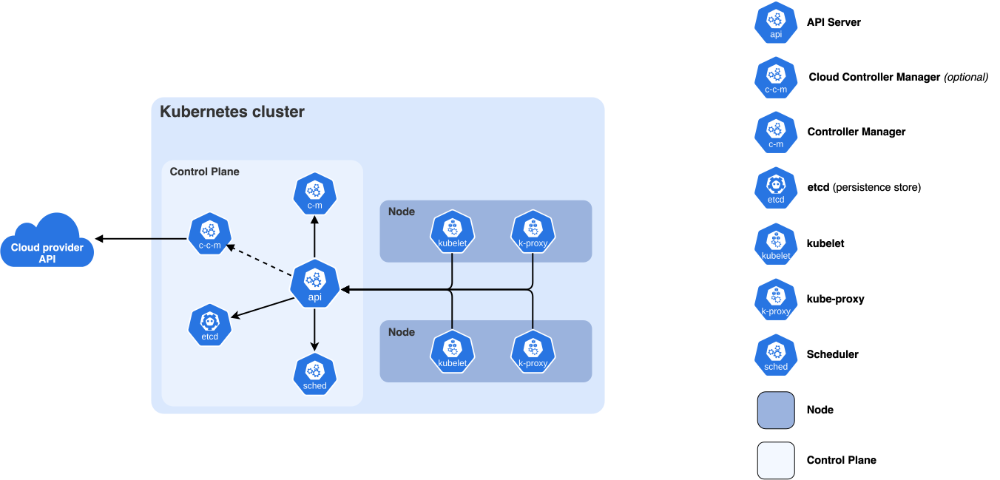

# Control Planes and Fleet Management

Somebody has to decide which machine runs what. When you call "create a sandbox" on an agent platform, "start 64 inference replicas" on a serving fleet, or "give me 8 H100s" on a compute marketplace, a piece of software receives that request, records it, picks a machine, tells the machine what to do, watches it happen, and notices when the machine dies halfway through. That software is a **control plane**, and the machines plus the software on them that actually run the work are the **data plane**.

This chapter is about building and operating control planes for fleets of machines: bare-metal CPU and GPU workers running secure microVM sandboxes for RL environments, inference fleets that have to keep up with an RL trainer, marketplaces that aggregate capacity from many providers. Kubernetes and SLURM are the famous examples, and the [Kubernetes](../orchestration/kubernetes-from-zero.md) and [orchestration internals](../orchestration/internals.md) chapters cover them. Here the goal is to understand the *pattern* well enough to build your own, because teams that place and run unusual workloads (microVMs in 100 ms, GPU jobs on someone else's hardware, rollouts that must never be counted twice) usually do end up writing one.

The chapter ends by building a working mini control plane in about 300 lines of Python: an HTTP API, a placement scheduler, node agents that heartbeat and run fake workloads, a reconciler that moves work off dead nodes with fencing, and a Prometheus `/metrics` endpoint. Then it pauses, partitions and kills nodes and shows what happened.

Conventions:

- Every script starts with a comment naming its file. Pure-Python scripts need only `python3` (run here with CPython 3.14.5 on an Apple Silicon Mac). Scripts marked **[venv]** need a virtualenv with third-party packages:

  ```bash
  python3 -m venv /tmp/cpvenv
  /tmp/cpvenv/bin/pip install fastapi uvicorn httpx prometheus_client opentelemetry-sdk "psycopg[binary]" redis
  # versions used here: fastapi 0.162.0, uvicorn 0.54.0, httpx 0.28.1, prometheus_client 0.26.0,
  # opentelemetry-sdk 1.45.2, PostgreSQL 15.14 and Redis 8.2.2 from Homebrew
  ```

  (Virtual environments are covered in [the toolkit chapter](../foundations/toolkit.md#venv-the-built-in-way).) What the packages are, briefly; each is explained properly where it is first used. `fastapi` is a Python web framework: you write a function, mark it with the URL it answers, and it handles the HTTP and JSON (section 9). `uvicorn` is the server process that runs a FastAPI app. `httpx` is an HTTP client, like `requests` but with an `asyncio` version. `prometheus_client` exports metrics, `opentelemetry-sdk` records traces (both in section 11). `psycopg` is the Python driver for the Postgres database and `redis` the client for the Redis server (both in section 6). FastAPI and httpx were already used in [Serving LLMs in Practice](../inference/serving-hands-on.md#a-mock-server-you-can-run-anywhere).

- Output under a script is real output from running it, unless the block says **untested** (things that need Linux, a GPU, a real cluster, or tools not installed here, such as `etcd`).
- Simulations are seeded, so you get the same numbers. Several end with `assert`s that fail if you break the property the section is about.

## Prerequisites

Read these first, or keep them open. This chapter links to them instead of repeating them:

- [The working toolkit](../foundations/toolkit.md): virtual environments, JSON and [jq](../foundations/toolkit.md#jq-json-on-the-command-line) (used to query this chapter's logs), YAML (the Prometheus rules file).
- [Linux and the OS](../foundations/linux-and-os.md): [signals](../foundations/linux-and-os.md#signals) (SIGTERM, SIGKILL, SIGSTOP/SIGCONT drive the failure scenarios), [cgroups](../foundations/linux-and-os.md#cgroups-limits-for-groups-of-processes), the shell.
- [Distributed Systems](../foundations/distributed-systems.md): partial failure, heartbeats and "slow vs dead", leases and fencing tokens, Raft, idempotency keys, retries with backoff and jitter, SLOs. This chapter applies those ideas to a fleet; it does not re-derive them.
- [Concurrency](../foundations/concurrency.md): processes, threads, the GIL, `asyncio`, condition variables, producer/consumer and backpressure.
- [Containers and Virtualization](../foundations/containers-and-virtualization.md): what the data plane actually runs (containers, Firecracker microVMs, snapshots, the jailer, tap devices, vsock).
- [Networking](../foundations/networking.md): TCP, HTTP, TLS, gRPC, what a timeout means on the wire.
- [Kubernetes from zero](../orchestration/kubernetes-from-zero.md): the reference control plane. REST verbs and status codes, `resourceVersion` and 409 Conflict, watches, taints, affinity, priority and preemption, `kubectl drain`.
- [Orchestration internals](../orchestration/internals.md): gang scheduling, topology, fairness, automatic draining, Prometheus and PromQL for GPU fleets.
- [Inference Internals I](../inference/arithmetic.md#littles-law) (Little's law), [Inference Internals II](../inference/serving-engine-internals.md#observability) (the Prometheus text format) and [Serving LLMs in Practice](../inference/serving-hands-on.md) (FastAPI, httpx, Server-Sent Events, `histogram_quantile`).
- Forward link: [RL infrastructure](rl-infrastructure.md) is the main client of the fleets described here.


## 1. Control plane vs data plane

### Two planes, two jobs

The terms come from networking. In a router, the **data plane** forwards packets (billions per second, in hardware), and the **control plane** computes the routing table that tells the data plane where to forward them (a few updates per second, in software). The split carried over to every large system:

| | Control plane | Data plane |
|---|---|---|
| What it does | decides: what should run, where, with what config | does: runs the sandbox, serves the tokens, moves the bytes |
| Examples | Kubernetes API server + scheduler + controllers; SLURM `slurmctld`; your placement service | `kubelet` + containerd + the container; `slurmd` + the job; Firecracker + the guest; vLLM serving requests |
| Request rate | low: creates, deletes, heartbeats (10s to 10,000s per second) | high: every token, packet, syscall |
| Latency it adds | once per workload lifecycle event | on every request |
| If it goes down | nothing new can start, move or heal; **running work keeps running** | users see errors immediately |

The last row is the most important design rule in this chapter: **the data plane must keep working when the control plane is down.** If your API server crashes for ten minutes, sandboxes that are already running should keep running, inference replicas should keep serving, and training jobs should keep training. Only changes (new sandboxes, rescheduling, scaling) should stop. This property is called **static stability**, and it decides a lot of details: node agents cache their desired state locally instead of asking for it on every decision, data-plane traffic never goes through the control plane, and "control plane unreachable" on a node means "keep doing what you were doing" (with one important exception covered in [self-fencing](#self-fencing-at-the-node)).

Here is the difference in one picture. The control plane sits off to the side of the request path:

```
          control path (rare, must be correct)
 user ──► API ──► state store ◄── scheduler / controllers
                     ▲ │
          heartbeats │ │ desired state
                     │ ▼
              ┌──────────────┐
              │  node agent  │  starts / stops / watches
              │   (kubelet,  │──────────────┐
              │   slurmd,..) │              ▼
              └──────────────┘     ┌──────────────────┐
                                   │  workload        │ ◄──── data path (hot, must be fast)
                                   │  (microVM, pod,  │       user traffic goes straight here,
                                   │   vLLM server)   │       never through the API server
                                   └──────────────────┘
```

A quick way to check which plane a piece of code belongs to: ask "does this run once per workload, or once per request?". The code below makes the same point with numbers (computed, not measured):

```python
# planes.py -- rates in the two planes of an inference fleet (illustrative numbers)
replicas, tok_per_s_per_replica = 512, 3_000
deploys_per_day, restarts_per_replica_per_day, hb_interval_s, nodes = 20, 0.5, 10, 64
data = replicas * tok_per_s_per_replica
control = (deploys_per_day * replicas + restarts_per_replica_per_day * replicas) / 86400 + nodes / hb_interval_s
print(f"data plane:    {data:>12,.0f} tokens/s")
print(f"control plane: {control:>12,.1f} writes/s (deploys + restarts + heartbeats)")
print(f"ratio: {data / control:,.0f}x")
```

```console
$ python3 planes.py
data plane:       1,536,000 tokens/s
control plane:          6.5 writes/s (deploys + restarts + heartbeats)
ratio: 235,529x
```

Five orders of magnitude apart. That is why the two planes are built differently: the data plane is optimized for throughput and latency, the control plane for correctness under failure. A control plane can afford a consensus round trip per write; a data plane can't afford one per token.

### Desired state and reconciliation

There are two ways to tell a fleet what to do.

- **Imperative**: send commands. "Start sandbox X on node 3." "Stop it." The control plane is a remote shell.
- **Declarative**: record what you want. "Sandbox X should exist, with 4 CPUs." A separate loop compares what you want (**desired state**, or **spec**) with what exists (**actual state**, or **status**) and acts to close the gap. That loop is a **reconciler** (Kubernetes calls it a **controller**).

Almost every serious control plane is declarative, for one reason: **commands get lost and reality drifts.** A command can be dropped by the network, the node can crash after receiving it, or the workload can die on its own an hour later without telling anyone. With commands, each of those is a separate bug you have to find and handle. With reconciliation, they are all the same case, "actual differs from desired", and the same loop fixes them.

A reconciler is structurally tiny:

```python
# shape of every reconciler (pseudocode for the pattern, not runnable on its own)
while True:
    desired = read_spec()            # from the state store
    actual  = observe_world()        # from node reports, provider APIs, probes
    for diff in compare(desired, actual):
        act(diff)                    # create / delete / restart / move; must be idempotent
    sleep_or_wait_for_change()
```

Three properties make it robust. `act` is **idempotent** (doing it twice is the same as once), because the loop will retry it. The loop reads **current** state every time instead of remembering what it did, so a crashed and restarted reconciler just carries on. And it runs **forever**, not once, so drift that appears later gets fixed too.

### Level-triggered vs edge-triggered

These terms come from electronics. An **edge-triggered** circuit reacts to a *change* in a signal (the rising edge). A **level-triggered** circuit reacts to the signal's *current value*. In control planes:

- An **edge-triggered** controller reacts to events: "replicas changed from 3 to 5, so start 2". If it misses the event, or a replica dies with no event, it never corrects.
- A **level-triggered** controller looks at the current levels: "spec says 5, I see 3 running, so start 2". It doesn't matter how we got here.

Kubernetes controllers use events (watches) to know *when* to look, but decide *what* to do from current state. That combination is the standard design. The simulation below runs both styles against the same world: a user editing the spec, 20% of events lost, and replicas that crash silently.

```python
# reconcile.py -- edge-triggered vs level-triggered control under lost events and silent crashes
import random

def run(level_triggered, steps=1000):
    spec, crash, net = random.Random(1), random.Random(2), random.Random(3)  # same world for both
    desired = actual = wrong_ticks = 0
    for t in range(steps):
        event = None
        if spec.random() < 0.1:                     # a user edits the spec: emits an event
            event = spec.choice([-2, -1, 1, 2]); desired = max(0, desired + event)
        if crash.random() < 0.05 and actual:        # a replica dies; nobody emits an event
            actual -= 1
        if level_triggered:
            actual = desired                        # every tick: observe both, close the gap
        elif event is not None and net.random() > 0.2:
            actual = max(0, actual + event)         # apply the delta, if the event arrived (80%)
        wrong_ticks += actual != desired
    return desired, actual, wrong_ticks

for lt in (False, True):
    d, a, w = run(lt)
    print(f"{'level' if lt else 'edge '}-triggered: final desired={d} actual={a}, "
          f"wrong for {w}/1000 ticks")
```

```console
$ python3 reconcile.py
edge -triggered: final desired=5 actual=0, wrong for 696/1000 ticks
level-triggered: final desired=5 actual=5, wrong for 0/1000 ticks
```

The edge-triggered controller was wrong for 70% of the run and ended with nothing running. The level-triggered one never drifted, because each tick it compares the two states instead of trusting a stream of deltas. This is the reason the mini control plane at the end has the node agent receive the *complete* list of what should run on it in every heartbeat reply, not "start this" and "stop that" messages.


## 2. Anatomy of a fleet control plane

### The components

Every fleet control plane, from Borg (Verma et al., "Large-scale cluster management at Google with Borg", EuroSys 2015) to Kubernetes to a startup's sandbox service, has the same five parts:

```
                    clients: SDK, CLI, RL trainer, eval harness, other services
                                        │  HTTPS / gRPC
                                        ▼
   ┌──────────────────────────────────────────────────────────────────────────┐
   │ CONTROL PLANE                                                            │
   │                                                                          │
   │   ┌──────────────┐  validate, authn/z, quota, idempotency, versioning    │
   │   │  API server  │  (stateless: run 3+ behind a load balancer)           │
   │   └──────┬───────┘                                                       │
   │          │ read / CAS write / watch                                      │
   │   ┌──────▼───────┐  the ONLY durable state: specs, status, leases,       │
   │   │ state store  │  assignments, resource versions (etcd / Postgres)     │
   │   └──┬────────┬──┘                                                       │
   │      │ watch  │ watch                                                    │
   │ ┌────▼─────┐ ┌▼─────────────────────┐                                    │
   │ │scheduler │ │ controllers          │ node lifecycle (lease expiry ->    │
   │ │(placement│ │ (reconcilers)        │ NotReady -> reschedule), autoscaler│
   │ │ binds    │ │                      │ GC, quota, provider sync, drain    │
   │ │ work to  │ └──────────────────────┘                                    │
   │ │ nodes)   │                                                             │
   │ └──────────┘                                                             │
   └───────────────────────────────▲──────────────────────────────────────────┘
                 register, heartbeat │ │ desired state for this node
                 status reports      │ ▼ (watch or heartbeat reply)
   ┌─────────────────────────────────┴────────────────────────────────────────┐
   │ DATA PLANE: one agent per machine                                        │
   │   ┌──────────────┐  supervise  ┌───────────────────────────────────────┐ │
   │   │  node agent  │────────────►│ runtime: containerd / Firecracker /   │ │
   │   │ (kubelet,    │             │ vLLM / slurmstepd ... -> the workload │ │
   │   │  slurmd, ..) │◄────────────│                                       │ │
   │   └──────────────┘  status     └───────────────────────────────────────┘ │
   └──────────────────────────────────────────────────────────────────────────┘
```

- The **API server** is the front door. It authenticates the caller, validates the request, enforces quota, applies idempotency keys, and writes to the state store. It holds no state of its own, so you can run several copies.
- The **state store** is the single source of truth. Everything else is a cache of it. If you lose the state store you have lost the fleet's memory: which sandboxes exist, where they run, who owns what. It must be durable and replicated.
- The **scheduler** (also called the **placer** or **allocator**) watches for work that has no node, picks one, and records the binding.
- **Controllers** are reconcilers for everything else: node lifecycle, autoscaling, garbage collection of finished work, syncing with cloud provider APIs.
- The **node agent** runs on every machine. It registers the machine, heartbeats, pulls its desired state, drives the local **runtime** (containerd, Firecracker, a vLLM process) to match it, and reports status back.

Kubernetes is this exact shape. Its official components diagram uses the same boxes, with `api` (kube-apiserver), `etcd`, `sched` (kube-scheduler), `c-m` (kube-controller-manager) and `kubelet` on every node:



([source](https://kubernetes.io/docs/concepts/overview/components/))

One design choice in the picture is worth stealing: **every component talks only to the API server**, and only the API server talks to etcd. The scheduler doesn't call the kubelet; it writes a binding, and the kubelet sees it through its watch. This hub-and-spoke shape means there is one place to put authentication, validation, auditing and rate limiting, and components can restart in any order.

A minimal on-disk layout of such a service, to make the parts concrete (a sketch, not a prescription):

```
fleetd/
  api/            # HTTP/gRPC handlers: validate, authz, quota, idempotency -> store
  store/          # the only module that talks to Postgres/etcd; CAS helpers, watch
  scheduler/      # filter + score + bind loop
  controllers/    # node_lifecycle.py, gc.py, autoscaler.py, provider_sync.py
  agent/          # the node agent binary: register, heartbeat, runtime driver
  runtime/        # firecracker.py / containerd.py: the only code that touches the data plane
```

### Life of a sandbox: assignment to ready

Here is what happens between a client asking for a sandbox and the sandbox being ready to take commands, for a Firecracker-style platform. Each arrow is a place where latency hides and where a failure can strand the request.

```
 t   client          API server         store          scheduler        node agent          runtime
 0   POST /sandboxes ──►
                     authn, validate,
                     quota, idem-key ──► INSERT phase=Pending (rv=41)
     ◄── 202 {id, op}                       │ watch event
                                            └──────────► filter+score
                                                         CAS bind node=n7,
                                     ◄─────────────────── epoch=1 (rv=42)
                                            │ watch / heartbeat reply
                                            └─────────────────────────► desired += sbx
                                                                       pull image/snapshot ─► (cache hit?)
                                                                       create tap, jailer ──► boot / restore
                                                                       guest agent up? ◄───── vsock hello
                                     ◄───────────────────────────────── status Ready, epoch=1
                                     UPDATE phase=Ready (rv=43)
     GET/watch ─────────► phase=Ready
```

Reading the diagram: `202` is the HTTP status "Accepted: I have recorded your request and will finish it later" (the full table is in [Errors and status codes](#errors-and-status-codes)). `INSERT` and `UPDATE` are database writes that add or change a row, in SQL (introduced in [State stores](#postgres-a-relational-database-that-can-be-a-control-plane-store)). `rv` is the object's resource version, a counter bumped on every write. `CAS bind` is a compare-and-swap write, explained in [Optimistic concurrency](#optimistic-concurrency-with-resource-versions). The tap device, jailer and vsock are the Firecracker pieces from [Containers and Virtualization](../foundations/containers-and-virtualization.md#8-microvms).

The time from create to Ready is the number users feel. A rough budget for a microVM sandbox platform looks like this (the boot and restore figures come from the Firecracker paper and [Containers and Virtualization](../foundations/containers-and-virtualization.md#8-microvms); the rest are typical targets, not measurements):

```python
# ready_budget.py -- where create->Ready time goes (targets, in ms)
budget = {
    "API: authn + validate + quota + store write": 10,
    "scheduler: notice (watch latency) + place + CAS bind": 20,
    "deliver to agent (watch push; a 1 s poll would add ~500 ms on average)": 10,
    "image/rootfs: local cache hit (miss: seconds, from the registry)": 5,
    "network: tap device + routes + firewall rules": 15,
    "Firecracker: snapshot restore (cold boot ~125 ms + your init)": 30,
    "guest agent handshake over vsock": 10,
    "status back to the store + client notices (watch)": 10,
}
for k, v in budget.items(): print(f"{v:5d} ms  {k}")
print(f"{sum(budget.values()):5d} ms  total, if every cache is warm")
```

```console
$ python3 ready_budget.py
   10 ms  API: authn + validate + quota + store write
   20 ms  scheduler: notice (watch latency) + place + CAS bind
   10 ms  deliver to agent (watch push; a 1 s poll would add ~500 ms on average)
    5 ms  image/rootfs: local cache hit (miss: seconds, from the registry)
   15 ms  network: tap device + routes + firewall rules
   30 ms  Firecracker: snapshot restore (cold boot ~125 ms + your init)
   10 ms  guest agent handshake over vsock
   10 ms  status back to the store + client notices (watch)
  110 ms  total, if every cache is warm
```

The budget shows two things. Control-plane hops (API, scheduler, delivery, status) are about half of a warm start, so they matter. And any *poll* in the chain (an agent that polls every second, a client that polls every second) adds half its interval on average and dominates everything else. That is why fast platforms push changes with watches or streams, and why the mini control plane at the end, which delivers work in heartbeat replies every 500 ms, shows create-to-Ready times near one second.

### The object model and its state machine

A control plane's API is a set of **objects** (sandbox, node, operation, quota), each with a **spec** (what the user asked for, written by the user) and a **status** (what is true, written by the system). Keeping the two separate matters: users never write status, controllers never rewrite spec, and the two can be updated without stepping on each other.

Every object with a lifecycle needs an explicit **state machine**: a list of phases and the legal moves between them. Write it down in code. Most production incidents in a control plane are "an object got into a state nobody thought possible", and an explicit transition table turns those into loud errors at the moment they happen:

```python
# lifecycle.py -- the sandbox state machine, written down so illegal transitions are bugs, not surprises
ALLOWED = {
    "Pending":   {"Scheduled", "Failed"},              # scheduler binds it (or gives up: quota, no fit)
    "Scheduled": {"Starting", "Pending"},              # agent picked it up / node died before it did
    "Starting":  {"Ready", "Failed", "Pending"},       # image pull + boot / boot failed / node died
    "Ready":     {"Succeeded", "Failed", "Pending", "Terminating"},
    "Terminating": {"Succeeded", "Failed"},
    "Succeeded": set(), "Failed": set(),               # terminal
}
def transition(obj, to):
    if to not in ALLOWED[obj["phase"]]:
        raise ValueError(f"{obj['id']}: illegal {obj['phase']} -> {to}")
    obj["phase"] = to

s = {"id": "sbx-1", "phase": "Pending"}
for to in ("Scheduled", "Starting", "Ready", "Pending", "Scheduled", "Starting", "Ready", "Succeeded"):
    transition(s, to); print(to, end=" -> ")
print("done")
try: transition(s, "Ready")
except ValueError as e: print(e)
```

```console
$ python3 lifecycle.py
Scheduled -> Starting -> Ready -> Pending -> Scheduled -> Starting -> Ready -> Succeeded -> done
sbx-1: illegal Succeeded -> Ready
```

Note the edges back to `Pending` from `Scheduled`, `Starting` and `Ready`. Those are the "node died, place it again" moves, and they are the source of most of the subtle bugs later in this chapter: after such a move the *old* node may still be running the old copy.


## 3. Placement and bin-packing

### Filter, then score

**Placement** (or **scheduling**) is choosing a node for a workload. Almost every scheduler does it in two phases:

1. **Filter** (Kubernetes calls these *predicates* or `Filter` plugins): drop every node that *cannot* run the workload. Not enough free GPUs, wrong GPU type, node is draining, a taint the workload doesn't tolerate, wrong region.
2. **Score** (*priorities*, `Score` plugins): rank the nodes that remain by how *good* a fit they are. Pack tightly, spread replicas apart, prefer nodes that already have the image cached, prefer cheaper capacity.

Then the scheduler **binds**: it writes "workload X runs on node N" to the state store, using a compare-and-swap so that two schedulers can't both claim the same capacity (see [optimistic concurrency](#optimistic-concurrency-with-resource-versions)).

```python
# filter_score.py -- the skeleton every scheduler shares
def schedule(req, nodes, filters, scorers):
    feasible = [n for n in nodes if all(f(n, req) for f in filters)]
    if not feasible:
        return None                                  # stays Pending; report WHY (which filter failed)
    return max(feasible, key=lambda n: sum(w * s(n, req) for s, w in scorers))

fits     = lambda n, r: n["free_gpu"] >= r["gpu"]
right_gpu = lambda n, r: r.get("gpu_type") in (None, n["gpu_type"])
pack     = lambda n, r: -(n["free_gpu"] - r["gpu"])  # higher score = less left over
cached   = lambda n, r: r["image"] in n["images"]    # warm cache -> faster start

nodes = [{"name": "a", "free_gpu": 8, "gpu_type": "H100", "images": set()},
         {"name": "b", "free_gpu": 2, "gpu_type": "H100", "images": {"vllm:0.9"}},
         {"name": "c", "free_gpu": 4, "gpu_type": "A10G", "images": {"vllm:0.9"}}]
req = {"gpu": 2, "gpu_type": "H100", "image": "vllm:0.9"}
print(schedule(req, nodes, [fits, right_gpu], [(pack, 1.0), (cached, 5.0)])["name"])
```

```console
$ python3 filter_score.py
b
```

Two practical rules. First, **record why a workload is unschedulable**: "0/64 nodes: 40 insufficient GPU, 20 taint reserved=training, 4 NotReady" (Kubernetes puts this in a pod event). Without it, "stuck in Pending" is the most common support ticket you'll get and the hardest to answer. Second, scores from different plugins live on different scales, so normalize each to a fixed range (Kubernetes normalizes to 0-100) before weighting them, or one plugin will silently dominate.

### Bin-packing policies and fragmentation

Placement is a form of **bin-packing**: fit items (workloads) into bins (nodes) with fixed capacity. Offline bin-packing (all items known up front) is NP-hard (no known algorithm finds the optimal packing for every input in time polynomial in its size). Online bin-packing (items arrive one at a time, and also *leave*) is what a fleet does, and simple greedy rules work well:

- **First-fit**: take the first node in a fixed order that has room.
- **Best-fit**: take the node with the *least* room left over after placing. Keeps big holes intact for big requests.
- **Worst-fit** (also called **spread** or **least-allocated**): take the node with the *most* room. Spreads load evenly, which is good for latency and blast radius, and bad for packing.

The thing to watch is **fragmentation**: enough total free capacity in the fleet, but not enough on any single node. With GPUs it is brutal, because a training worker or a large inference replica wants all 8 GPUs of one node (they're connected by NVLink inside the node and only by the network across nodes). A fleet of 64 nodes with 1 free GPU each has 64 free GPUs and can't run a single 8-GPU job.

The simulation runs 20,000 arrivals with departures on 64 nodes of 8 GPUs, at about 84% offered load, with a mix of 1, 2, 4 and 8 GPU requests:

```python
# binpack.py -- online GPU placement: first-fit vs best-fit vs worst-fit (spread), with departures
import random

NODES, GPUS = 64, 8                                   # 64 nodes x 8 GPUs = 512 GPUs
SIZES, WEIGHTS = [1, 2, 4, 8], [50, 25, 15, 10]       # request mix (GPUs per sandbox)

def choose(policy, free, need):
    fits = [i for i in range(NODES) if free[i] >= need]          # filter
    if not fits: return None
    if policy == "first-fit": return fits[0]
    if policy == "best-fit":  return min(fits, key=lambda i: free[i] - need)   # tightest hole
    if policy == "worst-fit": return max(fits, key=lambda i: free[i] - need)   # spread

def sim(policy, steps=20000, seed=0):
    rng = random.Random(seed)
    free, running = [GPUS] * NODES, []                # running: (end_time, node, gpus)
    stats = {s: [0, 0] for s in SIZES}                # size -> [attempts, rejected]
    frag_rejects, util = 0, 0.0
    for t in range(steps):
        for job in [j for j in running if j[0] <= t]:            # departures
            free[job[1]] += job[2]; running.remove(job)
        need = rng.choices(SIZES, WEIGHTS)[0]
        node = choose(policy, free, need)
        stats[need][0] += 1
        if node is None:
            stats[need][1] += 1
            frag_rejects += sum(free) >= need         # enough GPUs in total, just not on one node
        else:
            free[node] -= need; running.append((t + rng.randint(60, 300), node, need))
        util += 1 - sum(free) / (NODES * GPUS)
    rej8 = stats[8][1] / stats[8][0]
    total_rej = sum(r for _, r in stats.values()) / steps
    return util / steps, total_rej, rej8, frag_rejects

print(f"{'policy':10s} {'util':>6s} {'rejected':>9s} {'8-GPU rejected':>15s} {'rejected-but-fit-in-total':>26s}")
for p in ("first-fit", "best-fit", "worst-fit"):
    u, r, r8, f = sim(p)
    print(f"{p:10s} {u:6.1%} {r:9.1%} {r8:15.1%} {f:26d}")
```

```console
$ python3 binpack.py
policy       util  rejected  8-GPU rejected  rejected-but-fit-in-total
first-fit   82.5%      0.3%            3.1%                         65
best-fit    82.8%      0.3%            2.5%                         55
worst-fit   58.5%      9.0%           91.6%                       1800
```

Spreading is a disaster for whole-node requests: 92% of 8-GPU requests were rejected, and 1,800 rejections happened while the fleet had enough free GPUs in total. Spreading leaves a little free space on every node, which is exactly the wrong shape. First-fit and best-fit are close. Over 5 seeds the 8-GPU rejection rate was 1.9-3.1% for first-fit and 1.8-2.5% for best-fit, so the difference between them is within seed noise here; the difference from worst-fit is not. In practice:

- Use **packing** (best-fit or "most-allocated") for batch and GPU work, so whole nodes stay free.
- Use **spreading** where you want independence (replicas of one service across nodes and racks), and do it as a *constraint* on the replicas of one group, not as the global policy.
- Measure fragmentation directly: "largest request we could place right now" per GPU type is a good gauge to export.
- Defragment when needed: migrate or preempt small, restartable work off nearly-empty nodes to reassemble whole free nodes. This is what Kubernetes' descheduler and many internal GPU schedulers do.

### More than one resource

Real requests have several dimensions: GPUs, CPUs, memory, local disk, network bandwidth. A node is full when *any* dimension runs out, and the others are **stranded**: physically present, unusable. GPU servers are especially prone to this, because they have lots of CPU and RAM that people want for CPU-only work (code-execution sandboxes for RL environments, data preprocessing):

```python
# stranded.py -- multi-resource packing: GPUs run out while CPU and RAM sit idle (or the reverse)
node = {"gpu": 8, "cpu": 192, "mem": 2048}           # one 8-GPU box: 192 vCPUs, 2 TiB RAM (illustrative)
cpu_heavy_sandboxes = {"gpu": 0, "cpu": 16, "mem": 64}   # code-execution sandboxes for an RL env
gpu_jobs = {"gpu": 1, "cpu": 8, "mem": 128}              # one inference replica per GPU

def fits(free, r): return all(free[k] >= r[k] for k in r)
for order in (["sandbox"] * 12 + ["gpu"] * 8, ["gpu"] * 8 + ["sandbox"] * 12):
    free, placed = dict(node), {"sandbox": 0, "gpu": 0}
    for kind in order:
        r = cpu_heavy_sandboxes if kind == "sandbox" else gpu_jobs
        if fits(free, r): placed[kind] += 1; free = {k: free[k] - r.get(k, 0) for k in free}
    print(f"order {order[0]:7s}-first: placed {placed}, left idle {free}")

# Tetris-style alignment score (Grandl et al., SIGCOMM 2014): prefer the node whose free vector
# points the same way as the request, so no single dimension runs out early
def align(free, r): return sum(free[k] / node[k] * r[k] / node[k] for k in r)
print("alignment of a sandbox with a GPU-rich-but-CPU-poor node:",
      round(align({"gpu": 8, "cpu": 16, "mem": 512}, cpu_heavy_sandboxes), 4),
      " with a CPU-rich node:", round(align({"gpu": 0, "cpu": 160, "mem": 1024}, cpu_heavy_sandboxes), 4))
```

```console
$ python3 stranded.py
order sandbox-first: placed {'sandbox': 12, 'gpu': 0}, left idle {'gpu': 8, 'cpu': 0, 'mem': 1280}
order gpu    -first: placed {'sandbox': 8, 'gpu': 8}, left idle {'gpu': 0, 'cpu': 0, 'mem': 512}
alignment of a sandbox with a GPU-rich-but-CPU-poor node: 0.0148  with a CPU-rich node: 0.0851
```

Twelve CPU-heavy sandboxes ate all 192 vCPUs and left 8 GPUs (the expensive part of the box) unusable. Placing the GPU work first left everything usable. Three common fixes:

- **Reserve** a share of CPU and memory on GPU nodes for GPU work (Kubernetes: a taint on GPU nodes that only GPU pods tolerate, plus requests sized per GPU).
- Score with **alignment** (the Tetris heuristic: Grandl et al., "Multi-Resource Packing for Cluster Schedulers", SIGCOMM 2014): prefer the node whose free-resource vector points in the same direction as the request, so no single dimension runs out early. The score above is 0.085 for a CPU-rich node against 0.015 for a GPU-rich-but-CPU-poor one.
- Keep separate pools (CPU fleet, GPU fleet) and only spill over deliberately. This is the simplest and usually right for a small team.

When several tenants share a fleet, "fair" also needs a multi-resource definition. **Dominant Resource Fairness** (Ghodsi et al., NSDI 2011) equalizes each tenant's share of whichever resource they use most of; it is what YARN and Mesos implemented. Kubernetes' Kueue and SLURM's fair-share do related things (see [orchestration internals](../orchestration/internals.md#fairness-and-utilization-pull-in-opposite-directions)).

### Constraints, affinity, spreading and preemption

On top of capacity, users and operators need to say *where* things may and may not go. The vocabulary, in Kubernetes terms because they are the most widely known:

| Mechanism | Meaning | Example |
|---|---|---|
| **node selector / hard constraint** | must run on nodes with this label | `gpu=H100`, `region=us-east` |
| **taint and toleration** | node repels everything except workloads that tolerate the taint | GPU nodes tainted so CPU-only work stays off; a node tainted `reserved=training` |
| **affinity** | prefer (soft) or require (hard) to be near something | put the env sandbox in the same zone as the inference server it calls |
| **anti-affinity** | prefer or require to be *away* from something | no two replicas of one model on the same node |
| **topology spread** | keep counts across zones/racks within a max skew | 3 replicas over 3 zones, skew <= 1 |
| **priority and preemption** | a high-priority request may evict lower-priority work | the trainer evicts preemptible eval jobs |

The script below implements all of them in about 60 lines: a hard GPU-type constraint, a taint, anti-affinity between replicas, zone spreading for a group, best-fit, and preemption that evicts the fewest lowest-priority victims:

```python
# placement.py -- filter/score placement with constraints, anti-affinity, spreading and preemption
from dataclasses import dataclass, field

@dataclass
class Node:
    name: str; zone: str; gpu_type: str; gpus: int
    taints: set = field(default_factory=set)
    running: list = field(default_factory=list)      # list of Sandbox
    def free(self): return self.gpus - sum(s.gpus for s in self.running)

@dataclass
class Sandbox:
    name: str; gpus: int; priority: int = 0
    gpu_type: str | None = None                      # hard constraint (nodeSelector)
    tolerates: set = field(default_factory=set)      # taints this sandbox accepts
    anti_affinity: str | None = None                 # "not on a node with another sandbox of this group"
    group: str | None = None

def feasible(n, s, ignore_capacity=False):
    if s.gpu_type and n.gpu_type != s.gpu_type: return False          # hard constraint
    if not n.taints <= s.tolerates: return False                       # taint without toleration
    if s.anti_affinity and any(r.group == s.anti_affinity for r in n.running): return False
    return ignore_capacity or n.free() >= s.gpus

def score(n, s, nodes):
    # lower is better: (1) zone spread for the group, (2) best-fit leftover
    in_zone = sum(r.group == s.group for m in nodes if m.zone == n.zone for r in m.running) if s.group else 0
    return (in_zone, n.free() - s.gpus)

def place(s, nodes):
    cands = [n for n in nodes if feasible(n, s)]
    if cands:
        n = min(cands, key=lambda n: score(n, s, nodes)); n.running.append(s); return n.name, []
    # preemption: on each node that would fit if we evicted lower-priority work, evict the
    # fewest/lowest-priority victims; pick the node with the cheapest victim set
    best = None
    for n in nodes:
        if not feasible(n, s, ignore_capacity=True): continue
        victims, free = [], n.free()
        for r in sorted((r for r in n.running if r.priority < s.priority), key=lambda r: r.priority):
            if free >= s.gpus: break
            victims.append(r); free += r.gpus
        if free >= s.gpus:
            cost = (len(victims), sum(v.priority for v in victims))
            if best is None or cost < best[0]: best = (cost, n, victims)
    if best is None: return None, []
    _, n, victims = best
    for v in victims: n.running.remove(v)            # in reality: graceful stop, then requeue
    n.running.append(s); return n.name, [v.name for v in victims]

nodes = [Node("h100-a1", "us-east-1a", "H100", 8), Node("h100-b1", "us-east-1b", "H100", 8),
         Node("a10-a1", "us-east-1a", "A10G", 4),
         Node("h100-a2", "us-east-1a", "H100", 8, taints={"reserved=training"})]
reqs = [Sandbox("eval-0", 2, gpu_type="H100", group="eval"),
        Sandbox("eval-1", 2, gpu_type="H100", group="eval"),
        Sandbox("cheap-0", 1, gpu_type="A10G"),
        Sandbox("replica-0", 4, gpu_type="H100", group="serve", anti_affinity="serve"),
        Sandbox("replica-1", 4, gpu_type="H100", group="serve", anti_affinity="serve"),
        Sandbox("replica-2", 4, gpu_type="H100", group="serve", anti_affinity="serve"),
        Sandbox("trainer", 8, priority=10, gpu_type="H100", tolerates={"reserved=training"}),
        Sandbox("urgent", 6, priority=5, gpu_type="H100")]
for s in reqs:
    where, evicted = place(s, nodes)
    print(f"{s.name:10s} -> {where or 'UNSCHEDULABLE':14s}" + (f" evicting {evicted}" if evicted else ""))
print({n.name: [r.name for r in n.running] for n in nodes})
```

```console
$ python3 placement.py
eval-0     -> h100-a1
eval-1     -> h100-b1
cheap-0    -> a10-a1
replica-0  -> h100-a1
replica-1  -> h100-b1
replica-2  -> UNSCHEDULABLE
trainer    -> h100-a2
urgent     -> h100-a1        evicting ['eval-0', 'replica-0']
{'h100-a1': ['urgent'], 'h100-b1': ['eval-1', 'replica-1'], 'a10-a1': ['cheap-0'], 'h100-a2': ['trainer']}
```

Read the result line by line. `eval-0` and `eval-1` landed in different zones because of the spread score. `replica-2` is unschedulable: anti-affinity forbids the two nodes that already have a replica, and the third H100 node is tainted. That is correct behavior, and exactly the kind of decision you should explain in the "why Pending" message. `trainer` was the only workload allowed on the tainted node. `urgent` didn't fit anywhere, so the scheduler evicted two priority-0 sandboxes from `h100-a1`.

Preemption is powerful and dangerous. Rules that save you later:

- **Evicted work must be restartable**, and the evictee gets a grace period (SIGTERM, wait, then SIGKILL) to checkpoint. In RL, preemptible work is usually rollouts and evals, never the trainer.
- **Bound the blast radius**: cap evictions per minute, and never preempt to place something that will itself be unschedulable for another reason (the scheduler must re-run the filters as if the victims were gone, as `feasible(..., ignore_capacity=True)` does above).
- **Avoid preemption cascades**: A evicts B, B evicts C, and so on. Allow preemption only from a strictly higher priority class, and don't let preempted work preempt in turn.

### Gangs and topology

A distributed training job, or a multi-node inference replica, is useless unless *all* its members run at once. **Gang scheduling** places all of them or none. A scheduler that places members one by one will happily start 15 of 16 workers and leave them holding GPUs while waiting forever for the 16th, and two such half-placed jobs can deadlock each other. The fix is to reserve the whole gang in one step and roll back if any member doesn't fit:

```python
# gang.py -- all-or-nothing placement: reserve every member, or roll back and place none
def place_gang(n_members, gpus_each, free):          # free: node -> free GPUs (mutated on success)
    trial, plan = dict(free), []
    for _ in range(n_members):
        node = max((n for n in trial if trial[n] >= gpus_each), key=trial.get, default=None)
        if node is None: return None                  # one member doesn't fit -> nobody runs
        trial[node] -= gpus_each; plan.append(node)
    free.update(trial); return plan                   # commit all reservations at once

free = {"n1": 8, "n2": 8, "n3": 4}
print("16x1-GPU gang:", place_gang(16, 1, free), free)
print(" 2x8-GPU gang:", place_gang(2, 8, free), free, "(nothing reserved: no partial gang left holding GPUs)")
```

```console
$ python3 gang.py
16x1-GPU gang: ['n1', 'n2', 'n1', 'n2', 'n1', 'n2', 'n1', 'n2', 'n1', 'n2', 'n3', 'n1', 'n2', 'n3', 'n1', 'n2'] {'n1': 1, 'n2': 1, 'n3': 2}
 2x8-GPU gang: None {'n1': 1, 'n2': 1, 'n3': 2} (nothing reserved: no partial gang left holding GPUs)
```

Real gang schedulers add **topology**: members of one job should share an NVLink domain or a network leaf switch, because the collectives between them run at the speed of the slowest link. This chapter doesn't repeat that material. [Orchestration internals](../orchestration/internals.md#why-gang-scheduling-cannot-be-skipped) covers gangs, topology-aware placement, and how SLURM, Kueue, Volcano and KAI implement them.


## 4. Node agents

The node agent is the control plane's hands. It is also the part that runs on thousands of machines you can't easily log into, so it has to be boring, small and very careful. Kubernetes' agent is the `kubelet`, SLURM's is `slurmd`, Nomad's is the Nomad client; on a sandbox platform it is the daemon that drives Firecracker.

### Registration and identity

When a machine boots, its agent **registers**: "I am node `gpu-c`, I have 32 CPUs, 256 GiB, 2 GPUs of type H100, these labels, this agent version". Registration must be **idempotent**, because the agent will re-register after every restart and the control plane must not end up with two node records for one machine. Use a stable identity (a hostname or machine ID that survives reboots) and a `PUT` to a named resource rather than a `POST` that creates a new one. Against the mini control plane from the end of the chapter:

```console
$ curl -s -X PUT localhost:8700/v1/nodes/gpu-c -H 'content-type: application/json' \
       -d '{"cpu": 32, "mem": 256, "gpu": 2}'
{"lease_s":2.0}
```

(Output from the mini control plane; the second identical `PUT` returns the same thing and changes nothing.) In the `curl` line, `-X PUT` picks the HTTP method, `-H` adds a request header (here saying the body is JSON), `-d` supplies the request body, and `-s` hides the progress meter. `PUT` means "create or replace the object at this URL", so repeating it is harmless; `POST` means "create a new one", so repeating it makes two. The verbs were introduced in [Kubernetes from zero](../orchestration/kubernetes-from-zero.md#the-components).

The hard part in production is not the request, it's **trust**. A node that can register can receive workloads, including other tenants' secrets and model weights. Real systems bootstrap identity in one of three ways: a short-lived **bootstrap token** baked into the machine image that is exchanged for a per-node TLS client certificate (Kubernetes' TLS bootstrapping), the cloud provider's **instance identity document** signed by the provider, or a **TPM**-backed attestation on bare metal (a TPM, Trusted Platform Module, is a tamper-resistant chip on the motherboard that can sign a statement of which firmware and OS booted). After that, every agent request is authenticated with mutual TLS ([TLS basics](../foundations/networking.md#tls-basics); in mutual TLS the client presents a certificate too), and the API server authorizes it so that a node can only read and update *its own* assignments (Kubernetes' Node authorizer does exactly this). On a marketplace that aggregates other people's machines, assume a registered node can lie about everything it reports, and verify hardware claims (GPU model, count, bandwidth) with your own benchmark before trusting them; see [When peers are untrusted](../foundations/distributed-systems.md#when-peers-are-untrusted).

### Heartbeats and leases

After registering, the agent **heartbeats**: it periodically renews a **lease** in the control plane ("node `gpu-c` is alive until t+40 s"). A controller watches the leases. When one expires, the node becomes `NotReady`, and after a grace period its work is moved elsewhere. The theory (why a timeout *decides* rather than *detects* death, phi-accrual detectors) is in [Heartbeats, timeouts and "slow vs dead"](../foundations/distributed-systems.md#heartbeats-timeouts-and-slow-vs-dead). The practical questions are how often to beat and how long the lease should be.

Kubernetes is a good reference point. Since v1.17 (the `NodeLease` feature went GA then) the kubelet renews a small `Lease` object in the `kube-node-lease` namespace; the lease duration defaults to 40 s and the kubelet renews it every 10 s (a quarter of the duration). The node controller marks a node `NotReady`/unknown after `--node-monitor-grace-period` without a renewal (40 s for many releases; recent releases raised the default, so check your version), and pods get the default `node.kubernetes.io/unreachable` toleration of 300 s before they are evicted. A separate, rarer, full `NodeStatus` update carries the heavy information (capacity, conditions, images), so that the frequent heartbeat stays a tiny write. Copy that split.

The arithmetic behind those numbers:

```python
# hb_math.py -- heartbeat cost vs detection time
for nodes in (100, 10_000, 100_000):
    for interval in (1, 10):
        print(f"{nodes:7,d} nodes, beat every {interval:2d}s: {nodes / interval:8,.0f} writes/s to the state store")
lease, interval, tick = 40, 10, 5   # tick: how often the node controller checks leases
print(f"\nk8s-style: lease {lease}s, renew every {interval}s -> tolerate {lease // interval - 1} lost renewals;")
print(f"a node that dies between renewals is declared dead {lease - interval}-{lease + tick}s after it died")
# what the sandbox user sees after a node dies: detect + reschedule + boot elsewhere
detect, sched, boot_cold, boot_snap = 45, 0.1, 20, 0.3
print(f"time-to-recovered sandbox: cold boot {detect + sched + boot_cold:.1f}s, snapshot restore {detect + sched + boot_snap:.1f}s"
      f" -- detection dominates")
```

```console
$ python3 hb_math.py
    100 nodes, beat every  1s:      100 writes/s to the state store
    100 nodes, beat every 10s:       10 writes/s to the state store
 10,000 nodes, beat every  1s:   10,000 writes/s to the state store
 10,000 nodes, beat every 10s:    1,000 writes/s to the state store
100,000 nodes, beat every  1s:  100,000 writes/s to the state store
100,000 nodes, beat every 10s:   10,000 writes/s to the state store

k8s-style: lease 40s, renew every 10s -> tolerate 3 lost renewals;
a node that dies between renewals is declared dead 30-45s after it died
time-to-recovered sandbox: cold boot 65.1s, snapshot restore 45.4s -- detection dominates
```

- **Cost**: heartbeats are writes to your most precious component. 10,000 nodes beating every second is 10,000 writes/s to the state store, which is about the limit of a well-tuned etcd cluster and the main reason big fleets beat every 10 s and keep the heartbeat object small.
- **Tolerance**: renew several times per lease (Kubernetes: 4). One lost packet or one slow GC pause must not take a node out of service.
- **Detection dominates recovery**: with a 40 s lease, a dead node's sandboxes come back 30-45 s after the crash plus boot time. Making the boot 60x faster with snapshots saved 20 s; the lease costs 40 s. If your users care about recovery time, you need shorter leases (and more heartbeat writes), a faster signal than heartbeats (the provider's API telling you the instance is gone, a top-of-rack switch seeing the link drop), or redundancy so that nobody waits for recovery at all.

### Health reporting

"The agent process is alive" is not the same as "the node can run work". A node with a dead GPU, a full disk or a broken network will heartbeat happily forever. So agents report **conditions** in addition to liveness: a small set of named, typed, timestamped health facts, which the scheduler and controllers use as filters. Kubernetes nodes have `Ready`, `MemoryPressure`, `DiskPressure`, `PIDPressure` and `NetworkUnavailable`, and tools like the node-problem-detector add more (kernel deadlocks, GPU Xid errors).

A health report from a GPU sandbox node might look like this. The checks are Linux commands, so this block is **untested** here; the JSON shape is the point. `check NAME COMMAND...` is a small shell function ([the shell](../foundations/linux-and-os.md#2-the-shell)): `shift` drops the name from the argument list, `"$@"` runs the remaining arguments as a command, and the command's exit status (0 = success) becomes the condition's `True`/`False`:

```bash
# health.sh -- run by the agent every 30 s; each check becomes one condition (untested: needs Linux + NVIDIA GPU)
check() { local name=$1; shift; if "$@" >/dev/null 2>&1; then s=True; else s=False; fi
          printf '{"type":"%s","status":"%s","ts":"%s"}\n' "$name" "$s" "$(date -u +%FT%TZ)"; }
check GPUsVisible     bash -c '[ "$(nvidia-smi -L | wc -l)" -eq 8 ]'          # all 8 GPUs enumerate
check NoXidErrors     bash -c '! dmesg | grep -q "NVRM: Xid"'                  # see compute/accelerator/nvidia/debug.md
check KVMAvailable    test -c /dev/kvm                                          # microVMs need it
check DiskOK          bash -c '[ "$(df --output=pcent /var/lib/sandboxes | tail -1 | tr -dc 0-9)" -lt 90 ]'
check ImageCacheWarm  test -f /var/lib/sandboxes/cache/base-rootfs.ext4
check ControlPlaneDNS getent hosts api.fleet.internal
```

```
{"type":"GPUsVisible","status":"True","ts":"2026-11-05T12:00:00Z"}
{"type":"NoXidErrors","status":"False","ts":"2026-11-05T12:00:00Z"}
...
```

Design points:

- **Make each condition a scheduler input.** `NoXidErrors=False` should automatically **cordon** the node (no new work) without killing what runs on it; see [automatic node draining](../orchestration/internals.md#automatic-node-draining) for the full cordon-drain-repair loop on GPU fleets.
- **Rate-limit automated reactions.** A buggy health check, or a shared dependency like DNS failing, can make every node unhealthy at once. If more than a few percent of nodes go unhealthy in a minute, stop acting automatically and page a human. Kubernetes' node lifecycle controller does a version of this: when a large fraction of a zone's nodes are unhealthy it slows or stops evictions (`--unhealthy-zone-threshold`, default 0.55), on the theory that the control plane's view is more likely wrong than half a zone is dead.
- **Gray failures**: the node passes every check and is still bad (one GPU 30% slower, 1% packet loss on one NIC). Huang et al., "Gray Failure: The Achilles' Heel of Cloud-Scale Systems" (HotOS 2017), is the paper on this. The practical answer is to measure from the *workload's* side too (step time per node, error rate per node, latency per replica) and treat outliers as suspects.

### Supervising workloads

The agent owns the processes (or microVMs) it starts. It must notice when they exit, report why, and usually restart them, without turning a persistent failure into a tight restart loop that burns CPU and floods logs. The standard tool is **exponential backoff** with a cap, reset after the process has stayed up for a while. Kubernetes' `CrashLoopBackOff` is this: restarts at 10 s, 20 s, 40 s, ... capped at 5 minutes, reset after 10 minutes of successful running (per the Kubernetes docs; recent releases are making these tunable). A supervisor in 25 lines:

```python
# supervise.py -- what a node agent does for each workload: start, watch, restart with backoff
import subprocess, sys, time

# the "workload": crashes on its first three runs (bad config, OOM, flaky download), then stays up
CHILD = """
import os, sys, time
n = int(open('/tmp/attempts').read()) if os.path.exists('/tmp/attempts') else 0
open('/tmp/attempts', 'w').write(str(n + 1))
if n < 3: sys.exit(3)          # crash
time.sleep(30)                 # healthy, long-running
"""
open("/tmp/attempts", "w").write("0")
backoff, MAX_BACKOFF, STABLE_S, t0 = 0.1, 1.6, 1.0, time.time()
for attempt in range(6):
    started = time.time()
    p = subprocess.Popen([sys.executable, "-c", CHILD])
    try:
        rc = p.wait(timeout=STABLE_S * 2)               # watch it
    except subprocess.TimeoutExpired:
        print(f"t={time.time()-t0:4.1f}s attempt {attempt}: running for {STABLE_S*2:.0f}s -> report Ready")
        p.terminate(); p.wait(); print(f"t={time.time()-t0:4.1f}s drain: SIGTERM, exit code {p.returncode}")
        break
    if time.time() - started > STABLE_S: backoff = 0.1  # it ran a while: reset backoff
    print(f"t={time.time()-t0:4.1f}s attempt {attempt}: exited rc={rc} -> report CrashLoop, restart in {backoff:.1f}s")
    time.sleep(backoff); backoff = min(backoff * 2, MAX_BACKOFF)
```

```console
$ python3 supervise.py
t= 0.0s attempt 0: exited rc=3 -> report CrashLoop, restart in 0.1s
t= 0.1s attempt 1: exited rc=3 -> report CrashLoop, restart in 0.2s
t= 0.4s attempt 2: exited rc=3 -> report CrashLoop, restart in 0.4s
t= 2.8s attempt 3: running for 2s -> report Ready
t= 2.8s drain: SIGTERM, exit code -15
```

Other duties of a good supervisor, in decreasing order of how often their absence causes incidents:

- **Report the exit reason**, not just "exited": exit code, signal, OOM-killed (from the cgroup's `memory.events` on Linux), last lines of stderr. "OOMKilled" vs "exit 1" are very different tickets.
- **Kill the whole tree.** A workload that forks leaves orphans when you kill only the parent. Put each workload in its own cgroup (or process group) and kill the group. With microVMs this is natural: kill the Firecracker process and the whole guest is gone.
- **Clean up after itself**: tap devices, mounts, cgroup directories, temp disks. Leaked resources slowly make a node unusable; a periodic reconciler on the node ("these taps exist but no sandbox uses them") is the fix.
- **Survive its own restart.** If the agent restarts, the workloads must keep running (static stability again), and the new agent must rediscover them from the runtime (list the Firecracker sockets, the cgroups, the containerd tasks) rather than from memory.

### Draining

**Cordoning** a node means "schedule nothing new here". **Draining** means cordon, then move existing work off gracefully, so the node can be rebooted, upgraded or repaired. A drain is a small state machine:

```
Ready ──cordon──► Cordoned ──evict each workload (respecting disruption budgets)──► Drained ──► maintenance
                     │                                                                    │
                     └────────────────── uncordon (after repair + health checks pass) ◄───┘
```

On Kubernetes (**untested** here; standard commands):

```bash
kubectl cordon gpu-node-17                      # spec.unschedulable=true: no new pods
kubectl drain gpu-node-17 --ignore-daemonsets --delete-emptydir-data --timeout=10m
#   --ignore-daemonsets: skip DaemonSet pods (their controller would recreate them on this node anyway)
#   --delete-emptydir-data: allow evicting pods with emptyDir volumes (that scratch data is lost)
#   evicts pods through the Eviction API, which honors PodDisruptionBudgets
#   ("at most 1 of my 3 replicas may be down at once")
kubectl uncordon gpu-node-17                    # after repair and a passing health check
```

For sandboxes, "evict" often means "stop accepting new sandboxes, let the running ones finish or hit their time limit". RL rollouts and evals are usually minutes long, so waiting is cheaper than migrating. For long-running work you need a real eviction path: tell the workload (SIGTERM, or an API call into the guest), give it a deadline to checkpoint, then kill it and let the scheduler place it again. Live migration of microVMs exists but is rarely worth its complexity.


## 5. Failure detection, fencing and split brain

### Slow vs dead in practice

The theory is in [the distributed systems chapter](../foundations/distributed-systems.md#heartbeats-timeouts-and-slow-vs-dead): from outside, a dead node, a slow node and a partitioned node all look the same (silent). What matters for a control plane is what happens *after* it decides a silent node is dead and moves its work. In each case, here is what the old copy of the work is doing at that moment:

| Reality | Old copy of the work | Danger when you reschedule |
|---|---|---|
| node crashed / powered off | gone | none; reschedule freely |
| agent process paused (GC, SIGSTOP, swapped out, VM live-migrated) | **still running**, and the agent will wake up later believing nothing happened | two copies; old one may write results late |
| node partitioned from the control plane, but reachable by users or storage | **still running and still serving** | two copies at once, both "real" |
| agent crashed, workloads alive (static stability!) | **still running**, unsupervised | two copies until someone kills the old one |

Three of four rows mean *two copies*. So rescheduling after a failure gives you **at-least-once execution**, not exactly-once, and the rest of the system must be built for that. For stateless, idempotent work (an eval sandbox that computes a score) a duplicate only wastes compute. For work with side effects (commit a checkpoint, count a rollout, charge a customer, publish weights to the inference fleet) a duplicate is a correctness bug. The two tools are **fencing** at the resource and **self-fencing** at the node.

### Fencing tokens in a control plane

The idea is from [Leases and fencing tokens](../foundations/distributed-systems.md#leases-and-fencing-tokens): every time ownership changes, hand out a number that only goes up, and have the protected resource reject requests carrying an older number. In a control plane the natural place for the token is the **assignment**. Each time the scheduler binds a sandbox to a node, it increments the sandbox's **epoch** (also called a *generation* or *incarnation number*). The node gets the epoch with the assignment and must present it on every write that matters. The mini control plane does exactly this; here are the two checks, excerpted from `minicp.py` at the end of the chapter:

```python
# in schedule_pass(): every new binding gets a new epoch
s.update(phase="Scheduled", node=best, epoch=s["epoch"] + 1)

# in complete(): the result is accepted only from the CURRENT incarnation
if d.epoch != s["epoch"]:
    STALE.labels("complete").inc()
    raise HTTPException(409, f"stale epoch {d.epoch} < {s['epoch']}")
```

(`raise HTTPException(409, ...)` is how the FastAPI web framework, introduced in [section 9](#long-running-operations-watches-and-pagination), turns a Python exception into an HTTP error response, here `409 Conflict`. `STALE.labels("complete").inc()` adds 1 to a Prometheus counter, covered in [Metrics with Prometheus](#metrics-with-prometheus).)

And this is what it did in the scenario run, filtered from the structured log with `jq` ([jq: JSON on the command line](../foundations/toolkit.md#jq-json-on-the-command-line)). The scenario freezes a node's agent with SIGSTOP and later resumes it with SIGCONT ([signals](../foundations/linux-and-os.md#signals)). Sandbox `sbx-83e197` was placed on `cpu-b` with epoch 1. The scenario froze `cpu-b` with SIGSTOP, the control plane moved the sandbox to `gpu-c` with epoch 2, and when `cpu-b` woke up it tried to report its (stale) result:

```console
$ jq -c 'select(.sbx == "sbx-83e197") | {t, ev, node, epoch, http}' /tmp/minicp.log
{"t":1793914846.173,"ev":"created","node":null,"epoch":null,"http":null}
{"t":1793914846.234,"ev":"placed","node":"cpu-b","epoch":1,"http":null}
{"t":1793914846.766,"ev":"ready","node":"cpu-b","epoch":1,"http":null}
{"t":1793914849.373,"ev":"rescheduling","node":null,"epoch":null,"http":null}
{"t":1793914849.373,"ev":"placed","node":"gpu-c","epoch":2,"http":null}
{"t":1793914850.313,"ev":"ready","node":"gpu-c","epoch":2,"http":null}
{"t":1793914852.711,"ev":"REJECTED_stale_complete","node":"cpu-b","epoch":1,"http":null}
{"t":1793914852.712,"ev":"agent_complete","node":"cpu-b","epoch":1,"http":409}
{"t":1793914854.113,"ev":"succeeded","node":"gpu-c","epoch":2,"http":null}
{"t":1793914854.114,"ev":"agent_complete","node":"gpu-c","epoch":2,"http":200}
```

The old copy *did* run to completion; fencing doesn't prevent that. It prevents the old copy's *result* from counting. Two caveats from real systems:

- The fence must be checked **by the resource** that the side effect touches. Here the resource is the control plane's own record, so it is easy. If the workload writes to S3, the object store can't check your epoch, so put the epoch in the key (`results/sbx-83e197/epoch-2/`) and have the consumer read only the current epoch's output.
- Status reports need fencing too, not just results. In the run, the woken node also reported "sandbox running" for epoch 1, and those reports were rejected (`cp_stale_writes_rejected_total{kind="status"} 2.0` in the metrics). Without that check, the stale node could flip the sandbox's status back to "Ready on cpu-b".

### Self-fencing at the node

Fencing at the resource stops stale *writes*. It doesn't stop a stale copy from *serving users* or using a GPU. For that, the node must stop its own work when it can no longer be sure it still owns it. The rule is: **if the agent can't renew its lease, it must assume the control plane has already given its work to someone else, and stop that work before the new copy starts.** For that to be safe, the node must give up *before* the control plane reassigns:

```
agent's last successful renewal ─┬──────────────── self-fence deadline (0.75 x lease, agent's clock)
                                 │                               │ kill local workloads
                                 └──────────────────────────────────────────── lease expiry (1.0 x lease,
                                                                               control plane's clock) -> reassign
```

The margin (here 25% of the lease) has to cover clock *rate* differences and the agent's own scheduling delays. It cannot cover a process that is *paused*: a frozen agent can't run its self-fence timer at all. That is why you need both mechanisms. Self-fencing handles partitions, where the agent is running and notices. Fencing tokens handle pauses, where it doesn't. In the scenario run, a partition was injected at t=11.05 s; the agent fenced itself at t=12.09 s, and the control plane reassigned at t=12.60 s, half a second later:

```
{"t": 12.09, "ev": "agent_self_fenced", "node": "cpu-b", "killed": ["sbx-8d141b", "sbx-de46e8"]}
{"t": 12.6, "ev": "node_not_ready", "node": "cpu-b"}
{"t": 12.61, "ev": "placed", "sbx": "sbx-8d141b", "node": "cpu-a", "epoch": 2}
```

Self-fencing is in tension with static stability (keep running when the control plane is down). You have to pick per workload type. For sandboxes doing RL rollouts, where a duplicate is cheap and a stale result is fenced anyway, many platforms prefer *keep running* and rely on fencing. For a workload that holds an exclusive role (the one writer of a checkpoint, the primary of a database, the one replica allowed to publish weights), self-fence. Hardware-level fencing exists too: HA (high-availability) clusters use **STONITH** ("shoot the other node in the head"), power-cycling a suspected node through its BMC (baseboard management controller: a small separate computer on the server's board, with its own network port, that can power the machine on and off even when the OS is hung) before taking over its work, which turns "maybe dead" into "certainly dead". On a GPU fleet, `ipmitool chassis power off` through the BMC is the same tool.

### Split brain in the control plane itself

The control plane's own singletons have the same problem. If you run three scheduler replicas for availability, only one should place work at a time; if two do, they make conflicting decisions from the same view. That is **split brain**: two parts of a system each believing they are the leader.

The usual design is **leader election through a lease in the state store**. Kubernetes' scheduler and controller-manager run with `--leader-elect`: the replicas race to acquire a `Lease` object in etcd, the winner renews it every few seconds, and the others wait for it to expire. Here is the same thing in Redis, run against a local `redis-server` listening on port 6399 **[venv]**.

Just enough Redis to read it (more in [the Redis section](#redis-fast-mostly-in-memory-weaker-guarantees) below). Redis is a server that holds a dictionary of string keys in memory and executes one command at a time, so each command is atomic. The commands used here: `SET key value NX PX 300` stores the value only if the key does Not eXist, and makes it expire after 300 milliseconds; it returns success or nothing. `GET key` reads it. `PEXPIRE key ms` resets a key's expiry. `INCR key` adds 1 to a counter and returns the new value, atomically. Redis can also run a short script in **Lua** (a small embedded scripting language) on the server, as one atomic step; inside the script `KEYS[1]` and `ARGV[1]` are the arguments passed in and `redis.call(...)` runs a Redis command. In the Python client, `r.set(..., nx=True, px=ttl)` is `SET ... NX PX`, and `register_script` returns a Python function that runs the Lua script. `RENEW` below means "extend the lease only if I still hold it", which needs the check and the extend to happen without anything in between:

```python
# redis_lease.py -- a leader lease in Redis: SET NX PX to acquire, a Lua check-and-extend to renew,
# INCR for a fencing token. Fine for "only one scheduler should usually be active"; NOT a safe
# mutex on its own (single node, async replication, see Kleppmann's "How to do distributed locking").
import time, redis
r = redis.Redis(port=6399, decode_responses=True); r.delete("leader", "leader:epoch")
RENEW = r.register_script("""
if redis.call('GET', KEYS[1]) == ARGV[1] then return redis.call('PEXPIRE', KEYS[1], ARGV[2]) end
return 0""")

def acquire(me, ttl_ms):
    if r.set("leader", me, nx=True, px=ttl_ms):
        return r.incr("leader:epoch")          # fencing token: goes up on every new leadership
    return None

print("A acquires:", acquire("sched-A", 300))
print("B acquires:", acquire("sched-B", 300), "(held)")
print("A renews  :", RENEW(keys=["leader"], args=["sched-A", 300]))
time.sleep(0.35)                                # A stalls past its TTL
print("B acquires:", acquire("sched-B", 300), "(A's lease expired)")
print("A renews  :", RENEW(keys=["leader"], args=["sched-A", 300]), "(A learns it lost; must stop acting)")
```

```console
$ /tmp/cpvenv/bin/python redis_lease.py
A acquires: 1
B acquires: None (held)
A renews  : 1
B acquires: 2 (A's lease expired)
A renews  : 0 (A learns it lost; must stop acting)
```

A leader lease alone has the same pause problem as any lease: A can be frozen right after checking "I am the leader" and then act on stale belief. Two defenses make it safe in practice:

1. Every write the leader makes is a **conditional write** against the state store (compare-and-swap on resource versions, next section). A deposed leader working from an old view fails its writes, because the new leader has changed the objects since. This is the main reason Kubernetes tolerates brief dual leadership.
2. Where conditional writes aren't possible, carry the leader's **epoch** (the `INCR` value above) as a fencing token on writes to external systems.

Redis is fine for "usually only one is active" (a cron-like singleton where an occasional double run is harmless). It is not a safe mutex: a single Redis primary with asynchronous replication can lose a lock on failover, and Redlock's safety under clock and pause assumptions is disputed (Martin Kleppmann, "How to do distributed locking", 2016, and Salvatore Sanfilippo's reply "Is Redlock safe?"). For leadership that guards correctness, use etcd or Postgres, as in the next section.


## 6. State stores

### What the store must give you

The state store is the one component you can't make stateless, so it decides your control plane's correctness and most of its availability. Requirements, in order of importance:

1. **Durability**: an acknowledged write survives a crash of any single machine. That means the write was fsynced to disk on more than one machine before you got "OK".
2. **Linearizable reads and conditional writes**: a read returns the latest acknowledged write, and you can say "write this only if the object hasn't changed since version 41" (**compare-and-swap**, CAS). Without CAS, two schedulers can both bind the last free GPU.
3. **Change notification**: a way to be told "something changed after version N" (a **watch**), so components react in milliseconds without polling.
4. **Enough throughput for heartbeats plus everything else**, at a latency you can afford on the [Ready path](#life-of-a-sandbox-assignment-to-ready).

Three stores cover nearly every real control plane.

### etcd: a small replicated log with watches

**etcd** is a key-value store replicated with Raft (Ongaro and Ousterhout, "In Search of an Understandable Consensus Algorithm", USENIX ATC 2014; there is a runnable Raft election in [distributed systems](../foundations/distributed-systems.md#a-raft-style-leader-election-you-can-run)). It is what Kubernetes stores everything in. Its data model fits a control plane exactly:

- Every write gets a cluster-wide, monotonically increasing **revision**. Every key remembers its `mod_revision`. Kubernetes' `resourceVersion` is this revision.
- **Transactions** with compare-and-swap: `if mod_revision(key) == 41 then put(...) else get(...)`.
- **Watches** from a revision: "send me every change under `/sandboxes/` after revision 41". Because history is kept (until compacted), a client that disconnects can resume without missing anything.
- **Leases**: keys attached to a TTL that vanish when the lease isn't renewed. Built-in liveness and leader election.

`etcd` isn't installed on this machine, so the session below is **untested**; the commands follow the etcd v3 `etcdctl` docs:

```console
$ etcdctl put /sandboxes/sbx-1 '{"node":null}'
OK
$ etcdctl get /sandboxes/sbx-1 -w json | jq '.kvs[0].mod_revision'
41
$ etcdctl txn <<'EOF'
mod("/sandboxes/sbx-1") = "41"

put /sandboxes/sbx-1 '{"node":"gpu-c","epoch":1}'

get /sandboxes/sbx-1

EOF
SUCCESS
OK
$ etcdctl watch --prefix /sandboxes/ --rev=41          # stream every change from revision 41 on
$ etcdctl lease grant 10                               # -> lease 694d... granted with TTL(10s)
$ etcdctl put --lease=694d... /nodes/gpu-c/alive 1     # key disappears 10 s after the last keepalive
```

Its limits are as important as its features. etcd keeps its whole dataset in a memory-mapped B-tree (a sorted tree index whose wide nodes map onto disk pages) with a default storage quota of 2 GiB (`--quota-backend-bytes`; the docs suggest 8 GiB as a practical maximum), limits a request to about 1.5 MiB, and its write throughput is bounded by fsync latency on the leader's disk and one network round trip to a majority. It is a store for *metadata*: thousands to low millions of small objects. Don't put logs, metrics, rollout data or large blobs in it. Kubernetes' documented scalability envelope (about 5,000 nodes and 150,000 pods per cluster) is set largely by etcd and the API server's watch caches.

### Postgres: a relational database that can be a control plane store

**Postgres** (PostgreSQL) is a perfectly good state store for most control planes and often the better choice for a small team: SQL is widely known, you get transactions across many objects, secondary indexes ("all sandboxes of tenant X in phase Pending"), and mature backups and tooling. Replicate it with synchronous streaming replication for durability, or use a managed service.

**Just enough SQL.** A relational database stores **tables**: named columns with types, and rows. You talk to it in **SQL**, a language of statements sent as strings. Python's standard library includes **SQLite**, a SQL database that lives in one file (or in memory), which is enough to learn the handful of statements this chapter uses:

```python
# sql_basics.py -- just enough SQL for this chapter, on SQLite (a SQL database in one file; stdlib sqlite3)
import sqlite3
db = sqlite3.connect(":memory:", isolation_level=None)   # None: we write BEGIN/COMMIT ourselves
db.execute("CREATE TABLE sbx (id TEXT PRIMARY KEY, node TEXT, cpu INTEGER, rv INTEGER)")  # a table: named, typed columns
db.execute("INSERT INTO sbx VALUES ('sbx-1', NULL, 2, 1)")                # add a row (NULL = no value)
db.execute("INSERT INTO sbx (id, cpu, rv) VALUES (?, ?, ?)", ("sbx-2", 4, 1))  # ? = placeholder, filled safely
print(db.execute("SELECT id, cpu FROM sbx WHERE node IS NULL").fetchall())    # read rows matching a condition
n = db.execute("UPDATE sbx SET node='n7', rv=rv+1 WHERE id='sbx-1' AND rv=1").rowcount  # change matching rows
print("rows updated:", n)
db.execute("BEGIN")                                     # a transaction: everything until COMMIT happens, or nothing
db.execute("DELETE FROM sbx WHERE id='sbx-2'")
db.execute("ROLLBACK")                                  # ... changed our mind: undo it all
print(db.execute("SELECT node IS NULL AS pending, count(*), sum(cpu) FROM sbx GROUP BY pending").fetchall())
```

```console
$ python3 sql_basics.py
[('sbx-1', 2), ('sbx-2', 4)]
rows updated: 1
[(0, 1, 2), (1, 1, 4)]
```

`PRIMARY KEY` means the column is unique and indexed. `WHERE` filters rows for `SELECT`, `UPDATE` and `DELETE`. `rowcount` tells you how many rows an `UPDATE` changed, which is how you detect that a conditional write lost a race (0 rows). A **transaction** groups statements between `BEGIN` and `COMMIT` so they take effect together or, on `ROLLBACK` or a crash, not at all. `GROUP BY` collapses rows with the same value into one, and `count(*)` / `sum(...)` / `max(...)` aggregate over each group. Always pass values through placeholders (`?` in sqlite3, `%s` in psycopg), never by pasting them into the SQL string.

What Postgres gives you for each requirement:

- **CAS**: `UPDATE ... WHERE id = $1 AND version = $2` (`$1`, `$2` are Postgres's numbered placeholders) and check the row count (next section).
- **Work queue**: `SELECT ... FOR UPDATE SKIP LOCKED` (since 9.5) lets many workers claim distinct rows without blocking each other. `FOR UPDATE` locks the selected rows until the transaction ends, so no other transaction can change them; `SKIP LOCKED` makes other workers skip rows somebody else has locked instead of waiting for them. This is the standard way to build a reliable queue on Postgres.
- **Notifications**: `LISTEN`/`NOTIFY` for "something changed, go look" (fire-and-forget, so treat it as a hint and re-read state), or logical replication (Postgres streaming every committed row change to a subscriber) for a real change stream.

A queue of placement work, claimed by 4 concurrent workers, against a throwaway Postgres 15 started from Homebrew with `initdb -D /tmp/pgdata && pg_ctl -D /tmp/pgdata -o "-p 5499 -k /tmp" start` (`initdb` creates an empty database directory, `pg_ctl ... start` starts the server on port 5499 with its socket file in `/tmp`) **[venv]**. Postgres-specific pieces in the code: `psycopg.connect(DSN)` opens a connection described by the DSN string; `with c.transaction():` wraps a block in `BEGIN`/`COMMIT` (or `ROLLBACK` on an exception); `serial` is an auto-incrementing integer, `timestamptz` a timestamp; `generate_series(1, 200)` produces the numbers 1..200 as rows; `now() + interval '30 seconds'` is time arithmetic; and `UPDATE ... RETURNING id, sandbox` returns the rows it changed, so a worker claims a row and learns which one in a single statement:

```python
# pg_queue.py -- Postgres as the work queue: 4 workers claim placement work with FOR UPDATE SKIP LOCKED
import threading, time, psycopg
DSN = "host=/tmp port=5499 user=cp dbname=postgres"
with psycopg.connect(DSN, autocommit=True) as c:
    c.execute("DROP TABLE IF EXISTS work")
    c.execute("""CREATE TABLE work (id serial PRIMARY KEY, sandbox text, state text DEFAULT 'queued',
                 claimed_by text, attempts int DEFAULT 0, lease_until timestamptz)""")
    c.execute("INSERT INTO work (sandbox) SELECT 'sbx-' || g FROM generate_series(1, 200) g")

done = {}
def worker(name):
    with psycopg.connect(DSN) as c:
        while True:
            with c.transaction():
                row = c.execute("""
                    UPDATE work SET state='claimed', claimed_by=%s, attempts=attempts+1,
                                    lease_until=now() + interval '30 seconds'
                    WHERE id = (SELECT id FROM work
                                WHERE state='queued' OR (state='claimed' AND lease_until < now())
                                ORDER BY id FOR UPDATE SKIP LOCKED LIMIT 1)
                    RETURNING id, sandbox""", (name,)).fetchone()
            if row is None: return
            time.sleep(0.002)                           # "place it"
            c.execute("UPDATE work SET state='done' WHERE id=%s AND claimed_by=%s", (row[0], name)); c.commit()
            done.setdefault(name, []).append(row[0])

t0 = time.perf_counter()
ts = [threading.Thread(target=worker, args=(f"w{i}",)) for i in range(4)]
[t.start() for t in ts]; [t.join() for t in ts]
ids = [i for v in done.values() for i in v]
print({k: len(v) for k, v in sorted(done.items())}, f"total={len(ids)} unique={len(set(ids))}",
      f"in {time.perf_counter() - t0:.2f}s")
with psycopg.connect(DSN) as c:
    print(c.execute("SELECT state, count(*), max(attempts) FROM work GROUP BY state").fetchall())
```

```console
$ /tmp/cpvenv/bin/python pg_queue.py
{'w0': 50, 'w1': 50, 'w2': 50, 'w3': 50} total=200 unique=200 in 0.15s
[('done', 200, 1)]
```

Each of the 200 items was claimed exactly once, the four workers split them evenly, and nobody waited on anybody's row lock. The `lease_until` column makes the queue crash-safe: if a worker dies after claiming, its rows become claimable again 30 s later. That is at-least-once processing, so the work itself must be idempotent, and the final `UPDATE ... AND claimed_by=%s` is a small fence that stops a worker whose lease expired from marking someone else's claim done.

### Redis: fast, mostly in memory, weaker guarantees

**Redis** is an in-memory data structure server. It is extremely fast (hundreds of thousands of simple operations per second on one core) and has handy primitives: TTL keys, atomic counters, sorted sets for priority queues, streams, Lua scripts that run atomically. Its replication is asynchronous, so a failover can lose recently acknowledged writes, and persistence depends on configuration (`appendfsync everysec` can lose about a second of writes on a crash).

That makes Redis a great **cache**, rate-limiter backend, ephemeral queue or "who's probably online" table, and a poor **source of truth** for anything you can't rebuild. The [leader lease above](#split-brain-in-the-control-plane-itself) is about the limit of what to trust it with.

### Choosing

| | etcd | Postgres | Redis |
|---|---|---|---|
| Replication | Raft, synchronous majority | streaming; sync or async (your choice) | async |
| Linearizable CAS | yes (txn on revision) | yes (row versions, `SERIALIZABLE`, `SELECT FOR UPDATE`) | on one primary, yes (Lua / `WATCH`); lost on failover |
| Watch / change stream | first-class, resumable from revision | `LISTEN/NOTIFY` (lossy hint), logical replication | keyspace notifications (lossy), streams |
| Queries | prefix range only | full SQL, indexes, joins | per data structure |
| Size | ~2-8 GiB total | TBs | RAM |
| Ops burden | you run a quorum, watch fsync latency, compact and defrag | well-known; managed options everywhere | easy, until you need it durable |
| Good for | cluster metadata, leases, leader election, Kubernetes-style watches | most custom control planes: jobs, sandboxes, tenants, billing, queues | caches, rate limits, ephemeral presence, hot counters |

A reasonable default for a new fleet control plane: **Postgres as the source of truth**, a watch built either on an outbox table (below) or on logical replication, Redis only for things you can lose, and etcd only if you are building on Kubernetes or need its watch semantics at its scale.

Two arithmetic checks before choosing. Every acknowledged write in a replicated store costs at least one fsync and one round trip to a replica; with a few milliseconds per commit, a *single sequential writer* gets a few hundred commits per second (see [the multi-region section](#latency-where-the-quorum-lives) for the numbers). You get throughput by **batching** and **concurrency**, not by faster single writes. And size your heartbeat writes from [the heartbeat table](#heartbeats-and-leases) before anything else, because at fleet scale they are most of the write load.


## 7. Consistency patterns

### Optimistic concurrency with resource versions

Two schedulers read the same pending sandbox, both pick a node, both write. Without protection, the second write silently overwrites the first, and both nodes may start the sandbox. The fix that every control plane uses is **optimistic concurrency control**: every object carries a **resource version** that changes on every write, and every update says "only apply this if the version is still the one I read". If it isn't, the write fails with a conflict, and the writer re-reads and decides again. It is "optimistic" because it takes no lock; it assumes conflicts are rare and detects them at write time. The demo uses SQLite (see [Just enough SQL](#postgres-a-relational-database-that-can-be-a-control-plane-store)); the whole trick is the `AND rv=?` in the `UPDATE` and checking `rowcount`:

```python
# cas.py -- optimistic concurrency: two schedulers race to bind the same sandbox
import sqlite3, threading

db = sqlite3.connect("/tmp/cas.db", check_same_thread=False, isolation_level=None)
db.executescript("""DROP TABLE IF EXISTS sbx;
CREATE TABLE sbx (id TEXT PRIMARY KEY, node TEXT, rv INTEGER NOT NULL);
INSERT INTO sbx VALUES ('sbx-1', NULL, 7);""")
lock = threading.Lock()   # sqlite connection is not thread-safe; the CAS below is what matters

def bind(scheduler, node, use_cas):
    with lock: _, cur_node, rv = db.execute("SELECT * FROM sbx WHERE id='sbx-1'").fetchone()  # read
    barrier.wait()                                    # both schedulers have read rv=7
    with lock:
        if use_cas:   # write only if nobody wrote since we read: compare-and-swap on rv
            n = db.execute("UPDATE sbx SET node=?, rv=rv+1 WHERE id='sbx-1' AND rv=?", (node, rv)).rowcount
        else:
            n = db.execute("UPDATE sbx SET node=?, rv=rv+1 WHERE id='sbx-1'", (node,)).rowcount
    results.append(f"{scheduler} bind->{node} read rv={rv}: {'OK' if n else 'CONFLICT (re-read, retry)'}")

for use_cas in (False, True):
    db.execute("UPDATE sbx SET node=NULL, rv=7"); results = []; barrier = threading.Barrier(2)
    ts = [threading.Thread(target=bind, args=(f"sched-{i}", f"node-{i}", use_cas)) for i in (0, 1)]
    [t.start() for t in ts]; [t.join() for t in ts]
    print(f"use_cas={use_cas}:", "; ".join(sorted(results)), "| final:", db.execute("SELECT node, rv FROM sbx").fetchone())
```

```console
$ python3 cas.py
use_cas=False: sched-0 bind->node-0 read rv=7: OK; sched-1 bind->node-1 read rv=7: OK | final: ('node-0', 9)
use_cas=True: sched-0 bind->node-0 read rv=7: CONFLICT (re-read, retry); sched-1 bind->node-1 read rv=7: OK | final: ('node-1', 8)
```

Without CAS, both schedulers got "OK", the version advanced twice, and the final row says `node-0`, so `node-1`'s agent may be running a sandbox the store doesn't know about. With CAS, exactly one won and the other got a conflict. In Kubernetes every object has `metadata.resourceVersion`, every update must carry it, and a stale one gets HTTP `409 Conflict`; client-go's (the official Go client library for Kubernetes) `retry.RetryOnConflict` is the re-read-and-retry loop. The same pattern on Postgres is the `WHERE ... AND rv = ?` above, and on etcd it is a txn on `mod_revision`.

Two details matter in practice. Retry on conflict by **re-reading and re-deciding**, never by blindly re-sending the same write with the new version (that just reintroduces the lost update). And keep objects small and split by writer: if status and spec live in one object that both the user and the agent write, they conflict constantly. Kubernetes separates the `status` subresource for this reason.

### Idempotency keys

A client sends "create sandbox", the network drops the reply, the client retries, and now there are two sandboxes. The fix is an **idempotency key**: the client generates a unique ID for each *logical* operation, sends it with every retry, and the server returns the original result for a key it has seen. The mechanism and its subtleties (one key per operation, not per attempt; store the key with the side effect, atomically) are covered with a runnable demo in [distributed systems: idempotency](../foundations/distributed-systems.md#idempotency).

In an API it is a header, as in the mini control plane, where the scenario POSTs every create twice. (Preview of FastAPI, introduced in [section 9](#long-running-operations-watches-and-pagination): `@app.post(path, status_code=201)` registers the function as the handler for HTTP `POST` requests to that path; `req: SandboxReq` tells FastAPI to parse and type-check the JSON body into that Pydantic model (a class whose annotated fields declare the expected shape; see [Versioning](#versioning-and-compatibility)); `Header(...)` fills `idempotency_key` from the `Idempotency-Key` request header, with `...` meaning "required".)

```python
@app.post("/v1/sandboxes", status_code=201)
async def create(req: SandboxReq, idempotency_key: str = Header(...)):
    if idempotency_key in idem:                       # retried create: same answer, no new sandbox
        return view(idem[idempotency_key])
```

Production details (status codes as in [the table in section 9](#errors-and-status-codes)): keep keys for a bounded time (Stripe documents 24 hours) and scope them per tenant; reject a reused key that comes with a *different* body (`422`), since that is a client bug; and if the original request is still in flight when the retry arrives, return `409` and let the client retry later, rather than doing the work twice. Brandur Leach's "Implementing Stripe-like Idempotency Keys in Postgres" is the detailed reference. For APIs that create resources with client-chosen names (`PUT /v1/sandboxes/{name}`), the name *is* the idempotency key, which is one reason Kubernetes makes names client-chosen.

### At-least-once delivery, dedup and the outbox

A control plane writes to its store and also has to tell other systems: publish "sandbox created" to a queue, call the billing service, notify the scheduler. That is two writes to two systems, and there is no transaction across them. If you write the database then publish, a crash in between loses the event. If you publish then write, a crash in between announces something that never happened. This is the **dual-write problem**.

The **transactional outbox** fixes it. In the same database transaction as the state change, insert the event into an `outbox` table. A separate **relay** loop reads unpublished outbox rows, publishes them, and marks them published. A crash in the relay just means it publishes some rows again, so delivery is **at-least-once**, and consumers **dedup** on the event's sequence number. Combined, the effect is exactly-once *processing*. (In the code, `BEGIN IMMEDIATE` is SQLite's way of starting a transaction that takes the write lock at once, and `AUTOINCREMENT` gives each outbox row the next sequence number.)

```python
# outbox.py -- write state + idempotency record + outgoing event in ONE transaction, publish later
import sqlite3, json, random
random.seed(4)
db = sqlite3.connect(":memory:", isolation_level=None)
db.executescript("""
CREATE TABLE sandboxes (id TEXT PRIMARY KEY, spec TEXT, phase TEXT);
CREATE TABLE idempotency (key TEXT PRIMARY KEY, sandbox_id TEXT);
CREATE TABLE outbox (seq INTEGER PRIMARY KEY AUTOINCREMENT, event TEXT, published INTEGER DEFAULT 0);
""")

def create_sandbox(key, spec):
    db.execute("BEGIN IMMEDIATE")
    try:
        row = db.execute("SELECT sandbox_id FROM idempotency WHERE key=?", (key,)).fetchone()
        if row: db.execute("ROLLBACK"); return row[0], "replayed"
        sid = f"sbx-{db.execute('SELECT count(*) FROM sandboxes').fetchone()[0]}"
        db.execute("INSERT INTO sandboxes VALUES (?,?, 'Pending')", (sid, json.dumps(spec)))
        db.execute("INSERT INTO idempotency VALUES (?,?)", (key, sid))
        db.execute("INSERT INTO outbox(event) VALUES (?)", (json.dumps({"type": "created", "id": sid}),))
        db.execute("COMMIT"); return sid, "created"   # all three rows, or none of them
    except Exception:
        db.execute("ROLLBACK"); raise

delivered = []                                   # what the message broker / scheduler saw
def relay():                                     # separate loop: at-least-once publisher
    for seq, ev in db.execute("SELECT seq, event FROM outbox WHERE published=0 ORDER BY seq").fetchall():
        delivered.append((seq, ev))              # publish ...
        if random.random() < 0.3: return         # ... crash before marking published: will resend
        db.execute("UPDATE outbox SET published=1 WHERE seq=?", (seq,))

for i in range(5):
    print(create_sandbox(f"req-{i}", {"cpu": 2}), create_sandbox(f"req-{i}", {"cpu": 2})[1])  # + client retry
for _ in range(10): relay()
seen, applied = set(), []                        # consumer dedups on the outbox seq number
for seq, ev in delivered:
    if seq not in seen: seen.add(seq); applied.append(json.loads(ev)["id"])
print(f"sandboxes={db.execute('SELECT count(*) FROM sandboxes').fetchone()[0]}  "
      f"deliveries={len(delivered)}  applied after dedup={applied}")
```

```console
$ python3 outbox.py
('sbx-0', 'created') replayed
('sbx-1', 'created') replayed
('sbx-2', 'created') replayed
('sbx-3', 'created') replayed
('sbx-4', 'created') replayed
sandboxes=5  deliveries=9  applied after dedup=['sbx-0', 'sbx-1', 'sbx-2', 'sbx-3', 'sbx-4']
```

Five creates (each retried once, replayed from the idempotency table), nine deliveries because the relay "crashed" after publishing several times, and exactly five events applied after dedup. Three things are atomic in one transaction: the sandbox row, the idempotency record, and the event. That is the whole trick. The outbox table also gives you a free **watch** API: "give me outbox rows with `seq > N`" is exactly a resumable change stream, which is how you build Kubernetes-style watches on top of Postgres.


## 8. Work queues, backpressure and rate limiting

### Little's law

Before any queueing design, one formula, already met (with a simulation) in [Inference Internals I](../inference/arithmetic.md#littles-law). **Little's law**: the average number of items in a system $L$ equals the arrival rate $\lambda$ times the average time each item spends inside $W$. It holds for any stable system regardless of distributions, which makes it the most useful sanity check in capacity planning:

```console
$ python3 -c "
lam, W = 400, 0.5   # creates/s, seconds each create spends in the control plane
print(f'Little: L = lambda * W = {lam} * {W} = {lam*W:.0f} creates in flight')
lam, W = 400, 30
print(f'Little: {lam}/s * {W}s boot = {lam*W:.0f} sandboxes Starting at any moment')"
Little: L = lambda * W = 400 * 0.5 = 200 creates in flight
Little: 400/s * 30s boot = 12000 sandboxes Starting at any moment
```

So 400 creates/s with 30 s cold boots means 12,000 sandboxes booting at any moment: that much memory, that many image pulls, that many open connections. If you can't hold that, you need faster boots (snapshots) or fewer arrivals (admission control), and no amount of queueing helps.

### Bounded queues, load shedding and per-tenant limits

Every control plane has a capacity: placements per second, store writes per second, boots per second per node. When arrivals exceed it, work queues up. An **unbounded** queue turns a short overload into a long outage: latency grows without limit, clients time out and retry (adding more load), and the work you eventually do is for requests nobody is waiting on anymore. **Backpressure** is any mechanism that pushes the overload back to the sender; in an HTTP API that means rejecting early with `429 Too Many Requests` (or `503`) and a `Retry-After` header, so a well-behaved client backs off. (In-process producer/consumer backpressure with bounded queues is in [concurrency: producer/consumer and backpressure](../foundations/concurrency.md#producerconsumer-and-backpressure).)

A shared bound protects the control plane but not tenants from each other. If an RL trainer starts 2,000 rollouts at once, it fills the shared queue and a quiet tenant's requests get rejected too. **Per-tenant rate limits** fix that. The usual algorithm is a **token bucket**: tokens refill at a steady rate up to a maximum burst, and each request spends one; no token, no admission. The simulation compares the three designs against a fixed capacity of 200 creates/s, a quiet tenant at a steady 80/s, and a noisy one that bursts to 1,000/s for two seconds:

```python
# backpressure.py -- a burst against a fixed-capacity control plane
#   tenant "quiet": steady 80/s.   tenant "noisy": 80/s, then 1000/s for 2 s (2,000 rollouts at once)
from collections import deque

CAP, DT, END = 200, 0.01, 8.0           # control plane absorbs 200 creates/s; 10 ms ticks
def rate(tenant, t): return 1000 if tenant == "noisy" and 1.0 <= t < 3.0 else 80

class TokenBucket:                       # refills `rate` tokens/s up to `burst`; one token per request
    def __init__(self, rate, burst): self.rate, self.burst, self.tokens = rate, burst, burst
    def refill(self, dt): self.tokens = min(self.burst, self.tokens + self.rate * dt)
    def take(self):
        if self.tokens >= 1: self.tokens -= 1; return True
        return False

def sim(max_queue, buckets):
    q, acc = deque(), {"quiet": 0.0, "noisy": 0.0}
    lat, rej = {"quiet": [], "noisy": []}, {"quiet": 0, "noisy": 0}
    t = 0.0
    while t < END:
        for b in buckets.values(): b.refill(DT)
        for tenant in ("noisy", "quiet"):
            acc[tenant] += rate(tenant, t) * DT
            while acc[tenant] >= 1:
                acc[tenant] -= 1
                b = buckets.get(tenant)
                if (b and not b.take()) or len(q) >= max_queue:
                    rej[tenant] += 1     # 429 + Retry-After: fail fast, the client backs off
                else:
                    q.append((tenant, t))
        for _ in range(int(CAP * DT)):   # FIFO service
            if q: tenant, t0 = q.popleft(); lat[tenant].append(t - t0)
        t = round(t + DT, 2)
    out = []
    for tenant in ("quiet", "noisy"):
        l = sorted(lat[tenant])
        out.append(f"{tenant}: rejected={rej[tenant]:4d} p99={l[int(len(l) * .99)] * 1e3:5.0f} ms")
    return "   ".join(out) + f"   backlog at end={len(q)}"

print("unbounded queue          :", sim(10**9, {}))
print("shared queue <= 100      :", sim(100, {}))
print("+ per-tenant token bucket:", sim(100, {"noisy": TokenBucket(100, 50), "quiet": TokenBucket(100, 50)}))
```

```console
$ python3 backpressure.py
unbounded queue          : quiet: rejected=   0 p99= 5630 ms   noisy: rejected=   0 p99= 5640 ms   backlog at end=1560
shared queue <= 100      : quiet: rejected= 152 p99=  470 ms   noisy: rejected=1510 p99=  490 ms   backlog at end=0
+ per-tenant token bucket: quiet: rejected=   0 p99=  230 ms   noisy: rejected=1751 p99=  230 ms   backlog at end=0
```

- **Unbounded**: nothing rejected, and nothing useful either. p99 latency 5.6 s, and 1,560 requests still queued when the run ends. Every client with a 5 s timeout has already given up and retried.
- **Shared bound of 100**: latency is bounded (p99 under 0.5 s), but the quiet tenant lost 152 requests to someone else's burst.
- **Per-tenant token bucket**: the quiet tenant is untouched (0 rejected, p99 230 ms), and all the rejections land on the tenant that caused the overload.

In production, layer them: a per-tenant token bucket at the API (often in Redis or in each API server's memory with a global budget split across replicas), a bounded internal queue in front of the scheduler, and **priorities** inside the queue so that "reschedule work from a dead node" is never stuck behind a burst of new creates. Kubernetes' API server has a built-in version of this, API Priority and Fairness, which queues requests per priority level and per flow (roughly, per client) with fair queuing among flows.

### Retries and retry budgets

Retries are how clients survive transient failures, and also how a struggling service gets finished off. If every client retries 3 times, an outage multiplies the load on the backend by 4 at the exact moment it can least handle it. The basics (exponential backoff, jitter, only retrying idempotent operations) are in [distributed systems: retries](../foundations/distributed-systems.md#retries-with-exponential-backoff-and-jitter). The fleet-level addition is a **retry budget**: retries may add at most, say, 10% on top of normal traffic (the idea is from the Google SRE book's chapter "Handling Overload"; Finagle and Envoy implement variants):

```python
# retry_budget.py -- cap retries at 10% of requests so an outage can't triple your own load
class RetryBudget:
    def __init__(self, ratio=0.1, floor=10): self.ratio, self.floor, self.reqs, self.retries = ratio, floor, 0, 0
    def on_request(self): self.reqs += 1
    def can_retry(self):
        if self.retries < self.floor + self.ratio * self.reqs: self.retries += 1; return True
        return False

for name, budget in (("3 retries each, no budget", None), ("3 retries, 10% budget", RetryBudget())):
    sent = 0
    for _ in range(1000):                    # 1000 requests in one second against a dead backend
        sent += 1; budget and budget.on_request()
        for _ in range(3):
            if budget and not budget.can_retry(): break
            sent += 1
    print(f"{name:26s}: {sent} requests hit the backend ({sent / 1000:.1f}x)")
```

```console
$ python3 retry_budget.py
3 retries each, no budget : 4000 requests hit the backend (4.0x)
3 retries, 10% budget     : 1110 requests hit the backend (1.1x)
```

Also: retry at **one layer** only. If the SDK retries 3 times, the API server retries 3 times against the store, and the store client retries 3 times, one failed write becomes 64 attempts. And set **deadlines** that propagate: a request with 2 s left should not start a 5 s operation downstream (gRPC propagates deadlines for you).


## 9. API design for infrastructure

### REST vs gRPC

The API is the contract between your control plane and everything that uses it: SDKs, the CLI, the RL trainer, other services, your own node agents. Two styles dominate: REST (objects at URLs, acted on with HTTP verbs and JSON bodies, as in [Kubernetes from zero](../orchestration/kubernetes-from-zero.md#the-components)) and gRPC (remote procedure calls over HTTP/2, from [Networking](../foundations/networking.md#osi-vs-tcpip)). In the streaming row below, **long-poll** means the server holds a request open until there is something new; **chunked** responses ([HTTP/1.1 from raw sockets](../foundations/networking.md#http11-from-raw-sockets)) and **Server-Sent Events** (SSE, `data: ...` lines in one long response, used by [OpenAI-style streaming](../inference/serving-hands-on.md#the-openai-compatible-api-and-streaming)) send a response in pieces; **WebSockets** upgrade an HTTP connection into a two-way message channel.

| | REST/JSON over HTTP | gRPC (Protobuf over HTTP/2) |
|---|---|---|
| Schema | OpenAPI (often generated, e.g. by FastAPI) | `.proto` files; code generation in every language |
| Wire format | JSON: readable, `curl`-able, bigger and slower to parse | binary Protobuf: compact and fast, needs tools to read |
| Streaming | long-poll, chunked responses, Server-Sent Events, WebSockets | native server, client and bidirectional streams |
| Deadlines, cancellation | by convention (headers, timeouts) | built in, propagated across calls |
| Good for | public APIs, browsers, debugging by hand | internal service-to-service traffic, agent <-> control plane streams |

A common split: REST/JSON for the public API that customers and scripts touch, gRPC between the control plane and node agents (one long-lived bidirectional stream per agent carries heartbeats up and assignments down). Kubernetes uses REST/JSON (and Protobuf as an alternative encoding) for its API and gRPC for its node-local plugin interfaces (CRI to the container runtime, device plugins, CSI). A `.proto` for the agent channel might look like this (**untested** sketch; compile it with `grpcio-tools` to check):

```protobuf
// fleet/v1/agent.proto
syntax = "proto3";
package fleet.v1;

service NodeAgent {
  // One stream per node for its whole life: the agent sends heartbeats and status,
  // the control plane sends the COMPLETE desired set whenever it changes (level-triggered).
  rpc Connect(stream AgentMessage) returns (stream ControlMessage);
}

message AgentMessage {
  string node = 1;
  oneof body {
    Register register = 2;
    Heartbeat heartbeat = 3;
  }
}
message Register  { int32 cpu = 1; int64 mem_mib = 2; repeated string gpus = 3; map<string, string> labels = 4; }
message Heartbeat { repeated WorkloadStatus running = 1; }
message WorkloadStatus { string id = 1; int64 epoch = 2; string phase = 3; string reason = 4; }

message ControlMessage {
  repeated Assignment desired = 1;   // everything that should run on this node, nothing else
  int64 resource_version = 2;
}
message Assignment { string id = 1; int64 epoch = 2; int32 cpu = 3; int64 mem_mib = 4; int32 gpus = 5; string image = 6; }
```

Reading a `.proto` file: a `message` is a record type (like a dataclass) whose fields have a type (`string`, `int32`, `int64`, another message), a name, and a **field number** after `=`. The number is not a default value; it is the tag that identifies the field in the binary encoding. `repeated` makes a field a list, `map<K, V>` a dictionary, and `oneof` says exactly one of the listed fields is set. A `service` lists remote functions: `rpc Connect(stream AgentMessage) returns (stream ControlMessage)` is one call in which both sides keep sending messages for as long as the connection lives (bidirectional streaming). A code generator turns the file into client and server classes for each language. Field numbers are the compatibility contract in Protobuf: never reuse or renumber one, add new fields with new numbers, and old clients will skip what they don't know.

### Long-running operations, watches and pagination

Three patterns come up in every infrastructure API. Google's API Improvement Proposals (AIP-151 for long-running operations, AIP-158 for pagination, at [google.aip.dev](https://google.aip.dev)) and the Kubernetes API conventions are good references for each.

- **Long-running operations (LROs).** Creating a sandbox takes 100 ms to minutes, longer than you want to hold an HTTP request open. Return `202 Accepted` immediately with an **operation** object (`{name, done: false, metadata}`), and let the client poll `GET /operations/{name}` or watch until `done: true`, when it carries either a `response` or an `error`.
- **Watches.** Clients (and your own controllers) want "tell me when it changes" without polling. Every list response includes the current `resource_version`; a watch request says "send every change after version N". If N is too old (history compacted), the server returns `410 Gone`, and the client re-lists and re-watches. This list-then-watch loop is exactly what Kubernetes informers do.
- **Pagination.** Never return unbounded lists. Return a page plus an **opaque** `next_page_token` that encodes where to resume (here, the last key seen), not a page number, because page numbers shift when items are inserted.

All three in one FastAPI app **[venv]**. Just enough FastAPI to read it (it was used without much explanation in [Serving LLMs in Practice](../inference/serving-hands-on.md#a-mock-server-you-can-run-anywhere)):

- `app = FastAPI()` creates the application; `@app.get(path)` / `@app.post(path)` register the function below as the handler for that HTTP method and path. `{op_id}` in a path is captured into the parameter of the same name.
- Other function parameters with simple types become **query parameters** (`?cpu=2&limit=5`), converted and validated from their type hints; `Query(2, le=100)` sets a default of 2 and a maximum of 100. A parameter typed as a Pydantic model would be read from the JSON body instead.
- Whatever the handler returns (dict, list) is sent back as JSON with status 200, or the `status_code=` given in the decorator. `raise HTTPException(404, "...")` returns that status with body `{"detail": "..."}`.
- `StreamingResponse(gen())` sends the body piece by piece as the async generator `gen()` yields it, instead of all at once.
- `uvicorn.run(app, port=...)` starts the HTTP server that runs the app on an asyncio event loop. Handlers written as `async def` all run on that one loop.

Two other pieces: `asyncio.Condition` is the asyncio version of a [condition variable](../foundations/concurrency.md#condition-variables) (`wait_for(pred)` sleeps until another task calls `notify_all()` and `pred()` is true), and the watch stream is **NDJSON**, newline-delimited JSON, one object per line. `base64.urlsafe_b64encode` turns bytes into URL-safe text, which makes the page token opaque to clients.

```python
# api.py -- infra API patterns: long-running operations, watch from a resourceVersion, pagination
#   /tmp/cpvenv/bin/python api.py   then use curl (below)
import asyncio, base64, json, uuid
from fastapi import FastAPI, HTTPException, Query
from fastapi.responses import StreamingResponse

app = FastAPI()
objs, ops, log = {}, {}, []      # log: append-only change history [(rv, event)], the source for watches
changed = asyncio.Condition()

async def record(ev):
    async with changed:
        log.append((len(log) + 1, ev)); changed.notify_all()

async def provision(op_id, sid):             # the slow part: placement, image pull, boot
    for phase in ("Scheduled", "Starting", "Ready"):
        await asyncio.sleep(0.3); objs[sid]["phase"] = phase
        await record({"type": "MODIFIED", "object": dict(objs[sid])})
    ops[op_id].update(done=True, response=objs[sid])

@app.post("/v1/sandboxes", status_code=202)  # 202 Accepted: here is an operation, not a result
async def create(cpu: int = 1):
    sid, op_id = f"sbx-{len(objs):03d}", f"op-{uuid.uuid4().hex[:8]}"
    objs[sid] = {"id": sid, "cpu": cpu, "phase": "Pending"}
    ops[op_id] = {"name": op_id, "done": False, "metadata": {"target": sid}}
    await record({"type": "ADDED", "object": dict(objs[sid])})
    asyncio.create_task(provision(op_id, sid))
    return ops[op_id]

@app.get("/v1/operations/{op_id}")           # poll this (or watch) until done=true
async def get_op(op_id: str):
    if op_id not in ops: raise HTTPException(404, "no such operation")
    return ops[op_id]

@app.get("/v1/sandboxes")                    # list: stable order + opaque continue token + rv to watch from
async def list_(limit: int = Query(2, le=100), page_token: str | None = None):
    after = json.loads(base64.urlsafe_b64decode(page_token))["after"] if page_token else ""
    keys = sorted(k for k in objs if k > after)[:limit]
    nxt = base64.urlsafe_b64encode(json.dumps({"after": keys[-1]}).encode()).decode() \
          if len(keys) == limit and keys[-1] != max(objs) else None
    return {"items": [objs[k] for k in keys], "next_page_token": nxt, "resource_version": len(log)}

@app.get("/v1/watch/sandboxes")              # stream every change after resource_version, as NDJSON
async def watch(resource_version: int = 0):
    async def gen():
        rv = resource_version
        while True:
            async with changed:
                await changed.wait_for(lambda: len(log) > rv)
            for v, ev in log[rv:]:
                yield json.dumps({"rv": v, **ev}) + "\n"
            rv = len(log)
    return StreamingResponse(gen(), media_type="application/x-ndjson")

if __name__ == "__main__":
    import uvicorn; uvicorn.run(app, port=8701, log_level="warning")
```

Driving it with `curl`, from a script `api_demo.sh` (the server runs in the background, started with a trailing `&`). `-N` turns off curl's output buffering so streamed lines appear as they arrive, `--max-time 1.5` makes curl hang up after 1.5 s, and `VAR=$(...)` stores a command's output in a shell variable:

```bash
for i in 1 2 3; do curl -s -X POST 'localhost:8701/v1/sandboxes?cpu=2'; echo; done
curl -s 'localhost:8701/v1/sandboxes?limit=2'; echo
TOK=$(curl -s 'localhost:8701/v1/sandboxes?limit=2' | python3 -c 'import json,sys;print(json.load(sys.stdin)["next_page_token"])')
curl -s "localhost:8701/v1/sandboxes?limit=2&page_token=$TOK"; echo
curl -s -N 'localhost:8701/v1/watch/sandboxes?resource_version=3' --max-time 1.5; echo "(watch closed by client)"
sleep 0.2; OP=$(curl -s -X POST 'localhost:8701/v1/sandboxes' | python3 -c 'import json,sys;print(json.load(sys.stdin)["name"])')
curl -s localhost:8701/v1/operations/$OP; echo; sleep 1; curl -s localhost:8701/v1/operations/$OP; echo
```

```console
$ /tmp/cpvenv/bin/python api.py &
$ bash api_demo.sh
{"name":"op-6dcfebd6","done":false,"metadata":{"target":"sbx-000"}}
{"name":"op-aad9df96","done":false,"metadata":{"target":"sbx-001"}}
{"name":"op-cd93e96e","done":false,"metadata":{"target":"sbx-002"}}
{"items":[{"id":"sbx-000","cpu":2,"phase":"Pending"},{"id":"sbx-001","cpu":2,"phase":"Pending"}],"next_page_token":"eyJhZnRlciI6ICJzYngtMDAxIn0=","resource_version":3}
{"items":[{"id":"sbx-002","cpu":2,"phase":"Pending"}],"next_page_token":null,"resource_version":3}
{"rv": 4, "type": "MODIFIED", "object": {"id": "sbx-000", "cpu": 2, "phase": "Scheduled"}}
{"rv": 5, "type": "MODIFIED", "object": {"id": "sbx-001", "cpu": 2, "phase": "Scheduled"}}
{"rv": 6, "type": "MODIFIED", "object": {"id": "sbx-002", "cpu": 2, "phase": "Scheduled"}}
{"rv": 7, "type": "MODIFIED", "object": {"id": "sbx-000", "cpu": 2, "phase": "Starting"}}
{"rv": 8, "type": "MODIFIED", "object": {"id": "sbx-001", "cpu": 2, "phase": "Starting"}}
{"rv": 9, "type": "MODIFIED", "object": {"id": "sbx-002", "cpu": 2, "phase": "Starting"}}
{"rv": 10, "type": "MODIFIED", "object": {"id": "sbx-000", "cpu": 2, "phase": "Ready"}}
{"rv": 11, "type": "MODIFIED", "object": {"id": "sbx-001", "cpu": 2, "phase": "Ready"}}
{"rv": 12, "type": "MODIFIED", "object": {"id": "sbx-002", "cpu": 2, "phase": "Ready"}}
(watch closed by client)
{"name":"op-89d3637e","done":false,"metadata":{"target":"sbx-003"}}
{"name":"op-89d3637e","done":true,"metadata":{"target":"sbx-003"},"response":{"id":"sbx-003","cpu":1,"phase":"Ready"}}
{"detail":"no such operation"} 404
```

(The last line is a separate `curl -s -w ' %{http_code}\n' localhost:8701/v1/operations/nope`.) The watch from `resource_version=3` replayed every change after the list, in order, so a client that listed and then watched has seen everything exactly once. Two simplifications: the history list grows forever (a real server keeps a bounded window and returns `410 Gone` for older versions), and a production watch also sends periodic **bookmark** events carrying the latest version, so idle watchers can resume without a re-list.

### Versioning and compatibility

Infrastructure APIs live for years, and their clients (old SDKs pinned in someone's training script, node agents on machines you haven't upgraded yet) can't all move at once. Rules that hold up:

- Put the major version in the path (`/v1/`), and treat a version as a promise: within `v1` you may **add** optional fields and new endpoints, never remove, rename or change the meaning of a field.
- Clients must **ignore unknown fields**, servers must **default missing ones**. Then old and new versions interoperate in both directions.
- When you need a breaking change, serve `v1` and `v2` from the same storage and convert at the edge (Kubernetes stores one version and converts to whatever the client asked for).
- Version the **agent protocol** too, and make the control plane support at least the previous agent version, because a fleet upgrade takes days and some nodes will be offline for all of it.

**Pydantic** is the library FastAPI uses for request and response bodies: you declare the shape of the data as a class with type-annotated fields, and `Model.model_validate(some_dict)` checks and converts a dict into an instance, raising a validation error (which FastAPI turns into `422`) if a required field is missing or has the wrong type. `model_dump()` goes the other way, back to a dict. With Pydantic models, "add an optional field with a default" is the only safe move, and it is easy to check:

```python
# compat.py -- an old client and a new server, and the reverse
from pydantic import BaseModel, ConfigDict

class SandboxV1(BaseModel):                       # what an old SDK sends and expects
    model_config = ConfigDict(extra="ignore")     # ignore unknown fields: forward compatible
    cpu: int
    mem: int

class SandboxV1_1(SandboxV1):                     # server today: one new OPTIONAL field
    gpu_type: str | None = None

print(SandboxV1_1.model_validate({"cpu": 2, "mem": 4}))                      # old client -> new server
print(SandboxV1.model_validate({"cpu": 2, "mem": 4, "gpu_type": "H100"}))    # new server -> old client
```

```console
$ /tmp/cpvenv/bin/python compat.py
cpu=2 mem=4 gpu_type=None
cpu=2 mem=4
```

### Errors and status codes

An infra API's errors are read by programs that must decide whether to retry. Make the decision easy:

| Status | Meaning | Client should |
|---|---|---|
| `400` / `422` | invalid request | fix the request; never retry |
| `401` / `403` | not authenticated / not allowed | not retry |
| `404` | no such object | not retry (or create it) |
| `409` | conflict: stale resource version, stale epoch, or idempotency key in flight | re-read and re-decide; don't blindly resend |
| `410` | watch version too old | re-list, then watch |
| `429` | rate limited | wait `Retry-After`, then retry |
| `503` | overloaded or dependency down | retry with backoff and jitter, within the retry budget |
| `504` | timed out upstream; **the operation may have happened** | retry only with the same idempotency key |

The last row is the one people get wrong. A timeout tells you nothing about whether the write happened; only an idempotency key makes the retry safe.


## 10. Multi-region and multi-provider

### Latency: where the quorum lives

Spreading a control plane across regions buys survival of a regional outage, at the price of a cross-region round trip on every write. With a Raft-replicated store, a write commits when a majority of replicas have it on disk, so commit latency is set by the leader's distance to the *nearest majority*. In the script, an **AZ** (availability zone) is one of the separate data centers inside a cloud region, a few milliseconds apart; the **WAL** (write-ahead log) is the file each replica appends and fsyncs before acknowledging a write; and `AppendEntries` is the Raft message that carries new log entries from the leader to the followers:

```python
# multiregion.py -- what a quorum write costs, depending on where the replicas live
# RTTs in ms are ROUGH ASSUMPTIONS (typical public-cloud figures), not measurements; plug in yours.
RTT = {("a", "a"): 0.3, ("a", "b"): 1.0, ("a", "c"): 1.2, ("b", "c"): 1.1,            # 3 AZs, one region
       ("a", "west"): 65, ("a", "eu"): 80, ("west", "eu"): 140}
rtt = lambda x, y: RTT[("a","a")] if x == y else RTT.get((x, y)) or RTT[(y, x)]
FSYNC = 2.0   # ms for a WAL fsync on a decent NVMe; etcd's docs warn about slow disks for a reason

def commit_ms(leader, replicas):
    # Raft: leader fsyncs + sends AppendEntries; commits when a majority (incl. itself) has fsynced
    acks = sorted(rtt(leader, r) + FSYNC for r in replicas[1:])   # replicas[0] is the leader
    need = len(replicas) // 2            # followers needed besides the leader
    return max(FSYNC, acks[need - 1])

for name, reps in [("3 replicas, 1 AZ", ["a", "a", "a"]),
                   ("3 replicas, 3 AZs", ["a", "b", "c"]),
                   ("5 replicas, 3 AZs", ["a", "a", "b", "b", "c"]),
                   ("3 replicas, 3 regions", ["a", "west", "eu"])]:
    c = commit_ms(reps[0], reps)
    print(f"{name:22s} commit ~{c:5.1f} ms -> max ~{1000 / c:6.0f} sequential writes/s per key")
```

```console
$ python3 multiregion.py
3 replicas, 1 AZ       commit ~  2.3 ms -> max ~   435 sequential writes/s per key
3 replicas, 3 AZs      commit ~  3.0 ms -> max ~   333 sequential writes/s per key
5 replicas, 3 AZs      commit ~  3.0 ms -> max ~   333 sequential writes/s per key
3 replicas, 3 regions  commit ~ 67.0 ms -> max ~    15 sequential writes/s per key
```

Spreading replicas over three zones of one region costs almost nothing (about 3 ms per commit). Spreading over three regions costs 67 ms per commit, 20x worse, and at most about 15 strictly sequential writes per second on a single key. (The RTTs are rough public-cloud figures, not measurements; replace them with yours.) Most fleets therefore run **one control plane per region**, each with its own state store in three zones, plus a thin **global layer** that only does things that must be global (tenant accounts, quotas, routing a request to a region) and that the regional control planes can survive without for a while.

### Partial outages and cells

The failure that hurts most is not a region going dark (you planned for that) but a *partial* one: one zone's network is lossy, one provider's API returns errors 30% of the time, one storage backend is slow. The design that limits damage is **cells**: split the fleet into independent copies of the whole stack (control plane, store, nodes), each serving a subset of tenants or work, so a bad deploy or a poisoned config takes out one cell instead of everything. AWS has written extensively about cell-based architecture; Borg's "cells" are the same idea at Google. Rules of thumb:

- Roll out changes (code, config, agent versions) **one cell at a time**, with a bake period, and an automatic halt if the cell's SLOs drop.
- Keep cross-cell dependencies at zero on the data path and minimal on the control path.
- Put a hard ceiling on cell size (nodes, objects, watches) below what you have load-tested.

```python
# cells.py -- blast radius: fraction of tenants hit by one bad deploy or one cell failure
tenants = 10_000
for cells in (1, 4, 16, 64):
    print(f"{cells:3d} cells -> one failure hits {tenants // cells:6,d} tenants ({1 / cells:.1%})")
```

```console
$ python3 cells.py
  1 cells -> one failure hits 10,000 tenants (100.0%)
  4 cells -> one failure hits  2,500 tenants (25.0%)
 16 cells -> one failure hits    625 tenants (6.2%)
 64 cells -> one failure hits    156 tenants (1.6%)
```

### Heterogeneous hardware and many providers

A compute marketplace, or any fleet that buys capacity from several clouds and neoclouds (GPU-focused cloud providers such as CoreWeave or Lambda), adds two more problems.

**Normalization.** Every provider names hardware differently ("gpu_8x_h100_sxm5", "H100.80GB.PCIe", "8xH100-80G-IB"), and the differences that matter (SXM vs PCIe, NVLink vs none, InfiniBand vs Ethernet, 80 vs 94 GB) are often hidden in the name or not stated at all. Map every offering into one catalog of **normalized labels** that the scheduler filters on (`gpu=H100-SXM`, `gpus=8`, `ib=true`), and verify the labels with your own benchmark when a node joins, since provider metadata can be wrong. See [compute/accelerator](../compute/accelerators.md) for what the differences mean.

**Partial provider outages.** A provider's API that times out costs you a timeout on every placement attempt. A **circuit breaker** stops calling a provider after several consecutive failures, waits, and then lets one probe through ("half-open") to see if it recovered:

```python
# providers.py -- many providers behind one placement API: normalized catalog + per-provider circuit breaker
import random
random.seed(3)
# normalize what each provider calls things into one catalog the scheduler can filter on
CATALOG = [  # (provider, provider's SKU name, normalized labels, $/GPU-hr) -- illustrative values
    ("prov-a", "gpu_8x_h100_sxm5", {"gpu": "H100-SXM", "gpus": 8, "ib": True},  2.50),
    ("prov-b", "H100.80GB.PCIe",   {"gpu": "H100-PCIe", "gpus": 1, "ib": False}, 2.10),
    ("prov-c", "8xH100-80G-IB",    {"gpu": "H100-SXM", "gpus": 8, "ib": True},  2.30),
]
class Breaker:   # closed -> open after `n` consecutive failures -> half-open after `cool` calls
    def __init__(self, n=3, cool=5): self.n, self.cool, self.fails, self.open_for = n, cool, 0, 0
    def allow(self):
        if self.open_for: self.open_for -= 1; return self.open_for == 0   # half-open probe at the end
        return True
    def record(self, ok):
        self.fails = 0 if ok else self.fails + 1
        if self.fails >= self.n: self.open_for, self.fails = self.cool, 0

health = {"prov-a": 0.99, "prov-b": 0.99, "prov-c": 0.10}        # prov-c is having a partial outage

def run(use_breaker):
    brk = {p: Breaker() for p in health}
    calls = {p: 0 for p in health}; wins = {p: 0 for p in health}
    for req in range(60):                                        # 60 x "8 IB-connected H100s, please"
        for prov, sku, lab, price in sorted(CATALOG, key=lambda c: c[3]):   # cheapest feasible first
            if not (lab["gpu"] == "H100-SXM" and lab["gpus"] >= 8 and lab["ib"]): continue
            if use_breaker and not brk[prov].allow(): continue
            calls[prov] += 1
            ok = random.random() < health[prov]; brk[prov].record(ok)
            if ok: wins[prov] += 1; break
    print(f"breaker={use_breaker!s:5s} calls={calls} placed={sum(wins.values())}/60")
run(False); run(True)
```

```console
$ python3 providers.py
breaker=False calls={'prov-a': 54, 'prov-b': 0, 'prov-c': 60} placed=57/60
breaker=True  calls={'prov-a': 56, 'prov-b': 0, 'prov-c': 32} placed=60/60
```

Without the breaker, every one of the 60 requests first tried the cheapest provider, which was failing 90% of the time: 60 wasted calls, each one a timeout in real life, and 3 requests failed outright. With it, only 32 calls went to the broken provider and every request was placed. Other multi-provider concerns, briefly:

- **Capacity is a reservation problem**, not just a placement problem: providers run out, so the control plane must track reserved vs on-demand vs spot capacity and the price of each, and decide when to buy more (an autoscaler for the fleet itself).
- **Spot/preemptible capacity** can be taken away with short notice (on AWS a two-minute interruption notice; check each provider). Treat that notice as a drain signal.
- **The network between providers** is the public internet or a paid interconnect: slow, metered and lossy. Keep the data plane within one provider where possible, and assume the control channel to a remote provider's nodes will partition.
- **Trust**: on a marketplace, the machines belong to someone else. Your fencing, attestation and result verification can't assume honest nodes.


## 11. Operating the control plane

### SLIs, SLOs and error budgets

The vocabulary was introduced in [Availability, SLOs and nines](../foundations/distributed-systems.md#availability-slos-and-nines); here it is applied to a fleet. An **SLI** (service level indicator) is a measured number about what users experience: the fraction of creates that reach Ready within 5 s, the fraction of API requests that succeed. An **SLO** (objective) is a target for it over a window: 99.9% over 30 days. The **error budget** is what the SLO allows to fail: 0.1%. The budget is a decision tool. While budget remains, ship features; when it is burning fast, stop and fix reliability. (Google's *Site Reliability Engineering* book and *The Site Reliability Workbook* are the standard references.)

Pick SLIs that are what users of a fleet actually feel:

| SLI | Good event | Why |
|---|---|---|
| create-to-Ready latency | Ready within 5 s (or your budget) | the number users feel most |
| API availability | non-5xx responses (5xx = any status 500-599, a server-side failure) | can they talk to you at all |
| scheduling success | placed within 30 s, of requests that *can* fit | excludes "you asked for 1,000 GPUs" |
| unplanned interruption | sandboxes that ran to completion without being killed by the platform | the data plane's reliability |
| reschedule time | work from a dead node running again within N s | the lease and recovery path |

Then do the arithmetic, including how fast you'd notice a problem. The **burn rate** is how fast you're spending budget relative to plan (burn rate 1 spends exactly the whole budget over the window). The SRE Workbook (chapter 5, "Alerting on SLOs") recommends multi-window burn-rate alerts:

```python
# slo.py -- error budgets and burn-rate alert thresholds
slo = 0.999                         # 99.9% of sandbox creates reach Ready within 5 s
window_days = 30
budget = 1 - slo
print(f"SLO {slo:.1%} over {window_days} d: budget = {budget:.2%} of requests "
      f"= {budget * window_days * 24 * 60:.0f} min of total outage")
reqs_per_s = 400
print(f"at {reqs_per_s} creates/s that is {budget * reqs_per_s * 86400 * window_days:,.0f} bad creates per window")
# burn rate b = observed error rate / budget. Spending fraction f of the budget within time w means
#   b = f * window / w.  Multiwindow alerts from the Google SRE Workbook, ch. 5 "Alerting on SLOs":
for f, w_h, action in [(0.02, 1, "page"), (0.05, 6, "page"), (0.10, 72, "ticket")]:
    b = f * window_days * 24 / w_h
    print(f"  {f:4.0%} of budget in {w_h:3d} h -> burn rate {b:4.1f} -> error rate > {b * budget:.3%} -> {action}")
```

```console
$ python3 slo.py
SLO 99.9% over 30 d: budget = 0.10% of requests = 43 min of total outage
at 400 creates/s that is 1,036,800 bad creates per window
    2% of budget in   1 h -> burn rate 14.4 -> error rate > 1.440% -> page
    5% of budget in   6 h -> burn rate  6.0 -> error rate > 0.600% -> page
   10% of budget in  72 h -> burn rate  1.0 -> error rate > 0.100% -> ticket
```

A 99.9% SLO allows 43 minutes of full outage a month. Paging when 2% of the budget is gone in an hour means paging at a burn rate of 14.4, which is an error rate above 1.44%. A slower leak of 0.1% over three days opens a ticket instead of waking someone.

### Metrics with Prometheus

**Prometheus** scrapes `/metrics` endpoints over HTTP every 15-60 s and stores time series. The text format it scrapes was explained in [Inference Internals II: Observability](../inference/serving-engine-internals.md#observability), and a PromQL alert rule for a training fleet appeared in [Orchestration internals](../orchestration/internals.md#observability). Instrument with three types:

- **Counters** only go up (`cp_placements_total`); you query their rate.
- **Gauges** go up and down (`cp_nodes{state="NotReady"}`).
- **Histograms** count observations into buckets (`cp_time_to_ready_seconds_bucket{le="2.0"}`), so you can compute percentiles across many replicas. Pick bucket boundaries around your SLO threshold, since percentiles between buckets are interpolated.

Name things `<namespace>_<what>_<unit>`, put the unit in the name (`_seconds`, `_bytes`, `_total` for counters), and keep label cardinality low: a label per node is fine for 1,000 nodes, a label per sandbox ID will take down your Prometheus. In Python, the `prometheus_client` library does the bookkeeping: `Counter(name, help, [label names])`, `Gauge(...)` and `Histogram(..., buckets=...)` create metrics, `.inc()`, `.set(v)` and `.observe(v)` update them, `.labels("x")` picks the series for one label value, and `generate_latest()` renders everything in the text format for the `/metrics` handler (see `minicp.py`).

The mini control plane exports these. The queries and alerts you would put on top are written in **PromQL**, Prometheus's query language. Just enough to read the rules file below: `rate(c[5m])` is the per-second increase of counter `c`, averaged over the last 5 minutes. `sum(...)` adds series together, and `sum by (le) (...)` adds them while keeping the `le` (bucket upper bound) label apart. `histogram_quantile(0.99, ...)` estimates the 99th percentile from per-bucket rates. `x{le="2.0"}` selects the series whose label matches. In the YAML file (format in [the toolkit chapter](../foundations/toolkit.md#yaml)), a `record:` rule stores an expression's result as a new, cheaper-to-query series under that name, and an `alert:` rule fires when `expr` is true, after it has stayed true for the `for:` duration if one is given; `labels` route the alert (page vs ticket) and `annotations` are the text a human sees. Syntax per the Prometheus docs; **untested** here because Prometheus isn't running:

```yaml
# rules.yml -- recording + alerting rules for the mini control plane
groups:
- name: fleet
  rules:
  - record: cp:time_to_ready:p99_5m
    expr: histogram_quantile(0.99, sum by (le) (rate(cp_time_to_ready_seconds_bucket[5m])))
  - record: cp:ready_slow:ratio_1h          # SLI: fraction of creates NOT Ready within 2 s
    expr: 1 - (sum(rate(cp_time_to_ready_seconds_bucket{le="2.0"}[1h]))
                / sum(rate(cp_time_to_ready_seconds_count[1h])))
  - alert: ReadyLatencyBudgetFastBurn
    expr: cp:ready_slow:ratio_1h > 14.4 * 0.001 and cp:ready_slow:ratio_5m > 14.4 * 0.001
    labels: {severity: page}
    annotations: {summary: "create->Ready SLO burning 14x; check node health and image cache"}
  - alert: NodesNotReady
    expr: sum(cp_nodes{state="NotReady"}) / sum(cp_nodes) > 0.05
    for: 5m
    labels: {severity: page}
  - alert: StaleWritesRejected                 # fencing is firing: nodes are acting on old assignments
    expr: rate(cp_stale_writes_rejected_total[10m]) > 0
    labels: {severity: ticket}
```

(`cp:ready_slow:ratio_5m` would be a second recording rule like the 1 h one, with `[5m]`.) The last alert is worth having in any system with fencing: a steady trickle of stale writes means nodes are pausing or partitioning more than you think.

### Structured logs

**Structured logs** are log lines that are data: one JSON object per line with fixed field names, instead of prose. You can filter, join and count them with `jq` locally or a log store (Loki, Elasticsearch, BigQuery) at scale. The fields that make them useful in a control plane are IDs: request ID, sandbox ID, node, tenant, epoch, trace ID. Set the request ID once at the edge and let every log line in that request inherit it, which in `asyncio` code means a `contextvars.ContextVar`. `contextvars` is a standard-library module: a `ContextVar` behaves like a global variable, except that each asyncio task sees its own value, so two requests handled concurrently on one event loop don't overwrite each other's ID (a plain global would be shared by both):

```python
# slog.py -- structured logs with a request id carried through async code by contextvars
import asyncio, contextvars, json, logging, sys, uuid
req_id = contextvars.ContextVar("req_id", default="-")

class JSONFormatter(logging.Formatter):
    def format(self, r):
        return json.dumps({"ts": round(r.created, 3), "level": r.levelname, "msg": r.getMessage(),
                           "req_id": req_id.get(), **getattr(r, "kv", {})})
h = logging.StreamHandler(sys.stdout); h.setFormatter(JSONFormatter())
log = logging.getLogger("cp"); log.addHandler(h); log.setLevel(logging.INFO)

async def handle_create(tenant):
    req_id.set(uuid.uuid4().hex[:8])            # set once at the edge; every log line below inherits it
    log.info("create", extra={"kv": {"tenant": tenant}})
    await asyncio.sleep(0.01)
    log.info("placed", extra={"kv": {"node": "gpu-c", "epoch": 1}})

async def main(): await asyncio.gather(handle_create("rl-team"), handle_create("evals"))
asyncio.run(main())
```

```console
$ python3 slog.py
{"ts": 1793914892.069, "level": "INFO", "msg": "create", "req_id": "9d9d2829", "tenant": "rl-team"}
{"ts": 1793914892.069, "level": "INFO", "msg": "create", "req_id": "772777ad", "tenant": "evals"}
{"ts": 1793914892.081, "level": "INFO", "msg": "placed", "req_id": "9d9d2829", "node": "gpu-c", "epoch": 1}
{"ts": 1793914892.081, "level": "INFO", "msg": "placed", "req_id": "772777ad", "node": "gpu-c", "epoch": 1}
```

Two interleaved requests, and every line still says which request it belongs to. The mini control plane logs one JSON object per event, which is what makes questions like these one-liners (run on the log of the scenario at the end of the chapter):

```console
$ jq -c 'select(.ev == "node_not_ready" or .ev == "agent_self_fenced")' /tmp/minicp.log
{"t":1793914849.372,"ev":"node_not_ready","node":"cpu-b"}
{"t":1793914858.262,"ev":"agent_self_fenced","node":"cpu-b","killed":["sbx-8d141b","sbx-de46e8"]}
{"t":1793914858.774,"ev":"node_not_ready","node":"cpu-b"}
{"t":1793914866.963,"ev":"node_not_ready","node":"gpu-c"}
$ jq -r 'select(.ev == "placed") | .node' /tmp/minicp.log | sort | uniq -c
   4 cpu-a
   4 cpu-b
   4 gpu-c
$ jq -c 'select(.sbx == "sbx-83e197") | {t, ev, node, epoch, http}' /tmp/minicp.log
{"t":1793914846.173,"ev":"created","node":null,"epoch":null,"http":null}
{"t":1793914846.234,"ev":"placed","node":"cpu-b","epoch":1,"http":null}
{"t":1793914846.766,"ev":"ready","node":"cpu-b","epoch":1,"http":null}
{"t":1793914849.373,"ev":"rescheduling","node":null,"epoch":null,"http":null}
{"t":1793914849.373,"ev":"placed","node":"gpu-c","epoch":2,"http":null}
{"t":1793914850.313,"ev":"ready","node":"gpu-c","epoch":2,"http":null}
{"t":1793914852.711,"ev":"REJECTED_stale_complete","node":"cpu-b","epoch":1,"http":null}
{"t":1793914852.712,"ev":"agent_complete","node":"cpu-b","epoch":1,"http":409}
{"t":1793914854.113,"ev":"succeeded","node":"gpu-c","epoch":2,"http":null}
{"t":1793914854.114,"ev":"agent_complete","node":"gpu-c","epoch":2,"http":200}
```

The first query shows `cpu-b` going NotReady twice and self-fencing once, and `gpu-c` dying. The second shows placements spread evenly across nodes. The third is the full story of one sandbox, used in the [fencing section](#fencing-tokens-in-a-control-plane).

### Tracing

A **trace** is the tree of timed operations (**spans**) that served one request, across processes. Metrics tell you *that* p99 create-to-Ready got worse; a trace of a slow request tells you *which step*. The standard is **OpenTelemetry**: libraries create spans, and context (a trace ID and parent span ID) travels between processes in the W3C `traceparent` header, so the API server, scheduler and node agent spans join into one trace. With the OpenTelemetry SDK **[venv]**. The setup lines are boilerplate: a `TracerProvider` creates spans, a span processor hands each finished span to an **exporter**, and the exporter sends it somewhere (here, a list in memory; in production, over OTLP, OpenTelemetry's wire protocol, to a collector and a trace viewer such as Jaeger or Tempo). Each `with tr.start_as_current_span(name):` times its block, and spans opened inside it become its children:

```python
# trace_demo.py -- one sandbox create as a trace: which step ate the time?
import time
from opentelemetry import trace
from opentelemetry.sdk.trace import TracerProvider
from opentelemetry.sdk.trace.export import SimpleSpanProcessor
from opentelemetry.sdk.trace.export.in_memory_span_exporter import InMemorySpanExporter

mem = InMemorySpanExporter()        # in production: OTLPSpanExporter -> collector -> Jaeger/Tempo
provider = TracerProvider(); provider.add_span_processor(SimpleSpanProcessor(mem))
trace.set_tracer_provider(provider)
tr = trace.get_tracer("minicp")

with tr.start_as_current_span("create_sandbox", attributes={"sandbox": "sbx-42", "tenant": "rl-team"}):
    with tr.start_as_current_span("db_write"): time.sleep(0.004)
    with tr.start_as_current_span("schedule", attributes={"candidates": 512}): time.sleep(0.002)
    with tr.start_as_current_span("agent_start", attributes={"node": "gpu-c"}):
        # across a process boundary you'd inject the context into the request headers (W3C traceparent)
        with tr.start_as_current_span("pull_image", attributes={"cache": "miss"}): time.sleep(0.180)
        with tr.start_as_current_span("boot_vm"): time.sleep(0.030)

spans = sorted(mem.get_finished_spans(), key=lambda s: s.start_time)
depth = {}
for s in spans:
    depth[s.context.span_id] = 0 if s.parent is None else depth[s.parent.span_id] + 1
    print(f"{'  ' * depth[s.context.span_id]}{s.name:<16s}{(s.end_time - s.start_time) / 1e6:7.1f} ms  "
          f"trace={format(s.context.trace_id, '032x')[:8]}  {dict(s.attributes)}")
```

```console
$ /tmp/cpvenv/bin/python trace_demo.py
create_sandbox    225.1 ms  trace=b2f5a0b7  {'sandbox': 'sbx-42', 'tenant': 'rl-team'}
  db_write            4.3 ms  trace=b2f5a0b7  {}
  schedule            2.5 ms  trace=b2f5a0b7  {'candidates': 512}
  agent_start       218.1 ms  trace=b2f5a0b7  {'node': 'gpu-c'}
    pull_image        182.9 ms  trace=b2f5a0b7  {'cache': 'miss'}
    boot_vm            35.0 ms  trace=b2f5a0b7  {}
```

At a glance: of 225 ms, 183 ms was an image pull that missed the cache. The control-plane spans (DB write, scheduling) were under 7 ms. That kind of answer takes seconds with a trace and an afternoon without. Trace the create-to-Ready path end to end, including the node agent and the guest handshake, because that's where the time goes. Sample (keep 1-10% of traces, plus all slow or failed ones) since tracing every heartbeat is waste.

### Dashboards and alerting

A useful first dashboard has one row per question an on-call engineer asks, in the order they ask it:

```
Row 1  Are users OK?        SLIs vs SLO: create->Ready p50/p99, API error rate, budget remaining
Row 2  Is the fleet OK?     nodes by state (Ready / NotReady / Cordoned), by cell and GPU type;
                            largest placeable request per GPU type (fragmentation)
Row 3  Is the CP OK?        API request rate by endpoint and code; scheduler pass duration;
                            pending queue depth and age of oldest pending; reschedules/s
Row 4  Is the store OK?     commit latency (etcd: wal_fsync_duration, backend_commit_duration),
                            leader changes, DB size vs quota; Postgres: replication lag, locks
Row 5  Is the data plane OK image-pull time and cache hit rate, boot/restore time, OOM kills,
                            per-node error-rate outliers (gray failures)
```

Alert rules that age well:

- **Page on symptoms** (SLO burn, users affected), **ticket on causes** (one node down, disk at 80%). A page should mean "a human must act now".
- Every page has a **runbook** link: what it means, how to confirm, what to do first.
- Alert on the **age of the oldest pending item**, not only queue length. A short queue whose head is 20 minutes old is a stuck scheduler.
- Alert when the data you alert on **disappears** (`absent(up{job="cp"})`): a crashed exporter looks like "no errors".

### On-call and incident debugging

When something breaks at 3 a.m., the order of operations is: **mitigate, then understand, then fix**. Roll back the deploy, cordon the bad cell, raise the rate limit, fail over the store, whatever stops the bleeding, and only then dig. A runbook for the most common fleet page, "sandboxes stuck in Pending", might read:

```bash
# 1. scope: everyone, one tenant, one GPU type, one cell?
curl -s $CP/v1/sandboxes?phase=Pending | jq -r '.items[] | "\(.tenant) \(.gpu_type)"' | sort | uniq -c
# 2. capacity or scheduler? why does the scheduler say it can't place?
curl -s $CP/v1/sandboxes/$ID | jq .status.conditions          # "0/64 nodes: 40 insufficient gpu ..."
# 3. nodes: how many Ready, and did that just change?
curl -s $CP/metrics | grep '^cp_nodes'
# 4. the store: is it slow? (etcd) leader changes, fsync p99
etcdctl endpoint status -w table; etcdctl endpoint health
# 5. what changed? the most common cause of an incident is a change
git log --since=6h --oneline deploy/ ; kubectl rollout history deploy/scheduler
```

(**Untested**, illustrative: the endpoints are this chapter's, the `etcdctl` and `kubectl` commands are standard. `$CP` holds the control plane's base URL, the `jq` filters are the forms from [the toolkit chapter](../foundations/toolkit.md#jq-json-on-the-command-line), and `sort | uniq -c` counts identical lines.) Afterwards, write a **blameless postmortem**: timeline, impact (in SLO terms), root cause and contributing factors, and action items that change the system, not "be more careful". The best action items make the failure impossible or automatically mitigated: a fencing check, a rate limit, a validation, a canary.

The most valuable debugging habit for control planes: **you can reconstruct any incident if you log every state transition with its IDs and version**. Write that log from day one.


## 12. Performance engineering of the control plane

### Find the hot path

A control plane's work is small per event and enormous in count, so its performance problems are almost always **algorithmic** (something is O(N) per event that should be O(1)) or **contention** (everything serializes on one lock or one store key), rarely raw CPU speed. Profile first ([profiling and optimization](../training/profiling-and-optimization.md) covers the tools; `py-spy top --pid` on a live Python control plane is the fastest look; py-spy was introduced in [py-spy on all ranks](../foundations/distributed-systems.md#py-spy-on-all-ranks)). The usual hot paths:

- the scheduler's inner loop (filter and score, per pending item, per node),
- serializing and deserializing objects (JSON encoding of big status objects on every list and watch),
- fan-out of watch events (one change, 10,000 watchers),
- heartbeat handling (most of all requests at scale).

The mini control plane's scheduler is a good bad example. Its `used(node)` recomputes a node's usage by scanning *all* sandboxes, for every node, for every pending sandbox. Fine at 3 nodes, quadratic-times-linear at fleet scale. The benchmark compares it with keeping per-node free capacity up to date on each bind (incremental accounting), and with a sorted index of free capacity (best-fit becomes a binary search):

```python
# sched_perf.py -- the scheduler hot path: recompute vs incremental accounting vs a free-capacity index
import bisect, random, time
random.seed(0)
N_NODES, N_RUNNING, N_PENDING, CPU = 2000, 10000, 200, 64
nodes = [f"n{i}" for i in range(N_NODES)]
running = [(random.choice(nodes), random.choice([1, 2, 4, 8])) for _ in range(N_RUNNING)]
pending = [random.choice([1, 2, 4, 8, 16]) for _ in range(N_PENDING)]

def naive(pending):          # what minicp.py does: recompute usage from all sandboxes, per node, per pod
    placed = list(running)
    for need in pending:
        best = None
        for n in nodes:
            free = CPU - sum(c for m, c in placed if m == n)          # O(running) per node!
            if free >= need and (best is None or free < best[1]): best = (n, free)
        placed.append((best[0], need))

def incremental(pending):    # keep free[node] up to date on every bind/unbind: O(nodes) per pod
    free = {n: CPU for n in nodes}
    for m, c in running: free[m] -= c
    for need in pending:
        n = min((n for n in nodes if free[n] >= need), key=free.get); free[n] -= need

def indexed(pending):        # sorted (free, node) list: best-fit = first entry with free >= need, O(log n) + move
    free = {n: CPU for n in nodes}
    for m, c in running: free[m] -= c
    idx = sorted((f, n) for n, f in free.items())
    for need in pending:
        i = bisect.bisect_left(idx, (need, ""))
        f, n = idx.pop(i); bisect.insort(idx, (f - need, n))

for fn, k in ((naive, 5), (incremental, N_PENDING), (indexed, N_PENDING)):   # naive is too slow for 200
    t0 = time.perf_counter(); fn(pending[:k]); dt = time.perf_counter() - t0
    print(f"{fn.__name__:12s} {dt * 1e3:8.1f} ms for {k:3d} pods -> {k / dt:9,.0f} pods/s")
```

```console
$ python3 sched_perf.py
naive          1448.6 ms for   5 pods ->         3 pods/s
incremental      16.7 ms for 200 pods ->    11,992 pods/s
indexed           1.0 ms for 200 pods ->   208,905 pods/s
```

Same decisions, about 60,000x apart between the naive and the indexed version: about 3 placements per second against about 200,000 on 2,000 nodes with 10,000 running sandboxes. The fix in real schedulers is the same: an in-memory **cache** of nodes and their allocated resources, updated incrementally from watch events, so the scheduler never reads the store on its hot path and never rescans everything. Kubernetes' scheduler keeps exactly such a cache and **assumes** a pod onto a node in the cache as soon as it decides, before the binding is written, so the next decision already sees the capacity as taken.

### Contention and the single writer

The second classic problem is that everything funnels through one lock or one key:

- A single global lock around scheduler state, an "allocations" counter row every create updates, a single queue table every worker polls.
- In the store: a hot key (a per-tenant quota counter) where every write must be serialized, at a few hundred commits per second ([see the quorum arithmetic](#latency-where-the-quorum-lives)).

Fixes, cheapest first:

- **Batch**: commit 100 bindings in one transaction instead of 100 transactions. Per-commit cost (fsync, round trip) dominates; batching amortizes it.
- **Shard the hot thing**: per-tenant or per-cell locks instead of one global one; quota counters split into N sub-counters that are summed on read.
- **Single writer, many readers**: give one loop exclusive ownership of a piece of state (the scheduler owns bindings; a controller owns its object type), and let everyone else read caches. No locks needed for the owner, and it is how the mini control plane gets away with plain dicts (one event loop, `async def` handlers, no `await` inside a critical section).
- **Make conflicts cheap**: optimistic concurrency only works when conflicts are rare. If 30% of your CAS writes conflict, you are doing 30% wasted work and need sharding or a single owner instead.

### Scaling the scheduler

When one scheduler loop can't keep up, there are four known architectures, from the literature that came out of Google and Berkeley:

| Architecture | How | Trade-off | Example |
|---|---|---|---|
| **Monolithic, faster** | one scheduler, better algorithms, caches, sampling | simplest; limited by one machine | kube-scheduler, Borg's scheduler |
| **Sampling** | score only a subset of feasible nodes | slightly worse placements, much faster | kube-scheduler `percentageOfNodesToScore`; Sparrow's "power of two choices" (Ousterhout et al., SOSP 2013) |
| **Shared state, optimistic** | many schedulers read the whole cluster state and commit placements with CAS; losers retry | scales with schedulers until conflicts dominate | Omega (Schwarzkopf et al., EuroSys 2013) |
| **Two-level / partitioned** | a top level hands slices of the cluster to framework schedulers, or each scheduler owns a partition | no conflicts; capacity can be stranded in the wrong partition | Mesos, YARN; per-cell schedulers |

Sampling is the cheapest win. kube-scheduler stops looking for feasible nodes once it has found "enough" of them, then scores only those. By default the fraction adapts to cluster size (per the kube-scheduler docs: 50% for small clusters, decreasing by about 1% per 125 nodes, with a floor of 5%, and never fewer than 100 nodes):

```python
# to_score.py -- kube-scheduler's adaptive sampling: stop after finding "enough" feasible nodes
def nodes_to_find(n, pct=None):
    if pct is None: pct = max(5, 50 - n // 125)       # adaptive default, per the kube-scheduler docs
    return max(min(n, 100), n * pct // 100)            # never fewer than 100 (or all, if smaller)
for n in (50, 500, 5000, 15000):
    print(f"{n:6d} nodes -> score the first {nodes_to_find(n):5d} feasible ({nodes_to_find(n) / n:.0%})")
```

```console
$ python3 to_score.py
    50 nodes -> score the first    50 feasible (100%)
   500 nodes -> score the first   230 feasible (46%)
  5000 nodes -> score the first   500 feasible (10%)
 15000 nodes -> score the first   750 feasible (5%)
```

The insight from Sparrow's paper is that you don't need a perfect choice, only to avoid bad ones: picking the better of two random nodes is exponentially better than picking one at random. For a sandbox platform with many similar nodes, "best of a random sample of 50" is often indistinguishable from "best of all 10,000" and 200x cheaper.

Beyond the scheduler, scale the rest of the control plane the way Kubernetes does: stateless API servers behind a load balancer, a **watch cache** in each API server so that 10,000 node watches don't each hit the store, and **cells** with a hard size limit so that no single control plane ever needs to scale past what you have tested.


## 13. Why Go and Rust (and what Python hides)

Most production control planes and node agents are written in **Go** (Kubernetes, etcd, Nomad, Consul, containerd, Docker) or **Rust** (Firecracker, Cloud Hypervisor, many newer agents and data-plane proxies). This chapter uses Python because it is shorter and readable top to bottom. Here's what that choice hides:

| Concern | Python (this chapter) | Go | Rust |
|---|---|---|---|
| Concurrency | one event loop, or threads under the GIL; true parallelism needs processes | goroutines: cheap (KBs of stack), preemptively scheduled across all cores; channels | async (tokio) or threads; parallel; the compiler prevents data races |
| Correctness of shared state | atomic between `await`s by accident; races appear when you add threads | the race detector (`go test -race`) catches them at test time | data races are compile errors (`Send`/`Sync`) |
| Pauses | refcounting plus a cycle GC; usually small pauses, but CPU work blocks the loop | concurrent GC with sub-millisecond pauses typically | no GC; deterministic memory |
| Deployment | interpreter + venv + native wheels | one static binary | one static binary |
| Memory per agent | 30-100 MB for a FastAPI process | ~10-30 MB | a few MB |
| Ecosystem for this job | FastAPI, asyncio, httpx | client-go, controller-runtime, gRPC, the whole Kubernetes ecosystem | tokio, tonic (gRPC), rust-vmm crates |

Terms in the table: a **goroutine** is a function running concurrently under Go's own scheduler, much lighter than an OS thread (start one with `go f()`), and a **channel** is a typed queue goroutines use to pass values to each other. **tokio** is Rust's most common async runtime, the counterpart of asyncio. `Send` and `Sync` are Rust marker traits that say a type may be moved to, or shared between, threads; the compiler refuses to share anything that lacks them. **client-go** and **controller-runtime** are the Go libraries Kubernetes controllers are built from; **tonic** is a Rust gRPC library.

The practical consequences:

- **Node agents** run on every machine, sit next to the workload, and must never be the reason a node is slow or out of memory. A small static binary with predictable memory is a big operational win. For microVM platforms the data-plane pieces (VMM, jailer, vsock agents) are commonly Rust, to share code with Firecracker and to keep the attack surface small.
- **Controllers** are usually Go because the Kubernetes libraries are Go: `client-go` informers give you the list-then-watch cache, work queues with rate limiting and dedup, and leader election out of the box. Writing a controller is then mostly writing the `Reconcile` function. Just enough Go to read it: `func (r *SandboxReconciler) Reconcile(...)` defines a method on the type `SandboxReconciler`, with `r` playing the role of `self` (the `*` means `r` is a pointer to it). Parameters are written `name Type`, and the method returns two values, a result and an `error`: Go has no exceptions, so failures come back as an ordinary return value that is `nil` on success. `var sbx fleetv1.Sandbox` declares an empty object; `&sbx` passes its address so `r.Get` can fill it in. `if err := ...; err != nil { ... }` makes the call and checks its error in one line. `ctx` carries the request's deadline and cancellation. `//` starts a comment:

  ```go
  // the controller-runtime shape (untested sketch)
  func (r *SandboxReconciler) Reconcile(ctx context.Context, req ctrl.Request) (ctrl.Result, error) {
      var sbx fleetv1.Sandbox
      if err := r.Get(ctx, req.NamespacedName, &sbx); err != nil {
          return ctrl.Result{}, client.IgnoreNotFound(err)   // deleted: nothing to do
      }
      // compare sbx.Spec with the world, act idempotently, then write sbx.Status
      // (r.Status().Update fails with a Conflict if resourceVersion moved: requeue and retry)
      return ctrl.Result{RequeueAfter: 30 * time.Second}, nil  // level-triggered resync
  }
  ```

- **Python is fine** for prototypes, for control planes at modest scale (hundreds of nodes, tens of writes per second), for operator tooling, and for the parts that live next to ML code (an RL rollout orchestrator, an eval scheduler). Keep it on one event loop with `async def` everywhere, push CPU-heavy work to processes, and watch event-loop lag as a metric. If profiling shows the scheduler loop is the bottleneck, moving that loop to Go or Rust is a contained change, as long as the state store and API are the contract between components.


## 14. Build it: a mini control plane in Python

### What it implements

One file, `minicp.py`, about 300 lines **[venv]**, with three modes: `server` (the control plane), `agent` (one node), and `scenario` (start one server and three agents as separate processes, inject failures, print what happened). Everything from the earlier sections, in miniature:

| Piece | Where in the code | Section |
|---|---|---|
| HTTP API with idempotency keys | `create`, `Idempotency-Key` header | [Idempotency keys](#idempotency-keys) |
| state with resource versions | `sbx`, `nodes`, `bump()` | [Optimistic concurrency](#optimistic-concurrency-with-resource-versions) |
| filter + score placement: capacity filter, soft anti-affinity for GPU nodes, best-fit | `schedule_pass` | [Placement](#3-placement-and-bin-packing) |
| node registration (idempotent `PUT`) and lease-based heartbeats | `register`, `heartbeat`, `LEASE_S` | [Heartbeats and leases](#heartbeats-and-leases) |
| level-triggered delivery: each heartbeat reply is the complete desired set | `heartbeat` reply, agent reconcile loop | [Level-triggered](#level-triggered-vs-edge-triggered) |
| reconciler: lease expiry -> NotReady -> reschedule | `reconcile_nodes` | [Failure detection](#5-failure-detection-fencing-and-split-brain) |
| fencing with a per-assignment epoch, on status and results | `epoch`, `complete`, `STALE` | [Fencing tokens](#fencing-tokens-in-a-control-plane) |
| agent self-fencing when it can't renew | `agent_self_fenced` | [Self-fencing](#self-fencing-at-the-node) |
| Prometheus `/metrics`, JSON logs | `PLACED`, `READY`, ..., `log()` | [Operating](#11-operating-the-control-plane) |
| fault injection | `/debug/partition/{node}`, SIGSTOP/SIGCONT/SIGKILL | [Signals](../foundations/linux-and-os.md#signals) |

Library pieces not met earlier in this chapter: FastAPI's `lifespan` takes an async context manager whose code before `yield` runs when the server starts (here, launching the scheduler loop as a background task) and whose code after `yield` runs at shutdown. In the agent, `httpx.AsyncClient(base_url=..., timeout=1.0)` is a reusable asyncio HTTP client (`await c.post(path, json=...)` sends a JSON body), and `r.raise_for_status()` raises an exception for any 4xx or 5xx response, so a partition (503) and a timeout both land in the `except httpx.HTTPError` branch. The [load generator in Serving LLMs in Practice](../inference/serving-hands-on.md#writing-a-load-generator) uses the same client.

### The code

```python
# minicp.py -- a mini fleet control plane: API + state + scheduler + reconciler + node agents + /metrics
#   python minicp.py server                      # control plane on :8700
#   python minicp.py agent NAME CPU MEM_GB GPU   # one simulated node agent
#   python minicp.py scenario                    # start everything, kill nodes, print what happened
import asyncio, json, os, signal, subprocess, sys, time, uuid

LEASE_S = 2.0        # node is NotReady if no heartbeat for this long
HEARTBEAT_S = 0.5    # agents heartbeat 4x per lease: one lost beat must not kill a node
URL = "http://127.0.0.1:8700"

def log(**kv):       # structured logs: one JSON object per line, greppable, parseable
    print(json.dumps({"t": round(time.time(), 3), **kv}), flush=True)

# ----------------------------------------------------------------------------- control plane
def server():
    import uvicorn
    from fastapi import FastAPI, Header, HTTPException, Response
    from pydantic import BaseModel
    from prometheus_client import Counter, Gauge, Histogram, generate_latest, CONTENT_TYPE_LATEST

    # simplification: in-memory dicts and one event loop instead of a replicated store (see "State stores")
    nodes = {}       # name -> {cap: {cpu,mem,gpu}, lease_expires, state}
    sbx = {}         # id -> {req, phase, node, epoch, rv, created}
    idem = {}        # Idempotency-Key -> sandbox id
    RV = [0]         # global resource version, bumped on every write
    partitioned = set()  # fault injection: heartbeats from these nodes are dropped

    PLACED = Counter("cp_placements_total", "sandboxes bound to a node")
    RESCHED = Counter("cp_reschedules_total", "sandboxes moved off a NotReady node")
    STALE = Counter("cp_stale_writes_rejected_total", "writes rejected by fencing epoch", ["kind"])
    NODES = Gauge("cp_nodes", "nodes by state", ["state"])
    PHASE = Gauge("cp_sandboxes", "sandboxes by phase", ["phase"])
    READY = Histogram("cp_time_to_ready_seconds", "create -> Ready",
                      buckets=(.25, .5, 1, 2, 4, 8, 16))
    SCHED = Histogram("cp_schedule_pass_seconds", "one scheduler pass",
                      buckets=(1e-5, 1e-4, 1e-3, 1e-2, .1))

    def bump(s):
        RV[0] += 1; s["rv"] = RV[0]

    def used(name):  # resources already committed on a node = sum over sandboxes bound to it
        u = {"cpu": 0, "mem": 0, "gpu": 0}
        for s in sbx.values():
            if s["node"] == name and s["phase"] in ("Scheduled", "Starting", "Ready"):
                for k in u: u[k] += s["req"][k]
        return u

    def schedule_pass():
        t0 = time.perf_counter()
        for sid, s in sorted(sbx.items(), key=lambda kv: kv[1]["created"]):   # FIFO
            if s["phase"] != "Pending": continue
            best, best_left = None, None
            for name, n in nodes.items():                  # filter, then score
                if n["state"] != "Ready": continue
                u = used(name)
                free = {k: n["cap"][k] - u[k] for k in u}
                if any(s["req"][k] > free[k] for k in free): continue
                # score (lower wins): 1) soft anti-affinity: CPU-only work avoids GPU nodes,
                # 2) best-fit: least CPU left over after placing, so big holes survive for big requests
                score = (s["req"]["gpu"] == 0 and n["cap"]["gpu"] > 0, free["cpu"] - s["req"]["cpu"])
                if best is None or score < best_left: best, best_left = name, score
            if best:
                s.update(phase="Scheduled", node=best, epoch=s["epoch"] + 1); bump(s)
                PLACED.inc(); log(ev="placed", sbx=sid, node=best, epoch=s["epoch"])
        SCHED.observe(time.perf_counter() - t0)

    def reconcile_nodes():
        now = time.monotonic()
        for name, n in nodes.items():
            if n["state"] == "Ready" and now > n["lease_expires"]:
                n["state"] = "NotReady"; log(ev="node_not_ready", node=name)
                for sid, s in sbx.items():                 # level-triggered: look at all state
                    if s["node"] == name and s["phase"] in ("Scheduled", "Starting", "Ready"):
                        s.update(phase="Pending", node=None); bump(s)   # epoch bumps on next placement
                        RESCHED.inc(); log(ev="rescheduling", sbx=sid, from_node=name)

    def refresh_gauges():
        for st in ("Ready", "NotReady"):
            NODES.labels(st).set(sum(n["state"] == st for n in nodes.values()))
        for ph in ("Pending", "Scheduled", "Starting", "Ready", "Succeeded"):
            PHASE.labels(ph).set(sum(s["phase"] == ph for s in sbx.values()))

    async def control_loop():          # scheduler + reconciler, 10 Hz
        while True:
            reconcile_nodes(); schedule_pass(); refresh_gauges()
            await asyncio.sleep(0.1)

    from contextlib import asynccontextmanager
    @asynccontextmanager
    async def lifespan(app):
        task = asyncio.create_task(control_loop()); yield; task.cancel()
    app = FastAPI(lifespan=lifespan)
    # every handler is `async def`: they all run on the ONE event-loop thread, as does control_loop,
    # so each handler body is atomic (no awaits inside). A plain `def` handler would run in FastAPI's
    # thread pool and race with the scheduler on these dicts.

    class SandboxReq(BaseModel):
        cpu: int; mem: int; gpu: int = 0; duration_s: float = 3.0

    @app.post("/v1/sandboxes", status_code=201)
    async def create(req: SandboxReq, idempotency_key: str = Header(...)):
        if idempotency_key in idem:                       # retried create: same answer, no new sandbox
            return view(idem[idempotency_key])
        sid = "sbx-" + uuid.uuid4().hex[:6]
        sbx[sid] = dict(req=req.model_dump(), phase="Pending", node=None, epoch=0, rv=0,
                        created=time.monotonic())
        bump(sbx[sid]); idem[idempotency_key] = sid
        log(ev="created", sbx=sid, **req.model_dump())
        return view(sid)

    def view(sid):
        s = sbx[sid]
        return {"id": sid, "phase": s["phase"], "node": s["node"], "epoch": s["epoch"], "rv": s["rv"]}

    @app.get("/v1/sandboxes")
    async def list_sbx():
        return [view(i) for i in sbx]

    class Hello(BaseModel):
        cpu: int; mem: int; gpu: int

    @app.put("/v1/nodes/{name}")                          # register (idempotent PUT)
    async def register(name: str, cap: Hello):
        nodes[name] = dict(cap=cap.model_dump(), lease_expires=time.monotonic() + LEASE_S, state="Ready")
        log(ev="node_registered", node=name, **cap.model_dump())
        return {"lease_s": LEASE_S}

    class Beat(BaseModel):
        running: dict[str, dict]                          # sid -> {epoch, phase} as the agent sees it

    @app.post("/v1/nodes/{name}/heartbeat")
    async def heartbeat(name: str, b: Beat):
        if name in partitioned: raise HTTPException(503, "injected partition")
        n = nodes.get(name)
        if n is None: raise HTTPException(404, "register first")
        n["lease_expires"] = time.monotonic() + LEASE_S
        if n["state"] == "NotReady":
            n["state"] = "Ready"; log(ev="node_back", node=name)
        for sid, r in b.running.items():                   # status reports, fenced by epoch
            s = sbx.get(sid)
            if s is None or s["node"] != name or s["epoch"] != r["epoch"]:
                STALE.labels("status").inc(); continue
            if r["phase"] == "Ready" and s["phase"] in ("Scheduled", "Starting"):
                s["phase"] = "Ready"; bump(s); READY.observe(time.monotonic() - s["created"])
                log(ev="ready", sbx=sid, node=name, epoch=s["epoch"])
        # level-triggered reply: the COMPLETE desired set for this node; agent converges to it
        desired = {sid: {"epoch": s["epoch"], **s["req"]} for sid, s in sbx.items()
                   if s["node"] == name and s["phase"] in ("Scheduled", "Starting", "Ready")}
        for sid in desired:
            if sbx[sid]["phase"] == "Scheduled": sbx[sid]["phase"] = "Starting"; bump(sbx[sid])
        return {"desired": desired}

    class Done(BaseModel):
        node: str; epoch: int; result: str

    @app.post("/v1/sandboxes/{sid}/complete")
    async def complete(sid: str, d: Done):
        s = sbx[sid]
        if d.epoch != s["epoch"]:                         # the fencing check
            STALE.labels("complete").inc()
            log(ev="REJECTED_stale_complete", sbx=sid, node=d.node, epoch=d.epoch, current=s["epoch"])
            raise HTTPException(409, f"stale epoch {d.epoch} < {s['epoch']}")
        s.update(phase="Succeeded", result=d.result); bump(s)
        log(ev="succeeded", sbx=sid, node=d.node, epoch=d.epoch)
        return view(sid)

    @app.post("/debug/partition/{name}")                  # fault injection, toggles
    async def partition(name: str):
        partitioned.symmetric_difference_update({name}); return sorted(partitioned)

    @app.get("/metrics")
    async def metrics():
        return Response(generate_latest(), media_type=CONTENT_TYPE_LATEST)

    uvicorn.run(app, host="127.0.0.1", port=8700, log_level="warning")

# ----------------------------------------------------------------------------- node agent
def agent(name, cpu, mem, gpu):
    import httpx

    async def main():
        local = {}   # sid -> {"epoch", "phase", "task"}: ACTUAL state on this node
        last_ok = time.monotonic()
        async with httpx.AsyncClient(base_url=URL, timeout=1.0) as c:
            await c.put(f"/v1/nodes/{name}", json={"cpu": cpu, "mem": mem, "gpu": gpu})

            async def run(sid, spec):       # fake data-plane runtime: "boot" a microVM, run, report
                await asyncio.sleep(0.3)                     # boot / snapshot restore
                local[sid]["phase"] = "Ready"
                await asyncio.sleep(spec["duration_s"])      # the workload
                r = await c.post(f"/v1/sandboxes/{sid}/complete",
                                 json={"node": name, "epoch": spec["epoch"], "result": f"ok@{name}"})
                log(ev="agent_complete", node=name, sbx=sid, epoch=spec["epoch"], http=r.status_code)
                local.pop(sid, None)

            while True:
                try:
                    r = await c.post(f"/v1/nodes/{name}/heartbeat", json={"running":
                        {s: {"epoch": v["epoch"], "phase": v["phase"]} for s, v in local.items()}})
                    r.raise_for_status(); desired = r.json()["desired"]; last_ok = time.monotonic()
                except httpx.HTTPError as e:
                    # self-fence: once our lease may have expired, the control plane may have
                    # handed our work to someone else, so stop it before that copy starts
                    if time.monotonic() - last_ok > 0.75 * LEASE_S and local:
                        for sid, v in local.items(): v["task"].cancel()
                        log(ev="agent_self_fenced", node=name, killed=sorted(local)); local.clear()
                    await asyncio.sleep(HEARTBEAT_S); continue
                # reconcile actual -> desired
                for sid, v in list(local.items()):
                    if sid not in desired or desired[sid]["epoch"] != v["epoch"]:
                        v["task"].cancel(); local.pop(sid)   # we lost this assignment: stop it NOW
                        log(ev="agent_killed_stale", node=name, sbx=sid, epoch=v["epoch"])
                for sid, spec in desired.items():
                    if sid not in local:
                        local[sid] = {"epoch": spec["epoch"], "phase": "Starting"}
                        local[sid]["task"] = asyncio.create_task(run(sid, spec))
                await asyncio.sleep(HEARTBEAT_S)

    asyncio.run(main())

# ----------------------------------------------------------------------------- scenario
def scenario():
    import httpx
    py, me = sys.executable, os.path.abspath(__file__)
    logf = open("/tmp/minicp.log", "w")
    procs = {"cp": subprocess.Popen([py, me, "server"], stdout=logf, stderr=logf)}
    time.sleep(1.5)
    for name, cap in {"cpu-a": (8, 32, 0), "cpu-b": (8, 32, 0), "gpu-c": (32, 256, 2)}.items():
        procs[name] = subprocess.Popen([py, me, "agent", name, *map(str, cap)], stdout=logf, stderr=logf)
    time.sleep(1.0)
    c, T0 = httpx.Client(base_url=URL), time.time()
    say = lambda msg: print(f"[t={time.time() - T0:5.2f}s] {msg}", flush=True)

    reqs = [dict(cpu=4, mem=8, duration_s=4.0)] * 4 + [dict(cpu=8, mem=64, gpu=1, duration_s=4.0)]
    for i, r in enumerate(reqs):
        key = f"job-{i}"
        a = c.post("/v1/sandboxes", json=r, headers={"Idempotency-Key": key}).json()
        b = c.post("/v1/sandboxes", json=r, headers={"Idempotency-Key": key}).json()  # client retry
        assert a["id"] == b["id"]
    say(f"created {len(reqs)} sandboxes (each POSTed twice with the same Idempotency-Key)")
    time.sleep(1.5)
    table = lambda: "  ".join(f"{s['id']}:{s['phase']}@{s['node']}/e{s['epoch']}"
                              for s in c.get("/v1/sandboxes").json())
    say("state: " + table())

    victim = next(s["node"] for s in c.get("/v1/sandboxes").json() if s["node"] and s["node"].startswith("cpu"))
    os.kill(procs[victim].pid, signal.SIGSTOP)
    say(f"SIGSTOP {victim}  (alive but silent: a GC pause, a partition, a wedged kernel)")
    time.sleep(5.0)
    say("state: " + table())
    os.kill(procs[victim].pid, signal.SIGCONT)
    say(f"SIGCONT {victim}  (it wakes up still believing it owns its sandboxes)")
    time.sleep(3.0)
    say("state: " + table())

    for i in range(2):
        c.post("/v1/sandboxes", json=dict(cpu=4, mem=8, duration_s=4.0), headers={"Idempotency-Key": f"job-p{i}"})
    time.sleep(1.5)
    say("state: " + table())
    part = next(s["node"] for s in c.get("/v1/sandboxes").json() if s["phase"] == "Ready")
    c.post(f"/debug/partition/{part}")
    say(f"partition {part} from the control plane (process alive, heartbeats dropped)")
    time.sleep(4.0)
    c.post(f"/debug/partition/{part}")
    say(f"heal partition; state: " + table())
    time.sleep(4.0)

    os.kill(procs["gpu-c"].pid, signal.SIGKILL)
    say("SIGKILL gpu-c  (really dead; the GPU sandbox has nowhere to go)")
    c.post("/v1/sandboxes", json=dict(cpu=1, mem=1, gpu=1), headers={"Idempotency-Key": "job-gpu-2"})
    time.sleep(3.0)
    say("state: " + table())

    m, final = c.get("/metrics").text, {s["id"]: s["epoch"] for s in c.get("/v1/sandboxes").json()}
    print("\n--- /metrics (cp_* lines) ---")
    print("\n".join(l for l in m.splitlines() if l.startswith("cp_") and "_created" not in l
                    and not l.startswith("cp_schedule_pass_seconds_bucket")))
    for p in procs.values(): p.kill()
    logf.close()
    print("\n--- control-plane + agent log, interesting events ---")
    keep = ("self_fenced", "node_not_ready", "rescheduling", "placed", "REJECTED", "agent_killed_stale", "node_back", "agent_complete")
    for line in open("/tmp/minicp.log"):
        if any(k in line for k in keep):
            ev = json.loads(line); ev["t"] = round(ev["t"] - T0, 2); print(json.dumps(ev))
    # invariants: nothing succeeded twice; accepted completions carry the current epoch, rejected ones an older one
    evs = [json.loads(l) for l in open("/tmp/minicp.log") if l.startswith("{")]
    wins = [e["sbx"] for e in evs if e.get("ev") == "succeeded"]
    assert len(wins) == len(set(wins)), "a sandbox succeeded twice"
    for e in (e for e in evs if e.get("ev") == "agent_complete"):
        assert (e["http"] == 200) == (e["epoch"] == final[e["sbx"]]), e
    print(f"\ninvariants hold: {len(wins)} sandboxes succeeded, none twice; every stale completion got 409")

if __name__ == "__main__":
    mode = sys.argv[1]
    if mode == "server": server()
    elif mode == "agent": agent(sys.argv[2], *map(int, sys.argv[3:6]))
    else: scenario()
```

### The scenario and its output

The scenario starts the server and three agents (`cpu-a` and `cpu-b` with 8 CPUs, `gpu-c` with 32 CPUs and 2 GPUs), creates four 4-CPU sandboxes and one GPU sandbox, and then:

1. **SIGSTOP** a CPU node for 5 s: the agent process is frozen, alive but silent, like a long GC pause or a hung kernel. Then **SIGCONT** it.
2. Creates two more sandboxes, then **partitions** the node they landed on (the agent keeps running; the server drops its heartbeats with 503) for 4 s.
3. **SIGKILL**s the GPU node and asks for another GPU sandbox.

```console
$ /tmp/cpvenv/bin/python minicp.py scenario
[t= 0.01s] created 5 sandboxes (each POSTed twice with the same Idempotency-Key)
[t= 1.52s] state: sbx-83e197:Ready@cpu-b/e1  sbx-58c46e:Ready@cpu-b/e1  sbx-9228df:Ready@cpu-a/e1  sbx-e87167:Ready@cpu-a/e1  sbx-5280eb:Ready@gpu-c/e1
[t= 1.52s] SIGSTOP cpu-b  (alive but silent: a GC pause, a partition, a wedged kernel)
[t= 6.53s] state: sbx-83e197:Ready@gpu-c/e2  sbx-58c46e:Ready@gpu-c/e2  sbx-9228df:Succeeded@cpu-a/e1  sbx-e87167:Succeeded@cpu-a/e1  sbx-5280eb:Succeeded@gpu-c/e1
[t= 6.53s] SIGCONT cpu-b  (it wakes up still believing it owns its sandboxes)
[t= 9.54s] state: sbx-83e197:Succeeded@gpu-c/e2  sbx-58c46e:Succeeded@gpu-c/e2  sbx-9228df:Succeeded@cpu-a/e1  sbx-e87167:Succeeded@cpu-a/e1  sbx-5280eb:Succeeded@gpu-c/e1
[t=11.05s] state: sbx-83e197:Succeeded@gpu-c/e2  sbx-58c46e:Succeeded@gpu-c/e2  sbx-9228df:Succeeded@cpu-a/e1  sbx-e87167:Succeeded@cpu-a/e1  sbx-5280eb:Succeeded@gpu-c/e1  sbx-8d141b:Ready@cpu-b/e1  sbx-de46e8:Ready@cpu-b/e1
[t=11.05s] partition cpu-b from the control plane (process alive, heartbeats dropped)
[t=15.05s] heal partition; state: sbx-83e197:Succeeded@gpu-c/e2  sbx-58c46e:Succeeded@gpu-c/e2  sbx-9228df:Succeeded@cpu-a/e1  sbx-e87167:Succeeded@cpu-a/e1  sbx-5280eb:Succeeded@gpu-c/e1  sbx-8d141b:Ready@cpu-a/e2  sbx-de46e8:Ready@cpu-a/e2
[t=19.06s] SIGKILL gpu-c  (really dead; the GPU sandbox has nowhere to go)
[t=22.07s] state: sbx-83e197:Succeeded@gpu-c/e2  sbx-58c46e:Succeeded@gpu-c/e2  sbx-9228df:Succeeded@cpu-a/e1  sbx-e87167:Succeeded@cpu-a/e1  sbx-5280eb:Succeeded@gpu-c/e1  sbx-8d141b:Succeeded@cpu-a/e2  sbx-de46e8:Succeeded@cpu-a/e2  sbx-3681bc:Pending@None/e1

--- /metrics (cp_* lines) ---
cp_placements_total 12.0
cp_reschedules_total 5.0
cp_stale_writes_rejected_total{kind="complete"} 2.0
cp_stale_writes_rejected_total{kind="status"} 2.0
cp_nodes{state="Ready"} 2.0
cp_nodes{state="NotReady"} 1.0
cp_sandboxes{phase="Pending"} 1.0
cp_sandboxes{phase="Scheduled"} 0.0
cp_sandboxes{phase="Starting"} 0.0
cp_sandboxes{phase="Ready"} 0.0
cp_sandboxes{phase="Succeeded"} 7.0
cp_time_to_ready_seconds_bucket{le="0.25"} 0.0
cp_time_to_ready_seconds_bucket{le="0.5"} 0.0
cp_time_to_ready_seconds_bucket{le="1.0"} 7.0
cp_time_to_ready_seconds_bucket{le="2.0"} 7.0
cp_time_to_ready_seconds_bucket{le="4.0"} 9.0
cp_time_to_ready_seconds_bucket{le="8.0"} 11.0
cp_time_to_ready_seconds_bucket{le="16.0"} 11.0
cp_time_to_ready_seconds_bucket{le="+Inf"} 11.0
cp_time_to_ready_seconds_count 11.0
cp_time_to_ready_seconds_sum 19.667448459003936
cp_schedule_pass_seconds_count 242.0
cp_schedule_pass_seconds_sum 0.0041777898877626285

--- control-plane + agent log, interesting events ---
{"t": 0.06, "ev": "placed", "sbx": "sbx-83e197", "node": "cpu-b", "epoch": 1}
{"t": 0.06, "ev": "placed", "sbx": "sbx-58c46e", "node": "cpu-b", "epoch": 1}
{"t": 0.06, "ev": "placed", "sbx": "sbx-9228df", "node": "cpu-a", "epoch": 1}
{"t": 0.06, "ev": "placed", "sbx": "sbx-e87167", "node": "cpu-a", "epoch": 1}
{"t": 0.06, "ev": "placed", "sbx": "sbx-5280eb", "node": "gpu-c", "epoch": 1}
{"t": 3.2, "ev": "node_not_ready", "node": "cpu-b"}
{"t": 3.2, "ev": "rescheduling", "sbx": "sbx-83e197", "from_node": "cpu-b"}
{"t": 3.2, "ev": "rescheduling", "sbx": "sbx-58c46e", "from_node": "cpu-b"}
{"t": 3.2, "ev": "placed", "sbx": "sbx-83e197", "node": "gpu-c", "epoch": 2}
{"t": 3.2, "ev": "placed", "sbx": "sbx-58c46e", "node": "gpu-c", "epoch": 2}
{"t": 4.4, "ev": "agent_complete", "node": "gpu-c", "sbx": "sbx-5280eb", "epoch": 1, "http": 200}
{"t": 4.4, "ev": "agent_complete", "node": "cpu-a", "sbx": "sbx-9228df", "epoch": 1, "http": 200}
{"t": 4.4, "ev": "agent_complete", "node": "cpu-a", "sbx": "sbx-e87167", "epoch": 1, "http": 200}
{"t": 6.54, "ev": "REJECTED_stale_complete", "sbx": "sbx-83e197", "node": "cpu-b", "epoch": 1, "current": 2}
{"t": 6.54, "ev": "REJECTED_stale_complete", "sbx": "sbx-58c46e", "node": "cpu-b", "epoch": 1, "current": 2}
{"t": 6.54, "ev": "agent_complete", "node": "cpu-b", "sbx": "sbx-83e197", "epoch": 1, "http": 409}
{"t": 6.54, "ev": "node_back", "node": "cpu-b"}
{"t": 6.54, "ev": "agent_complete", "node": "cpu-b", "sbx": "sbx-58c46e", "epoch": 1, "http": 409}
{"t": 7.94, "ev": "agent_complete", "node": "gpu-c", "sbx": "sbx-83e197", "epoch": 2, "http": 200}
{"t": 7.95, "ev": "agent_complete", "node": "gpu-c", "sbx": "sbx-58c46e", "epoch": 2, "http": 200}
{"t": 9.58, "ev": "placed", "sbx": "sbx-8d141b", "node": "cpu-b", "epoch": 1}
{"t": 9.58, "ev": "placed", "sbx": "sbx-de46e8", "node": "cpu-b", "epoch": 1}
{"t": 12.09, "ev": "agent_self_fenced", "node": "cpu-b", "killed": ["sbx-8d141b", "sbx-de46e8"]}
{"t": 12.6, "ev": "node_not_ready", "node": "cpu-b"}
{"t": 12.61, "ev": "rescheduling", "sbx": "sbx-8d141b", "from_node": "cpu-b"}
{"t": 12.61, "ev": "rescheduling", "sbx": "sbx-de46e8", "from_node": "cpu-b"}
{"t": 12.61, "ev": "placed", "sbx": "sbx-8d141b", "node": "cpu-a", "epoch": 2}
{"t": 12.61, "ev": "placed", "sbx": "sbx-de46e8", "node": "cpu-a", "epoch": 2}
{"t": 15.11, "ev": "node_back", "node": "cpu-b"}
{"t": 17.03, "ev": "agent_complete", "node": "cpu-a", "sbx": "sbx-8d141b", "epoch": 2, "http": 200}
{"t": 17.03, "ev": "agent_complete", "node": "cpu-a", "sbx": "sbx-de46e8", "epoch": 2, "http": 200}
{"t": 19.07, "ev": "placed", "sbx": "sbx-3681bc", "node": "gpu-c", "epoch": 1}
{"t": 20.79, "ev": "node_not_ready", "node": "gpu-c"}
{"t": 20.79, "ev": "rescheduling", "sbx": "sbx-3681bc", "from_node": "gpu-c"}

invariants hold: 7 sandboxes succeeded, none twice; every stale completion got 409
```

The whole run takes about 25 s. Your sandbox IDs and the node picked as the first victim will differ (IDs are random; `cpu-a` and `cpu-b` are interchangeable), and timings move by tens of milliseconds, but the sequence of events and the invariants are the same on every run we did.

### Reading the output

**The pause (SIGSTOP at t=1.52 s).** `cpu-b` stopped heartbeating. Its lease ran out 2 s after its last heartbeat, and the reconciler noticed at t=3.20 s, marked it NotReady and put its two sandboxes back to Pending. The scheduler placed them on `gpu-c` in the same pass, with **epoch 2**. They went to the GPU node because the soft anti-affinity is a *score*, not a filter: with `cpu-a` full, a GPU node is better than nothing. (With a hard taint, they would have waited for `cpu-a` to free up.)

**The wake-up (SIGCONT at t=6.53 s).** `cpu-b` resumed exactly where it froze. Its fake workloads had been "running" the whole time, their timers had expired, and it immediately reported both as complete with **epoch 1**. The control plane rejected both with 409 (`REJECTED_stale_complete ... "epoch": 1, "current": 2`), and also rejected its stale status reports (`kind="status"`). Then its heartbeat reply contained an empty desired set, so it would have stopped anything still running. The real results arrived from `gpu-c` at t=7.94 s with epoch 2 and were accepted. Notice what happened physically: **each of those two sandboxes ran twice**. Execution was at-least-once; the fence made the *effect* once.

**The partition (t=11.05 s).** This time the agent was running and noticed its heartbeats failing. After 0.75 x lease without a successful renewal, it **self-fenced** at t=12.09 s, killing its two sandboxes; the control plane declared the node NotReady at t=12.60 s and placed them on `cpu-a` with epoch 2. The old copies were dead half a second before the new ones were assigned, so there was no window with two live copies. When the partition healed, `cpu-b` came back (`node_back`) with nothing to run.

**The crash (SIGKILL at t=19.06 s).** Two things are worth seeing. The new GPU sandbox was **placed on the dead node** at t=19.07 s, 10 ms after it died, because the control plane didn't know yet: until the lease expires a dead node looks healthy. It was taken back at t=20.79 s and is now Pending forever, because no other node has a GPU. On a real platform that sandbox would sit there until capacity appears, and the "why Pending" message, the pending-age alert and a capacity-aware admission check are what keep a user from waiting on it in silence.

**The metrics** tell the same story in aggregate: 12 placements for 8 sandboxes, 5 reschedules, 2 fenced completions, 2 fenced status reports, 1 NotReady node, 1 Pending sandbox. The time-to-Ready histogram has 7 observations under 1 s (first placements: up to one heartbeat interval to deliver, 0.3 s boot, up to one more interval to report) and 4 between 2 s and 8 s (the rescheduled ones, measured from the original create, which is what the user experienced). The 242 scheduler passes took 4.2 ms in total, about 17 µs each with this few objects; [the benchmark above](#find-the-hot-path) shows what happens to `used()` at 10,000 sandboxes.

**The invariants** at the end are checked from the logs, not from the code's opinion of itself: no sandbox succeeded twice, every accepted completion carried the sandbox's current epoch, and every rejected one an older epoch. Try breaking them: delete the epoch check in `complete()` and rerun, and the assertion fails with the stale node's completion.

### What it doesn't do

Each missing piece is a section of this chapter:

| Missing | Consequence | Fix |
|---|---|---|
| durable, replicated state | restart the server and the fleet's memory is gone | Postgres or etcd with CAS ([State stores](#6-state-stores)) |
| watches | up to 2 heartbeat intervals added to every create | push assignments on a stream ([API design](#long-running-operations-watches-and-pagination)) |
| authentication | any process can register as a node and receive work | mTLS + node authorizer ([Registration](#registration-and-identity)) |
| rate limits, bounded queues | a burst of creates grows latency without bound | token buckets + 429 ([Backpressure](#bounded-queues-load-shedding-and-per-tenant-limits)) |
| O(N) `used()` per node per pod | scheduler collapses at fleet scale | incremental accounting / index ([Hot path](#find-the-hot-path)) |
| drain, health conditions, preemption, gangs | can't do maintenance; schedules onto broken GPUs | [Node agents](#4-node-agents), [Placement](#3-placement-and-bin-packing) |
| a single control-plane process | it is a single point of failure for changes (running work survives) | several API servers + leader-elected scheduler ([Split brain](#split-brain-in-the-control-plane-itself)) |

### Try this

1. Set `LEASE_S = 0.6` (with `HEARTBEAT_S = 0.5`). Run the scenario. How many spurious NotReady events and reschedules do you get with no failures injected? This is the "too short" row of the timeout trade-off, live.
2. Remove the self-fence in the agent and rerun. In the partition phase, both the old and new copies now run at the same time for a few seconds. The fence on `complete()` still keeps the results correct; what would *not* be protected if the sandbox were serving user traffic?
3. Replace the heartbeat-reply delivery with a long-poll endpoint (`GET /v1/nodes/{name}/desired?after_rv=N` that waits until something for this node changes) and measure the change in `cp_time_to_ready_seconds`.
4. Make `used()` incremental (keep a `free` dict per node, update it on bind and on unbind) and add an `assert` in `schedule_pass` that the incremental value equals the recomputed one. Then run with 1,000 simulated sandboxes.
5. Persist `sbx` and `idem` in SQLite with a resource-version CAS on every update (start from `cas.py` and `outbox.py`), kill the server mid-scenario, restart it, and check that the agents reconverge.


## You can now read

- [Kubernetes from zero](../orchestration/kubernetes-from-zero.md) and [orchestration internals](../orchestration/internals.md), and recognize every component as one of the five parts here: Kueue, Volcano and KAI as schedulers, the GPU operator as node agents plus controllers, DRA as a resource model.
- [RL infrastructure](rl-infrastructure.md): rollout workers, environment sandboxes and inference servers are a fleet, and the trainer is a very demanding client of its control plane.
- [Serving hands-on](../inference/serving-hands-on.md) and [inference arithmetic](../inference/arithmetic.md): autoscaling inference replicas is a reconciler with a latency SLO.
- [Decentralized training](../training/decentralized-training.md): a control plane where the nodes are untrusted and the network is the internet.
- The papers below, with the vocabulary to follow them.

## Further reading

Papers:

- Verma et al., "Large-scale cluster management at Google with Borg", EuroSys 2015.
- Schwarzkopf et al., "Omega: flexible, scalable schedulers for large compute clusters", EuroSys 2013.
- Burns, Grant, Oppenheimer, Brewer, Wilkes, "Borg, Omega, and Kubernetes", ACM Queue 2016. The lessons from three generations, including why Kubernetes is level-triggered and API-server-centric.
- Ousterhout et al., "Sparrow: Distributed, Low Latency Scheduling", SOSP 2013.
- Hindman et al., "Mesos: A Platform for Fine-Grained Resource Sharing in the Data Center", NSDI 2011.
- Ghodsi et al., "Dominant Resource Fairness: Fair Allocation of Multiple Resource Types", NSDI 2011.
- Grandl et al., "Multi-Resource Packing for Cluster Schedulers" (Tetris), SIGCOMM 2014.
- Gog et al., "Firmament: Fast, Centralized Cluster Scheduling at Scale", OSDI 2016.
- Ongaro and Ousterhout, "In Search of an Understandable Consensus Algorithm" (Raft), USENIX ATC 2014.
- Burrows, "The Chubby lock service for loosely-coupled distributed systems", OSDI 2006.
- Huang et al., "Gray Failure: The Achilles' Heel of Cloud-Scale Systems", HotOS 2017.
- Agache et al., "Firecracker: Lightweight Virtualization for Serverless Applications", NSDI 2020.

Docs and posts:

- Kubernetes: [components](https://kubernetes.io/docs/concepts/overview/components/), [API concepts (resourceVersion, watch, pagination)](https://kubernetes.io/docs/reference/using-api/api-concepts/), [node heartbeats and leases](https://kubernetes.io/docs/concepts/architecture/nodes/#node-heartbeats), [scheduler performance tuning](https://kubernetes.io/docs/concepts/scheduling-eviction/scheduler-perf-tuning/), [API Priority and Fairness](https://kubernetes.io/docs/concepts/cluster-administration/flow-control/), [large-cluster considerations](https://kubernetes.io/docs/setup/best-practices/cluster-large/).
- The Kubernetes [API conventions](https://github.com/kubernetes/community/blob/master/contributors/devel/sig-architecture/api-conventions.md) (spec/status, conditions, optimistic concurrency).
- etcd: [data model](https://etcd.io/docs/latest/learning/data_model/), [API guarantees](https://etcd.io/docs/latest/learning/api_guarantees/), [system limits](https://etcd.io/docs/latest/dev-guide/limit/).
- Google [API Improvement Proposals](https://google.aip.dev): AIP-151 (long-running operations), AIP-155 (request identification), AIP-158 (pagination).
- Martin Kleppmann, ["How to do distributed locking"](https://martin.kleppmann.com/2016/02/08/how-to-do-distributed-locking.html), 2016.
- Brandur Leach, ["Implementing Stripe-like Idempotency Keys in Postgres"](https://brandur.org/idempotency-keys), 2017.
- Beyer et al., [*Site Reliability Engineering*](https://sre.google/sre-book/table-of-contents/) (chapters on monitoring, handling overload, cascading failures) and [*The Site Reliability Workbook*](https://sre.google/workbook/table-of-contents/) (chapter 5, "Alerting on SLOs").
- Prometheus: [metric and label naming](https://prometheus.io/docs/practices/naming/), [histograms and summaries](https://prometheus.io/docs/practices/histograms/).
- OpenTelemetry [Python docs](https://opentelemetry.io/docs/languages/python/) and the [W3C Trace Context](https://www.w3.org/TR/trace-context/) spec.
- AWS, ["Reducing the Scope of Impact with Cell-Based Architecture"](https://docs.aws.amazon.com/wellarchitected/latest/reducing-scope-of-impact-with-cell-based-architecture/reducing-scope-of-impact-with-cell-based-architecture.html) (Well-Architected whitepaper), and the Amazon Builders' Library articles on static stability, timeouts, retries and backoff with jitter.
