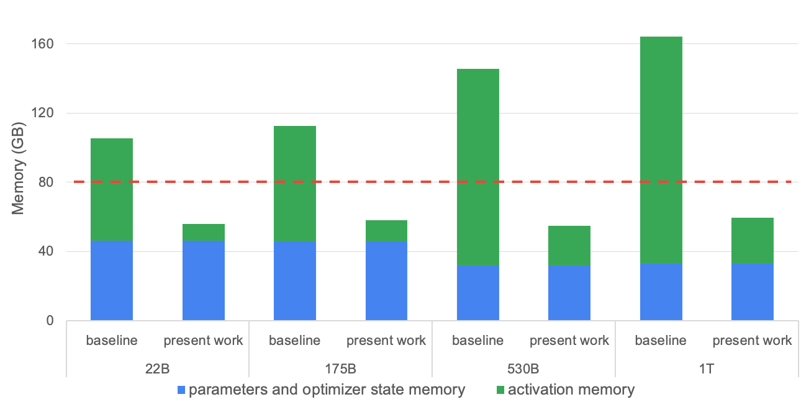
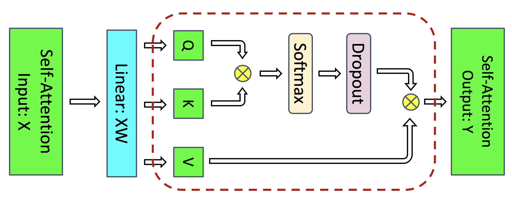
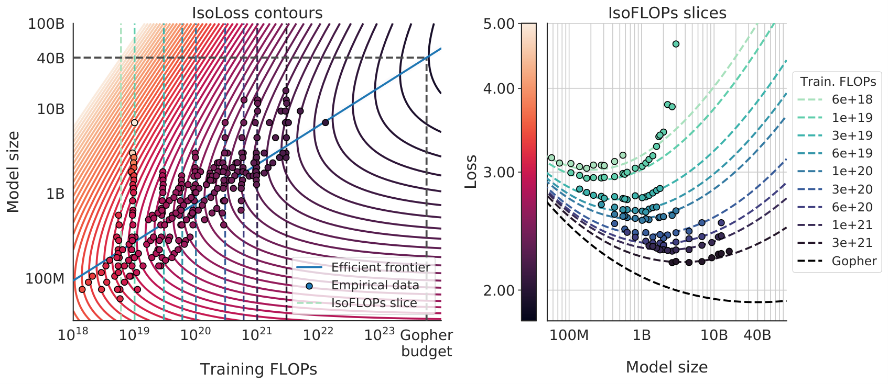
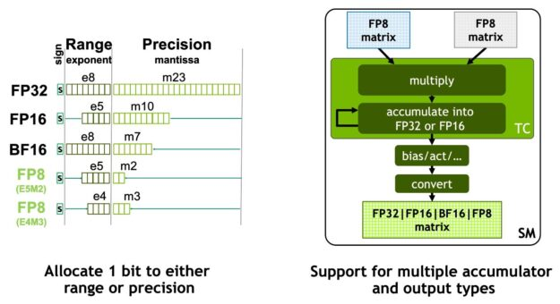
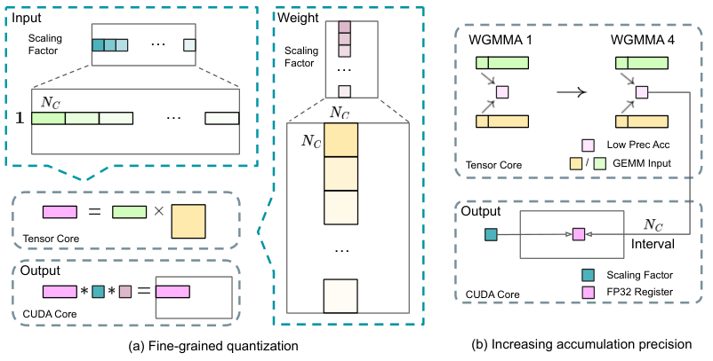
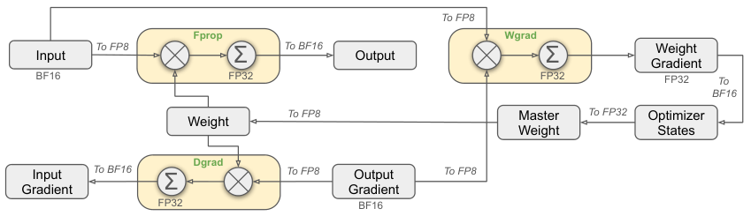

# Training Arithmetic and Numerics: Going Deeper

## Prerequisites

This chapter assumes you know the math of transformers and backprop. It does not assume any systems background, but a few foundation chapters make the memory and precision sections easier:

- [Computer architecture](../foundations/computer-architecture.md) - what accelerator memory, memory bandwidth and on-chip compute units are. This chapter's FLOP and MFU numbers are measured against them.
- [Linux and OS](../foundations/linux-and-os.md) - virtual memory and pages. You need these for the PyTorch caching allocator and `expandable_segments` section.
- [Concurrency](../foundations/concurrency.md) - asynchronous work queues and why a buffer freed on one queue cannot immediately be reused by another. This is the "stream" behaviour of the allocator.
- [Distributed systems](../foundations/distributed-systems.md) - data parallelism, sharding and collective operations (all-reduce and friends). They show up in the memory and batch-size sections.
- [Transformer architectures](../models/architectures.md) - GQA, SwiGLU, RMSNorm, MoE. All the FLOP and activation formulas below are written for these variants.

This chapter goes below the rules of thumb in [Software Tune Up For The Best Performance](performance/README.md), [Tensor Precision / Data Types](dtype.md), [Selecting Training Hyper-Parameters](hparams.md) and [Instabilities](instabilities/README.md). It derives the constants those chapters quote and shows where they break. How the work is split across devices is covered in [Model Parallelism: Derivations](model-parallelism/derivations.md). What happens inside a single GPU kernel is covered in [Accelerator Execution Model](../compute/accelerator/execution-model.md). Neither topic is repeated here.

All numbers in this chapter come from arithmetic, and the arithmetic was checked with `python3`. None of them are benchmark measurements. Where a throughput number appears, it is either computed from first principles or taken from a cited paper, and the text says which.

## Notation

| Symbol | Meaning |
| :----- | :------ |
| `b`    | micro-batch size (sequences) |
| `s`    | sequence length (tokens) |
| `h`    | hidden size (`d_model`) |
| `L`    | number of layers |
| `a`    | number of query heads |
| `k`    | number of KV heads (GQA); `g = k/a` |
| `d`    | head dimension, `h = a*d` |
| `f`    | MLP intermediate size (`ffn_dim`) |
| `V`    | vocabulary size |
| `t`    | tensor-parallel degree |
| `N`    | parameter count |
| `D`    | training tokens |

The two reference models (from their public `config.json`) are:

| Model        | `h`  | `L` | `a` | `k` | `d` | `f`   | `V`    | tied emb |
| :----------- | ---: | --: | --: | --: | --: | ----: | -----: | :------- |
| Llama-3-8B   | 4096 | 32  | 32  | 8   | 128 | 14336 | 128256 | no |
| Llama-3-70B  | 8192 | 80  | 64  | 8   | 128 | 28672 | 128256 | no |

Units: parameter and optimizer memory is in GB (1e9 bytes), activation memory is in GiB (2^30 bytes), and FLOP means a single multiply or add (1 MAC = 2 FLOP, see [MACs vs FLOP](performance/README.md#macs-vs-flop-vs-flops-vs-flops)).

## FLOPs of a decoder transformer

### Per-matmul breakdown

A dense matmul `(M, K) @ (K, N)` costs `2*M*K*N` FLOP. One token going through one layer of the forward pass therefore costs `2 * (number of weight elements it touches)` for every projection. The attention core adds a cost that grows with context length.

| Operation | Weight shape | Forward FLOP per token per layer |
| :-------- | :----------- | :------------------------------- |
| Q proj    | `(h, a*d)`   | `2*h*h` |
| K, V proj | `(h, k*d)` x2 | `4*h*k*d = 4*g*h*h` |
| scores `Q K^T` | - | `2*s*a*d = 2*s*h` (full) |
| `softmax(S) V` | - | `2*s*h` (full) |
| out proj  | `(a*d, h)`   | `2*h*h` |
| SwiGLU gate, up, down | `(h,f)`,`(h,f)`,`(f,h)` | `6*h*f` |
| LM head (once, not per layer) | `(h, V)` | `2*h*V` |
| input embedding | gather | 0 |

Softmax, norms, RoPE, SiLU and residual adds are `O(s*h)` or `O(s*a)` elementwise work per token. Chinchilla's appendix counts softmax at `3*a*s` FLOP per token per layer, which is under 0.5% of the total at these shapes. Everyone drops it, and so does this chapter. These ops are memory-bandwidth bound: the time goes into reading and writing accelerator memory (HBM, the high-bandwidth DRAM stacked next to the GPU die), not into arithmetic. So they cost time but contribute almost no FLOPs, and that is one reason MFU can never reach 100%.

Here is the breakdown for Llama-3-8B at `s = 8192`, in GFLOP per token per layer, forward only:

```
q 0.0336 | k+v 0.0168 | o 0.0336 | mlp 0.3523 | scores 0.0671 | attn*V 0.0671
```

The MLP is 62% of the forward FLOPs of a layer even at 8k context. The attention core (scores + `attn*V`) is 24% if counted without causal skipping.

### Where `6N` comes from

For a linear layer `Y = X W` with `X: (T, K)` and `W: (K, N)`:

```python
Y  = X @ W        # (T, N)  forward:  2*T*K*N
dX = dY @ W.T     # (T, K)  backward: 2*T*K*N  (activation grad)
dW = X.T @ dY     # (K, N)  backward: 2*T*K*N  (weight grad)
```

The backward pass is two matmuls of the same size as the forward matmul. So the total is `3 x 2 = 6` FLOP per weight element per token, and summing over all weight matrices gives `6N` per token. The first layer does not need its `dX`, which saves a negligible amount. The rule holds only for parameters that take part in a matmul, which has two consequences:

- The input embedding is a gather. It costs zero forward FLOPs and a scatter-add in backward. Counting it in `N` overstates the work by `6*V*h` per token. For Llama-3-8B that is `6 * 0.525B = 3.15 GFLOP` out of ~48, about 6.5%.
- The LM head is a real `(h, V)` matmul and must be counted. With tied embeddings it is the same tensor, so you count it once, as the head.

For an untied model, the right `N` for FLOP purposes is the non-embedding parameters plus the head. For Llama-3-8B that gives `N' = 6.979B + 0.525B = 7.504B` against a nominal 8.03B.

### The attention term, and which constant

Per layer, the two attention-core matmuls cost `4*s*h` forward FLOP per token when every query attends to all `s` keys. Multiplying by 3 for forward plus backward gives:

```
FLOP/token = 6*N' + 12*L*s*h            # no causal discount
FLOP/token = 6*N' + 6*L*s*h             # causal, masked half skipped
```

Both constants are in use, and reported MFU numbers are not comparable unless you know which one was used:

- **12**: PaLM appendix B (`6N + 12*L*H*Q*T`), Chinchilla appendix F (which counts both attention matmuls over the full `s x s`), and the Megatron-LM paper's equation 3. Expanding Megatron's no-recompute form `72*b*s*L*h^2*(1 + s/(6h) + V/(12*L*h))` gives exactly `6*12*L*h^2 + 12*L*s*h + 6*h*V` per token for a 4h-MLP, MHA model (checked symbolically above: ratio 1.0). With activation recomputation the paper uses 96 instead of 72 and `V/(16*L*h)`, which keeps the logit term at `6*h*V`, i.e. the LM head is not recomputed.
- **6**: Kaplan et al. (arXiv:2001.08361), table 1, gives `C_forward = 2N + 2*n_layer*n_ctx*d_attn`, which is `6*L*s*h` for training. Numerically this equals "both attention matmuls with a causal discount". The table labels the row as the masking operation, so I am not certain this was the authors' reasoning.

The 12 convention describes the math of full attention. The 6 convention is closer to what a causal FlashAttention kernel actually executes. If you use 12 with a causal kernel, your "MFU" includes about `6*L*s*h` per token of work that was never done. At 8k context on the 8B model that is 11% of the claimed FLOPs.

### Do kernels skip the causal half?

- FlashAttention-2 and -3 skip every key/value tile that lies entirely above the diagonal and apply the mask only on diagonal tiles. Executed work is therefore `~0.5*s^2` plus one diagonal band of tiles. The repo's own benchmark script counts causal FLOPs as `4*b*s^2*a*d / 2`.
- PyTorch SDPA with `is_causal=True` skips the masked tiles when it dispatches to the flash, cuDNN or memory-efficient backends.
- FlexAttention skips the blocks that its `BlockMask` marks as empty.
- The eager "materialize `S`, add `-inf` mask, softmax" path does the full `s^2` work.
- Document masking for packed sequences, where each packed document attends only to itself, cuts executed attention FLOPs further: to `sum_i(s_i^2)/2` instead of `s^2/2`. A 128k window packed with 2k-token documents executes 64x fewer attention FLOPs than the causal estimate. Use the masked count if you want MFU to reflect real work.

### GQA

GQA shrinks only the K and V projections, from `4*h*h` to `4*g*h*h`. The attention core is unchanged. Each of the `a` query heads still takes a dot product against `s` keys of dimension `d`, so scores plus `attn*V` remain `4*s*a*d = 4*s*h` regardless of `k`. GQA is a memory and KV-bandwidth optimization, not a FLOP optimization. For Llama-3-8B, going from MHA to `k=8` removes 0.050 GFLOP of forward work per token per layer, about 9% of the layer's forward FLOPs at `s = 8192`.

### MoE: active FLOPs

For a mixture-of-experts layer with `E` experts and top-`r` routing, each token passes through `r` expert MLPs plus a router matmul costing `2*h*E`. The FLOP count uses the active parameters:

```
FLOP/token = 6*N_active' + attention term + 6*h*E*L_moe   (router, usually <0.1%)
```

| Model | total params | active params | source |
| :---- | -----------: | ------------: | :----- |
| Mixtral 8x7B | 46.7B | 12.9B | Mixtral paper, arXiv:2401.04088 |
| DeepSeek-V3  | 671B  | 37B   | arXiv:2412.19437 |

The gap between MFU and HFU is larger for MoE than for dense models. Capacity-factor padding (with `C > 1` each expert's buffer is padded to `C * tokens/E`) executes FLOPs on padding. Dropped tokens execute fewer FLOPs than the model math implies. Grouped GEMMs on small, uneven per-expert batches run well below the dense matmul peak. Only `6*N_active` belongs in the MFU numerator.

### Worked numbers at `s = 8192`

| | Llama-3-8B | Llama-3-70B |
| :-- | --: | --: |
| `N` (all params) | 8.030B | 70.554B |
| `N'` (non-embedding + head) | 7.504B | 69.502B |
| `6*N` (naive) | 48.18 GF | 423.32 GF |
| `6*N'` | 45.03 GF | 417.01 GF |
| attention, 12 convention | 12.88 GF | 64.42 GF |
| attention, 6 convention (causal) | 6.44 GF | 32.21 GF |
| **total, 12 convention** | **57.91 GF** | **481.43 GF** |
| total, causal | 51.47 GF | 449.22 GF |
| attention share (12 / causal) | 22.2% / 12.5% | 13.4% / 7.2% |

(GF = GFLOP per token, training, forward plus backward.)

Attention's share depends on `s/h`, not on `N`. The 70B model has twice the `h`, so the same 8k context costs it half the relative attention share.

Here is a self-contained counter that reproduces the table:

```python
def flops_per_token(h, L, a, k, f, V, s, causal=False, tied=False):
    d = h // a
    per_layer = 2*h*h + 2*h*k*d + 3*h*f          # q, o, k, v, gate/up/down weight elements
    n_mm = L*per_layer + h*V                     # matmul params incl. LM head, excl. embedding
    attn = (6 if causal else 12) * L * s * h     # QK^T and PV, fwd+bwd
    return 6*n_mm + attn

assert round(flops_per_token(4096, 32, 32, 8, 14336, 128256, 8192)/1e9, 2) == 57.91
assert round(flops_per_token(8192, 80, 64, 8, 28672, 128256, 8192)/1e9, 2) == 481.43
```

## MFU and HFU, properly

[MFU vs HFU](performance/README.md#mfu-vs-hfu) gives the definitions. The precise version is:

```
MFU = (tokens/s/GPU) * model_FLOP_per_token    / peak_FLOP/s
HFU = (tokens/s/GPU) * executed_FLOP_per_token / peak_FLOP/s
```

`model_FLOP_per_token` comes from the table above. You have to choose the attention convention and say which one you chose. `executed_FLOP_per_token` adds everything the implementation actually runs.

### What recomputation adds

| Scheme | Executed FLOP per token (per layer, excluding head) |
| :----- | :------------------------------------------- |
| none | `6*n_layer + 12*s*h` (math) |
| FlashAttention backward | attention backward is **2.5x** forward, not 2x |
| selective recompute (Korthikanti; attention core only) | `+ 4*s*h` (one more attention-core forward) |
| full recompute (every layer's forward re-run) | `+ 2*n_layer + 4*s*h`, i.e. ~4/3 of the matmul work |

The 2.5x for FlashAttention has a simple cause. The forward pass runs 2 matmuls (`S = QK^T`, `O = PV`). The backward pass runs 5: it recomputes `S`, then computes `dV = P^T dO`, `dP = dO V^T`, `dQ = dS K` and `dK = dS^T Q`. That is 5/2 = 2.5x the forward attention matmul work, and FlashAttention's own benchmark uses exactly this factor. So **FlashAttention is selective recomputation built into the kernel**. Korthikanti's selective scheme recomputes the attention core because storing `s^2` tensors is expensive. FlashAttention never stores them. With FlashAttention, "selective recompute" in the Megatron sense is already happening and should not be counted twice.

For causal attention, all of these attention terms are halved. Executed FLOPs per token with full recompute, causal FlashAttention, and the head not recomputed:

```
8*N' + 2*L*s*h*(1 + 1 + 2.5)      # fwd, re-fwd, bwd of attention, each causal-halved
```

| | Llama-3-8B | Llama-3-70B |
| :-- | --: | --: |
| executed, full recompute + causal FA | 69.70 GF | 604.33 GF |
| ratio to 12-convention model FLOPs | 1.204 | 1.255 |

So with full recompute, `HFU ~ 1.2-1.25 x MFU (12 convention)`. The ratio is lower than the textbook 4/3 because the 12 convention counts causal attention FLOPs that the kernel does not execute, while HFU adds the recompute FLOPs that it does.

### MFU from a measured tokens/s

Inverting the formula gives the throughput a target MFU requires. With H100 SXM dense bf16 peak = 989.4 TFLOP/s (derivation in [How To Calculate Theoretical TFLOPS](../compute/accelerator/README.md#how-to-calculate-theoretical-tflops)) and the 12 convention at `s = 8192`:

```
tokens/s/GPU at 40% MFU = 0.40 * 989.4e12 / FLOP_per_token
  Llama-3-8B : 0.40 * 989.4e12 / 57.91e9  = 6,834 tok/s/GPU
  Llama-3-70B: 0.40 * 989.4e12 / 481.43e9 =   822 tok/s/GPU
```

Going forward is mechanical. If your logger reports `T` tokens per second across `G` GPUs:

```python
def mfu(tokens_per_sec_global, n_gpus, flop_per_token, peak=989.4e12):
    return tokens_per_sec_global / n_gpus * flop_per_token / peak
```

The denominator has two choices, and they mean different things. The spec peak (989) measures distance from a number no kernel reaches. The [maximum achievable matmul FLOPS](../compute/accelerator/README.md#maximum-achievable-and-sustainable-matmul-flops-comparison-table) for H100 SXM is 853 bf16 TFLOPS in this repo's measurements (86.2% of spec), and MFU against that number measures distance from what your matmuls could realistically do. Report MFU against the spec peak, since that is the convention, and use the MAMF ratio internally to tell how much is left to gain.

### Implied MFU from published GPU-hours

When a paper reports GPU-hours and token counts, you can recover its MFU. This is a useful sanity check:

- **Llama 2 7B** (arXiv:2307.09288): 184,320 A100-80GB GPU-hours for 2T tokens, `N = 6.74B`, `s = 4096`. `6*N*D / (hours * 3600 * 312e12) = 39.1%`. With the 12-convention attention term the figure is 45.3%. That is the same run quoted at two MFUs depending only on convention.
- **DeepSeek-V3** (arXiv:2412.19437): 2.664M H800 GPU-hours for pre-training on 14.8T tokens, 37B active. `6 * 37e9 * 14.8e12 = 3.29e24` FLOP, which is 34.6% of a 989 TF bf16 peak or 17.3% of the 1979 TF FP8 peak. The attention FLOPs (MLA, 61 layers) are excluded, which understates the figure. Also, the H800's reduced interconnect bandwidth makes communication a different bottleneck than on an H100. Treat this as a lower bound with roughly ±20% uncertainty that comes from the convention alone.

## Activation memory

[Anatomy of Model's Memory Usage](performance/README.md#anatomy-of-models-memory-usage) measures "copies of `hidden_states`" empirically. This section derives what autograd actually saves for backward, term by term. The two quantities differ. The measured coefficient is peak working memory inside one layer's forward, temporaries included. The coefficient below is what stays resident after the forward pass until backward runs.

Why activations dominate at scale - memory per GPU split into parameters+optimizer state and activations (Korthikanti et al.):



([source](https://arxiv.org/abs/2205.05198))

### Korthikanti et al., derived

[Reducing Activation Recomputation in Large Transformer Models](https://arxiv.org/abs/2205.05198) (arXiv:2205.05198) counts bytes saved per layer for a GPT block with a 4h GeLU MLP, MHA, LayerNorm, dropout, 16-bit activations and 1-byte dropout masks:

| Saved tensor | Bytes |
| :----------- | ----: |
| QKV projection input | `2sbh` |
| Q and K (for `QK^T`) | `4sbh` |
| softmax output (for its backward) | `2as^2b` |
| attention dropout mask | `as^2b` |
| attention dropout output (for `PV`) | `2as^2b` |
| V | `2sbh` |
| out-proj input | `2sbh` |
| out-proj dropout mask | `sbh` |
| **attention subtotal** | **`11sbh + 5as^2b`** |
| fc1 input | `2sbh` |
| GeLU input | `8sbh` |
| GeLU output (fc2 input) | `8sbh` |
| MLP dropout mask | `sbh` |
| **MLP subtotal** | **`19sbh`** |
| 2 x LayerNorm input | `4sbh` |
| **total** | **`sbh*(34 + 5as/h)`** |

The self-attention block; the red dashed region is what selective recompute drops (the `5as/h` term):



([source](https://arxiv.org/abs/2205.05198))

Under parallelism, with `t` the tensor-parallel degree (TP: each layer's weight matrices are split across `t` GPUs, which then exchange partial results):

```
TP only:                      sbh*(10 + 24/t + 5as/(h*t))   # norms, dropout, linear inputs replicated
TP + sequence parallel (SP):  sbh*(34/t + 5as/(h*t))        # SP shards the replicated regions along s
TP + SP + selective recompute: sbh*34/t                     # attention core recomputed
full recompute:               2sbh                          # only the layer input is kept
```

In SP, the inputs to the column-parallel linears are stored sharded and re-gathered across the TP group in backward (Korthikanti section 4.2.2). That is why the whole formula divides by `t`. The communication cost is covered in [Model Parallelism: Derivations](model-parallelism/derivations.md).

The quadratic term is the one that hurts. At `s = 8192`, `a = 32`, `h = 4096`, the value of `5as/h` is 320, nearly 10x the linear coefficient 34. Llama-3-8B under the literal Korthikanti formula at `b = 1`, `s = 8192` would need 11.06 GiB per layer and 354 GiB in total.

### What FlashAttention, no-dropout, SwiGLU, GQA and RMSNorm change

- **FlashAttention** never stores `P`. It saves Q, K, V, O and the per-row log-sum-exp (`4*b*a*s` bytes in fp32, which is `4a/h ~ 0.03 sbh`). Q, K and V are already counted above, and O is the out-proj input. So all of `5as^2b` disappears and the layer becomes linear in `s`.
- **Dropout = 0** (standard for LLM pre-training) removes both `sbh` masks. A GPT block with FlashAttention and no dropout therefore needs `32sbh`.
- **GQA** shrinks K and V from `4sbh` to `4g*sbh`.
- **SwiGLU** with eager PyTorch saves the gate pre-activation (for SiLU backward), `silu(gate)` and `up` (for the multiply's backward), and the product (for `down`'s weight gradient). That is four tensors of shape `(b, s, f)`, or `8sbf` bytes. A fused SwiGLU that recomputes `silu` saves `6sbf`. One that also recomputes the product from gate and up saves `4sbf`.
- **RMSNorm**, fused: input only (`2sbh`) plus a `(b, s)` fp32 `rstd`. The eager HuggingFace implementation upcasts to fp32 and saves both the fp32 input and the fp32 normalized tensor, plus the bf16 output for the weight gradient. That is ~`10sbh` instead of `2sbh` per norm. This is untested here, so check with the snapshot tool below before you trust it.

For a Llama block (fused norms, FlashAttention, no dropout):

```
attn:  2 (qkv input) + 2 (Q) + 4g (K,V) + 2 (O)      = 6 + 4g
norms: 2 + 2                                         = 4
mlp:   2 (gate/up input) + {8, 6, 4} * f/h           (eager / fused-silu / fully fused)
total = sbh * (12 + 4g + c*f/h),  c in {8, 6, 4}
```

### Worked example, `b = 1`, `s = 8192`, bf16

| | coef | per layer | all layers | TP=8 + SP, per GPU |
| :-- | --: | --: | --: | --: |
| 8B eager SwiGLU (`g = 1/4`, `f/h = 3.5`) | 41.0 | 1.28 GiB | 41.0 GiB | 5.1 GiB |
| 8B fused-silu | 34.0 | 1.06 GiB | 34.0 GiB | 4.3 GiB |
| 8B fully fused | 27.0 | 0.84 GiB | 27.0 GiB | 3.4 GiB |
| 70B eager (`g = 1/8`, `f/h = 3.5`) | 40.5 | 2.53 GiB | 202.5 GiB | 25.3 GiB |
| 70B fused-silu | 33.5 | 2.09 GiB | 167.5 GiB | 20.9 GiB |
| 70B Korthikanti literal, TP=8 + SP | - | 2.77 GiB | 221.2 GiB | - |

With full recompute, the resident cost is `2sbh*L`: 2.0 GiB for the 8B model and 10.0 GiB for the 70B model, plus one layer's working set during recompute.

The LM head adds `s*V*(2 + 4)` bytes for bf16 logits plus their fp32 upcast: 5.87 GiB at `s = 8192`, for both models. That is independent of `h` and larger than the entire checkpointed residual stream of the 8B model. Chunked or fused cross-entropy (Liger kernel; "Cut Your Losses in Large-Vocabulary Language Models", arXiv:2411.09009) never materializes the full `(s, V)` tensor.

With pipeline parallelism under 1F1B (PP: consecutive groups of layers live on different GPUs and micro-batches flow through them like an assembly line), stage 1 holds activations for `p` in-flight micro-batches of `L/p` layers each, i.e. about one full model's worth. The derivation is in [Model Parallelism: Derivations](model-parallelism/derivations.md).

FP8 linears in Transformer Engine save their inputs in FP8, which halves the "linear input" terms (QKV input, out-proj input, gate/up input, down input). DeepSeek-V3 goes further: it caches some activations in FP8 and recomputes SwiGLU.

## Total memory and the caching allocator

### Static, per parameter

| Component | Mixed bf16 + AdamW | Notes |
| :-------- | -----------------: | :---- |
| fp32 master weights | 4 | |
| bf16 working weights | 2 | often only the current layer, under FSDP/ZeRO-3 |
| gradients | 4 (fp32) or 2 (bf16) | fp32 if accumulated in fp32 |
| Adam `m`, `v` | 8 | fp32 |
| **total** | **16-18** | |

ZeRO and FSDP are data parallelism that shards these per-parameter states across the `DP` replicas instead of replicating them. ZeRO-1 shards optimizer states, ZeRO-2 also shards gradients, and ZeRO-3/FSDP also shards weights, gathering each layer just before it runs. Llama-3-8B at 16-18 B/param is 128.5-144.5 GB, so it does not fit on one 80 GB H100. FSDP-sharded over 8 GPUs it is `16 * 8.03 / 8 = 16.1 GB/GPU` static, plus the unsharded bf16 weights and gradients of the layers currently in flight. Llama-3-70B is 1129-1270 GB before sharding.

### Everything else

- **Temporary buffers**: the all-gather destination buffer for each FSDP unit (an all-gather is the collective in which every GPU ends up holding the concatenation of everyone's shards), the reduce-scatter source buffer (the inverse: inputs are summed and each GPU receives one shard of the sum), fp32 upcasts of bf16 gradients for reduction, cuBLAS workspaces (cuBLAS is NVIDIA's matmul library, and it requests scratch space per call), the logits pair above, and fused-optimizer temporaries if you use a non-foreach optimizer.
- **CUDA context and kernel images**: 0.5-2 GiB before you allocate anything. The CUDA context is the per-process driver state, including the loaded GPU kernel binaries; a kernel is a single function launched on the GPU. See [Preloaded CUDA kernels memory usage](performance/README.md#preloaded-cuda-kernels-memory-usage).
- **NCCL** (NVIDIA's library for collectives between GPUs): 1-2 GiB of communicator buffers, more with many process groups. See [`torch.distributed` memory usage](performance/README.md#torchdistributed-memory-usage).
- **Fragmentation**: memory the allocator has reserved from the driver but cannot hand out for the request at hand. It typically costs from a few percent to tens of percent. The mechanism follows.

None of the context, NCCL or fragmentation memory shows up in `torch.cuda.memory_allocated()`. `nvidia-smi` shows reserved memory plus context plus NCCL.

### PyTorch caching allocator internals

`cudaMalloc` and `cudaFree` synchronize the device and are slow, so PyTorch keeps freed memory and reuses it. The constants and behaviour below come from `c10/cuda/CUDACachingAllocator.cpp`. They have been stable for years, but check the source of your version.

- **Rounding**: requests are rounded up to a multiple of 512 bytes.
- **Two pools**: requests of 1 MiB or less come from the *small pool*, which allocates 2 MiB segments. Larger requests come from the *large pool*. Requests under 10 MiB get a 20 MiB segment. Requests of 10 MiB or more get a segment of exactly the request rounded up to 2 MiB.
- **Segments and blocks**: a *segment* is one `cudaMalloc`. It is carved into *blocks*. A request is served from the smallest cached free block that fits (best fit). The remainder is split off as a new free block if it is at least 512 B (small pool) or more than 1 MiB (large pool). Freed blocks merge with free neighbours in the same segment.
- **Streams**: a CUDA stream is an ordered queue of GPU work, and different streams run concurrently. Blocks belong to the stream they were allocated on. A block freed on stream A is reused only by requests on stream A, because the allocator cannot know whether work queued on stream B still reads it. Code that hands a tensor to another stream (NCCL communication streams, FSDP prefetch) calls `tensor.record_stream(s)`. The block's free is then deferred until an event recorded on `s` completes. Until then it is in state `active_pending_free`, and that is where much of the "mysterious" reserved memory under FSDP sits.
- **OOM path**: when no cached block fits and `cudaMalloc` fails, the allocator frees every cached block that is not split and retries. This increments `num_alloc_retries`. If the retry fails you get the OOM message showing "reserved but unallocated" memory. That number is your fragmentation.
- **`max_split_size_mb`**: blocks larger than this are never split, so a large free block is not chewed into fragments by small requests.
- **`expandable_segments:True`**: instead of a fixed-size `cudaMalloc` per segment, the allocator reserves a large range of *virtual* addresses once per stream and maps physical memory pages into it on demand with the CUDA virtual memory API (`cuMemCreate`/`cuMemMap`). Virtual memory means a pointer refers to an address range that the hardware translates to physical memory in fixed-size chunks called pages, so contiguous addresses do not need contiguous physical memory. The segment grows at its end, and a freed tail can be unmapped. Allocations whose size varies step to step (variable sequence lengths, the SP reshapes in [Overcoming CUDA OOM due to memory fragmentation](../debug/pytorch.md#overcoming-cuda-oom-due-to-memory-fragmentation)) stop leaving holes the size of last step's tensor.

The counters to watch in `torch.cuda.memory_stats()`:

| Key | Meaning |
| :-- | :------ |
| `allocated_bytes.all.peak` | live tensors at the worst moment |
| `reserved_bytes.all.peak` | what the allocator held from the driver |
| `inactive_split_bytes.all.current` | free bytes stranded inside split segments, i.e. fragmentation |
| `num_alloc_retries` | times the allocator had to flush and retry. Nonzero in steady state means you are thrashing `cudaMalloc` and losing throughput. |
| `num_ooms` | OOMs caught, e.g. by an auto-batch-size finder |

### Reading `torch.cuda.memory._snapshot()`

[PyTorch memory profiler](../debug/pytorch.md#pytorch-memory-profiler) shows how to record and visualize the history. The snapshot is also a plain dict you can analyze yourself. It is a private API and its keys may change between versions:

```python
import torch
from collections import defaultdict

snap = torch.cuda.memory._snapshot()
# snap["segments"]: list of dicts with
#   address, total_size, allocated_size, active_size, stream, segment_type ('small'|'large'),
#   blocks: [ {address, size, requested_size, state, frames}, ... ]
#   state in {'active_allocated', 'active_pending_free', 'inactive'}
by_state = defaultdict(int)
largest_free, total_free = 0, 0
for seg in snap["segments"]:
    for blk in seg["blocks"]:
        by_state[blk["state"]] += blk["size"]
        if blk["state"] == "inactive":
            total_free += blk["size"]
            largest_free = max(largest_free, blk["size"])
reserved = sum(seg["total_size"] for seg in snap["segments"])
print({k: v / 2**30 for k, v in by_state.items()}, f"reserved={reserved/2**30:.2f}GiB")
# external fragmentation: 0 = all free memory in one block, ->1 = shattered
print(f"frag={1 - largest_free / max(total_free, 1):.2f}")
```

Take the snapshot at peak, i.e. inside the step, by calling it from a hook just before `optimizer.step()`, not after the step when memory has drained. Grouping blocks by the innermost Python frame in `blk["frames"]` (the frames are recorded only if `_record_memory_history` was on) tells you which line of your model owns the memory. Compare those totals against the per-layer coefficients from the activation section. A mismatch of more than ~20% usually means an eager op is saving an fp32 copy you did not expect.

## Compute-optimal scaling

### `C ~ 6ND`

Total training compute is `C ~ 6*N*D`: the per-token count from above, with the attention term dropped, times `D` tokens. The attention term is 15% of `6N` for a 7B model at `s = 4096` under the 12 convention, so this approximation is not free at long context.

Chinchilla's Approach 3 fit - loss contours and the efficient frontier:



([source](https://arxiv.org/abs/2203.15556))

**Chinchilla** (Hoffmann et al., arXiv:2203.15556) fit three different ways and concluded that `N_opt ∝ C^~0.5` and `D_opt ∝ C^~0.5`, with roughly 20 tokens per parameter (approaches 1 and 2). Substituting `D = 20N` gives `N_opt = sqrt(C/120)`.

The paper's approach 3 fits `L(N, D) = E + A/N^α + B/D^β` with published `E=1.69, A=406.4, B=410.7, α=0.34, β=0.28`. Plugging these into the closed form `N_opt = (αA/(βB))^(1/(α+β)) * (C/6)^(β/(α+β))` at `C = 8.4e22` gives **N = 13.5B, D = 1.04T, about 77 tokens/param**. The same budget under the 20x rule gives N = 26.5B, D = 0.53T. Besiroglu et al. ("Chinchilla Scaling: A replication attempt", arXiv:2404.10102) traced this inconsistency to the approach 3 fit itself; their refit is consistent with ~20. The lesson is that "20 tokens/param" is a coarse, data-mix-dependent ratio, not a constant of nature. The loss surface is flat near the optimum, so a factor of 2 in `N` at fixed `C` costs little loss.

### Why everyone overtrains

Chinchilla minimizes training compute for a target loss. A deployed model also spends `2*N` FLOP per token it serves. Total lifetime cost is `6*N*D_train + 2*N*D_serve`. Once `D_serve` is comparable to `D_train`, the minimum shifts to a smaller `N` trained on more tokens (Sardana and Frankle, "Beyond Chinchilla-Optimal", arXiv:2401.00448). Serving 1T tokens costs 1.4e22 FLOP on a 7B model and 5.3e22 on a 26.5B model. That difference alone is 40% of the 8.4e22 training budget. Llama-3-8B was trained on ~15T tokens, about 1,870 tokens per parameter, 90x past Chinchilla. Loss keeps improving log-linearly far past 20x, just less per FLOP.

### Worked GPU-hours: 7B, 2T tokens, H100, 40% MFU

```
C          = 6 * 7e9 * 2e12                 = 8.40e22 FLOP
throughput = 0.40 * 989.4e12                = 3.958e14 FLOP/s/GPU
GPU-hours  = 8.40e22 / 3.958e14 / 3600      = 58,958
+ attention (s=4096, L=32, h=4096, 12-conv) = +15.3% -> 68,002
on 1,024 GPUs                               = 2.4 days (6N only), 2.8 days with attention
```

This is pure compute time. Checkpointing, restarts and evaluation reduce goodput (the fraction of wall-clock time spent on useful training), so budget for them separately. The Llama 2 cross-check above (39% implied MFU on A100 for the same `N*D`) shows that 40% is a realistic, not optimistic, planning number for a dense model of this size.

## Mixed precision internals

### Bits

| | sign | exp | mantissa | max | min normal | spacing at 1.0 |
| :-- | --: | --: | --: | --: | --: | --: |
| fp32 | 1 | 8 | 23 | 3.4e38 | 1.18e-38 | 1.2e-7 |
| bf16 | 1 | 8 | 7 | 3.39e38 | 1.18e-38 | 2^-7 = 0.0078 |
| fp16 | 1 | 5 | 10 | 65504 | 6.1e-5 (subnormal 6e-8) | 2^-10 = 0.00098 |

The bit layouts:


([source](https://developer.nvidia.com/blog/accelerating-ai-training-with-tf32-tensor-cores/))

bf16 trades precision for fp32's range. fp16 does the opposite. The practical consequences, computed by emulating round-to-nearest-even in numpy:

- **fp16 underflows in backward.** A gradient element below 6e-8 flushes to zero, and gradients of ~1e-8 are routine in large models. Squaring is worse: any `g < 2^-12 = 2.4e-4` has `g^2` below the smallest fp16 subnormal. That is why fp16 Adam states are unusable without scaling.
- **bf16 loses integers above 256.** The spacing is 2 at 256, 32 at 4096 and 64 at 8192. `bf16(8191) = 8192` and `bf16(4097) = 4096`. RoPE angles computed as `position * inv_freq` in bf16 are therefore wrong by up to 32 positions at 8k context. Compute positions and angles in fp32 and cast `cos`/`sin` afterwards.
- **bf16 cannot represent typical Adam `β2`.** `bf16(0.999) = 1.0`. Even with an fp32 multiplier, `0.999 * v` rounds back to `v`, because a 0.1% change is below bf16's half-spacing of 0.39%.

### Loss scaling (fp16 only)

Multiply the loss by `S` so that the gradients `S*g` land in fp16's normal range, then unscale in fp32 before the optimizer step. Dynamic scaling (`torch.amp.GradScaler` defaults: `init_scale=2**16`, `growth_factor=2`, `backoff_factor=0.5`, `growth_interval=2000`) halves `S` and skips the step on any inf/NaN, and doubles `S` after 2000 clean steps. bf16 needs none of this, because its range equals fp32's. Loss scaling with bf16 does nothing useful. If your bf16 run "needs" it, the problem is elsewhere.

### fp32 accumulation in tensor cores

Tensor cores are the dedicated matrix-multiply units on the GPU. With bf16 or fp16 inputs, they multiply in full precision and accumulate in fp32 when cuBLAS is asked for `CUBLAS_COMPUTE_32F`, which is PyTorch's default. Two caveats:

- `torch.backends.cuda.matmul.allow_bf16_reduced_precision_reduction` and the fp16 equivalent permit cuBLAS to use reduced-precision intermediate reductions in split-K kernels (kernels that split the inner dimension across several partial sums and add them at the end). I believe both default to `True` in current PyTorch, but I am not certain of the bf16 default. Set them explicitly if you are chasing bitwise differences.
- The output is rounded to bf16 when written. Summing `K` products in fp32 and rounding once is fine. The danger is repeated accumulation into a bf16 buffer: gradient accumulation across micro-batches in bf16, or all-reduce of bf16 gradients. An all-reduce is the collective that sums a tensor across all GPUs and leaves the full sum on each of them, and a ring all-reduce adds partial sums `DP-1` times, each rounded to bf16.

### What must stay fp32, and why

| Op | Why |
| :-- | :-- |
| softmax (attention and output) | `exp` amplifies relative error, and the normalizer is a long reduction |
| norm statistics (mean, variance, rms) | long reduction over `h`; variance has catastrophic cancellation |
| cross-entropy / log-softmax over `V` | 128k-term log-sum-exp |
| loss and its scalar reductions | |
| gradient accumulation and reduction | repeated rounding of partial sums |
| master weights and optimizer states | see the update-size analysis below |
| RoPE angles, position ids | integers above 256 |
| router logits / top-k in MoE | ties and near-ties flip routing |

`torch.autocast` encodes most of this. `matmul`, `linear`, `conv` and `bmm` run in bf16, while `softmax`, `log_softmax`, `layer_norm`, `exp`, `pow`, `sum` and the losses run in fp32. A hand-written RMSNorm with `x * torch.rsqrt(x.pow(2).mean(-1))` under autocast will do the `pow` and `mean` in fp32, but if `x` arrives in bf16, the cast happens after `pow`. That is the reason for HuggingFace's explicit `.float()`, and the activation cost discussed earlier.

### Stochastic rounding

Round-to-nearest is biased whenever the increment is smaller than half the spacing: the update is always rounded away. Stochastic rounding (SR) rounds up with probability equal to the fractional distance, so `E[SR(x)] = x`. For fp32 to bf16 it is a single integer add:

```python
def to_bf16_sr(x32):                     # x32: float32 tensor (...)
    bits = x32.view(torch.int32)
    noise = torch.randint_like(bits, 0, 1 << 16)
    return ((bits + noise) & -65536).view(torch.float32).to(torch.bfloat16)  # exact cast, low bits already 0
```

Emulated in numpy: a bf16 weight at 0.02, receiving 1000 constant updates of size `lr`.

| lr | fp32 result | bf16 round-nearest | bf16 SR |
| --: | --: | --: | --: |
| 3e-4 | 0.3200 | 0.1250 | 0.3047 |
| 3e-5 | 0.0500 | 0.0200 (no movement) | 0.0469 |
| 3e-6 | 0.0230 | 0.0200 (no movement) | 0.0233 |

Round-to-nearest stalls as soon as `lr` drops below about half the spacing at the weight's magnitude, which is exactly what happens during LR decay. SR tracks fp32 in expectation, with variance about `ulp^2/4` per step. That is why pure-bf16 training (no fp32 master weights) needs SR or Kahan summation ("Revisiting BFloat16 Training", arXiv:2010.06192). NVIDIA tensor cores do not stochastically round matmul outputs. Recent PTX ISA versions expose an `.rs` rounding mode for some down-conversions on Blackwell, which NVFP4 training recipes use for gradients. I have not verified which conversions support it on which architectures.

## FP8 training

### Formats

| | max | min normal | min subnormal | mantissa bits | inf/NaN |
| :-- | --: | --: | --: | --: | :-- |
| E4M3 (`e4m3fn`) | 448 | 2^-6 | 2^-9 | 3 | NaN only |
| E5M2 | 57344 | 2^-14 | 2^-16 | 2 | yes |

The two FP8 formats as introduced with Hopper:



([source](https://developer.nvidia.com/blog/nvidia-hopper-architecture-in-depth/))

The original recipe ("FP8 Formats for Deep Learning", arXiv:2209.05433) uses E4M3 for forward tensors (weights, activations) and E5M2 for gradients, which need range more than precision. Transformer Engine calls this `Format.HYBRID`. DeepSeek-V3 uses E4M3 everywhere and gets its range from finer-grained scales instead.

With 3 mantissa bits, E4M3's relative spacing is 12.5%. FP8 is only usable when a scale maps each tensor's actual range onto the format's: `x_fp8 = cast(x * scale)` and `y = (A_fp8 @ B_fp8) * (1 / (scale_A * scale_B))`.

### Delayed vs current scaling

- **Delayed scaling** (TE `DelayedScaling`) computes the scale for step `t` from a history of absolute maxima (amax) from previous steps: `scale = fp8_max / max(amax_history) / 2^margin`. In TE the history length defaults to 1024 and the reduction to `max`; check your version. It costs no extra pass over the data, but it lags: a sudden outlier at step `t` overflows and saturates, because the scale was set for step `t-1`'s range. In a distributed run, amaxes must be all-reduced across the TP group (and for weights across DP or FSDP shards) so that all ranks quantize identically.
- **Current (just-in-time) scaling** (TE `Float8CurrentScaling`) computes the amax of the tensor about to be quantized. That costs one extra read of the tensor (bandwidth-bound) before the cast, but it never lags. For per-tensor scaling, the trend since 2024 has been toward current scaling, because delayed scaling's failure mode (overflow exactly on the outlier step) coincides with instability.

### Per-tensor vs blockwise

One scale per tensor means a single outlier channel sets the scale for millions of elements and pushes everything else into the subnormal range. Finer granularity fixes this:

- **DeepSeek-V3** (arXiv:2412.19437): activations get one scale per `1x128` tile (per token, per 128 channels), and weights get one scale per `128x128` block, all computed online (current scaling). Because scales vary along the contraction dimension `K`, the GEMM cannot apply them in a single epilogue (the post-processing step a matmul kernel runs on its output tile). Partial sums are dequantized every 128 elements of `K`. The paper also notes that Hopper's FP8 tensor core accumulation keeps only ~14 bits of precision, so DeepSeek promotes partial sums to fp32 on the CUDA cores (the GPU's general-purpose arithmetic units) at that same 128-element interval. This both corrects the accumulation and applies the scales.
- **Transposes**: backward needs `dW = X^T dY` and `dX = dY W^T`, which contract over different dimensions than forward. A `1x128` activation tiling along channels becomes the wrong axis for `X^T`, so the activation has to be re-quantized along tokens (`128x1`). Blockwise and MX recipes therefore keep two quantized copies, row-wise and column-wise, or re-quantize in backward.
- **MXFP8** (OCP Microscaling, native on Blackwell tensor cores): an E8M0 scale (a pure power of two) per block of 32 elements along `K`. The scale is applied inside the tensor core, so there is no promotion trick and no epilogue cost. The overhead is 8 bits per 32 elements, 0.25 bits per element. Because E8M0 can only represent powers of two, rounding the scale up or down decides whether the block maximum saturates. NVIDIA's MXFP8 pre-training study ("Recipes for Pre-training LLMs with MXFP8", arXiv:2506.08027, id unverified) reports rounding the scale up and using E4M3 for all tensors, gradients included. I have not verified the details.

DeepSeek-V3's 1x128 activation tiles and 128x128 weight blocks (a), and promoting partial sums to FP32 every 128 elements (b):



([source](https://arxiv.org/abs/2412.19437))

| Granularity | scale dtype | where applied | extra memory |
| :---------- | :---------- | :------------ | :----------- |
| per-tensor | fp32 | GEMM epilogue | negligible |
| 1x128 / 128x128 (DeepSeek) | fp32 | CUDA-core promotion every 128 `K` | 0.25 bits/elem for activations |
| MXFP8 1x32 | E8M0 | inside the tensor core | 0.25 bits/elem |

### What stays in bf16/fp32

FP8 is applied to the linear-layer GEMMs only. Embeddings, the LM head, norms, softmax and the attention core, the MoE router, the residual stream, the loss, master weights and optimizer states stay in higher precision. DeepSeek-V3 lists the embedding, output head, MoE gating, normalization and attention operators as kept in BF16/FP32, and stores its AdamW moments in BF16. Many recipes also keep the first and last few transformer layers in bf16. FP8 attention exists (FlashAttention-3, TE) but is not the default.

DeepSeek-V3's FP8 framework for a linear layer - which tensors are FP8, BF16 and FP32:



([source](https://arxiv.org/abs/2412.19437))

The upper bound on end-to-end speedup is Amdahl's law over the GEMM fraction of step time `φ`: `1 / ((1 - φ) + φ/2)`. That is 1.43x at `φ = 0.6`, 1.54x at 0.7 and 1.67x at 0.8, before quantization overhead. Measure `φ` with a profiler before promising anything.

### Transformer Engine mechanics

`te.Linear`, `te.LayerNormLinear` and `te.LayerNormMLP` hold high-precision weights. Inside `with te.fp8_autocast(enabled=True, fp8_recipe=recipe):` each forward pass:

1. computes or looks up the scale (depending on the recipe),
2. casts the input to FP8, fused into the preceding LayerNorm where a `LayerNorm*` module is used,
3. casts the weight to FP8. With gradient accumulation, `is_first_microbatch=True` casts once and caches the FP8 weight and its transpose for the remaining micro-batches,
4. runs the FP8 GEMM with a higher-precision output,
5. saves the FP8 input (and its transpose, if required) for backward.

The recipe classes in TE 2.x are `DelayedScaling`, `Float8CurrentScaling`, `Float8BlockScaling` (DeepSeek-style) and `MXFP8BlockScaling`. An NVFP4 recipe also exists. Exact names and defaults vary by release, so check the docs for your version.

## Optimizer internals

### Adam's epsilon

The update is `Δ = -lr * m̂ / (sqrt(v̂) + ε)`. When `sqrt(v̂)` is comparable to `ε`, the denominator stops normalizing and Adam becomes momentum SGD with effective learning rate `lr/ε`, a jump of up to 1e8x in effective step size. The jump is applied unevenly, to exactly the parameters with the smallest gradients: rare-token embedding rows, and late in training, everything. Wortsman et al. ("Small-scale proxies for large-scale Transformer training instabilities", arXiv:2309.14322) show that gradient RMS falls with model scale until the default `ε = 1e-8` dominates, and recommend about `1e-15`. The time-domain correlation theory linked from [Instabilities](instabilities/README.md#time-domain-correlation-divergence-in-adam) is a related failure mode through the same term.

### bf16 optimizer states

A numpy emulation with `v` initialized at 1e-6 and constant `g^2 = 1e-8` for 3000 steps:

| β2 | fp32 `v` | bf16 round-nearest `v` | bf16 SR `v` |
| --: | --: | --: | --: |
| 0.999 | 5.9e-8 (true) | **9.98e-7 (stuck)** | 6.5e-8 |
| 0.95 | 1.0e-8 | 1.1e-8 | 1.0e-8 |

With β2 = 0.999 the per-step change is 0.1% of `v`, which is below bf16's half-spacing, so `v` never decays. When gradients shrink, the second moment stays at its old, larger value and updates are silently too small, possibly by orders of magnitude. With β2 = 0.95 the step is 5%, which bf16 can represent. DeepSeek-V3 stores BF16 moments with β2 = 0.95. That is consistent with this analysis, but I have not seen them state it as the reason. Rule: bf16 moments require β2 ≤ ~0.99 or stochastic rounding. Keep master weights in fp32 regardless; see the weight-update table above.

### Decoupled weight decay

AdamW (Loshchilov and Hutter, arXiv:1711.05101) applies decay outside the adaptive normalization: `θ ← θ - η_t*(α * m̂/(sqrt(v̂)+ε) + λθ)`, where `η_t` is the schedule multiplier. L2 regularization inside Adam gets divided by `sqrt(v̂)`, so high-variance parameters are barely regularized. Decoupled decay shrinks every parameter at the same rate. PyTorch's `AdamW` multiplies `λ` by the full `lr` (`θ *= 1 - lr*λ`), so its `λ` is not the paper's `λ`. The decay timescale is `τ = 1/(lr*λ)` steps. At `lr = 3e-4`, `λ = 0.1` that is ~33k steps. Changing the LR silently changes the decay strength, which matters when sweeping LR or transferring hyperparameters.

### Muon

Muon (Keller Jordan, 2024; scaled up in Moonlight, arXiv:2502.16982) applies to 2D hidden weight matrices only. It takes the momentum `M` and replaces it with its nearest semi-orthogonal matrix. If `M = U Σ V^T`, the update is `U V^T`. Computing an SVD is too slow, so Muon uses 5 Newton-Schulz iterations in bf16, which converge `Σ → ~I`:

```python
def newton_schulz5(G, steps=5):          # G: (m, n), m <= n (transpose otherwise)
    a, b, c = 3.4445, -4.7750, 2.0315
    X = G.bfloat16() / (G.norm() + 1e-7)  # spectral norm <= 1
    for _ in range(steps):
        A = X @ X.T                      # (m, m)  2*m*m*n
        B = b*A + c*(A @ A)              # (m, m)  2*m^3
        X = a*X + B @ X                  # (m, n)  2*m*m*n
    return X
```

Cost per step for a square `m x m` matrix is `5 * (4m^3 + 2m^3) = 30*m^3` FLOP, which is `30m` per parameter. The forward-plus-backward pass costs `6*T` per parameter per step, where `T` is tokens per step. The overhead ratio is `5m/T`: 0.51% for `m = 4096` with a 4M-token batch, and 0.26% for `m = 8192` with 16M tokens. The FLOPs are cheap. The communication is not: NS needs the full matrix, so under ZeRO or FSDP sharding each matrix has to be gathered onto one rank (or the work spread across ranks round-robin). Embeddings, the LM head, norms and biases stay on AdamW. Moonlight scales the update by `0.2*sqrt(max(m, n))` so its RMS matches AdamW's, which lets AdamW's LR and weight decay transfer.

Muon is Shampoo without accumulation. For `G = UΣV^T`, `(GG^T)^(-1/4) G (G^TG)^(-1/4) = U V^T`. This observation appears in Bernstein and Newhouse, "Old Optimizer, New Norm" (arXiv:2409.20325, id unverified).

### Shampoo

Shampoo (Gupta et al., arXiv:1802.09568) keeps `L = Σ G G^T` (`m x m`) and `R = Σ G^T G` (`n x n`) and updates with `L^(-1/4) G R^(-1/4)`. The inverse 4th roots require an eigendecomposition, `O(m^3 + n^3)`, which is amortized by recomputing only every `k` steps. Production versions such as Distributed Shampoo (arXiv:2309.06497) block large matrices into `B x B` tiles and graft the step size onto Adam's. Per `B x B` block they store `L`, `R` and their two inverse roots, 4 fp32 matrices of `B^2` each, which is **16 bytes per parameter** on top of the grafting state.

### Optimizer-state memory

| Optimizer | bytes/param (states only) | Llama-3-8B | Llama-3-70B |
| :-------- | ------------------------: | ---------: | ----------: |
| AdamW fp32 | 8 | 64.2 GB | 564.4 GB |
| AdamW bf16 moments | 4 | 32.1 GB | 282.2 GB |
| 8-bit Adam (bnb, blockwise, block 2048) | 2 + ~0.004 | 16.1 GB | 141.1 GB |
| Adafactor, β1 = 0 | ~`(m+n)/(mn)*4` ≈ 0 for matrices | <0.1 GB | <0.5 GB |
| Adafactor, with momentum | 4 | 32.1 GB | 282.2 GB |
| Muon (fp32 momentum) + AdamW on emb/head | 4 on matrices, 8 on emb/head | 36.3 GB | 290.6 GB |
| Shampoo (blocked) + Adam grafting | ~16 + 8 | ~193 GB | ~1.7 TB |

The 8-bit Adam overhead is one fp32 absmax per 2048-element block per state: `2*4/2048` B/param. The Muon row uses the 1.05B (8B) and 2.10B (70B) embedding-plus-head parameters at 8 B/param.

## LR and batch size

### Critical batch size

McCandlish et al. ("An Empirical Model of Large-Batch Training", arXiv:1812.06162) model a step at batch `B` as reducing the loss by an amount that saturates once `B` exceeds the *noise scale*:

```
B_noise  = tr(Σ) / |G|^2          # Σ = per-example gradient covariance, G = true gradient
(S/S_min - 1) * (E/E_min - 1) = 1    # steps vs examples trade-off
B_crit   = E_min / S_min ≈ B_noise
```

Below `B_crit`, doubling `B` halves the number of steps at constant data (perfect data parallelism). Above it, doubling `B` doubles the data needed for almost no reduction in steps. `B_crit` grows as the loss falls, which is the justification for batch-size ramps ([Global Batch Size Ramp Up](hparams.md#global-batch-size-ramp-up)). Llama 3 405B, per its paper (arXiv:2407.21783), went from 4M to 8M to 16M tokens per step. Kaplan et al. fit `B_crit(L) ≈ B*/L^(1/α_B)` with `B* ≈ 2e8` tokens and `α_B ≈ 0.21`. That fit is specific to their data and tokenizer. More recent work ("How Does Critical Batch Size Scale in Pre-training?", arXiv:2410.21676, id unverified) finds `B_crit` tracks data size more than model size.

You can measure it for free using two batch sizes you already have, the per-micro-batch gradient and the accumulated or all-reduced one, because `E|G_B|^2 = |G|^2 + tr(Σ)/B` (McCandlish appendix A):

```python
def noise_scale(gsq_small, gsq_big, B_small, B_big):
    """gsq_*: squared L2 norm of the gradient averaged over B_* examples."""
    G2 = (B_big * gsq_big - B_small * gsq_small) / (B_big - B_small)   # |G|^2 estimate
    S  = (gsq_small - gsq_big) / (1 / B_small - 1 / B_big)            # tr(Σ) estimate
    return S, G2                     # EMA S and G2 separately over ~100s of steps, then B_simple = S/G2
```

Both estimators are unbiased but very noisy, so smooth the numerator and denominator separately before dividing. `B` must be in the unit you care about (sequences or tokens). Packed sequences are not independent examples at the token level, so the token-level estimate is biased low.

### WSD schedules

Warmup-Stable-Decay holds the LR constant after warmup and decays only over the final ~10-20% of steps (MiniCPM, arXiv:2404.06395; Hägele et al., "Scaling Laws and Compute-Optimal Training Beyond Fixed Training Durations", arXiv:2405.18392, which also finds that a `1 - sqrt` decay shape outperforms linear). The practical value:

- The run length does not have to be fixed in advance. You can branch a decay from any stable-phase checkpoint, which gives a whole family of `D` values from one run. That is what makes scaling-law sweeps cheap.
- Cosine decay to 10% at a fixed `D` and WSD with a 20% cooldown reach similar final loss in those papers, so you lose nothing.
- The loss drops sharply during the cooldown. Do not compare stable-phase loss to a cosine run's loss at the same step.

The "river valley" interpretation (high LR moves along the valley floor, decay descends into it; Wen et al., arXiv:2410.05192, id unverified) explains why the cooldown recovers the loss so fast.

### muP essentials

Under standard parametrization, the optimal LR shrinks as width grows, so small-model sweeps do not transfer. μP (Yang et al., Tensor Programs V, arXiv:2203.03466) chooses per-layer init and LR multipliers so that the size of each layer's update relative to its weights is width-independent. For Adam (their table 3, with `fan_in` measured relative to a base width):

| Layer type | init variance | Adam LR |
| :--------- | :------------ | :------ |
| input embedding, biases, norm gains | `1/fan_in` (`fan_in = V`, constant in width) | constant |
| hidden matrices (QKV, O, MLP) | `1/fan_in` | `∝ 1/fan_in` |
| output / unembedding | `1/fan_in^2` (or multiply logits by `1/width`; zero init is common) | `∝ 1/fan_in` |
| attention logits | scale by `1/d` instead of `1/sqrt(d)` | - |

Why hidden matrices get `1/fan_in`: Adam's update is entry-wise `O(lr)`, and a rank-1-ish update to an `n x n` matrix changes its output by `O(n*lr)`, so `lr ∝ 1/n` keeps the output change `O(1)`. Depth transfer needs separate residual-branch scaling (Tensor Programs VI, arXiv:2310.02244; CompleteP, arXiv:2505.01618, id unverified). μP transfers LR, init and some other hyperparameters across width at fixed data and batch size. It does not transfer the batch size or schedule length.

## Numerics diagnostics

Each fix below targets a specific mechanism. Diagnose the mechanism before applying a fix.

### Output-logit growth → z-loss

Cross-entropy is invariant to adding a constant to all logits, so nothing in the loss anchors `log Z = logsumexp(z)`, and it drifts. Large logits cost precision in bf16: at |z| ≈ 256 the spacing is 2.0, so logit differences that decide the top-1 token get quantized, and the fp32 softmax only helps if the logits were produced in fp32. PaLM (arXiv:2204.02311) adds:

```
L_z = 1e-4 * (log Z)^2          # gradient wrt z_i: 2e-4 * log Z * softmax(z)_i
```

This is a quadratic well on the one direction CE leaves flat. It pulls `log Z → 0` without changing the relative logits. Wortsman et al. (arXiv:2309.14322) identify output-logit divergence as an LR-sensitivity failure that z-loss (or weight decay) removes. Monitor `log Z` mean and max per step. A steady upward trend is the signature.

### Attention-logit growth and entropy collapse → QK-norm

The attention logits are `q·k/sqrt(d)`, with `q = W_q x` and `k = W_k x`. Their scale grows with `|W_q| |W_k|`, and nothing in the loss bounds it. As logits grow, softmax saturates toward one-hot. The effect, computed on random logits over 4096 keys (max entropy 8.32 nats):

| logit scale | entropy (nats) | max prob |
| --: | --: | --: |
| 1 | 7.84 | 0.003 |
| 4 | 4.04 | 0.092 |
| 16 | 1.73 | 0.268 |
| 64 | 1.17 | 0.464 |

The softmax Jacobian is `diag(p) - p p^T`, which goes to 0 as `p` becomes one-hot. Gradients into `W_q` and `W_k` vanish, the head freezes, and small parameter changes near the saturated regime flip the argmax and produce loss spikes. Zhai et al. ("Stabilizing Transformer Training by Preventing Attention Entropy Collapse", arXiv:2303.06296) correlate collapse with divergence and fix it with σReparam (`W ← γ W / σ(W)`, with `σ` the spectral norm estimated by power iteration).

QK-norm (ViT-22B, Dehghani et al., arXiv:2302.05442; used by OLMo 2, arXiv:2501.00656) applies LayerNorm or RMSNorm to `q` and `k` per head before the dot product. With RMSNorm, `|q| = |k| = sqrt(d)` times the gain, so `|q·k|/sqrt(d) ≤ sqrt(d) * γ_q * γ_k`. The logit scale is now controlled by two small learnable gain vectors instead of the product of two unbounded matrix norms. The gains can still grow, but slowly and visibly. Wortsman et al. show that QK-norm widens the stable LR range by orders of magnitude at small scale.

Alternatives: logit soft-capping, `cap * tanh(z/cap)` (Gemma 2, arXiv:2408.00118, with caps of 50 on attention logits and 30 on final logits, as I recall). It bounds the logits but saturates their gradient, and needs kernel support (FlashAttention-2 added it). QK-clip (Kimi K2, arXiv:2507.20534, id unverified) rescales `W_q` and `W_k` after the optimizer step whenever a head's max logit exceeds a threshold. It was motivated by Muon's tendency to grow these weights faster than AdamW does.

### Monitoring them cheaply

FlashAttention does not expose `P`, so probe a sampled batch with an eager computation on a few layers:

```python
@torch.no_grad()
def attn_stats(q, k, causal=True):         # q, k: (B, a, s, d), after RoPE (and QK-norm, if any)
    S = (q.float() @ k.float().transpose(-1, -2)) / q.shape[-1] ** 0.5   # (B, a, s, s)
    if causal:
        S = S.masked_fill(torch.ones_like(S[0, 0], dtype=torch.bool).triu(1), float("-inf"))
    P = S.softmax(-1)                                                    # (B, a, s, s)
    H = -(P * P.clamp_min(1e-30).log()).sum(-1)                          # (B, a, s)
    return S.amax(dim=(-1, -2)).amax(0), H.mean(dim=(0, -1))             # per-head max logit, mean entropy: (a,), (a,)
```

Log per-head max logit, mean entropy, the output `log Z`, and per-layer update-to-weight RMS ratios. Under μP and well-tuned Adam the last of these sits near `lr`. Spikes tend to be preceded by one of these drifting, often thousands of steps earlier, which is cheaper to catch than a loss spike after it happens. For how to recover once a spike occurs, see [Instabilities](instabilities/README.md) and [Numerical instabilities](instabilities/README.md#numerical-instabilities).

## Further reading

- Kaplan et al., Scaling Laws for Neural Language Models, arXiv:2001.08361
- Hoffmann et al., Training Compute-Optimal Large Language Models (Chinchilla), arXiv:2203.15556
- Besiroglu et al., Chinchilla Scaling: A replication attempt, arXiv:2404.10102
- Sardana and Frankle, Beyond Chinchilla-Optimal, arXiv:2401.00448
- Narayanan et al., Efficient Large-Scale Language Model Training on GPU Clusters Using Megatron-LM, arXiv:2104.04473
- Korthikanti et al., Reducing Activation Recomputation in Large Transformer Models, arXiv:2205.05198
- Chowdhery et al., PaLM, arXiv:2204.02311 (appendix B for MFU, z-loss)
- Dao, FlashAttention-2, arXiv:2307.08691
- Micikevicius et al., FP8 Formats for Deep Learning, arXiv:2209.05433
- DeepSeek-AI, DeepSeek-V3 Technical Report, arXiv:2412.19437
- Zamirai et al., Revisiting BFloat16 Training, arXiv:2010.06192
- Loshchilov and Hutter, Decoupled Weight Decay Regularization, arXiv:1711.05101
- Liu et al., Muon is Scalable for LLM Training (Moonlight), arXiv:2502.16982
- Gupta et al., Shampoo, arXiv:1802.09568; Shi et al., Distributed Shampoo, arXiv:2309.06497
- Dettmers et al., 8-bit Optimizers via Block-wise Quantization, arXiv:2110.02861
- Shazeer and Stern, Adafactor, arXiv:1804.04235
- McCandlish et al., An Empirical Model of Large-Batch Training, arXiv:1812.06162
- Hägele et al., Scaling Laws and Compute-Optimal Training Beyond Fixed Training Durations, arXiv:2405.18392
- Yang et al., Tensor Programs V (μP), arXiv:2203.03466
- Wortsman et al., Small-scale proxies for large-scale Transformer training instabilities, arXiv:2309.14322
- Zhai et al., Stabilizing Transformer Training by Preventing Attention Entropy Collapse, arXiv:2303.06296
- Dehghani et al., Scaling Vision Transformers to 22 Billion Parameters, arXiv:2302.05442
- [Transformer Engine FP8 primer](https://docs.nvidia.com/deeplearning/transformer-engine/user-guide/examples/fp8_primer.html)
- [PyTorch CUDA memory management notes](https://docs.pytorch.org/docs/stable/notes/cuda.html#memory-management)
- [Transformer Math 101 (EleutherAI)](https://blog.eleuther.ai/transformer-math/)
