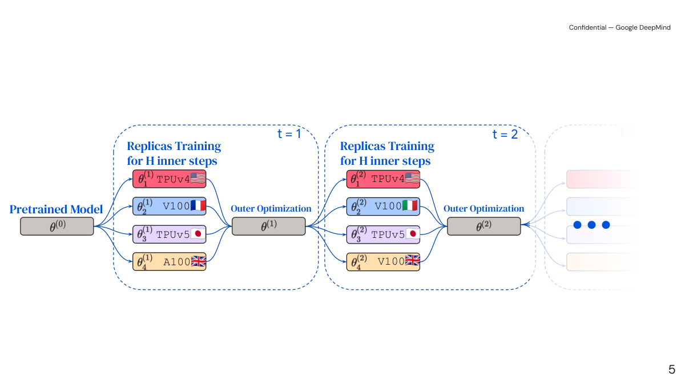
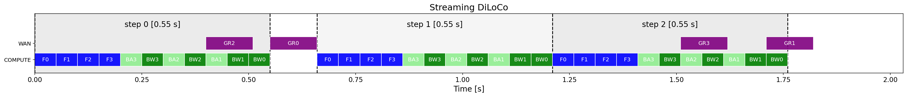
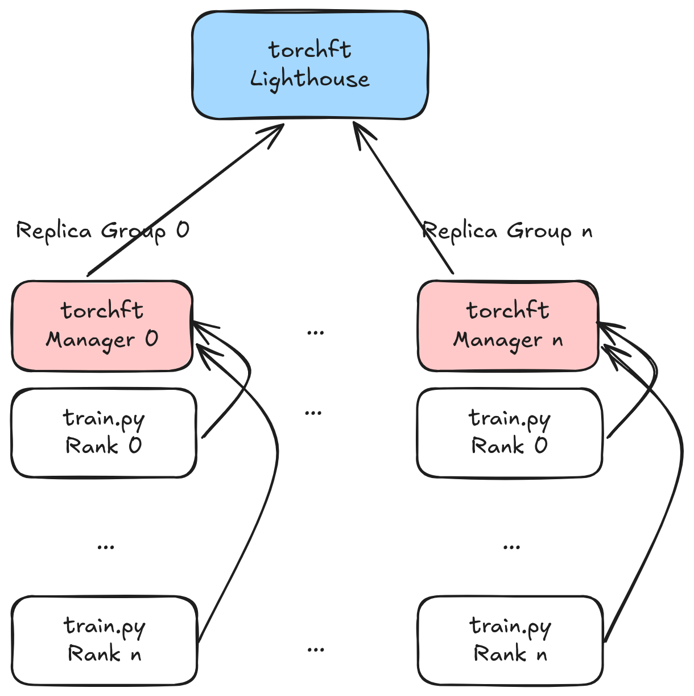

# Training Across Datacenters and the Internet

## Prerequisites

This chapter is about what changes when the GPUs that train one model are not in one building. It leans on several earlier chapters. Read them first if the terms are new:

- [Networking](../foundations/networking.md): latency vs bandwidth, TCP, the bandwidth-delay product, NAT basics, why TCP is slow for HPC. This chapter only adds the wide-area parts.
- [Distributed systems](../foundations/distributed-systems.md): partial failure, heartbeats, rendezvous, "slow vs dead", elastic training.
- [Collectives internals](../network/collectives-internals.md): the alpha-beta model and ring all-reduce. Every bandwidth number below plugs into the formulas derived there.
- [Parallelism derivations](model-parallelism/derivations.md): DDP communication volume (`2·b_g·Ψ` bytes per rank per step) and when DDP becomes comm-bound. This chapter starts from that result.
- [Training arithmetic](arithmetic.md): `6Ψ` FLOPs per token and MFU.

Helpful but optional: [concurrency](../foundations/concurrency.md) for async collectives, [containers](../foundations/containers-and-virtualization.md) for how contributors package workers, and [RL infrastructure](../platform/rl-infrastructure.md) for the decentralized RL case touched on at the end.

Conventions. Every number in this chapter is either computed by a script shown next to it or cited from a named paper. Scripts marked **[ran]** were executed on an Apple M4 laptop (macOS, CPU only, PyTorch 2.15, Python 3.14), and the output pasted is real. Anything that needs Linux, GPUs, or more than one machine is marked **untested**. A run on one laptop with one or two seeds is an anecdote, not a benchmark, and I say so where it matters.

## Why WAN training is different

A **WAN** (wide-area network) is any network that spans buildings, cities or continents: the public internet, a leased line between two datacenters, a cloud provider's inter-region backbone. A **LAN** or datacenter **fabric** is the network inside one building, such as InfiniBand or RoCE between GPU nodes. Everything in the [parallelism chapters](model-parallelism/derivations.md) assumes a fabric. This chapter is about the WAN case.

### The bandwidth gap, in seconds

The [parallelism derivations](model-parallelism/derivations.md#communication-volume) show that DDP sends about `2·b_g·Ψ` bytes per rank per step for a ring all-reduce of the gradients, where `Ψ` is the parameter count and `b_g` the bytes per gradient element. Here is that cost on links of different speeds. **[ran]**

```python
# wan_math.py -- time for one ring all-reduce of the full gradient: t = 2(N-1)/N * M / beta  (latency ignored)
links = {"1 Gbps (home/WAN)": 1e9, "10 Gbps (good WAN)": 10e9, "100 Gbps (cross-DC)": 100e9,
         "400 Gbps (IB NIC, 1 GPU)": 400e9, "3.2 Tbps (8x400G node)": 3.2e12}
N = 8  # participants in the ring
def fmt(s):
    return f"{s*1e3:8.1f} ms" if s < 1 else (f"{s:8.1f} s " if s < 120 else (f"{s/60:8.1f} min" if s < 7200 else f"{s/3600:8.1f} h  "))
print(f"bf16 gradients, ring all-reduce over N={N}, bandwidth term only")
print(f"{'link':26s}" + "".join(f"{p:>13s}" for p in ["1B", "10B", "100B"]))
for name, bps in links.items():
    row = ""
    for P in [1e9, 10e9, 100e9]:
        M = 2 * P                       # bytes of bf16 gradient
        t = 2 * (N - 1) / N * M / (bps / 8)
        row += f"{fmt(t):>13s}"
    print(f"{name:26s}{row}")

# Compute time per step for comparison: one 8xH100 node at 40% MFU, 1M-token batch
F = 8 * 0.4 * 989e12
for P in [1e9, 10e9, 100e9]:
    tok = 2**20
    print(f"{P/1e9:.0f}B: one step of {tok} tokens on 8xH100@40% MFU = {6*P*tok/F:6.1f} s")
```

```
bf16 gradients, ring all-reduce over N=8, bandwidth term only
link                                 1B          10B         100B
1 Gbps (home/WAN)               28.0 s       4.7 min     46.7 min
10 Gbps (good WAN)               2.8 s       28.0 s       4.7 min
100 Gbps (cross-DC)            280.0 ms       2.8 s       28.0 s 
400 Gbps (IB NIC, 1 GPU)        70.0 ms     700.0 ms       7.0 s 
3.2 Tbps (8x400G node)           8.8 ms      87.5 ms     875.0 ms
1B: one step of 1048576 tokens on 8xH100@40% MFU =    2.0 s
10B: one step of 1048576 tokens on 8xH100@40% MFU =   19.9 s
100B: one step of 1048576 tokens on 8xH100@40% MFU =  198.8 s
```

Read the 10B column. One 8-GPU node computes a 1M-token step in about 20 s. Over a 1 Gbps link, the gradient all-reduce for that step takes 4.7 minutes. That is 14x longer than the compute, so the GPUs would sit idle about 93% of the time. Inside a node with 3.2 Tbps of NICs, the same all-reduce takes 88 ms and hides under the backward pass.

The gap between the fabric and the WAN is about 3,000x (3.2 Tbps vs 1 Gbps). No overlap trick closes a 3,000x gap. The only fix is to **send fewer bytes**: communicate less often, send smaller messages, or both. Most of this chapter is about how to do that without hurting the model.

Notice that `Ψ` cancels in the ratio, as the [derivations chapter](model-parallelism/derivations.md#when-is-ddp-comm-bound) shows: compute and DDP traffic both scale with `Ψ`. A bigger model does not get you out of the problem. Only more tokens per sync, or fewer bytes per sync, help.

### Latency and the alpha term

Bandwidth is not the only thing that gets worse. **RTT** (round-trip time, how long a tiny message takes to go there and back) is about 5 µs inside an InfiniBand rack, about 70 ms between the US and Europe, and 150-250 ms between Europe and Asia. Light in fiber covers about 200 km per millisecond, so a 10,000 km path costs at least 50 ms each way before any router touches the packet.

A ring all-reduce has `2(N-1)` sequential steps, and each one pays the latency `α` (the fixed per-message cost; see the [alpha-beta model](../network/collectives-internals.md#the-alpha-beta-model)). With 14 nodes spread across three continents and an average one-way hop of 50 ms:

```python
>>> N, alpha = 14, 0.050
>>> 2 * (N - 1) * alpha          # seconds of pure latency in one ring all-reduce
1.3
```

1.3 s is small compared with minutes of bandwidth time, so on the WAN you stay bandwidth-bound for big messages. Latency does decide two other things. First, small control messages (heartbeats, "are we all ready?" barriers) each cost a full RTT, so a protocol with ten round trips per sync spends seconds just agreeing. Second, TCP's throughput on a single connection is capped by window/RTT. That is the [bandwidth-delay product](../foundations/networking.md#bandwidth-delay-product), covered below in [WAN TCP tuning](#wan-tcp-tuning).

### What else changes

Bandwidth is the headline, but WAN training also breaks assumptions that fabric training quietly relies on:

| Assumption inside one cluster | What happens across the internet |
|---|---|
| All ranks start together and stay up for the whole job | Nodes join late, leave early, get preempted. Membership changes are routine events, not errors. |
| Identical hardware | A mix of H100, A100 and consumer GPUs, at different speeds, on different drivers. |
| Every node can open a TCP connection to every other node | Most nodes sit behind NAT and firewalls and cannot accept incoming connections. |
| A failure is rare enough to restart the job from a checkpoint | With 30 contributors, something fails every few hours. A full restart each time wastes most of the run. |
| Every worker is honest | If anyone can contribute compute, someone will send garbage, by accident or on purpose. |
| A shared filesystem holds checkpoints | There is no shared filesystem. A new node has to get the weights from a peer. |

The rest of the chapter takes these in order: the algorithm (DiLoCo), what real systems did, compression, overlap, membership, heterogeneity, networking, model parallelism over slow links, and trust.

## Local SGD and DiLoCo

### From DDP to local SGD

In DDP, every worker computes a gradient on its own data and all workers average gradients **every step**. **Local SGD** relaxes that. Each worker runs `H` optimizer steps on its own, with no communication. Then all workers average their *parameters* and continue from the average. `H` is the number of **inner steps** per **outer step** (one round of averaging).

```
DDP:        step: grad_k = ∇L_k(θ);  g = mean_k(grad_k)      ← all-reduce every step
                  θ = opt(θ, g)

Local SGD:  repeat H times on each worker k independently:
                  θ_k = opt(θ_k, ∇L_k(θ_k))                  ← no communication
            then: θ = mean_k(θ_k);  θ_k = θ for all k        ← one all-reduce per H steps
```

Communication drops by a factor of `H`. The price is that workers drift apart during the `H` steps, since each follows its own data. Averaging drifted models is not the same as taking `H` steps of large-batch SGD, and the gap grows with `H` and with how different the workers' data is. Federated learning calls this algorithm **FedAvg** ("Communication-Efficient Learning of Deep Networks from Decentralized Data", McMahan et al., arXiv:1602.05629). The optimization literature studied it as local SGD ("Local SGD Converges Fast and Communicates Little", Stich, arXiv:1805.09767; "Don't Use Large Mini-Batches, Use Local SGD", Lin et al., arXiv:1808.07217).

### Pseudo-gradients and the outer optimizer

The step that makes local SGD work at LLM scale is to treat the averaging step as an optimizer step in its own right. Define the **pseudo-gradient** of worker `k` after an inner loop as

```
Δ_k = θ_global − θ_k          # where the round started, minus where worker k ended up
Δ   = mean_k(Δ_k)              # one all-reduce
```

`Δ` points from where the workers went back toward where they started, so it has the same sign convention as a gradient: stepping *against* it moves you toward the workers. Plain parameter averaging is exactly `θ_global ← θ_global − 1.0 · Δ`, which is SGD with learning rate 1 on the pseudo-gradient. Once you see it that way, you can use any optimizer you like for the outer step: momentum, Nesterov, Adam ("Adaptive Federated Optimization", Reddi et al., arXiv:2003.00295, calls this FedOpt; "SlowMo", Wang et al., arXiv:1910.00643, adds outer momentum to local SGD).

**DiLoCo** ("DiLoCo: Distributed Low-Communication Training of Language Models", Douillard et al., arXiv:2311.08105) is this recipe with specific choices that work well for transformers:

- **inner optimizer**: AdamW, the same hyperparameters you would use without DiLoCo. Each worker keeps its own Adam state across rounds and never communicates it.
- **outer optimizer**: SGD with Nesterov momentum, outer learning rate 0.7, momentum 0.9.
- **H**: around 500 inner steps in the paper.
- Reported result: on C4 with 8 workers, it matches fully synchronous training while communicating about 500x less, and it tolerates non-IID data across workers and workers joining or leaving.



([source](https://arxiv.org/html/2311.08105v3))

Here is one outer step in PyTorch-like code. The real loop is in the toy below.

```python
# one DiLoCo outer step, K workers, global params theta (a model), outer = SGD(theta, lr=0.7, momentum=0.9, nesterov=True)
for p_glob, *p_workers in zip(theta.parameters(), *[w.parameters() for w in workers]):
    delta = torch.stack([p_glob.data - p_k.data for p_k in p_workers]).mean(0)   # (*p.shape) mean pseudo-gradient
    p_glob.grad = delta                                                          # all-reduce lives here in a real system
outer.step(); outer.zero_grad()
for w in workers:
    w.load_state_dict(theta.state_dict())    # everybody restarts from the new global point; inner Adam state is kept
```

### Why Nesterov momentum on the outside

Three facts explain the choices. They are intuitions supported by the ablations in the DiLoCo paper, not proofs.

1. **The pseudo-gradient is a big, low-noise step.** It is the sum of `H` AdamW updates, averaged over `K` workers. Pseudo-gradients from consecutive rounds point in similar directions. Momentum accumulates that consistent direction, so the outer step can be larger than any single worker's drift.
2. **Outer lr < 1 with momentum 0.9 means each round's effective step is larger than plain averaging.** With momentum `β = 0.9`, a direction that persists is amplified by up to `1/(1-β) = 10` in steady state. With lr 0.7 that is up to 7x a single averaged move. The DiLoCo paper reports that Nesterov beat plain averaging, SGD with momentum, and Adam as the outer optimizer.
3. **Nesterov looks ahead.** It evaluates the momentum at the point you're about to move to, which damps overshoot when the direction changes. That matters when one outer step represents hundreds of inner steps.

Here is the update `torch.optim.SGD(nesterov=True)` applies, written out (dampening 0):

```python
# v: momentum buffer, d: mean pseudo-gradient, theta: global params
v = beta * v + d
theta = theta - lr * (d + beta * v)       # Nesterov: gradient + lookahead momentum
```

### Choosing H

`H` trades communication against drift. You want it just large enough that the outer sync fits inside (or barely outside) the compute of one inner loop. Using the INTELLECT-1 configuration below (10B params, 14 nodes, 8×H100 per node, global batch 128 × 8192 tokens per node, 36% MFU):

```python
# hide_math.py -- can DiLoCo hide the outer all-reduce? INTELLECT-1-like numbers.   [ran]
P, N = 10e9, 14                       # params, nodes in the ring
F = 8 * 989e12 * 0.36                 # one 8xH100 node at 36% MFU (INTELLECT-1 global MFU)
tok_per_step = 128 * 8192             # global batch per node per inner step (INTELLECT-1: bs 128, seq 8192)
t_step = 6 * P * tok_per_step / F
print(f"inner step: {t_step:.1f} s   H=100 inner loop: {100*t_step/60:.1f} min")
for name, b in [("fp32", 4), ("bf16", 2), ("int8", 1)]:
    for gbps in [0.5, 1, 4]:
        t = 2 * (N - 1) / N * b * P * 8 / (gbps * 1e9)
        print(f"  {name} pseudo-grad all-reduce @ {gbps:>3} Gbps: {t/60:6.1f} min  -> idle fraction if blocking: {t/(t+100*t_step):5.1%}")
# DDP for comparison: one bf16 all-reduce per inner step
t_ddp = 2 * (N - 1) / N * 2 * P * 8 / 1e9
print(f"DDP bf16 @ 1 Gbps: {t_ddp/60:.1f} min of comm per {t_step:.0f} s of compute -> utilization {t_step/(t_step+t_ddp):.1%}")
print(f"bytes ratio DDP(bf16, every step) / DiLoCo(int8, every 100): {2*100/1:.0f}x;  vs fp32 grads: {4*100:.0f}x")
```

```
inner step: 22.1 s   H=100 inner loop: 36.8 min
  fp32 pseudo-grad all-reduce @ 0.5 Gbps:   19.8 min  -> idle fraction if blocking: 35.0%
  fp32 pseudo-grad all-reduce @   1 Gbps:    9.9 min  -> idle fraction if blocking: 21.2%
  fp32 pseudo-grad all-reduce @   4 Gbps:    2.5 min  -> idle fraction if blocking:  6.3%
  bf16 pseudo-grad all-reduce @ 0.5 Gbps:    9.9 min  -> idle fraction if blocking: 21.2%
  bf16 pseudo-grad all-reduce @   1 Gbps:    5.0 min  -> idle fraction if blocking: 11.9%
  bf16 pseudo-grad all-reduce @   4 Gbps:    1.2 min  -> idle fraction if blocking:  3.3%
  int8 pseudo-grad all-reduce @ 0.5 Gbps:    5.0 min  -> idle fraction if blocking: 11.9%
  int8 pseudo-grad all-reduce @   1 Gbps:    2.5 min  -> idle fraction if blocking:  6.3%
  int8 pseudo-grad all-reduce @   4 Gbps:    0.6 min  -> idle fraction if blocking:  1.7%
DDP bf16 @ 1 Gbps: 5.0 min of comm per 22 s of compute -> utilization 6.9%
bytes ratio DDP(bf16, every step) / DiLoCo(int8, every 100): 200x;  vs fp32 grads: 400x
```

The estimated inner loop, 36.8 minutes, is close to the "about 38 minutes" the INTELLECT-1 report gives. The 400x figure matches the report's "400x less bandwidth than data parallel" claim if the baseline is fp32 gradients and the comparison is int8 pseudo-gradients every 100 steps. The rule of thumb: **pick `H` so that `H · t_step` is at least 10x `t_sync`**. Then a blocking sync costs under 10% of throughput, and you have headroom for a slow link. Larger `H` saves more bandwidth but drifts more. The DiLoCo paper's ablation over `H` (which I have not re-checked for the exact range) finds quality degrading slowly, not abruptly, as `H` grows.

### A runnable toy: DDP vs DiLoCo on CPU

This script simulates `K = 4` workers in one process, so it measures the *optimization* effect of DiLoCo and counts the bytes a real ring all-reduce would send. It does not measure network time. The model is a 2-layer, 119k-parameter character-level GPT. The data is the Python standard library's source code, which is on every machine. Worker `k` trains only on its own contiguous quarter of the corpus, so the data is non-IID (different files, different styles), which is the realistic case for decentralized training. Every method gets exactly the same compute: 1200 steps per worker, 16 × 64 tokens per worker per step. **[ran]**

```python
# diloco_toy.py -- DDP vs Local-SGD vs DiLoCo (+ compressed pseudo-gradients), K simulated workers, one CPU process.
# Run: python diloco_toy.py      (torch>=2.0). Optional: SEED=1 python diloco_toy.py "DDP" "int8"  (filter rows by name)
import copy, glob, os, sys, time
import torch, torch.nn as nn, torch.nn.functional as F

SEED = int(os.environ.get("SEED", 0)); torch.manual_seed(SEED)
torch.set_num_threads(4)
K, B, T, STEPS, H, LR = 4, 16, 64, 1200, 50, 2e-3   # workers, per-worker batch, context, inner steps per worker, sync period, inner lr

# ---- data: char-level Python source from the stdlib; worker k trains on its own contiguous shard (non-IID) ----
files = sorted(glob.glob(os.path.join(os.path.dirname(os.__file__), "*.py")))
text = "".join(open(f, encoding="utf-8", errors="ignore").read() for f in files)[:3_000_000]
chars = sorted(set(text)); stoi = {c: i for i, c in enumerate(chars)}
data = torch.tensor([stoi[c] for c in text], dtype=torch.long)
n_val = 200_000
train, val = data[:-n_val], data[-n_val:]
shards = train.chunk(K)
print(f"corpus {len(text):,} chars, vocab {len(chars)}, {len(files)} files, shard size {len(shards[0]):,}")
print("sample from shard 2:", repr(text[len(shards[0]) * 2: len(shards[0]) * 2 + 120]))

def batch(src, g):
    ix = torch.randint(len(src) - T - 1, (B,), generator=g)
    x = torch.stack([src[i:i + T] for i in ix])          # (B, T)
    y = torch.stack([src[i + 1:i + T + 1] for i in ix])  # (B, T)
    return x, y

# ---- model: 2-layer GPT, d=64 ----
class Block(nn.Module):
    def __init__(s, d, nh):
        super().__init__(); s.ln1, s.ln2 = nn.LayerNorm(d), nn.LayerNorm(d)
        s.attn = nn.MultiheadAttention(d, nh, batch_first=True)
        s.mlp = nn.Sequential(nn.Linear(d, 4 * d), nn.GELU(), nn.Linear(4 * d, d))
    def forward(s, x):                                    # x: (B, T, d)
        mask = torch.triu(torch.ones(x.size(1), x.size(1), dtype=torch.bool), 1)
        h = s.ln1(x); x = x + s.attn(h, h, h, attn_mask=mask, need_weights=False)[0]
        return x + s.mlp(s.ln2(x))
class GPT(nn.Module):
    def __init__(s, V, d=64, L=2, nh=4):
        super().__init__(); s.tok, s.pos = nn.Embedding(V, d), nn.Embedding(T, d)
        s.blocks = nn.Sequential(*[Block(d, nh) for _ in range(L)]); s.ln, s.head = nn.LayerNorm(d), nn.Linear(d, V)
    def forward(s, x, y):                                 # x, y: (B, T)
        h = s.tok(x) + s.pos(torch.arange(x.size(1)))     # (B, T, d)
        logits = s.head(s.ln(s.blocks(h)))                # (B, T, V)
        return F.cross_entropy(logits.flatten(0, 1), y.flatten())

@torch.no_grad()
def evaluate(m):
    g = torch.Generator().manual_seed(123)
    return sum(m(*batch(val, g)).item() for _ in range(40)) / 40

base = GPT(len(chars))
P = sum(p.numel() for p in base.parameters())
print(f"params {P:,}  ({4*P/1e6:.2f} MB fp32)")

# ---- compressors for pseudo-gradients: return (tensor the receivers reconstruct, bytes on the wire) ----
def none(d, st): return d, 4 * d.numel()
def int8(d, st):
    s = d.abs().max() / 127 + 1e-12                       # per-tensor absmax scale
    return (d / s).round().clamp(-127, 127) * s, d.numel() + 4
def topk(frac, ef):
    def f(d, st):
        if ef: d = d + st.get("e", torch.zeros_like(d))    # error feedback: add back what we failed to send last time
        k = max(1, int(frac * d.numel()))
        idx = d.abs().flatten().topk(k).indices
        out = torch.zeros_like(d).flatten(); out[idx] = d.flatten()[idx]; out = out.view_as(d)
        if ef: st["e"] = d - out
        return out, 8 * k                                 # fp32 value + int32 index
    return f

def ring_allreduce_bytes(payload): return 2 * (K - 1) / K * payload   # bytes each worker sends
def allgather_bytes(payload):      return (K - 1) * payload           # sparse tensors don't sum in place

# ---- training loops ----
def run_ddp():
    m = copy.deepcopy(base); opt = torch.optim.AdamW(m.parameters(), lr=LR)
    gens = [torch.Generator().manual_seed(k + 100 * SEED) for k in range(K)]
    sent = 0
    for step in range(STEPS):
        opt.zero_grad()
        for k in range(K):                                 # K workers, gradient averaged = mean of their losses
            (m(*batch(shards[k], gens[k])) / K).backward()
        sent += ring_allreduce_bytes(4 * P)               # one fp32 all-reduce of all grads per step
        opt.step()
    return evaluate(m), sent, STEPS

def run_diloco(outer_lr, momentum, nesterov, comp=none, H=H, sparse=False):
    glob_m = copy.deepcopy(base)
    outer = torch.optim.SGD(glob_m.parameters(), lr=outer_lr, momentum=momentum, nesterov=nesterov)
    workers = [copy.deepcopy(base) for _ in range(K)]
    inner = [torch.optim.AdamW(w.parameters(), lr=LR) for w in workers]
    gens = [torch.Generator().manual_seed(k + 100 * SEED) for k in range(K)]
    state = [[{} for _ in base.parameters()] for _ in range(K)]
    sent, syncs = 0, 0
    for step in range(1, STEPS + 1):
        for k in range(K):                                 # inner step: no communication at all
            inner[k].zero_grad(); workers[k](*batch(shards[k], gens[k])).backward(); inner[k].step()
        if step % H: continue
        syncs += 1; payload = 0
        for i, gp in enumerate(glob_m.parameters()):
            acc = torch.zeros_like(gp)
            for k in range(K):
                delta = gp.data - list(workers[k].parameters())[i].data   # pseudo-gradient: theta_global - theta_k
                d_hat, nbytes = comp(delta, state[k][i]); acc += d_hat / K
                payload += nbytes / K
            gp.grad = acc                                  # outer "gradient" = mean pseudo-gradient
        sent += allgather_bytes(payload) if sparse else ring_allreduce_bytes(payload)
        outer.step(); outer.zero_grad()
        for w in workers: w.load_state_dict(glob_m.state_dict())   # broadcast new global weights (inner Adam state kept)
    return evaluate(glob_m), sent, syncs

def run_single():                                         # dumb baseline: one worker, no communication
    m = copy.deepcopy(base); opt = torch.optim.AdamW(m.parameters(), lr=LR); g = torch.Generator().manual_seed(100 * SEED)
    for _ in range(STEPS):
        opt.zero_grad(); m(*batch(shards[0], g)).backward(); opt.step()
    return evaluate(m), 0, 0

print(f"\nK={K} workers, {STEPS} steps/worker, batch {B}x{T} per worker, H={H}; init val loss {evaluate(base):.3f}")
print(f"{'method':40s} {'val loss':>8s} {'syncs':>6s} {'MB sent/worker':>15s} {'vs DDP':>8s} {'time':>6s}")
ddp_bytes = STEPS * ring_allreduce_bytes(4 * P)
for name, fn in [
    ("single worker (no comm)",              run_single),
    ("DDP (all-reduce every step)",          run_ddp),
    ("Local SGD: avg params (outer lr=1)",   lambda: run_diloco(1.0, 0.0, False)),
    ("DiLoCo: Nesterov lr=0.7 m=0.9",        lambda: run_diloco(0.7, 0.9, True)),
    ("DiLoCo H=200",                         lambda: run_diloco(0.7, 0.9, True, H=200)),
    ("DiLoCo + int8 pseudo-grads",           lambda: run_diloco(0.7, 0.9, True, int8)),
    ("DiLoCo + top-1% no error feedback",    lambda: run_diloco(0.7, 0.9, True, topk(0.01, False), sparse=True)),
    ("DiLoCo + top-1% + error feedback",     lambda: run_diloco(0.7, 0.9, True, topk(0.01, True), sparse=True)),
    ("Local SGD + top-1% + error feedback",  lambda: run_diloco(1.0, 0.0, False, topk(0.01, True), sparse=True)),
    ("DiLoCo + top-10% + error feedback",    lambda: run_diloco(0.7, 0.9, True, topk(0.10, True), sparse=True)),
]:
    if sys.argv[1:] and not any(a in name for a in sys.argv[1:]): continue   # python diloco_toy.py "top-10%" ...
    t0 = time.time(); loss, sent, syncs = fn(); dt = time.time() - t0
    ratio = f"{ddp_bytes/sent:7.0f}x" if sent else "      -"
    print(f"{name:40s} {loss:8.3f} {syncs:6d} {sent/1e6:15.2f} {ratio:>8s} {dt:5.0f}s", flush=True)
```

Output, seed 0 (the last two rows came from a second invocation filtered by name; same seed, same code):

```
corpus 3,000,000 chars, vocab 116, 155 files, shard size 700,000
sample from shard 2: 'so we can do some very readable comparisons.\n            while len(lines) < 4:\n                lines.append(next(diff_li'
params 119,156  (0.48 MB fp32)

K=4 workers, 1200 steps/worker, batch 16x64 per worker, H=50; init val loss 4.842
method                                   val loss  syncs  MB sent/worker   vs DDP   time
single worker (no comm)                     2.114      0            0.00        -    45s
DDP (all-reduce every step)                 1.778   1200          857.92       1x   104s
Local SGD: avg params (outer lr=1)          1.911     24           17.16      50x    94s
DiLoCo: Nesterov lr=0.7 m=0.9               1.885     24           17.16      50x    51s
DiLoCo H=200                                1.957      6            4.29     200x    78s
DiLoCo + int8 pseudo-grads                  1.885     24            4.29     200x   104s
DiLoCo + top-1% no error feedback           2.489     24            0.68    1257x    68s
DiLoCo + top-1% + error feedback            2.678     24            0.68    1257x    65s
Local SGD + top-1% + error feedback         2.414     24            0.68    1257x    47s
DiLoCo + top-10% + error feedback           2.256     24            6.86     125x    38s
```

Seed 1, a subset of rows (different init and data order):

```
K=4 workers, 1200 steps/worker, batch 16x64 per worker, H=50; init val loss 5.049
method                                   val loss  syncs  MB sent/worker   vs DDP   time
single worker (no comm)                     2.150      0            0.00        -    13s
DDP (all-reduce every step)                 1.827   1200          857.92       1x    39s
Local SGD: avg params (outer lr=1)          1.964     24           17.16      50x    30s
DiLoCo: Nesterov lr=0.7 m=0.9               1.915     24           17.16      50x    39s
DiLoCo + int8 pseudo-grads                  1.914     24            4.29     200x    30s
DiLoCo + top-1% no error feedback           2.502     24            0.68    1257x    28s
DiLoCo + top-1% + error feedback            2.692     24            0.68    1257x    29s
```

The `time` column is CPU wall-clock for the simulation, which shared the machine with other jobs. Ignore it.

What the toy shows, with two seeds:

- **The dumb baseline matters.** One worker with no communication reaches 2.11. Every method that uses four workers should beat that, and anything that doesn't (top-1% sparsification) is worse than not communicating at all.
- **DDP is the quality ceiling at this scale.** DDP reaches 1.778 / 1.827. DiLoCo with H=50 reaches 1.885 / 1.915 while sending 50x fewer bytes. That gap of about 0.1 nats is *not* what the DiLoCo paper reports at scale (parity with DDP). The toy is tiny, short (24 outer steps in total) and untuned: the outer lr, `H` and the inner lr were not swept. Read it as "the mechanism works and costs something", not as a measurement of the gap.
- **Nesterov beats plain averaging**: 1.885 vs 1.911 (seed 0) and 1.915 vs 1.964 (seed 1). Same bytes, same compute, one variable changed. The direction agrees with the paper.
- **H=200 costs more quality** (1.957) for another 4x fewer bytes.
- **int8 is free here.** 1.885 vs 1.885 and 1.914 vs 1.915, at 4x fewer bytes. Of all the compression knobs, quantizing pseudo-gradients is the one to try first.
- **Top-k sparsification hurt badly, and error feedback made it worse.** See [sparsification and error feedback](#sparsification-top-k-and-error-feedback) for why. This disagrees with the gradient-compression literature, which works on per-step gradients. Here the "gradient" is a 50-step pseudo-gradient fed into Nesterov momentum, and both differences matter.

What it does not show: wall-clock speedup (no network), anything at scale, or anything about IID data. It's for building intuition and for checking your own implementation against a known-good one.

### Variants worth knowing

DiLoCo spawned a family of methods. You should know these exist and what problem each attacks. I have read the abstracts, not reproduced the results.

| Method | Paper | What changes |
|---|---|---|
| Async Local-SGD | Liu et al., arXiv:2401.09135 | Workers push pseudo-gradients whenever they finish, with no round barrier. Staleness hurts momentum, and the paper proposes fixes. |
| DiPaCo | Douillard et al., arXiv:2403.10616 | Each worker trains a "path" through a modular network instead of a full replica, so no worker needs the whole model. |
| Streaming DiLoCo | Douillard et al., arXiv:2501.18512 | Sync parameter fragments on a staggered schedule, overlap sync with compute, quantize. [Covered below](#streaming-and-overlapping-outer-syncs). |
| Scaling laws for DiLoCo | Charles et al., arXiv:2503.09799 | Fits scaling laws for DiLoCo vs data parallel across model sizes and replica counts. The paper reports that DiLoCo scales predictably. |
| DiLoCoX | arXiv:2506.21263 | Claims 100B+ scale training over 1 Gbps by combining pipeline parallelism with DiLoCo-style outer steps. I have not checked the details. |
| NoLoCo | arXiv:2506.10911 | Replaces the global all-reduce with gossip-style averaging between pairs of workers, so there is never a global synchronization point. |

## Systems that did it: OpenDiLoCo, INTELLECT-1 and successors

### OpenDiLoCo

"OpenDiLoCo: An Open-Source Framework for Globally Distributed Low-Communication Training" (Jaghouar, Ong, Hagemann, arXiv:2407.07852) is an open reimplementation of DiLoCo on top of **Hivemind**, a library for decentralized training over the internet (github.com/learning-at-home/hivemind). The paper reports:

- training across two continents and three countries at 90-95% compute utilization,
- all-reducing pseudo-gradients in FP16 without loss of quality,
- scaling to about 1.1B parameters, three times the size in the original DiLoCo paper.

Hivemind's own lineage is useful background. "Towards Crowdsourced Training of Large Neural Networks using Decentralized Mixture-of-Experts" (Learning@home, Ryabinin & Gusev, arXiv:2002.04013), "Distributed Deep Learning in Open Collaborations" (DeDLOC, Diskin et al., arXiv:2106.10207), and "Moshpit SGD" (Ryabinin et al., arXiv:2103.03239) built the DHT-based peer discovery and group all-reduce that OpenDiLoCo relies on. A **DHT** (distributed hash table) is a key-value store spread across all peers, with no central server, so any peer can look up "who else is training run X".

### INTELLECT-1

"INTELLECT-1 Technical Report" (Jaghouar et al., arXiv:2412.01152) describes a 10B-parameter model trained on 1T tokens by up to 14 concurrent nodes across three continents, with 30 compute contributors joining and leaving during the run. The facts below are from the report's text and tables:

| Item | Value in the report |
|---|---|
| Model | Llama-3 style, 42 layers, hidden 4096, 32 heads, 8 KV heads, vocab 128,256 |
| Duration | 42 days (Oct 10 to Nov 22, 2024) |
| Nodes | 8×H100 each, started at 4 nodes, peaked at 14 (112 H100s) |
| Inner optimizer | AdamW, lr 7.5e-5, β = (0.9, 0.95), wd 0.1, 1000 warmup steps, batch 128 × 8192 tokens |
| Outer optimizer | Nesterov, lr 0.7, momentum 0.9 |
| H | 100 inner steps (about 38 min of compute) |
| Pseudo-gradient wire format | int8, range mean ± 6σ split into 256 buckets, **reduction done in fp32** |
| Inter-node bandwidth | 500 Mb/s to 4 Gb/s |
| Median all-reduce time | 103 s (USA only), 382 s (USA + Europe), 469 s (global) |
| Compute utilization | 95.7% (USA), 85.6% (USA + Europe), 83.0% (global) |
| MFU | 41.4% (USA), 37.1% (USA + Europe), 36.0% (global; the text says 36.2%) |

The system is **PRIME** (github.com/PrimeIntellect-ai/prime). Two of its ideas recur in the rest of this chapter:

- **ElasticDeviceMesh**: inside a node, ranks form a normal fixed process group for FSDP over NVLink. Across nodes, a separate *global* process group can be torn down and rebuilt when membership changes, without killing the local group. In other words: fast, rigid parallelism where the network is good, slow, elastic parallelism where it isn't. torchft's "replica group" (below) is the same idea.
- **Heartbeats + "deathrattle"**: nodes heartbeat to a central key-value store every 2 s and are evicted after 6 s of silence. A node that exits cleanly sends a deathrattle message so it is removed immediately instead of after the timeout.

### Re-deriving INTELLECT-1's numbers

A habit worth building: when you read a systems report, reproduce its numbers from first principles. If they don't match, either you misunderstand the system or the report is hiding something. From `hide_math.py` above:

- predicted inner loop 36.8 min vs reported ~38 min: matches.
- int8 all-reduce of 10B params over 14 nodes takes 2.5 min at 1 Gbps and 5.0 min at 0.5 Gbps. The reported medians of 1.7 min (USA, faster links) to 7.8 min (global) bracket that.
- utilization if blocking: about 94% at 1 Gbps and 88% at 0.5 Gbps. The report gives 96% to 83%. The global number is lower than the bandwidth model predicts, which points to costs the simple model leaves out, such as stragglers, the ring being limited by its slowest link, and VPN overhead (the report mentions Tailscale becoming a bottleneck on intercontinental links).

```python
>>> t_inner, t_sync = 38, 469 / 60          # minutes, global setting from the report
>>> f"{t_inner / (t_inner + t_sync):.1%}"   # predicted utilization from the reported medians
'82.9%'
```

The reported medians reproduce the reported 83.0% global utilization almost exactly. So in this run the sync was **blocking**: compute stopped while the pseudo-gradients moved. Overlapping it is the next obvious win, and that is what Streaming DiLoCo does.

### After INTELLECT-1

- **PCCL** ("Prime Collective Communications Library -- Technical Report", Keiblinger et al., arXiv:2505.14065): a collective library built for the public internet. It has a master process that handles membership and consensus but doesn't carry data, peers that can join and fail mid-run, and a ring order chosen from measured bandwidth. Prime Intellect's blog reports up to 45 Gbit/s across western European datacenters. I have not run it. Don't confuse it with a different PCCL, arXiv:2504.18658, which is for GPU supercomputers.
- **INTELLECT-2** (arXiv:2505.07291): a 32B reasoning model trained with fully asynchronous **RL** across permissionless contributors. RL changes the shape of the problem. Inference workers generate rollouts and need fresh weights (distributed by a component called SHARDCAST). Their outputs must be checked because the workers are untrusted (TOPLOC, [below](#trust-and-verification)). See [RL infrastructure](../platform/rl-infrastructure.md).
- **Nous Research Psyche / Consilience**: Nous reports pre-training a 40B model called Consilience on its Psyche network, which coordinates over the Solana blockchain and uses DisTrO-family optimizers. The sources I found are blog posts and secondary coverage. I have not seen a technical report with loss curves and comparisons. See [DeMo and DisTrO](#demo-and-distro-published-vs-claimed).

## Compressing the communication

DiLoCo reduces *how often* you communicate. Compression reduces *how many bytes* each sync sends. The two multiply. This section works through the options from safest to most aggressive.

### Quantization: int8, fp8, 4-bit

**Quantization** means sending each number in fewer bits plus a shared scale. The toy's int8 compressor uses one scale per tensor:

```python
s = d.abs().max() / 127                 # scalar scale for the whole tensor
q = (d / s).round().clamp(-127, 127)    # int8 on the wire, 1 byte per element
d_hat = q * s                           # what the receiver reconstructs
```

Real systems use finer scales (per block of 128 or 2048 elements, as in torchft's `quantization.py`) so that one outlier doesn't flatten everything else to zero. INTELLECT-1 used a different scheme: it clipped the range to mean ± 6σ and used 256 uniform buckets.

The subtle part is **reducing quantized data**. A ring all-reduce sums partial results at every hop. If you add two int8 tensors, you overflow. If you dequantize, add, and requantize at every hop, you pay `N-1` rounds of rounding error plus the CPU or GPU time to do it. Two common approaches:

```
Option A (INTELLECT-1 style):  wire = int8, accumulate = fp32
    each hop: recv int8 chunk -> dequantize -> add into fp32 accumulator -> requantize for the next hop
    error grows with the number of hops; cost: quantize/dequantize on every hop (the report says its
    multithreaded C++ version was >60x faster than the PyTorch implementation)

Option B: reduce-scatter as all-to-all, then all-gather
    each rank sends its int8 slices directly to the owner of each slice; the owner sums in fp32 once,
    requantizes once, all-gathers int8. Two quantization errors total, regardless of N.
```

How low can you go? On the published evidence:

- 16-bit pseudo-gradients: no loss (OpenDiLoCo, FP16).
- int8 pseudo-gradients: comparable quality (INTELLECT-1, and the toy above).
- 4-bit: Streaming DiLoCo reports that exchanging pseudo-gradients in 4-bit floating point (FP4, E3M0 according to my reading of the paper; check it before relying on that) did not hurt quality at the 1B scale.
- Below that, you're into sparsification and transforms.

### Sparsification: top-k and error feedback

**Top-k sparsification** sends only the `k` largest-magnitude entries and their indices. At 1% density with fp32 values and int32 indices, that is 8 bytes × 0.01 = 0.08 bytes per parameter instead of 4, a 50x reduction. It has two structural problems.

1. **Sparse tensors don't all-reduce.** Worker A's top 1% and worker B's top 1% sit at different indices. Their sum has up to 2% nonzeros, and after `K` workers up to `K`%. You can't keep summing in place along a ring. You need an **all-gather** of everyone's (index, value) lists, in which each worker sends its payload to `K-1` others. The toy accounts for this with `allgather_bytes`. Per-worker traffic grows with `K`, the opposite of a ring all-reduce. (Deep Gradient Compression, Lin et al., arXiv:1712.01887, works around this with hierarchical schemes. Some systems share a random seed so that all workers pick the same indices: random-k with a shared mask, which does all-reduce.)
2. **Dropped mass is gone**, unless you remember it. **Error feedback** (EF) keeps a per-worker residual of everything not yet sent and adds it to the next round's input:

```python
d = delta + e            # add back what we failed to send last round
sent = topk(d)           # transmit only the largest entries
e = d - sent             # remember the rest
```

EF is what makes 1-bit SGD (Seide et al., Interspeech 2014), Deep Gradient Compression, "Sparsified SGD with Memory" (Stich, Cordonnier, Jaggi, arXiv:1809.07599) and signSGD ("Error Feedback Fixes SignSGD and other Gradient Compression Schemes", Karimireddy et al., arXiv:1901.09847) converge. Every coordinate eventually gets transmitted.

So why did EF make things *worse* in the toy (2.678 with EF vs 2.489 without at top-1%, two seeds in agreement)? My hypothesis, which I have not ablated further:

- With `H = 50` and only 24 outer steps, a residual entry may wait many rounds before it gets sent. By then it is a 500-inner-step-old correction, applied to a model that has moved on.
- Nesterov momentum with β = 0.9 then amplifies these stale bursts. Plain averaging with EF (2.414) did better than Nesterov with EF (2.678), which is consistent with this.
- Per-step gradient compression papers have thousands of steps for the residual to drain. Here there are 24.

The practical conclusion matches what the systems above actually shipped: **for pseudo-gradients, quantize first. Treat sparsification as a research problem, not a default.** If you do sparsify, the momentum and the error-feedback buffer have to be designed together, which is exactly DeMo's idea (below).

### Low-rank: PowerSGD

**PowerSGD** ("PowerSGD: Practical Low-Rank Gradient Compression for Distributed Optimization", Vogels et al., arXiv:1905.13727) approximates each `n × m` gradient matrix as `P · Qᵀ` with rank `r`, using one step of power iteration per training step, warm-started from the previous step's `Q`. It sends `r(n+m)` numbers instead of `n·m`. Because `P` and `Q` are dense, they **do** all-reduce. It uses error feedback. PyTorch ships it as a DDP communication hook:

```python
# untested in this chapter: it hung on Gloo/CPU (torch 2.15, macOS) once compression kicked in.
# I did not debug further; it is documented and used with NCCL on GPUs.
from torch.distributed.algorithms.ddp_comm_hooks import powerSGD_hook as psgd
state = psgd.PowerSGDState(process_group=None, matrix_approximation_rank=4,
                           start_powerSGD_iter=1000, use_error_feedback=True, warm_start=True)
ddp_model.register_comm_hook(state, psgd.powerSGD_hook)
# per 4096x4096 weight: 4*(4096+4096) = 32,768 numbers instead of 16,777,216 -> 512x fewer
```

PowerSGD compresses *per-step gradients* in DDP. You can combine it with local steps, but the published decentralized LLM systems above used DiLoCo plus quantization rather than PowerSGD. `start_powerSGD_iter` delays compression until the early, chaotic phase of training is over, because the PowerSGD paper and docs recommend a warm-up of uncompressed steps.

### DeMo and DisTrO: published vs claimed

Be careful here. There is a peer-reviewable paper and there are company claims, and they are not the same thing.

**Published**: "DeMo: Decoupled Momentum Optimization" (Peng, Chen, Su, Quesnelle, Kingma, Liu, arXiv:2411.19870). The idea:

1. Each worker keeps its own momentum and does **not** synchronize it.
2. Each step, it applies a fast orthonormal transform (a **DCT**, discrete cosine transform, the same transform JPEG uses) to chunks of the momentum and extracts the top-k frequency components.
3. Only those components are all-gathered and used for the update. The extracted part is subtracted from local momentum, so **the momentum buffer is the error-feedback buffer**.

The paper reports, on 300M and 1B models, up to 85x less data per GPU than AdamW-DDP with comparable loss and downstream accuracy. That's a per-step method (closer to DDP than DiLoCo), and it composes with DiLoCo-style infrequent sync in principle.

```python
# DeMo's core step, paraphrased from the paper (not the reference code)
m = beta * m + grad                       # local momentum, never all-reduced
c = dct(chunk(m))                         # (n_chunks, chunk_size) frequency coefficients
q = topk_per_chunk(c, k)                  # small sparse payload
m = m - idct(q)                           # remove what we're about to share: momentum doubles as error feedback
Q = all_gather(q)                         # sparse, so all-gather, not all-reduce
theta -= lr * sign(idct(mean(Q)))         # the paper's update uses the sign of the reconstructed shared component
```

I'm reasonably but not fully sure the sign step is in the published algorithm. Check the paper before implementing.

**Claimed, not independently verified**: DisTrO (github.com/NousResearch/DisTrO). The repository contains a README and a preliminary report PDF dated August 26, 2024, and no source code. The README describes DisTrO as a family of optimizers that cut inter-GPU communication by three to four orders of magnitude, and calls DeMo its "original seed idea". Secondary coverage of the preliminary report quotes an 857x reduction (74.4 GB down to 86.8 MB per step) for a 1.2B Llama-2-style model. The README says production code later moved into the Psyche repository and a DeMo v2 paper appeared on OpenReview in October 2025. I have not read either. Treat the "1000x-10,000x" headline as a claim until you've read a full method description with baselines.

The general lesson: when a compression paper reports "Nx less communication", ask (1) relative to what baseline precision (fp32? bf16?), (2) per step or per token, (3) whether the collective is still an all-reduce or has turned into an all-gather that scales with `K`, and (4) whether quality was compared at equal tokens *and* equal wall-clock time.

## Streaming and overlapping outer syncs

### The idea

In blocking DiLoCo, the GPUs idle while the outer all-reduce runs, which cost INTELLECT-1 17% of its compute globally. "Streaming DiLoCo with overlapping communication" (Douillard et al., arXiv:2501.18512) makes three changes:

1. **Fragments.** Split the model into `F` fragments (for example, groups of layers). Sync one fragment at a time on a staggered schedule. The total bytes are the same, but the **peak** bandwidth drops by `F`, because you never send the whole model at once.
2. **Overlap with delay τ.** Start a fragment's all-reduce, keep doing `τ` more inner steps while it's in flight, then apply the result. The paper merges local and global copies with a mixing factor α.
3. **Quantize** the exchanged pseudo-gradients to low precision (see above).

The paper reports similar quality to the baseline at the billion-parameter scale, while needing about two orders of magnitude less bandwidth (the abstract's wording; the peak-bandwidth reduction comes from the fragment schedule).



([source](https://arxiv.org/html/2501.18512v1))

The arithmetic of fragments, for a 10B model with int8 payloads and `H = 100` **[ran]** (part of `hetero.py` in the [heterogeneous hardware](#heterogeneous-hardware) section):

```python
P, b, H = 10e9, 1, 100
for frag in [1, 4, 16]:
    print(f"fragments={frag:2d}: bytes per sync {P*b/frag/1e9:5.2f} GB, one sync every {H//frag:3d} steps, total bytes per H steps {P*b/1e9:.0f} GB")
```

```
fragments= 1: bytes per sync 10.00 GB, one sync every 100 steps, total bytes per H steps 10 GB
fragments= 4: bytes per sync  2.50 GB, one sync every  25 steps, total bytes per H steps 10 GB
fragments=16: bytes per sync  0.62 GB, one sync every   6 steps, total bytes per H steps 10 GB
```

The total bytes are the same in every row. What changes is that you need a link that can move 0.62 GB in 6 inner steps instead of 10 GB in one burst. Bursty traffic is also what TCP congestion control and shared links handle worst.

### Overlap over a real collective

This is the overlap mechanism, minus fragments, with a real Gloo all-reduce between two processes. `dist.all_reduce(..., async_op=True)` returns a `Work` handle immediately. Gloo moves the bytes on its own background thread while the main thread keeps running inner steps. **[ran]**

```python
# overlap_gloo.py -- DiLoCo outer sync over real Gloo (TCP, localhost): blocking vs overlapped with tau inner steps.
# Run: python overlap_gloo.py   (spawns 2 CPU processes per config)
import os, time, torch, torch.distributed as dist, torch.multiprocessing as mp, torch.nn as nn
WORLD, H, ROUNDS, D = 2, 20, 5, 2048

def worker(rank, tau, alpha, port):
    os.environ.update(MASTER_ADDR="127.0.0.1", MASTER_PORT=str(port))
    dist.init_process_group("gloo", rank=rank, world_size=WORLD)
    torch.set_num_threads(2)
    torch.manual_seed(0); m = nn.Sequential(nn.Linear(D, 4 * D), nn.ReLU(), nn.Linear(4 * D, D))   # ~33.6M params
    torch.manual_seed(rank)
    params = list(m.parameters())
    inner = torch.optim.AdamW(params, lr=1e-4)
    outer_ref = [p.detach().clone() for p in params]               # global weights the round started from
    mom = [torch.zeros_like(p) for p in params]
    blocked, t0 = 0.0, time.time()
    for r in range(ROUNDS):
        def inner_step():
            x = torch.randn(32, D)                                 # (B, D)
            loss = (m(x) - x.roll(1, -1)).pow(2).mean()
            inner.zero_grad(); loss.backward(); inner.step(); return loss
        for _ in range(H - tau): loss = inner_step()
        delta = torch.cat([(g - p.detach()).flatten() for g, p in zip(outer_ref, params)])   # (P,) pseudo-gradient
        work = dist.all_reduce(delta, async_op=True)               # starts on Gloo's background thread
        for _ in range(tau): loss = inner_step()                   # keep computing while bytes move
        t = time.time(); work.wait(); blocked += time.time() - t
        delta /= WORLD; i = 0
        for g, v, p in zip(outer_ref, mom, params):                # outer Nesterov step, then merge with local
            d = delta[i:i + g.numel()].view_as(g); i += g.numel()
            v.mul_(0.9).add_(d); g.sub_(0.7 * (d + 0.9 * v))
            p.data.copy_(alpha * p.data + (1 - alpha) * g)         # alpha=0: take global; Streaming DiLoCo's mixing factor
    if rank == 0:
        P = sum(p.numel() for p in params)
        print(f"tau={tau} alpha={alpha:.1f}  P={P/1e6:.1f}M  last loss {loss.item():.4f}  blocked on comm {blocked:5.2f} s  total {time.time()-t0:5.2f} s")
    dist.destroy_process_group()

if __name__ == "__main__":
    for port, (tau, alpha) in enumerate([(0, 0.0), (5, 0.0), (5, 0.5)], start=29560):
        mp.spawn(worker, args=(tau, alpha, port), nprocs=WORLD)
```

```
tau=0 alpha=0.0  P=33.6M  last loss 0.8331  blocked on comm  0.20 s  total 11.56 s
tau=5 alpha=0.0  P=33.6M  last loss 0.8776  blocked on comm  0.00 s  total 10.51 s
tau=5 alpha=0.5  P=33.6M  last loss 0.9054  blocked on comm  0.00 s  total 13.15 s
```

On localhost, a 134 MB all-reduce takes about 40 ms, so there was little to hide (0.20 s over 5 rounds). The point is the mechanism: with `τ = 5`, time blocked on communication went to zero. The `total` column is noisy at this scale. Over a real 1 Gbps WAN, the same 134 MB takes about 1 s per sync, and `τ` inner steps have to cover that.

The `alpha = 0` line also shows what overlap costs. The pseudo-gradient was computed *before* the last `τ` steps, and setting `p = g` discards those `τ` steps of local progress. Keep `τ` small relative to `H`, or mix with α > 0 so that some local progress survives. The loss numbers here are from a regression toy with 5 rounds. They don't tell you which α is better. The Streaming DiLoCo paper ablates that.

torchft's `DiLoCo` class exposes these knobs directly (see [torchft](#torchft-as-of-031) below): `model_fragments=[...]`, `fragment_sync_delay` (the docstring calls it the paper's τ), `fragment_update_alpha`, and `should_quantize`.

## Elastic membership and fault tolerance

### Failure is the normal case

The [distributed systems chapter](../foundations/distributed-systems.md#failure-arithmetic) shows that a job's mean time between failures is roughly one node's MTBF divided by the node count. In a datacenter, a node's MTBF is weeks. For internet contributors (spot instances, someone's workstation, a provider rebooting for maintenance) it can be hours:

```python
>>> 24 / 14                      # node MTBF 24 h, 14 nodes: hours between failures
1.7142857142857142
>>> 38 / 60                      # INTELLECT-1 inner loop in hours
0.6333333333333333
```

A failure every 1.7 hours, against an outer step every 38 minutes, means about one round in three has a membership change. Restarting the whole job from a checkpoint each time is not an option. The system has to keep going with whoever is left, and let newcomers join without stopping everyone else.

DiLoCo is naturally suited to this. Between syncs, workers are independent. A worker that dies mid-round loses only its own `H` steps. The others just average over one fewer pseudo-gradient. DDP has no such slack: one dead rank stalls the all-reduce for everyone, every step.

### Heartbeats and membership

The mechanism is the one in [distributed systems: heartbeats](../foundations/distributed-systems.md#heartbeats-timeouts-and-slow-vs-dead): each worker periodically tells a coordinator "I'm alive", and the coordinator evicts anyone silent for longer than a timeout. The design questions are:

- **Who is the coordinator?** A small central process: a key-value store in PRIME, the Lighthouse in torchft, the master in PCCL. It holds membership and carries no tensor data, so it can run on a cheap CPU machine. It is still a single point of failure, and fully decentralized designs (Hivemind's DHT, Psyche's blockchain) exist to remove it.
- **When does membership change take effect?** Only at sync boundaries. Each outer step begins with a **quorum**: an agreement on who participates in this round. Everyone in the quorum all-reduces. Anyone not in it waits for the next round.
- **What's the timeout?** INTELLECT-1: heartbeat every 2 s, evict after 6 s. torchft's Lighthouse defaults to 5 s (`--heartbeat_timeout_ms 5000`). Too short and a GC pause or a congested link evicts a healthy node. Too long and everyone waits on a dead one.

A minimal membership loop, to make the logic concrete:

```python
# coordinator side, sketch: called every tick
def tick(now, last_beat, members, timeout=6.0):
    alive = {w for w in members if now - last_beat[w] < timeout}
    dead = members - alive
    for w in dead: log(f"evict {w}: silent {now - last_beat[w]:.1f}s")
    return alive                       # the next quorum is formed from this set

# worker side: a daemon thread
def heartbeat(store, me, period=2.0):
    while True:
        store.set(f"hb/{me}", str(time.time())); time.sleep(period)
```

You should never trust wall-clock timestamps across machines ([clocks drift](../foundations/distributed-systems.md#why-you-cannot-trust-timestamps-across-nodes)). A real coordinator records *its own* receive time for each heartbeat, not the sender's timestamp.

### Joining: getting the weights from a peer

A newcomer needs the current state before it can contribute. There is no shared filesystem across the internet, so the state comes from a live peer. How much state? For a 10B DiLoCo worker, if you ship everything:

```python
# [ran]
P=10e9
parts={'bf16 weights':2,'fp32 master weights':4,'inner AdamW m':4,'inner AdamW v':4,'outer global copy (fp32)':4,'outer Nesterov momentum (fp32)':4}
tot=0
for k,b in parts.items(): print(f'{k:32s} {b*P/1e9:5.0f} GB'); tot+=b*P
print(f'{"total":32s} {tot/1e9:5.0f} GB')
for g in [0.5,1,4,10]: print(f'  @ {g:>4} Gbps: {tot*8/(g*1e9)/60:6.1f} min')
```

```
bf16 weights                        20 GB
fp32 master weights                 40 GB
inner AdamW m                       40 GB
inner AdamW v                       40 GB
outer global copy (fp32)            40 GB
outer Nesterov momentum (fp32)      40 GB
total                              220 GB
  @ 0.5 Gbps:   58.7 min
  @    1 Gbps:   29.3 min
  @    4 Gbps:    7.3 min
  @   10 Gbps:    2.9 min
```

The INTELLECT-1 report says peer-to-peer checkpoint transfers took 30-60 minutes, which matches this table at 0.5-1 Gbps. I don't know exactly which tensors PRIME transfers. Joining costs about one full outer round. Ways to cut it:

- **Don't ship the inner optimizer state.** The newcomer can start with fresh AdamW moments. They warm up within tens of steps, and the outer step averages the newcomer's pseudo-gradient with everyone else's anyway. That saves 80 of the 220 GB. Whether this causes a loss spike is something you'd have to measure.
- **Ship from many peers in parallel**, each sending a different shard, like BitTorrent. The newcomer's downlink becomes the bottleneck instead of one sender's uplink.
- **Choose blocking or non-blocking join.** INTELLECT-1 had two modes. In *non-blocking* mode, the joiner downloads while others keep training, then joins the next outer step contributing a zero pseudo-gradient for the round it missed. In *blocking* mode, active nodes pause. The report says they used blocking mode because non-blocking caused small loss spikes.

The zero-pseudo-gradient detail matters for the math. If the outer step averages over `K` participants and one contributes zero, the update is scaled by `(K-1)/K`. An implementation must either exclude non-contributors from the denominator or accept the damping deliberately:

```python
# average only over workers that actually trained this round
contrib = [d for d, trained in zip(deltas, did_train) if trained]
delta = torch.stack(contrib).mean(0)        # not sum(deltas) / len(deltas)
```

### torchft, as of 0.3.1

**torchft** (github.com/pytorch/torchft, "Easy Per Step Fault Tolerance for PyTorch") is the PyTorch project's library for this. As of PyPI version 0.3.1 (November 2026):

- A **Lighthouse** (a Rust server, the `torchft_lighthouse` binary) tracks heartbeats from **replica groups** and issues a quorum at each step.
- A **Manager** inside each replica group joins the quorum, reconfigures the cross-replica process group when membership changes, and **heals** newcomers by streaming a state dict from a healthy peer (`HTTPTransport`, or a process-group-based transport).
- Inside a replica group you can use FSDP or TP as usual. Fault tolerance applies across replica groups. This is the ElasticDeviceMesh idea again, under the name HSDP: sharded inside the group, replicated across groups.
- Algorithms: fault-tolerant DDP, HSDP, LocalSGD, DiLoCo and Streaming DiLoCo (`torchft.local_sgd.DiLoCo` with `model_fragments`, `fragment_sync_delay`, `fragment_update_alpha`, `should_quantize`). The README marks LocalSGD and DiLoCo as **experimental**. Quantization uses Triton kernels, so it needs a GPU.



([source](https://github.com/pytorch/torchft))

Here is a real run on the laptop. It uses two replica groups doing DiLoCo over Gloo on CPU. I `kill -9` one replica mid-run, let the survivor continue alone, then restart the dead replica and watch it heal from the survivor. **[ran]** (`pip install torchft==0.3.1` in a venv, torch 2.15)

```python
# ft_diloco.py -- torchft DiLoCo on CPU/Gloo. One process = one replica group.
import os, sys, time
from datetime import timedelta
import torch, torch.nn as nn
from torchft import Manager, ProcessGroupGloo
from torchft.checkpointing.http_transport import HTTPTransport
from torchft.local_sgd import DiLoCo

if sys.platform == "darwin":                              # macOS only: torchft's HTTP checkpoint transport would grab an
    torch.accelerator.is_available = lambda: False        # MPS stream, which can't synchronize (torchft 0.3.1); force CPU path
rid = int(os.environ["REPLICA_GROUP_ID"]); open(f"pid_{rid}", "w").write(str(os.getpid()))
torch.manual_seed(rid)                                    # different data per replica
m = nn.Sequential(nn.Linear(32, 64), nn.ReLU(), nn.Linear(64, 1))
inner = torch.optim.AdamW(m.parameters(), lr=1e-2)
outer = torch.optim.SGD(m.parameters(), lr=0.7, momentum=0.9, nesterov=True)
w_true = torch.randn(32, 1, generator=torch.Generator().manual_seed(42))

def state_dict():  return {"model": m.state_dict(), "inner": inner.state_dict(), "outer": outer.state_dict()}
def load_state_dict(sd):
    m.load_state_dict(sd["model"]); inner.load_state_dict(sd["inner"]); outer.load_state_dict(sd["outer"])

manager = Manager(pg=ProcessGroupGloo(timeout=timedelta(seconds=10)), use_async_quorum=False, min_replica_size=1,
                  load_state_dict=load_state_dict, state_dict=state_dict, replica_id=f"diloco_{rid}",
                  timeout=timedelta(seconds=30), checkpoint_transport=HTTPTransport(timeout=timedelta(seconds=10), num_chunks=0))

with DiLoCo(manager, [m], inner, outer, backup_device=torch.device("cpu"), sync_every=20):
    while manager.current_step() < 40:                    # current_step counts outer syncs
        x = torch.randn(64, 32)                           # (B, 32)
        loss = ((m(x) - x @ w_true) ** 2).mean()
        inner.zero_grad(); loss.backward(); inner.step()  # DiLoCo hooks inner.step(); every 20th call it syncs
        if manager.current_step() != getattr(manager, "_last", -1):
            manager._last = manager.current_step()
            print(f"[replica {rid}] outer_step={manager.current_step():2d} participants={manager.num_participants()} loss={loss.item():.4f}", flush=True)
        time.sleep(0.05)
```

```console
$ export PATH=/tmp/dt-venv/bin:$PATH
$ torchft_lighthouse --min_replicas 1 --quorum_tick_ms 100 --join_timeout_ms 2000 > lh.log 2>&1 &
$ start() { REPLICA_GROUP_ID=$1 TORCHFT_LIGHTHOUSE=http://localhost:29510 \
    torchrun --nnodes 1 --nproc_per_node 1 --master_port 2960$1 ft_diloco.py > $2 2>&1 & }
$ start 0 r0.log; start 1 r1.log
$ sleep 12; kill -9 $(cat pid_1)          # 16:32:33 -- replica 1 dies without warning
$ sleep 12; start 1 r1b.log               # 16:32:45 -- a fresh replica 1 joins
$ grep '^\[replica' r0.log                # the survivor's view
[replica 0] outer_step= 0 participants=0 loss=68.9648
[replica 0] outer_step= 1 participants=2 loss=5.9848
...
[replica 0] outer_step= 9 participants=2 loss=0.0583
[replica 0] outer_step=10 participants=1 loss=0.0741
[replica 0] outer_step=11 participants=1 loss=0.0923
...
[replica 0] outer_step=18 participants=1 loss=0.0223
[replica 0] outer_step=19 participants=2 loss=0.0247
[replica 0] outer_step=20 participants=2 loss=0.0159
...
[replica 0] outer_step=40 participants=2 loss=0.0025
$ grep -h '^\[replica\|healing' r1b.log | cut -c1-120 | head -4    # the newcomer's view
[replica 1] outer_step= 0 participants=0 loss=34.4352
2026-11-05T16:32:48.045 [INFO] [torchft::manager] - [Replica diloco_1] healing is required step=0, max_step=18, recover_src_replica_rank=0
[replica 1] outer_step=19 participants=2 loss=3.0532
[replica 1] outer_step=20 participants=2 loss=0.0117
```

And the Lighthouse's view of the failure (log lines trimmed):

```
16:32:33.454 Quorum status: New quorum not ready, only have 1 participants, need at least half of 2 healthy workers [1/1 participants healthy][2 heartbeating]
16:32:38.090 Quorum status: Valid quorum found [1/1 participants healthy][1 heartbeating][shrink_only=false]
16:32:38.090 Detected quorum change, bumping quorum_id to 2
...
16:32:48.044 Quorum status: Fast quorum found! [2/2 participants healthy][2 heartbeating][shrink_only=false]
16:32:48.044 Detected quorum change, bumping quorum_id to 3
```

What happened:

- **Detection took about 5 s** (killed at 16:32:33, new quorum at 16:32:38). That is the default `--heartbeat_timeout_ms 5000`. During those 5 s, the survivor's quorum request waited because the Lighthouse still counted 2 heartbeating replicas and wouldn't form a quorum with only half of them.
- **The survivor kept training alone** (outer steps 10-18, `participants=1`). No restart and no checkpoint reload. Its all-reduce simply ran over a group of one.
- **The newcomer healed in one step.** At its first quorum it reported `step=0, max_step=18`, fetched the state dict from replica 0 over HTTP (`GET /checkpoint/18/full` in replica 0's log), and jumped to outer step 19. The `loss=3.0532` printed at step 19 comes from the 20 inner steps it ran from random init before its first sync. Those steps were discarded when it loaded the healed state, and the next value is 0.0117.

The macOS workaround at the top of the script is needed because torchft 0.3.1's HTTP transport creates a device stream whenever `torch.accelerator.is_available()` is true. On a Mac that's MPS, whose streams can't `synchronize()`, so healing failed with `RuntimeError: Backend doesn't support synchronizing streams` until I forced the CPU path. On Linux, you wouldn't need it. This is what "experimental" means in practice.

## Heterogeneous hardware

### Fixed H vs fixed time

If every worker must do exactly `H` inner steps before a sync, the round takes as long as the slowest worker, and the fast ones idle. **[ran]** (the speed ratios are illustrative, not measured)

```python
# hetero.py -- fixed-H vs fixed-time inner loops when workers run at different speeds.
speeds = {"H100": 1.00, "A100": 0.33, "H100 (throttled)": 0.80, "4090": 0.20}   # relative steps/s (illustrative, not measured)
H = 100
base = 10.0                                          # seconds per inner step on the fastest worker
t_round = max(H * base / s for s in speeds.values()) # fixed H: everyone waits for the slowest
print(f"fixed H={H}: round takes {t_round/60:.1f} min")
for n, s in speeds.items():
    busy = H * base / s
    print(f"  {n:18s} busy {busy/60:5.1f} min, idle {1 - busy/t_round:5.1%}")
T = H * base                                         # fixed wall-clock budget: everyone stops at T seconds
steps = {n: int(T * s / base) for n, s in speeds.items()}
tot = sum(steps.values())
print(f"fixed time {T/60:.1f} min: steps done {steps}; weight by steps -> {', '.join(f'{n}:{v/tot:.2f}' for n, v in steps.items())}")
```

```
fixed H=100: round takes 83.3 min
  H100               busy  16.7 min, idle 80.0%
  A100               busy  50.5 min, idle 39.4%
  H100 (throttled)   busy  20.8 min, idle 75.0%
  4090               busy  83.3 min, idle  0.0%
fixed time 16.7 min: steps done {'H100': 100, 'A100': 33, 'H100 (throttled)': 80, '4090': 20}; weight by steps -> H100:0.43, A100:0.14, H100 (throttled):0.34, 4090:0.09
```

There are three ways out:

1. **Fixed time, variable H.** Each worker runs inner steps until a wall-clock deadline, then syncs. Its pseudo-gradient then represents a different amount of work, so weight it by steps done (or tokens processed) instead of averaging uniformly. The open question is how much a 20-step pseudo-gradient and a 100-step one disagree, and whether their average is still a good outer gradient. As far as I know, there's no settled answer.
2. **Scale the batch, not the steps.** Give slower workers a smaller per-step batch so that all workers do `H` steps in the same time. The gradient noise then differs across workers, but each step represents the same amount of optimization progress. This only works within a range, because a worker's memory sets its minimum and maximum batch.
3. **Group by speed.** Put similar hardware in the same replica group and run several groups at different `H`. This is more complex, and you need async-style outer updates (Async Local-SGD, arXiv:2401.09135).

### What else differs

- **Numerics.** An H100 doing fp8 matmuls and an A100 doing bf16 compute different pseudo-gradients for the same data. Averaging them is fine, since the noise is far smaller than data noise. It does break any verification scheme that expects bit-exact reproduction (see [trust](#trust-and-verification)).
- **Memory.** A 24 GB consumer GPU can't hold a 10B model with optimizer state. It either joins a group that shards with FSDP across several local GPUs, or contributes to a pipeline (SWARM, below), or does inference-only work such as RL rollouts.
- **Software stack.** Mixed CUDA, ROCm and driver versions mean you need a container per contributor and a test that every image produces the same loss on the same batch to within a tolerance (see [containers](../foundations/containers-and-virtualization.md) and [GPU software stack](../compute/gpu-software-stack.md)). This check is cheap to run and saves you from a whole class of hard-to-debug failures.

```python
# a join-time sanity check every new worker should pass before it is admitted to the quorum
ref_loss = 3.217604                       # computed by the coordinator on the reference image, fixed seed and batch
loss = model(*fixed_batch).item()
assert abs(loss - ref_loss) < 1e-2 * abs(ref_loss), f"numerics mismatch: {loss} vs {ref_loss}"
```

## Peer-to-peer networking basics

### NAT and why peers can't just connect

**NAT** (network address translation) is the box (your home router, a cloud NAT gateway) that lets many machines with private addresses (`192.168.x.x`, `10.x.x.x`; see [private ranges](../foundations/networking.md#private-ranges)) share one public IP. When an inside machine sends a packet out, the NAT rewrites the source to `public_ip:some_port` and remembers the mapping, so replies can come back. An *unsolicited* packet arriving from outside matches no mapping and is dropped. So two contributors who are both behind NAT cannot open a connection to each other directly, even though both can reach the internet.

You can see your own mapping with **STUN** (Session Traversal Utilities for NAT, RFC 8489, which updates RFC 5389). A public STUN server simply tells you which `ip:port` your packet appeared to come from. This script uses only the standard library and asks two different servers through the *same* local socket. **[ran]**

```python
# stun.py -- ask two public STUN servers (RFC 5389) how our ONE UDP socket looks from the Internet.
# Same public ip:port from both -> endpoint-independent mapping (hole punching usually works).
# Different public port per destination -> "symmetric" NAT (hole punching usually fails, need a relay).
import os, socket, struct
SERVERS = [("stun.l.google.com", 19302), ("stun.cloudflare.com", 3478)]
MAGIC = 0x2112A442

def binding(sock, server):
    txid = os.urandom(12)
    sock.sendto(struct.pack("!HHI12s", 0x0001, 0, MAGIC, txid), server)   # Binding Request, no attributes
    data, _ = sock.recvfrom(2048)
    msg_type, length, _, rtx = struct.unpack("!HHI12s", data[:20])
    assert msg_type == 0x0101 and rtx == txid, "not a Binding Success for our request"
    i = 20
    while i < 20 + length:
        atype, alen = struct.unpack("!HH", data[i:i + 4]); val = data[i + 4:i + 4 + alen]
        if atype == 0x0020:                               # XOR-MAPPED-ADDRESS: port and IP XORed with the magic cookie
            port = struct.unpack("!H", val[2:4])[0] ^ (MAGIC >> 16)
            ip = socket.inet_ntoa(struct.pack("!I", struct.unpack("!I", val[4:8])[0] ^ MAGIC))
            return ip, port
        i += 4 + alen + (-alen % 4)                       # attributes are padded to 4 bytes

probe = socket.socket(socket.AF_INET, socket.SOCK_DGRAM); probe.connect(SERVERS[0])
local_ip = probe.getsockname()[0]; probe.close()         # which local interface the OS routes through
sock = socket.socket(socket.AF_INET, socket.SOCK_DGRAM); sock.settimeout(3); sock.bind(("0.0.0.0", 0))
print(f"local socket      : {local_ip}:{sock.getsockname()[1]}")
for host, port in SERVERS:
    ip, p = binding(sock, (socket.gethostbyname(host), port))
    print(f"seen by {host:20s}: {ip}:{p}")
```

```
local socket      : 192.168.40.183:56179
seen by stun.l.google.com   : 203.0.113.7:56179
seen by stun.cloudflare.com : 203.0.113.7:56179
```

(The public address has been replaced with a documentation address. Everything else is verbatim.) Both servers saw the same public `ip:port`. This home router does **endpoint-independent mapping** (RFC 4787's term): one inside socket maps to one outside port regardless of destination, and here it even kept the same port number. That is the friendly case.

### Hole punching, relays, overlays

**UDP hole punching** exploits that friendly case. Peers A and B each learn their public mapping from STUN and exchange them through a coordinator, a **rendezvous server** that both can reach. Then both send packets to each other at the same time. A's outgoing packet creates a mapping in A's NAT that admits B's packets, and vice versa. Once both mappings exist, traffic flows directly.

```
   A (192.168.1.5) --NAT_A 198.51.100.1:40000--\            /--NAT_B 203.0.113.9:50000-- B (10.0.0.7)
                                                 rendezvous
   1. A, B -> STUN: learn public mappings        (exchanges 198.51.100.1:40000 <-> 203.0.113.9:50000)
   2. A -> 203.0.113.9:50000   (dropped by NAT_B, but opens NAT_A for B's address)
   3. B -> 198.51.100.1:40000  (passes NAT_A, since A just sent to B; opens NAT_B)
   4. direct UDP between A and B; build QUIC or a WireGuard tunnel on top for reliability/encryption
```

It fails when either side has a **symmetric NAT**, which assigns a different public port for every destination. Then the port STUN reported isn't the port the peer will see, and hole punching has nothing to aim at. Carrier-grade NAT on mobile networks and some corporate firewalls behave this way. The fallback is a **relay**: both peers connect *out* to a public server, which forwards bytes between them. TURN (RFC 8656) is the standard protocol. Tailscale's DERP servers are a widely used proprietary equivalent. A relay always works, but every byte crosses it twice and it caps your bandwidth at whatever the relay has. **ICE** (RFC 8445) is the standard procedure for trying direct, then hole-punched, then relayed connections, and picking the best that works. libp2p, which Hivemind uses, implements hole punching as "DCUtR" plus relays.

In practice, most decentralized training runs avoid building this themselves and use a **VPN overlay**: every node runs WireGuard (a small, fast encrypted tunnel protocol), usually managed by Tailscale or similar, which does the STUN/hole-punching/relay work and gives every node a stable private IP. Then Gloo or NCCL sockets work as if all nodes were on one LAN. INTELLECT-1 did exactly this, because Gloo needs a private network interface. The report also notes that Tailscale became a bottleneck on intercontinental links. Encryption and userspace packet processing cost CPU, and a relayed path is far slower than a direct one.

```console
# untested here (needs two Linux hosts on a tailnet): is the path direct or relayed?
$ tailscale status
100.101.1.2   node-a   linux   -
100.101.1.3   node-b   linux   active; direct 203.0.113.9:41641, tx 1.2GB rx 1.1GB
100.101.1.4   node-c   linux   active; relay "fra", tx 0.3GB rx 0.2GB      <- bandwidth capped by the relay
$ tailscale ping node-c
pong from node-c (100.101.1.4) via DERP(fra) in 48ms
```

### WAN TCP tuning

Recall from [networking](../foundations/networking.md#bandwidth-delay-product): one TCP connection can have at most one window of unacknowledged data in flight, so its throughput is at most `window / RTT`. Here is what a typical Linux autotuning maximum (about 6 MiB receive buffer) allows on WAN paths:

```python
# [ran]
for gbps,rtt in [(1,0.02),(1,0.15),(10,0.15),(100,0.07)]:
  bdp=gbps*1e9*rtt/8
  print(f'{gbps} Gbps RTT {rtt*1e3:.0f} ms: BDP {bdp/1e6:.1f} MB; 6 MiB window caps one stream at {6*2**20*8/rtt/1e9:.2f} Gbps')
```

```
1 Gbps RTT 20 ms: BDP 2.5 MB; 6 MiB window caps one stream at 2.52 Gbps
1 Gbps RTT 150 ms: BDP 18.8 MB; 6 MiB window caps one stream at 0.34 Gbps
10 Gbps RTT 150 ms: BDP 187.5 MB; 6 MiB window caps one stream at 0.34 Gbps
100 Gbps RTT 70 ms: BDP 875.0 MB; 6 MiB window caps one stream at 0.72 Gbps
```

Between Europe and Asia (150 ms), a single default-tuned connection tops out at 0.34 Gbps whether the link is 1 or 10 Gbps. Three fixes, cheapest first:

1. **Raise the socket buffer maxima** so that autotuning can grow the window to the BDP (untested here; Linux only, needs root):

```console
$ sysctl net.ipv4.tcp_rmem net.ipv4.tcp_wmem net.core.rmem_max      # look first
net.ipv4.tcp_rmem = 4096	131072	6291456
net.ipv4.tcp_wmem = 4096	16384	4194304
net.core.rmem_max = 212992
$ sudo sysctl -w net.core.rmem_max=268435456 net.core.wmem_max=268435456
$ sudo sysctl -w net.ipv4.tcp_rmem="4096 131072 268435456" net.ipv4.tcp_wmem="4096 65536 268435456"
```

   For reference, the same knobs on this Mac (real output) cap autotuned buffers at 4 MiB:

```console
$ sysctl net.inet.tcp.autorcvbufmax net.inet.tcp.autosndbufmax kern.ipc.maxsockbuf
net.inet.tcp.autorcvbufmax: 4194304
net.inet.tcp.autosndbufmax: 4194304
kern.ipc.maxsockbuf: 8388608
```

2. **Use a congestion control algorithm built for long fat pipes.** Classic CUBIC halves its window on every packet loss, and on a 150 ms path it takes a long time to grow back. BBR ("BBR: Congestion-Based Congestion Control", Cardwell et al., ACM Queue 2016) models the path's bandwidth and RTT instead of reacting to loss, and usually sustains much higher throughput on lossy WAN paths. (Untested here.)

```console
$ sysctl net.ipv4.tcp_available_congestion_control
net.ipv4.tcp_available_congestion_control = reno cubic bbr
$ sudo sysctl -w net.core.default_qdisc=fq net.ipv4.tcp_congestion_control=bbr
```

3. **Open many parallel connections.** Each gets its own window and its own congestion state. INTELLECT-1 reports a "noticeable" bandwidth increase from multiple connections between nodes. Measure it with iperf3 before and after any tuning (untested here, sketched output):

```console
$ iperf3 -c node-b -t 20            # one stream
[  5]   0.00-20.00  sec   812 MBytes   341 Mbits/sec                  receiver
$ iperf3 -c node-b -t 20 -P 16      # sixteen streams
[SUM]   0.00-20.00  sec  12.1 GBytes  5.20 Gbits/sec                  receiver
```

For Gloo specifically, I'm not aware of a documented knob for the number of TCP connections per peer. NCCL's socket transport has `NCCL_SOCKET_NTHREADS` and `NCCL_NSOCKS_PERTHREAD`. Check the [NCCL env docs](https://docs.nvidia.com/deeplearning/nccl/user-guide/docs/env.html) for your version.

### Picking the ring order

A ring all-reduce runs at the speed of its slowest edge, and on the WAN the edges differ by an order of magnitude. Choosing the order of nodes around the ring matters. INTELLECT-1 measured pairwise bandwidth in the background and solved a TSP-like problem (maximize the minimum edge). Here is the brute-force version for 5 sites. **[ran]** (bandwidth numbers are illustrative)

```python
# ring_order.py -- a ring all-reduce runs at the speed of its slowest edge. Pick the order that maximizes that edge.
import itertools
sites = ["us-east", "us-west", "eu-west", "eu-central", "asia"]
gbps = {  # measured pairwise throughput in Gbit/s (illustrative numbers, symmetric)
    ("us-east", "us-west"): 4.0, ("us-east", "eu-west"): 2.0, ("us-east", "eu-central"): 1.5, ("us-east", "asia"): 0.5,
    ("us-west", "eu-west"): 1.0, ("us-west", "eu-central"): 0.8, ("us-west", "asia"): 1.5,
    ("eu-west", "eu-central"): 4.0, ("eu-west", "asia"): 0.6, ("eu-central", "asia"): 1.0}
bw = lambda a, b: gbps.get((a, b)) or gbps[(b, a)]
def bottleneck(order): return min(bw(order[i], order[(i + 1) % len(order)]) for i in range(len(order)))
naive = sites                                                     # alphabetical / join order
best = max((("us-east",) + p for p in itertools.permutations(sites[1:])), key=bottleneck)   # fix start: rotations are equal
# Note: brute force is (n-1)! -- fine for ~10 sites; INTELLECT-1 solved it as a TSP variant
for name, o in [("join order", naive), ("best ring", best)]:
    b = bottleneck(o); t = 2 * 4 / 5 * 10e9 * 8 / (b * 1e9)       # 10 GB int8 pseudo-gradient, N=5
    print(f"{name:10s} {' -> '.join(o):60s} bottleneck {b:.1f} Gbps, all-reduce {t/60:5.1f} min")
```

```
join order us-east -> us-west -> eu-west -> eu-central -> asia          bottleneck 0.5 Gbps, all-reduce   4.3 min
best ring  us-east -> us-west -> asia -> eu-central -> eu-west          bottleneck 1.0 Gbps, all-reduce   2.1 min
```

The best ring halved the sync time without changing a single byte. Beyond rings, [hierarchical all-reduce](../network/collectives-internals.md#hierarchical-all-reduce) applies here too: reduce inside each region first, then run a small cross-region ring between one representative per region.

## Model parallelism over slow links: SWARM and Petals

Everything above is data parallel: every worker holds a full model replica (possibly sharded across its own local GPUs). What if no single contributor can hold the model? Then you need [pipeline parallelism](model-parallelism/derivations.md#pipeline-parallelism) across the WAN, and what crosses the links is **activations**, not gradients. **[ran]**

```python
for d,T,B in [(8192,2048,1),(8192,1,1),(12288,1,1)]:
    by=B*T*d*2                      # bf16 activations crossing one pipeline boundary: (B, T, d)
    print(f'd={d} tokens={B*T}: {by/1e6:.3f} MB/hop; @1Gbps {by*8/1e9*1e3:.2f} ms transfer')
```

```
d=8192 tokens=2048: 33.554 MB/hop; @1Gbps 268.44 ms transfer
d=8192 tokens=1: 0.016 MB/hop; @1Gbps 0.13 ms transfer
d=12288 tokens=1: 0.025 MB/hop; @1Gbps 0.20 ms transfer
```

For training, a 2048-token sequence crossing a stage boundary is 34 MB, or 0.27 s at 1 Gbps. A stage holding several transformer layers computes for longer than that on a big model, so the bandwidth can be hidden. Activation traffic per stage scales with `d`, while compute per stage scales with `d²`, so larger models make pipelines *more* WAN-friendly. **SWARM Parallelism** ("SWARM Parallelism: Training Large Models Can Be Surprisingly Communication-Efficient", Ryabinin et al., arXiv:2301.11913) builds on this argument (the paper calls it the square-cube law). It forms temporary randomized pipelines between unreliable peers, rebalances stages when peers fail, and reports training a ~1B-shared-parameter model on preemptible T4 GPUs with under 200 Mb/s links.

For inference, generating one token sends only `d × 2` bytes per hop (16 KB at d=8192), so transfer time is negligible and the cost is **latency**: one RTT per pipeline stage per token. With 8 stages spread across a continent at 20 ms each, that's 160 ms per token before any compute. **Petals** ("Petals: Collaborative Inference and Fine-tuning of Large Models", Borzunov et al., arXiv:2209.01188) runs BLOOM-176B this way. Volunteers each serve a few blocks, clients route through a chain of servers, and the paper reports roughly one step per second for interactive generation (my recollection of the paper's headline; check it). That's slow by datacenter standards, but it serves a model that no single participant could load.

```
Petals client generating one token through 4 volunteer servers:
  client --(16 KB, RTT 20 ms)--> blocks 0-17 --> blocks 18-35 --> blocks 36-53 --> blocks 54-69 --> client
  time/token ≈ Σ RTT_i + Σ compute_i  ≈ 4 × 20 ms + 4 × (few ms)   -- latency-bound, not bandwidth-bound
```

Expert parallelism over the WAN (Learning@home, arXiv:2002.04013) has the same structure: route each token to an expert hosted by some peer, so the RTT is paid per MoE layer. The [expert parallel section](model-parallelism/derivations.md#expert-parallelism) explains why all-to-all latency dominates there even inside a datacenter. Across the internet, it dominates even more. As of late 2026, none of the large, publicly documented decentralized pre-training runs I know of used WAN pipeline or expert parallelism. They used DiLoCo-style data parallelism with each replica inside one well-connected node or cluster.

## Trust and verification

### The threat model

Once anyone can contribute compute, you must assume some contributors are:

- **buggy**: wrong CUDA version, bad memory, silent data corruption. They aren't malicious, but they still send wrong updates.
- **lazy**: they skip work to save money, for example by running half the inner steps or a smaller model, and submit something plausible-looking.
- **malicious**: they submit updates designed to damage the model or plant a backdoor.

A single bad pseudo-gradient averaged with honest ones can wreck a run. This script shows it, and shows the simplest defense. **[ran]**

```python
# robust_agg.py -- one malicious worker vs mean, coordinate-wise median, and trimmed mean of pseudo-gradients.
import torch
torch.manual_seed(0)
true = torch.randn(10_000)                                        # the "real" average update direction
honest = [true + 0.3 * torch.randn_like(true) for _ in range(7)]  # 7 honest workers: noisy versions of it
evil = -50 * true                                                 # 1 attacker: large update in the opposite direction
U = torch.stack(honest + [evil])                                  # (workers, P)
def trimmed(U, k=1):
    s = U.sort(0).values; return s[k:-k].mean(0)                  # drop k largest and k smallest per coordinate
cos = lambda a: torch.nn.functional.cosine_similarity(a, true, 0).item()
for name, agg in [("mean (honest only)", torch.stack(honest).mean(0)), ("mean", U.mean(0)),
                  ("coord median", U.median(0).values), ("trimmed mean k=1", trimmed(U))]:
    print(f"{name:20s} cosine to true update {cos(agg):+.3f}   norm {agg.norm():8.1f}")
```

```
mean (honest only)   cosine to true update +0.994   norm    101.0
mean                 cosine to true update -1.000   norm    538.5
coord median         cosine to true update +0.988   norm     97.4
trimmed mean k=1     cosine to true update +0.992   norm     95.8
```

One attacker out of eight turned the mean into its exact opposite. A coordinate-wise median or trimmed mean ignores it. This is the idea behind **Byzantine-robust aggregation**: Krum ("Machine Learning with Adversaries: Byzantine Tolerant Gradient Descent", Blanchard et al., NeurIPS 2017), and BTARD ("Secure Distributed Training at Scale", Gorbunov et al., arXiv:2106.11257), which does robust aggregation inside a decentralized all-reduce. Two limits apply. Robust aggregators need the full set of updates in one place, or a protocol to emulate that, which doesn't fit a bandwidth-optimal ring. And a smart attacker sends something small and subtly wrong, not `-50×`, which robust statistics cannot tell apart from honest noise.

### Why "just recompute and compare hashes" fails

The obvious check is to rerun a contributor's work and compare the outputs. Floating-point addition is not associative, and different GPUs, kernels or batch sizes sum in different orders, so honest results are not bit-identical. **[ran]**

```python
# verify_toy.py -- why "hash the output and compare" fails for untrusted GPU work, and what a tolerant check looks like.
import hashlib, torch
torch.manual_seed(0)
W = torch.randn(4096, 4096) / 64                     # (d, d) one "layer"
x = torch.randn(8, 4096)                             # (B, d) activations

honest_a = x @ W                                     # (B, d) one worker's kernel
honest_b = sum(x[:, i:i+512] @ W[i:i+512] for i in range(0, 4096, 512))  # same math, different reduction order
cheater = (x.half() @ W.half()).float()              # cheaper: ran in fp16 instead of fp32
lazy    = x @ (W + 0.01 * torch.randn_like(W))       # "close" model, e.g. wrong checkpoint

sha = lambda t: hashlib.sha256(t.numpy().tobytes()).hexdigest()[:12]
def topk_check(ref, got, k=128, tol=1e-3):
    # Note: toy stand-in for TOPLOC's idea (top-k values + tolerance); the real scheme encodes them as a polynomial
    idx = ref.abs().topk(k, dim=-1).indices          # (B, k) positions of the largest activations
    same_idx = (got.abs().topk(k, dim=-1).indices.sort(-1).values == idx.sort(-1).values).float().mean().item()
    err = (ref.gather(-1, idx) - got.gather(-1, idx)).abs().max().item()
    return same_idx, err, same_idx > 0.99 and err < tol

print(f"{'run':10s} {'sha256':12s} {'bit-exact':>9s} {'top-k overlap':>13s} {'max err':>9s} {'accept':>6s}")
for name, t in [("honest_a", honest_a), ("honest_b", honest_b), ("fp16", cheater), ("perturbed", lazy)]:
    ov, err, ok = topk_check(honest_a, t)
    print(f"{name:10s} {sha(t):12s} {str(torch.equal(t, honest_a)):>9s} {ov:13.3f} {err:9.2e} {str(ok):>6s}")
```

```
run        sha256       bit-exact top-k overlap   max err accept
honest_a   cf89e378708d      True         1.000  0.00e+00   True
honest_b   de57df62fc7c     False         1.000  1.07e-05   True
fp16       a0e661e4d6ad     False         0.966  1.86e-03  False
perturbed  c440b5b990db     False         0.037  2.25e+00  False
```

The honest re-computation in a different order (`honest_b`) has a different SHA-256, so a hash check would falsely accuse an honest worker. A tolerance check on the *largest* activations accepts it (error 1e-5) and still rejects the fp16 shortcut (2e-3) and the wrong weights. The large activations are stable under reordering. The small ones are noise. The hard part is setting the tolerance across real GPU types, which this CPU toy cannot test.

### TOPLOC and related work

- **TOPLOC** ("TOPLOC: A Locality Sensitive Hashing Scheme for Trustless Verifiable Inference", Ong et al., arXiv:2501.16007) is built on that observation, for **inference**. The provider commits to the top-k values of intermediate activations (encoded compactly as a polynomial, about 258 bytes per 32 generated tokens for Llama-3.1-8B-Instruct according to the paper). A verifier recomputes with a single prefill pass, which is cheaper than generation because it processes all tokens in parallel, and checks within tolerance. The paper reports detecting unauthorized changes to the model, prompt or precision with no false positives or negatives in its experiments, across GPU types and algebraic reorderings. INTELLECT-2 used it to verify RL rollouts from untrusted inference workers. **What it doesn't cover**: it verifies inference (forward passes), not training updates. "100% detection" is an empirical result on the attacks the authors tried, not a security proof against an adaptive adversary.
- **Verifying training** is harder, because a training update depends on the entire sequence of inner steps. Approaches:
  - **Proof-of-Learning** ("Proof-of-Learning: Definitions and Practice", Jia et al., arXiv:2103.05633): log intermediate checkpoints so that a verifier can spot-check segments. "Proof-of-Learning is Currently More Broken Than You Think" (Fang et al., arXiv:2208.03567) shows ways to forge such logs.
  - **Refereed delegation** ("Verde: Verification via Refereed Delegation for Machine Learning Programs", arXiv:2502.19405): if two providers disagree, binary-search their computation traces to the first diverging operation and have a referee recompute only that. It needs deterministic, reproducible operators across hardware to make "diverging" well defined. I haven't checked how far the paper gets on that.
  - **Redundancy**: assign the same work to two or more random workers and compare within tolerance. It is simple and robust, and it multiplies compute cost by the replication factor.
  - **Economic/stake schemes**: contributors post a bond that is forfeited if spot checks catch them. This depends on detection probability and incentives, not cryptography.

My summary, with the uncertainty stated: inference verification (TOPLOC-style) has published, specific results and has been used in a production decentralized RL run. Training-update verification, as of late 2026, has no published method that I know of that is both cheap and robust to adaptive adversaries at LLM scale. Decentralized pre-training runs so far have relied on vetted or whitelisted contributors rather than fully permissionless training.

## Facts I'm not certain about

- Whether Streaming DiLoCo's 4-bit format is FP4 E3M0. I believe so from reading the paper, but I didn't recheck the exact section.
- Whether the sign step in my DeMo pseudocode matches the published algorithm exactly.
- DisTrO's 857x figure comes from secondary coverage of the August 2024 preliminary report. I did not read the PDF itself.
- Petals' "about one step per second" for BLOOM-176B is from memory of the paper.
- Which tensors PRIME transfers when a node joins. The 220 GB table is an upper bound if everything is sent.
- DiLoCoX's claims (arXiv:2506.21263). I checked the title and nothing else.
- Gloo's per-peer TCP connection count and whether it's configurable.
- The PowerSGD hook hung on Gloo/CPU on my machine after compression began. I did not determine whether that is a bug, a platform issue or a misuse on my part.
- torchft is moving quickly. The API above is from version 0.3.1 (released November 3, 2026). The main branch may differ.

## You can now read

- [Collectives internals](../network/collectives-internals.md) again, with the WAN in mind: which NCCL assumptions (lossless fabric, static membership, symmetric bandwidth) break across the internet.
- [Fault tolerance](fault-tolerance/README.md) and [checkpoints](checkpoints/README.md): the datacenter versions of the elastic-membership and peer-checkpoint ideas above.
- [RL infrastructure](../platform/rl-infrastructure.md): decentralized RL (INTELLECT-2), where inference workers are untrusted and weight broadcast replaces gradient all-reduce.
- [Profiling and optimization](profiling-and-optimization.md): how to measure whether a sync is actually overlapped, using the trace techniques that also apply to DiLoCo rounds.
- [Control planes and fleet management](../platform/control-planes.md): the coordinator (Lighthouse, master, KV store) is a small control-plane service with the usual availability problems.

## Further reading

Algorithms:
- McMahan et al., "Communication-Efficient Learning of Deep Networks from Decentralized Data" (FedAvg), arXiv:1602.05629
- Stich, "Local SGD Converges Fast and Communicates Little", arXiv:1805.09767
- Lin et al., "Don't Use Large Mini-Batches, Use Local SGD", arXiv:1808.07217
- Wang et al., "SlowMo: Improving Communication-Efficient Distributed SGD with Slow Momentum", arXiv:1910.00643
- Reddi et al., "Adaptive Federated Optimization", arXiv:2003.00295
- Douillard et al., "DiLoCo: Distributed Low-Communication Training of Language Models", arXiv:2311.08105
- Liu et al., "Asynchronous Local-SGD Training for Language Modeling", arXiv:2401.09135
- Douillard et al., "DiPaCo: Distributed Path Composition", arXiv:2403.10616
- Douillard et al., "Streaming DiLoCo with overlapping communication: Towards a Distributed Free Lunch", arXiv:2501.18512
- Charles et al., "Communication-Efficient Language Model Training Scales Reliably and Robustly: Scaling Laws for DiLoCo", arXiv:2503.09799
- "NoLoCo: No-all-reduce Low Communication Training Method for Large Models", arXiv:2506.10911
- "DiLoCoX: A Low-Communication Large-Scale Training Framework for Decentralized Cluster", arXiv:2506.21263

Compression:
- Lin et al., "Deep Gradient Compression", arXiv:1712.01887
- Stich, Cordonnier, Jaggi, "Sparsified SGD with Memory", arXiv:1809.07599
- Karimireddy et al., "Error Feedback Fixes SignSGD and other Gradient Compression Schemes", arXiv:1901.09847
- Vogels et al., "PowerSGD", arXiv:1905.13727; PyTorch DDP comm hooks: https://pytorch.org/docs/stable/ddp_comm_hooks.html
- Tang et al., "1-bit Adam", arXiv:2102.02888
- Peng et al., "DeMo: Decoupled Momentum Optimization", arXiv:2411.19870
- DisTrO README and preliminary report: https://github.com/NousResearch/DisTrO

Systems:
- Jaghouar, Ong, Hagemann, "OpenDiLoCo", arXiv:2407.07852
- Jaghouar et al., "INTELLECT-1 Technical Report", arXiv:2412.01152; code: https://github.com/PrimeIntellect-ai/prime
- Keiblinger et al., "Prime Collective Communications Library -- Technical Report", arXiv:2505.14065
- Prime Intellect Team, "INTELLECT-2: A Reasoning Model Trained Through Globally Decentralized Reinforcement Learning", arXiv:2505.07291
- torchft: https://github.com/pytorch/torchft
- Hivemind: https://github.com/learning-at-home/hivemind; Diskin et al., "Distributed Deep Learning in Open Collaborations", arXiv:2106.10207; Ryabinin et al., "Moshpit SGD", arXiv:2103.03239
- Ryabinin & Gusev, "Towards Crowdsourced Training of Large Neural Networks using Decentralized Mixture-of-Experts", arXiv:2002.04013
- Ryabinin et al., "SWARM Parallelism", arXiv:2301.11913
- Borzunov et al., "Petals: Collaborative Inference and Fine-tuning of Large Models", arXiv:2209.01188
- Nous Research, "Democratizing AI: The Psyche Network Architecture": https://nousresearch.com/nous-psyche/

Networking:
- RFC 8489 (STUN), RFC 8656 (TURN), RFC 8445 (ICE), RFC 4787 (NAT behavioral requirements for UDP)
- Cardwell et al., "BBR: Congestion-Based Congestion Control", ACM Queue 2016
- Tailscale, "How NAT traversal works": https://tailscale.com/blog/how-nat-traversal-works

Trust:
- Ong et al., "TOPLOC: A Locality Sensitive Hashing Scheme for Trustless Verifiable Inference", arXiv:2501.16007
- Jia et al., "Proof-of-Learning: Definitions and Practice", arXiv:2103.05633
- Fang et al., "Proof-of-Learning is Currently More Broken Than You Think", arXiv:2208.03567
- "Verde: Verification via Refereed Delegation for Machine Learning Programs", arXiv:2502.19405
- Blanchard et al., "Machine Learning with Adversaries: Byzantine Tolerant Gradient Descent", NeurIPS 2017
- Gorbunov et al., "Secure Distributed Training at Scale", arXiv:2106.11257
