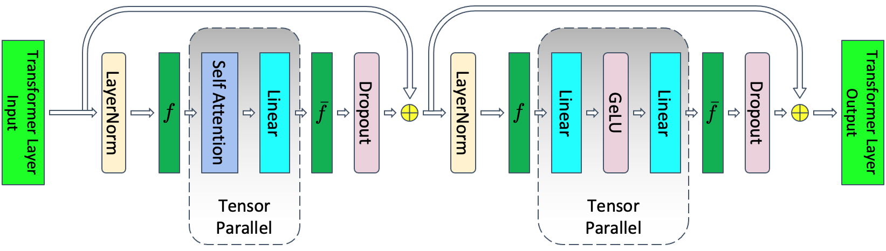
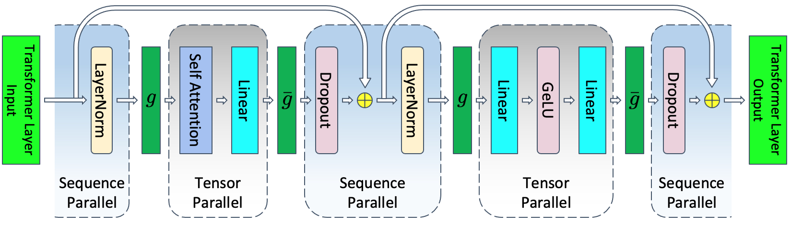
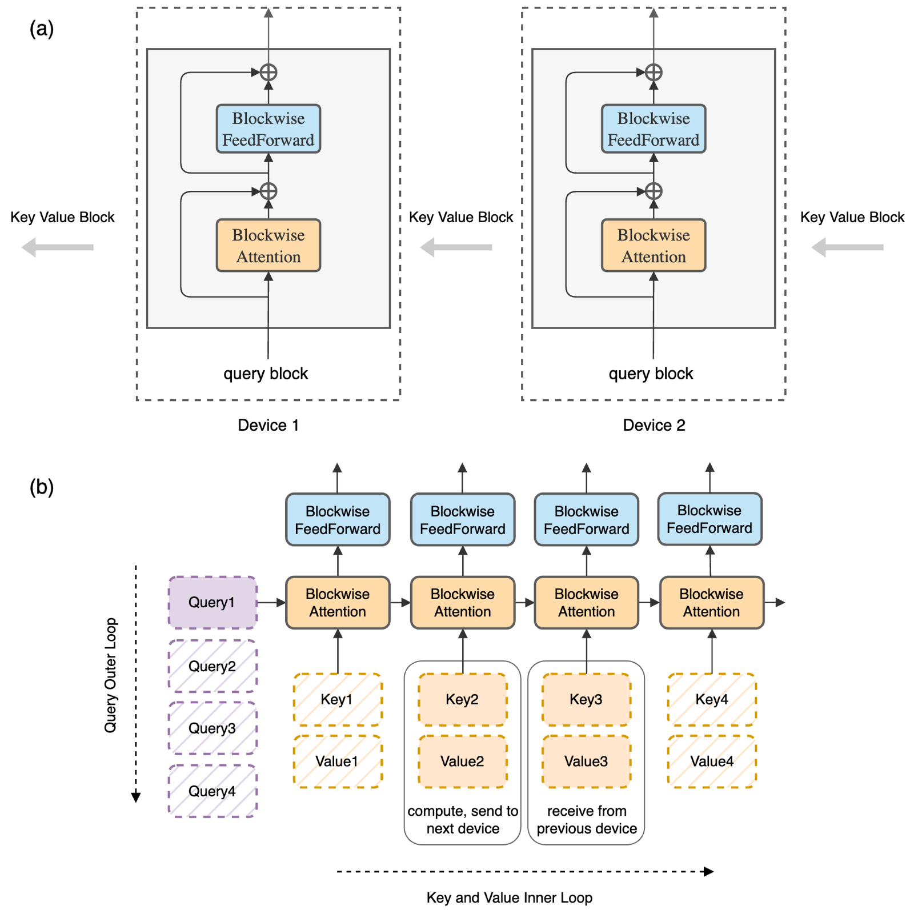
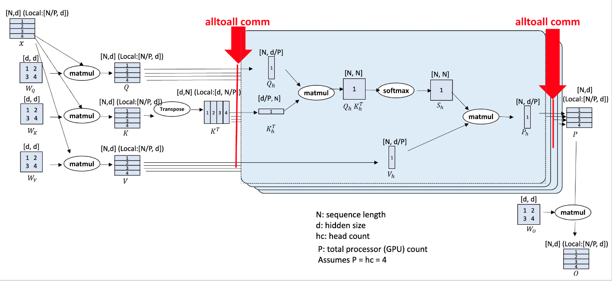
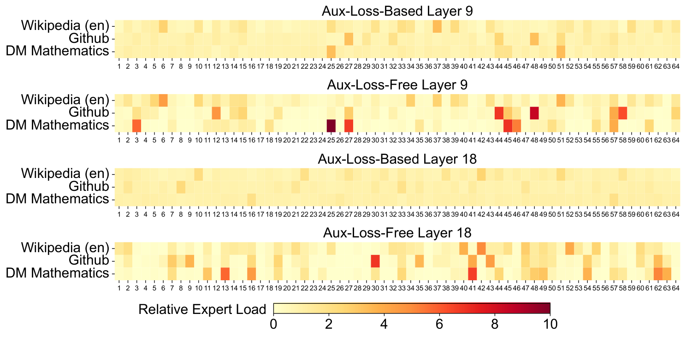

# Parallelism From First Principles: Derivations and Cost Models

## Prerequisites

This chapter assumes you know the transformer math. It does not assume you know systems. If any of the following is new, read it first:

- [Computer architecture](../../foundations/computer-architecture.md) - the GPU memory hierarchy (HBM vs SRAM) and why FLOP/s and bytes/s are separate limits. The roofline argument used throughout this chapter depends on it.
- [Concurrency](../../foundations/concurrency.md) - streams, asynchronous launches and overlap. "Overlap compute with communication" is a concurrency statement, and every cost model below depends on whether the overlap actually happens.
- [Toolkit](../../foundations/toolkit.md) - running commands in a terminal, Python virtual environments, `export` of environment variables. The setup block below uses all three.
- [Networking](../../foundations/networking.md) - latency vs bandwidth, NVLink vs InfiniBand, RDMA, loopback and network interfaces, and [how PyTorch distributed bootstraps](../../foundations/networking.md#how-pytorch-distributed-bootstraps) (rendezvous, `MASTER_ADDR`/`MASTER_PORT`). Every $\beta$ in this chapter is a networking number.
- [Distributed systems](../../foundations/distributed-systems.md) - ranks, process groups, collectives, and why a slow rank stalls everyone.
- [Execution model](../../compute/accelerator/execution-model.md) - GEMMs, [FlashAttention and online softmax](../../compute/accelerator/execution-model.md#flashattention), and reading a profiler trace. The context-parallel section builds on online softmax.
- [Collectives internals](../../network/collectives-internals.md) - the alpha-beta model, ring/tree algorithms, bus bandwidth, bisection bandwidth and oversubscription, and compute-communication overlap. This chapter uses its formulas without re-deriving them.
- [Transformer architectures](../../models/architectures.md) - GQA/MQA, SwiGLU, MoE layers. The head-count constraints and the expert-parallel sections use these details.
- [Training arithmetic](../arithmetic.md) - FLOPs per token and memory per parameter. This chapter uses those results without re-deriving them.

You don't need the Linux/OS chapter, the beyond-transformers chapter, or the cluster chapters (Slurm, Kubernetes) here. Everything runs as local processes on one machine.

This chapter explains what each parallelism technique is, where to get an implementation of it, and what it costs. It builds each technique from scratch in a few dozen lines of `torch.distributed` code that you can run on a laptop, checks that it computes exactly what the unsharded model computes, and then derives what it costs in memory and in bytes moved. The last part uses those formulas to choose a layout for two concrete models. The collective algorithms themselves (ring, tree, NVLS, how NCCL chooses between them) are covered in [collectives internals](../../network/collectives-internals.md). FLOPs-per-token and memory arithmetic for a single model are in [training arithmetic](../arithmetic.md).

Two kinds of numbers appear below. **Measured**: outputs of the scripts in this chapter, run on a MacBook CPU with several processes talking over the loopback network; these check correctness and count bytes, but their timings say nothing about GPUs. **Estimated**: step times and bandwidth costs for H100 clusters, computed from the stated assumptions with the cost-model scripts. None of the H100 numbers is a measured benchmark, and I note where real systems are known to differ.

## Why parallelize, and the map of techniques

Parallelism across accelerators is used for two reasons:

1. **To fit.** A model or a sequence can be bigger than one accelerator's memory. t5-11b is 45 GB in parameters alone (11B × 4 bytes in fp32), before gradients, optimizer state or activations. Llama 3.1 models are trained to a 128K-token context, whose activations alone overflow one GPU.
2. **To go faster.** A run that would take a year on one GPU can finish in hours on thousands.

There are two broad families for training and running models bigger than one accelerator's memory:

- **3D parallelism**: data, tensor and pipeline parallelism combined (the terms were introduced in [Data parallel vs model parallel](../../foundations/distributed-systems.md#data-parallel-vs-model-parallel)). Very network-efficient, but invasive: the modeling code has to be rewritten around it, and it takes a lot more work to get right.
- **ZeRO / FSDP**: shard the training state across data-parallel ranks and reassemble each layer just in time. Much less network-efficient, but needs close to zero changes to the modeling code and is easy to get working.

The techniques, each built and costed later in this chapter:

| Technique | What is split | Where it is covered |
| :-- | :-- | :-- |
| Data parallelism (DP, DDP) | the batch; the model is replicated, gradients are averaged at the end of each step | [Data parallelism (DDP)](#data-parallelism-ddp) |
| ZeRO / FSDP (also called *sharded* or *partitioned* DP) | the batch, plus parameters, gradients and optimizer states sharded across DP ranks and gathered just in time; supports offload to CPU memory or NVMe | [ZeRO and FSDP](#zero-and-fsdp) |
| Tensor parallelism (TP, "horizontal") | every weight matrix; ranks exchange partial activations and gradients inside every layer with all-reduce, all-gather or reduce-scatter (see the [PyTorch TP tutorial](https://docs.pytorch.org/tutorials/intermediate/TP_tutorial.html)) | [Tensor parallelism (Megatron)](#tensor-parallelism-megatron) |
| Pipeline parallelism (PP, "vertical") | the layers; each rank holds a contiguous group of layers and works on a different micro-batch | [Pipeline parallelism](#pipeline-parallelism) |
| Sequence / context parallelism (SP, CP) | the sequence dimension of one sample | [Sequence parallelism and context parallelism](#sequence-parallelism-and-context-parallelism) |
| Expert parallelism (EP) | the experts of a Mixture-of-Experts layer | [Expert parallelism](#expert-parallelism) |

The ZeRO family also reconstructs whole tensors before use, so unlike TP it needs no change to the model. "Sharded DDP" is another name for the core ZeRO idea, used by several implementations.

Most of what follows is PyTorch-specific, but the concepts carry over to other frameworks. The introduction of [Breadth-First Pipeline Parallelism](https://arxiv.org/abs/2211.05953) (Lamy-Poirier, arXiv 2211.05953) is one of the clearest short explanations of the common techniques, and is worth reading alongside this chapter.

## Running the code: many processes on one machine

Distributed training runs one process per GPU. Each process is a *rank*, numbered `0 .. world_size-1`. The processes find each other through a *rendezvous*: rank 0 listens on an address and port, everyone else connects there, and they agree on who is who. After that they talk through a *backend*: NCCL on NVIDIA GPUs, **gloo** on CPUs. Gloo implements the same collectives over ordinary TCP sockets, so the same code runs on a laptop with no GPU at all. That is what every demo in this chapter does. (Launching a process group on one machine is worked through step by step in [collectives internals](../../network/collectives-internals.md#launching-a-process-group-on-one-machine); the TCP rendezvous underneath is in [networking](../../foundations/networking.md#step-1-rendezvous-over-tcp-the-store).)

`torchrun` is the launcher. It starts `--nproc-per-node` copies of your script and sets the environment variables `RANK`, `WORLD_SIZE`, `LOCAL_RANK`, `MASTER_ADDR` and `MASTER_PORT` in each, so that `dist.init_process_group("gloo")` needs no arguments.

Setup used for this chapter (macOS on Apple Silicon, PyTorch 2.15.0, CPU only):

```bash
python3 -m venv /tmp/arith-venv
/tmp/arith-venv/bin/pip install torch numpy
export PATH=/tmp/arith-venv/bin:$PATH
mkdir -p /tmp/par-code && cd /tmp/par-code        # save each script below here
export GLOO_SOCKET_IFNAME=lo0                     # macOS: make gloo use the loopback interface
torchrun --nproc-per-node 4 --master-addr 127.0.0.1 collectives.py
```

On this Mac, leaving out `--master-addr 127.0.0.1` and `GLOO_SOCKET_IFNAME=lo0` made `torchrun` hang until I killed it after 60 s: gloo tried to resolve the machine's hostname to a non-loopback interface (interfaces and hostname resolution: [networking](../../foundations/networking.md#interfaces-and-the-routing-table)). On Linux, `GLOO_SOCKET_IFNAME=lo` does the same job. You will also see harmless warnings about IPv6 address lookups and `OMP_NUM_THREADS`; they are omitted from the outputs below. The outputs are otherwise pasted verbatim. The alternative to `torchrun` is `torch.multiprocessing.spawn(fn, nprocs=N)`, which forks the workers from inside one Python script; you then set `MASTER_ADDR`/`MASTER_PORT` yourself and pass `rank` and `world_size` to `init_process_group`.

## Notation and hardware constants

| Symbol | Meaning |
|---|---|
| $\Psi$ | number of model parameters |
| $N$ | number of ranks in a collective (a *rank* is one process, normally driving one GPU) |
| $M$ | message size in bytes (defined per collective below) |
| $\alpha$ | per-message latency (seconds): fixed startup cost of one send |
| $\beta$ | per-rank bandwidth (bytes/s) in one direction on the slowest link the collective crosses |
| $F$ | achieved FLOP/s per GPU (not peak) |
| $B, T, h$ | micro-batch size (sequences), sequence length, hidden size |
| $L$ | number of transformer layers |
| $t, p, d, c, e$ | tensor-, pipeline-, data-, context-, expert-parallel degree |
| $m$ | number of micro-batches per pipeline per step |

Hardware used in the worked examples. These match H100 SXM specs:

- **HBM** (High Bandwidth Memory, the GPU's on-package DRAM, the memory "GPU memory" usually refers to): 80 GB per H100.
- **NVLink** (NVIDIA's GPU-to-GPU link inside a node, routed through NVSwitch chips so that any GPU can reach any other at full speed): 900 GB/s per GPU *bidirectional*, so $\beta_{\text{nvl}} = 450\ \text{GB/s}$ per direction. Achieved NCCL bus bandwidth is lower. Measure yours with the [network benchmarks](../../network/measuring-and-debugging.md).
- **InfiniBand (IB)** (the inter-node network; each GPU has its own NIC, a network interface card, and talks to it via **RDMA**, remote direct memory access, which means one machine writes directly into another machine's memory without going through either CPU): 400 Gb/s per GPU, so $\beta_{\text{ib}} = 400/8 = 50\ \text{GB/s}$ per direction.
- Dense BF16 peak is 989 TFLOP/s. I assume 40% MFU (model FLOPs utilization: useful model FLOP/s divided by peak, defined in [training arithmetic](../arithmetic.md#mfu-and-hfu-properly)), so $F = 0.4 \cdot 989 \times 10^{12} = 395.6 \times 10^{12}\ \text{FLOP/s}$. This is an assumption, not a measurement.

A **node** here means 8 GPUs sharing one NVLink domain. A **collective** is a communication operation in which every rank of a group takes part, for example all of them summing a tensor together. **NCCL** is NVIDIA's library that implements collectives on GPUs. A **kernel** is a single function launched on the GPU. A **CUDA stream** is an ordered queue of kernels. Kernels on different streams may run concurrently, which is the mechanism behind every "overlap" claim in this chapter (see [multiple streams in PyTorch](../../foundations/concurrency.md#multiple-streams-in-pytorch) and [streams and what "async" means](../../network/collectives-internals.md#streams-and-what-async-means)).

These constants live in one small module that the cost-model scripts below import:

```python
# costmodel.py
# costmodel.py: alpha-beta collective costs and the hardware constants used in this chapter
NVL, IB = 450e9, 50e9                       # bytes/s per GPU per direction: H100 NVLink, 400 Gb/s NIC
F = 0.4 * 989e12                            # achieved FLOP/s per GPU at an assumed 40% MFU
ALPHA = 0.0                                 # set to ~5-20e-6 to include latency; large messages are bandwidth-bound

def t_allreduce(M, N, beta, alpha=ALPHA):   # M = bytes per rank
    return 2 * (N - 1) * alpha + 2 * (N - 1) / N * M / beta

def t_reduce_scatter(M, N, beta, alpha=ALPHA):
    return (N - 1) * alpha + (N - 1) / N * M / beta

t_allgather = t_reduce_scatter              # same cost: M = full gathered size
t_alltoall = t_reduce_scatter               # pairwise exchange, full bisection assumed

if __name__ == "__main__":
    M = 1e9
    for N in (2, 8, 64, 1024):
        print(f"N={N:5d}: all-reduce of 1 GB over IB {t_allreduce(M, N, IB)*1e3:6.1f} ms, "
              f"with alpha=10us {t_allreduce(M, N, IB, 10e-6)*1e3:6.1f} ms")
```

```
$ python costmodel.py
N=    2: all-reduce of 1 GB over IB   20.0 ms, with alpha=10us   20.0 ms
N=    8: all-reduce of 1 GB over IB   35.0 ms, with alpha=10us   35.1 ms
N=   64: all-reduce of 1 GB over IB   39.4 ms, with alpha=10us   40.6 ms
N= 1024: all-reduce of 1 GB over IB   40.0 ms, with alpha=10us   60.4 ms
```

The bandwidth term of an all-reduce barely changes from 8 to 1024 ranks (35 ms to 40 ms for 1 GB), but with a 10 µs per-message latency the 1024-rank ring pays 20 ms of pure latency. That is the next section in one table.

## Collective cost models (alpha-beta, ring)

### What each collective does

Before costs, semantics. Each rank starts with a small tensor, and each collective rearranges or sums those tensors in a different way. Run this with 4 ranks and read the output column by column:

```python
# collectives.py
# collectives.py: run with  torchrun --nproc-per-node 4 --master-addr 127.0.0.1 collectives.py
import torch, torch.distributed as dist

dist.init_process_group("gloo")                      # gloo = CPU backend; on GPUs you'd use "nccl"
r, N = dist.get_rank(), dist.get_world_size()

def show(name, t):                                   # print rank by rank, in order
    for i in range(N):
        if i == r:
            print(f"{name:15s} rank {r}: {t.tolist()}", flush=True)
        dist.barrier()

x = torch.arange(N, dtype=torch.float32) + 10 * r     # (N,) rank r holds [10r, 10r+1, ...]
show("input", x)

ar = x.clone(); dist.all_reduce(ar)                  # every rank: elementwise sum over ranks
show("all_reduce", ar)

rs = torch.empty(1); dist.reduce_scatter_tensor(rs, x.clone())   # rank i: the i-th element of the sum
show("reduce_scatter", rs)

ag = torch.empty(N); dist.all_gather_into_tensor(ag, rs)         # every rank: concatenation of all shards
show("all_gather(rs)", ag)
assert torch.equal(ag, ar)                           # AR == RS followed by AG

a2a = torch.empty(N); dist.all_to_all_single(a2a, x.clone())     # rank i sends its j-th element to rank j
show("all_to_all", a2a)

b = x.clone(); dist.broadcast(b, src=0)              # everyone gets rank 0's tensor
show("broadcast", b)
dist.destroy_process_group()
```

```
$ torchrun --nproc-per-node 4 --master-addr 127.0.0.1 collectives.py
input           rank 0: [0.0, 1.0, 2.0, 3.0]
input           rank 1: [10.0, 11.0, 12.0, 13.0]
input           rank 2: [20.0, 21.0, 22.0, 23.0]
input           rank 3: [30.0, 31.0, 32.0, 33.0]
all_reduce      rank 0: [60.0, 64.0, 68.0, 72.0]
all_reduce      rank 1: [60.0, 64.0, 68.0, 72.0]
all_reduce      rank 2: [60.0, 64.0, 68.0, 72.0]
all_reduce      rank 3: [60.0, 64.0, 68.0, 72.0]
reduce_scatter  rank 0: [60.0]
reduce_scatter  rank 1: [64.0]
reduce_scatter  rank 2: [68.0]
reduce_scatter  rank 3: [72.0]
all_gather(rs)  rank 0: [60.0, 64.0, 68.0, 72.0]
all_gather(rs)  rank 1: [60.0, 64.0, 68.0, 72.0]
all_gather(rs)  rank 2: [60.0, 64.0, 68.0, 72.0]
all_gather(rs)  rank 3: [60.0, 64.0, 68.0, 72.0]
all_to_all      rank 0: [0.0, 10.0, 20.0, 30.0]
all_to_all      rank 1: [1.0, 11.0, 21.0, 31.0]
all_to_all      rank 2: [2.0, 12.0, 22.0, 32.0]
all_to_all      rank 3: [3.0, 13.0, 23.0, 33.0]
broadcast       rank 0: [0.0, 1.0, 2.0, 3.0]
broadcast       rank 1: [0.0, 1.0, 2.0, 3.0]
broadcast       rank 2: [0.0, 1.0, 2.0, 3.0]
broadcast       rank 3: [0.0, 1.0, 2.0, 3.0]
```

- **all-reduce**: everyone ends with the elementwise sum. Used for DDP gradients and tensor-parallel partial sums.
- **reduce-scatter**: the sum is computed, but rank $i$ keeps only the $i$-th slice. Used for sharded gradients (ZeRO, FSDP) and sequence parallelism.
- **all-gather**: every rank contributes a slice and everyone ends with the concatenation. Used to reassemble sharded parameters.
- **all-to-all**: rank $i$ sends its $j$-th slice to rank $j$. It is a distributed transpose. Used for MoE token dispatch and Ulysses attention.
- **broadcast**: rank 0's tensor is copied to everyone. Used at initialization.

The `assert` in the script checks the identity the rest of this chapter leans on: an all-reduce is exactly a reduce-scatter followed by an all-gather. Drawn out:


([source](https://engineering.fb.com/2021/07/15/open-source/fsdp/attachment/fsdp-graph-2a/))

### The ring algorithm, built by hand

The standard way to all-reduce large tensors is the *ring*: arrange the ranks in a circle, cut the tensor into $N$ chunks, and pass chunks to the right neighbour. In $N-1$ steps of "send a chunk, add the one you received" each rank ends up owning the full sum of one chunk (that is a reduce-scatter). In $N-1$ more steps of "send the finished chunk along" everyone gets every finished chunk (that is an all-gather). Each step every rank sends $M/N$ bytes, so the total sent per rank is $2(N-1)/N \cdot M$. Here it is with point-to-point `isend`/`irecv` (`dist.isend(t, dst)` and `dist.irecv(t, src)` start a non-blocking send to or receive from one rank and return a request object whose `.wait()` blocks until the transfer is done; posting the send and the receive before waiting on either is what keeps two neighbours from deadlocking while each waits for the other), checked against `dist.all_reduce` and with the bytes counted:

```python
# ring_allreduce.py
# ring_allreduce.py: torchrun --nproc-per-node 4 --master-addr 127.0.0.1 ring_allreduce.py
import torch, torch.distributed as dist

dist.init_process_group("gloo")
r, N = dist.get_rank(), dist.get_world_size()
right, left = (r + 1) % N, (r - 1) % N
sent = 0                                              # bytes this rank puts on the wire

def ring_step(send_chunk, recv_chunk):
    global sent
    reqs = [dist.isend(send_chunk.contiguous(), right), dist.irecv(recv_chunk, left)]
    for q in reqs:
        q.wait()
    sent += send_chunk.numel() * send_chunk.element_size()

def ring_all_reduce(x):                               # x: (M,) with M divisible by N
    chunks = list(x.view(N, -1).clone())              # N chunks of M/N elements
    buf = torch.empty_like(chunks[0])
    for i in range(N - 1):                            # phase 1, reduce-scatter: after N-1 steps rank r owns sum of chunk (r+1)%N
        s, rcv = (r - i) % N, (r - i - 1) % N
        ring_step(chunks[s], buf)
        chunks[rcv] += buf
    for i in range(N - 1):                            # phase 2, all-gather: circulate the finished chunks
        s, rcv = (r + 1 - i) % N, (r - i) % N
        ring_step(chunks[s], buf)
        chunks[rcv] = buf.clone()
    return torch.cat(chunks)

torch.manual_seed(r)
M = 1 << 20                                           # 1M fp32 elements = 4 MiB per rank
x = torch.randn(M)
mine = ring_all_reduce(x)
ref = x.clone(); dist.all_reduce(ref)
assert torch.allclose(mine, ref, atol=1e-4)
if r == 0:
    nbytes = M * 4
    print(f"ring all-reduce matches dist.all_reduce; rank 0 sent {sent:,} B "
          f"= {sent/nbytes:.3f} x M; formula 2(N-1)/N = {2*(N-1)/N:.3f}")
dist.destroy_process_group()
```

```
$ torchrun --nproc-per-node 4 --master-addr 127.0.0.1 ring_allreduce.py
ring all-reduce matches dist.all_reduce; rank 0 sent 6,291,456 B = 1.500 x M; formula 2(N-1)/N = 1.500
```

The key property is that per-rank traffic is about $2M$ no matter how many ranks there are: each rank only ever talks to its two neighbours, and the work is spread evenly. That is why the bandwidth term below barely depends on $N$.

### The formulas

The derivations are in [collectives internals](../../network/collectives-internals.md). The results for the ring algorithm on $N$ ranks are:

**all-reduce** (every rank ends with the sum of all ranks' $M$-byte buffers):

$$
t_{\text{AR}} = 2(N-1)\cdot\alpha + 2\cdot\frac{N-1}{N}\cdot\frac{M}{\beta}
$$

**reduce-scatter** (input $M$ bytes per rank; rank $i$ ends with the summed $i$-th $1/N$ slice):

$$
t_{\text{RS}} = (N-1)\cdot\alpha + \frac{N-1}{N}\cdot\frac{M}{\beta}
$$

**all-gather** (rank $i$ holds $M/N$; every rank ends with the full $M$ bytes):

$$
t_{\text{AG}} = (N-1)\cdot\alpha + \frac{N-1}{N}\cdot\frac{M}{\beta}
$$

**all-to-all** (rank $i$ sends a distinct $M/N$ slice to each rank $j$; $M$ = rank's total send buffer; pairwise exchange, assumes full bisection bandwidth):

$$
t_{\text{A2A}} \approx (N-1)\cdot\alpha + \frac{N-1}{N}\cdot\frac{M}{\beta}
$$

Three facts are used repeatedly:

1. $\text{AR} = \text{RS} + \text{AG}$, exactly in volume. Every rank sends $2(N-1)/N \cdot M$ bytes for an all-reduce and $(N-1)/N \cdot M$ for each half. This identity drives ZeRO, FSDP and sequence parallelism.
2. The bandwidth term barely depends on $N$, and the latency term grows linearly in $N$. At large $N$ and small $M$, NCCL switches to tree/NVLS algorithms with $O(\log N)$ latency. The bandwidth formulas above remain a good lower bound for large messages.
3. $\beta$ is the bottleneck link. A ring that spans nodes runs at roughly NIC speed (50 GB/s), not NVLink speed, even though most of its hops are intra-node. NCCL runs one ring per NIC in parallel, which is why the per-GPU NIC bandwidth is the right $\beta$.

From here on, "volume" means bytes sent per rank, and I often drop the $(N-1)/N$ factor when $N$ is large.

### Measuring α and β

$\alpha$ and $\beta$ are not datasheet numbers; you measure them by timing a collective at many message sizes and fitting a line. The same procedure works on a laptop over loopback and on a cluster over InfiniBand (with NCCL and GPU tensors instead of gloo and CPU tensors):

```python
# alphabeta.py
# alphabeta.py: torchrun --nproc-per-node 4 --master-addr 127.0.0.1 alphabeta.py
import time, torch, torch.distributed as dist

dist.init_process_group("gloo")
r, N = dist.get_rank(), dist.get_world_size()
sizes = [2**k for k in range(10, 27, 2)]              # 1 KiB .. 64 MiB
times = []
for nbytes in sizes:
    x = torch.ones(nbytes // 4)
    for _ in range(3):
        dist.all_reduce(x)                            # warm-up
    best = float("inf")
    for _ in range(10):
        dist.barrier(); t = time.perf_counter(); dist.all_reduce(x); best = min(best, time.perf_counter() - t)
    times.append(best)

if r == 0:
    # fit t = A + B * M, then map onto the ring model t = 2(N-1)α + 2(N-1)/N · M/β
    X = torch.tensor([[1.0, m] for m in sizes], dtype=torch.float64)
    A, B = torch.linalg.lstsq(X, torch.tensor(times, dtype=torch.float64)[:, None]).solution.flatten().tolist()
    alpha, beta = A / (2 * (N - 1)), 2 * (N - 1) / N / B
    print(f"{'size':>11} {'time':>9} {'busbw':>10}")
    for m, t in zip(sizes, times):
        print(f"{m:>11,} {t*1e6:>7.0f}us {2*(N-1)/N*m/t/1e9:>7.2f}GB/s")
    print(f"fit: alpha = {alpha*1e6:.1f} us per message, beta = {beta/1e9:.2f} GB/s per rank (loopback, gloo, {N} ranks)")
    print(f"half-bandwidth message size M_1/2 = alpha*beta*N = {alpha*beta*N/1e3:.0f} KB")
dist.destroy_process_group()
```

```
$ torchrun --nproc-per-node 4 --master-addr 127.0.0.1 alphabeta.py
       size      time      busbw
      1,024     576us    0.00GB/s
      4,096     580us    0.01GB/s
     16,384     616us    0.04GB/s
     65,536     344us    0.29GB/s
    262,144     348us    1.13GB/s
  1,048,576     550us    2.86GB/s
  4,194,304    1439us    4.37GB/s
 16,777,216    6713us    3.75GB/s
 67,108,864   27174us    3.70GB/s
fit: alpha = 48.9 us per message, beta = 3.76 GB/s per rank (loopback, gloo, 4 ranks)
half-bandwidth message size M_1/2 = alpha*beta*N = 735 KB
```

The shape is what matters, not the loopback numbers. Small messages cost a few hundred microseconds regardless of size ($\alpha$ dominates; the jitter between them is noise on a shared laptop), large messages approach a fixed bandwidth ($\beta$ dominates), and the crossover is $M_{1/2} = N \cdot \alpha \cdot \beta$, the message size at which you get half the peak bandwidth. On an H100 cluster $\alpha$ is a few to tens of microseconds and $\beta$ is tens to hundreds of GB/s, so $M_{1/2}$ is in the MB range. That is why DDP and FSDP group gradients into buckets of tens of MB. "busbw" (bus bandwidth) here is $2(N-1)/N \cdot M / t$, the same normalization `nccl-tests` (NVIDIA's standard collective benchmark, see [collectives internals](../../network/collectives-internals.md#the-same-measurement-on-gpus-nccl-tests-and-torch-dist-bench)) uses ([algbw vs busbw](../../network/collectives-internals.md#algbw-vs-busbw)), so that a perfect ring reports the link bandwidth regardless of $N$. The fit is from one run on a busy laptop, so treat the exact values as an anecdote.

## Data parallelism (DDP)

**DDP** (DistributedDataParallel) keeps a full replica of the model on each of the $d$ ranks, gives each a different slice of the batch, and averages gradients with an all-reduce before the optimizer step. Because the loss is a mean over examples, the average of per-slice gradients equals the full-batch gradient, so every replica takes exactly the step that a single huge GPU would.

PyTorch has two built-in versions. `torch.nn.DataParallel` is the older single-process one: one Python process drives all GPUs from threads, scatters the batch and gathers outputs on GPU 0 every step. [`DistributedDataParallel`](https://docs.pytorch.org/docs/stable/generated/torch.nn.parallel.DistributedDataParallel.html) runs one process per GPU and all-reduces the gradients during `backward`. Use DDP; it is what everything below means by DP, and it is almost trivial to adopt even on 2 GPUs.

### Bucketing and overlap

Gradients become available in roughly reverse layer order during backward. PyTorch DDP:

- Assigns parameters to **buckets**: contiguous flat buffers, `bucket_cap_mb=25` by default, filled in reverse `model.parameters()` order. When you leave `bucket_cap_mb` at its default, the first bucket is capped smaller (1 MiB, `dist._DEFAULT_FIRST_BUCKET_BYTES`, confirmed as 1048576 in torch 2.15) so that the first all-reduce launches early.
- Registers an autograd hook on each parameter. When every gradient in a bucket is ready, it launches an asynchronous all-reduce of that bucket on a separate NCCL stream while backward keeps computing on the compute stream.
- After the first iteration, rebuilds the buckets in the *observed* gradient-ready order (`_rebuild_buckets`). In torch 2.15 the default (no `find_unused_parameters`, no `static_graph`) is to put everything in one bucket for the first iteration and only build real buckets from the observed order; the demo below shows this.
- With `gradient_as_bucket_view=True`, `param.grad` is a view into the bucket, which saves one gradient-sized copy.

The point of bucketing is the $\alpha$ term. One all-reduce per parameter tensor pays $2(N-1)\alpha$ hundreds of times. One all-reduce of the whole model can't start until backward finishes, so nothing overlaps. A bucket of 25 MB is large enough to be bandwidth-bound and small enough to give many overlap opportunities. The exposed communication is the last bucket, plus any part of the total that doesn't fit under backward compute.

Gradient accumulation uses `no_sync()`: skip the all-reduce on the first $k-1$ micro-batches. This costs nothing extra in memory, because the gradients exist anyway.

All three behaviours, observed with a *comm hook* (a function DDP calls once per bucket instead of its built-in all-reduce; here it records the bucket and then does the same all-reduce-and-average):

```python
# ddp_demo.py
# ddp_demo.py: torchrun --nproc-per-node 2 --master-addr 127.0.0.1 ddp_demo.py
import torch, torch.nn as nn, torch.distributed as dist
from torch.nn.parallel import DistributedDataParallel as DDP

dist.init_process_group("gloo")
r, N = dist.get_rank(), dist.get_world_size()

def make_model():
    torch.manual_seed(0)                              # identical init on every rank (DDP also broadcasts rank 0's weights)
    return nn.Sequential(*[nn.Linear(512, 512) for _ in range(8)])   # 8 x 262,656 params = 8.0 MiB fp32 in total

torch.manual_seed(123)
X, Y = torch.randn(16, 512), torch.randn(16, 512)     # global batch, same on all ranks
lo, hi = r * 16 // N, (r + 1) * 16 // N               # each rank takes its slice

buckets = []
def recording_hook(state, bucket):                    # a DDP comm hook: called once per gradient bucket
    buckets.append((bucket.index(), bucket.buffer().numel() * 4 / 2**20, len(bucket.parameters())))
    fut = dist.all_reduce(bucket.buffer(), async_op=True).get_future()
    return fut.then(lambda f: f.value()[0] / N)       # all-reduce, then average, exactly what DDP does by default

model = DDP(make_model(), bucket_cap_mb=2)            # small buckets so a toy model has several
model.register_comm_hook(None, recording_hook)
nn.functional.mse_loss(model(X[lo:hi]), Y[lo:hi]).backward()

ref = make_model()                                    # single process, whole batch
nn.functional.mse_loss(ref(X), Y).backward()
err = max((p.grad - q.grad).abs().max().item() for p, q in zip(model.module.parameters(), ref.parameters()))
if r == 0:
    print(f"max |grad_DDP - grad_full_batch| = {err:.2e}")
    print("iteration 1 buckets (index, MiB, #params):", [(i, round(mb, 2), n) for i, mb, n in buckets])

for it in (2, 3):                                     # buckets are rebuilt after iteration 1 in gradient-ready order
    buckets.clear(); model.zero_grad()
    nn.functional.mse_loss(model(X[lo:hi]), Y[lo:hi]).backward()
    if r == 0:
        print(f"iteration {it} buckets:", [(i, round(mb, 2), n) for i, mb, n in buckets])

# gradient accumulation: no_sync() skips the all-reduce on all but the last micro-batch
buckets.clear()
model.zero_grad()
with model.no_sync():
    nn.functional.mse_loss(model(X[lo:hi]), Y[lo:hi]).backward()
n_sync_off = len(buckets)
nn.functional.mse_loss(model(X[lo:hi]), Y[lo:hi]).backward()
if r == 0:
    print(f"all-reduces during no_sync micro-batch: {n_sync_off}, during the final micro-batch: {len(buckets)}")
dist.destroy_process_group()
```

```
$ torchrun --nproc-per-node 2 --master-addr 127.0.0.1 ddp_demo.py
max |grad_DDP - grad_full_batch| = 4.66e-10
iteration 1 buckets (index, MiB, #params): [(0, 8.02, 16)]
iteration 2 buckets: [(0, 2.0, 4), (1, 2.0, 4), (2, 2.0, 4), (3, 2.0, 4)]
iteration 3 buckets: [(0, 2.0, 4), (1, 2.0, 4), (2, 2.0, 4), (3, 2.0, 4)]
all-reduces during no_sync micro-batch: 0, during the final micro-batch: 4
```

The DDP gradient equals the single-process full-batch gradient to 5e-10 (float rounding from a different summation order). The first iteration ran as one 8 MiB bucket; from iteration 2 the 2 MiB cap produced four buckets of 4 parameters each (the weights and biases of two layers, 2 MiB). Inside `no_sync()` no all-reduce ran at all.

### Communication volume

With $b_g$ bytes per gradient element (2 for bf16 gradients, 4 for fp32 gradients as in classic AMP, automatic mixed precision via `torch.autocast`, with fp32 params; see [mixed precision internals](../arithmetic.md#mixed-precision-internals)), one all-reduce of all gradients per step sends:

$$
V_{\text{DDP}} = 2\cdot\frac{d-1}{d}\cdot b_g\Psi \approx 2\,b_g\Psi \quad \text{bytes per rank per step}
$$

This is independent of batch size and of $d$.

### When is DDP comm-bound?

Let $T_g$ be the tokens each GPU processes per optimizer step. Ignoring attention FLOPs, training compute is $6\Psi$ FLOPs per token (2 forward, 4 backward). See [arithmetic](../arithmetic.md#where-6n-comes-from).

$$
\begin{aligned}
t_{\text{compute}} &= 6\Psi T_g / F \\
t_{\text{backward}} &= 4\Psi T_g / F \\
t_{\text{comm}} &= 2 b_g \Psi / \beta
\end{aligned}
$$

$t_{\text{backward}}$ is the only window into which the all-reduce can overlap.

Comm is fully hidden only if $t_{\text{comm}} \le t_{\text{backward}}$:

$$
\frac{2 b_g \Psi}{\beta} \le \frac{4\Psi T_g}{F} \quad\Longrightarrow\quad T_g \ge \frac{b_g F}{2\beta}
$$

**Ψ cancels.** Whether DDP is comm-bound depends only on tokens per GPU per step, achieved FLOP/s and bandwidth, not on model size. Bigger models need more memory, but they are not more comm-bound under DDP.

```python
# ddp_threshold.py
from costmodel import F, IB, NVL
for name, beta in [("IB", IB), ("NVLink", NVL)]:
    for b_g in (2, 4):
        print(f"{name:6s} grad bytes {b_g}: hide under backward if T_g >= b_g*F/(2*beta) = {b_g*F/(2*beta):,.0f} tokens/GPU/step; "
              f"break-even vs whole step b_g*F/(3*beta) = {b_g*F/(3*beta):,.0f}")
```

```
$ python ddp_threshold.py
IB     grad bytes 2: hide under backward if T_g >= b_g*F/(2*beta) = 7,912 tokens/GPU/step; break-even vs whole step b_g*F/(3*beta) = 5,275
IB     grad bytes 4: hide under backward if T_g >= b_g*F/(2*beta) = 15,824 tokens/GPU/step; break-even vs whole step b_g*F/(3*beta) = 10,549
NVLink grad bytes 2: hide under backward if T_g >= b_g*F/(2*beta) = 879 tokens/GPU/step; break-even vs whole step b_g*F/(3*beta) = 586
NVLink grad bytes 4: hide under backward if T_g >= b_g*F/(2*beta) = 1,758 tokens/GPU/step; break-even vs whole step b_g*F/(3*beta) = 1,172
```

For bf16 gradients ($b_g = 2$), $F = 395.6\ \text{TFLOP/s}$ and $\beta= 50\ \text{GB/s}$, the all-reduce hides under backward only above about 7,912 tokens per GPU per step, and breaks even against the whole step (no overlap) at about 5,275. With fp32 gradient reduction, double these. If the gradient all-reduce stays on NVLink (single node, 450 GB/s), the threshold drops to about 880 tokens. These thresholds assume perfect overlap and full achieved bandwidth. In practice, give yourself 2x headroom.

## ZeRO and FSDP

### The idea on a 3-GPU toy

ZeRO-powered data parallelism (ZeRO-DP) is ordinary DDP, except that instead of every GPU holding the full parameters, gradients and optimizer states, each GPU stores only a slice. When a layer's full parameters are needed, the GPUs send each other the parts they are missing, compute, and throw the borrowed parts away.

Take a model of 3 layers with 3 parameters each. Layer `La` has weights `a0`, `a1`, `a2`:

```
La | Lb | Lc
---|----|---
a0 | b0 | c0
a1 | b1 | c1
a2 | b2 | c2
```

With 3 GPUs, ZeRO (sharded DDP) gives each GPU one row:

```
GPU0:          GPU1:          GPU2:
La | Lb | Lc   La | Lb | Lc   La | Lb | Lc
---|----|---   ---|----|---   ---|----|---
a0 | b0 | c0   a1 | b1 | c1   a2 | b2 | c2
```

Each GPU still gets its own slice of the batch, exactly as in DDP (`x0 => GPU0`, `x1 => GPU1`, `x2 => GPU2`), and the inputs are unmodified: the model code thinks it is running the normal model.

When the inputs reach `La`, GPU0 needs `a0`, `a1` and `a2` but only has `a0`. It receives `a1` from GPU1 and `a2` from GPU2. At the same time GPU1 receives `a0` and `a2`, and GPU2 receives `a0` and `a1`: that exchange is one all-gather. All three now hold the full `La` and run its forward on their own data. As soon as the computation is done the borrowed pieces are dropped. Then the same happens for `Lb` and `Lc` in forward, and for `Lc`, `Lb`, `La` in backward. Implementations prefetch the next layer's pieces while the current layer computes, so the gather overlaps with compute.

An analogy: three hikers share one set of gear. Person A carries the tent, B the stove, C the axe. Each night they share what they have and in the morning each packs up only their own item again. That is ZeRO. DDP is every hiker carrying their own tent, stove and axe.

Note that ZeRO cuts each layer's weights across GPUs, which looks like tensor parallelism's split. The difference is that ZeRO reassembles the whole weight before the matmul, so each GPU runs the full, unmodified matmul on its own data; TP never reassembles, and each GPU runs a slice of the matmul on the same data. Pipeline parallelism instead puts whole layers on different GPUs.

ZeRO comes in three stages, each sharding more of the training state: stage 1 shards the optimizer states, stage 2 also the gradients, stage 3 also the parameters. The walk-through above is stage 3, which is what PyTorch FSDP (Fully Sharded Data Parallel) does in its default `FULL_SHARD` mode. The per-stage memory is next; the stage-level per-GPU code in [The three resources](../../foundations/distributed-systems.md#the-three-resources) computes the same thing.

### Memory per GPU

With Adam and mixed precision, each parameter needs 2 bytes (bf16 weights), 2 bytes (bf16 gradients) and $K = 12$ bytes of optimizer state (fp32 master weights, fp32 momentum, fp32 variance), for 16 bytes in total. See [ZeRO](https://arxiv.org/abs/1910.02054) (Rajbhandari et al., arXiv 1910.02054). The observation behind ZeRO is that under DDP every rank stores and updates an identical copy of all of this. Sharding over $d$ data-parallel ranks means each rank keeps, and updates, only $1/d$ of it:

| Stage | Sharded | Bytes / GPU | 70.55B params, $d=64$ |
|---|---|---|---|
| DDP | nothing | $16\Psi$ | 1128.8 GB |
| ZeRO-1 | optimizer states | $4\Psi+ 12\Psi/d$ | 295.4 GB |
| ZeRO-2 | + gradients | $2\Psi+ 14\Psi/d$ | 156.5 GB |
| ZeRO-3 / FSDP | + parameters | $16\Psi/d$ | 17.6 GB |

```python
# zero_mem.py
def per_gpu_gb(psi, d, stage, K=12):        # bf16 params (2) + bf16 grads (2) + K bytes of optimizer state
    p, g, o = 2 * psi, 2 * psi, K * psi
    if stage >= 1: o /= d
    if stage >= 2: g /= d
    if stage >= 3: p /= d
    return (p + g + o) / 1e9

psi, d = 70.55e9, 64
for st, name in enumerate(["DDP", "ZeRO-1", "ZeRO-2", "ZeRO-3 / FSDP"]):
    print(f"{name:14s} {per_gpu_gb(psi, d, st):7.1f} GB/GPU")
b = 2
print(f"comm per rank per step (bf16): DDP {2*b*psi/1e9:.0f} GB, ZeRO-1/2 {2*b*psi/1e9:.0f} GB, ZeRO-3 {3*b*psi/1e9:.0f} GB")
layer = 855.7e6
print(f"FSDP prefetch buffers for one 70B layer: 2 x params {2*2*layer/1e9:.1f} GB + grads {2*layer/1e9:.1f} GB")
print(f"HSDP shard=8 for 70B: {16*psi/8/1e9:.0f} GB/GPU of states")
```

```
$ python zero_mem.py
DDP             1128.8 GB/GPU
ZeRO-1           295.4 GB/GPU
ZeRO-2           156.5 GB/GPU
ZeRO-3 / FSDP     17.6 GB/GPU
comm per rank per step (bf16): DDP 282 GB, ZeRO-1/2 282 GB, ZeRO-3 423 GB
FSDP prefetch buffers for one 70B layer: 2 x params 3.4 GB + grads 1.7 GB
HSDP shard=8 for 70B: 141 GB/GPU of states
```

The ZeRO stages and what each shards:


([source](https://www.microsoft.com/en-us/research/blog/zero-deepspeed-new-system-optimizations-enable-training-models-with-over-100-billion-parameters/))

These exclude activations, temporary unsharded buffers and fragmentation.

FSDP2's usual setup ($MixedPrecisionPolicy(param_{\text{dtype}}=bf16, reduce_{\text{dtype}}=fp32)$) stores the *sharded* parameter in fp32 and uses it as the master copy. The sharded state is then $4\ (\text{fp32 param}) + 4\ (\text{fp32 grad}) + 8\ (\text{Adam } m, v) = 16\Psi/d$, the same total with a different split. The bf16 copy exists only transiently, in the all-gathered (unsharded) buffer.

### A sharded optimizer step, by hand

The mechanism is short enough to write out. Each rank computes gradients for the full model on its slice of the batch, exactly as in DDP. Then, instead of an all-reduce, a reduce-scatter gives each rank the averaged gradient of only its $1/d$ of the parameters; each rank runs AdamW on that slice only (so Adam's $m$ and $v$ exist only for that slice); and an all-gather puts the updated parameters back together. This is ZeRO-2 (ZeRO-1 differs only in keeping the full gradient buffer around):

```python
# zero_step.py
# zero_step.py: torchrun --nproc-per-node 4 --master-addr 127.0.0.1 zero_step.py
# A ZeRO-2 style step by hand: reduce-scatter grads, AdamW on my shard only, all-gather params.
import torch, torch.nn as nn, torch.distributed as dist

dist.init_process_group("gloo")
r, N = dist.get_rank(), dist.get_world_size()

def make_model():
    torch.manual_seed(0)
    return nn.Sequential(nn.Linear(256, 1024), nn.GELU(), nn.Linear(1024, 256))

torch.manual_seed(1)
X, Y = torch.randn(32, 256), torch.randn(32, 256)            # global batch
lo, hi = r * 32 // N, (r + 1) * 32 // N

model = make_model()
params = list(model.parameters())
numel = sum(p.numel() for p in params)
pad = (-numel) % N                                            # flat buffer must split evenly into N shards
shard = (numel + pad) // N
flat = torch.cat([p.detach().flatten() for p in params] + [torch.zeros(pad)])   # (numel + pad,)
master = flat[r * shard:(r + 1) * shard].clone().requires_grad_()               # (shard,) fp32 master copy of MY shard
opt = torch.optim.AdamW([master], lr=1e-2)                    # Adam m, v exist only for my shard
sent = 0

for step in range(3):
    for p in params:
        p.grad = None
    nn.functional.mse_loss(model(X[lo:hi]), Y[lo:hi]).backward()
    g = torch.cat([p.grad.flatten() for p in params] + [torch.zeros(pad)]) / N    # (numel + pad,) local grad / N
    g_shard = torch.empty(shard)
    dist.reduce_scatter_tensor(g_shard, g)                    # I receive the summed (= averaged) grad of my shard only
    sent += g.numel() * 4 * (N - 1) // N
    master.grad = g_shard
    opt.step()                                                # update 1/N of the parameters
    full = torch.empty(numel + pad)
    dist.all_gather_into_tensor(full, master.detach())        # everyone gets everyone's updated shard
    sent += shard * 4 * (N - 1)
    torch.nn.utils.vector_to_parameters(full[:numel], params)

ref = make_model()                                            # reference: one process, whole batch, plain AdamW
ropt = torch.optim.AdamW(ref.parameters(), lr=1e-2)
for step in range(3):
    ropt.zero_grad()
    nn.functional.mse_loss(ref(X), Y).backward()
    ropt.step()
err = max((p - q).abs().max().item() for p, q in zip(model.parameters(), ref.parameters()))
state = sum(t.numel() * 4 for t in opt.state[master].values() if t.dim() > 0)
if r == 0:
    print(f"params {numel:,}; max |ZeRO - reference| after 3 steps = {err:.2e}")
    print(f"Adam state on this rank: {state:,} B (unsharded would be {8*numel:,} B, ratio 1/{8*numel/state:.0f})")
    print(f"bytes sent per rank per step: {sent/3:,.0f} = {sent/3/(4*numel):.3f} x (4 B x params); "
          f"DDP all-reduce would be 2(N-1)/N = {2*(N-1)/N:.3f}x")
dist.destroy_process_group()
```

```
$ torchrun --nproc-per-node 4 --master-addr 127.0.0.1 zero_step.py
params 525,568; max |ZeRO - reference| after 3 steps = 1.03e-05
Adam state on this rank: 1,051,136 B (unsharded would be 4,204,544 B, ratio 1/4)
bytes sent per rank per step: 3,153,408 = 1.500 x (4 B x params); DDP all-reduce would be 2(N-1)/N = 1.500x
```

After three steps the sharded model matches the single-process reference to 1e-5 (the gradients differ in the last bits because they were summed in a different order, and Adam's normalization amplifies those differences early in training). Each rank holds a quarter of the Adam state, and the bytes sent are exactly those of an all-reduce: $1.5 = 2(N-1)/N$ times the gradient size at $N = 4$. Sharding the optimizer is free in communication.

### Communication volume: why ZeRO-3 is 1.5x DDP

Count bf16 bytes per rank per step, with $b = 2$:

- **DDP**: all-reduce of gradients, $2b\Psi$.
- **ZeRO-1/2**: reduce-scatter the gradients (each rank needs only its gradient shard to update its optimizer shard), $b\Psi$. Then all-gather the updated bf16 parameters, $b\Psi$. Total $2b\Psi$, the same as DDP. This is just the $\text{AR} = \text{RS} + \text{AG}$ identity with the optimizer step inserted in the middle, as measured above.
- **ZeRO-3**: parameters are not resident, so:
  - forward: all-gather each layer's params before use, $b\Psi$
  - backward: all-gather them again, because they were freed after forward, $b\Psi$
  - backward: reduce-scatter gradients, $b\Psi$
  - no final all-gather, because each rank updates only its own shard and the next forward will gather
  - total $3b\Psi = 1.5 \times V_{\text{DDP}}$

Gradient accumulation changes this. ZeRO-3 with `reshard_after_forward=True` repeats the two all-gathers for each micro-batch. If it also reduce-scatters every micro-batch, as it does by default, the cost becomes $3b\Psi\cdot k$ for $k$ micro-batches. With FSDP2 you can trade memory for volume: `reshard_after_forward=False` keeps unsharded params from forward to backward (which is ZeRO-2 behaviour, $2b\Psi$), and `model.set_requires_gradient_sync(False)` on all but the last micro-batch accumulates unsharded gradients locally. The DeepSpeed side of gradient accumulation is in [Inter-node bandwidth for ZeRO: the IDEFICS-80B check](#inter-node-bandwidth-for-zero-the-idefics-80b-check) below.

The comm-bound condition is the same derivation as for DDP, with $3b\Psi$ in place of $2b\Psi$. Forward all-gathers can overlap with forward compute, so the window is the whole step:

$$
\frac{3 b \Psi}{\beta} \le \frac{6\Psi T_g}{F} \quad\Longrightarrow\quad T_g \ge \frac{b F}{2\beta} = \frac{F}{\beta} \approx 7{,}912\ \text{tokens/GPU} \quad (\text{bf16, IB})
$$

### Inter-node bandwidth for ZeRO: the IDEFICS-80B check

ZeRO, whether DeepSpeed ZeRO or PyTorch FSDP, moves much more data across nodes than a TP+PP+DP layout does, and in its plain form it cannot keep that traffic on the faster intra-node links. On a slow inter-node network the expensive GPUs spend much of the step waiting. ZeRO overlaps communication with compute only partly, so the goal is $t_{\text{comm}} \le t_{\text{compute}}$, and in practice $t_{\text{comm}}$ not much larger than $t_{\text{compute}}$.

The byte counts from the previous section, in DeepSpeed terms: ZeRO-3 does an `all_gather` of the weights in `forward`, another in `backward`, and a `reduce_scatter` of the gradients, three collectives each moving the whole model. A 10B model in bf16 under ZeRO-3 therefore sends $10 \times 2 \times 3 = 60$ GB per step. DDP's single `all_reduce` moves 2× the model, $10 \times 2 \times 2 = 40$ GB, and ZeRO-1 (one `reduce_scatter`, one `all_gather`) also sends 40 GB.

A first-order estimate of the two times, in seconds:

$$
t_{\text{comm}} = \frac{\text{comms\_multiplier} \cdot \text{n\_bytes} \cdot \text{model\_size\_in\_B}}{\text{inter\_node\_throughput\_in\_GBps}}
$$

$$
t_{\text{compute}} = \frac{\text{n\_passes} \cdot 2 \cdot \text{model\_size\_in\_B} \cdot \text{seqlen} \cdot \text{global\_batch\_size}}{\text{total\_gpus} \cdot 10^3 \cdot \text{tflops\_wo\_comms}}
$$

- `comms_multiplier` is the sum of the [busbw correction factors](https://github.com/NVIDIA/nccl-tests/blob/master/doc/PERFORMANCE.md#bandwidth) of the collectives in one step: $2(n-1)/n$ for `all_reduce` and $(n-1)/n$ each for `all_gather` and `reduce_scatter`, with $n$ ranks. Dropping the $(n-1)/n$ gives DDP's 2 and ZeRO-3's 3. That is a good approximation for many ranks (0.998 at 512) but optimistic for few (0.875 at 8).
- The throughput must be measured **busbw**, not algbw (both defined in [algbw vs busbw](../../network/collectives-internals.md#algbw-vs-busbw)), since algbw shrinks as ranks are added. Even busbw varies between collectives at the same payload, because NCCL may choose a different algorithm or protocol for each.
- In the compute formula, the 2 is the multiply and the add per parameter per token in a matmul, and `n_passes` is 3 without activation recomputation (1 for forward, 2 for backward, which computes gradients with respect to both inputs and weights) and 4 with it (one extra forward). $3 \times 2 = 6$ is the familiar $6\Psi$ FLOPs per token from [training arithmetic](../arithmetic.md#where-6n-comes-from). It counts only the big matmuls and ignores attention scores, which is fine for a rough check.
- `tflops_wo_comms` is the achievable TFLOPS without communication, not the theoretical peak. For A100 bf16, about 80% of 312, rounded up to 250.

The numbers come from the IDEFICS-80B training run (a [multimodal 80B model](https://huggingface.co/HuggingFaceM4/idefics-80b/) built from a frozen language model and a frozen vision model). With a 340 Gbps AWS EFA v1 network it reached only 90 TFLOPS per A100 with DeepSpeed ZeRO-3, against the 150+ TFLOPS that Megatron-style TP+PP+DP typically reached on the same GPUs. The inputs:

- `model_size_in_B` = 80, `n_bytes` = 2 (bf16)
- `comms_multiplier` = 3 for ZeRO-3/FSDP (2 all-gathers + 1 reduce-scatter), 2 for ZeRO-1. For this run, two effects roughly cancelled. Activation recomputation adds one more all-gather of all weights, and gradients were [reduced in fp32](../arithmetic.md#fp32-accumulation-in-tensor-cores) to avoid NCCL's half-precision accumulation loss, so the reduce-scatter moved 4 bytes, giving a nominal $3 \cdot 2 + 2 = 4 \cdot 2$, about 4.5 counting the extra gather. But more than half the model was frozen, so only about half the gradients were reduced. Net: about 3.
- `n_passes` = 4 (activation recomputation was on), `total_gpus` = 512, `global_batch_size` = 3584, `seqlen` = 1024
- throughput = 42.5 GB/s (340 Gbps), measured with an all-reduce benchmark at a 4 GiB payload (today's version is [torch-dist-bench.py](../../network/benchmarks/torch-dist-bench.py)). The model has 80 layers of about 1B parameters, so each per-layer collective moved about 2 GB in bf16 and 4 GB in fp32, which matches the benchmark payload. **Benchmark at your own layer size.** A 100M-parameter layer moves 0.2 GB in bf16, an order of magnitude smaller, and will likely see lower bandwidth.

```python
# zero_internode.py: first-order ZeRO comms vs compute per step, with the IDEFICS-80B numbers
def comms_s(mult, n_bytes, model_B, GBps):       # mult = sum of collective multipliers per step (DDP 2, ZeRO-3 3)
    return mult * n_bytes * model_B / GBps
def compute_s(n_passes, model_B, seqlen, gbs, gpus, tflops):
    # 2 FLOPs (multiply + add) per parameter per token per matmul pass; passes: fwd 1 + bwd 2 (+1 recompute)
    return n_passes * 2 * model_B * seqlen * gbs / (gpus * 1e3 * tflops)

M, gpus, gbs, seqlen = 80, 512, 3584, 1024
print(f"comms   ZeRO-3, bf16, 42.5 GB/s : {comms_s(3, 2, M, 42.5):5.1f} s")
print(f"compute 4 passes @ 250 TFLOPS   : {compute_s(4, M, seqlen, gbs, gpus, 250):5.1f} s")
print(f"compute 4 passes @  90 TFLOPS   : {compute_s(4, M, seqlen, gbs, gpus, 90):5.1f} s  (logged; measured step ~49 s)")
for name, GBps in [("5x slower", 8.5), ("5x faster", 212)]:
    print(f"comms   ZeRO-3, {name:9s} {GBps:5.1f} GB/s: {comms_s(3, 2, M, GBps):5.1f} s")
print(f"ZeRO-3 GAS=4 comms at 42.5 GB/s : {4 * comms_s(3, 2, M, 42.5):5.1f} s (ZeRO-2/3 repeat per micro-batch; ZeRO-1 does not)")
for n in (8, 512):
    print(f"(n-1)/n dropped by the formula, n={n:3d}: {(n - 1) / n:.3f}")
```

```
$ python zero_internode.py
comms   ZeRO-3, bf16, 42.5 GB/s :  11.3 s
compute 4 passes @ 250 TFLOPS   :  18.4 s
compute 4 passes @  90 TFLOPS   :  51.0 s  (logged; measured step ~49 s)
comms   ZeRO-3, 5x slower   8.5 GB/s:  56.5 s
comms   ZeRO-3, 5x faster 212.0 GB/s:   2.3 s
ZeRO-3 GAS=4 comms at 42.5 GB/s :  45.2 s (ZeRO-2/3 repeat per micro-batch; ZeRO-1 does not)
(n-1)/n dropped by the formula, n=  8: 0.875
(n-1)/n dropped by the formula, n=512: 0.998
```

How to read it:

- **11 s of comms and 18 s of compute** at a realistic 250 TFLOPS add up to 29 s, while the logged step took about 49 s. The estimate is in the right ballpark but leaves about 20 s unexplained, so something else was also a bottleneck. The run is no longer available to investigate. The `DataLoader` was checked and took under 1 s, and hardware latencies are negligible at these payload sizes.
- **51 s at 90 TFLOPS** matches the 49 s measured step, but that is circular: the logged TFLOPS were computed from this very formula. The useful check is the other direction: plug in close-to-peak TFLOPS, and compare the estimate with the measured `forward` + `backward` wall time (which includes whatever comms were not overlapped).
- **The network moves the answer a lot.** At 5× slower (8.5 GB/s, 68 Gbps), comms take 56 s and dominate everything. At 5× faster (212 GB/s, 1700 Gbps), 2 s is negligible, especially once overlapped.
- **Gradient accumulation (GAS)** does not change compute, but under ZeRO-2 and ZeRO-3 the comms repeat per micro-batch: the weights are all-gathered for forward and backward each time, and since there is nowhere to keep partial gradients of the gathered weights, the reduce-scatter runs every micro-batch too. That multiplies $t_{\text{comm}}$ by GAS (45 s at GAS = 4). ZeRO-1 needs no extra comms for GAS > 1. IDEFICS-80B did not use GAS.

The DeepSpeed team [benchmarked a 176B model](https://github.com/deepspeedai/DeepSpeed/issues/2928#issuecomment-1463041491) on 384 V100 GPUs (24 DGX-2 nodes) under ZeRO and found:

| Inter-node InfiniBand | TFLOPS per GPU | Verdict |
| :-- | :-- | :-- |
| 100 Gbps | < 20 | bad |
| 200-400 Gbps | 30-40 | ok |
| 800 Gbps | 40+ | excellent |

V100 peaks at [125 TFLOPS](https://www.nvidia.com/en-gb/data-center/tesla-v100/) in fp16. These are V100 numbers: A100 is about 2-3× faster and H100 about 4-8× faster in half precision (spec sheets claim 3× per generation; users measure at most about 2.5×), so an H100 cluster needs a 4-8× faster network to reach the same verdicts. Newer benchmarks are needed. The same team noticed that the communication overhead is worst with a small micro-batch per GPU, which often cannot be raised because the global batch is fixed for convergence. [ZeRO++](#zero-and-the-global-batch-size-hierarchical-partitioning-zero) addresses that.

Finally, the bandwidth you plug in depends on payload size: larger payloads get better bandwidth. In DeepSpeed the payloads are set by `reduce_bucket_size` (reductions) and `prefetch_bucket_size` (prefetch gathers) in the config. The default of 0.5B parameters is 1 GB in half precision ($0.5 \times 10^9 \times 2$ bytes) and 2 GB in fp32. Run the all-reduce benchmark at that payload and feed the reported busbw into the formula.

### FSDP2 in practice

PyTorch's FSDP2 does all of the above for you. `fully_shard(module, mesh=...)` replaces each parameter of `module` with a `DTensor` (a "distributed tensor": a tensor object that knows its global shape and how it is split across a mesh of ranks) sharded on dim 0. Each `fully_shard`-wrapped module becomes one unit of communication: one all-gather of its parameters before its forward, one reduce-scatter of its gradients after its backward. It runs on CPU with gloo too:

```python
# fsdp2_demo.py
# fsdp2_demo.py: torchrun --nproc-per-node 4 --master-addr 127.0.0.1 fsdp2_demo.py
import torch, torch.nn as nn, torch.distributed as dist
from torch.distributed.device_mesh import init_device_mesh
from torch.distributed.fsdp import fully_shard

dist.init_process_group("gloo")
r, N = dist.get_rank(), dist.get_world_size()
mesh = init_device_mesh("cpu", (N,))

def make_model():
    torch.manual_seed(0)
    return nn.Sequential(nn.Linear(256, 1024), nn.GELU(), nn.Linear(1024, 256))

torch.manual_seed(1)
X, Y = torch.randn(32, 256), torch.randn(32, 256)
lo, hi = r * 32 // N, (r + 1) * 32 // N

model = make_model()
for layer in model:
    if isinstance(layer, nn.Linear):
        fully_shard(layer, mesh=mesh)                         # each Linear is one FSDP unit: one all-gather / reduce-scatter
fully_shard(model, mesh=mesh)
w = model[0].weight
if r == 0:
    print(f"model[0].weight: {type(w).__name__}, global {tuple(w.shape)}, local shard {tuple(w.to_local().shape)}, "
          f"placement {w.placements}")
opt = torch.optim.AdamW(model.parameters(), lr=1e-2)
for step in range(3):
    opt.zero_grad()
    nn.functional.mse_loss(model(X[lo:hi]), Y[lo:hi]).backward()
    opt.step()

ref = make_model()
ropt = torch.optim.AdamW(ref.parameters(), lr=1e-2)
for step in range(3):
    ropt.zero_grad()
    nn.functional.mse_loss(ref(X), Y).backward()
    ropt.step()
err = max((p.full_tensor() - q).abs().max().item() for p, q in zip(model.parameters(), ref.parameters()))
local = sum(p.to_local().numel() for p in model.parameters())
if r == 0:
    print(f"max |FSDP2 - reference| after 3 steps = {err:.2e}; params held on rank 0: {local:,} of "
          f"{sum(q.numel() for q in ref.parameters()):,}")
dist.destroy_process_group()
```

```
$ torchrun --nproc-per-node 4 --master-addr 127.0.0.1 fsdp2_demo.py
model[0].weight: DTensor, global (1024, 256), local shard (256, 256), placement (Shard(dim=0),)
max |FSDP2 - reference| after 3 steps = 1.22e-05; params held on rank 0: 131,392 of 525,568
```

Rank 0 holds 131,392 of 525,568 parameters: a quarter of every weight's rows, plus a quarter of each bias. The trained parameters match the single-process reference.

### Prefetching

FSDP overlaps by running layer $i+1$'s all-gather on a separate stream while layer $i$ computes:

- **Forward prefetch**: issue AG(i+1) before compute(i). FSDP2 does this implicitly, one layer ahead. `module.set_modules_to_forward_prefetch([...])` prefetches more (used in the HSDP demo below).
- **Backward prefetch**: issue AG(i-1) before RS(i), so the next layer's parameters arrive while the current layer's gradients are being reduced (FSDP1 `BackwardPrefetch.BACKWARD_PRE`; FSDP2 has `set_modules_to_backward_prefetch`).
- **Memory cost**: about 2 unsharded layers of bf16 params, plus 1 unsharded layer of gradients during backward. For a 70B Llama layer (855.7M params) that is $2 \cdot 2 \cdot 855.7 \times 10^{6} \approx 3.4\ \text{GB}$ plus about 1.7 GB, which is small next to activations. Deeper prefetch buys more slack for late all-gathers at one layer of memory per step of depth:

```python
# prefetch_mem.py
layer_params, b = 855.7e6, 2                                  # one Llama-3-70B layer, bf16
for depth in (1, 2, 4):                                       # unsharded layers resident: running + prefetched
    params = (depth + 1) * layer_params * b
    print(f"prefetch depth {depth}: unsharded params {params/1e9:.1f} GB + one layer of grads {layer_params*b/1e9:.1f} GB")
```

```
$ python prefetch_mem.py
prefetch depth 1: unsharded params 3.4 GB + one layer of grads 1.7 GB
prefetch depth 2: unsharded params 5.1 GB + one layer of grads 1.7 GB
prefetch depth 4: unsharded params 8.6 GB + one layer of grads 1.7 GB
```


Prefetch depth is limited by memory. Overlap is limited by the CPU: if the Python thread falls behind (too many small modules, CPU-bound launches), the all-gather is issued late and is exposed. This is the most common reason FSDP underperforms its cost model. You can only see it in a GPU profiler trace ([Nsight Systems](../../compute/accelerator/execution-model.md#nsight-systems-where-does-the-time-go), [verifying overlap in a trace](../../network/collectives-internals.md#verifying-overlap-in-a-trace)) (look for all-gather kernels that start after the compute stream goes idle); see [Profiling and optimization](../profiling-and-optimization.md).

### FSDP1 vs FSDP2

| | FSDP1 (`FullyShardedDataParallel`) | FSDP2 (`fully_shard`) |
|---|---|---|
| Unit of sharding | one `FlatParameter` per wrapped module: all params flattened and concatenated, then split into $d$ equal 1-D chunks | each parameter is a `DTensor` sharded on dim 0 (`Shard(0)`) |
| Consequences | a parameter may straddle ranks; per-param attributes (dtype, `requires_grad`, weight decay) need `use_orig_params=True` and are awkward; padding at the end | per-param semantics preserved; frozen params, per-param optimizers, fp8 all-gather are natural |
| Composition with TP | params are already DTensors after TP, so flat-param over DTensor is clumsy | 2-D `DTensor` with placements `(Shard(0) on dp, Shard(k) on tp)` on a 2-D mesh |
| Memory management | `recordStream`-based (`Tensor.record_stream` tells the caching allocator that another CUDA stream still uses a tensor, so the allocator delays reusing its memory until that stream's queued work is done, at a time that depends on GPU progress), which can make memory release non-deterministic | copy-in/copy-out into a per-group flat buffer, deterministic frees |
| Communication | one AG/RS per FlatParameter | one AG/RS per `fully_shard` group (FSDP2 also flattens for the collective, then views back out) |

The "straddle" row, made concrete for a few Llama-8B-shaped parameters on 8 ranks:

```python
# flatparam.py
# flatparam.py: where FSDP1's FlatParameter chunk boundaries fall, vs FSDP2's per-parameter dim-0 sharding
params = {"q.weight": (4096, 4096), "q.bias": (4096,), "norm.weight": (4096,), "mlp.weight": (14336, 4096)}
d = 8
sizes = {n: (s[0] * s[1] if len(s) == 2 else s[0]) for n, s in params.items()}
total = sum(sizes.values()); chunk = -(-total // d)              # FSDP1: flatten, concatenate, split in d equal chunks
start = 0
for n, sz in sizes.items():
    ranks = sorted({(start + i) // chunk for i in (0, sz - 1)})
    print(f"{n:12s} FSDP1 ranks {ranks[0]}..{ranks[-1]}  |  FSDP2 every rank holds rows "
          f"{params[n][0] // d} of {params[n][0]}")
    start += sz
```

```
$ python flatparam.py
q.weight     FSDP1 ranks 0..1  |  FSDP2 every rank holds rows 512 of 4096
q.bias       FSDP1 ranks 1..1  |  FSDP2 every rank holds rows 512 of 4096
norm.weight  FSDP1 ranks 1..1  |  FSDP2 every rank holds rows 512 of 4096
mlp.weight   FSDP1 ranks 1..7  |  FSDP2 every rank holds rows 1792 of 14336
```

Under FSDP1, rank 1 holds the end of `q.weight`, all of `q.bias` and `norm.weight`, and the start of `mlp.weight`, so "apply no weight decay to norms" or "freeze `q`" has to be expressed in terms of slices of one flat buffer. Under FSDP2 every rank holds $1/8$ of the rows of each parameter, as a separate tensor.

Communication volume is identical. The differences are in memory determinism, composability and correctness of per-parameter features. Reference: [PyTorch FSDP](https://arxiv.org/abs/2304.11277) (Zhao et al., arXiv 2304.11277) for FSDP1, [TorchTitan](https://arxiv.org/abs/2410.06511) (Liang et al., arXiv 2410.06511) for FSDP2 in a 4D stack.

### HSDP (hybrid sharding)

Shard within a group of $s$ ranks and replicate across $r = d/s$ groups. Pick $s$ = one node so that the AG/RS traffic stays on NVLink:

$$
\begin{aligned}
\text{memory} &= 16\Psi/s \\
\text{intra-group comm} &= 3 b \Psi\cdot\frac{s-1}{s} \quad \text{over } \beta_{\text{nvl}}\ (\text{AG, AG, RS}) \\
\text{inter-group comm} &= 2 b\cdot\frac{\Psi}{s}\cdot\frac{r-1}{r} \quad \text{over } \beta_{\text{ib}}\ (\text{all-reduce of the gradient shard})
\end{aligned}
$$

```python
# hsdp_cost.py
from costmodel import IB, NVL
psi, b, d, s = 70.55e9, 2, 1024, 8
r = d // s
flat_ib = 3 * b * psi                                          # flat ZeRO-3 over all d ranks crosses IB
intra = 3 * b * psi * (s - 1) / s
inter = 2 * b * (psi / s) * (r - 1) / r
print(f"flat ZeRO-3: {flat_ib/1e9:.0f} GB over IB | HSDP s={s}: {intra/1e9:.0f} GB NVLink + {inter/1e9:.1f} GB IB "
      f"({flat_ib/inter:.1f}x fewer IB bytes) | states {16*psi/s/1e9:.0f} GB/GPU")
print(f"largest model with 16*psi/8 <= 40 GB: {40e9*8/16/1e9:.0f}B params")
```

```
$ python hsdp_cost.py
flat ZeRO-3: 423 GB over IB | HSDP s=8: 370 GB NVLink + 35.0 GB IB (12.1x fewer IB bytes) | states 141 GB/GPU
largest model with 16*psi/8 <= 40 GB: 20B params
```

Inter-node bytes drop by $1.5 \cdot s$ relative to flat ZeRO-3, but memory is only divided by $s$. For a 70B model with $s = 8$, $16 \cdot 70.55 \times 10^{9}/8 = 141\ \text{GB}$, which doesn't fit. HSDP (shard = 8) is a tool for models where $16\Psi/8 = 2\Psi$ bytes fits, roughly $\Psi\lesssim 20\text{B}$ on 80 GB if you leave about half of HBM for activations. For larger models, shrink $\Psi$ per rank with TP/PP first.

In FSDP2, HSDP is just `fully_shard` on a 2-D mesh: the first dimension replicates, the second shards. Four ranks as two "nodes" of two:

```python
# hsdp_demo.py
# hsdp_demo.py: torchrun --nproc-per-node 4 --master-addr 127.0.0.1 hsdp_demo.py
# HSDP: shard inside a group of 2 ranks ("a node"), replicate across 2 groups. Plus explicit forward prefetch.
import torch, torch.nn as nn, torch.distributed as dist
from torch.distributed.device_mesh import init_device_mesh
from torch.distributed.fsdp import fully_shard

dist.init_process_group("gloo")
r = dist.get_rank()
mesh = init_device_mesh("cpu", (2, 2), mesh_dim_names=("replicate", "shard"))   # 2-D mesh -> HSDP
torch.manual_seed(0)
model = nn.Sequential(*[nn.Linear(64, 64) for _ in range(4)])
for layer in model:
    fully_shard(layer, mesh=mesh)
fully_shard(model, mesh=mesh)
for i in range(3):
    model[i].set_modules_to_forward_prefetch([model[i + 1]])  # issue layer i+1's all-gather before layer i runs
w = model[0].weight
torch.manual_seed(1 + r)
model(torch.randn(8, 64)).sum().backward()
g = w.grad.to_local().clone()
shard_group = dist.get_process_group_ranks(mesh["shard"].get_group())
for i in range(4):
    if i == r:
        print(f"rank {r}: placements {w.placements}, local {tuple(w.to_local().shape)} of {tuple(w.shape)}, "
              f"shard group {shard_group}", flush=True)
    dist.barrier()
gathered = [torch.empty_like(g) for _ in range(4)]
dist.all_gather(gathered, g)
if r == 0:
    print("grad shard identical across replicas (rank 0 vs 2, 1 vs 3):",
          torch.allclose(gathered[0], gathered[2]), torch.allclose(gathered[1], gathered[3]))
dist.destroy_process_group()
```

```
$ torchrun --nproc-per-node 4 --master-addr 127.0.0.1 hsdp_demo.py
rank 0: placements (Replicate(), Shard(dim=0)), local (32, 64) of (64, 64), shard group [0, 1]
rank 1: placements (Replicate(), Shard(dim=0)), local (32, 64) of (64, 64), shard group [0, 1]
rank 2: placements (Replicate(), Shard(dim=0)), local (32, 64) of (64, 64), shard group [2, 3]
rank 3: placements (Replicate(), Shard(dim=0)), local (32, 64) of (64, 64), shard group [2, 3]
grad shard identical across replicas (rank 0 vs 2, 1 vs 3): True True
```

The placement `(Replicate(), Shard(dim=0))` says it all: replicated across the outer mesh dimension, sharded across the inner one. Ranks 0 and 2 hold the same shard and, after the cross-replica all-reduce, the same gradient for it, even though they saw different data.

### ZeRO and the global batch size: hierarchical partitioning (ZeRO++)

By default ZeRO spreads one model replica over *all* GPUs. That has two consequences:

1. **The global batch size is inflexible.** It is always $\text{total\_gpus} \times \text{micro\_batch\_size}$. On 1024 GPUs the shards are tiny, so there is plenty of free memory and you might fit a micro-batch of 32, but that gives a global batch of $32 \times 1024 = 32\text{k}$ samples per optimizer step, most likely too large for good convergence. Shrinking the micro-batch keeps the global batch in check, but gives smaller matrices per GPU and less efficient compute.
2. **The fast intra-node links go unused.** Every collective spans all nodes, so the slow inter-node network sets the speed.

[ZeRO++](https://arxiv.org/abs/2306.10209) fixes the second with *hierarchical partitioning* (hpZ): each model replica is restricted to one node, so the two weight `all_gather`s per step run over the intra-node fabric and only the gradient `reduce_scatter` crosses nodes. Memory per GPU grows (the model is sharded over 8 GPUs instead of all of them). The first problem is not directly fixed, since the global batch is unchanged, but each replica runs more efficiently and the extra memory pressure tends to cap the micro-batch size, so throughput should improve overall. This is the same layout as [HSDP](#hsdp-hybrid-sharding) above; in FSDP1 it is [`ShardingStrategy.HYBRID_SHARD`](https://docs.pytorch.org/docs/stable/fsdp.html). The papers: [ZeRO++](https://arxiv.org/abs/2306.10209) and [PyTorch FSDP](https://arxiv.org/abs/2304.11277).

To shrink the global batch on a large cluster, you need another dimension that makes several GPUs cooperate on one sample. [Tensor parallelism](#tensor-parallelism-megatron) is non-trivial to adopt; [sequence parallelism](#sequence-parallelism-and-context-parallelism) is often simpler. The options that pair with ZeRO-style sharding:

- with DeepSpeed ZeRO: [DeepSpeed-Ulysses](#long-sequence-variants-and-implementations)
- [Arctic Long Sequence Training](#long-sequence-variants-and-implementations) (Ulysses for HuggingFace Transformers)
- with FSDP: [Paged Ring Attention](https://github.com/lucidrains/ring-attention-pytorch) ([paper](https://arxiv.org/abs/2402.08268))

These are probably less efficient than TP; how much overhead they add is not something I have measured.

### ZeRO implementations, integrations and papers

Implementations of ZeRO stages 1, 2 and 3:

- [DeepSpeed](https://www.deepspeed.ai/tutorials/zero/)
- [PyTorch FSDP](https://docs.pytorch.org/docs/stable/fsdp.html), originally implemented in [FairScale](https://github.com/facebookresearch/fairscale/) and later upstreamed into PyTorch core
- [torchtitan](https://github.com/pytorch/torchtitan)

DeepSpeed ZeRO is integrated into [HF Trainer](https://huggingface.co/docs/transformers/main_classes/deepspeed), [Accelerate](https://huggingface.co/docs/accelerate/usage_guides/deepspeed), [PyTorch Lightning](https://lightning.ai/docs/pytorch/stable/advanced/model_parallel/deepspeed.html) and [Determined.AI](https://github.com/determined-ai/determined/tree/main/docs/model-dev-guide/api-guides/apis-howto/deepspeed). FSDP is integrated into [HF Trainer](https://huggingface.co/docs/transformers/main/en/fsdp), [Accelerate](https://huggingface.co/docs/accelerate/main/en/usage_guides/fsdp), [PyTorch Lightning](https://lightning.ai/docs/pytorch/stable/advanced/model_parallel/fsdp.html) and [torchtitan](https://github.com/pytorch/torchtitan).

DeepSpeed resources: [GitHub](https://github.com/deepspeedai/DeepSpeed), [usage docs](https://www.deepspeed.ai/getting-started/), [API docs](https://deepspeed.readthedocs.io/en/latest/index.html), [blog posts](https://www.microsoft.com/en-us/research/search/?q=deepspeed).

Papers on DeepSpeed and ZeRO:

- [ZeRO: Memory Optimizations Toward Training Trillion Parameter Models](https://arxiv.org/abs/1910.02054)
- [ZeRO-Offload: Democratizing Billion-Scale Model Training](https://arxiv.org/abs/2101.06840) - optimizer state and update on the CPU
- [ZeRO-Infinity: Breaking the GPU Memory Wall for Extreme Scale Deep Learning](https://arxiv.org/abs/2104.07857) - offload to CPU memory and NVMe
- [ZeRO++: Extremely Efficient Collective Communication for Giant Model Training](https://arxiv.org/abs/2306.10209) - hierarchical partitioning (above), plus quantized communication
- [DeepSpeed Ulysses: System Optimizations for Enabling Training of Extreme Long Sequence Transformer Models](https://arxiv.org/abs/2309.14509)
- [PyTorch FSDP: Experiences on Scaling Fully Sharded Data Parallel](https://arxiv.org/abs/2304.11277)

Published modifications of the ZeRO protocol:

- [MiCS: Near-linear Scaling for Training Gigantic Model on Public Cloud](https://arxiv.org/abs/2205.00119) (2022) - shard within a subgroup and replicate across subgroups, the idea behind HSDP
- [AMSP: Super-Scaling LLM Training via Advanced Model States Partitioning](https://arxiv.org/abs/2311.00257) (2023; an earlier version was titled *AMSP: Reducing Communication Overhead of ZeRO for Efficient LLM Training*) - chooses the sharding degree separately for parameters, gradients and optimizer states

## Tensor parallelism (Megatron)

Reference: [Megatron-LM](https://arxiv.org/abs/1909.08053) (Shoeybi et al., arXiv 1909.08053). The figures in this section are from the follow-up paper, [Efficient Large-Scale Language Model Training on GPU Clusters](https://arxiv.org/abs/2104.04473). DeepSpeed calls the same technique [tensor slicing](https://www.deepspeed.ai/tutorials/large-models-w-deepspeed/).

Data parallelism and ZeRO split the *batch*; every rank still runs every matmul in full. Tensor parallelism (TP) splits the *matmuls themselves*: each rank holds a slice of every weight matrix and computes a slice of every layer's output. That is the only way to make one layer's compute and memory smaller, and the price is communication in the middle of every layer.

### Column and row splits

The basic building block is a linear layer followed by a nonlinearity, $Y = \operatorname{GeLU}(XA)$, with input $X$, output $Y$ and weight $A$. A matrix product splits naturally across GPUs:


Split $A$ by columns across $N$ GPUs and each computes $XA_i$, giving outputs $Y_1, \ldots, Y_N$ that go through `GeLU` independently:


For a 2-layer MLP $Z = \operatorname{act}(XA)\,B$ with $X: (BT, h)$, $A: (h, 4h)$, $B: (4h, h)$:

- **Column-parallel A**: $A = [A_1 \dots A_t]$ split along the output dim. Rank $i$ computes $Y_i = \operatorname{act}(XA_i)$, shape $(BT, 4h/t)$. The activation is elementwise, so no communication is needed (splitting along rows would have required a sum *before* the nonlinearity).
- **Row-parallel B**: $B = [B_1; \dots ; B_t]$ split along the input dim. Rank $i$ computes $Z_i = Y_i B_i$, shape $(BT, h)$, a *partial sum*. $Z = \sum_i Z_i$ requires one all-reduce.

Why the first matmul must be split by columns, in four lines:

```python
# why_columns.py
import torch
torch.manual_seed(0)
X, A = torch.randn(8, 16), torch.randn(16, 64)               # (BT, h), (h, 4h)
gelu = torch.nn.functional.gelu
full = gelu(X @ A)
cols = torch.cat([gelu(X @ A[:, :32]), gelu(X @ A[:, 32:])], dim=1)                 # split output dim
rows = gelu(X[:, :8] @ A[:8]) + gelu(X[:, 8:] @ A[8:])                               # split input dim: partial sums
print(f"column split error {(cols - full).abs().max():.1e} | row split error {(rows - full).abs().max():.1e}")
```

```
$ python why_columns.py
column split error 0.0e+00 | row split error 5.2e+00
```

$\operatorname{gelu}(a + b) \ne \operatorname{gelu}(a) + \operatorname{gelu}(b)$, so a row split of $A$ would force an all-reduce before the activation. A column split hands each rank complete pre-activations for its columns, and the elementwise GELU commutes with the split. Following the column split with a row split lets an MLP of any depth run without synchronization until the very end, where the output is reconstructed from the shards:


Attention works the same way: $W_Q, W_K, W_V$ are column-parallel *by heads* (rank $i$ owns $n_{\text{heads}}/t$ query heads and $n_{\text{kv}}/t$ KV heads), attention is computed locally per head, and $W_O$ is row-parallel. This requires $n_{\text{kv}} \bmod t = 0$, or KV-head replication when $t > n_{\text{kv}}$. Attention is the easiest part to parallelize, because its heads are already independent:


### The f / g conjugate operators

Megatron inserts two autograd functions per block:

- $f$: forward = identity, backward = all-reduce($dX$). It sits at the block input, before the column-parallel GEMM.
- $g$: forward = all-reduce($Z$), backward = identity. It sits at the block output, after the row-parallel GEMM.

Where $f$ and $\bar{f}$ sit in a Megatron TP layer (Korthikanti et al.; the figure's $\bar{f}$ is what this chapter calls $g$):



([source](https://arxiv.org/abs/2205.05198))

Why $f$'s backward is an all-reduce: $X$ feeds every rank's $A_i$, so $dL/dX = \sum_i dY_i A_i^{\top}$, a sum of partials across ranks. Why $g$'s backward is the identity: $Z$ is replicated, and each rank already holds the full $dZ$.

A toy TP MLP on 4 ranks, with $f$ and $g$ written as `torch.autograd.Function`s, checked against the unsharded MLP for both the output and every gradient:

```python
# tp_mlp.py
# tp_mlp.py: torchrun --nproc-per-node 4 --master-addr 127.0.0.1 tp_mlp.py
# Megatron tensor parallelism by hand: column-parallel A, row-parallel B, and the f / g operators.
import torch, torch.distributed as dist

dist.init_process_group("gloo")
r, t = dist.get_rank(), dist.get_world_size()
n_allreduce = {"fwd": 0, "bwd": 0}

class f(torch.autograd.Function):                     # identity forward, all-reduce backward
    @staticmethod
    def forward(ctx, x):
        return x
    @staticmethod
    def backward(ctx, g):
        g = g.clone(); dist.all_reduce(g); n_allreduce["bwd"] += 1
        return g

class g(torch.autograd.Function):                     # all-reduce forward, identity backward
    @staticmethod
    def forward(ctx, z):
        z = z.clone(); dist.all_reduce(z); n_allreduce["fwd"] += 1
        return z
    @staticmethod
    def backward(ctx, grad):
        return grad

BT, h = 64, 128                                       # tokens, hidden; MLP width 4h
torch.manual_seed(0)                                  # same full weights and input on every rank
A_full = torch.randn(h, 4 * h) / h**0.5               # (h, 4h)
B_full = torch.randn(4 * h, h) / (4 * h)**0.5         # (4h, h)
X_full = torch.randn(BT, h)                           # (BT, h)

# unsharded reference
X0, A0, B0 = (T.clone().requires_grad_() for T in (X_full, A_full, B_full))
Z0 = torch.nn.functional.gelu(X0 @ A0) @ B0           # (BT, h)
Z0.square().sum().backward()

# tensor parallel: rank r owns columns r of A and rows r of B
cols = slice(r * 4 * h // t, (r + 1) * 4 * h // t)
A = A_full[:, cols].clone().requires_grad_()          # (h, 4h/t)   column-parallel
B = B_full[cols, :].clone().requires_grad_()          # (4h/t, h)   row-parallel
X = X_full.clone().requires_grad_()                   # (BT, h)     replicated
Y = torch.nn.functional.gelu(f.apply(X) @ A)          # (BT, 4h/t)  no communication: gelu is elementwise
Z_partial = Y @ B                                     # (BT, h)     partial sum
Z = g.apply(Z_partial)                                # (BT, h)     all-reduce -> full output on every rank
Z.square().sum().backward()

checks = {
    "Z": (Z - Z0).abs().max(),
    "dX": (X.grad - X0.grad).abs().max(),
    "dA shard": (A.grad - A0.grad[:, cols]).abs().max(),
    "dB shard": (B.grad - B0.grad[cols, :]).abs().max(),
}
if r == 0:
    print("max abs diff vs unsharded:", {k: f"{v:.1e}" for k, v in checks.items()})
    print(f"all-reduces: forward {n_allreduce['fwd']} (g), backward {n_allreduce['bwd']} (f)")
    print(f"weights per rank: {A.numel() + B.numel():,} of {A_full.numel() + B_full.numel():,}")
dist.destroy_process_group()
```

```
$ torchrun --nproc-per-node 4 --master-addr 127.0.0.1 tp_mlp.py
max abs diff vs unsharded: {'Z': '2.0e-06', 'dX': '4.8e-06', 'dA shard': '9.5e-06', 'dB shard': '2.0e-05'}
all-reduces: forward 1 (g), backward 1 (f)
weights per rank: 32,768 of 131,072
```

Output, input gradient and each rank's weight-gradient shard match the unsharded computation to float32 rounding. Exactly one all-reduce ran in forward ($g$) and one in backward ($f$), and each rank stored a quarter of the weights.

### Exactly which all-reduces happen per layer

A transformer layer has two blocks (attention, MLP), and each block has one $f$ and one $g$:

| Phase | All-reduces | Where |
|---|---|---|
| forward | 2 | $g$ after attention $W_O$, $g$ after MLP $B$ |
| backward | 2 | $f$ before attention QKV, $f$ before MLP $A$ |
| forward recompute (full activation checkpointing: activations are discarded after forward and recomputed in backward; see [what recomputation adds](../arithmetic.md#what-recomputation-adds)) | +2 | the forward $g$s run again |

You don't have to take this on trust. PyTorch's built-in TP (`ColwiseParallel` / `RowwiseParallel` applied with `parallelize_module`) can be inspected with `CommDebugMode`, which counts every collective DTensor issues. Here on a two-block layer, with and without sequence parallelism (next section):

```python
# tp_count.py
# tp_count.py: torchrun --nproc-per-node 2 --master-addr 127.0.0.1 tp_count.py
# Count the collectives that PyTorch's DTensor TP actually issues for one transformer block.
import torch, torch.nn as nn, torch.nn.functional as F, torch.distributed as dist
from torch.distributed.device_mesh import init_device_mesh
from torch.distributed.tensor import Shard, Replicate
from torch.distributed.tensor.debug import CommDebugMode
from torch.distributed.tensor.parallel import (parallelize_module, ColwiseParallel, RowwiseParallel,
                                               SequenceParallel, PrepareModuleInput)

class Block(nn.Module):                                   # attention-free stand-in: two "blocks" = attn-like + MLP
    def __init__(s, h):
        super().__init__()
        s.n1, s.a_in, s.a_out = nn.LayerNorm(h), nn.Linear(h, h, bias=False), nn.Linear(h, h, bias=False)
        s.n2, s.m_in, s.m_out = nn.LayerNorm(h), nn.Linear(h, 4 * h, bias=False), nn.Linear(4 * h, h, bias=False)
    def forward(s, x):                                    # (B, T, h)
        x = x + s.a_out(s.a_in(s.n1(x)))
        return x + s.m_out(F.gelu(s.m_in(s.n2(x))))

dist.init_process_group("gloo")
mesh = init_device_mesh("cpu", (dist.get_world_size(),))
plans = {
    "TP": {"a_in": ColwiseParallel(), "a_out": RowwiseParallel(), "m_in": ColwiseParallel(), "m_out": RowwiseParallel()},
    "TP+SP": {"n1": SequenceParallel(), "n2": SequenceParallel(),
              "a_in": ColwiseParallel(input_layouts=Shard(1)), "a_out": RowwiseParallel(output_layouts=Shard(1)),
              "m_in": ColwiseParallel(input_layouts=Shard(1)), "m_out": RowwiseParallel(output_layouts=Shard(1))},
}
for name, plan in plans.items():
    torch.manual_seed(0)
    blk = parallelize_module(Block(64), mesh, plan)
    x = torch.randn(2, 16 if name == "TP" else 8, 64, requires_grad=True)   # SP: each rank holds T/tp tokens
    with CommDebugMode() as fwd:
        y = blk(x)
    with CommDebugMode() as bwd:
        y.sum().backward()
    if dist.get_rank() == 0:
        c = lambda m: {str(k).split(".")[-1]: v for k, v in m.get_comm_counts().items()}
        print(f"{name:6s} forward {c(fwd)}  backward {c(bwd)}")
dist.destroy_process_group()
```

```
$ torchrun --nproc-per-node 2 --master-addr 127.0.0.1 tp_count.py
TP     forward {'all_reduce': 2}  backward {'all_reduce': 2}
TP+SP  forward {'all_gather_into_tensor': 2, 'reduce_scatter_tensor': 2}  backward {'all_gather_into_tensor': 2, 'reduce_scatter_tensor': 2}
```

Two all-reduces forward and two backward, as in the table. With SP, each all-reduce becomes an all-gather plus a reduce-scatter.

Each all-reduce is over an activation of $B \cdot T \cdot h$ elements, $M = 2BTh$ bytes in bf16. Per layer per rank:

$$
\begin{aligned}
V_{\text{TP}}(\text{layer}) &= 4\cdot 2\,\frac{t-1}{t}\cdot 2BTh = 16\,BTh\,\frac{t-1}{t}\ \text{bytes} \qquad \text{(no recompute)} \\
&= 24\,BTh\,\frac{t-1}{t}\ \text{bytes} \qquad \text{(full recompute)}
\end{aligned}
$$

### Why TP stays inside NVLink

TP communication is on the critical path. $g$'s output is the next block's input, so unless you use async-TP / collective-matmul decomposition ([below](#tp-implementations-and-async-tp), [collectives internals](../../network/collectives-internals.md#async-tp--collective-matmul)), the GPU waits for it. Compare comm time to compute time per layer. For a standard layer with $12h^2$ params, the per-rank FLOPs are $6 \cdot 12h^2 \cdot BT/t$ (forward + backward), so:

$$
\begin{aligned}
\frac{t_{\text{comm}}}{t_{\text{compute}}} &= \frac{16\,BTh\,(t-1)/t \,/\, \beta}{72\,h^2\,BT/(tF)} \\
&= \frac{2(t-1)F}{9h\beta}
\end{aligned}
$$

B and T cancel. The ratio depends only on $t$, $h$ and the ratio of FLOP/s to bandwidth. For $t = 8$, $h = 8192$, $F = 395.6\ \text{TFLOP/s}$:

| Link | $\beta$ | ratio |
|---|---|---|
| NVLink (per direction) | 450 GB/s | $2 \cdot 7 \cdot 395.6 \times 10^{12}/(9 \cdot 8192 \cdot 450 \times 10^{9})$ = **0.167** |
| IB per GPU | 50 GB/s | **1.50** |

The exact computation for Llama-70B layer shapes (855.7M params/layer, GQA, causal attention FLOPs included) at $B=1, T=8192$:

```python
# tp_cost.py
from costmodel import F, IB, NVL, t_allreduce
t, h = 8, 8192
for name, beta in [("NVLink", NVL), ("IB", IB)]:
    print(f"{name:6s}: t_comm/t_compute = 2(t-1)F/(9 h beta) = {2*(t-1)*F/(9*h*beta):.3f}")
print(f"h needed for IB to match the NVLink ratio: {h*NVL/IB:,.0f}")

# exact Llama-3-70B layer at B=1, T=8192
B, T, L = 1, 8192, 80
params_layer = 8192*64*128 + 2*8192*8*128 + 64*128*8192 + 3*8192*28672
M = 2 * B * T * h                                          # one bf16 activation (B, T, h)
ar_nvl, ar_ib = t_allreduce(M, t, NVL), t_allreduce(M, t, IB)
flops_layer = 6 * params_layer * B * T + 6 * T * h * B * T  # matmuls + causal attention (6*s*h per token), fwd+bwd
compute = flops_layer / t / F
print(f"one AR: {2*(t-1)/t*M/1e6:.1f} MB -> {ar_nvl*1e3:.2f} ms NVLink, {ar_ib*1e3:.2f} ms IB")
print(f"4 ARs/layer: {4*ar_nvl*1e3:.2f} ms NVLink, {4*ar_ib*1e3:.1f} ms IB; compute/layer on {t} GPUs {compute*1e3:.1f} ms")
print(f"exposed fraction: NVLink {4*ar_nvl/compute:.0%}, IB {4*ar_ib/compute:.0%}")
```

```
$ python tp_cost.py
NVLink: t_comm/t_compute = 2(t-1)F/(9 h beta) = 0.167
IB    : t_comm/t_compute = 2(t-1)F/(9 h beta) = 1.502
h needed for IB to match the NVLink ratio: 73,728
one AR: 234.9 MB -> 0.52 ms NVLink, 4.70 ms IB
4 ARs/layer: 2.09 ms NVLink, 18.8 ms IB; compute/layer on 8 GPUs 14.3 ms
exposed fraction: NVLink 15%, IB 131%
```

So TP=8 costs about 15% exposed time on NVLink and about 130% over IB. That is the whole argument. It holds for any $h$ you are likely to train: you would need $h \gtrsim 74\text{k}$ to bring cross-IB TP down to the NVLink ratio. On NVL72-class systems (GB200 NVL72: a rack of 72 Blackwell GPUs on one NVLink switch fabric), the NVLink domain is 72 GPUs, and the same formula says TP can go wider. You still pay the $(t-1)/t$ factor and shrinking GEMMs ($h/t$ gets small, efficiency drops). That second effect is not in this model, so measure it.

The practical rule that follows: TP degree ≤ GPUs per NVLink domain. On a node with 4 GPUs the highest sensible TP degree is 4; if you need TP = 8, you need nodes with at least 8 GPUs (or a rack-scale NVLink system).

### TP implementations and async TP

TP combines with every other method in this chapter. Implementations:

- [Megatron-LM](https://github.com/NVIDIA/Megatron-LM) - its own implementation, written per model architecture
- [PyTorch](https://docs.pytorch.org/docs/stable/distributed.tensor.parallel.html) `torch.distributed.tensor.parallel`, the DTensor API used in this chapter
- [torchtitan](https://github.com/pytorch/torchtitan) and [nanotron](https://github.com/huggingface/nanotron) - training stacks built on it
- [SageMaker](https://arxiv.org/abs/2111.05972) - proprietary, AWS only
- [OSLO](https://github.com/eleutherAI/Oslo) - TP for HuggingFace Transformers models

**Async TP.** TP's weak point is that its collectives sit between dependent matmuls, so they are hard to overlap with compute. PyTorch's [Async-TP](https://discuss.pytorch.org/t/distributed-w-torchtitan-introducing-async-tensor-parallelism-in-pytorch/209487) decomposes the dependent all-gather + matmul into a series of `cudaMemcpyAsync` peer copies and smaller partial matmuls that overlap, and `torch.compile` applies it automatically. The mechanism is in [Async TP / collective matmul](../../network/collectives-internals.md#async-tp--collective-matmul). Megatron-LM implements the same idea behind `--tp-comm-overlap`.

Further reading: [Tensor Parallelism and Sequence Parallelism: Detailed Analysis](https://insujang.github.io/2024-01-11/tensor-parallelism-and-sequence-parallelism-detailed-analysis/#sequence-parallelism).

## Sequence parallelism and context parallelism

Some workloads need very long sequences: DNA models train at 256K tokens, and ordinary LLMs are trained on 10K tokens and well beyond. Standard dense self-attention has compute quadratic in sequence length. A kernel that materializes the full sequence-by-sequence score matrix also needs quadratic temporary memory; memory-efficient kernels such as [FlashAttention](https://arxiv.org/abs/2205.14135) (taught in [FlashAttention](../../compute/accelerator/execution-model.md#flashattention)) avoid storing that matrix and keep attention memory linear in sequence length, without removing the quadratic compute.

At long enough sequences even a batch of 1 does not fit on one GPU, so these methods split work along the sequence dimension. That raises the supported length but does not make it unlimited: aggregate memory, compute time, communication and kernel constraints still set a ceiling. Splitting the sequence is orthogonal to the other dimensions, so it combines with all of them (4D layouts, ZeRO-DP + SP, and so on).

Two different things share the name "sequence parallelism". Megatron SP, next, is an add-on to TP that shards only the cheap per-token regions. Context parallelism (CP), after it, shards attention itself and is what DeepSpeed-Ulysses, ring attention and their relatives do; the original papers call several of those "sequence parallelism" too.

### Megatron sequence parallelism (SP)

Reference: [Reducing Activation Recomputation in Large Transformer Models](https://arxiv.org/abs/2205.05198) (Korthikanti et al., arXiv 2205.05198).

With SP, $g$ (all-gather) and $\bar{g}$ (reduce-scatter) replace the all-reduces (these are the figure's names, from the paper: its $g$ is the new $f$ below and its $\bar{g}$ the new $g$), and the norm/dropout regions are sharded along the sequence:



([source](https://arxiv.org/abs/2205.05198))

Under plain TP, LayerNorm, dropout and the residual stream are *replicated* on all $t$ ranks, which is wasted memory. SP shards those regions along the sequence dimension and rewrites the conjugate operators using $\text{AR} = \text{RS} + \text{AG}$:

- $g$ becomes: forward = reduce-scatter along $T$, partials $(B, T, h) \to (B, T/t, h)$; backward = all-gather.
- $f$ becomes: forward = all-gather along $T$, $(B, T/t, h) \to (B, T, h)$; backward = reduce-scatter.

The toy MLP again, now with a LayerNorm in front, the input sharded by tokens, and the two new operators. It matches the unsharded block, and the forward bytes equal exactly one all-reduce:

```python
# sp_mlp.py
# sp_mlp.py: torchrun --nproc-per-node 4 --master-addr 127.0.0.1 sp_mlp.py
# Sequence parallelism: the all-reduce of plain TP becomes all-gather (before A) + reduce-scatter (after B).
import torch, torch.distributed as dist

dist.init_process_group("gloo")
r, t = dist.get_rank(), dist.get_world_size()
sent = {"AG": 0, "RS": 0}

class AllGatherT(torch.autograd.Function):           # forward: (BT/t, h) -> (BT, h); backward: reduce-scatter
    @staticmethod
    def forward(ctx, x):
        out = torch.empty(x.shape[0] * t, x.shape[1]); dist.all_gather_into_tensor(out, x.contiguous())
        sent["AG"] += x.numel() * 4 * (t - 1)
        return out
    @staticmethod
    def backward(ctx, gout):
        g = torch.empty(gout.shape[0] // t, gout.shape[1]); dist.reduce_scatter_tensor(g, gout.contiguous())
        return g

class ReduceScatterT(torch.autograd.Function):       # forward: partial (BT, h) -> summed (BT/t, h); backward: all-gather
    @staticmethod
    def forward(ctx, z):
        out = torch.empty(z.shape[0] // t, z.shape[1]); dist.reduce_scatter_tensor(out, z.contiguous())
        sent["RS"] += z.numel() * 4 * (t - 1) // t
        return out
    @staticmethod
    def backward(ctx, gout):
        g = torch.empty(gout.shape[0] * t, gout.shape[1]); dist.all_gather_into_tensor(g, gout.contiguous())
        return g

BT, h = 64, 128
torch.manual_seed(0)
A_full, B_full = torch.randn(h, 4 * h) / h**0.5, torch.randn(4 * h, h) / (4 * h)**0.5
X_full = torch.randn(BT, h)
ln = torch.nn.LayerNorm(h, elementwise_affine=False)

X0, A0, B0 = (T.clone().requires_grad_() for T in (X_full, A_full, B_full))
Z0 = torch.nn.functional.gelu(ln(X0) @ A0) @ B0       # reference (BT, h)
Z0.square().sum().backward()

rows = slice(r * BT // t, (r + 1) * BT // t)          # my tokens
cols = slice(r * 4 * h // t, (r + 1) * 4 * h // t)    # my MLP columns
X = X_full[rows].clone().requires_grad_()             # (BT/t, h)  sequence-sharded: layernorm runs on 1/t of tokens
A = A_full[:, cols].clone().requires_grad_()
B = B_full[cols].clone().requires_grad_()
Z = ReduceScatterT.apply(torch.nn.functional.gelu(AllGatherT.apply(ln(X)) @ A) @ B)   # (BT/t, h)
Z.square().sum().backward()

d = {"Z": (Z - Z0[rows]).abs().max(), "dX": (X.grad - X0.grad[rows]).abs().max(), "dA": (A.grad - A0.grad[:, cols]).abs().max()}
if r == 0:
    print("max abs diff vs unsharded:", {k: f"{v:.1e}" for k, v in d.items()})
    M = BT * h * 4
    print(f"forward bytes sent: AG {sent['AG']:,} + RS {sent['RS']:,} = {sum(sent.values()):,}; "
          f"one all-reduce of M would be 2(t-1)/t*M = {2*(t-1)*M//t:,}")
dist.destroy_process_group()
```

```
$ torchrun --nproc-per-node 4 --master-addr 127.0.0.1 sp_mlp.py
max abs diff vs unsharded: {'Z': '1.3e-06', 'dX': '4.1e-06', 'dA': '9.5e-06'}
forward bytes sent: AG 24,576 + RS 24,576 = 49,152; one all-reduce of M would be 2(t-1)/t*M = 49,152
```

Forward volume per layer: 2 AG + 2 RS at $(t-1)/t \cdot 2BTh$ each, which equals 2 ARs. Per-layer volume is unchanged. One implementation detail: Megatron-LM keeps only the *sharded* input of a column-parallel linear and re-all-gathers it in backward to compute $dW$, overlapped with the $dX$ GEMM. That is one extra AG per block in backward. I believe this is the current behaviour of `LinearWithGradAccumulationAndAsyncCommunication`, but verify it against your version. PyTorch's DTensor SP does not do this: `tp_count.py` above shows exactly 2 all-gathers in backward (the conjugates of the 2 forward reduce-scatters) and no extra ones. My inference is that DTensor saves the gathered $(B, T, h)$ input for $dW$, which costs $t$ times more activation memory for those tensors than the Megatron scheme. I have not measured the memory directly.

Activation memory per layer (bytes, fp16/bf16 with dropout masks, standard GPT block with a $4h$ MLP, $a$ = heads), from the paper:

$$
\begin{aligned}
\text{no parallelism:} &\quad s\cdot b\cdot h\cdot\left(34 + \frac{5as}{h}\right) \\
\text{TP:} &\quad s\cdot b\cdot h\cdot\left(10 + \frac{24}{t} + \frac{5as}{ht}\right) \\
\text{TP + SP:} &\quad s\cdot b\cdot h\cdot\left(\frac{34}{t} + \frac{5as}{ht}\right)
\end{aligned}
$$

The $5as/h$ term is the materialized $s \times s$ attention score/softmax/dropout. FlashAttention doesn't store it ([execution model](../../compute/accelerator/execution-model.md#flashattention)), so drop the term. At $s = 8192$, $b = 1$, $h = 8192$, $t = 8$:

```python
# sp_mem.py
s, b, h, t = 8192, 1, 8192, 8                               # FlashAttention: drop the 5as/h term
MB = 1e6
print(f"no parallelism: 34*s*h      = {34*s*b*h/MB:.1f} MB/layer")
print(f"TP:             (10+24/t)*s*h = {(10 + 24/t)*s*b*h/MB:.1f} MB/layer")
print(f"TP + SP:        34/t*s*h      = {34/t*s*b*h/MB:.1f} MB/layer")
```

```
$ python sp_mem.py
no parallelism: 34*s*h      = 2281.7 MB/layer
TP:             (10+24/t)*s*h = 872.4 MB/layer
TP + SP:        34/t*s*h      = 285.2 MB/layer
```

The non-shardable "10" term disappears. For SwiGLU/GQA models the constants differ, so treat 34 as approximate; [training arithmetic](../arithmetic.md#measuring-saved-activations-on-a-tiny-model) measures the real coefficient for a Llama block.

### Context parallelism (CP)

CP shards *all* activations along $T$, including inside attention. Every layer except attention is token-local, so only attention communicates. Q is local. Each query block needs all keys and values, subject to the causal mask.

Ring attention passes KV blocks around the ring while each host computes blockwise attention on its query block:



([source](https://arxiv.org/abs/2310.01889))

Ulysses instead uses two all-to-alls to swap the sharded dimension from sequence to heads and back:



([source](https://arxiv.org/abs/2309.14509))

**Ring attention** ([Ring Attention with Blockwise Transformers](https://arxiv.org/abs/2310.01889), Liu et al., arXiv 2310.01889). Rank $i$ holds $Q_i, K_i, V_i$ for $T/c$ tokens. In $c-1$ steps it passes its current KV block to rank $i+1$ (a point-to-point send/recv, P2P for short, not a collective), receives one from $i-1$, and accumulates attention with online softmax:

$$
\text{forward volume/rank} = (c-1)\cdot B\cdot\frac{T}{c}\cdot 2d_{\text{kv}}\cdot b \approx 2BT\,d_{\text{kv}}\,b, \qquad d_{\text{kv}} = n_{\text{kv}}\,d_{\text{head}}
$$

Backward volume per rank is about $2\times$ forward (KV circulates again, plus $dK$, $dV$ circulate back).

*Online softmax* is what makes the blockwise computation exact: keep a running row-max $m$, a running normalizer $l$ and a running unnormalized output, and when a new block raises the max, rescale what you have accumulated by $\exp(m_{\text{old}} - m_{\text{new}})$. This is the same trick FlashAttention uses inside one GPU, derived in [execution model: online softmax](../../compute/accelerator/execution-model.md#online-softmax). The simulation below runs the $c$ ranks in one process (the KV "send" is just indexing a different block), checks the result against PyTorch's causal SDPA (`F.scaled_dot_product_attention` with `is_causal=True`), and counts how much work each rank does under the two token layouts discussed under causal load balancing below:

```python
# ring_attention.py
# ring_attention.py: c "ranks" simulated in one process. Each holds T/c queries; KV blocks travel around the ring.
import torch, torch.nn.functional as F
torch.manual_seed(0)
B, H, T, d, c = 1, 4, 512, 32, 4
q, k, v = (torch.randn(B, H, T, d) for _ in range(3))          # (B, H, T, d)
ref = F.scaled_dot_product_attention(q, k, v, is_causal=True)

def ring_attention(q, k, v, chunks_of):                        # chunks_of[i] = token chunk ids owned by rank i
    n = sum(len(x) for x in chunks_of)
    C = T // n                                                 # chunk length
    idx = lambda ids: torch.cat([torch.arange(j * C, (j + 1) * C) for j in ids])
    out, work = torch.empty_like(q), [0] * c
    for i in range(c):                                         # rank i
        qi_pos = idx(chunks_of[i]); qi = q[:, :, qi_pos]       # (B, H, Tq, d)
        m = torch.full(qi.shape[:-1], float("-inf"))           # running max      (B, H, Tq)
        l = torch.zeros(qi.shape[:-1])                         # running sum      (B, H, Tq)
        acc = torch.zeros_like(qi)                             # running output   (B, H, Tq, d)
        for step in range(c):                                  # step s: rank i holds the KV of rank (i - s) % c
            j = (i - step) % c
            kv_pos = idx(chunks_of[j])
            mask = qi_pos[:, None] >= kv_pos[None, :]          # causal mask for this (Q block, KV block) pair
            if not mask.any():
                continue                                       # fully masked block: skip the compute (still forward the KV)
            work[i] += int(mask.sum())
            s = (qi @ k[:, :, kv_pos].transpose(-1, -2)) / d**0.5    # (B, H, Tq, Tk)
            s = s.masked_fill(~mask, float("-inf"))
            m_new = torch.maximum(m, s.amax(-1))
            p = torch.exp(s - m_new[..., None])
            scale = torch.exp(m - m_new)                       # rescale what we accumulated under the old max
            l = l * scale + p.sum(-1)
            acc = acc * scale[..., None] + p @ v[:, :, kv_pos]
            m = m_new
        out[:, :, qi_pos] = acc / l[..., None]
    return out, work

contig = [[i] for i in range(c)]                               # rank i: chunk i
zigzag = [[i, 2 * c - 1 - i] for i in range(c)]                # rank i: chunks i and 2c-1-i
for name, layout in [("contiguous", contig), ("zigzag", zigzag)]:
    out, work = ring_attention(q, k, v, layout)
    print(f"{name:10s}: max |ring - SDPA causal| = {(out - ref).abs().max():.1e}; "
          f"score elements per rank {work}, max/mean = {max(work) / (sum(work) / c):.3f}")
print(f"formula, contiguous: 2 - 1/c = {2 - 1/c:.3f}")
```

```
$ python ring_attention.py
contiguous: max |ring - SDPA causal| = 4.2e-07; score elements per rank [8256, 24640, 41024, 57408], max/mean = 1.749
zigzag    : max |ring - SDPA causal| = 4.8e-07; score elements per rank [32832, 32832, 32832, 32832], max/mean = 1.000
formula, contiguous: 2 - 1/c = 1.750
```

Overlap condition: step $j$ computes a $(T/c) \times (T/c)$ block, $4 \cdot (T/c)^2 \cdot h$ FLOPs, while sending $2 \cdot (T/c) \cdot d_{\text{kv}} \cdot b$ bytes:

$$
\frac{4\,(T/c)^2\,h}{F} \ge \frac{4\,(T/c)\,d_{\text{kv}}}{\beta} \quad (b = 2) \quad\Longrightarrow\quad \frac{T}{c} \ge \frac{F\,d_{\text{kv}}}{h\beta}
$$

For the 70B ($h = 8192$, $d_{\text{kv}} = 1024$) over IB: $T/c \ge 395.6 \times 10^{12} \cdot 1024/(8192 \cdot 50 \times 10^{9}) \approx 989$ tokens per rank. With MHA ($d_{\text{kv}} = h$) it is $F/\beta\approx 7{,}912$. With GQA, ring CP can cross nodes at modest chunk lengths, and it has no head-count constraint.

**Ulysses** ([DeepSpeed-Ulysses](https://arxiv.org/abs/2309.14509), Jacobs et al., arXiv 2309.14509). Before attention, an all-to-all converts sequence-sharding into head-sharding: $(B, T/c, n_{\text{heads}}, d)$ → $(B, T, n_{\text{heads}}/c, d)$. Full-sequence attention then runs locally on $n_{\text{heads}}/c$ heads, and an all-to-all on O converts back. Per rank, forward:

$$
\text{volume} = \frac{c-1}{c}\cdot B\cdot\frac{T}{c}\cdot(h_q + 2d_{\text{kv}} + h_o)\cdot b
$$

with Q, K, V going in and O coming out, and $h_q = h_o = h$.

Both all-to-alls, on 4 real processes:

```python
# ulysses.py
# ulysses.py: torchrun --nproc-per-node 4 --master-addr 127.0.0.1 ulysses.py
# DeepSpeed-Ulysses: all-to-all from sequence-sharded to head-sharded, full attention locally, all-to-all back.
import torch, torch.nn.functional as F, torch.distributed as dist

dist.init_process_group("gloo")
r, c = dist.get_rank(), dist.get_world_size()
B, H, T, d = 1, 8, 256, 32
torch.manual_seed(0)
q, k, v = (torch.randn(B, T, H, d) for _ in range(3))           # (B, T, H, d) full tensors, identical on all ranks
ref = F.scaled_dot_product_attention(*(x.transpose(1, 2) for x in (q, k, v)), is_causal=True).transpose(1, 2)

def seq_to_heads(x):                                            # (B, T/c, H, d) -> (B, T, H/c, d)
    send = x.reshape(B, T // c, c, H // c, d).permute(2, 0, 1, 3, 4).contiguous()   # (c, B, T/c, H/c, d): piece j goes to rank j
    recv = torch.empty_like(send)
    dist.all_to_all_single(recv, send)                          # recv[j] = rank j's tokens, my heads
    return recv.permute(1, 0, 2, 3, 4).reshape(B, T, H // c, d)

def heads_to_seq(x):                                            # (B, T, H/c, d) -> (B, T/c, H, d)
    send = x.reshape(B, c, T // c, H // c, d).permute(1, 0, 2, 3, 4).contiguous()   # (c, B, T/c, H/c, d): rank j's tokens
    recv = torch.empty_like(send)
    dist.all_to_all_single(recv, send)                          # recv[j] = my tokens, rank j's heads
    return recv.permute(1, 2, 0, 3, 4).reshape(B, T // c, H, d)

mine = slice(r * T // c, (r + 1) * T // c)
ql, kl, vl = (seq_to_heads(x[:, mine].contiguous()) for x in (q, k, v))       # each (B, T, H/c, d)
o = F.scaled_dot_product_attention(*(x.transpose(1, 2) for x in (ql, kl, vl)), is_causal=True).transpose(1, 2)
out = heads_to_seq(o.contiguous())                              # (B, T/c, H, d) my tokens, all heads
err = (out - ref[:, mine]).abs().max()
dist.all_reduce(err, op=dist.ReduceOp.MAX)                     # worst rank
if r == 0:
    print(f"local shapes: in {tuple(q[:, mine].shape)} -> attention on {tuple(ql.shape)} -> out {tuple(out.shape)}")
    print(f"max |Ulysses - full causal attention| over all ranks = {err:.1e}")
dist.destroy_process_group()
```

```
$ torchrun --nproc-per-node 4 --master-addr 127.0.0.1 ulysses.py
local shapes: in (1, 64, 8, 32) -> attention on (1, 256, 2, 32) -> out (1, 64, 8, 32)
max |Ulysses - full causal attention| over all ranks = 0.0e+00
```

The difference is exactly zero because each head's attention is computed by the same kernel on the same numbers; only where it runs changed. The reshapes are the whole trick: before the all-to-all, rank $r$ cuts its $(T/c)$ tokens by head group and sends head group $j$ to rank $j$; after it, rank $r$ holds all $T$ tokens for head group $r$.

Comparison per layer forward, GQA with $h/d_{\text{kv}} = 8$:

$$
\frac{\text{Ulysses}}{\text{Ring}} = \frac{2h + 2d_{\text{kv}}}{c\cdot 2d_{\text{kv}}} = \frac{h + d_{\text{kv}}}{c\,d_{\text{kv}}} = \frac{9}{c}
$$

```python
# cp_cost.py
from costmodel import F, IB
h, d_kv, b = 8192, 1024, 2                                  # Llama-3-70B: 8 KV heads x 128
print(f"ring CP overlap needs T/c >= F*d_kv/(h*beta) = {F*d_kv/(h*IB):,.0f} tokens/rank (GQA), "
      f"{F/IB:,.0f} (MHA)")
B, T, c = 1, 128 * 1024, 8
ring = (c - 1) * B * (T / c) * 2 * d_kv * b                 # forward: K and V blocks passed c-1 times
ulysses = (c - 1) / c * B * (T / c) * (h + 2 * d_kv + h) * b  # Q, K, V in, O out
print(f"T=128k, c=8: ring {ring/1e6:.1f} MB/rank, Ulysses {ulysses/1e6:.1f} MB/rank, ratio {ulysses/ring:.3f}")
for c in (2, 4, 8):
    print(f"causal contiguous split, c={c}: busiest rank does {2 - 1/c:.3f}x the mean")
```

```
$ python cp_cost.py
ring CP overlap needs T/c >= F*d_kv/(h*beta) = 989 tokens/rank (GQA), 7,912 (MHA)
T=128k, c=8: ring 469.8 MB/rank, Ulysses 528.5 MB/rank, ratio 1.125
causal contiguous split, c=2: busiest rank does 1.500x the mean
causal contiguous split, c=4: busiest rank does 1.750x the mean
causal contiguous split, c=8: busiest rank does 1.875x the mean
```

At $T = 128\text{k}$, $c = 8$: ring sends 469.8 MB per rank and Ulysses 528.5 MB (ratio 1.125). With strong GQA, ring sends *fewer* bytes until $c > 9$. With MHA ($d_{\text{kv}} = h$) the ratio is $2/c$, and Ulysses wins for any $c > 2$. This is the regime where the "constant comm volume" claim in the Ulysses paper is most favourable. Other trade-offs:

| | Ring | Ulysses |
|---|---|---|
| head constraint | none | $n_{\text{heads}} \bmod c = 0$ and $n_{\text{kv}} \bmod c = 0$, otherwise replicate KV heads. 70B GQA: $c \le 8$ |
| overlap | natural (P2P overlaps the block compute) | all-to-all is a sync point before/after attention, harder to hide |
| fabric | P2P, tolerates crossing IB | all-to-all wants high bisection, best on NVLink |
| kernel | needs a ring/online-softmax wrapper around flash attention | stock flash attention on full $T$ |

The two compose (2D, or "USP" style, after Unified Sequence Parallelism, which combines them): Ulysses inside the node, ring across nodes.

**Causal load balancing.** With a contiguous split, rank $i$ attends to $i+1$ blocks, so work is proportional to $i + 1/2$ and the last rank does $(c-1/2)/(c/2) = 2 - 1/c$ times the mean: 1.5x at $c = 2$, 1.875x at $c = 8$. Fix (zigzag): cut T into $2c$ chunks and give rank $i$ chunks $i$ and $2c-1-i$. Work becomes $(i+\tfrac{1}{2}) + (2c-1-i+\tfrac{1}{2}) = 2c$, the same on every rank. `ring_attention.py` above measures it: contiguous max/mean 1.749 at $c = 4$ (formula 1.750), zigzag exactly 1.000. Megatron-CP and the Llama 3 CP use this layout. Llama 3 ([The Llama 3 Herd of Models](https://arxiv.org/abs/2407.21783), arXiv 2407.21783) all-gathers K/V instead of ringing them, which is simpler and, with GQA, cheap.

### Long-sequence variants and implementations

**DeepSpeed-Ulysses** ([paper](https://arxiv.org/abs/2309.14509), [blog](https://github.com/deepspeedai/DeepSpeed/tree/master/blogs/deepspeed-ulysses)). Two things are sharded: the attention heads (each GPU owns a few heads, a split decided when the model is created or loaded, somewhat like TP), and the input sequence (each GPU gets a chunk, like ZeRO-3 shards weights but applied to inputs). The DeepSpeed diagram of one layer:


([source](https://github.com/deepspeedai/DeepSpeed/tree/master/blogs/deepspeed-ulysses))

Reading the diagram:

1. The $N$ tokens of the input are partitioned across $P$ devices.
2. Each device projects its $N/P$ tokens to Q, K and V.
3. An [all-to-all](../../network/collectives-internals.md#all-to-all) turns sequence-sharded QKV into head-sharded QKV covering all $N$ tokens.
4. Each device computes ordinary attention for its heads:


5. A second all-to-all turns the head-sharded attention output back into sequence shards ($N/P$ tokens) for the rest of the layer: the MLP matmuls, layer norm, and so on.

Example: 8K tokens, 128 heads, one node of 8 GPUs. Each GPU gets a 1K-token chunk ($8\text{K}/8$) and 16 heads ($128/8$). Before attention, the all-to-all gives each GPU all 8K tokens for its 16 heads, and it computes full 8K attention for those heads. The other 7 GPUs do the same for theirs. The paper's claim is that per-device communication volume stays constant if you add GPUs in proportion to the sequence length ([details](https://github.com/deepspeedai/DeepSpeed/tree/master/blogs/deepspeed-ulysses#significant-communication-volume-reduction)); `cp_cost.py` above shows when that beats ring attention.

**Arctic Long Sequence Training (ALST)** ([paper](https://arxiv.org/abs/2506.13996), [integration guide](https://www.deepspeed.ai/tutorials/ulysses-alst-sequence-parallelism/)) ports Ulysses to HuggingFace Transformers, updates it for modern attention-head layouts (GQA), and pushes sequence length (or batch size) much further by tiling compute and offloading activation checkpoints (the layer inputs kept for recomputing `forward` during `backward`, see [What recomputation adds](../arithmetic.md#what-recomputation-adds)) to CPU memory. Implementations: [ArcticTraining](https://github.com/snowflakedb/ArcticTraining/tree/main/projects/sequence-parallelism) and [Axolotl](https://github.com/axolotl-ai-cloud/axolotl).

**Colossal-AI's sequence parallelism** ([Sequence parallelism: Long sequence training from system perspective](https://arxiv.org/abs/2105.13120)) introduced *Ring Self-Attention* (RSA): queries stay local while keys and values are passed around a ring, so communication is linear in the message size $M$.

**Ring Attention with Blockwise Transformers** ([paper](https://arxiv.org/abs/2310.01889)) is the same ring-passing idea combined with blockwise (FlashAttention-style) computation, the version built in `ring_attention.py` above. "Ring self-attention" and "ring attention" are used interchangeably, so comparisons against RSA (like DistFlashAttn's below) refer to this technique. Step by step: tensors are sharded along the sequence throughout, shape $(\lfloor \text{seq\_len}/N \rfloor, d_{\text{model}})$; each GPU starts on the attention scores it can compute from its own shards; meanwhile keys and values of other chunks travel around the ring; as each new KV block arrives the GPU continues its attention with it, until every block has been seen.

**Megatron-LM's SP** ([paper](https://arxiv.org/abs/2205.05198)) is the TP add-on described [above](#megatron-sequence-parallelism-sp): all-gather and reduce-scatter around the TP region. Its communication volume grows linearly with the message size $M$ regardless of the number of devices. Combining TP and SP in the same process group is what keeps its cost equal to plain TP: TP for the embedding, attention and linear layers, SP for the dropout and layer-norm regions.

**DistFlashAttn** ([DISTFLASHATTN: Distributed Memory-efficient Attention for Long-context LLMs Training](https://arxiv.org/abs/2310.03294)) is reported to be many times faster than ring self-attention, because it balances the per-token Q/K/V work between workers (the causal imbalance computed above) and overlaps communication with compute:


([source](https://arxiv.org/abs/2310.03294))

Implementations of SP/CP: [Megatron-LM](https://github.com/NVIDIA/Megatron-LM), [DeepSpeed](https://github.com/deepspeedai/DeepSpeed), [Colossal-AI](https://colossalai.org/), and [torchtitan](https://github.com/pytorch/torchtitan), which uses PyTorch's own *Context Parallel* (CP) API. [Ring attention and context parallelism](../../models/beyond-transformers.md#ring-attention-and-context-parallelism) places these among the other long-context techniques. Further reading: [Tensor Parallelism and Sequence Parallelism: Detailed Analysis](https://insujang.github.io/2024-01-11/tensor-parallelism-and-sequence-parallelism-detailed-analysis/#sequence-parallelism).

## Pipeline parallelism

Split $L$ layers into $p$ stages, and split the per-replica batch into $m$ micro-batches. Each stage lives on a different device (or TP group); a micro-batch's activations flow forward through the stages and its gradients flow back. In this section only, $F$, $B$, $W$ (not FLOP/s and batch size) denote per-micro-batch per-stage times for forward, backward-for-inputs and backward-for-weights. Normalize to $F = 1$, $B_{\text{full}} = B + W = 2$.

### From naive model parallelism to a pipeline

The simplest way to split a model by layers is *naive* (vertical) model parallelism: move groups of layers to different devices with `.to()`, and move the activations to the next device at each boundary. For an 8-layer model on 2 GPUs:

```
===================  ===================
|  0 | 1 | 2 | 3  |  |  4 | 5 | 6 | 7  |
===================  ===================
        gpu0                 gpu1
```

Layers 0 to 3 run as normal on GPU0. Between layer 3 and 4 the activations are copied to GPU1, which is fast inside one node and much slower across nodes. After layer 7 the output has to meet the labels (send it back to the device holding the labels, or send the labels to the last device), then the loss and optimizer run.

Its problems:

- **Only one GPU works at a time.** With 4 GPUs it is roughly one GPU with 4× the memory, plus copying overhead. Four 6 GB cards hold about as much layer state as one 24 GB card, and the single card trains faster because it never copies between devices. Naive MP is a capacity technique: it makes a model fit when its layer state exceeds one GPU, provided each partition and its activations fit on its GPU.
- **Shared (tied) embeddings** may have to be copied back and forth between the first and last device.

Pipeline parallelism fixes the idling by cutting the batch into micro-batches so that different stages work on different micro-batches at the same time. The idle time that remains is the *bubble*. PyTorch calls the number of micro-batches `chunks`; DeepSpeed calls it GAS (gradient accumulation steps), since running $m$ micro-batches through forward and backward and summing their gradients before one optimizer step is exactly gradient accumulation (see the `no_sync()` paragraph in [Bucketing and overlap](#bucketing-and-overlap)).

Batch sizes then nest three deep. DP splits the global batch into one mini-batch per replica, and PP splits each mini-batch into micro-batches. With DP = 4, a global batch of 1024 gives mini-batches of 256; with `chunks` = 32 each micro-batch has 8 samples, and each stage works on one micro-batch at a time. Conversely $\text{global batch} = \text{mbs} \times \text{chunks} \times \text{dp} = 8 \times 32 \times 4 = 1024$. `chunks = 1` is naive MP. A very large `chunks` gives tiny micro-batches whose matmuls run inefficiently, so the right value is found by experiment: the goal is the highest utilization of all GPUs, i.e. the smallest bubble at an acceptable micro-batch size.

Schedules, in order of invention (each is analysed below):

- sequential, [GPipe](https://arxiv.org/abs/1811.06965)
- 1F1B (one-forward-one-backward: once the pipeline is full, each stage alternates one micro-batch's `forward` with another's `backward`), from [PipeDream](https://arxiv.org/abs/1806.03377)
- looped, depth-first (interleaved 1F1B), [Megatron-LM 2021](https://arxiv.org/abs/2104.04473)
- looped, breadth-first, [Breadth-First Pipeline Parallelism](https://arxiv.org/abs/2211.05953)
- Llama 3 combined depth-first and breadth-first ordering, and could change the global batch size during training, which is normally very hard with PP ([The Llama 3 Herd of Models](https://arxiv.org/abs/2407.21783), section 3.3.2)
- zero-bubble schedules and DeepSeek-V3's DualPipe

The simulator below makes every claim in this section checkable. It is a unit-time list scheduler: each device has an ordered list of operations; at each time step a device starts its next operation if that operation's input is ready (the forward of the previous stage, or the backward of the next stage), and otherwise idles. For zero-bubble schedules, an idle device may instead run a deferred weight-gradient $W$. It prints one row per device: digits are forward passes of micro-batch `0..7`, lowercase letters are backward passes (`a` = micro-batch 0), uppercase letters are $W$ passes, `.` is idle (the *bubble*).

```python
# pp_sim.py
# pp_sim.py: a unit-time pipeline-schedule simulator. Prints the timeline, bubble and peak activation memory.
from string import ascii_lowercase, ascii_uppercase

def orders(kind, p, m, v=1):
    """Per-device ordered list of ("F"|"B", mb, chunk). W ops (ZB) are added greedily by the simulator."""
    out = []
    for i in range(p):
        F = lambda mb, c=0: ("F", mb, c)
        Bk = lambda mb, c=0: ("B", mb, c)
        if kind == "gpipe":
            seq = [F(j) for j in range(m)] + [Bk(j) for j in range(m)]
        elif kind in ("1f1b", "zb-h1"):
            w = min(p - 1 - i, m)                                   # warm-up forwards
            seq = [F(j) for j in range(w)]
            for j in range(m - w):
                seq += [F(w + j), Bk(j)]                            # steady state: one forward, one backward
            seq += [Bk(j) for j in range(m - w, m)]                 # cool-down
        elif kind == "interleaved":                                 # Megatron-LM interleaved 1F1B, needs m % p == 0
            fk = lambda k: ((k // (p * v)) * p + k % p, (k // p) % v)
            bk = lambda k: ((k // (p * v)) * p + k % p, v - 1 - (k // p) % v)
            total = m * v
            w = min((p - 1 - i) * 2 + (v - 1) * p, total)
            seq = [F(*fk(k)) for k in range(w)]
            for k in range(total - w):
                seq += [F(*fk(w + k)), Bk(*bk(k))]
            seq += [Bk(*bk(k)) for k in range(total - w, total)]
        out.append(seq)
    return out

def simulate(kind, p, m, v=1, tF=1, tB=2, tW=0):
    """Durations in integer time units for one chunk (= 1/v of a stage). zb-h1 splits B into B (dX) and W (dW)."""
    seqs = orders(kind, p, m, v)
    S = p * v                                                       # virtual stages; stage s lives on device s % p
    done = {}                                                       # (op, stage, mb) -> finish time
    busy_until, ptr, pend_w = [0] * p, [0] * p, [[] for _ in range(p)]
    live, peak = [0] * p, [0] * p                                   # activations held, in units of one chunk's micro-batch
    rows = [[] for _ in range(p)]
    t = 0
    while any(ptr[i] < len(seqs[i]) or pend_w[i] for i in range(p)) or any(b > t for b in busy_until):
        for i in range(p):
            if busy_until[i] > t:
                continue
            op = None
            if ptr[i] < len(seqs[i]):
                kind_, mb, c = seqs[i][ptr[i]]
                s = c * p + i
                if kind_ == "F":
                    dep = ("F", s - 1, mb) if s > 0 else None
                else:
                    dep = ("B", s + 1, mb) if s < S - 1 else ("F", s, mb)
                mem_full = kind == "zb-h1" and kind_ == "F" and live[i] >= p and pend_w[i]
                if (dep is None or done.get(dep, 10**9) <= t) and not mem_full:
                    op = (kind_, s, mb); ptr[i] += 1        # ZB-H1: a new F waits for a W once p micro-batches are live (1F1B's peak, on dev0)
            if op is None and pend_w[i]:
                op = pend_w[i].pop(0)                                # fill the gap with a deferred weight-gradient
            if op is None:
                rows[i].append("."); continue
            k_, s, mb = op
            dur = {"F": tF, "B": tB, "W": tW}[k_]
            done[op] = t + dur; busy_until[i] = t + dur
            sym = {"F": str(mb % 10), "B": ascii_lowercase[mb % 26], "W": ascii_uppercase[mb % 26]}[k_]
            rows[i] += [sym] * dur
            if k_ == "F":
                live[i] += 1; peak[i] = max(peak[i], live[i])
            elif k_ == "W" or (k_ == "B" and tW == 0):
                live[i] -= 1                                        # activations freed once dW is done
            if k_ == "B" and tW:
                pend_w[i].append(("W", s, mb))
        t += 1
    T = max(busy_until)
    work = m * v * (tF + tB + tW)
    return rows, T, 1 - work / T, [pk / v for pk in peak]

def show(kind, p, m, v=1, **kw):
    rows, T, bub, peak = simulate(kind, p, m, v, **kw)
    print(f"{kind} p={p} m={m} v={v}: step {T} units, bubble {bub:.1%}, peak activations (micro-batches of a full stage) {peak}")
    for i, row in enumerate(rows):
        print(f"  dev{i} " + "".join(row).ljust(T, "."))

if __name__ == "__main__":
    p, m = 4, 8
    show("gpipe", p, m)                                               # F=1, B=2
    show("1f1b", p, m)
    show("interleaved", p, m, v=2, tF=1, tB=2)                        # chunk F = 1/v of a stage: scale units by v
    show("zb-h1", p, m, tF=1, tB=1, tW=1)                             # B split into B (dX) and W (dW)
    print("formulas for p=4, m=8: (p-1)/(m+p-1) =", f"{(p-1)/(m+p-1):.1%}", "| interleaved (p-1)/(vm+p-1) =",
          f"{(p-1)/(2*m+p-1):.1%}", "| ZB-H1 (p-1)(F+B-W)/T =", f"{(p-1)/(3*m+p-1):.1%}")
    print("\np=16, m=64 (no timeline):")
    for kind, v, kw in [("1f1b", 1, {}), ("interleaved", 2, {}), ("interleaved", 4, {}), ("zb-h1", 1, dict(tF=1, tB=1, tW=1))]:
        _, T, bub, peak = simulate(kind, 16, 64, v, **kw)
        print(f"  {kind:11s} v={v}: bubble {bub:.1%}, peak activations on dev0 {peak[0]:.2f} micro-batches")
```

```
$ python pp_sim.py
gpipe p=4 m=8 v=1: step 33 units, bubble 27.3%, peak activations (micro-batches of a full stage) [8.0, 8.0, 8.0, 8.0]
  dev0 01234567.........aabbccddeeffgghh
  dev1 .01234567......aabbccddeeffgghh..
  dev2 ..01234567...aabbccddeeffgghh....
  dev3 ...01234567aabbccddeeffgghh......
1f1b p=4 m=8 v=1: step 33 units, bubble 27.3%, peak activations (micro-batches of a full stage) [4.0, 3.0, 2.0, 1.0]
  dev0 0123......aa4bb5cc6dd7ee.ff.gg.hh
  dev1 .012....aa3bb4cc5dd6ee7ff.gg.hh..
  dev2 ..01..aa2bb3cc4dd5ee6ff7gg.hh....
  dev3 ...0aa1bb2cc3dd4ee5ff6gg7hh......
interleaved p=4 m=8 v=2: step 57 units, bubble 15.8%, peak activations (micro-batches of a full stage) [5.5, 4.5, 3.5, 2.5]
  dev0 01230123456...aa7bb.4cc5dd6aa7bbcc.dd.ee.ff.gg.hheeffgghh
  dev1 .012301234..aa5bb6cc7dd4aa5bb6cc7dd.ee.ff.gg.hheeffgghh..
  dev2 ..0123012.aa3bb4cc5dd6aa7bb4cc5dd6ee7ff.gg.hheeffgghh....
  dev3 ...01230aa1bb2cc3dd4aa5bb6cc7dd4ee5ff6gg7hheeffgghh......
zb-h1 p=4 m=8 v=1: step 27 units, bubble 11.1%, peak activations (micro-batches of a full stage) [4.0, 4.0, 4.0, 4.0]
  dev0 0123...aA4bB5cC6dD7eEfFgGhH
  dev1 .012..a3bA4cB5dC6eD7fEgFhGH
  dev2 ..01.a2b3cA4dB5eC6fD7gEhFGH
  dev3 ...0a1b2c3dA4eB5fC6gD7hEFGH
formulas for p=4, m=8: (p-1)/(m+p-1) = 27.3% | interleaved (p-1)/(vm+p-1) = 15.8% | ZB-H1 (p-1)(F+B-W)/T = 11.1%

p=16, m=64 (no timeline):
  1f1b        v=1: bubble 19.0%, peak activations on dev0 16.00 micro-batches
  interleaved v=2: bubble 10.5%, peak activations on dev0 23.50 micro-batches
  interleaved v=4: bubble 5.5%, peak activations on dev0 19.75 micro-batches
  zb-h1       v=1: bubble 7.2%, peak activations on dev0 16.00 micro-batches
```

### GPipe and 1F1B: the bubble

GPipe ([arXiv 1811.06965](https://arxiv.org/abs/1811.06965)) runs all $m$ forwards, then all $m$ backwards. Stage $p-1$ can't start until micro-batch 0 has passed $p-1$ stages, and the drain is symmetric. The critical path is:

$$
\begin{aligned}
t_{\text{total}} &= (m + p - 1)\cdot(t_F + t_B) \\
t_{\text{useful}} &= m\cdot(t_F + t_B) \\
\text{bubble fraction (of total)} &= \frac{p-1}{m+p-1} \\
\text{bubble / ideal} &= \frac{p-1}{m}
\end{aligned}
$$

The bubble, from the GPipe paper:


([source](https://arxiv.org/abs/1811.06965); see also Google's [GPipe announcement](https://research.google/blog/introducing-gpipe-an-open-source-library-for-efficiently-training-large-scale-neural-network-models/))

Both halves show a pipeline of degree 4: forward stages F0 to F3, then backward stages in reverse, B3 to B0. The top half is naive model parallelism ($m = 1$). The bottom half uses `chunks` = 4: $F_{i,j}$ is stage $i$ running micro-batch $j$, so GPU0 runs $F_{0,0}, F_{0,1}, F_{0,2}, F_{0,3}$, waits while the other stages work, and only then runs the backwards in reverse order, $B_{0,3}, B_{0,2}, B_{0,1}, B_{0,0}$. The empty cells are the bubble.

1F1B (PipeDream-Flush, [arXiv 2006.09503](https://arxiv.org/abs/2006.09503)) reorders the same work. After $p - i$ warm-up forwards, stage $i$ alternates one forward and one backward. The bubble is *identical*, $(p-1)/(m+p-1)$, because the critical path still contains $p-1$ fills and drains. What changes is memory:

| Schedule | Micro-batches of activations in flight on stage 0 |
|---|---|
| GPipe | $m$ |
| 1F1B | $p$ (stage $i$ holds $p - i$) |

The simulator output shows both: GPipe and 1F1B both take 33 units with a 27.3% bubble at $p = 4, m = 8$, matching $3/11$, but GPipe holds 8 micro-batches of activations on every device while 1F1B holds `[4, 3, 2, 1]`. So 1F1B lets you raise $m$ to shrink the bubble without raising memory.

SageMaker's documentation calls this backward-first ordering an "interleaved pipeline" (not to be confused with the interleaved stages of the next section). DeepSpeed and SageMaker both use it:


(from the SageMaker model parallelism documentation)

### Interleaved 1F1B

[Megatron-LM 2021](https://arxiv.org/abs/2104.04473) (Narayanan et al., arXiv 2104.04473). Each device owns $v$ non-contiguous chunks of $L/(pv)$ layers. A chunk's F/B takes $1/v$ of a stage's time, and the fill/drain still crosses $p-1$ devices, so:

$$
\text{bubble} = \frac{(p-1)\cdot(t_F+t_B)}{v}, \qquad \text{fraction} = \frac{p-1}{v\cdot m + p - 1}
$$

The cost is $v$× more P2P messages, and slightly more memory. Megatron-LM's implementation warms up $2(p-1) + (v-1) \cdot p$ chunk-forwards on rank 0 (the simulator uses the same warm-up rule and ordering). In units of one micro-batch's activations for a full stage, that gives $(2(p-1) + (v-1)p + 1)/v = p + (p-1)/v$ in flight. I derived this from the code's warm-up count, not from the paper; the simulator reproduces it (5.5 at $p = 4, v = 2$; 23.5 and 19.75 at $p = 16$ with $v = 2, 4$). It also requires $m \bmod p = 0$ in Megatron.

### Zero-bubble: ZB-H1, ZB-H2

[Zero Bubble Pipeline Parallelism](https://arxiv.org/abs/2401.10241) (Qi et al., arXiv 2401.10241) splits backward into $B$ (computes $dX$, on the critical path to the previous stage) and $W$ (computes $dW$, needed only by the optimizer). $W$ can be scheduled into the holes.

- **ZB-H1**: same peak memory as 1F1B ($p$ micro-batches). Bubble $(p-1)(t_F + t_B - t_W)$. With $F = B = W = 1$ that is $(p-1)$ versus 1F1B's $3(p-1)$, a third of the bubble.
- **ZB-H2**: more warm-up forwards fill the start, and Ws fill the end. The bubble is about 0 (it relies on bypassing the optimizer-step sync, with post-hoc validation). Peak memory is about $2p$ micro-batches.
- A $W$-deferred micro-batch keeps its inputs and output-grads alive until $W$ runs, which is where the extra memory comes from.

In the simulator, ZB-H1 is the 1F1B order of F and B plus one rule: a $W$ runs whenever the device would otherwise idle, or when starting another forward would push the device above $p$ live micro-batches (1F1B's peak, reached on device 0). That greedy rule reproduces the paper's bubble exactly: 27 units, 11.1%, against 33 units for 1F1B, with peak memory $p = 4$ on every device. Note that later devices now hold 4 micro-batches instead of 1F1B's $p - i$: ZB-H1 keeps the *peak* the same, not every device's footprint. The bubble formula across a different configuration (for 1F1B read $W = 0$, $B$ = the whole backward):

```python
# zb_sweep.py
from pp_sim import simulate
p, m = 8, 32
for tB, tW in [(2, 0), (1, 1)]:                               # whole backward vs split into B (dX) and W (dW)
    kind = "1f1b" if tW == 0 else "zb-h1"
    _, T, bub, peak = simulate(kind, p, m, tF=1, tB=tB, tW=tW)
    print(f"{kind:6s} F=1 B={tB} W={tW}: step {T} units, bubble {(T - m*3)} units = {bub:.1%}, "
          f"formula (p-1)(F+B-W) = {(p-1)*(1+tB-tW)}, peak live micro-batches {max(peak):.0f}")
```

```
$ python zb_sweep.py
1f1b   F=1 B=2 W=0: step 117 units, bubble 21 units = 17.9%, formula (p-1)(F+B-W) = 21, peak live micro-batches 8
zb-h1  F=1 B=1 W=1: step 103 units, bubble 7 units = 6.8%, formula (p-1)(F+B-W) = 7, peak live micro-batches 8
```


### DualPipe

DeepSeek-V3 ([arXiv 2412.19437](https://arxiv.org/abs/2412.19437)) feeds micro-batches from *both ends* of the pipeline. Each device holds 2 stages (stage $i$ and $p-1-i$), so parameters are duplicated (2×). It overlaps one chunk's forward with another's backward ($F\&B$), so that the expert-parallel all-to-all of one hides under the compute of the other. Their table, using their notation ($B$ = full backward, $W$ = weight part):

| Schedule | Bubble | Params | Activations |
|---|---|---|---|
| 1F1B | $(p-1)(F+B)$ | 1× | $p$ |
| ZB1P | $(p-1)(F+B-2W)$ | 1× | $p$ |
| DualPipe | $(p/2-1)(F\&B+B-3W)$ | 2× | $p+1$ |

DualPipe's bidirectional schedule:


([source](https://arxiv.org/abs/2412.19437))

For $p = 16$, $m = 64$, $F = 1$, $B = 2$, $W = 1$, and pessimistically $F\&B = F + B = 3$ (no overlap gain), with useful work $m \cdot (F+B) = 192$ units:

- 1F1B: 45 units, 19.0% of the step
- ZB1P: 15 units, 7.2%
- DualPipe: 14 units, 6.8%
- interleaved with $v = 2$: 22.5 units, 10.5%

The simulator's $p = 16, m = 64$ sweep reproduces the 1F1B (19.0%), interleaved (10.5%) and ZB-H1 (7.2%) numbers; it does not implement DualPipe. DualPipe's real win is not the bubble. It is that the all-to-all disappears under $F\&B$ overlap, which this bubble table doesn't capture.

```python
# dualpipe_bubble.py
p, m, F, B, W = 16, 64, 1, 2, 1                             # DeepSeek notation: B = full backward, W = its weight part
FB = F + B                                                  # pessimistic: no gain from overlapping F and B
work = m * (F + B)
for name, bub in [("1F1B", (p - 1) * (F + B)), ("ZB1P", (p - 1) * (F + B - 2 * W)),
                  ("DualPipe", (p / 2 - 1) * (FB + B - 3 * W)), ("interleaved v=2", (p - 1) * (F + B) / 2)]:
    print(f"{name:16s} bubble {bub:5.1f} units = {bub / (work + bub):.1%} of the step")
```

```
$ python dualpipe_bubble.py
1F1B             bubble  45.0 units = 19.0% of the step
ZB1P             bubble  15.0 units = 7.2% of the step
DualPipe         bubble  14.0 units = 6.8% of the step
interleaved v=2  bubble  22.5 units = 10.5% of the step
```

### P2P volume

Each stage boundary sends one activation forward and one gradient backward per micro-batch: $2 \cdot B \cdot T \cdot h \cdot b$ bytes. With TP+SP each TP rank sends only its $1/t$ shard. This is tiny compared with DP and TP, which is why PP is the one parallelism that tolerates IB well.

```python
# pp_p2p.py
B, T, h, b, t, m = 1, 8192, 8192, 2, 8, 16
per_mb = 2 * B * T * h * b / t                                  # activation forward + gradient backward, TP+SP shard
print(f"per micro-batch per boundary: {per_mb/1e6:.1f} MB; step (m={m}): {m*per_mb/1e9:.2f} GB -> {m*per_mb/50e9*1e3:.0f} ms over IB")
```

```
$ python pp_p2p.py
per micro-batch per boundary: 33.6 MB; step (m=16): 0.54 GB -> 11 ms over IB
```

In code, a stage boundary is nothing more than a matched `send`/`recv` pair between neighbouring ranks:

```python
# pp_two_stage.py
# pp_two_stage.py: torchrun --nproc-per-node 2 --master-addr 127.0.0.1 pp_two_stage.py
# Two pipeline stages on two processes, GPipe schedule, explicit send/recv at the boundary.
import copy, torch, torch.nn as nn, torch.distributed as dist

dist.init_process_group("gloo")
r = dist.get_rank()
torch.manual_seed(0)
full = nn.Sequential(nn.Linear(32, 64), nn.Tanh(), nn.Linear(64, 64), nn.Tanh(), nn.Linear(64, 1))
ref = copy.deepcopy(full)
stage = full[:2] if r == 0 else full[2:]                    # rank 0 owns layers 0-1, rank 1 owns layers 2-4
torch.manual_seed(1)
X, Y = torch.randn(16, 32), torch.randn(16, 1)
m = 4                                                       # micro-batches
mbs = list(zip(X.chunk(m), Y.chunk(m)))
acts = []
for x, y in mbs:                                            # all forwards
    if r == 0:
        a = stage(x); dist.send(a.detach(), dst=1); acts.append(a)          # (B/m, 64) activation -> stage 1
    else:
        a = torch.empty(x.shape[0], 64); dist.recv(a, src=0)
        a.requires_grad_(); acts.append((a, nn.functional.mse_loss(stage(a), y) / m))
for i in range(m):                                          # all backwards
    if r == 1:
        a, loss = acts[i]; loss.backward(); dist.send(a.grad, dst=0)        # (B/m, 64) gradient -> stage 0
    else:
        g = torch.empty_like(acts[i]); dist.recv(g, src=1); acts[i].backward(g)

nn.functional.mse_loss(ref(X), Y).backward()
mine = list(stage.parameters())
theirs = list(ref[:2].parameters()) if r == 0 else list(ref[2:].parameters())
err = torch.tensor(max((p.grad - q.grad).abs().max().item() for p, q in zip(mine, theirs)))
dist.all_reduce(err, op=dist.ReduceOp.MAX)
if r == 0:
    print(f"max |grad_pipeline - grad_reference| over both stages: {err:.1e}; messages per micro-batch: 1 send each way")
dist.destroy_process_group()
```

```
$ torchrun --nproc-per-node 2 --master-addr 127.0.0.1 pp_two_stage.py
max |grad_pipeline - grad_reference| over both stages: 3.7e-08; messages per micro-batch: 1 send each way
```

This is the GPipe schedule for $p = 2$ with explicit sends: rank 0 runs stage 0 for every micro-batch and ships activations, rank 1 runs stage 1 and the loss and ships activation gradients back. The gradients match the unsplit model. Production pipelines ($torch.distributed.pipelining$, Megatron) add the schedule logic, shape negotiation and overlap, but the communication is exactly these two messages per micro-batch per boundary.

### PP in practice: caveats and implementations

Whatever stack you use, the same structural constraints keep showing up:

- The model has to be cut into stages, and some APIs still want something close to an `nn.Sequential` of stages, which may force design changes.
- Stage boundaries are restricted in what they pass. Python variables flowing through a single-process forward have to be worked around: typical interfaces accept a Tensor or a tuple of Tensors, with the batch as the first dimension, because the pipeline chunks the mini-batch into micro-batches along it.
- Conditional control flow at the stage level is not possible. Encoder-decoder models like T5 need special workarounds for a conditional encoder stage.
- Each layer's output must become the next stage's input.
- The first stage holds the embedding, which is large with a big vocabulary, so the first stage may need fewer transformer blocks than the others (and the last stage, holding the output projection and loss, the same).

Modern stacks remove some of the boilerplate but not these constraints. Where to get PP:

- [Megatron-LM](https://github.com/NVIDIA/Megatron-LM) - battle-tested PP (interleaved 1F1B and related schedules); model-specific, with no separate public pipe-style API
- [DeepSpeed](https://www.deepspeed.ai/tutorials/pipeline/) - PP as part of the DeepSpeed stack, often combined with ZeRO
- [`torch.distributed.pipelining`](https://docs.pytorch.org/docs/stable/distributed.pipelining.html) - PyTorch's PP toolkit (migrated from [PiPPy](https://github.com/pytorch/pippy)), still **alpha** and subject to API change. It splits general models, ships GPipe, 1F1B, interleaved 1F1B, looped BFS and `ScheduleDualPipeV` (DeepSeek-style) schedules, and composes with DP/FSDP/TP; [torchtitan](https://github.com/pytorch/torchtitan) has a 3D-parallel Llama example
- [torchtitan](https://github.com/pytorch/torchtitan) and [nanotron](https://github.com/huggingface/nanotron) - full training stacks using modern PP
- [DeepSeek DualPipe](https://github.com/deepseek-ai/DualPipe) - the reference implementation of the [DualPipe](#dualpipe) schedule
- [SageMaker](https://arxiv.org/abs/2111.05972) - proprietary, AWS only

Further reading: [Pipeline-Parallelism: Distributed Training via Model Partitioning](https://siboehm.com/articles/22/pipeline-parallel-training).

## Expert parallelism

An MoE layer (Mixture of Experts, see [Mixture of Experts](../../models/architectures.md#mixture-of-experts)) has $E$ experts and routes each token to $k$ of them. Expert parallelism (EP) gives each expert its own accelerator, or a few when one is not enough: it places $E/e$ experts per rank in a group of $e$ ranks. Instead of moving weights, EP moves *tokens* to the experts that hold the weights. It is used in training and especially at inference, where large batches are likely to hit every expert, and each expert's matmul sees all the tokens routed to it, which makes the matmuls bigger and more efficient. Background: [DeepSpeed-MoE](https://arxiv.org/abs/2201.05596) and HuggingFace's [Mixture of Experts Explained](https://huggingface.co/blog/moe#parallelism).

### Dispatch / combine volume

With $n$ tokens on a rank (after attention), forward:

- dispatch: all-to-all, send $n\cdot k\cdot h\cdot b_d$ bytes ($k$ copies of each token's hidden state; $b_d = 1$ for FP8 dispatch, 2 for bf16)
- combine: all-to-all, send $n\cdot k\cdot h\cdot b_c$ bytes (expert outputs back, $b_c = 2$)
- fraction leaving the rank $\approx (e-1)/e$ under uniform routing

Backward repeats both in reverse, so a layer costs about $2 \cdot n \cdot k \cdot h \cdot (b_d + b_c) \cdot (e-1)/e$ per rank.

The full forward path on 4 ranks with 8 experts and top-2 routing: compute routes, sort token copies by destination, exchange the counts (every rank must know how much it will receive, since routing is data-dependent), all-to-all with *uneven* splits, run the local experts, all-to-all back, and weight by the gate values:

```python
# ep_dispatch.py
# ep_dispatch.py: torchrun --nproc-per-node 4 --master-addr 127.0.0.1 ep_dispatch.py
# Expert parallelism: top-k routing, all-to-all dispatch with uneven splits, expert MLP, all-to-all combine.
import torch, torch.distributed as dist

dist.init_process_group("gloo")
r, e = dist.get_rank(), dist.get_world_size()         # e ranks in the EP group
E, k, h, n = 8, 2, 16, 32                             # experts, top-k, hidden, tokens per rank
per = E // e                                          # experts per rank
torch.manual_seed(0)
experts = [torch.randn(h, h) / h**0.5 for _ in range(E)]        # expert j = a linear map; same init everywhere
router = torch.randn(h, E)
torch.manual_seed(100 + r)
x = torch.randn(n, h)                                 # (n, h) my tokens

def reference(x):                                     # every expert locally: what EP must reproduce
    w, idx = torch.topk((x @ router).softmax(-1), k)  # (n, k)
    return sum(w[:, j:j+1] * torch.stack([x[t] @ experts[idx[t, j]] for t in range(len(x))]) for j in range(k))

w, idx = torch.topk((x @ router).softmax(-1), k)      # (n, k) gate values and expert ids
flat_e = idx.flatten()                                # (n*k,) one entry per token copy
order = torch.argsort(flat_e // per, stable=True)     # group the copies by destination rank
send_x = x.repeat_interleave(k, 0)[order]             # (n*k, h)
send_e = flat_e[order]
send_counts = torch.bincount(flat_e // per, minlength=e)                # copies going to each rank
recv_counts = torch.empty_like(send_counts); dist.all_to_all_single(recv_counts, send_counts)   # tell everyone the sizes
recv_x = torch.empty(int(recv_counts.sum()), h)
dist.all_to_all_single(recv_x, send_x, recv_counts.tolist(), send_counts.tolist())             # dispatch
recv_e = torch.empty(int(recv_counts.sum()), dtype=torch.long)
dist.all_to_all_single(recv_e, send_e, recv_counts.tolist(), send_counts.tolist())
y = torch.stack([recv_x[i] @ experts[recv_e[i]] for i in range(len(recv_x))])                 # run my experts
back = torch.empty_like(send_x)
dist.all_to_all_single(back, y, send_counts.tolist(), recv_counts.tolist())                    # combine
out_copies = torch.empty_like(back); out_copies[order] = back                                  # undo the grouping
out = (out_copies.view(n, k, h) * w[..., None]).sum(1)                                         # weight by gates
err = (out - reference(x)).abs().max()
dist.all_reduce(err, op=dist.ReduceOp.MAX)
load = recv_counts.sum().clone(); loads = [torch.zeros_like(load) for _ in range(e)]; dist.all_gather(loads, load)
if r == 0:
    print(f"max |EP - local reference| = {err:.1e}")
    print(f"token copies received per rank: {[int(l) for l in loads]} (uniform would be {n*k})")
    print(f"rank 0 sent {int(send_counts.sum() - send_counts[r]) * h * 4} of {n*k*h*4} dispatch bytes off-rank "
          f"(uniform routing: (e-1)/e = {(e-1)/e:.2f})")
dist.destroy_process_group()
```

```
$ torchrun --nproc-per-node 4 --master-addr 127.0.0.1 ep_dispatch.py
max |EP - local reference| = 0.0e+00
token copies received per rank: [76, 72, 33, 75] (uniform would be 64)
rank 0 sent 2944 of 4096 dispatch bytes off-rank (uniform routing: (e-1)/e = 0.75)
```

The result equals running all experts locally. Even with a random router the loads are uneven (one rank receives half of what another does), and that imbalance is what the next two subsections are about. 72% of rank 0's dispatch bytes left the rank, close to the uniform-routing estimate of 75%.

DeepSeek-V3 caps cross-node fan-out with *node-limited routing*. Each token goes to experts on at most $M = 4$ nodes, and is sent over IB once per target node, then forwarded over NVLink to the GPUs in that node. IB volume per token per MoE layer is then at most $M \cdot h \cdot b$ per direction-pass instead of $k \cdot h \cdot b$.

### Capacity factor

Static-shape implementations (GShard [arXiv 2006.16668](https://arxiv.org/abs/2006.16668), Switch [arXiv 2101.03961](https://arxiv.org/abs/2101.03961)) give each expert a fixed buffer:

$$
\text{capacity } C = \text{CF}\cdot\frac{(\text{tokens in EP group})\cdot k}{E}
$$

Tokens beyond $C$ are dropped, which means they skip the expert through the residual connection. Buffers are padded to $C$, so the a2a (all-to-all) volume and expert FLOPs scale with $\text{CF}$. $\text{CF} = 1.25$ costs 25% more bytes and FLOPs than perfect balance, and still drops tokens whenever an expert's load is more than 1.25x the mean. Dropless implementations (grouped GEMM with variable sizes, as in MegaBlocks, [arXiv 2211.15841](https://arxiv.org/abs/2211.15841)) remove the padding, but then the slowest rank sets the step time. Load balance is a throughput problem, not just a quality problem.

### Aux loss vs aux-loss-free balancing

- **Aux loss (Switch)**: $L_{\text{aux}} = \alpha \cdot E \cdot \sum_i f_i \cdot P_i$, where $f_i$ is the fraction of tokens routed to expert $i$ and $P_i$ is the mean router probability for expert $i$. Switch uses $\alpha= 0.01$. It pushes towards uniform load, but the gradient interferes with the LM objective, and a larger $\alpha$ hurts quality.
- **Aux-loss-free bias** ([Wang et al., arXiv 2408.15664](https://arxiv.org/abs/2408.15664), used in DeepSeek-V3). Add a per-expert bias $b_i$ to the affinity *only for top-k selection*: $\text{select } \operatorname{topk}(s_i + b_i)$. Gate values still use the unbiased $s_i$, normalized over the selected experts. After each step, $b_i \leftarrow b_i - \gamma$ if expert $i$ was overloaded and $b_i \leftarrow b_i + \gamma$ if it was underloaded. DeepSeek-V3 uses $\gamma= 0.001$ for most of training, plus a tiny sequence-wise aux loss ($\alpha = 10^{-4}$) as a guard against extreme per-sequence imbalance. There is no gradient through $b$, so the LM loss is untouched, and no token dropping. These constants come from my reading of the V3 report.

Both, on a synthetic router where some experts are systematically preferred (64 experts, top-8, 8192 tokens per step):

```python
# moe_balance.py
# moe_balance.py: capacity-factor drops, and aux-loss-free bias balancing (DeepSeek-V3 style), on a skewed router.
import torch
torch.manual_seed(0)
E, k, n = 64, 8, 8192                                      # experts, top-k, tokens per step
skew = torch.linspace(0, 1.5, E)                           # some experts are systematically preferred

def route(bias):
    s = torch.randn(n, E) + skew                           # (n, E) affinities; fresh tokens every step
    _, idx = torch.topk(s + bias, k)                       # bias affects selection only (gates use s, not shown)
    return torch.bincount(idx.flatten(), minlength=E).float()   # (E,) load

def drop_rate(load, CF):
    cap = CF * n * k / E                                    # capacity C = CF * tokens * k / E
    return (load - cap).clamp_min(0).sum() / load.sum()

load0 = route(torch.zeros(E))
print(f"no balancing: max/mean load {load0.max() / load0.mean():.2f}; "
      + ", ".join(f"CF={cf}: {drop_rate(load0, cf):.1%} dropped" for cf in (1.0, 1.25, 2.0)))

bias, gamma = torch.zeros(E), 0.001
for step in range(1, 3001):
    load = route(bias)
    bias += gamma * torch.sign(load.mean() - load)         # underloaded -> raise bias, overloaded -> lower
    if step in (1, 100, 1000, 3000):
        print(f"aux-free step {step:4d}: max/mean load {load.max() / load.mean():.2f}, "
              f"CF=1.25 would drop {drop_rate(load, 1.25):.1%}")
```

```
$ python moe_balance.py
no balancing: max/mean load 2.45; CF=1.0: 28.6% dropped, CF=1.25: 19.1% dropped, CF=2.0: 2.6% dropped
aux-free step    1: max/mean load 2.47, CF=1.25 would drop 19.4%
aux-free step  100: max/mean load 2.24, CF=1.25 would drop 14.0%
aux-free step 1000: max/mean load 1.06, CF=1.25 would drop 0.0%
aux-free step 3000: max/mean load 1.07, CF=1.25 would drop 0.0%
```

Without balancing, the busiest expert gets 2.45x the mean load, and even a capacity factor of 2.0 drops 2.6% of token copies. The bias update with $\gamma= 0.001$ brings max/mean to about 1.06 within 1000 steps, after which $\text{CF} = 1.25$ drops nothing. On a real model the router's preferences drift during training, so the bias keeps tracking them. This is a toy; real routing statistics are not Gaussian.

Measured expert load for aux-loss vs aux-loss-free models (DeepSeek-V3):



([source](https://arxiv.org/abs/2412.19437))

### EP × TP interactions

- Attention is usually TP+SP, so at the MoE layer each TP rank holds $n/t$ tokens and dispatches only those. The a2a volume per GPU is divided by $t$.
- TP *inside* an expert (expert-TP, ETP) splits already-small FFNs (`2048` wide in V3), giving tiny, inefficient GEMMs and an extra AG/RS per expert. The modern default is ETP = 1. The expert mesh `(EP, EDP)` is decoupled from the attention mesh `(TP, CP, DP)`, so that the same GPUs are factored differently for the two halves of the layer. Megatron calls this "MoE Parallel Folding" ([arXiv 2504.14960](https://arxiv.org/abs/2504.14960), Liu et al.).
- Expert parameters are replicated across $\text{EDP} = \text{world} / (\text{PP} \cdot \text{EP})$ ranks. Their gradients are reduced over that EDP group, not over the full DP group.

```python
# ep_groups.py: which ranks form the EP and expert-DP groups (no processes needed)
world, PP, EP = 1024, 16, 8
EDP = world // (PP * EP)                                    # replicas of each expert
per_stage = world // PP                                     # 64 ranks per pipeline stage
r = 0
stage, local = divmod(r, per_stage)
ep_group = [stage * per_stage + (local // EP) * EP + j for j in range(EP)]          # consecutive: one node
edp_group = [stage * per_stage + (local % EP) + j * EP for j in range(EDP)]          # same expert slot, other nodes
print(f"EDP = {EDP}; rank {r}: EP group {ep_group}; expert-DP group {edp_group}")
```

```
$ python ep_groups.py
EDP = 8; rank 0: EP group [0, 1, 2, 3, 4, 5, 6, 7]; expert-DP group [0, 8, 16, 24, 32, 40, 48, 56]
```

## Composing parallelisms: device mesh ordering

A **DeviceMesh** is an n-D array of ranks. Each mesh dimension is a process group, and rank coordinates are row-major, so the last dimension changes fastest and holds consecutive ranks, which means the same node. Put the parallelism with the highest bandwidth demand *on the critical path* innermost:

| Rank (innermost first) | Dim | Why |
|---|---|---|
| 1 | TP | ~hundreds of GB/step, synchronous per block (computed above). Must be NVLink. |
| 2 | CP / EP | per-layer traffic. Ring-CP overlaps and tolerates IB, Ulysses/EP all-to-all prefer NVLink. |
| 3 | DP / FSDP shard | per-step (or per-micro-batch) traffic, overlappable with compute |
| 4 | DP replicate (HSDP) | small per-step all-reduce of shards |
| 5 | PP | tiny P2P, tolerates IB best |

TorchTitan's mesh is `("pp", "dp_replicate", "dp_shard", "cp", "tp")`, outermost to innermost. Megatron's order string is `tp-cp-ep-dp-pp`, innermost first. Rank of coordinate $(\text{pp}, \text{dpr}, \text{dps}, \text{cp}, \text{tp})$:

$$
\text{rank} = (((\text{pp}\cdot\text{DPR} + \text{dpr})\cdot\text{DPS} + \text{dps})\cdot\text{CP} + \text{cp})\cdot\text{TP} + \text{tp}
$$

Eight processes as a $\text{pp} \times \text{dp} \times \text{tp} = 2 \times 2 \times 2$ mesh, printing which ranks share each group:

```python
# mesh.py
# mesh.py: torchrun --nproc-per-node 8 --master-addr 127.0.0.1 mesh.py
import torch.distributed as dist
from torch.distributed.device_mesh import init_device_mesh

dist.init_process_group("gloo")
PP, DP, TP = 2, 2, 2
mesh = init_device_mesh("cpu", (PP, DP, TP), mesh_dim_names=("pp", "dp", "tp"))   # outermost -> innermost
r = dist.get_rank()
pp, dp, tp = mesh.get_coordinate()
assert r == (pp * DP + dp) * TP + tp                       # row-major: the last dim varies fastest
groups = {name: dist.get_process_group_ranks(mesh[name].get_group()) for name in ("pp", "dp", "tp")}
for i in range(dist.get_world_size()):
    if i == r:
        print(f"rank {r} (pp={pp}, dp={dp}, tp={tp}): tp group {groups['tp']}, dp group {groups['dp']}, pp group {groups['pp']}", flush=True)
    dist.barrier()
dist.destroy_process_group()
```

```
$ torchrun --nproc-per-node 8 --master-addr 127.0.0.1 mesh.py
rank 0 (pp=0, dp=0, tp=0): tp group [0, 1], dp group [0, 2], pp group [0, 4]
rank 1 (pp=0, dp=0, tp=1): tp group [0, 1], dp group [1, 3], pp group [1, 5]
rank 2 (pp=0, dp=1, tp=0): tp group [2, 3], dp group [0, 2], pp group [2, 6]
rank 3 (pp=0, dp=1, tp=1): tp group [2, 3], dp group [1, 3], pp group [3, 7]
rank 4 (pp=1, dp=0, tp=0): tp group [4, 5], dp group [4, 6], pp group [0, 4]
rank 5 (pp=1, dp=0, tp=1): tp group [4, 5], dp group [5, 7], pp group [1, 5]
rank 6 (pp=1, dp=1, tp=0): tp group [6, 7], dp group [4, 6], pp group [2, 6]
rank 7 (pp=1, dp=1, tp=1): tp group [6, 7], dp group [5, 7], pp group [3, 7]
```

TP groups are consecutive ranks (`[0, 1]`, `[2, 3]`, ...), which on a real cluster means GPUs in the same node. PP groups are the furthest apart (`[0, 4]`), which on a real cluster could be different racks. The `assert` checks the rank formula above.

Two non-obvious points:

1. FSDP in TorchTitan shards over `dp_shard × cp` jointly, because CP ranks hold identical params. This flattened sub-mesh gets the FSDP collectives.
2. The product of the inner dims assigned to NVLink must not exceed 8 here. $\text{TP} = 8$ leaves CP and EP crossing IB.

### 2D and 3D layouts: DP+PP and DP+PP+TP

DP combined with PP, from the DeepSpeed [pipeline tutorial](https://www.deepspeed.ai/tutorials/pipeline/):


DP rank 0 does not see GPU2 and DP rank 1 does not see GPU3. To DP there are only GPUs 0 and 1, which it feeds as if there were just 2 GPUs. GPU0 "secretly" hands part of its load to GPU2 through PP, and GPU1 enlists GPU3 the same way. Each dimension needs at least 2 GPUs, so this needs at least 4.

Adding TP gives 3D parallelism, from the blog post [3D parallelism: Scaling to trillion-parameter models](https://www.microsoft.com/en-us/research/blog/deepspeed-extreme-scale-model-training-for-everyone/) (worth reading in full):


At least 2 GPUs per dimension means at least 8 GPUs. Implementations of both DP+PP and DP+PP+TP: [DeepSpeed](https://github.com/deepspeedai/DeepSpeed) (whose DP can be ZeRO-DP), [Megatron-LM](https://github.com/NVIDIA/Megatron-LM), [SageMaker](https://arxiv.org/abs/2111.05972), [OSLO](https://github.com/eleutherAI/Oslo), [nanotron](https://github.com/huggingface/nanotron) and [torchtitan](https://github.com/pytorch/torchtitan).

### ZeRO combined with PP and TP

ZeRO is normally a standalone alternative to PP and TP, but it can be combined with them, and when it is combined with PP (with or without TP) it is usually only ZeRO-1, optimizer-state sharding. Candidate C in the worked example below is exactly this layout.

- **ZeRO-2 with PP** is possible but slow. Gradients would need an extra reduce-scatter per *micro-batch* before sharding, and PP deliberately uses many small micro-batches to shrink the bubble (trading arithmetic intensity, the micro-batch size, against bubble size, the number of micro-batches). Those per-micro-batch collectives hurt. The memory win is also small: PP already cuts each rank's gradients to $1/\text{PP}$ of the model.
- **ZeRO-3 with PP** is a poor fit for the same reason: even more inter-node communication per micro-batch.
- **ZeRO-Offload** still applies: with ZeRO-1 the optimizer states can be offloaded to CPU memory.

Implementations: [Megatron-DeepSpeed](https://github.com/deepspeedai/Megatron-DeepSpeed) and its fork [Megatron-DeepSpeed from BigScience](https://github.com/bigscience-workshop/Megatron-DeepSpeed) (used for BLOOM-176B), [OSLO](https://github.com/eleutherAI/Oslo) and [torchtitan](https://github.com/pytorch/torchtitan). The reference paper is [Using DeepSpeed and Megatron to Train Megatron-Turing NLG 530B](https://arxiv.org/abs/2201.11990).

### Which collectives each strategy uses

Intra-node and inter-node bandwidth differ by about an order of magnitude, which is why the mesh order above matters. TP is the most synchronization-heavy, so it belongs inside the fastest, lowest-latency domain. Traditionally that is one node, but on rack-scale systems like NVL72 the NVLink domain spans many nodes (a *supernode*). The real rule is to keep TP inside the scale-up fabric (the NVLink-class network joining GPUs inside a node or rack, as opposed to the scale-out InfiniBand/Ethernet between them; see [Intra-node networking](../../network/interconnects.md#intra-node-networking)), and cross into scale-out only when measurement says you can afford it or capacity leaves no choice. Some accelerators, such as AMD's MI300-series, have comparatively slow GPU-to-GPU links, which changes the best layout again.

Per step, with $\Psi$ parameters (volumes in units of the model size, as derived in the sections above):

| Strategy | Collectives | Volume |
| :-- | :-- | :-- |
| DDP | 1 all-reduce of gradients, overlapped with backward | 2× model |
| ZeRO-1 / ZeRO-2 | 1 reduce-scatter of gradients + 1 all-gather of updated params | 2× model |
| ZeRO-3 / FSDP | 2 all-gathers of weights (before forward and before backward) + 1 reduce-scatter of gradients | 3× model (1.5× DDP) |
| TP | per layer: 2 all-gathers + 2 reduce-scatters (equivalently, 2 all-reduces in forward and 2 in backward) | activations, every layer |
| PP | per micro-batch per boundary: 1 send + 1 recv each way, overlapped in the steady phase | activations at boundaries |
| SP, Megatron | 2 all-gathers + 2 reduce-scatters per layer | $4Nh$ per layer ([paper, §3.2](https://arxiv.org/abs/2309.14509)) |
| SP, DeepSpeed-Ulysses | 2 all-to-alls per layer | $4Nh/P$ per layer (same source) |

For SP, $h$ is the hidden size, $N$ the sequence length and $P$ the parallel degree. Implementations may use different patterns from these.

### Choosing a strategy: rules of thumb

A rough guide. In each list the first option is usually the fastest. The worked examples below show how to replace these rules with arithmetic.

**Single GPU**

- Model fits: train normally.
- Model does not fit: ZeRO with offload to CPU and optionally NVMe. Add Memory Centric Tiling (next item) if the largest layer does not fit either.
- Largest layer does not fit: ZeRO with [Memory Centric Tiling](https://deepspeed.readthedocs.io/en/latest/zero3.html#memory-centric-tiling) (MCT), which splits a huge layer and runs the pieces sequentially. MCT reduces the parameters live on the GPU but not the activation memory. Because this need is rare as of 2026-08, you have to override `torch.nn.Linear` yourself to use it.

**Single node, multiple GPUs**

- Model fits on one GPU: DDP; ZeRO may or may not be faster depending on the situation and configuration.
- Model does not fit on one GPU: PP, ZeRO or TP. With fast NVLink/NVSwitch the three are mostly on par; without it PP is faster than TP or ZeRO. The TP degree also matters. Experiment on your setup. TP is almost always kept inside one node, $\text{TP} \le$ GPUs per node.
- Largest layer does not fit on one GPU: without ZeRO you must use TP, since PP alone cannot fit it. With ZeRO, see the single-GPU entry.

**Multiple nodes**

- If the model fits in one node, try [ZeRO with multiple replicas](#zero-and-the-global-batch-size-hierarchical-partitioning-zero) (HSDP) first: ZeRO over the fast intra-node links, DDP over the slow inter-node network.
- Fast inter-node network: ZeRO, which needs almost no model changes; or PP+TP+DP, which communicates less but needs large model changes.
- Slow inter-node network and still short of GPU memory: DP+PP+TP+ZeRO-1.

### Automatic layout search: FlexFlow

[FlexFlow](https://github.com/flexflow/flexflow-train) ([Beyond Data and Model Parallelism for Deep Neural Networks](https://arxiv.org/abs/1807.05358), Jia, Zaharia and Aiken) approaches the problem differently: instead of a human picking a layout, it searches for one. It parallelizes over four dimensions, Sample-Operator-Attribute-Parameter (SOAP):

1. **Sample**: data parallelism over samples. 10 sequences of length 512, split over 2 devices, become $5 \times 2 \times 512$: each device gets 5 sequences.
2. **Operator**: split one operation into sub-operations on different devices. LayerNorm needs the mean and variance, which are not independent; for illustration, copy the input to both devices, let cuda:0 reduce $\sum x$ while cuda:1 reduces $\sum x^2$, then combine $\text{mean} = E[x]$ and $\text{variance} = E[x^2] - E[x]^2$. That moment formula loses precision, so real implementations use a stable reduction (see [`torch.std_mean`](https://docs.pytorch.org/docs/stable/generated/torch.std_mean.html)).
3. **Attribute**: data parallelism along the length. 10 sequences of length 512 become $10 \times 2 \times 256$: each device gets the first or second half of every sequence.
4. **Parameter**: model parallelism, whether horizontal (TP-like) or vertical (layer-wise).

```python
# flexflow_ops.py: FlexFlow's four split dimensions on a (10, 512) batch, and an operator split of LayerNorm statistics
import torch
torch.manual_seed(0)
x = torch.randn(10, 512)                                          # (batch, seq)
print("sample   :", tuple(x.reshape(2, 5, 512).shape), "-> each device gets (5, 512)")
print("attribute:", tuple(x.reshape(10, 2, 256).permute(1, 0, 2).shape), "-> each device gets (10, 256)")
h = torch.randn(4096, dtype=torch.float64) * 0.5 + 3.0           # one row to normalize
s1 = h.sum()                                                      # "cuda:0" reduces sum x
s2 = (h * h).sum()                                                # "cuda:1" reduces sum x^2
mean = s1 / h.numel(); var = s2 / h.numel() - mean ** 2           # E[x^2] - E[x]^2
std_ref, mean_ref = torch.std_mean(h, unbiased=False)
print(f"operator : mean {mean:.6f} (ref {mean_ref:.6f}), var {var:.6f} (ref {std_ref**2:.6f})")
hf = h.float() + 1000
v32 = (hf * hf).mean() - hf.mean() ** 2
print(f"same split in fp32 with mean shifted to 1003: var {v32:.4f} vs true {h.var(unbiased=False):.4f}")
```

```
$ python flexflow_ops.py
sample   : (2, 5, 512) -> each device gets (5, 512)
attribute: (2, 10, 256) -> each device gets (10, 256)
operator : mean 2.988113 (ref 2.988113), var 0.248285 (ref 0.248285)
same split in fp32 with mean shifted to 1003: var 0.2500 vs true 0.2483
```

The first dimension of each printed shape is the device. The two-device moment split is exact in float64, but in fp32 with a large mean the variance is off by 0.7%, the same catastrophic cancellation measured in [What must stay fp32](../arithmetic.md#what-must-stay-fp32-and-why).


The point of FlexFlow is that it takes the resources (GPU/TPU/CPU, RAM/DRAM, fast intra-connect vs slow inter-connect) and decides algorithmically which parallelization to use where. It runs a roughly 30-minute simulation on the target cluster and produces a strategy for that environment; change the hardware and it re-optimizes. It is designed for models with static, fixed workloads, since models with dynamic behaviour may want different strategies on different iterations.

## Worked example 1: 70B dense on 1024 H100

Model (Llama-3-70B shapes): $h = 8192$, $L = 80$, FFN 28672 (SwiGLU), 64 query heads, 8 KV heads, $d_{\text{head}} = 128$, vocab 128256.

- params/layer: attention $h \cdot (64 \cdot 128) + 2 \cdot h \cdot (8 \cdot 128) + (64 \cdot 128) \cdot h$ = 151.0M; MLP $3 \cdot h \cdot 28672$ = 704.6M; total 855.7M (including the two norm gains)
- total $\Psi = 80 \cdot 855.7\text{M} + 2 \cdot 128256 \cdot 8192\ (\text{untied embeddings}) \approx 70.55\text{B}$

Workload: $T = 8192$, global batch $4 \cdot 2^{20} = 4{,}194{,}304$ tokens, which is **512 sequences**. FLOPs/token is $6\Psi+ 6 \cdot L \cdot T \cdot h$ (causal attention: $QK^{\top}$ and $AV$ are each $2Th$ per layer forward, halved by the mask, times 3 for forward and backward):

- $6\Psi$ = 423.3 GFLOP; attention 32.2 GFLOP (+7.6%)
- step = $455.5 \times 10^{9} \cdot 4{,}194{,}304$ = 1.911e18 FLOP
- $t_{\text{compute}} = 1.911 \times 10^{18} / 1024 / 395.6 \times 10^{12}$ = **4.72 s** per step

The first constraint is easy to miss: **512 sequences < 1024 GPUs**. Pure DP would need half a sequence per GPU, so some model or context parallel degree ≥ 2 is mandatory.

The whole comparison below is one script; change the constants at the top to evaluate your own model and cluster:

```python
# layout_dense.py
# layout_dense.py: cost model for Llama-3-70B shapes on 1024 H100, three candidate layouts
from costmodel import F, IB, NVL
h, L, f, a, kv, dh, V = 8192, 80, 28672, 64, 8, 128, 128256
layer = h*a*dh + 2*h*kv*dh + a*dh*h + 3*h*f + 2*h                # 855.7M incl. 2 RMSNorm gains
psi = L * layer + 2 * V * h                                       # 70.55B, untied
T, tokens, G = 8192, 4 * 2**20, 1024
seqs = tokens // T                                                # 512 sequences
flop_tok = 6 * psi + 6 * L * T * h                                # causal attention convention
t_comp = flop_tok * tokens / G / F
print(f"layer {layer/1e6:.1f}M, psi {psi/1e9:.2f}B, sequences/step {seqs}, compute {t_comp:.2f} s/step")
sbh = lambda s, coef: coef * s * h                                # bytes per layer at b=1
ar = 2 * 7 / 8 * 2 * T * h                                        # one TP=8 all-reduce of (T, h) bf16, bytes/rank

rows = {}
# A: FSDP over all 1024 ranks (CP=2 inside the node), full activation checkpointing
fsdp_A = 3 * 2 * psi
rows["A: FSDP1024+CP2"] = dict(states=16*psi/G/1e9, act=2*4096*h*L/1e9, ib=fsdp_A, nvl=0, bubble=0)
# B: TP=8 (+SP) x FSDP=128, 4 micro-batches, params gathered once, grads reduce-scattered once
p_tp = psi / 8
rows["B: TP8 x FSDP128"] = dict(states=16*p_tp/128/1e9 + 2*p_tp/1e9 + 2*p_tp/1e9, act=sbh(T, 34/8)*L/1e9,
                                ib=2*2*p_tp, nvl=4*L*4*ar, bubble=0)
# C: TP=8 x PP=4 (interleaved v=5) x DP=32 with ZeRO-1, m=16 micro-batches
p_c, m, p, v = psi / 32, seqs // 32, 4, 5
rows["C: TP8 x PP4 x DP32"] = dict(states=(4*p_c + 12*p_c/32)/1e9, act=(p + (p-1)/v)*(L//p)*sbh(T, 34/8)/1e9,
                                   ib=2*2*p_c*31/32, nvl=(L//p)*m*4*ar, bubble=(p-1)/(v*m+p-1)*t_comp)
print(f"{'layout':22s} {'states+params GB':>16s} {'act GB':>7s} {'IB GB':>6s} {'IB s':>5s} {'NVL s':>6s} {'bubble s':>8s}")
for name, x in rows.items():
    print(f"{name:22s} {x['states']:16.1f} {x['act']:7.1f} {x['ib']/1e9:6.1f} {x['ib']/IB:5.2f} "
          f"{x['nvl']/NVL:6.2f} {x['bubble']:8.2f}")
print(f"trap: B with per-micro-batch resharding: {4*3*2*p_tp/1e9:.0f} GB -> {4*3*2*p_tp/IB:.1f} s over IB")
```

```
$ python layout_dense.py
layer 855.7M, psi 70.55B, sequences/step 512, compute 4.72 s/step
layout                 states+params GB  act GB  IB GB  IB s  NVL s bubble s
A: FSDP1024+CP2                     1.1     5.4  423.3  8.47   0.00     0.00
B: TP8 x FSDP128                   36.4    22.8   35.3  0.71   0.67     0.00
C: TP8 x PP4 x DP32                 9.6    26.2    8.5  0.17   0.67     0.17
trap: B with per-micro-batch resharding: 212 GB -> 4.2 s over IB
```

### Candidate A: FSDP over 1024 (CP = 2 intra-node, FSDP over `dp × cp`)

- Memory: states $16\Psi/1024$ = 1.10 GB. Activations at 4096 local tokens: about $34 \cdot 4096 \cdot 8192$ = 1.14 GB/layer, 91 GB for 80 layers. **Doesn't fit without full checkpointing.** Full checkpointing stores $2 \cdot 4096 \cdot 8192 \cdot 80$ = 5.4 GB plus one layer's working set. It fits, but adds a recompute forward.
- FSDP comm: $3 \cdot 2 \cdot \Psi$ = **422.9 GB/GPU** over IB (423.3 GB with the exact $\Psi$), **8.47 s**, versus 4.72 s of compute. Even with ZeRO-2 behaviour ($2 \cdot 2\Psi$, 282 GB), it takes 5.6 s. **Comm-bound by about 1.8x.**
- Sanity check against the DDP/FSDP threshold: 4096 tokens/GPU is below the $F/\beta\approx 7{,}912$ threshold for ZeRO-3, which is consistent.
- HSDP with shard = 8 to keep AG/RS on NVLink needs $16\Psi/8$ = 141 GB of states. It doesn't fit.

Rejected.

### Candidate B: TP = 8 (+SP) intra-node × FSDP = 128

Per TP rank $\Psi/8$ = 8.82B. Each DP rank (one node) gets $512/128 = 4$ sequences: micro-batch 1 sequence, 4 accumulation steps, no recompute.

- **FSDP** with `reshard_after_forward=False` and gradient sync only on the last micro-batch, so params are gathered once and gradients reduce-scattered once: $2 \cdot 2 \cdot 8.82 \times 10^{9}$ = 35.3 GB → **0.71 s** over IB, overlappable. With default per-micro-batch resharding it would be $4 \cdot 3 \cdot 2 \cdot 8.82 \times 10^{9}$ = 212 GB → 4.2 s. That is the trap.
- **TP+SP**: 4 AR-equivalents/layer × 80 layers × 4 micro-batches × 234.9 MB = 300.6 GB → **0.67 s** on NVLink, largely exposed (on the critical path).
- **Memory/GPU**:
  - sharded states 1.10 GB
  - unsharded bf16 params 17.6 GB
  - unsharded bf16 accumulated grads 17.6 GB
  - activations $34/8 \cdot s \cdot h \cdot 80$ = 22.8 GB
  - logits shard (vocab-parallel, fp32) $8192 \cdot 128256 \cdot 4/8$ = 0.53 GB
  - total ≈ **60 GB**, about 20 GB headroom for fragmentation and temporaries

  An alternative that saves memory is per-micro-batch resharding, at 4.2 s of comm. Don't.

### Candidate C: TP = 8 × PP = 4 × DP = 32 (ZeRO-1)

20 layers/stage, interleaved with $v = 5$ (4 layers/chunk). $m = 512/32 = 16$ micro-batches.

- **Memory**: params/GPU $\Psi/32$ = 2.20B. ZeRO-1 over 32 gives $4 \cdot 2.20 + 12 \cdot 2.20/32$ = 9.65 GB. Activations $(p + (p-1)/v) = 4.6$ micro-batches × 20 layers × 285.2 MB = 26.2 GB. Total ≈ 36 GB.
- **Bubble**: 1F1B $3/19$ = 15.8%. Interleaved $3/(5 \cdot 16+3)$ = 3.6%, or 0.17 s.
- **DP comm** (RS + AG): $2 \cdot 2 \cdot 2.20 \times 10^{9} \cdot 31/32$ = 8.5 GB → 0.17 s, overlappable.
- **TP comm**: 20 layers × 16 micro-batches × 4 × 234.9 MB = 300.6 GB → 0.67 s. Same as B, because TP volume per GPU is $(L/p) \cdot (\text{seqs}/d) \cdots$, and $p \cdot d$ is fixed at 128.
- **PP P2P**: $16 \cdot 2 \cdot 2 \cdot 8192 \cdot 8192/8$ = 0.54 GB, 0.01 s (`pp_p2p.py` above).

You can check the interleaved bubble with the simulator: `simulate("interleaved", 4, 16, v=5)` returns the same 3.6%.

### Comparison

| | A: FSDP1024+CP2 | B: TP8 × FSDP128 | C: TP8 × PP4(v5) × DP32 |
|---|---|---|---|
| states + params/grads | 1.1 GB (+ ckpt) | 36 GB | 9.6 GB |
| activations | 5.4 GB + recompute | 22.8 GB | 26.2 GB |
| IB bytes/GPU/step | 423 GB | 35 GB | 8.5 GB |
| IB time (overlappable) | 8.47 s | 0.71 s | 0.17 s |
| NVLink time (exposed) | ~0 | 0.67 s | 0.67 s |
| bubble | 0 | 0 | 0.17 s |
| est. step (compute 4.72 s) | ≥ 8.5 s (+recompute) | ≈ 5.4 s if FSDP overlaps | ≈ 5.6 s + 0.17 s if DP doesn't overlap |

**Pick B.** It has the same exposed TP cost as C, no bubble, no PP code, and its IB traffic is 15% of compute time, so it hides with margin under a 4.7 s step. Its risk is FSDP overlap quality at 128 ranks with 80 layer-groups, which you can check in a profiler trace in 10 minutes. If the trace shows exposed all-gathers, C is the fallback: its IB traffic is 4x lower. Async-TP would cut the exposed 0.67 s in both. A variant to consider is TP4 × FSDP256 (2 sequences per TP group): TP 0.29 s (0.43 s if you add full recompute to cut the activations below), FSDP 3-pass 105 GB → 2.1 s, activations 45.6 GB. It is viable only if FSDP overlap is near perfect.

All of these step times are cost-model estimates (40% MFU assumed, nominal $\beta$). None of them has been run on GPUs.

## Worked example 2: ~600B MoE (DeepSeek-V3 shapes) on 1024 H100

Model: $h = 7168$, 61 layers (3 dense, 58 MoE), 256 routed experts + 1 shared expert, $k = 8$, expert FFN 2048, 671B total, 37B active.

- one expert: $3 \cdot 7168 \cdot 2048$ = 44.04M
- routed experts: $256 \cdot 58 \cdot 44.04\text{M}$ = 653.9B
- everything else (MLA attention, dense layers, shared experts, embeddings) ≈ $671 - 653.9$ = **17.1B**

Workload (my choice): $T = 4096$, 4096 sequences = 16.78M tokens/step. Compute $6 \cdot 37 \times 10^{9} \cdot 16.78 \times 10^{6}/1024/395.6 \times 10^{12}$ = **9.19 s** (active-param FLOPs only, MLA attention ignored).

Both candidates use PP = 16 ($58/16 \approx 3.6$ MoE layers/stage) and 64 attention-DP ranks per stage with ZeRO-1 for the non-expert 17.1B: $17.1/16$ = 1.07B/stage, which gives $4 \cdot 1.07 + 12 \cdot 1.07/64$ = 4.47 GB. Each rank handles $16.78\text{M}/64$ = 262,144 tokens/step = 64 micro-batches of 4096 tokens. The PP P2P is $64 \cdot 2 \cdot 4096 \cdot 7168 \cdot 2$ = 7.5 GB → 0.15 s. The bubble is 7% with DualPipe or ZB, and 19% with 1F1B (numbers in the PP section).

```python
# layout_moe.py
# layout_moe.py: DeepSeek-V3 shapes on 1024 H100: EP across nodes (M1) vs EP inside the node (M2)
from costmodel import F, IB, NVL
h, n_moe, E, k, f_e = 7168, 58, 256, 8, 2048
expert = 3 * h * f_e                                           # 44.04M
routed = E * n_moe * expert
dense_rest = 671e9 - routed
T, seqs, G, PP = 4096, 4096, 1024, 16
tokens = T * seqs
t_comp = 6 * 37e9 * tokens / G / F
moe_per_stage = n_moe / PP                                     # 3.625
dp_attn = G // PP                                              # 64 attention-DP ranks per stage
tok_rank = tokens // dp_attn                                   # 262,144
print(f"expert {expert/1e6:.2f}M, routed {routed/1e9:.1f}B, rest {dense_rest/1e9:.1f}B, compute {t_comp:.2f} s")
dense_stage = dense_rest / PP
print(f"dense ZeRO-1 states/GPU {(4*dense_stage + 12*dense_stage/dp_attn)/1e9:.2f} GB, "
      f"PP P2P {64*2*T*h*2/1e9:.1f} GB -> {64*2*T*h*2/IB:.2f} s")

# M1: EP=64 across 8 nodes, node-limited routing to M=4 nodes, FP8 dispatch, bf16 combine
e1 = 64
p1 = moe_per_stage * (E // e1) * expert
per_tok = 2 * (4 * h * 1 + 4 * h * 2)                          # fwd+bwd, dispatch 1 B + combine 2 B, 4 node copies
a2a1 = tok_rank * moe_per_stage * per_tok
naive = tok_rank * moe_per_stage * 2 * (8 * h * 1 + 8 * h * 2) * 56 / 64
print(f"M1: experts/GPU {E//e1}, {p1/1e9:.2f}B params = {16*p1/1e9:.1f} GB; a2a {a2a1/1e9:.0f} GB over IB -> "
      f"{a2a1/IB:.2f} s ({a2a1/IB/t_comp:.0%} of compute); without node-limiting {naive/IB:.1f} s; "
      f"tokens/expert/micro-batch {T*64*k//E}")

# M2: EP=8 inside the node, expert-DP=8 across nodes
e2, edp = 8, 8
p2 = moe_per_stage * (E // e2) * expert
mem2 = p2 * (2 + 2 + 12 / edp)
a2a2 = tok_rank * moe_per_stage * 2 * k * h * 3 * 7 / 8        # bf16-ish: 1 B dispatch + 2 B combine, fwd+bwd, 7/8 off-GPU
rs_ag = 2 * 2 * p2 * 7 / 8
print(f"M2: experts/GPU {E//e2}, {p2/1e9:.2f}B params = {mem2/1e9:.1f} GB; a2a {a2a2/1e9:.0f} GB NVLink -> {a2a2/NVL:.2f} s; "
      f"expert RS+AG over IB {rs_ag/1e9:.1f} GB -> {rs_ag/IB:.2f} s; tokens/expert/micro-batch {T*8*k//E}")
```

```
$ python layout_moe.py
expert 44.04M, routed 653.9B, rest 17.1B, compute 9.19 s
dense ZeRO-1 states/GPU 4.47 GB, PP P2P 7.5 GB -> 0.15 s
M1: experts/GPU 4, 0.64B params = 10.2 GB; a2a 163 GB over IB -> 3.27 s (36% of compute); without node-limiting 5.7 s; tokens/expert/micro-batch 8192
M2: experts/GPU 32, 5.11B params = 28.1 GB; a2a 286 GB NVLink -> 0.64 s; expert RS+AG over IB 17.9 GB -> 0.36 s; tokens/expert/micro-batch 1024
```

### Candidate M1: EP = 64 across 8 nodes (DeepSeek-V3's training layout, scaled to 1024 GPUs)

- **Experts/GPU**: $256/64 = 4$ per layer, so $3.6 \cdot 4 \cdot 44.04\text{M}$ = 0.64B params, 10.2 GB at 16 B/param (EDP = 1, nothing to shard).
- **a2a** with node-limited $M = 4$, FP8 dispatch and bf16 combine: per token per MoE layer forward+backward $2 \cdot (4 \cdot 7168 \cdot 1 + 4 \cdot 7168 \cdot 2)$ = 172 KB. Per GPU per step $262{,}144 \cdot 3.625 \cdot 172\ \text{KB}$ = **163 GB over IB → 3.27 s**, which is 36% of compute. This has to be hidden (DualPipe's F&B overlap). Without node-limited routing (8 copies, 56/64 remote) it would be 5.7 s.
- **Tokens/expert/micro-batch**: $4096 \cdot 64 \cdot 8/256$ = 8192. The GEMMs are large and efficient.

DeepSeek reports roughly 1:1 computation-to-communication for cross-node EP on H800, versus my 0.36. The gap plausibly comes from FP8 compute (about 2x my $F$) and achieved a2a bandwidth well below 50 GB/s. I can't verify the split.

### Candidate M2: EP = 8 inside each node, EDP = 8 across nodes

- **Experts/GPU**: 32 per layer, so $3.6 \cdot 32 \cdot 44.04\text{M}$ = 5.11B params. With bf16 params and grads resident and fp32 master and Adam ZeRO-sharded over EDP = 8: $5.11 \cdot (2 + 2 + 12/8)$ = **28.1 GB**. With 4.5 GB of dense states, that leaves about 45 GB for activations (2x expert params if you use DualPipe: +10 GB).
- **a2a** entirely on NVLink: $262{,}144 \cdot 3.625 \cdot 2 \cdot 8 \cdot 7168 \cdot 3 \cdot 7/8$ = 286 GB → **0.64 s**.
- **Expert gradient RS+AG** over EDP = 8 (IB): $2 \cdot 2 \cdot 5.11 \times 10^{9} \cdot 7/8$ = 17.9 GB → 0.36 s, once per step, overlappable with backward.
- **Tokens/expert/micro-batch**: $4096 \cdot 8 \cdot 8/256$ = 1024. The GEMMs are 8x smaller per expert, with the same total FLOPs.

### Pick

On this hardware (900 GB/s NVLink) the arithmetic favours **M2**:

- 0.64 s NVLink + 0.36 s overlappable IB, versus 3.27 s of IB a2a that only an aggressive schedule hides
- simpler schedule (1F1B/ZB is fine)
- its costs are 3x more HBM per GPU for experts and 1024-row expert GEMMs, which lose some efficiency (unquantified here; measure grouped-GEMM throughput at M=1024 vs 8192 for 7168×2048)

M1 becomes attractive when NVLink is weak (H800: 400 GB/s), when HBM is tight, or when you need the larger per-expert GEMMs. These are some of the conditions DeepSeek actually faced. Both layouts are untested cost-model estimates.

## PyTorch recipe: DeviceMesh + FSDP2 + TP

This is the composition chosen in worked example 1 (TP + SP inside a node, FSDP2 across nodes), written with PyTorch's own building blocks. An earlier version of this chapter presented it as an untested sketch. It has now been run end to end on CPU: 4 gloo processes as a $\text{dp} = 2 \times \text{tp} = 2$ mesh, a 2-layer model with the same structure as Llama (GQA attention, SwiGLU, RMSNorm, untied head), two micro-batches of gradient accumulation, three optimizer steps, compared parameter-by-parameter against the same model trained in one process. The model classes and the parallelization plan are unchanged from the GPU version; only the backend, the mesh device type, the sizes and the fp32 `param_dtype` differ, and each such line carries a comment saying what to use on GPUs. APIs as of PyTorch 2.15 (`torch.distributed.fsdp.fully_shard`; on versions before 2.6, `torch.distributed._composable.fsdp`).

```python
# fsdp_tp.py
# fsdp_tp.py: torchrun --nproc-per-node 4 --master-addr 127.0.0.1 fsdp_tp.py
# The chapter's DeviceMesh + TP/SP + FSDP2 recipe, scaled down to run on CPU with gloo (dp=2 x tp=2),
# checked against the same model trained in one process.
import copy, os
import torch, torch.nn as nn, torch.nn.functional as F
import torch.distributed as dist
from torch.distributed.device_mesh import init_device_mesh
from torch.distributed.fsdp import fully_shard, MixedPrecisionPolicy
from torch.distributed.tensor import Shard, Replicate
from torch.distributed.tensor.parallel import (
    parallelize_module, ColwiseParallel, RowwiseParallel,
    SequenceParallel, PrepareModuleInput,
)

class Attn(nn.Module):
    def __init__(s, h, nh, nkv):
        super().__init__()
        s.dh = h // nh
        s.wq = nn.Linear(h, nh * s.dh, bias=False)
        s.wk = nn.Linear(h, nkv * s.dh, bias=False)
        s.wv = nn.Linear(h, nkv * s.dh, bias=False)
        s.wo = nn.Linear(nh * s.dh, h, bias=False)

    def forward(s, x):                                      # x: (B, T, h), replicated over tp (AG'd by PrepareModuleInput)
        B, T, _ = x.shape
        # Colwise outputs are local shards: -1 resolves to nh/tp and nkv/tp local heads
        q = s.wq(x).view(B, T, -1, s.dh).transpose(1, 2)    # (B, nh/tp,  T, dh)
        k = s.wk(x).view(B, T, -1, s.dh).transpose(1, 2)    # (B, nkv/tp, T, dh)
        v = s.wv(x).view(B, T, -1, s.dh).transpose(1, 2)    # (B, nkv/tp, T, dh)
        o = F.scaled_dot_product_attention(q, k, v, is_causal=True, enable_gqa=True)  # (B, nh/tp, T, dh)
        o = o.transpose(1, 2).reshape(B, T, -1)             # (B, T, nh*dh/tp)
        return s.wo(o)                                      # rowwise: partial (B, T, h) -> reduce-scatter -> (B, T/tp, h)

class MLP(nn.Module):
    def __init__(s, h, f):
        super().__init__()
        s.w1, s.w3 = nn.Linear(h, f, bias=False), nn.Linear(h, f, bias=False)
        s.w2 = nn.Linear(f, h, bias=False)

    def forward(s, x):                                      # (B, T, h) replicated
        return s.w2(F.silu(s.w1(x)) * s.w3(x))              # (B, T, f/tp) local -> (B, T/tp, h) after RS

class Block(nn.Module):
    def __init__(s, h, nh, nkv, f):
        super().__init__()
        s.norm1, s.attn = nn.RMSNorm(h), Attn(h, nh, nkv)
        s.norm2, s.mlp = nn.RMSNorm(h), MLP(h, f)

    def forward(s, x):                                      # x: (B, T/tp, h) local, sequence-sharded residual
        x = x + s.attn(s.norm1(x))
        return x + s.mlp(s.norm2(x))

class Model(nn.Module):
    def __init__(s, V, h, nh, nkv, f, L):
        super().__init__()
        s.emb = nn.Embedding(V, h)
        s.layers = nn.ModuleList(Block(h, nh, nkv, f) for _ in range(L))
        s.norm, s.out = nn.RMSNorm(h), nn.Linear(h, V, bias=False)

    def forward(s, idx):                                    # idx: (B, T), same tokens on every tp rank
        x = s.emb(idx)                                      # (B, T/tp, h) after rowwise emb + RS
        for blk in s.layers:
            x = blk(x)
        return s.out(s.norm(x))                             # (B, T, V) replicated

dist.init_process_group("gloo")                             # GPU: "nccl" and torch.cuda.set_device(LOCAL_RANK)
TP = 2
mesh = init_device_mesh("cpu", (dist.get_world_size() // TP, TP), mesh_dim_names=("dp", "tp"))  # tp innermost = same node
torch.manual_seed(0)
model = Model(V=256, h=64, nh=4, nkv=2, f=128, L=2)         # real scale: build on torch.device("meta"), then to_empty
ref = copy.deepcopy(model)                                  # unsharded copy for the correctness check

block_plan = {
    "norm1": SequenceParallel(),                            # norm on (B, T/tp, h)
    "attn": PrepareModuleInput(input_layouts=(Shard(1),), desired_input_layouts=(Replicate(),)),  # AG over T
    "attn.wq": ColwiseParallel(), "attn.wk": ColwiseParallel(), "attn.wv": ColwiseParallel(),
    "attn.wo": RowwiseParallel(output_layouts=Shard(1)),    # RS over T
    "norm2": SequenceParallel(),
    "mlp": PrepareModuleInput(input_layouts=(Shard(1),), desired_input_layouts=(Replicate(),)),
    "mlp.w1": ColwiseParallel(), "mlp.w3": ColwiseParallel(),
    "mlp.w2": RowwiseParallel(output_layouts=Shard(1)),
}
for blk in model.layers:
    parallelize_module(blk, mesh["tp"], block_plan)
parallelize_module(model, mesh["tp"], {
    "emb": RowwiseParallel(input_layouts=Replicate(), output_layouts=Shard(1)),
    "norm": SequenceParallel(),
    "out": ColwiseParallel(input_layouts=Shard(1), output_layouts=Replicate()),  # AG of logits: simple, memory-heavy
})

mp = MixedPrecisionPolicy(param_dtype=torch.float32, reduce_dtype=torch.float32)  # GPU: param_dtype=torch.bfloat16
for blk in model.layers:
    fully_shard(blk, mesh=mesh["dp"], mp_policy=mp, reshard_after_forward=False)
fully_shard(model, mesh=mesh["dp"], mp_policy=mp)
opt = torch.optim.AdamW(model.parameters(), lr=3e-3)
ropt = torch.optim.AdamW(ref.parameters(), lr=3e-3)

dp_rank, dp = mesh["dp"].get_local_rank(), mesh["dp"].size()
torch.manual_seed(1)
data = [(torch.randint(0, 256, (4, 32)), torch.randint(0, 256, (4, 32))) for _ in range(2)]   # 2 micro-batches, global (4, 32)
w = model.layers[0].attn.wq.weight
if dist.get_rank() == 0:
    print(f"wq: global {tuple(w.shape)}, placements {w.placements}, local {tuple(w.to_local().shape)}")

for step in range(3):
    for i, (idx, tgt) in enumerate(data):
        mine = slice(dp_rank * 4 // dp, (dp_rank + 1) * 4 // dp)           # shard the batch by dp rank, not global rank
        model.set_requires_gradient_sync(i == len(data) - 1)               # RS only on the last micro-batch
        logits = model(idx[mine])                                           # (B/dp, T, V)
        loss = F.cross_entropy(logits.flatten(0, 1).float(), tgt[mine].flatten())
        (loss / len(data)).backward()
        rl = F.cross_entropy(ref(idx).flatten(0, 1), tgt.flatten())         # reference: whole batch, one process
        (rl / len(data)).backward()
    opt.step(); opt.zero_grad(); ropt.step(); ropt.zero_grad()
    l = loss.detach().clone(); dist.all_reduce(l); l /= dist.get_world_size()
    if dist.get_rank() == 0:
        print(f"step {step}: loss parallel {l.item():.5f} (last micro-batch, mean over ranks) | reference {rl.item():.5f}")

err = max((p.full_tensor() - q).abs().max().item() for p, q in zip(model.parameters(), ref.parameters()))
if dist.get_rank() == 0:
    print(f"max |param_parallel - param_reference| after 3 steps: {err:.1e}")
dist.destroy_process_group()
```

```
$ torchrun --nproc-per-node 4 --master-addr 127.0.0.1 fsdp_tp.py
wq: global (64, 64), placements (_StridedShard(dim=0, sf=2), Shard(dim=0)), local (16, 64)
step 0: loss parallel 5.68090 (last micro-batch, mean over ranks) | reference 5.68089
step 1: loss parallel 5.43438 (last micro-batch, mean over ranks) | reference 5.43438
step 2: loss parallel 5.19143 (last micro-batch, mean over ranks) | reference 5.19143
max |param_parallel - param_reference| after 3 steps: 1.5e-06
```

The losses agree to within 1e-5 and the parameters to 1.5e-6 after three AdamW steps. The `wq` placement `(_StridedShard(dim=0, sf=2), Shard(dim=0))` is the 2-D sharding described in the notes below: FSDP's dim-0 shard on the `dp` axis layered over TP's dim-0 (column) shard on the `tp` axis. PyTorch 2.15 also prints two warnings that I have left out of the output above: one that the root FSDP module returned a view (harmless here because nothing modifies the logits in place), and one that `full_tensor()` on a strided shard needs two sequential all-gathers (it only affects the final check).

For the real 70B launch (`torchrun --nproc-per-node 8 --nnodes N ...`), the changes are: `dist.init_process_group("nccl")` plus `torch.cuda.set_device(int(os.environ["LOCAL_RANK"]))`, `init_device_mesh("cuda", ...)` with `TP = 8`, `Model(V=128256, h=8192, nh=64, nkv=8, f=28672, L=80)` built under `with torch.device("meta"):` so that no rank ever allocates the full model, `model.to_empty(device="cuda")` followed by weight initialization after sharding (parameters are uninitialized after `to_empty`), `param_dtype=torch.bfloat16`, and `AdamW(..., fused=True)` (the whole optimizer update in one or a few kernels instead of several per parameter tensor). Those GPU-specific lines are **untested** here; the meta-device and `to_empty` path in particular was not run.

Notes on the recipe:

- **Order matters.** Apply TP first, then FSDP. FSDP then shards the already-TP-sharded DTensor again on dim 0 (internally a strided shard, as the placement printout shows).
- **Output layer.** Replicating the `(B, T, V)` logits costs $8192 \cdot 128256 \cdot 2$ = 2.1 GB/sequence in bf16 (4.2 GB if upcast to fp32 for the loss). In production, keep `output_layouts=Shard(-1)` and wrap the loss in `torch.distributed.tensor.parallel.loss_parallel()`.
- **Data loading.** All TP ranks must see the same tokens. Shard the data by `mesh["dp"].get_local_rank()`, not by global rank, as the script does.
- **Missing pieces.** No CP, no PP, no activation checkpointing, no `torch.compile`, no checkpoint save/resume. TorchTitan has all of these and should be your starting point for anything real.

## Facts I'm not certain about

- Megatron-SP re-gathering the input for `dW` in backward is my reading of the code. It may be configurable or have changed. That PyTorch DTensor SP saves the gathered input instead is my inference from the collective counts in `tp_count.py`, not a memory measurement.
- The interleaved-1F1B in-flight memory $p + (p-1)/v$ is derived from Megatron's warm-up count, not quoted from the paper. The simulator reproduces it, but the simulator uses the same warm-up rule, so this is a consistency check, not independent confirmation.
- The ZB-H1 schedule in the simulator is a greedy rule that reproduces the paper's bubble and peak-memory numbers; it is not the paper's exact schedule.
- The DeepSeek-V3 constants ($\gamma= 0.001$, sequence-wise $\alpha = 10^{-4}$, $M = 4$ nodes, EP64/PP16 on 2048 H800) are from my reading of arXiv 2412.19437. The DualPipe table is reproduced from it.
- The activation-memory constant 34 is for a GPT block with a 4h GELU MLP and dropout. For SwiGLU/GQA models without dropout it is approximate.
- All $\beta$ values are nominal. Achieved all-reduce/all-to-all bus bandwidth is typically noticeably lower and depends on message size. Plug in measured busbw (`alphabeta.py`, or `nccl-tests` on GPUs).
- The IDEFICS-80B step-time breakdown (11 s comms + 18 s compute vs a 49 s step) was never explained; the gap points at a bottleneck the first-order formulas miss. The 176B V100 InfiniBand table is DeepSpeed's report, not reproduced here.
- DDP's first-iteration single bucket is observed behaviour in torch 2.15 with default arguments; older versions bucketed from the first iteration.

## You can now read

- [Collectives internals](../../network/collectives-internals.md) (an earlier chapter, worth rereading now) - how NCCL implements the collectives used here, and when it picks tree over ring.
- [Decentralized training](../decentralized-training.md) - the same cost models when $\beta$ is a WAN link and $\alpha$ is tens of milliseconds.
- [Profiling and optimization](../profiling-and-optimization.md) - checking in a trace whether the overlap these cost models assume actually happens.
- [RL infrastructure](../../platform/rl-infrastructure.md) - the parallelism layouts used for trainer and inference workers in RL systems.

Parts of this chapter are adapted from Stas Bekman's [Machine Learning Engineering Open Book](https://github.com/stas00/ml-engineering) (CC BY-SA 4.0).

## Further reading

- [Collectives internals](../../network/collectives-internals.md) - ring/tree/NVLS derivations behind the alpha-beta models
- [Training arithmetic](../arithmetic.md) - FLOPs/token, memory accounting, MFU
- [torch.distributed docs](https://docs.pytorch.org/docs/stable/distributed.html), [FSDP2 `fully_shard`](https://docs.pytorch.org/docs/stable/distributed.fsdp.fully_shard.html), [tensor parallel](https://docs.pytorch.org/docs/stable/distributed.tensor.parallel.html), [DeviceMesh tutorial](https://docs.pytorch.org/tutorials/recipes/distributed_device_mesh.html)
- Rajbhandari et al., *ZeRO: Memory Optimizations Toward Training Trillion Parameter Models*, [arXiv 1910.02054](https://arxiv.org/abs/1910.02054)
- Zhao et al., *PyTorch FSDP*, [arXiv 2304.11277](https://arxiv.org/abs/2304.11277)
- Shoeybi et al., *Megatron-LM*, [arXiv 1909.08053](https://arxiv.org/abs/1909.08053)
- Narayanan et al., *Efficient Large-Scale Language Model Training on GPU Clusters Using Megatron-LM*, [arXiv 2104.04473](https://arxiv.org/abs/2104.04473)
- Korthikanti et al., *Reducing Activation Recomputation in Large Transformer Models*, [arXiv 2205.05198](https://arxiv.org/abs/2205.05198)
- Liu et al., *Ring Attention with Blockwise Transformers*, [arXiv 2310.01889](https://arxiv.org/abs/2310.01889)
- Jacobs et al., *DeepSpeed Ulysses*, [arXiv 2309.14509](https://arxiv.org/abs/2309.14509)
- Huang et al., *GPipe*, [arXiv 1811.06965](https://arxiv.org/abs/1811.06965)
- Narayanan et al., *Memory-Efficient Pipeline-Parallel DNN Training* (PipeDream-2BW/Flush), [arXiv 2006.09503](https://arxiv.org/abs/2006.09503)
- Qi et al., *Zero Bubble Pipeline Parallelism*, [arXiv 2401.10241](https://arxiv.org/abs/2401.10241)
- DeepSeek-AI, *DeepSeek-V3 Technical Report*, [arXiv 2412.19437](https://arxiv.org/abs/2412.19437)
- Wang et al., *Auxiliary-Loss-Free Load Balancing Strategy for Mixture-of-Experts*, [arXiv 2408.15664](https://arxiv.org/abs/2408.15664)
- Lepikhin et al., *GShard*, [arXiv 2006.16668](https://arxiv.org/abs/2006.16668)
- Fedus et al., *Switch Transformers*, [arXiv 2101.03961](https://arxiv.org/abs/2101.03961)
- Gale et al., *MegaBlocks*, [arXiv 2211.15841](https://arxiv.org/abs/2211.15841)
- Llama Team, *The Llama 3 Herd of Models*, [arXiv 2407.21783](https://arxiv.org/abs/2407.21783)
- Liang et al., *TorchTitan*, [arXiv 2410.06511](https://arxiv.org/abs/2410.06511)
- Lamy-Poirier, *Breadth-First Pipeline Parallelism*, [arXiv 2211.05953](https://arxiv.org/abs/2211.05953)
- Harlap et al., *PipeDream*, [arXiv 1806.03377](https://arxiv.org/abs/1806.03377)
- Wang et al., *ZeRO++*, [arXiv 2306.10209](https://arxiv.org/abs/2306.10209)
- Li et al., *Sequence Parallelism: Long Sequence Training from System Perspective* (Colossal-AI), [arXiv 2105.13120](https://arxiv.org/abs/2105.13120)
- Li et al., *DISTFLASHATTN*, [arXiv 2310.03294](https://arxiv.org/abs/2310.03294)
- Bekman et al., *Arctic Long Sequence Training*, [arXiv 2506.13996](https://arxiv.org/abs/2506.13996)
- Jia, Zaharia and Aiken, *Beyond Data and Model Parallelism for Deep Neural Networks* (FlexFlow), [arXiv 1807.05358](https://arxiv.org/abs/1807.05358)
- Smith et al., *Using DeepSpeed and Megatron to Train Megatron-Turing NLG 530B*, [arXiv 2201.11990](https://arxiv.org/abs/2201.11990)
